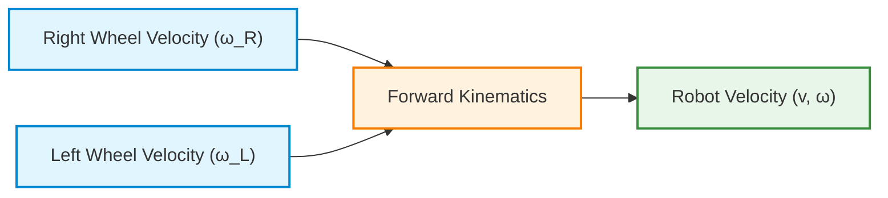
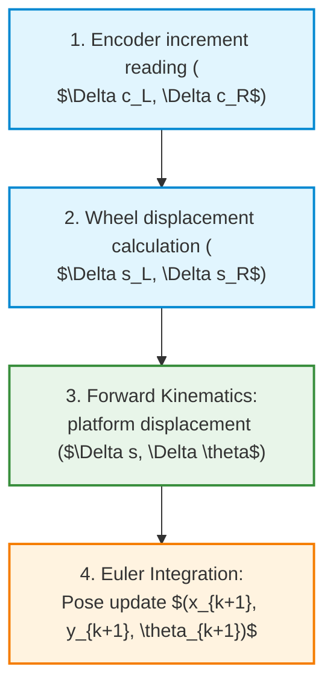
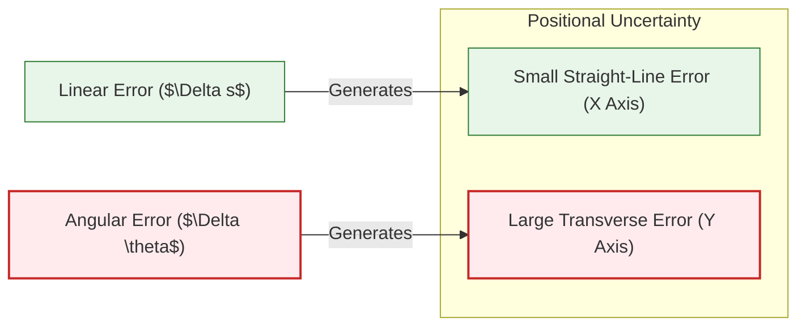
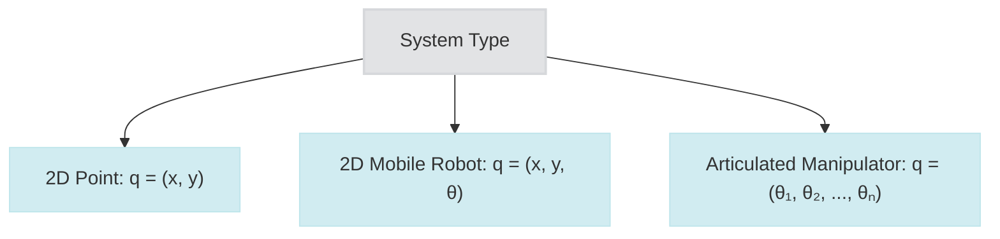
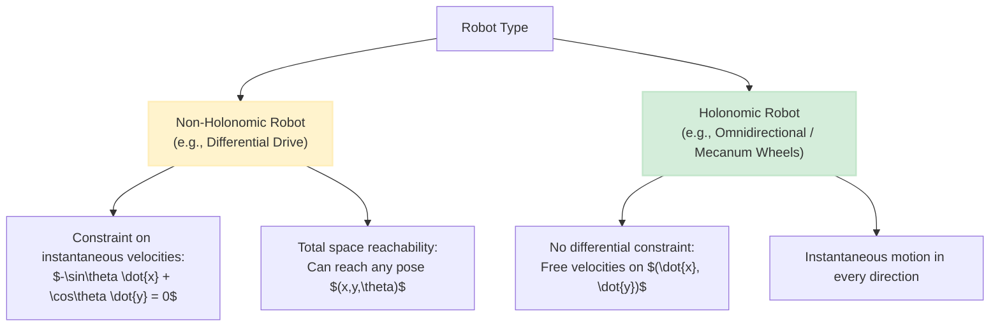
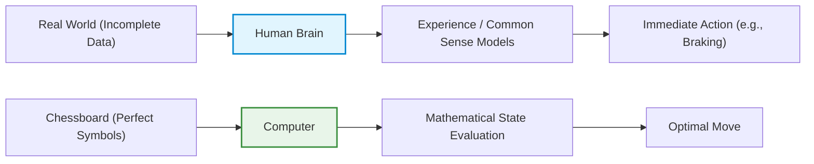
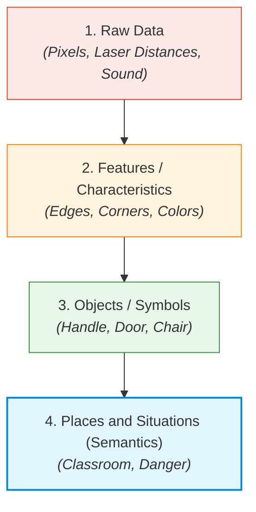
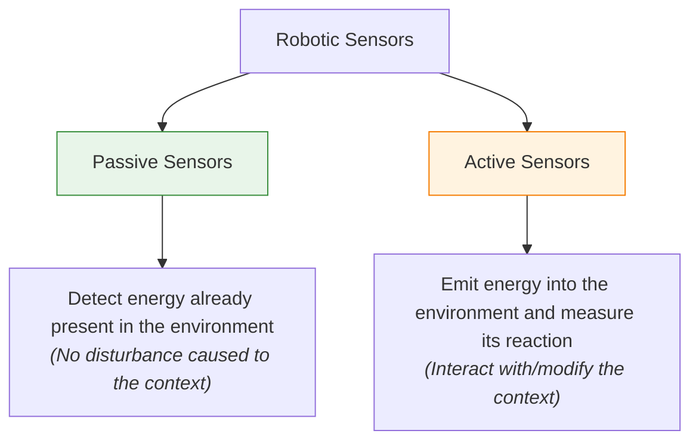

# Mobile Robot Kinematics: Differential Drive Model, Odometry, and Reference Transformations

## Teaching Overview
In this lesson, the kinematic analysis of differential drive mobile robots (*Differential Drive Robots*) is completed and formalized. Through the correction of the analytical relationships between the velocity components of the driving wheels, the forward kinematics model (*Forward Kinematics*) is defined, which allows determining the translational and angular velocity of the robot starting from the rotational speed of each actuator.

The following fundamental aspects are analyzed:
- **Analysis of Kinematic Constraints**: Distinction between active (driving) wheels, which impose constraints on motion and generate traction, and passive/caster wheels (*Castor Wheels*), whose dynamics do not introduce geometric constraints to the system.
- **Robot Frame vs. World Frame**: Formulation of the velocity vector (*Twist Vector*) in the reference frame attached to the robot (*Robot Frame*) — where lateral motion is constrained to zero ($v_y = 0$) — and its projection into the global reference frame (*World Frame*) using two-dimensional rotation matrices.
- **Introduction to Odometry (*Odometry*)**: Concept of incremental pose estimation (*Pose Estimation*) using onboard sensors (wheel encoders), necessary to compensate for non-idealities and the lack of a fixed absolute reference.
- **Kinematic vs. Dynamic Assumptions**: Delimitation of the scope of validity of the kinematic model, based on the idealized assumption of the absence of masses, inertias, forces, and external torques.

---

### Mobile Robot Kinematics and Comparison with Manipulators

---

### Kinematic Model of the Differential Drive Robot

To understand the kinematics of a mobile robot, the classic starting example is the **differential drive robot (*Differential Drive Robot*)**.

#### Model Correction and Sign Conventions
Analyzing the velocity contribution generated by individual wheels, it is fundamental to pay attention to sign conventions:
* If the left wheel turns faster than the right wheel ($\omega_L > \omega_R$), the robot turns to the **right** (clockwise rotation, with angular velocity $\omega < 0$).
* The overall angular velocity $\omega$ of the robot around its geometric center (or Instantaneous Center of Rotation - *ICR*) depends on the **difference** between the angular velocities of the two wheels:

$$\omega = \frac{r}{L} (\omega_R - \omega_L)$$

where $r$ is the wheel radius and $L$ is the distance between them (wheelbase).

#### Forward Kinematics Equations (*Forward Kinematics*)
**Forward Kinematics (*Forward Kinematics*)** allows determining how the control of individual motors connected to the wheels translates into the overall movement of the robot. The fundamental kinematic equations for a differential drive robot are:

1. **Translational velocity ($v$):** proportional to the sum of the rotation speeds of the wheels.
   $$v = \frac{r}{2} (\omega_R + \omega_L)$$

2. **Angular velocity ($\omega$):** proportional to the difference of the rotation speeds of the wheels.
   $$\omega = \frac{r}{L} (\omega_R - \omega_L)$$



> **Key Concept: Role of Active and Passive Wheels**
> In this configuration, we have two driving/active wheels that generate movement and impose kinematic constraints on the system. The third wheel is a **caster wheel (*Castor Wheel*)**: it is not driven by motors (it generates no directional force) and imposes no kinematic constraints on motion. Its contribution to the kinematic model of the robot is entirely zero.

---

### Reference Frames: Robot Frame vs. World Frame

To describe the motion of the robot in the environment, it is necessary to distinguish between two reference frames:
1. **Robot Frame ($R$):** reference frame attached to the robot body.
2. **World Frame ($W$):** global reference frame fixed in the environment.

#### Velocity Vector in the Robot Frame (*Twist*)
In the robot reference frame, due to the kinematic constraints imposed by the wheels (no lateral slip), the robot cannot move laterally. The velocity vector (*Twist*) in the robot frame $\boldsymbol{\xi}_R$ reduces to:

$$\boldsymbol{\xi}_R = \begin{bmatrix} v_x \\ v_y \\ \omega \end{bmatrix} = \begin{bmatrix} v \\ 0 \\ \omega \end{bmatrix}$$

The only allowed movements in the Robot Frame are forward motion along the $x$ axis of the robot ($v_x = v$) and rotation on the spot ($\omega$). The velocity along the $y$ axis is constrained to zero ($v_y = 0$).

#### Transformation into the World Frame
To integrate the global trajectory of the robot, we must transform the velocity from the Robot Frame to the World Frame using the rotation matrix $R(\theta)$:

$$R(\theta) = \begin{bmatrix} \cos\theta & -\sin\theta & 0 \\ \sin\theta & \cos\theta & 0 \\ 0 & 0 & 1 \end{bmatrix}$$

The equation of motion of the robot expressed in the World Frame $\dot{\mathbf{q}} = \begin{bmatrix} \dot{x} & \dot{y} & \dot{\theta} \end{bmatrix}^T$ is therefore:

$$\dot{\mathbf{q}} = \begin{bmatrix} \dot{x} \\ \dot{y} \\ \dot{\theta} \end{bmatrix} = R(\theta) \boldsymbol{\xi}_R = \begin{bmatrix} \cos\theta & -\sin\theta & 0 \\ \sin\theta & \cos\theta & 0 \\ 0 & 0 & 1 \end{bmatrix} \begin{bmatrix} v \\ 0 \\ \omega \end{bmatrix} = \begin{bmatrix} v \cos\theta \\ v \sin\theta \\ \omega \end{bmatrix}$$

---

### Inverse Kinematics

**Inverse Kinematics** solves the opposite problem: given a desired command expressed as translational velocity $v$ and angular velocity $\omega$ of the robot, it calculates the angular velocities that must be applied to the motors of each wheel ($\omega_R$ and $\omega_L$).

Solving the linear system of direct equations for $\omega_R$ and $\omega_L$ yields:

$$\omega_R = \frac{v + \frac{L}{2}\omega}{r}$$

$$\omega_L = \frac{v - \frac{L}{2}\omega}{r}$$

*(Note: Step integrated with didactic clarity starting from the forward formulas of $v$ and $\omega$)*.

---

### Limitations of Kinematics and Difference from Dynamics

> **Key Concept: Kinematic Model Assumptions**
> Kinematic analysis **does not consider the dynamics of the system**: it ignores forces, torques, masses, and inertias.
> 
> Mathematically, a **zero-mass** robot is assumed, capable of changing its velocity instantaneously and with theoretically infinite accelerations. Although this is an idealized simplification of reality, kinematics allows us to rigorously model the relationships between system velocities.

---

### Odometry and Position Estimation

Commands sent to the motors are never executed identically to their theoretical values due to mechanical imperfections, slipping, and environmental non-idealities. Consequently, we cannot know the robot's position based solely on the theoretical commands issued.

**Odometry** is the process of estimating the variation of the robot's pose over time based on data from onboard sensors (such as wheel encoders).


A mobile robot does not have a fixed origin point or a mechanically predefined absolute reference. Odometric estimation always starts from a known initial pose $\mathbf{q}_0 = [x_0, y_0, \theta_0]^T$ provided to the system, integrating the measured infinitesimal displacements over time.

---

### Fundamental Comparison: Mobile Robots vs. Industrial Manipulators

There is a deep structural difference between the kinematics of an industrial manipulator (articulated kinematic chain) and that of a mobile robot.

| Feature | Industrial Manipulators | Mobile Robots |
| :--- | :--- | :--- |
| **Mapping Level** | First-order variables (Positions/Angles) | Time derivatives (Velocities) |
| **Pose Relationship** | Direct mapping: $\mathbf{x}_{EE} = f(\mathbf{q})$ | Time integration: $\mathbf{q}(t) = \int \dot{\mathbf{q}}(t) dt$ |
| **Trajectory Dependence** | **Trajectory-independent**: the final end-effector pose depends only on the final joint values $\mathbf{q}$. | **Trajectory-dependent**: the final pose depends on the temporal order and execution of velocities. |
| **Nature of Constraints** | Holonomic | Non-holonomic |

> **Key Concept: Non-holonomic Constraints**
> In articulated manipulators, once a certain value is set for the joint angles, the end-effector will always be in the same unique position in space, regardless of the path taken to get there.
> 
> In mobile robots, this **is not true**. Due to non-holonomic constraints, the total rotation performed by the wheels does not uniquely determine the final pose of the robot. If two robots undergo the exact same overall wheel rotation, but execute the straight-line and curved components in a **different temporal order**, they will end up in two completely different final stationary poses in the World Frame. To determine the pose, it is mandatory to integrate the entire velocity profile over time.

---

### From Velocity Calculation to Odometry

Returning to the kinematic analysis of mobile robots, recall the fundamental distinction between the two workspaces:
*   **Forward Kinematics**: allows moving from the joint/wheel space (*joint space*) to the three-dimensional physical space (*physical space*).
*   **Inverse Kinematics**: performs the opposite transformation, from the physical space to the robot's joint space.

To control the actual movement of a mobile robot in an operational environment, considering transformations between static positions is not sufficient: we must work with **transformations between velocities**.

To perform effective motion control, the robot requires perception. The primary and minimal form of proprioceptive perception for mobile robotics is **Odometry**. Odometers are the sensors designated to measure how much and how wheels move over time.

#### Sensor vs. Process
It is essential to distinguish the hardware aspect from the computational one:
*   **Odometer**: is the physical sensor (e.g., optical encoder) mounted on the motor shaft that measures the rotation of the shaft or wheel.
*   **Odometry**: is not a sensor, but the entire **algorithmic estimation process** that integrates discrete sensor measurements over time to reconstruct the robot's trajectory and pose.

---

### Discrete Motion Integration and Mathematical Formulation

We do not directly measure the displacement of the entire platform in space, but rather the rotation of each wheel per unit of time. Since measurements are acquired via digital components, the system operates in discrete time by sampling wheel rotation at constant time intervals $\Delta t$.

The sampling instant is commonly called a **tick**.

> **Basic Assumption**: It is assumed that the velocity (both translational and rotational) remains constant within each sampling interval $\Delta t$.

To estimate continuous motion from a sequence of discrete measurements, **Euler Integration** is applied.

#### Pose Update Model

We define the state of the robot (pose) at step $k$ as $\mathbf{q}_k = [x_k, y_k, \theta_k]^T$. The pose update at step $k+1$ occurs according to the equations:

$$x_{k+1} = x_k + \Delta s_k \cos\left(\theta_k + \frac{\Delta \theta_k}{2}\right)$$

$$y_{k+1} = y_k + \Delta s_k \sin\left(\theta_k + \frac{\Delta \theta_k}{2}\right)$$

$$\theta_{k+1} = \theta_k + \Delta \theta_k$$

where $\Delta s_k$ represents the linear displacement increment of the platform and $\Delta \theta_k$ the orientation increment (*heading*) in the interval $\Delta t$.

#### Relationship with Wheel Displacement

Using forward kinematics for a differential drive robot, the displacements of the individual wheels (left $\Delta s_L$ and right $\Delta s_R$) in $\Delta t$ are related to the rotation measured by the encoders ($\Delta c_L, \Delta c_R$) and the nominal wheel radius $r$:

$$\Delta s_L = r \cdot \Delta c_L$$
$$\Delta s_R = r \cdot \Delta c_R$$

From these, the linear increment $\Delta s_k$ and rotational increment $\Delta \theta_k$ of the platform are derived (with $b$ equal to the wheel track or *wheel separation*):

$$\Delta s_k = \frac{\Delta s_R + \Delta s_L}{2}$$

$$\Delta \theta_k = \frac{\Delta s_R - \Delta s_L}{b}$$

#### Computational Flow of the Odometry Algorithm



---

### Real-World Non-Idealities and Error Sources

Odometric estimation suffers from physical discrepancies compared to ideal kinematic models. The assumption that the measured wheel rotation corresponds exactly to the robot's movement on the ground fails in the presence of various non-idealities:

1.  **Violation of the Pure Rolling Constraint**: Slipping or skidding phenomena cause a wheel rotation that does not correspond to an actual advancement of the structure (or vice versa).
2.  **Wheel Deformation**:
    *   In mathematical models, the wheel is represented as a perfect circle touching the ground at a single idealized point.
    *   In the real world, the contact surface is flattened due to the bearing weight. What matters in kinematic equations is not the unloaded geometric radius $r$, but the effective distance between the center of the wheel axle and the ground.
    *   This distance varies dynamically as the payload changes, for example when an Automated Guided Vehicle (AGV) loads or unloads heavy material.
3.  **Uncertainty in Geometric Parameters**: Measuring the effective radius $r$ and wheel separation $b$ manually with absolute precision is nearly impossible.
4.  **Uneven Terrain**: Bumps or surface imperfections modify the distances traveled from instant to instant.
5.  **Quantization and Numerical Errors**: The finite encoder resolution introduced by the discrete sampling process and numerical integration approximations generate systematic errors at each step.

> **Odometry Calibration**: Many systematic non-idealities (such as inaccuracies in $r$ and $b$) can be mitigated through specific **odometry calibration algorithms**. However, calibration does not entirely eliminate the accumulation of unpredictable error over time.

---

### Error Accumulation and Trajectory Drift

Since Euler integration updates the current pose $\mathbf{q}_{k+1}$ based entirely on the estimate from the previous step $\mathbf{q}_k$, any error committed at step $k$ is permanently carried forward and added to subsequent errors.

This phenomenon is known as **Odometric Drift**.

```
Traiettoria Reale vs Stima Odometrica:
Posa Iniziale ---- (Stima Odometrica Teorica: Rettilinea) ----> [Posizione Prevista]
             \
              \___ (Traiettoria Reale Effettiva per Drift) ---> [Posizione Reale]
```

#### > KEY CONCEPT: Dominance of Heading Error (*Heading Error*)

An error made in orientation ($\Delta \theta$) has a significantly greater impact on the final position compared to an error made in the linear distance traveled ($\Delta s$).

**Demonstrative Example**:
Consider a robot that needs to travel a straight segment of $10\text{ m}$ along the $x$ axis.
*   A small percentage error in the linear distance traveled translates into a limited deviation along the axis of motion (e.g., an error of $10\%$ leads to $1\text{ m}$ of uncertainty along $x$).
*   A small error in the initial orientation angle (even of a few degrees) projects the erroneous trajectory along the path. Over a distance of $10\text{ m}$, a minimal angular deviation causes a lateral displacement along the $y$ axis that can reach several meters ($5-6\text{ m}$).

#### Error Ellipse (*Error Ellipse*)
If we represent the uncertainty in the robot's position during straight-line motion using an **error ellipse**, we observe that:
*   The minor axis of the ellipse is aligned with the direction of motion ($x$ axis).
*   The major axis of the ellipse extends transversely to the direction of motion ($y$ axis), due to the dominance of the accumulated uncertainty in the *heading* angle.



#### Limitations of Open-Loop Control
If a robot relies solely on odometry, **it has no way of detecting that it is deviating from the desired trajectory**. From the odometric standpoint (calculated internally), the robot will believe it is moving in a perfectly straight line, whereas in the real world it will progressively drift away from the planned path.

To correct the trajectory and eliminate *drift*, odometry alone is not sufficient: it is essential to integrate external sensors (e.g., LiDAR, cameras, IMUs) capable of perceiving the surrounding environment and providing corrections to the pose estimate.

---

### Configuration Space (C-Space) and Its Representations

As previously introduced, estimating the pose (*pose estimation*) of the robot through odometry estimation makes it possible to obtain the fundamental variables that define its configuration in the environment.

Summarizing the different system types in their **Configuration Space (C-Space)**:
* **2D Point:** defined by 2 configuration variables: $q = (x, y)$.
* **Planar Mobile Robot:** defined by 3 configuration variables (complete pose): $q = (x, y, \theta)$.
* **Articulated Arm (Manipulator):** defined by a set of angular variables, where each joint represents a variable in the configuration space.



#### Visualization of Configuration Space and Obstacles
For a planar mobile robot, the ideal C-Space is three-dimensional, combining two straight translational axes $(x, y)$ and one circular angular axis $\theta$. Real-world environment obstacles (present in the workspace) are projected into the C-Space as forbidden regions or volumes: selecting a combination of variables inside these regions means bringing the robot into a condition of physical collision.

When attempting to project 3D C-Space onto a 2D plot to facilitate visualization (for example, considering only the $x$ and $\theta$ axes):
* Modifying only the variable $\theta$ is equivalent to rotating the robot on the spot (*rotation on the spot*).
* Modifying only the variable $x$ results in a pure translation of the robot along the $x$ axis.
* Motion along the $y$ axis is difficult to represent and directly make explicit in a single 2D projection without simultaneously coordinating both translation and rotation.

---

### Task Space and State Space

It is essential to clearly distinguish three fundamental concepts of space used in robotics:

#### 1. Task Space
The **Task Space** includes all and only the coordinates and variables relevant to the specific objective (task) that the robot must perform. 
* *Example:* If the robot's task is to maintain a certain safety distance from a wall, the scalar variable measuring the wall-robot distance becomes part of the Task Space for that specific operation.

#### 2. State Space
The **State Space** completely describes the dynamic and kinematic state of the robot at a given moment. Unlike the Configuration Space (which contains only positions), the State Space includes both **poses** and **velocities**:
$$\mathbf{x}_{stato} = \begin{bmatrix} x \\ y \\ \theta \\ \dot{x} \\ \dot{y} \\ \dot{\theta} \end{bmatrix} \quad \text{oppure} \quad \mathbf{x}_{stato} = \begin{bmatrix} x \\ y \\ \theta \\ v \\ \omega \end{bmatrix}$$

Where $v$ represents the translational velocity and $\omega$ the angular rotational velocity.

---

### Non-Holonomic Constraints and Mobile Robot Kinematics

A central concept in mobile robot kinematics is the physical and mathematical intuition of **non-holonomic constraints**.

#### The Standard Wheel Constraint
Consider a conventional wheel (standard wheel): it cannot slip laterally. In kinematically local terms (in the robot frame), this means that the velocity component along the robot's lateral axis ($Y_R$) must be strictly zero:
$$v_{y}^R = 0$$

> **Key Concept: Mathematical Origin of the Non-Holonomic Constraint**
> 
> Expressing the local lateral velocity $v_{y}^R$ as a function of the velocities expressed in the global reference frame $(\dot{x}, \dot{y})$ via the rotation matrix linked to orientation $\theta$, we obtain the equation for the non-holonomic constraint:
>
> $$-\sin(\theta)\dot{x} + \cos(\theta)\dot{y} = 0$$
>
> This differential relation inextricably links the robot's instantaneous velocities $(\dot{x}, \dot{y})$ to its current orientation angle $\theta$.

#### Fundamental Difference: Velocity Constraints vs. Pose Reachability

> **Key Concept: The Nature of Non-Holonomic Constraints**
> 
> Non-holonomic constraints **restrict exclusively the instantaneous velocity vector** that the robot can exhibit at a given moment, **NOT the poses** that the robot can reach in space.

Let us take as an example a **differential drive robot**:
1. **Instantaneous limitation:** It cannot move laterally instantaneously (it cannot "crab walk" or translate sideways).
2. **Global reachability:** By appropriately choosing the trajectory and sequence of velocities over time (e.g. move forward, rotate, move forward again), the robot can reach **any pose** $(x, y, \theta)$ in 2D space. It therefore maintains all of its 3 Degrees of Freedom (DoF) in configuration space.



#### Holonomic Robots
A robot is defined as **holonomic** if it presents zero non-holonomic constraints. 
* It typically uses special wheels such as **omnidirectional wheels** or **Mecanum wheels**.
* It has no restrictions on the velocity vectors it can generate instantaneously: any combination of $\dot{x}$, $\dot{y}$, and $\dot{\theta}$ is directly achievable.
* It does not need to satisfy the constraint equation $-\sin(\theta)\dot{x} + \cos(\theta)\dot{y} = 0$ and can move in any direction at any moment.

---

### The Difficulty of Perception and the Paradox of Robotics

To understand how a robot moves, odometry alone is not enough: **perception** is needed, that is, the ability to extract information from the environment through sensors. 

Perception historically represents one of the most complex obstacles in the entire discipline of robotics and Artificial Intelligence. Despite recent advances in generative models of Artificial General Intelligence (*General AI*), reliable perception and interpretation of the real world remain problems that are not entirely solved.

> **Key Concept: The Paradox of Robotics**  
> *"In robotics, easy problems are hard, and hard problems are easy."*  
> 
> * **What is difficult for human beings is easy for computers:** Playing chess requires high human cognitive effort, but for a computer it is a "simple" problem. Chess relies on the manipulation of explicit **symbols**. The state of every piece (King, Queen, Bishop) is entirely known, information is complete, and rules are deterministic.
> * **What is easy for human beings is extremely hard for computers:** Interpreting a real visual scene (e.g., a child running into the street after a ball) is immediate for our brain, but requires enormous complexity for a machine. 



#### Why is real perception so complex?

In data collected by sensors in the real world, a vast amount of information is missing, which must be "reconstructed" by the algorithm. 

Humans are able to interpret a complex scene thanks to **embodied experience** or **common sense**. Our brain is a predictive machine that constantly applies models of the world:
* We know from experience that if we let go of an object, gravity will make it fall.
* If we see a ball near a street, we anticipate that a child might run to grab it.

Providing this common sense to a computer has been for decades one of the greatest scientific hurdles. Today, Large Language Models (*Large Language Models - LLMs*) are able to exhibit a certain level of common sense learned from text, but interpreting an image on the part of a robot still requires understanding what is **really in the data** and what is instead **interpolated by the model**.

#### The historical underestimation of Computer Vision

A famous anecdote dates back to 1966, when Professor Seymour Papert of MIT assigned as a "summer project" (*Summer Vision Project*) the goal of connecting a video camera to a computer to identify and classify the bird species present in images. Computer science pioneers believed visual perception to be a trivial problem to solve in a few months; it took over 50 years of research to achieve an acceptable level of accuracy.

---

### The Hierarchy of Perceptual Information

Why do we study sensors? A robot without sensors is unable to handle any deviation from what was planned. Understanding the physical principles of sensors makes it possible to:
1. Know what information is contained in the data and what uncertainties it carries.
2. Choose the correct sensor for a specific application.
3. Build mathematical models to properly interpret measurements.

The flow that transforms the physics of measurement into intelligent action follows a **hierarchical structure of abstraction**:



#### The abstraction levels of perceptual data

1. **Raw Data (*Raw Data*):** This is the lowest level. It consists of the raw measurements produced by the hardware (e.g., the pixel matrix of a camera, the time of flight of a laser beam, gas readings, or acoustic signals).
2. **Feature Extraction (*Feature Extraction*):** By applying geometric or mathematical models to the raw data, elementary structured elements are identified. For example, from a grid of pixels, corners, lines, or homogeneous color segments are extracted.
3. **Symbols and Objects (*Symbols / Objects*):** Assigning a semantic interpretation to features. If a model detects a vertical surface with a small metallic protrusion at a certain height, it converts those features into the symbol "Door" or "Chair".
4. **Understanding Places and Situations (*Semantic Context*):** By aggregating multiple symbols and evaluating their spatial and causal relationships, the robot recognizes the context (e.g., the simultaneous presence of a teacher's desk, student desks, and a chalkboard allows synthesizing the environment as "Classroom").

> **Important:** This process of moving up the hierarchy performs a very strong **information compression**. A single semantic label ("Classroom") encapsulates an enormous amount of structured information that allows the robot to reason, plan complex actions, and interact with humans.

---

### Fundamental Definitions in Perceptual Robotics

To formalize the perceptual architecture of a robotic system, it is necessary to clearly distinguish three basic concepts:

* **Sensor (*Sensor*):** The physical device that interfaces the machine with the real environment by providing raw data (*raw data*).
* **Sensing / Perception (*Sensing*):** The combination of the sensor and the algorithms dedicated to processing raw data in order to produce a **Percept** (*Percept*).
* **Percept (*Percept*):** The unit of meaningful information extracted by the sensing process (e.g., *"obstacle at $1.2\text{ m}$"*, *"orange ball"*, *"open door"*).

#### Sensor Fusion (*Sensor Fusion*)

A robot is rarely equipped with a single sensor: a single information source is almost never sufficient to solve real-world ambiguities. 

**Sensor Fusion (*Sensor Fusion*)** is the perceptual technique that combines measurements coming from multiple different sensors (or from the same sensor at different times) to generate higher-level percepts, reducing overall uncertainty.

*Example:* If a laser sensor recognizes a geometric obstacle at a certain distance and at the same time a camera detects its color and shape, the fusion of the two data allows the robot to understand that the obstacle is actually a *"wastebasket"*, allowing it to execute a contextual action (e.g., throwing an object inside it).

In self-driving cars, sensor fusion typically integrates:
* **Tactile Sensors / Bumpers (*Bumpers*):** Detection of imminent or occurred collisions.
* **GPS and IMU (*Inertial Measurement Unit*):** Global localization, orientation, and accelerations.
* **Wheel Encoders (*Wheel Encoders*):** Odometry and local motion estimation.
* **Laser Scanners (*LiDAR*) and Cameras:** 3D reconstruction of the surrounding environment and recognition of signage.

---

### Classification of Sensors: Active vs. Passive

From the perspective of the physical principle of operation, the main distinction divides sensors into two broad categories:



#### 1. Passive Sensors (*Passive Sensors*)
Passive sensors measure energy coming from the surrounding environment without modifying it or emitting their own radiation/signals.
* **Examples:** 
  * The classic mercury/liquid thermometer (absorbs heat from the body to reach thermal equilibrium).
  * A **standard camera** under ambient light conditions: it simply opens the shutter and collects the photons emitted or reflected by natural sources in the scene onto the CCD/CMOS sensor.

#### 2. Active Sensors (*Active Sensors*)
Active sensors emit energy (light, acoustic, electromagnetic) into the environment and observe how this energy interacts with it, measuring its reflected or modified response.
* **Examples:** 
  * A **camera with flash**: the environment does not have sufficient light energy; the sensor projects light and measures how various surfaces reflect it.
  * **Laser Distance Sensors (*Laser Range Finders / LiDAR*) and Sonar:** Emit a signal (light pulse or ultrasonic wave) and calculate distance based on the Time of Flight (*Time of Flight*) of the return signal.