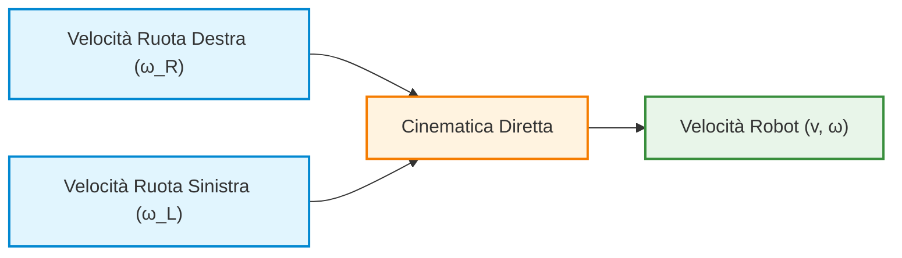
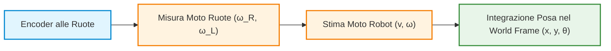
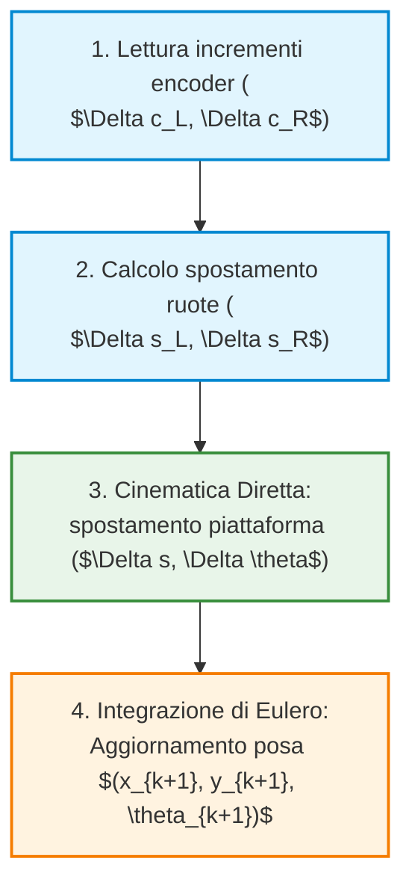
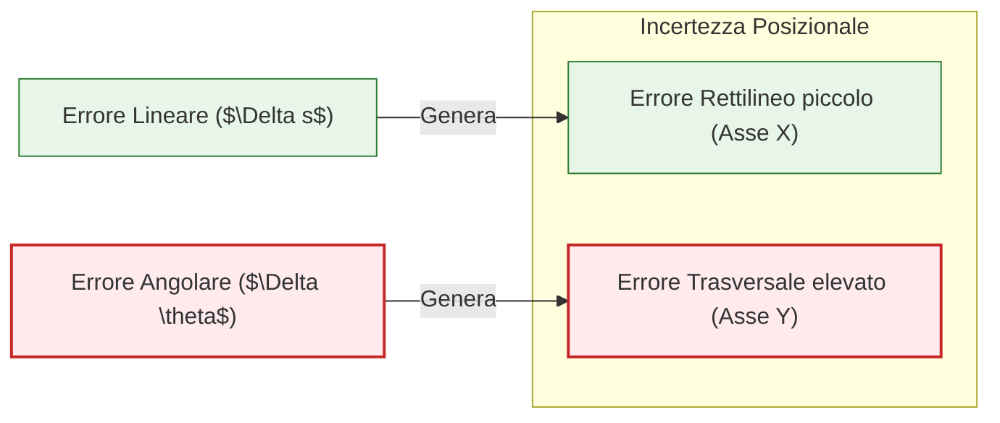
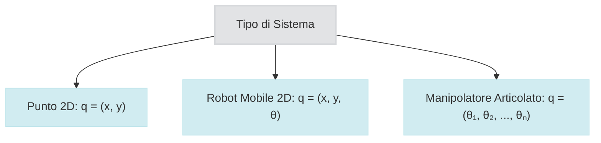
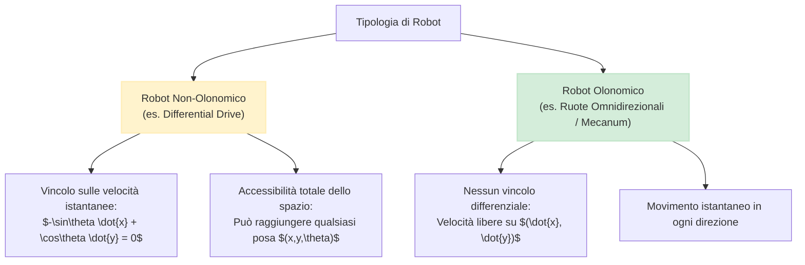
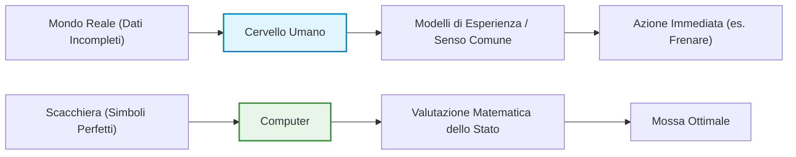
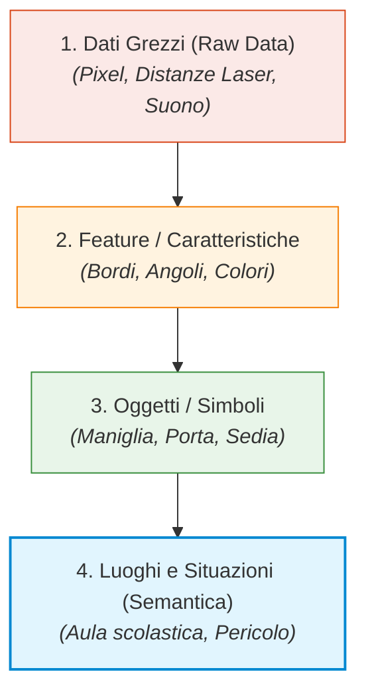
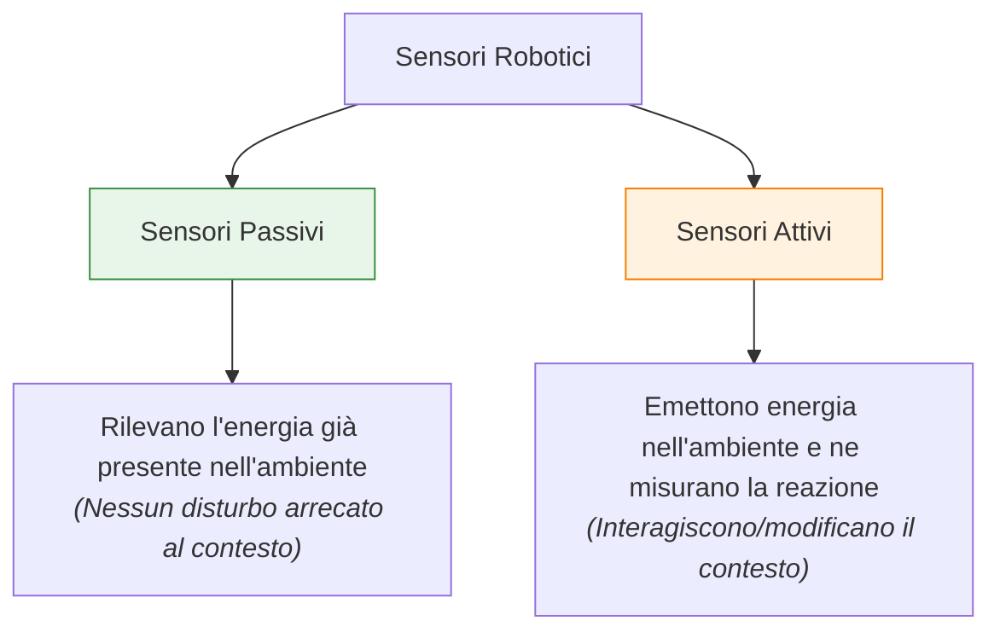

# Cinematica dei Robot Mobili: Modello Differential Drive, Odometria e Trasformazioni di Riferimento

## Overview Didattica
In questa lezione viene completata e formalizzata l'analisi cinematica dei robot mobili a trazione differenziale (*Differential Drive Robots*). Attraverso la correzione delle relazioni analitiche tra i componenti di velocità delle ruote motrici, si definisce il modello di cinematica diretta (*Forward Kinematics*), il quale consente di determinare la velocità traslazionale e angolare del robot a partire dal regime rotazionale di ciascun attuatore. 

Vengono analizzati i seguenti aspetti fondamentali:
- **Analisi dei Vincoli Cinematici**: Distinzione tra ruote attive (motrici), che impongono vincoli al moto e generano trazione, e ruote passive/piroettanti (*Castor Wheels*), le cui dinamiche non introducono vincoli geometrici al sistema.
- **Riferimento Robot vs. Riferimento Mondo**: Formulazione del vettore di velocità (*Twist Vector*) nel sistema di riferimento solidale al robot (*Robot Frame*) — in cui il moto laterale è vincolato a zero ($v_y = 0$) — e sua proiezione nel sistema di riferimento globale (*World Frame*) mediante matrici di rotazione bidimensionali.
- **Introduzione all'Odometria (*Odometry*)**: Concetto di stima incrementale della posa (*Pose Estimation*) tramite sensoristica di bordo (encoder sugli assi), necessaria per compensare le non-idealità e l'assenza di un riferimento assoluto fisso.
- **Ipotesi Cinematica vs. Dinamica**: Delimitazione del campo di validità del modello cinematico, fondato sull'assunzione ideata di assenza di masse, inerzie, forze e coppie esterne.

---

### Cinematica dei Robot Mobili e Confronto con i Manipolatori

---

### Modello Cinematico del Robot Differential Drive

Per comprendere la cinematica di un robot mobile, l'esempio classico da cui partire è il **robot a trazione differenziale (*Differential Drive Robot*)**.

#### Correzione del Modello e Convenzioni di Segno
Analizzando il contributo alla velocità generato dalle singole ruote, è fondamentale prestare attenzione alle convenzioni dei segni:
* Se la ruota sinistra gira più velocemente della ruota destra ($\omega_L > \omega_R$), il robot curva verso **destra** (rotazione oraria, con velocità angolare $\omega < 0$).
* La velocità angolare complessiva $\omega$ del robot attorno al suo centro geometrico (o Centro di Rotazione Istantaneo, *Instantaneous Center of Rotation - ICR*) dipende dalla **differenza** tra le velocità angolari delle due ruote:

$$\omega = \frac{r}{L} (\omega_R - \omega_L)$$

dove $r$ è il raggio delle ruote e $L$ è la distanza tra di esse (interasse).

#### Equazioni di Cinematica Diretta (*Forward Kinematics*)
La **Cinematica Diretta (*Forward Kinematics*)** permette di determinare come il controllo dei singoli motori collegati alle ruote si traduce nel movimento complessivo del robot. Le equazioni cinematiche fondamentali per un robot differential drive sono:

1. **Velocità traslazionale ($v$):** proporzionale alla somma delle velocità di rotazione delle ruote.
   $$v = \frac{r}{2} (\omega_R + \omega_L)$$

2. **Velocità angolare ($\omega$):** proporzionale alla differenza delle velocità di rotazione delle ruote.
   $$\omega = \frac{r}{L} (\omega_R - \omega_L)$$



> **Concetto Chiave: Ruolo delle Ruote Attive e Passive**
> In questa configurazione abbiamo due ruote motrici/attive che generano il movimento e impongono vincoli cinematici al sistema. La terza ruota è una **ruota pivottante (*Castor Wheel*)**: non è azionata da motori (non genera forza direzionale) e non impone alcun vincolo cinematico al moto. Il suo contributo al modello cinematico del robot è totalmente nullo.

---

### Sistemi di Riferimento: Robot Frame vs. World Frame

Per descrivere il movimento del robot nell'ambiente, occorre distinguere tra due sistemi di riferimento:
1. **Robot Frame ($R$):** sistema di riferimento solidale al corpo del robot.
2. **World Frame ($W$):** sistema di riferimento globale fisso nell'ambiente.

#### Vettore di Velocità nel Robot Frame (*Twist*)
Nel sistema di riferimento del robot, a causa dei vincoli cinematici imposti dalle ruote (assenza di slittamento laterale), il robot non può muoversi lateralmente. Il vettore delle velocità (*Twist*) nel robot frame $\boldsymbol{\xi}_R$ si riduce a:

$$\boldsymbol{\xi}_R = \begin{bmatrix} v_x \\ v_y \\ \omega \end{bmatrix} = \begin{bmatrix} v \\ 0 \\ \omega \end{bmatrix}$$

Gli unici movimenti ammessi nel Robot Frame sono l'avanzamento lungo l'asse $x$ del robot ($v_x = v$) e la rotazione sul posto ($\omega$). La velocità lungo l'asse $y$ è vincolata a zero ($v_y = 0$).

#### Trasformazione nel World Frame
Per integrare la traiettoria globale del robot, dobbiamo trasformare la velocità dal Robot Frame al World Frame utilizzando la matrice di rotazione $R(\theta)$:

$$R(\theta) = \begin{bmatrix} \cos\theta & -\sin\theta & 0 \\ \sin\theta & \cos\theta & 0 \\ 0 & 0 & 1 \end{bmatrix}$$

L'equazione del moto del robot espresso nel World Frame $\dot{\mathbf{q}} = \begin{bmatrix} \dot{x} & \dot{y} & \dot{\theta} \end{bmatrix}^T$ risulta quindi:

$$\dot{\mathbf{q}} = \begin{bmatrix} \dot{x} \\ \dot{y} \\ \dot{\theta} \end{bmatrix} = R(\theta) \boldsymbol{\xi}_R = \begin{bmatrix} \cos\theta & -\sin\theta & 0 \\ \sin\theta & \cos\theta & 0 \\ 0 & 0 & 1 \end{bmatrix} \begin{bmatrix} v \\ 0 \\ \omega \end{bmatrix} = \begin{bmatrix} v \cos\theta \\ v \sin\theta \\ \omega \end{bmatrix}$$

---

### Cinematica Inversa (*Inverse Kinematics*)

La **Cinematica Inversa (*Inverse Kinematics*)** risolve il problema opposto: dato un comando desiderato espresso come velocità traslazionale $v$ e velocità angolare $\omega$ del robot, calcola le velocità angolari che devono essere applicate ai motori di ciascuna ruota ($\omega_R$ e $\omega_L$).

Risolvendo il sistema lineare delle equazioni dirette per $\omega_R$ e $\omega_L$, si ottiene:

$$\omega_R = \frac{v + \frac{L}{2}\omega}{r}$$

$$\omega_L = \frac{v - \frac{L}{2}\omega}{r}$$

*(Nota: Passaggio integrato con chiarezza didattica partendo dalle formule dirette di $v$ e $\omega$)*.

---

### Limiti della Cinematica e Differenza con la Dinamica

> **Concetto Chiave: Assunzioni del Modello Cinematico**
> Lo studio cinematico **non considera la dinamica del sistema**: ignora forze, coppie, masse e inerzie. 
> 
> Matematicamente si assume un robot a **massa nulla**, capace di variare la propria velocità istantaneamente e con accelerazioni teoricamente infinite. Sebbene sia una semplificazione ideale della realtà, la cinematica ci permette di modellare rigorosamente le relazioni tra le velocità del sistema.

---

### Odometria e Stima della Posizione

I comandi inviati ai motori non vengono mai attuati in modo identico al valore teorico a causa di imperfezioni meccaniche, slittamenti e non-idealità dell'ambiente. Di conseguenza, non possiamo conoscere la posizione del robot basandoci unicamente sui comandi teorici erogati.

L'**Odometria (*Odometry*)** è il processo di stima della variazione di posa (*pose*) del robot nel tempo basato sui dati provenienti dai sensori di bordo (come gli *encoder* applicati alle ruote).



Un robot mobile non ha un punto d'origine fisso o un riferimento assoluto predefinito meccanicamente. La stima odometrica parte sempre da una posa iniziale nota $\mathbf{q}_0 = [x_0, y_0, \theta_0]^T$ fornita al sistema, integrando nel tempo gli spostamenti infinitesimali misurati.

---

### Confronto Fondamentale: Robot Mobili vs. Manipolatori Industriali

Sussiste una differenza strutturale profonda tra la cinematica di un manipolatore industriale (catena cinematica articolata) e quella di un robot mobile.

| Caratteristica | Manipolatori Industriali (*Manipulators*) | Robot Mobili (*Mobile Robots*) |
| :--- | :--- | :--- |
| **Livello di Mappatura** | Variabili del primo ordine (Posizioni/Angoli) | Derivate temporali (Velocità) |
| **Relazione di Posa** | Mappatura diretta: $\mathbf{x}_{EE} = f(\mathbf{q})$ | Integrazione temporale: $\mathbf{q}(t) = \int \dot{\mathbf{q}}(t) dt$ |
| **Dipendenza dalla Traiettoria** | **Indipendente dalla traiettoria**: la posa finale dell'end-effector dipende solo dai valori finali dei giunti $\mathbf{q}$. | **Dipendente dalla traiettoria**: la posa finale dipende dall'ordine ed esecuzione temporale delle velocità. |
| **Natura dei Vincoli** | Olonomi (*Holonomic*) | Non-olonomi (*Non-holonomic*) |

> **Concetto Chiave: Vincoli Non-Olonomi (*Non-holonomic Constraints*)**
> Nei manipolatori articolati, impostato un certo valore per gli angoli dei giunti, l'organo terminale (*end-effector*) si troverà sempre nella medesima ed univoca posizione nello spazio, indipendentemente dal percorso fatto per arrivarci.
> 
> Nei robot mobili questo **non è vero**. A causa dei vincoli non-olonomi, la rotazione totale effettuata dalle ruote non determina in maniera univoca la posa finale del robot. Se due robot compiono la medesima rotazione complessiva delle ruote, ma applicano le componenti rettilinee e curve in un **ordine temporale diverso**, si ritroveranno in due pose stazionarie finali totalmente differenti nel World Frame. Per determinare la posa è obbligatorio integrare l'intero profilo di velocità nel tempo.

---

### Dal Calcolo delle Velocità all'Odometria

Riprendendo il filo del discorso sulla cinematica dei robot mobili, ricordiamo la distinzione fondamentale tra i due spazi di lavoro:
*   **Cinematica Diretta (*Forward Kinematics*)**: permette di passare dallo spazio dei giunti/ruote (*joint space*) allo spazio fisico tridimensionale (*physical space*).
*   **Cinematica Inversa (*Inverse Kinematics*)**: compie la trasformazione opposta, dallo spazio fisico allo spazio dei giunti del robot.

Per controllare il movimento reale di un robot mobile in ambiente operativo, non è sufficiente considerare le trasformazioni tra posizioni statiche: occorre lavorare con le **trasformazioni tra velocità**. 

Per eseguire un controllo di movimento efficace, il robot ha bisogno di percezione. La forma primaria e minimale di percezione propriocettiva per la robotica mobile è l'**Odometria (*Odometry*)**. Gli odometri (*odometers*) sono i sensori preposti a misurare quanto e come si muovono le ruote nel tempo.

#### Sensore vs. Processo
È essenziale distinguere l'aspetto hardware da quello computazionale:
*   **Odometro (*Odometer*)**: è il sensore fisico (es. encoder ottico) montato sull'asse del motore che misura la rotazione dell'asse o della ruota.
*   **Odometria (*Odometry*)**: non è un sensore, ma l'intero **processo algoritmico di stima** che integra le misurazioni discrete dei sensori nel tempo per ricostruire la traiettoria e la posa del robot.

---

### Integrazione Discreta del Moto e Formulazione Matematica

Non misuriamo direttamente lo spostamento dell'intera piattaforma nello spazio, ma la rotazione di ciascuna ruota nell'unità di tempo. Poiché le misurazioni avvengono tramite componenti digitali, il sistema lavora a tempo discreto campionando la rotazione della ruota a intervalli di tempo costanti $\Delta t$.

L'istante di campionamento viene comunemente chiamato **tick**.

> **Assunzione di base**: Si ipotizza che la velocità (sia traslazionale che rotazionale) rimanga costante all'interno di ciascun intervallo di campionamento $\Delta t$.

Per stimare un movimento continuo a partire da una sequenza di misurazioni discrete, si applica l'**Integrazione di Eulero (*Euler Integration*)**.

#### Modello di Aggiornamento della Posa

Definiamo lo stato del robot (posa) al passo $k$ come $\mathbf{q}_k = [x_k, y_k, \theta_k]^T$. L'aggiornamento della posa al passo $k+1$ avviene secondo le equazioni:

$$x_{k+1} = x_k + \Delta s_k \cos\left(\theta_k + \frac{\Delta \theta_k}{2}\right)$$

$$y_{k+1} = y_k + \Delta s_k \sin\left(\theta_k + \frac{\Delta \theta_k}{2}\right)$$

$$\theta_{k+1} = \theta_k + \Delta \theta_k$$

dove $\Delta s_k$ rappresenta l'incremento di spostamento lineare della piattaforma e $\Delta \theta_k$ l'incremento di orientamento (*heading*) nell'intervallo $\Delta t$.

#### Relazione con lo Spostamento delle Ruote

Utilizzando la cinematica diretta per un robot a guida differenziale (*differential drive robot*), gli spostamenti delle singole ruote (sinistra $\Delta s_L$ e destra $\Delta s_R$) nel $\Delta t$ sono legati alla rotazione misurata dagli encoder ($\Delta c_L, \Delta c_R$) e al raggio nominale della ruota $r$:

$$\Delta s_L = r \cdot \Delta c_L$$
$$\Delta s_R = r \cdot \Delta c_R$$

Da questi si ricavano l'incremento lineare $\Delta s_k$ e rotazionale $\Delta \theta_k$ della piattaforma (con $b$ pari all'interasse o separazione tra le ruote, *wheel separation*):

$$\Delta s_k = \frac{\Delta s_R + \Delta s_L}{2}$$

$$\Delta \theta_k = \frac{\Delta s_R - \Delta s_L}{b}$$

#### Flusso Computazionale dell'Algoritmo di Odometria



---

### Non-Idealità del Mondo Reale e Fonti d'Errore

La stima odometrica soffre di discrepanze fisiche rispetto ai modelli cinematici ideali. L'ipotesi che la rotazione misurata della ruota corrisponda esattamente al movimento del robot sul terreno cade in presenza di diverse non-idealità:

1.  **Violazione del Vincolo di Puro Rotolamento (*Pure Rolling Constraint*)**: Fenomeni di slittamento (*slipping*) o pattinamento determinano una rotazione della ruota a cui non corrisponde un effettivo avanzamento della struttura (o viceversa).
2.  **Deformazione dello Pneumatico (*Wheel Deformation*)**:
    *   Nei modelli matematici la ruota è rappresentata come un cerchio perfetto che tocca il terreno in un unico punto idealizzato.
    *   Nel mondo reale la superficie di contatto è appiattita per via del peso gravante. Ciò che rileva nelle equazioni cinematiche non è il raggio geometrico a riposo $r$, ma la distanza effettiva tra il centro dell'asse della ruota e il terreno.
    *   Tale distanza varia dinamicamente al variare del carico utile (*payload*), ad esempio quando un veicolo a guida autonoma AGV (*Automated Guided Vehicle*) carica o scarica materiale pesante.
3.  **Incertezza sui Parametri Geometrici**: Misurare manualmente con assoluta precisione il raggio effettivo $r$ e la separazione tra le ruote $b$ è pressoché impossibile.
4.  **Terreno Irregolare (*Uneven Terrain*)**: Avvallamenti o imperfezioni del suolo modificano le distanze percorse istante per istante.
5.  **Quantizzazione ed Errori Numerici**: La risoluzione finita degli encoder introdotta dal processo di campionamento discreto e le approssimazioni dell'integrazione numerica generano errori sistematici ad ogni passo.

> **Calibrazione Odometrica**: Molte delle non-idealità di tipo sistematico (come imprecisioni su $r$ e $b$) possono essere attenuate mediante specifici **algoritmi di calibrazione odometrica** (*odometry calibration algorithms*). Tuttavia, la calibrazione non elimina del tutto l'accumulo di errore imprevedibile nel tempo.

---

### Accumulo dell'Errore e Deriva Traiettoriale (*Drift*)

Poiché l'integrazione di Eulero aggiorna la posa corrente $\mathbf{q}_{k+1}$ basandosi interamente sulla stima al passo precedente $\mathbf{q}_k$, qualsiasi errore commesso al passo $k$ viene trascinato permanentemente e sommato agli errori successivi. 

Questo fenomeno prende il nome di **Deriva odometrica (*Odometric Drift*)**.

```
Traiettoria Reale vs Stima Odometrica:
Posa Iniziale ---- (Stima Odometrica Teorica: Rettilinea) ----> [Posizione Prevista]
             \
              \___ (Traiettoria Reale Effettiva per Drift) ---> [Posizione Reale]
```

#### > CONCETTO CHIAVE: Dominanza dell'Errore di Orientamento (*Heading Error*)

Un errore commesso sull'orientamento ($\Delta \theta$) ha un impatto nettamente superiore sulla posizione finale rispetto a un errore commesso sulla distanza lineare percorsa ($\Delta s$).

**Esempio dimostrativo**:
Si consideri un robot che deve percorrere un tratto rettilineo di $10\text{ m}$ lungo l'asse $x$.
*   Un piccolo errore percentuale sulla distanza lineare percorsa si traduce in uno scostamento contenuto lungo l'asse del moto (es. un errore del $10\%$ porta ad avere $1\text{ m}$ di incertezza lungo $x$).
*   Un piccolo errore sull'angolo di orientamento iniziale (anche di pochi gradi) proietta la traiettoria errata lungo il tragitto. Su una distanza di $10\text{ m}$, una deviazione angolare minima provoca una deviazione laterale lungo l'asse $y$ che può raggiungere diversi metri ($5-6\text{ m}$).

#### Ellisse d'Errore (*Error Ellipse*)
Se rappresentiamo l'incertezza sulla posizione del robot durante un moto rettilineo mediante un'**ellisse d'errore**, osserviamo che:
*   L'asse minore dell'ellisse è allineato con la direzione del moto (asse $x$).
*   L'asse maggiore dell'ellisse si estende trasversalmente alla direzione del moto (asse $y$), a causa della dominanza dell'incertezza accumulata sull'angolo di *heading*.



#### Limiti del Controllo a Catena Aperta
Se un robot si affida unicamente all'odometria, **non ha alcun modo di rilevare che sta deviando dalla traiettoria desiderata**. Dal punto di vista odometrico (calcolato internamente), il robot crederà di procedere perfettamente in linea retta, mentre nel mondo reale si staccherà progressivamente dal percorso pianificato.

Per correggere la traiettoria ed eliminare il *drift*, l'odometria da sola non è sufficiente: è indispensabile integrare sensori esterni (es. LiDAR, telecamere, IMU) capaci di percepire l'ambiente circostante e fornire correzioni alla stima di posa.

---

### Spazio delle Configurazioni (C-Space) e sue Rappresentazioni

Come già introdotto, stimare la posa (pose estimation) del robot attraverso la stima dell'odometria consente di ricavare le variabili fondamentali che ne definiscono la configurazione nell'ambiente.

Sintetizzando le diverse tipologie di sistema nel loro **Spazio delle Configurazioni (Configuration Space - C-Space)**:
* **Punto in 2D:** definito da 2 variabili di configurazione: $q = (x, y)$.
* **Robot mobile su piano:** definito da 3 variabili di configurazione (posa completa): $q = (x, y, \theta)$.
* **Braccio articolato (Manipolatore):** definito da un insieme di variabili angolari, dove ogni giunto (joint) rappresenta una variabile dello spazio delle configurazioni.



#### Visualizzazione dello Spazio delle Configurazioni e degli Ostacoli
Per un robot mobile planarmente, lo spazio C-Space ideale è tridimensionale, combinando due assi traslazionali rettilinei $(x, y)$ e un asse angolare circolare $\theta$. Gli ostacoli dell'ambiente reale (presenti nello spazio di lavoro o *workspace*) vengono proiettati nel C-Space come regioni o volumi proibiti: selezionare una combinazione di variabili all'interno di tali regioni significa portare il robot in una condizione di collisione fisica.

Quando si tenta di proiettare il C-Space 3D su un grafico 2D per facilitarne la visualizzazione (ad esempio considerando solo gli assi $x$ e $\theta$):
* Modificare unicamente la variabile $\theta$ equivale a far ruotare il robot sul posto (rotation on the spot).
* Modificare unicamente la variabile $x$ comporta una traslazione pura del robot lungo l'asse $x$.
* Il movimento lungo l'asse $y$ risulta difficile da rappresentare ed esplicitare direttamente in una singola proiezione 2D senza coordinare contemporaneamente sia la traslazione sia la rotazione.

---

### Spazio del Task (Task Space) e Spazio degli Stati (State Space)

È essenziale distinguere chiaramente tre concetti fondamentali di spazio utilizzati nella robotica:

#### 1. Spazio del Task (Task Space)
Lo **Spazio del Task (Task Space)** include tutte e sole le coordinate e le variabili rilevanti per l'obiettivo specifico (task) che il robot deve eseguire. 
* *Esempio:* Se il compito del robot è mantenere una determinata distanza di sicurezza da una parete, la variabile scalare che misura la distanza parete-robot entra a far parte dello Spazio del Task per quella specifica operazione.

#### 2. Spazio degli Stati (State Space)
Lo **Spazio degli Stati (State Space)** descrive in modo completo lo stato dinamico e cinematico del robot in un determinato istante. A differenza dello Spazio delle Configurazioni (che contiene unicamente le posizioni), lo Spazio degli Stati include sia le **pose** sia le **velocità**:
$$\mathbf{x}_{stato} = \begin{bmatrix} x \\ y \\ \theta \\ \dot{x} \\ \dot{y} \\ \dot{\theta} \end{bmatrix} \quad \text{oppure} \quad \mathbf{x}_{stato} = \begin{bmatrix} x \\ y \\ \theta \\ v \\ \omega \end{bmatrix}$$

Dove $v$ rappresenta la velocità traslazionale e $\omega$ la velocità di rotazione angolare.

---

### Vincoli Non-Olonomici e Cinematica dei Robot Mobili

Un concetto centrale nella cinematica dei robot mobili è l'intuizione fisica e matematica dei **vincoli non-olonomici (non-holonomic constraints)**.

#### Il Vincolo della Ruota Standard
Si consideri una ruota convenzionale (standard wheel): essa non può slittare lateralmente. In termini cinematicalmente locali (nel sistema di riferimento del robot), ciò significa che la componente di velocità lungo l'asse laterale del robot ($Y_R$) deve essere rigorosamente nulla:
$$v_{y}^R = 0$$

> **Concetto Chiave: Origine Matematica del Vincolo Non-Olonomico**
> 
> Esprimendo la velocità laterale locale $v_{y}^R$ in funzione delle velocità espresse nel sistema di riferimento globale $(\dot{x}, \dot{y})$ tramite la matrice di rotazione legata all'orientamento $\theta$, si ottiene l'equazione del vincolo non-olonomico:
>
> $$-\sin(\theta)\dot{x} + \cos(\theta)\dot{y} = 0$$
>
> Questa relazione differenziale lega indissolubilmente le velocità istantanee del robot $(\dot{x}, \dot{y})$ con il suo angolo di orientamento corrente $\theta$.

#### Differenza fondamentale: Vincoli sulle Velocità vs Accessibilità delle Pose

> **Concetto Chiave: La natura dei vincoli non-olonomici**
> 
> I vincoli non-olonomici **limitano esclusivamente il vettore delle velocità istantanee** che il robot può esibire in un dato momento, **NON le pose** che il robot può raggiungere nello spazio.

Prendiamo ad esempio un robot a **guida differenziale (differential drive robot)**:
1. **Limitazione istantanea:** Non può muoversi lateralmente in modo istantaneo (non può "traslare di lato" come un granchio).
2. **Raggiungibilità globale:** Scegliendo opportunamente la traiettoria e la sequenza delle velocità nel tempo (es. avanzare, ruotare, avanzare di nuovo), il robot può raggiungere **qualsiasi posa** $(x, y, \theta)$ nello spazio 2D. Mantiene quindi tutti i suoi 3 Gradi di Libertà (Degrees of Freedom - DoF) nello spazio delle configurazioni.



#### Robot Olonomici (Holonomic Robots)
Un robot si definisce **olonomico (holonomic)** se presenta zero vincoli non-olonomici. 
* Utilizza tipicamente ruote speciali come le **ruote omnidirezionali (omnidirectional wheels)** o le **ruote Mecanum (Mecanum wheels)**.
* Non ha alcuna restrizione sui vettori di velocità che può generare istantaneamente: qualsiasi combinazione di $\dot{x}$, $\dot{y}$ e $\dot{\theta}$ è direttamente realizzabile.
* Non deve soddisfare l'equazione di vincolo $-\sin(\theta)\dot{x} + \cos(\theta)\dot{y} = 0$ e può muoversi in qualsiasi direzione in qualunque momento.

---

### La Difficoltà della Percezione e il Paradosso della Robotica

Per comprendere come si muove un robot, l'odometria da sola non è sufficiente: occorre la **percezione** (*perception*), ovvero la capacità di estrarre informazioni dall'ambiente attraverso i sensori. 

La percezione rappresenta storicamente uno degli ostacoli più complessi nell'intera disciplina della robotica e dell'Intelligenza Artificiale. Nonostante i recenti progressi nei modelli generativi di Intelligenza Artificiale Generale (*General AI*), la percezione affidabile e l'interpretazione del mondo reale rimangono problemi non del tutto risolti.

> **Concetto Chiave: Il Paradosso della Robotica**  
> *"In robotica, i problemi facili sono difficili e i problemi difficili sono facili."*  
> 
> * **Ciò che è difficile per l'essere umano è facile per il calcolatore:** Giocare a scacchi richiede un alto sforzo cognitivo umano, ma per un computer è un problema "semplice". Gli scacchi si basano sulla manipolazione di **simboli** espliciti. Lo stato di ogni pezzo (Re, Regina, Alfiere) è del tutto noto, l'informazione è completa e le regole sono deterministiche.
> * **Ciò che è facile per l'essere umano è difficilissimo per il calcolatore:** Interpretare una scena visiva reale (es. un bambino che corre in strada dietro a un pallone) è immediato per il nostro cervello, ma richiede una complessità enorme per una macchina. 



#### Perché la percezione reale è così complessa?

Nei dati raccolti dai sensori nel mondo reale mancano moltissime informazioni, che devono essere "ricostruite" dall'algoritmo. 

L'essere umano riesce a interpretare una scena complessa grazie all'**esperienza incorporata** o **senso comune** (*common sense*). Il nostro cervello è una macchina predittiva che applica costantemente modelli del mondo:
* Sappiamo per esperienza che se lasciamo andare un oggetto, la gravità lo farà cadere.
* Se vediamo una palla vicina a una strada, prevediamo che un bambino potrebbe correre a prenderla.

Fornire questo senso comune a un computer è stato per decenni uno dei più grandi scogli scientifici. Oggi i Grandi Modelli Linguistici (*Large Language Models - LLM*) riescono a mostrare un certo livello di senso comune appreso dai testi, ma l'interpretazione di un'immagine da parte di un robot richiede ancora di capire cosa c'è **davvero nei dati** e cosa viene invece **interpolato dal modello**.

#### La sottovalutazione storica della Computer Vision

Un aneddoto celebre risale al 1966, quando il professor Seymour Papert del MIT assegnò come "progetto estivo" (*Summer Vision Project*) l'obiettivo di collegare una videocamera a un computer per identificare e classificare le specie di uccelli presenti nelle immagini. I pionieri dell'informatica ritenevano che la percezione visiva fosse un problema banale da risolvere in pochi mesi; ci sono voluti oltre 50 anni di ricerca per raggiungere un livello di accuratezza accettabile.

---

### La Gerarchia dell'Informazione Percettiva

Perché studiamo i sensori? Un robot privo di sensori non è in grado di gestire alcuna deviazione rispetto a quanto pianificato. Comprendere i principi fisici dei sensori permette di:
1. Sapere quali informazioni sono contenute nei dati e quali incertezze contengono.
2. Scegliere il sensore corretto per una specifica applicazione.
3. Costruire modelli matematici per interpretare correttamente le misure.

Il flusso che trasforma la fisica della misurazione in un'azione intelligente segue una **struttura gerarchica di astrazione**:



#### I livelli di astrazione dei dati percettivi

1. **Dati Grezzi (*Raw Data*):** È il livello più basso. Consiste nelle misurazioni nude e crude prodotte dall'hardware (es. la matrice di pixel di una telecamera, i tempi di volo di un raggio laser, letture di gas o segnali acustici).
2. **Estrazione di Feature (*Feature Extraction*):** Applicando modelli geometrici o matematici sui dati grezzi, si identificano elementi strutturati elementari. Ad esempio, da una griglia di pixel si estraggono angoli (*corners*), linee o segmenti di colore omogeneo.
3. **Simboli e Oggetti (*Symbols / Objects*):** Assegnazione di una interpretazione semantica alle feature. Se un modello rileva una superficie verticale con una piccola protrusione metallica ad una certa altezza, converte quelle feature nel simbolo "Porta" o "Sedia".
4. **Comprehensione di Luoghi e Situazioni (*Semantic Context*):** Aggregando più simboli e valutando le loro relazioni spaziali e causali, il robot riconosce il contesto (es. la presenza simultanea di cattedra, banchi e lavagna permette di sintetizzare l'ambiente come "Aula").

> **Importante:** Questo processo di risalita della gerarchia effettua una fortissima **compressione dell'informazione**. Una singola etichetta semantica ("Aula") racchiude un'enorme quantità di informazioni strutturate che consentono al robot di ragionare, pianificare azioni complesse e interagire con gli esseri umani.

---

### Definizioni Fondamentali nella Robotica Percettiva

Per formalizzare l'architettura percettiva di un sistema robotico, occorre distinguere chiaramente tre concetti base:

* **Sensore (*Sensor*):** Il dispositivo fisico che interfaccia la macchina con l'ambiente reale fornendo i dati grezzi (*raw data*).
* **Percezione / Sensing (*Sensing*):** L'insieme del sensore e degli algoritmi dedicati all'elaborazione dei dati grezzi al fine di produrre un **Percetto** (*Percept*).
* **Percetto (*Percept*):** L'unità di informazione significativa estratta dal processo di sensing (es. *"ostacolo a $1.2\text{ m}$"*, *"pallone arancione"*, *"porta aperta"*).

#### Fusione Sensoriale (*Sensor Fusion*)

Raramente un robot è dotato di un singolo sensore: un'unica sorgente informativa non è quasi mai sufficiente a risolvere le ambiguità del mondo reale. 

La **Fusione Sensoriale (*Sensor Fusion*)** è la tecnica percettiva che combina le misurazioni provenienti da più sensori diversi (o dallo stesso sensore in momenti diversi) per generare percetti di livello superiore, riducendo l'incertezza complessiva.

*Esempio:* Se un sensore laser riconosce un ostacolo geometrico a una certa distanza e contemporaneamente una telecamera ne rileva il colore e la forma, la fusione dei due dati permette al robot di capire che l'ostacolo è in realtà un *"cestino dei rifiuti"*, consentendogli di eseguire un'azione contestuale (es. gettare un oggetto al suo interno).

Nelle auto ad guida autonoma, la fusione sensoriale integra tipicamente:
* **Sensori tattili / Paraurti (*Bumpers*):** Rilevamento di collisioni imminenti o avvenute.
* **GPS e IMU (*Inertial Measurement Unit*):** Localizzazione globale, orientamento e accelerazioni.
* **Encoder sulle ruote (*Wheel Encoders*):** Odometria e stima del movimento locale.
* **Scanner Laser (*LiDAR*) e Telecamere:** Ricostruzione 3D dell'ambiente circostante e riconoscimento della segnaletica.

---

### Classificazione dei Sensori: Attivi vs. Passivi

Dal punto di vista del principio fisico di funzionamento, la distinzione principale divide i sensori in due grandi categorie:



#### 1. Sensori Passivi (*Passive Sensors*)
I sensori passivi misurano l'energia proveniente dall'ambiente circostante senza modificarlo o emettere radiazioni/segnali propri.
* **Esempi:** 
  * Il classico termometro a mercurio/liquido (assorbe calore dal corpo per raggiungere l'equilibrio termico).
  * Una **telecamera standard** in condizioni di luce ambientale: si limita ad aprire l'otturatore e raccogliere i fotoni emessi o riflessi dalle sorgenti naturali della scena sul sensore CCD/CMOS.

#### 2. Sensori Attivi (*Active Sensors*)
I sensori attivi immettono energia (luminosa, acustica, elettromagnetica) all'interno dell'ambiente e osservano come tale energia interagisce con esso, misurandone la risposta riflessa o modificata.
* **Esempi:** 
  * Una **telecamera con flash**: l'ambiente non dispone di energia luminosa sufficiente; il sensore proietta luce e misura come le varie superfici la riflettono.
  * **Sensori di distanza laser (*Laser Range Finders / LiDAR*) e Sonar:** Emettono un segnale (impulso luminoso o onda ultrasonica) e calcolano la distanza basandosi sul tempo di volo (*Time of Flight*) del segnale di ritorno.