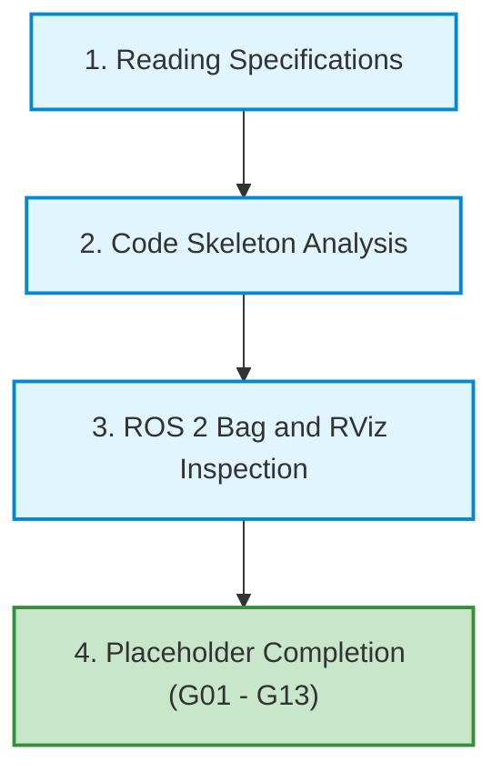
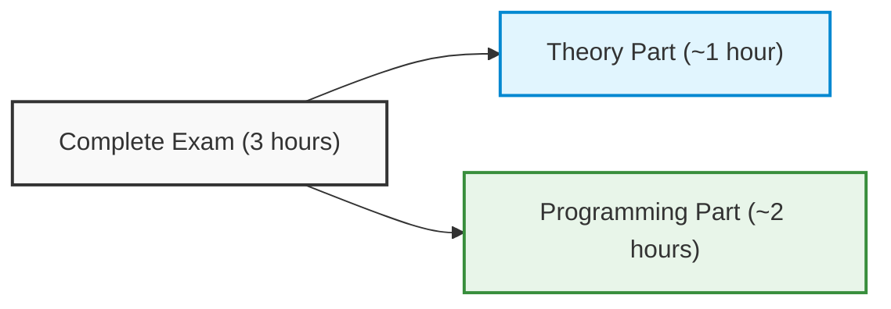
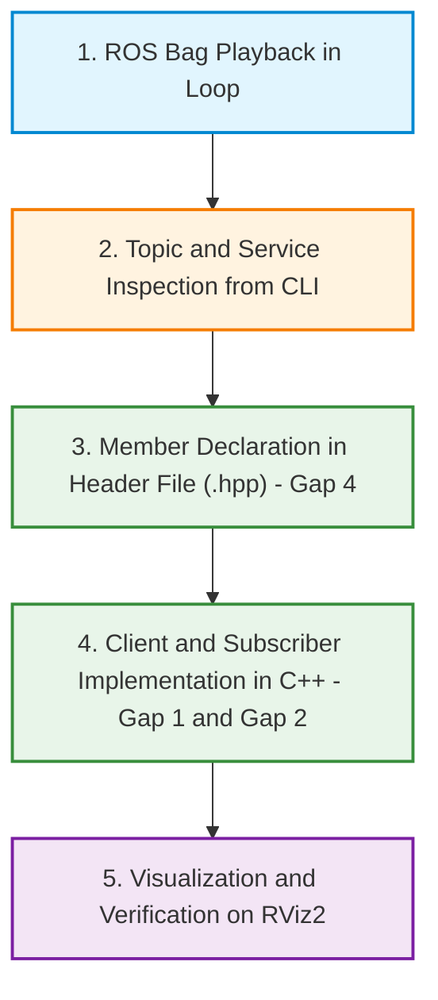

# Practical Exam Simulation and Development Methodology in ROS 2

## Educational Overview

This lesson is dedicated to the simulation of the practical exam for the Industrial/Intelligent Robotics course, focusing on the analysis of a software architecture in **ROS 2** (*Robot Operating System 2*) and guided code completion.

During the session, the following key aspects are addressed:
* **Structure of the Educational Project:** Analysis of the provided *code skeleton* and management of placeholders (indicated as `G01`, `G02`, etc.) that identify the code sections to be implemented.
* **Inspection of Log Data:** Use of system data recordings (**ROS 2 Bag**) and 3D visualization tools such as **RViz** for the analysis of active topics and information-sensory flows.
* **Recommended Workflow (*Pipeline*):** Definition of the standard procedure for tackling robotics programming problems:
  1. Understanding laboratory requirements and instructions.
  2. Exploring node structure and retrieving topic information from source files.
  3. Dynamic inspection of the system via *ROS 2 Bag* playback.
  4. Code development through autonomous consultation of official documentation.
* **Operational Autonomy and Documentation:** Emphasis on the ability to consult and extract code templates, parameters, and message structures from the official C++/Python and ROS 2 documentation, simulating the operational restrictions of the final exam (no Internet connection and no generative AI tools).

---

### Simulation Structure and File Organization

Today's practical session replicates the setup of the practical exam. The material is organized inside a main archive (folder `student`), which includes:

*   **Data Recording File (ROS 2 Bag):** contains time-series data recorded by sensors and nodes (topics, messages, transforms) necessary to stimulate and test the software pipeline.
*   **Code Skeleton:** a partially implemented structure of ROS 2 nodes in C++. Inside, there are placeholders marked with progressive identifiers (from `G01` up to `G13`), indicating the exact points where student intervention is required.

The task consists of completing the missing sections by implementing the correct ROS 2 architectural primitives and structures (e.g., nodes, subscribers, publishers, management of parameters or custom messages).



---

### Work Methodology and Recommended Operational Flow

To methodically approach the exercise, an ordered sequence of steps is suggested:

1.  **Thorough reading of instructions:** understand system requirements and the expected behavior of each node before writing code.
2.  **Architectural inspection of the skeleton:** analyze node hierarchy and related source files. Much of the necessary information (for example, the exact name of the odometry topic, the structure of a message, or the definition of a callback) can already be deduced by examining the surrounding context in the repository.
3.  **Execution and analysis of the ROS 2 Bag:** start bag playback to verify the list of published topics, their types, and sampling frequency. The use of 3D visualization tools such as **RViz** (*ROS Visualization*) is strongly recommended to observe data flow in space.
4.  **Progressive implementation:** resolve placeholders in logical sequence, starting from `G01`.

> **Key Concept — Code Navigation Ability:**  
> The primary objective of these exercises is not the rote memorization of syntax (such as the exact order of arguments in a method or the exact signature of a callback), but rather **navigation autonomy**: knowing how to identify dependencies between files, derive correct message types, and quickly find correct templates within the technical documentation.

---

### Operational Constraints and Support Resources

The exercise aims to consolidate practical skills in view of the final assessment, applying the following guidelines:

#### Allowed Tools
*   **Official Documentation:** consultation of official ROS 2 documentation (*ROS 2 Documentation*), official tutorials, and standard C++ references. The documentation provides all the syntactic schemes needed to define nodes, publishers, subscribers, and parameter structures.
*   **Previous Material:** consultation of course slides and exercises completed in previous labs, which fully cover the cases required by today's placeholders.

#### Limitations on the Use of Artificial Intelligence
The use of assistants based on language models (e.g., ChatGPT, GitHub Copilot, Claude) is strictly discouraged. Although such tools are capable of easily solving the placeholders, their use defeats the purpose of the practical exercise: acquiring the speed of action necessary to solve complex problems in a controlled environment without Internet connectivity.

#### Sizing of the Exam
Today's simulation includes 13 placeholders (`G01`–`G13`) and has an intentionally larger scope than expected for a regular exam session (roughly calibrated to 5 or 6 tasks depending on complexity). This overabundance is designed to offer an intensive and complete training set on all the main interaction cases in ROS 2.

---

### Logistics and Exam Schedule

The organization of exam sessions during the academic year provides a standard distribution across four overall exam calls, divided into their respective sessions:

*   **Winter Session (*Sessione Invernale*):** includes two closely spaced exam calls. The first is held tentatively towards the end of January (with possible slight advances compared to what was initially published on Uniweb, for example around January 19–20 to ensure room availability), while the second is scheduled close to the beginning or middle of February.
*   **Summer Session (*Sessione Estiva*):** one exam call scheduled in the month of June.
*   **Autumn Session (*Sessione Autunnale*):** one retake exam call in the month of September.

> **Key Concept:** It is essential to check promptly on Uniweb for the absence of overlaps with other exams in the same semester. Any schedule conflicts must be reported immediately to the professor before final recording and publication of the official room schedule.

---

### Structure and Breakdown of the Exam

The exam takes place in a single continuous session with a total duration of $3\text{ ore}$ ($180\text{ minuti}$). Room allocation takes into account both the theoretical component and access to terminals for the implementation component.



#### Time Allocation and Content

1.  **Theory Part (*Parte Teorica*):**
    *   **Duration:** approximately $1\text{ ora}$.
    *   **Objective:** verify the understanding of conceptual models, algorithms, and formal definitions covered in lectures.

2.  **Practical/Programming Part (*Parte Pratica/Programmazione*):**
    *   **Duration:** about $2\text{ ore}$.
    *   **Work environment:** takes place entirely in the computer lab (*Lab*), using dedicated workstations and the development environments provided for the course.
    *   **Objective:** evaluate the practical application of Information Retrieval techniques through code writing and execution.

---

### Resolution Methodology and Structural Gap Analysis

The correct approach to tackling a software integration problem in ROS 2 (Robot Operating System 2) first requires an analysis of the architecture of the provided messages and services, before moving on to structured implementation in header files (*Header File*) `.hpp` and source files `.cpp`.

The ideal workflow consists of the following phases:



> **Key Concept**
> Before writing any line of code inside the "gaps" (code sections to be completed), it is essential to play back the data recording file (*ROS Bag*) to reliably identify the exact topic names, message types, and structure of active services in the system.

---

### Service Client Declaration and Implementation (Gap 1 and Gap 4)

The exercise requires interfacing with a service named `report_entry`. Since this is a service-oriented architecture, the node must act as a *Service Client*.

#### 1. Declaration in the Header File (Gap 4)
In the file `.hpp`, it is necessary to declare the private member related to the client inside the node class.

*Note: Step integrated for instructional clarity.*

```cpp
// Inclusione dell'interfaccia di servizio corretta
#include "my_package/srv/report_entry.hpp"

class MyNode : public rclcpp::Node {
private:
    // Dichiarazione del Service Client (Gap 4)
    rclcpp::Client<my_package::srv::ReportEntry>::SharedPtr client_;
};
```

#### 2. Instantiation in the Source File (Gap 1)
In the class constructor (inside the file `.cpp`), instantiate the client associating it with the correct service name:

```cpp
// Istanziazione del client per il servizio report_entry (Gap 1)
client_ = this->create_client<my_package::srv::ReportEntry>("report_entry");
```

---

### Declaration and Implementation of the LaserScan Subscriber (Gap 2 and Gap 4)

To manage data coming from the LiDAR sensor, a *Subscriber* for messages of type `sensor_msgs/msg/LaserScan` is used.

#### 1. Declaration in the Header File (Gap 4)
Add the subscriber declaration in the header file alongside that of the client:

```cpp
#include "sensor_msgs/msg/laser_scan.hpp"

// Dichiarazione del Sottoscrittore al sensore LaserScan (Gap 4)
rclcpp::Subscription<sensor_msgs::msg::LaserScan>::SharedPtr scan_sub_;
```

#### 2. Instantiation and Callback in the Source File (Gap 2)
In the `.cpp` file, the subscriber must be connected to the correct topic and to the respective callback function:

```cpp
// Istanziazione della sottoscrizione al topic del laser (Gap 2)
scan_sub_ = this->create_subscription<sensor_msgs::msg::LaserScan>(
    "scan", // Nome del topic ricavato dal ROS Bag
    10,     // Dimensione della coda (QoS)
    std::bind(&MyNode::scan_callback, this, std::placeholders::_1)
);
```

---

### Inspecting the ROS 2 System via ROS Bag and RViz2

To determine the exact name of the topic on which sensor data is published (in the example, `/scan`), ROS 2 command-line tools are used.

#### Running the ROS Bag in a Loop
Since the bag file has a limited duration, it is advisable to play it continuously using the `--loop` option (or `-l`):

```bash
ros2 bag play <nome_del_bag> --loop
```

#### Identifying Topics and Inspecting Data
In a second terminal, you can list active topics and check the type of message transmitted:

```bash
# Elenco dei topic attivi nel sistema
ros2 topic list

# Ispezione del contenuto del topic del sensore laser
ros2 topic echo /scan
```

Analyzing the list confirms that the topic associated with type `sensor_msgs/msg/LaserScan` is `/scan`.

#### Data Visualization on RViz2
To verify the correct transmission and structure of spatial data:
1. Launch the visualization tool:
   ```bash
   rviz2
   ```
2. Set the *Fixed Frame* in the "Global Options" section by entering the robot's reference frame, for example `base_link`.
3. Add a **LaserScan** display and select the topic `/scan` to visualize the points detected by the sensor in three-dimensional space.

---

> [!NOTE]
> ### Exam Notes and Instructor Notices
> - **Exam Format and Duration:** The exam has a total duration of 3 hours (approximately 1 hour for the theoretical part and 2 hours for the practical programming part) and will take place in the laboratory.
> - **Rules and Allowed Resources:** During the exam there will be no internet access nor access to Artificial Intelligence tools (ChatGPT, Copilot, Claude, etc.). Students will be allowed to consult exclusively the official documentation (ROS, ROS 2, C++).
> - **Structure of the Practical Test:** The practical test will consist of analyzing a *ROS 2 bag* and completing the provided code skeleton (ROS 2 structures, nodes, client/service, publisher/subscriber). In the actual test, there will be approximately 5 to 6 points/gaps to complete (fewer than the 13 in the simulation).
> - **Exam Session Period:** The first two exam dates of the winter session will take place between late January and early/mid-February (very close to each other). Subsequent sessions will take place in June and September.