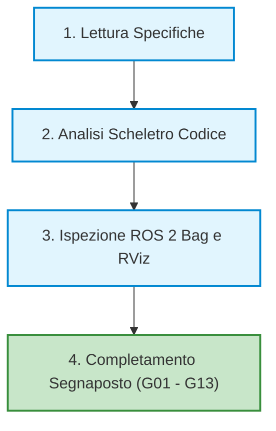
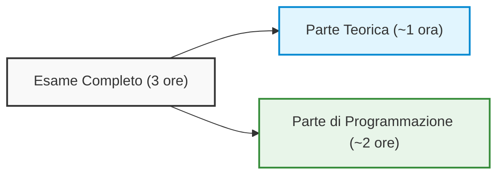
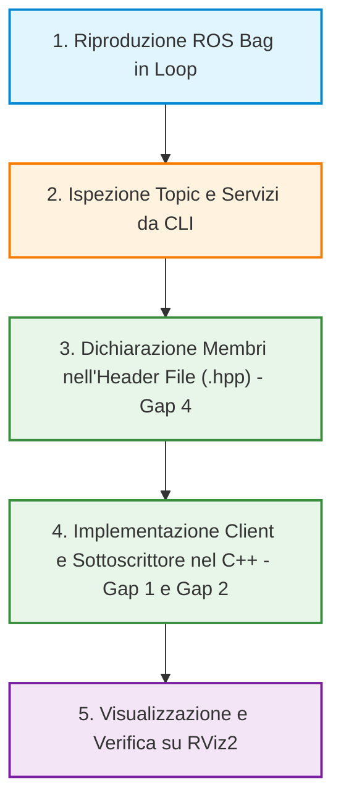

# Simulazione d'Esame Pratico e Metodologia di Sviluppo in ROS 2

## Overview Didattica

Questa lezione è dedicata alla simulazione della prova pratica d'esame per il corso di Robotica Industriale/Intelligente, focalizzandosi sull'analisi di un'architettura software in **ROS 2** (*Robot Operating System 2*) e sul completamento guidato del codice.

Durante la sessione vengono affrontati i seguenti aspetti chiave:
* **Struttura del Progetto Didattico:** Analisi dello scheletro del codice (*code skeleton*) fornito e gestione dei segnaposto (*placeholders*, indicati come `G01`, `G02`, ecc.) che identificano le porzioni di codice da implementare.
* **Ispezione dei Dati di Registro:** Utilizzo delle registrazioni di dati di sistema (**ROS 2 Bag**) e degli strumenti di visualizzazione 3D come **RViz** per l'analisi dei topic e dei flussi informativo-sensoriali attivi.
* **Flusso di Lavoro Consigliato (*Pipeline*):** Definizione della procedura standard per affrontare problemi di programmazione robotica:
  1. Comprensione dei requisiti e delle istruzioni di laboratorio.
  2. Esplorazione della struttura dei nodi e reperimento delle informazioni sui topic nei file sorgente.
  3. Ispezione dinamica del sistema tramite riproduzione della *ROS 2 Bag*.
  4. Sviluppo del codice tramite consultazione autonoma della documentazione ufficiale.
* **Autonomia Operativa e Documentazione:** Enfasi sulla capacità di consultare ed estrarre modelli di codice (*templates*), parametri e strutture dei messaggi dalla documentazione ufficiale C++/Python e ROS 2, simulando le restrizioni operative della prova d'esame finale (assenza di connessione Internet e strumenti di AI generativa).

---

### Struttura della Simulazione e Organizzazione dei File

La sessione pratica odierna replica l'impostazione della prova pratica d'esame. Il materiale è organizzato all'interno di un archivio principale (cartella `student`), che include:

*   **File di Registrazione Dati (ROS 2 Bag):** contiene i dati temporali registrati dai sensori e dai nodi (topic, messaggi, trasformazioni) necessari a stimolare e testare la pipeline software.
*   **Scheletro del Codice (*Code Skeleton*):** una struttura parzialmente implementata di nodi ROS 2 in C++. Al suo interno sono presenti dei segnaposto (*placeholders*) contrassegnati con identificativi progressivi (da `G01` fino a `G13`), che indicano i punti precisi in cui è richiesto l'intervento dello studente.

Il compito consiste nel completare le sezioni mancanti implementando le corrette primitive e strutture architetturali di ROS 2 (es. nodi, subscriber, publisher, gestione di parametri o messaggi custom).



---

### Metodologia di Lavoro e Flusso Operativo Consigliato

Per affrontare in modo metodico l'esercitazione, viene suggerita una sequenza ordinata di passaggi:

1.  **Lettura approfondita delle istruzioni:** comprendere i requisiti di sistema e il comportamento atteso da ciascun nodo prima di scrivere codice.
2.  **Ispezione architetturale dello scheletro:** analizzare la gerarchia dei nodi e i file sorgente correlati. Gran parte delle informazioni necessarie (ad esempio il nome esatto del topic di odometria, la struttura di un messaggio o la definizione di una callback) è già deducibile esaminando il contesto circostante nel repository.
3.  **Esecuzione e analisi del ROS 2 Bag:** avviare la riproduzione della bag per verificare l'elenco dei topic pubblicati, i loro tipi e la frequenza di campionamento. È fortemente consigliato l'utilizzo di strumenti di visualizzazione 3D come **RViz** (*ROS Visualization*) per osservare il flusso dei dati nello spazio.
4.  **Implementazione progressiva:** risolvere i segnaposto in sequenza logica, partendo da `G01`.

> **Concetto Chiave — Capacità di navigazione nel codice:**  
> L'obiettivo primario di queste esercitazioni non è la memorizzazione mnemonica della sintassi (come l'ordine esatto degli argomenti in un metodo o la firma esatta di una callback), bensì l'**autonomia di navigazione**: saper individuare le dipendenze tra file, ricavare i tipi corretti dei messaggi e trovare rapidamente i template corretti all'interno della documentazione tecnica.

---

### Vincoli Operativi e Risorse di Supporto

L'esercitazione mira a consolidare le competenze pratiche in vista della verifica finale, applicando le seguenti linee guida:

#### Strumenti Consentiti
*   **Documentazione Ufficiale:** consultazione della documentazione ufficiale di ROS 2 (*ROS 2 Documentation*), dei tutorial ufficiali e delle reference standard di C++. La documentazione fornisce tutti gli schemi sintattici necessari per definire nodi, pubblicatori, sottoscrittori e strutture di parametri.
*   **Materiale Pregresso:** consultazione delle slide del corso e degli esercizi svolti nei laboratori precedenti, i quali coprono interamente le casistiche richieste dai segnaposto odierni.

#### Limitazioni sull'Uso dell'Intelligenza Artificiale
È tassativamente sconsigliato l'ausilio di assistenti basati su modelli linguistici (es. ChatGPT, GitHub Copilot, Claude). Sebbene tali strumenti siano in grado di risolvere agevolmente i segnaposto, il loro utilizzo vanifica lo scopo dell'esercitazione pratica: acquisire la rapidità d'azione necessaria per risolvere problemi complessi in ambiente controllato privo di connettività Internet.

#### Dimensionamento della Prova
La simulazione odierna comprende 13 segnaposto (`G01`–`G13`) e presenta un'estensione volutamente superiore a quella prevista per una sessione d'esame ordinaria (orientativamente calibrata su 5 o 6 task a seconda della complessità). Questa sovrabbondanza è pensata per offrire un set di allenamento intensivo e completo su tutte le principali casistiche d'interazione in ROS 2.

---

### Logistica e Calendario degli Appelli

L'organizzazione delle prove d'esame durante l'anno accademico prevede una distribuzione standard su quattro appelli complessivi, suddivisi nelle rispettive sessioni:

*   **Sessione Invernale (*Winter Session*):** comprende due appelli ravvicinati. Il primo si tiene indicativamente verso la fine di gennaio (con possibili lievi anticipi rispetto a quanto inizialmente pubblicato su Uniweb, ad esempio intorno al 19–20 gennaio per garantire la disponibilità dell'aula), mentre il secondo è programmato a ridosso dell'inizio o metà febbraio.
*   **Sessione Estiva (*Summer Session*):** un appello fissato nel mese di giugno.
*   **Sessione Autunnale (*Autumn Session*):** un appello di recupero nel mese di settembre.

> **Concetto Chiave:** È fondamentale verificare tempestivamente su Uniweb l'assenza di sovrapposizioni con altri esami del medesimo semestre. Eventuali conflitti di orario devono essere segnalati subito al docente prima della definitiva verbalizzazione e pubblicazione del calendario ufficiale delle aule.

---

### Struttura e Articolazione della Prova

La prova d'esame si svolge in un'unica seduta continuativa con una durata complessiva di $3\text{ ore}$ ($180\text{ minuti}$). L'allocazione dell'aula tiene conto sia della componente teorica sia dell'accesso ai terminali per la componente implementativa.



#### Ripartizione del Tempo e Contenuti

1.  **Parte Teorica (*Theory Part*):**
    *   **Durata:** indicativamente $1\text{ ora}$.
    *   **Obiettivo:** verificare la comprensione dei modelli concettuali, degli algoritmi e delle definizioni formali trattati a lezione.

2.  **Parte Pratica/Programmazione (*Programming Part*):**
    *   **Durata:** circa $2\text{ ore}$.
    *   **Ambiente di lavoro:** si svolge interamente presso il laboratorio informatico (*Lab*), utilizzando le postazioni dedicate e gli ambienti di sviluppo previsti dal corso.
    *   **Obiettivo:** valutare l'applicazione concreta delle tecniche di Information Retrieval attraverso la stesura e l'esecuzione di codice.

---

### Metodologia di Risoluzione e Analisi Strutturale dei Gap

L'approccio corretto per affrontare un problema di integrazione software in ROS 2 (Robot Operating System 2) richiede prima di tutto un'analisi dell'architettura dei messaggi e dei servizi forniti, per poi passare all'implementazione strutturata nei file d'intestazione (*Header File*) `.hpp` e nei file sorgente `.cpp`.

Il flusso di lavoro ideale si articola nelle seguenti fasi:



> **Concetto Chiave**
> Prima di scrivere qualsiasi riga di codice all'interno dei "gap" (sezioni di codice da completare), è fondamentale riprodurre il file di registrazione dati (*ROS Bag*) per identificare con certezza i nomi esatti dei topic, i tipi di messaggio e la struttura dei servizi attivi nel sistema.

---

### Dichiarazione e Implementazione del Client di Servizio (Gap 1 e Gap 4)

L'esercizio richiede di interfacciarsi con un servizio denominato `report_entry`. Trattandosi di un'architettura orientata ai servizi, il nodo deve agire come *Client di Servizio (Service Client)*.

#### 1. Dichiarazione nell'Header File (Gap 4)
Nel file `.hpp` è necessario dichiarare il membro privato relativo al client all'interno della classe del nodo.

*Nota: Passaggio integrato con chiarezza didattica.*

```cpp
// Inclusione dell'interfaccia di servizio corretta
#include "my_package/srv/report_entry.hpp"

class MyNode : public rclcpp::Node {
private:
    // Dichiarazione del Service Client (Gap 4)
    rclcpp::Client<my_package::srv::ReportEntry>::SharedPtr client_;
};
```

#### 2. Istanziazione nel File Sorgente (Gap 1)
Nel costruttore della classe (all'interno del file `.cpp`), si istanzia il client associandolo al nome corretto del servizio:

```cpp
// Istanziazione del client per il servizio report_entry (Gap 1)
client_ = this->create_client<my_package::srv::ReportEntry>("report_entry");
```

---

### Dichiarazione e Implementazione del Sottoscrittore LaserScan (Gap 2 e Gap 4)

Per la gestione dei dati provenienti dal sensore LiDAR, si utilizza un *Sottoscrittore (Subscriber)* per messaggi di tipo `sensor_msgs/msg/LaserScan`.

#### 1. Dichiarazione nell'Header File (Gap 4)
Aggiungere la dichiarazione del sottoscrittore nel file d'intestazione accanto a quella del client:

```cpp
#include "sensor_msgs/msg/laser_scan.hpp"

// Dichiarazione del Sottoscrittore al sensore LaserScan (Gap 4)
rclcpp::Subscription<sensor_msgs::msg::LaserScan>::SharedPtr scan_sub_;
```

#### 2. Istanziazione e Callback nel File Sorgente (Gap 2)
Nel file `.cpp`, il sottoscrittore deve essere collegato al topic corretto e alla rispettiva funzione di callback:

```cpp
// Istanziazione della sottoscrizione al topic del laser (Gap 2)
scan_sub_ = this->create_subscription<sensor_msgs::msg::LaserScan>(
    "scan", // Nome del topic ricavato dal ROS Bag
    10,     // Dimensione della coda (QoS)
    std::bind(&MyNode::scan_callback, this, std::placeholders::_1)
);
```

---

### Ispezione del Sistema ROS 2 tramite ROS Bag e RViz2

Per determinare il nome esatto del topic sul quale vengono pubblicati i dati del sensore (nell'esempio, `/scan`), si utilizzano gli strumenti a riga di comando di ROS 2.

#### Esecuzione del ROS Bag in Loop
Poiché il file bag ha una durata limitata, è consigliabile riprodurlo in ciclo continuo utilizzando l'opzione `--loop` (o `-l`):

```bash
ros2 bag play <nome_del_bag> --loop
```

#### Identificazione dei Topic e Ispezione dei Dati
In un secondo terminale, è possibile elencare i topic attivi e verificare il tipo di messaggio trasmesso:

```bash
# Elenco dei topic attivi nel sistema
ros2 topic list

# Ispezione del contenuto del topic del sensore laser
ros2 topic echo /scan
```

Dall'analisi della lista si conferma che il topic associato al tipo `sensor_msgs/msg/LaserScan` è `/scan`.

#### Visualizzazione Dati su RViz2
Per verificare la corretta trasmissione e la struttura dei dati spaziali:
1. Avviare lo strumento di visualizzazione:
   ```bash
   rviz2
   ```
2. Impostare il riferimento fisso (*Fixed Frame*) nella sezione "Global Options" inserendo il sistema di riferimento del robot, ad esempio `base_link`.
3. Aggiungere un display di tipo **LaserScan** e selezionare il topic `/scan` per visualizzare i punti rilevati dal sensore nello spazio tridimensionale.

---

> [!NOTE]
> ### Note per l'Esame e Avvisi del Docente
> - **Modalità e Durata dell'Esame:** L'esame ha una durata totale di 3 ore (circa 1 ora per la parte teorica e 2 ore per la parte di programmazione pratica) e si svolgerà in laboratorio.
> - **Regole e Risorse Consentite:** Durante l'esame non ci sarà alcun accesso a Internet né a strumenti di Intelligenza Artificiale (ChatGPT, Copilot, Claude, ecc.). Gli studenti potranno consultare esclusivamente la documentazione ufficiale (ROS, ROS 2, C++).
> - **Struttura della Prova Pratica:** La prova pratica consisterà nell'analizzare un *ROS 2 bag* e completare lo scheletro di codice fornito (strutture ROS 2, nodi, client/service, publisher/subscriber). Nella prova reale ci saranno indicativamente dai 5 ai 6 punti/gap da completare (meno rispetto ai 13 della simulazione).
> - **Periodo delle Sessioni d'Esame:** I primi due appelli della sessione invernale si terranno tra la fine di gennaio e l'inizio/metà di febbraio (molto ravvicinati tra loro). Gli appelli successivi si terranno a giugno e settembre.