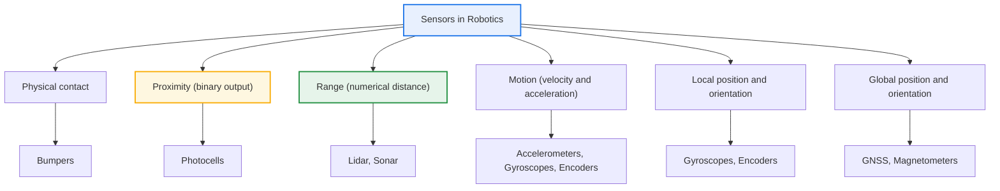
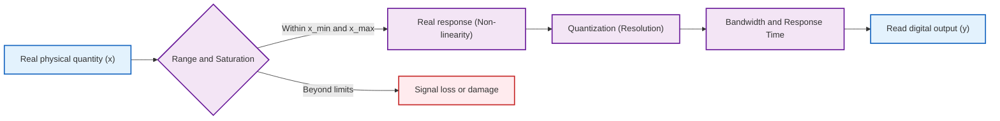
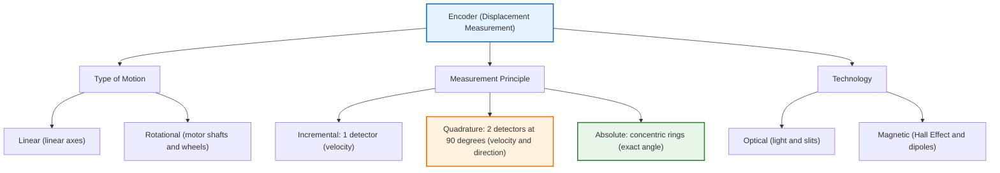
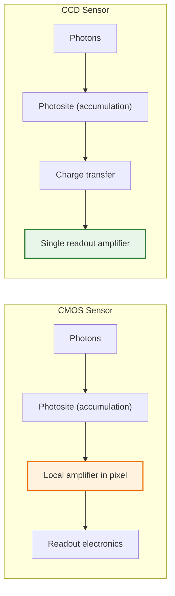
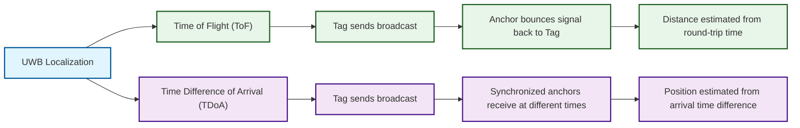

# Robotic Perception: Physical Principles, Architecture, and Sensor Taxonomy

## Course Overview

This lecture delves deeper into the topic of **Perception** introduced in the previous session, moving from the general definition of the perceptual process to the analysis of the internal architecture and operating principles of the main sensors used in robotics. After a brief operational introduction dedicated to aligning the slides on the Moodle portal, the instructor outlines the thematic path for the week, which will cover contact and proximity sensors, *Encoders* for motion measurement, positioning systems (*GNSS* and *Ultra-Wideband*), and *Inertial and Heading Sensors*.

The fundamental concepts covered in this first part include:

* **Key Concept — Importance of the physical principle and error management:** The instructor repeatedly emphasizes that knowing the physical principle underlying each *Sensor* and knowing how to read its *Datasheet* is indispensable for two practical reasons: designing effective algorithms to filter and compensate for inevitable measurement errors, and selecting the most suitable device for the robot's specific environment and application (obstacle avoidance, action planning, interaction with other robots or humans).
* **Sensor architecture and conversion chain:** A sensor detects a physical parameter or an environmental characteristic and converts it into a digital signal usable by the robot. The typical chain includes:
  * **Receiver:** collects energy coming from the environment and outputs an electrical signal.
  * **Transducer:** a component inside the receiver that transforms energy from one form to another (changing its carrier, for example converting photons into electrons or voltage).
  * **Analog-to-Digital Converter (ADC):** samples the electrical signal and transforms it into a digital numerical value.
* **Emitters and Integrated Sensors:** In active sensors (such as *Sonar*), the system pairs the receiver with an emitter—comparable to an *Actuator*—that radiates energy into the environment in the form of electromagnetic or pressure (sound) waves to subsequently collect their reflection. In modern robotics practice, devices are almost always **integrated sensors** that combine multiple transducers and receivers into a single component.
* **Key Concept — Taxonomy by interaction and difference between Proximity and Range:** In addition to active/passive and *Proprioceptive* / *Exteroceptive* classifications, sensors are distinguished based on the type of quantity or interaction measured: *Contact*, *Velocity*, *Position*, *Proximity*, and *Range*. A clear distinction is emphasized between:
  * **Proximity Sensor:** detects only whether an object is nearby, providing in most cases binary information (yes/no).
  * **Range Sensor:** provides a quantitative metric measurement of the actual distance to the object.

---

### Introduction to Perception and Importance of Physical Principles

Picking up the thread from the previous lecture, we began to understand how a robot can observe its surrounding environment and what it actually means to *perceive*. **Perception** is not limited to the simple act of collecting raw data from the outside: it also encompasses the ability to process this information to extract the data that are truly relevant to the goal the robot must accomplish.

In a robot active in the environment—whether it is moving or physically interacting with it—sensors are indispensable for:
*   **Avoiding obstacles** and understanding how the surrounding space is structured and where objects are located.
*   **Deciding which actions to take** based on the context.
*   **Interacting with other agents** (other robots or humans), estimating their state and position.

#### Why Study the Physical Functioning of Sensors

> **Key Concept:** Understanding the underlying physical principle by which each sensor performs a measurement is not a minor detail, but a fundamental aspect of robotics.

There are two practical reasons why it is necessary to go into detail about how sensors work:
1.  **Error management:** Every sensor inevitably introduces measurement errors. By knowing the physical principle behind the device, it is possible to understand where such errors originate and to design data filtering and processing strategies or algorithms to achieve more reliable perception.
2.  **Design choice:** When designing a robot, it is necessary to select the components best suited to a specific application or a given environment. Having a clear view of the operating principles enables better design decisions.

Furthermore, every commercial sensor is accompanied by a **Datasheet** provided by the manufacturer, which summarizes its specifications and operating characteristics: knowing the basic terminology serves precisely to be able to read and interpret these documents.

---

### Sensor Architecture and Fundamental Components

What is a **sensor**, essentially? It is a device that performs a measurement—that is, it converts a physical parameter (for example, velocity) or an environmental characteristic (such as distance, temperature, or brightness) into a signal usable by the system.

In modern systems, this conversion almost always yields a **digital value**. Consequently, the typical internal structure of a digital sensor consists of three main elements in cascade:
*   A **receiver**, which collects the physical signal from the outside.
*   A **transducer**, located inside the receiver, which transforms the physical quantity into an electrical or electronic signal.
*   An **analog-to-digital converter (ADC)**, which samples the continuous electrical signal and transforms it into a digital numerical value.

```mermaid
flowchart LR
    accTitle: Acquisition chain of a digital sensor
    accDescr: Flowchart showing the transformation of a physical or environmental quantity through the receiver with transducer, the analog electrical signal, and the ADC converter up to the digital value.
    F["Physical or environmental quantity"] --> R["Receiver with Transducer"]
    R --> E["Analog electrical signal"]
    E --> ADC["ADC Converter"]
    ADC --> D["Digital value"]
    style F fill:#f4f6f9,stroke:#3b5998,stroke-width:2px
    style R fill:#e8f0fe,stroke:#1a73e8,stroke-width:2px
    style E fill:#fef7e0,stroke:#f9ab00,stroke-width:2px
    style ADC fill:#e8f0fe,stroke:#1a73e8,stroke-width:2px
    style D fill:#e6f4ea,stroke:#1e8e3e,stroke-width:2px
```

#### Transducers, Emitters, and Receivers

It is useful to clearly distinguish the roles of these three elements that frequently appear in sensory systems:

*   **Transducer:** It is the component that converts energy from one form to another, effectively changing the "carrier" of the energy itself. Consider a photodiode or a camera sensor: it collects photons (light energy) and transforms them into electrons, thereby generating an electrical voltage or current.
*   **Emitter:** It is an element that injects or radiates energy into the environment in the form of an electromagnetic, light (e.g., an LED or a flash), sound, or pressure wave signal. Conceptually, emitters are often grouped with **actuators**: while a motor injects mechanical energy into the environment (for example, using friction to move the robot), an emitter radiates energy into the surrounding environment.
*   **Receiver:** It is the part of the sensor responsible for collecting a certain amount of energy from the environment—using the transducer inside it—to output an electrical signal.

In robotics practice, it is rare to deal with purely elementary and isolated sensors. Most modern devices are **integrated sensors**, that is, modules that house several transducers and receivers in a single *package* to measure multiple quantities simultaneously.

A classic example of a sensor that combines multiple units is **sonar**: being an active sensor, it consists of the combination of an emitter and a receiver. The emitter generates a vibration on a membrane, creating a pressure wave in the air; when the wave encounters an object, it is reflected and travels back until it is collected by the receiver, which detects it and transforms it into an electrical signal.

---

### Sensor Taxonomy

To navigate among the various available devices, we can classify sensors according to different criteria.

#### Basic Classifications (Review)
*   **Based on the energy principle:** **passive sensors**, which simply collect energy already present in the environment, versus **active sensors**, which emit energy or perturb the environment in order to perform the measurement (such as the sonar just seen).
*   **Based on the origin of the information:** **proprioceptive sensors**, which measure quantities internal to the robot itself, versus **exteroceptive sensors**, which acquire information coming from the external environment.
*   **Based on the output type:** classification linked to the nature of the signal returned by the device.

#### Classification by Type of Interaction and Measured Quantity

Another very practical way to classify sensors is based on the type of interaction they have with the environment and the type of physical quantity they allow us to estimate.

> **Key Concept — Proximity vs. Range:** Although in everyday language they may seem synonymous, **proximity** and **metric distance (range)** refer to two very different concepts in robotic sensors:
> *   A **proximity sensor** only detects *whether* something is nearby, without providing a direct metric measurement. In most cases, it returns a **binary** signal (yes/no, presence/absence).
> *   A **range sensor**, on the other hand, measures the **actual distance**, returning a quantitative numerical value.

Following this division, the main sensors that characterize robotic systems are organized as follows:
*   **Physical Contact (Contact):** Detect impact or direct contact with obstacles; a typical example is **bumpers**.
*   **Proximity:** Detect the close presence of an object, as in the case of **photocells**.
*   **Distance / Range:** Measure the actual distance from surrounding objects, as **Lidar** and **Sonar** do (which will be explored in depth together with a recap on **RGB cameras** in the next lecture).
*   **Acceleration and Velocity (Motion):** Measure changes in kinematic state or the motion of the robot using **accelerometers**, **gyroscopes**, and **wheel encoders**.
*   **Local Position and Orientation (Local Position & Heading):** Gyroscopes and encoders can be used to estimate the robot's **heading** and position, but they provide only a **local** estimate (subject to error accumulation over time).
*   **Global Position and Orientation:** To obtain global references, sensors such as **GNSS** (satellite systems) and **magnetometers**, which exploit the Earth's magnetic field, are used, in addition to positioning systems like **Ultra-Wideband (UWB)** sensors.

---

When choosing or using a sensor, the manufacturer provides a technical specification sheet called a **data sheet**, which reports all the characteristics describing how the sensor transforms the real physical quantity into a readable signal (its **transfer function**).

---

### Linearity vs. Non-linearity

In an ideal world, we would always want a sensor to have a **linear response**. Let us call $x$ the physical quantity we want to measure and $y$ the sensor output. If the sensor is linear, its response is modeled by the equation of a straight line:

$$y = m x + b$$

* **$b$ (offset)**: this is the output value when the input is zero, or it is related to the minimum quantity the sensor can start measuring. Some sensors can also measure negative values of $x$, while others cannot (for example, a camera cannot measure a negative amount of light).
* **$m$ (slope)**: indicates the proportionality factor between input and output. If I double the change in the input, the output changes proportionally according to $m = \frac{\Delta y}{\Delta x}$, which is related to the inclination angle $\alpha$ of the line via the tangent: $m = \tan(\alpha) = \frac{\sin(\alpha)}{\cos(\alpha)}$ (therefore $\alpha = \arctan(m)$).

#### Non-linearity Error
The line $y = mx + b$ is almost always only a mathematical approximation. In reality, the sensor responds by following a curve. When we read an output value $y$ and use the ideal linear model to estimate the actual quantity $x$, the difference between the real curve and the expected line introduces a **non-linearity error**. For this reason, strongly non-linear sensors are much more complex to calibrate and use.

---

### Quantization Noise and Error

Modern sensors used in robotics are **digital sensors**. This means they do not return a continuous signal, but rather introduce **quantization** at two levels:
1. **Sampling** along the axis of the input quantity $x$.
2. **Discretization** of the possible output values $y$.

Consequently, the actual characteristic curve is not a smooth line, but a **step function**. The sensor is blind to variations in $x$ smaller than the width of a single step and produces output changes only in discrete jumps. This deviation from the ideal continuous curve generates the **quantization error**.

> **Key Concept:** Errors in sensors are physically unavoidable. Every real measurement is affected by at least two structural error sources: **non-linearity** (imperfect correlation between $x$ and $y$) and **quantization** (discretization of continuous data). We can make the quantization step very small, but we cannot eliminate it completely.

---

### Measurement Range, Perceived Horizon, and Saturation

#### Measurement Range and Perceived Horizon
The **measurement range** is the interval between the minimum value $x_{\min}$ and the maximum value $x_{\max}$ that the sensor is able to detect properly.

In robotics, this parameter is critical, especially for distance sensors:
* If an obstacle is at a distance smaller than $x_{\min}$, the sensor does not detect it and the robot risks crashing into it.
* If the obstacle is beyond $x_{\max}$, the sensor can no longer see it.
* In the robot's reference frame, the maximum detectable distance is often called the **perceived / perceptive horizon**.

#### Dynamic Range
The **dynamic range** expresses the breadth of the sensor's operating interval through the ratio between the maximum and minimum measurable values:

$$\text{Dynamic Range} = \frac{x_{\max}}{x_{\min}}$$

Since $x_{\max}$ is often many orders of magnitude greater than $x_{\min}$, this ratio is usually expressed in **decibels ($\text{dB}$)** to compress otherwise overly large numbers and make them more readable.

#### Saturation
**Saturation** occurs when the upper bound of the range ($x > x_{\max}$) is exceeded. Beyond a certain input threshold, even if $x$ continues to increase, the output $y$ stops growing and remains flat at a constant value. A typical example is a camera blinded by an overly intense beam of light.

> **Warning:** Driving a sensor into saturation not only makes the measurement useless, but can **physically damage** the sensor itself.

---

### Sensitivity and Resolution

#### Sensitivity
**Sensitivity** is the slope of the sensor's response curve, that is, how much the output $y$ changes in response to a variation in the input $x$:

$$S = \frac{\Delta y}{\Delta x}$$

* A sensor with **high sensitivity** is preferable because even a tiny variation in $x$ generates a large change in $y$, making the measurement much easier to detect (also helping to compensate for the presence of quantization steps).
* In a **linear** sensor, sensitivity is constant across the entire range ($S = m$).
* In a **non-linear** sensor, sensitivity changes depending on the operating point: in some regions of the curve a small $\Delta x$ produces a large $\Delta y$, whereas in other regions the same $\Delta x$ produces a barely perceptible variation.

#### Resolution
**Resolution** is the minimum variation in the input quantity $x$ that produces a detectable change in the output $y$. It may depend on output quantization or on the input sampling step.

For a digital sensor, within its *measurement range*, resolution is calculated by dividing the width of the interval by the number of steps (discrete levels) available at the output ($N_{\text{steps}}$):

$$\text{Risoluzione} = \frac{x_{\max} - x_{\min}}{N_{\text{steps}}}$$

High resolution implies a denser sampling of the measurement space, that is, much smaller and more closely spaced steps.

---

### Precision vs. Accuracy

In everyday language they are often used as synonyms, but in engineering and in *data sheets* they denote two clearly distinct concepts. Imagine repeatedly measuring a true value (the center of a target):

* **Precision**: indicates how close repeatedly measured values are **to each other** (low statistical dispersion). A precise sensor always gives roughly the same reading, but this *not* guarantee — wait, this does *not* guarantee that the reading is close to the real value.
* **Accuracy**: indicates how close the obtained measurements are to the **real value** of the physical quantity.

Obviously, the ideal sensor possesses both high precision and high accuracy (all measurements fall tightly grouped right on the true value).

#### Translation into Robotics: the Concept of Repeatability
> **Key Concept:** In robotic manipulators, the distinction between accuracy and precision takes on a specific name that is fundamental for industry:
> * **Accuracy**: the robot's ability to reach the exact coordinates $(x, y, z)$ calculated through forward/inverse kinematics.
> * **Repeatability**: corresponds to the robot's **precision**. It indicates the ability to always return to the exact same point every time it is given the same command.
> 
> **Industrial robots** are designed to have **very high repeatability** (even at the expense of absolute accuracy). In most industrial applications this is sufficient, because the motion is taught only once by saving the actual position (*teaching*), and the robot will then have to repeat it identically every time.

---

### Bandwidth & Response Time

In addition to the static parameters just seen, a sensor is characterized by two time-related dynamic parameters:

* **Bandwidth**: represents the speed of the sensor, i.e., the maximum frequency at which it can operate while accurately tracking time variations of the input signal.
  * In robotics, bandwidth is often **intentionally limited** by integrating a **low-pass filter** into the sensor. This serves to cut out high-frequency noise, but has the disadvantage of reducing the sensor's responsiveness to very rapid changes in the measured quantity.
* **Response Time**: the time required for the sensor to detect and output a change that occurred at the input.

> **Key Concept:** Response time is a critical parameter especially for **mobile robots**. If a distance sensor takes, for example, $1\text{ s}$ to process the data and detect the presence of a wall, during that second the moving robot will continue advancing and may crash into the obstacle.

---

### Encoders: Measuring Displacement in Robots

An **encoder** is a device capable of measuring displacement, transforming a mechanical quantity (how much an object moves or rotates) into a **digital code**.

Depending on the geometry of the motion we want to detect, we distinguish two main families:
* **Linear Encoder:** measures a linear displacement (back and forth along an axis). In robotics it is mainly used in robotic manipulators equipped with linear axes.
* **Rotational Encoder:** measures the rotation of a shaft or an axis. It is by far the most widespread type in mobile robotics.

> **Key Concept — Why rotational encoders are fundamental in mobile robotics:**
> As seen in previous lectures, motors are generally controlled by sending current or voltage pulses, and are not directly position-controlled. When we send a command to the motor, we do not know a priori with precision how much the shaft (and therefore the wheel) will actually rotate. By measuring the actual rotation of the motor with an encoder, we can estimate how far the robot has moved in the environment.

---

### Encoder Technologies and Architectures

#### Incremental Optical Encoders
The simplest way to build an encoder (both linear and rotational) leverages optical technology:
1. An alternating pattern of small transparent windows and opaque zones (blocking elements) is created along the bar or along the circumference of a disk attached to the motor shaft.
2. A light source is placed on one side of the disk and a **photodetector** or photocell on the opposite side.
3. When the object moves or rotates, the light beam is cyclically interrupted.

By knowing the geometry of the slits and counting how many times the light is interrupted over time, we can derive both the relative displacement and, above all, the **rotational speed**. When only a single photodetector is present, the device is called an **incremental encoder**. However, a single detector only sees the alternation between light and dark: for this reason, **it is not able to distinguish the direction of rotation**.

#### Quadrature Encoders
To overcome the limitation of the single incremental encoder, a second photodetector is added, phase-shifted by $90^\circ$ with respect to the phase of the signal measured by the first one. This configuration is called a **quadrature encoder**.

> **Key Concept — Advantages of quadrature:**
> Adding the second channel phase-shifted by $90^\circ$ yields two fundamental results:
> 1. **Direction detection:** by observing which of the two signals leads the other, it is immediately clear in which direction the motor is rotating.
> 2. **Higher resolution:** by exploiting the transitions of both channels, it is possible to achieve a resolution up to $4$ times higher than that of a single channel.

#### Absolute Encoders and Gray Code
While incremental encoders measure changes in position over time (hence speed and relative displacements), an **absolute encoder** makes it possible to directly and instantaneously read the **exact angle** of the motor, even immediately after power-on.

The structure of the optical disk is organized according to two subdivisions:
* **Concentric Rings:** the disk is divided radially into $N$ rings (for example $4$ or $5$ rings, depending on the desired number of bits). On each ring, opaque zones (made of metal or plastic) alternate with windows that let light pass through.
* **Radial Sectors:** the circumference is divided into wedges; each sector features a unique combination of open and closed zones across the $N$ rings, generating a unique binary word (for example $1111$ when all the windows in a sector let light pass through, or $0000$ when they block it).

By aligning along a radius an array of $N$ emitters on one side and $N$ receivers on the other, the simultaneous reading of the $N$ bits identifies exactly which sector the disk is in. The angular resolution desired during the design phase therefore determines the number of rings and sectors to be fabricated.

> **Key Concept — Transition errors and Gray Code:**
> The weak point of absolute encoders based on standard binary encoding manifests itself right on the transition boundary between one sector and the next. If multiple bits must change simultaneously (for example, going from $0111$ to $1000$), the slightest mechanical misalignment or imperfect sensor calibration causes some bits to switch slightly before others, generating **false readings** corresponding to completely wrong sectors.
>
> To eliminate this problem, **Gray Code** is used, a binary encoding designed so that when moving from one value to the next, **only one bit at a time** changes. In this way, on the boundary line between two adjacent sectors, the reading can at most oscillate between the previous sector and the next one, filtering out gross errors at the root.

#### Magnetic Encoders
In addition to the optical encoders just described, there are **magnetic encoders**, widely used in dirty or dusty environments where light would be obstructed. They exploit the **Hall Effect**: magnetic dipoles are fixed along the ring integral with the motor; when the shaft rotates, the movement of the dipoles induces a variation in the surrounding magnetic field, which is detected moment by moment by a magnetic Hall sensor.

---

### Force Sensors

To detect the force applied to a surface or a joint (as typically occurs in **Force-Torque Sensors** mounted on the wrist of a manipulator robot), several transduction technologies are used:

* **Piezoelectric:** they use materials that, when mechanically compressed, directly generate an electric potential difference (piezoelectric effect). The measured voltage is proportional to the applied pressure.
* **Piezoresistive:** they use materials similar to the previous ones, but in this case the pressure changes the **electrical resistance** of the material rather than generating a voltage. By applying a known supply voltage to the sensor, the applied force translates into a measurable current variation.
* **Capacitive Force Sensors:** they consist of a capacitor with a dielectric material placed between the two plates. When pressure is exerted, the two plates move closer together, changing the electrical capacitance of the system.
* **Electromagnetic Force Sensors:** they consist of a magnet suspended inside a coil. The external force displaces the magnet relative to the coil, inducing a current in the latter proportional to the movement.

---

### Light Transducers (Light Sensors and Light Emitters)

#### Point Light Sensors
For the simple detection of light intensity, there are two fundamental components:
* **Photoresistor:** it is the simplest light sensor to manufacture. It consists of a semiconductor material that changes its electrical resistance when photons strike its surface. By applying a voltage across the semiconductor, the arrival of photons reduces the resistance and allows a greater current to flow. Photoresistors can be designed to be selective with respect to the light spectrum, making them sensitive to specific wavelengths.
* **Photodiode:** a semiconductor component that directly generates an electric current proportional to the flux of photons incident on the sensor.

#### Image Sensors: CMOS vs CCD
By arranging photodiodes in a two-dimensional matrix, image sensors for cameras are created. Since the number of photons hitting each individual photosite (pixel) is very small, the electrons freed by the interaction with the substrate must be amplified. The main difference between **CMOS (Complementary Metal-Oxide-Semiconductor)** technology and **CCD (Charge-Coupled Device)** technology lies precisely in *where* this amplification takes place:

* **CMOS Architecture:** the amplifier is integrated **locally inside each individual pixel**. Electrons are collected in the photosite, immediately amplified on site, and finally read by the readout electronics.
* **CCD Architecture:** each photosite merely accumulates the electrons freed by photons; during the readout phase, the charges are transferred toward the output where there is **a single amplifier** shared across the entire sensor.

> **Key Concept — Quality and Linearity between CCD and CMOS:**
> **CCD** sensors offer superior image quality because the presence of a **single amplifier** ensures maximum linearity and amplification uniformity across the entire frame. In **CMOS** sensors, on the other hand, it is technologically very difficult to manufacture millions of local amplifiers that have the exact same gain. For this reason, in ultra-high-precision applications (such as space telescopes and advanced scientific instrumentation), CCDs continue to be preferred.

#### Optical Emitters and Filters
In robotics, we do not limit ourselves to receiving light; often it is necessary to emit light energy into the environment:
* **Light Emitting Diodes (LEDs):** they are diodes that emit light when an electric current passes through them. By appropriately adjusting the **doping** of the semiconductor, it is possible to control the emission spectrum and choose the exact desired wavelength.
* **Controllable Optical Filters:** devices that allow only specific wavelengths to pass depending on the applied control current. A practical example is the **Electro-Optic Liquid Crystal Filter** used in classroom projectors to select the different light components generated internally and thus reproduce colors on the screen.

---

### Sensors for Other Electromagnetic Bands and Magnetic Fields

#### Radio Wave Antennas
Moving to other regions of the electromagnetic spectrum (outside the visible range), **antennas** are used to receive radio waves. The transduction principle transforms the captured electromagnetic signal into an electric current processed by the receiver.

#### Magnetometers and Compasses
To directly measure the ambient magnetic field (the same technology on which electronic compasses are based), there are two main approaches: **Magnetoresistance** and the **Hall Effect**.

The operation of a **Hall Effect** magnetometer is based on a fundamental physical principle:
1. A current of free electrons is made to flow inside a semiconductor material.
2. When the sensor is immersed in an external magnetic field, the moving charges are **deflected** from their straight trajectory.
3. This shift causes an accumulation of charges on one of the two sides of the semiconductor, generating a **transverse potential difference** across its terminals.

By measuring this transverse voltage, which is proportional to the number of deflected charges, it is possible to directly determine the intensity of the applied magnetic field.

---

### Proximity and Contact Sensors

To allow a robot to interact safely with its surrounding environment, it is essential to detect when an obstacle is in the immediate vicinity or when it physically collides with the robot itself. For this purpose, two complementary families of sensors are used:

* **Proximity Sensor**: detects the presence of an object near the robot without requiring any physical contact; its operation is based on the use of **electromagnetic waves**.
* **Contact Sensor**: detects the actual physical collision with an object; it therefore requires direct contact and is based on **mechanical forces**.

In robotics practice, these two sensors almost always work in pairs. The proximity sensor serves to keep the robot at a safe distance, avoiding impacts; however, below a certain minimum distance, the proximity sensor stops working properly (or perception may fail). In that case, the contact sensor takes over as a final safety layer (*fallback*).

#### Operation and Limits of Proximity Sensors

A typical proximity sensor consists of:
* An **emitter** of diffused (unfocused) light, almost always operating in the **Infrared (IR)** band, specifically in the near-infrared.
* A **photocell** or **photoresistor** that measures the amount of light reflected by the obstacle.
* Small **lenses**, one to diffuse the emitted light beam and one to focus the returning light onto the receiver.

*(Practical fun fact: if you have a robot vacuum cleaner at home and want to see the infrared LEDs mounted along its perimeter, you can point your smartphone camera at it, as its sensor is sensitive precisely to near-infrared light).*

> **Key Concept — Why proximity sensors are used almost exclusively as threshold sensors**
> By measuring the amount of light reflected by the obstacle, in theory one could estimate the distance to the object. However, this estimate is strongly dependent on the **material** hit: a highly reflective surface bounces back a lot of light, whereas a dark or absorbing surface bounces back very little.
> Consequently, receiving little return light creates an ambiguity: the object could be very far away or very close but absorbing. For this reason, even though sensors with an output proportional to distance exist, in the vast majority of applications proximity sensors are used as simple **binary threshold sensors**: if the reflected light exceeds a preset threshold, the output switches to $1$, otherwise it remains at $0$.

#### Contact Sensors: Bumpers and Whiskers

The most common contact sensors on mobile robots are **bumpers**, used as an emergency solution in case proximity sensors fail to avoid the obstacle.

A mechanical bumper consists of an **arm** connected to a **spring** and positioned in front of a **micro switch**. When the robot hits an obstacle, the arm is pushed back, compressing the spring and closing the micro switch contacts; the flow of current in the closed circuit signals that contact has occurred.

If we mount two arms with two separate micro switches (one on the left and one on the right), how many types of contact can we distinguish? **Three**:
1. **Left contact**: only the left switch closes.
2. **Right contact**: only the right switch closes.
3. **Front contact**: both switches close simultaneously.

In robotic vacuum cleaners, a **floating bumper** is almost always adopted: a single front shell kept separated from the robot's body by a central spring and connected to two lateral micro switches. Even though the bumper is a single piece, its floating geometry still allows distinguishing left, right, or frontal impacts, working in synergy with the perimeter infrared sensors.

An alternative variant is **whiskers**, inspired by cat whiskers: in this case, the mechanical arms do not have any external bumper cover, but protrude directly to actuate the micro switch at the slightest contact.

---

### Localization via Fixed References: Ultra Wide Band (UWB)

Moving from local obstacle detection to the problem of **localization**, we can determine a robot's position by measuring it relative to fixed reference points of known position.

The first technology based on this principle is **Ultra Wide Band (UWB)**, used mainly in *indoor* or bounded environments:
* Fixed transmitters are placed in the environment at known coordinates, called **anchors**.
* A receiver/transmitter called a **tag** is mounted on the robot (whose position is unknown).

By estimating the distance of the tag from each anchor via radio signals, the robot's position is determined using the **trilateration algorithm**:
* If the measurement from anchor $A_1$ yields a distance $R_1$, we know that the robot lies somewhere on a circle of radius $R_1$ centered at $A_1$ (in 2D; on a sphere in 3D).
* Adding a second measurement $R_2$ from anchor $A_2$, the intersection of the two circles narrows the robot's position down to **only two candidate points**.
* With a third measurement $R_3$ from anchor $A_3$, the ambiguity is resolved, uniquely identifying the robot's position in the plane.

To measure distances between the tag and anchors using radio signals, UWB systems use two main strategies:
1. **Time of Flight (ToF)**: a *two-way* protocol is used. The tag on the robot sends a *broadcast* message, the anchor receives it and bounces it back; by measuring the total *round-trip time*, the distance is derived.
2. **Time Difference of Arrival (TDoA)**: the tag transmits a *broadcast* message that reaches the various anchors at slightly different times. Since all anchors are synchronized via their internal clocks, the difference between arrival times allows the robot's position to be determined.

---

### Global Navigation Satellite Systems (GNSS)

The exact same principle as UWB is adopted *outdoors* on a planetary scale by **GNSS (Global Navigation Satellite Systems)**. In this case, the anchors at known positions are not installed on the walls of a room, but are **satellites** in stable orbit around the Earth.

In everyday language, the word "GPS" is often used to refer to any satellite locator, but this is a generalization due to the fact that GPS was the first system ever created. **GNSS** is the correct term for the entire category of systems, which today includes several national and international constellations:
* **GPS** (United States, since 1978) — the first system developed.
* **GLONASS** (Soviet Union / Russia, since 1982).
* **Chinese system / BeiDou** (China, since 2000).
* **Galileo** (Europe, launched in 2011) — currently the most technically advanced constellation.
* Regional constellations of **Japan** and **India**.

> **Key Concept — How many satellites are needed for GNSS localization?**
> Working in three-dimensional space (the Earth's surface), the intersection of three spheres of known radius still leaves **two possible intersection points**. For this reason, the theoretical minimum required is **4 satellites**.
> However, in practice, to obtain a reliable estimate, at least **6 or 7 visible satellites** are required: signals traveling from space pass through the Earth's ionosphere and magnetosphere, introducing multiple non-idealities and calculation errors that must be compensated for with redundant measurements.

#### Pseudo-range and RTK GPS

The raw distance that the receiver derives from the satellite is not the actual geometric distance, but rather a **pseudo-range**, obtained by multiplying the speed of light $c$ by the measured time interval $\Delta t$:

$$\text{pseudo-range} = c \cdot \Delta t$$

Due to delays introduced by the atmosphere and synchronization inaccuracies, standard GNSS has an accuracy limited to the order of meters. For precision robotics applications, **RTK GPS (Real-Time Kinematic GPS)** is therefore used:
* A **base station** is installed on the ground at a position known with extreme precision, which receives the satellite signals and computes their discrepancies.
* In addition to the signal's time of flight, the system also measures the phase of the **carrier wave**, counting the number of complete wave cycles.
* The base station transmits the corrections via radio in real time to all mobile receivers in the area.

Thanks to the RTK technique, localization accuracy improves from several meters to the **centimeter** level.

#### Critical Issues, Interference, and Limitations of GNSS

Despite its enormous widespread adoption, GNSS presents several vulnerabilities and physical limitations that must be taken into account in mobile robotics:

* **Intentional interference and military domain**: GPS was originally created for military purposes; consequently, the United States can deliberately disable or degrade signal accuracy in specific geographic areas, or encrypt the information to make it usable only by its own devices and not by adversarial ones.
* **Signal spoofing (real-world example)**: during the conflict between Russia and Ukraine, electronic warfare systems around Kyiv (nicknamed the *"Lima system"*) overwrote satellite signals by transmitting false coordinates from ground stations that localized receivers in Lima, Peru. This stratagem had the side effect of making users of geolocated apps (such as navigation apps or dating apps) appear to be in Lima, but its main purpose was to deceive incoming missiles: suddenly receiving coordinates off by thousands of kilometers, the missiles' automatic guidance systems commanded trajectory changes so abrupt as to cause mechanical destruction or deviation off target.
* **Signal absence**: in galleries, tunnels, or indoor environments, the satellite signal is completely shielded and the vehicle loses localization.
* **Canyon Effect**: in environments with narrow alleys (such as in Venice) or surrounded by very tall buildings, the visible portion of the sky is extremely limited; most of the satellites are blocked by the buildings and the receiver cannot reach the minimum number required for positioning.
* **Absorption by water and foliage**: water effectively blocks satellite radio waves (a GPS tracker submerged underwater stops working). Even the water contained in tree leaves is sufficient to absorb the signal: when moving under dense trees or in a forest, GNSS coverage degrades severely.
* **Multipath**: in the presence of tall buildings or reflective walls, the satellite signal may bounce before reaching the receiver. The measured distance therefore corresponds to this lengthened path rather than the straight line toward the satellite, introducing significant errors in the position estimate.

---

### Summary and Next Steps

In the next lecture, we will see how to deal with the limitations, errors, and temporary signal losses of GNSS by fusing (*sensor fusion*) these measurements with those coming from inertial sensors and other onboard sensors.

For studying and exploring this section on sensors in greater depth, please refer on Moodle to the slides and the dedicated chapter **Sensors for Mobile Devices** (the slides directly follow the structure of that chapter, while the other sections provided serve as additional material for understanding the physical operation of the devices).