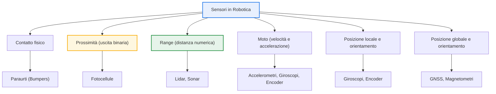
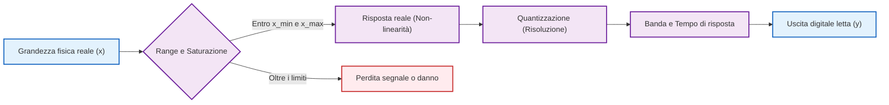
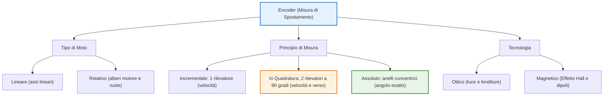
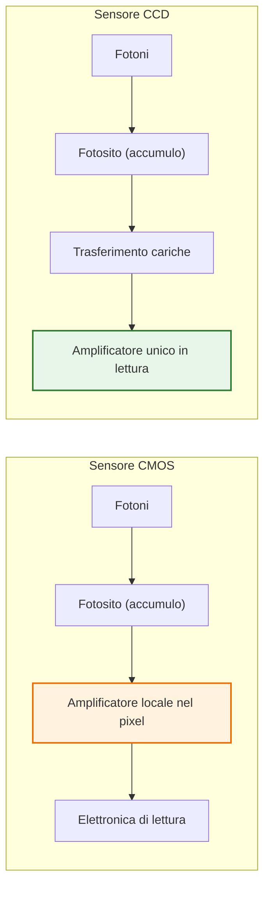
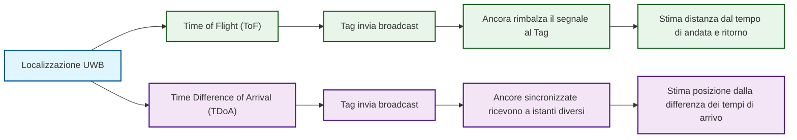

# Percezione Robotica: Principi Fisici, Architettura e Tassonomia dei Sensori

## Overview Didattica

La lezione approfondisce il tema della **Percezione (*Perception*)** introdotto nell'incontro precedente, passando dalla definizione generale del processo percettivo all'analisi dell'architettura interna e dei principi di funzionamento dei principali sensori impiegati in robotica. Dopo una breve introduzione operativa dedicata all'allineamento delle slide sul portale Moodle, il docente traccia il percorso tematico della settimana, che coprirà i sensori di contatto e prossimità, gli *Encoder* per la misura del moto, i sistemi di posizionamento (*GNSS* e *Ultra-Wideband*) e i sensori inerziali e di orientamento (*Inertial and Heading Sensors*).

I concetti fondamentali trattati in questa prima parte includono:

* **Concetto Chiave — Importanza del principio fisico e gestione degli errori:** Il docente sottolinea ripetutamente che conoscere il principio fisico alla base di ogni sensore (*Sensor*) e saperne leggere il foglio delle specifiche (*Datasheet*) è indispensabile per due ragioni pratiche: progettare algoritmi efficaci per filtrare e compensare gli inevitabili errori di misura, e selezionare il dispositivo più adatto all'ambiente e all'applicazione specifica del robot (evitamento ostacoli, pianificazione delle azioni, interazione con altri robot o esseri umani).
* **Architettura e catena di conversione del sensore:** Un sensore rileva un parametro fisico o una caratteristica ambientale convertendola in un segnale digitale utilizzabile dal robot. La catena tipica comprende:
  * **Ricevitore (*Receiver*):** raccoglie l'energia proveniente dall'ambiente e restituisce un segnale elettrico.
  * **Trasduttore (*Transducer*):** componente interno al ricevitore che trasforma l'energia da una forma all'altra (cambiandone il vettore, ad esempio convertendo fotoni in elettroni o tensione).
  * **Convertitore Analogico-Digitale (*Analog-to-Digital Converter*, ADC):** campiona il segnale elettrico e lo trasforma in un valore numerico digitale.
* **Emettitori (*Emitters*) e Sensori Integrati (*Integrated Sensors*):** Nei sensori attivi (come il *Sonar*), il sistema affianca al ricevitore un emettitore — assimilabile a un attuatore (*Actuator*) — che irradia energia nell'ambiente sotto forma di onde elettromagnetiche o di pressione (suono) per poi raccoglierne la riflessione. Nella pratica robotica moderna, i dispositivi sono quasi sempre **sensori integrati** che combinano più trasduttori e ricevitori in un unico componente.
* **Concetto Chiave — Tassonomia per interazione e differenza tra Prossimità e Distanza:** Oltre alle classificazioni attivi/passivi e propriocettivi/esterocettivi (*Proprioceptive* / *Exteroceptive*), i sensori si distinguono in base al tipo di grandezza o interazione misurata: contatto (*Contact*), velocità (*Velocity*), posizione (*Position*), prossimità (*Proximity*) e distanza (*Range*). Viene enfatizzata la netta distinzione tra:
  * **Sensore di prossimità (*Proximity Sensor*):** rileva unicamente se un oggetto è vicino, fornendo nella maggior parte dei casi un'informazione binaria (sì/no).
  * **Sensore di distanza (*Range Sensor*):** fornisce una misura metrica quantitativa della distanza effettiva dall'oggetto.

---

### Introduzione alla percezione e importanza dei principi fisici

Riprendendo il filo della lezione precedente, abbiamo iniziato a capire come un robot possa osservare l'ambiente circostante e che cosa significhi effettivamente *percepire*. La **percezione (Perception)** non si riduce al semplice atto di raccogliere dati grezzi dall'esterno: comprende anche la capacità di elaborare queste informazioni per estrarre i dati davvero rilevanti rispetto all'obiettivo che il robot deve portare a termine.

In un robot attivo nell'ambiente — che si stia muovendo o che stia interagendo fisicamente con esso — i sensori sono indispensabili per:
*   **Evitare gli ostacoli** e comprendere come è fatto lo spazio circostante e dove si trovano gli oggetti.
*   **Decidere quali azioni intraprendere** in base al contesto.
*   **Interagire con altri agenti** (altri robot o esseri umani), stimandone lo stato e la posizione.

#### Perché studiare il funzionamento fisico dei sensori

> **Concetto Chiave:** Comprendere il principio fisico di base con cui ogni sensore effettua la misura non è un dettaglio secondario, ma un aspetto fondamentale della robotica.

Ci sono due ragioni pratiche per cui è necessario entrare nel dettaglio di come lavorano i sensori:
1.  **Gestione degli errori:** Ogni sensore introduce inevitabilmente degli errori di misura. Conoscendo il principio fisico alla base del dispositivo, è possibile capire da dove originano tali errori e progettare strategie o algoritmi di filtraggio ed elaborazione dei dati per ottenere una percezione più affidabile.
2.  **Scelta progettuale:** Quando si progetta un robot, occorre selezionare i componenti più adatti a una specifica applicazione o a un determinato ambiente. Avere una visione chiara dei principi di funzionamento permette di prendere decisioni progettuali migliori.

Inoltre, ogni sensore commerciale è accompagnato da una **scheda tecnica (Datasheet)** fornita dal produttore, che ne riassume le specifiche e le caratteristiche operative: conoscere la terminologia di base serve proprio a saper leggere e interpretare questi documenti.

---

### Architettura di un sensore e componenti fondamentali

Che cos'è, in sostanza, un **sensore (Sensor)**? È un dispositivo che esegue una misura, ovvero converte un parametro fisico (ad esempio la velocità) o una caratteristica dell'ambiente (come la distanza, la temperatura o la luminosità) in un segnale utilizzabile dal sistema.

Nei sistemi moderni, questa conversione porta quasi sempre a ottenere un **valore digitale**. Di conseguenza, la struttura interna tipica di un sensore digitale si compone di tre elementi principali in cascata:
*   Un **ricevitore (Receiver)**, che raccoglie il segnale fisico dall'esterno.
*   Un **trasduttore (Transducer)**, collocato all'interno del ricevitore, che trasforma la grandezza fisica in un segnale elettrico o elettronico.
*   Un **convertitore analogico-digitale (Analog-to-Digital Converter, ADC)**, che campiona il segnale elettrico continuo e lo trasforma in un valore numerico digitale.

```mermaid
flowchart LR
    accTitle: Catena di acquisizione di un sensore digitale
    accDescr: Diagramma di flusso che mostra la trasformazione di una grandezza fisica o ambientale attraverso il ricevitore con trasduttore, il segnale elettrico analogico e il convertitore ADC fino al valore digitale.
    F["Grandezza fisica o ambientale"] --> R["Ricevitore con Trasduttore"]
    R --> E["Segnale elettrico analogico"]
    E --> ADC["Convertitore ADC"]
    ADC --> D["Valore digitale"]
    style F fill:#f4f6f9,stroke:#3b5998,stroke-width:2px
    style R fill:#e8f0fe,stroke:#1a73e8,stroke-width:2px
    style E fill:#fef7e0,stroke:#f9ab00,stroke-width:2px
    style ADC fill:#e8f0fe,stroke:#1a73e8,stroke-width:2px
    style D fill:#e6f4ea,stroke:#1e8e3e,stroke-width:2px
```

#### Trasduttori, Emettitori e Ricevitori

È utile distinguere chiaramente i ruoli di questi tre elementi che compaiono spesso nei sistemi sensoriali:

*   **Trasduttore (Transducer):** È il componente che converte l'energia da una forma a un'altra, cambiando di fatto il "portatore" dell'energia stessa. Pensiamo a un fotodiodo o al sensore di una telecamera: raccoglie fotoni (energia luminosa) e li trasforma in elettroni, generando quindi una tensione o una corrente elettrica.
*   **Emettitore (Emitter):** È un elemento che immette o irradia energia nell'ambiente sotto forma di segnale elettromagnetico, luminoso (es. un LED o un flash), sonoro o di onda di pressione. Dal punto di vista concettuale, gli emettitori sono spesso accomunati agli **attuatori (Actuators)**: mentre un motore immette energia meccanica nell'ambiente (ad esempio sfruttando l'attrito per muovere il robot), un emettitore irradia energia nell'ambiente circostante.
*   **Ricevitore (Receiver):** È la parte del sensore deputata a raccogliere una certa quantità di energia dall'ambiente — sfruttando al proprio interno il trasduttore — per restituire in uscita un segnale elettrico.

Nella pratica robotica, è raro avere a che fare con sensori puramente elementari e isolati. La maggior parte dei dispositivi moderni sono **sensori integrati (Integrated Sensors)**, ovvero moduli che racchiudono in un unico *package* diversi trasduttori e ricevitori per misurare più grandezze contemporaneamente.

Un esempio classico di sensore che combina più unità è il **sonar**: trattandosi di un sensore attivo, è formato dall'unione di un emettitore e di un ricevitore. L'emettitore genera una vibrazione su una membrana creando un'onda di pressione nell'aria; quando l'onda incontra un oggetto, viene riflessa e torna indietro fino a essere raccolta dal ricevitore, che la rileva trasformandola in segnale elettrico.

---

### Tassonomia dei sensori

Per orientarsi tra i vari dispositivi disponibili, possiamo classificare i sensori secondo criteri differenti.

#### Classificazioni di base (richiamo)
*   **In base al principio energetico:** **sensori passivi (Passive Sensors)**, che si limitano a raccogliere l'energia già presente nell'ambiente, contro **sensori attivi (Active Sensors)**, che emettono energia o perturbano l'ambiente per poter effettuare la misura (come il sonar appena visto).
*   **In base all'origine dell'informazione:** **sensori propriocettivi (Proprioceptive Sensors)**, che misurano grandezze interne al robot stesso, contro **sensori esterocettivi (Exteroceptive Sensors)**, che acquisiscono informazioni provenienti dall'ambiente esterno.
*   **In base al tipo di uscita:** classificazione legata alla natura del segnale restituito dal dispositivo.

#### Classificazione per tipologia di interazione e grandezza misurata

Un ulteriore modo molto pratico per classificare i sensori si basa sul tipo di interazione che hanno con l'ambiente e sul tipo di grandezza fisica che permettono di stimare.

> **Concetto Chiave — Prossimità vs Range:** Sebbene nel linguaggio comune sembrino sinonimi, **prossimità (Proximity)** e **distanza metrica o range (Range)** indicano due concetti molto diversi nei sensori robotici:
> *   Un **sensore di prossimità** si limita a rilevare *se* qualcosa si trova nelle vicinanze, senza fornire una misura metrica diretta. Nella maggior parte dei casi restituisce un segnale **binario** (sì/no, presenza/assenza).
> *   Un **sensore di range** misura invece la **distanza effettiva**, restituendo un valore numerico quantitativo.

Seguendo questa suddivisione, i principali sensori che caratterizzano i sistemi robotici si organizzano come segue:
*   **Contatto fisico (Contact):** Rilevano l'urto o il contatto diretto con gli ostacoli; un esempio tipico sono i **paraurti (Bumpers)**.
*   **Prossimità (Proximity):** Rilevano la presenza ravvicinata di un oggetto, come nel caso delle **fotocellule (Photocells)**.
*   **Distanza / Range:** Misurano l'effettiva distanza dagli oggetti circostanti, come fanno **Lidar** e **Sonar** (che verranno approfonditi insieme a un riepilogo sulle **telecamere RGB** nella prossima lezione).
*   **Accelerazione e Velocità (Motion):** Misurano la variazione di stato cinematico o il moto del robot tramite **accelerometri (Accelerometers)**, **giroscopi (Gyroscopes)** ed **encoder sulle ruote (Wheel Encoders)**.
*   **Posizione locale e orientamento (Local Position & Heading):** I giroscopi e gli encoder possono essere impiegati per stimare l'**orientamento (Heading)** e la posizione del robot, ma forniscono esclusivamente una stima di tipo **locale** (soggetta ad accumulo di errore nel tempo).
*   **Posizione globale e orientamento (Global Position & Orientation):** Per ottenere riferimenti globali si ricorre a sensori come il **GNSS** (sistemi satellitari) e i **magnetometri (Magnetometers)**, che sfruttano il campo magnetico terrestre, oltre a sistemi di posizionamento come i sensori **Ultra-Wideband (UWB)**.

---

Quando si sceglie o si utilizza un sensore, il produttore fornisce una scheda tecnica chiamata **data sheet**, nella quale sono riportate tutte le caratteristiche che descrivono come il sensore trasforma la grandezza fisica reale in un segnale leggibile (la sua *funzione di trasferimento*, **transfer function**).

---

### Linearità e Non-linearità (Linearity vs. Non-linearity)

In un mondo ideale, vorremmo sempre che un sensore avesse una **risposta lineare (linear response)**. Chiamiamo $x$ la grandezza fisica che vogliamo misurare e $y$ l'uscita del sensore. Se il sensore è lineare, la sua risposta è modellata dall'equazione di una retta:

$$y = m x + b$$

* **$b$ (offset)**: è il valore di uscita quando l'ingresso è nullo, oppure è legato alla quantità minima che il sensore può iniziare a misurare. Alcuni sensori possono misurare anche valori negativi di $x$, altri no (ad esempio, una telecamera non può misurare una quantità negativa di luce).
* **$m$ (coefficiente angolare o pendenza, *slope*)**: indica il fattore di proporzionalità tra ingresso e uscita. Se raddoppio la variazione in ingresso, l'uscita varia in proporzione secondo $m = \frac{\Delta y}{\Delta x}$, che è legato all'angolo $\alpha$ di inclinazione della retta tramite la tangente: $m = \tan(\alpha) = \frac{\sin(\alpha)}{\cos(\alpha)}$ (quindi $\alpha = \arctan(m)$).

#### L'errore di non-linearità (Non-linearity Error)
La retta $y = mx + b$ è quasi sempre solo un'approssimazione matematica. Nella realtà, il sensore risponde seguendo una curva. Quando leggiamo un valore in uscita $y$ e usiamo il modello lineare ideale per stimare la grandezza reale $x$, la differenza tra la curva reale e la retta attesa introduce un **errore di non-linearità (non-linearity error)**. Per questo motivo, i sensori fortemente non lineari sono molto più complessi da calibrare e utilizzare.

---

### Rumore ed Errore di Quantizzazione (Quantization Noise / Error)

I sensori moderni usati in robotica sono **sensori digitali (digital sensors)**. Questo significa che non restituiscono un segnale continuo, ma introducono una **quantizzazione (quantization)** su due livelli:
1. **Campionamento (sampling)** sull'asse della grandezza in ingresso $x$.
2. **Discretizzazione** dei possibili valori di uscita $y$.

Di conseguenza, la curva caratteristica reale non è una linea liscia, ma una funzione **a gradini (steps)**. Il sensore risulta cieco a variazioni di $x$ più piccole della larghezza di un singolo gradino e produce variazioni in uscita solo a scatti discreti. Questo scostamento rispetto alla curva continua ideale genera l'**errore di quantizzazione (quantization error)**.

> **Concetto Chiave:** Gli errori nei sensori sono fisicamente inevitabili. Ogni misura reale è affetta almeno da due sorgenti di errore strutturali: la **non-linearità** (correlazione imperfetta tra $x$ e $y$) e la **quantizzazione** (discretizzazione dei dati continui). Possiamo rendere il passo di quantizzazione molto piccolo, ma non possiamo eliminarlo del tutto.

---

### Intervallo di Misura (Measurement Range), Orizzonte Percettivo e Saturazione

#### Measurement Range e Orizzonte Percettivo (Perceived Horizon)
L'**intervallo di misura (measurement range)** è l'intervallo compreso tra il valore minimo $x_{\min}$ e il valore massimo $x_{\max}$ che il sensore è in grado di rilevare correttamente.

In robotica questo parametro è critico, soprattutto per i sensori di distanza:
* Se un ostacolo si trova a una distanza inferiore a $x_{\min}$, il sensore non lo rileva e il robot rischia di andarci a sbattere contro.
* Se l'ostacolo è oltre $x_{\max}$, il sensore non riesce più a vederlo.
* Nel sistema di riferimento del robot, la distanza massima rilevabile viene spesso chiamata **orizzonte percettivo (perceived / perceptive horizon)**.

#### Gamma Dinamica (Dynamic Range)
La **gamma dinamica (dynamic range)** esprime l'ampiezza dell'intervallo di lavoro del sensore tramite il rapporto tra il valore massimo e quello minimo misurabili:

$$\text{Dynamic Range} = \frac{x_{\max}}{x_{\min}}$$

Poiché $x_{\max}$ è spesso di molti ordini di grandezza superiore a $x_{\min}$, questo rapporto viene solitamente espresso in **decibel ($\text{dB}$)** per comprimere numeri altrimenti troppo grandi e renderli più leggibili.

#### Saturazione (Saturation)
La **saturazione (saturation)** si verifica quando si supera l'estremo superiore del range ($x > x_{\max}$). Oltre una certa soglia di ingresso, anche se $x$ continua ad aumentare, l'uscita $y$ smette di crescere e rimane piatta su un valore costante. Un esempio tipico è una telecamera accecata da un fascio di luce troppo intenso.

> **Attenzione:** Mandare un sensore in saturazione non rende solo inutile la misura, ma può **danneggiare fisicamente** il sensore stesso.

---

### Sensibilità e Risoluzione

#### Sensibilità (Sensitivity)
La **sensibilità (sensitivity)** è la pendenza della curva di risposta del sensore, ovvero quanto cambia l'uscita $y$ a fronte di una variazione dell'ingresso $x$:

$$S = \frac{\Delta y}{\Delta x}$$

* Un sensore con **alta sensibilità** è preferibile perché anche una variazione minuscola di $x$ genera un grande cambiamento di $y$, rendendo la misura molto più facile da rilevare (aiutando anche a compensare la presenza dei gradini di quantizzazione).
* In un sensore **lineare**, la sensibilità è costante lungo tutto il range ($S = m$).
* In un sensore **non lineare**, la sensibilità cambia a seconda del punto di lavoro: in alcune zone della curva un piccolo $\Delta x$ produce un grande $\Delta y$, mentre in altre zone lo stesso $\Delta x$ produce una variazione appena percepibile.

#### Risoluzione (Resolution)
La **risoluzione (resolution)** è la minima variazione della grandezza in ingresso $x$ che produce un cambiamento rilevabile nell'uscita $y$. Può dipendere dalla quantizzazione in uscita o dal passo di campionamento dell'ingresso.

Per un sensore digitale, all'interno del suo *measurement range*, la risoluzione si calcola dividendo l'ampiezza dell'intervallo per il numero di gradini (livelli discreti) disponibili in uscita ($N_{\text{steps}}$):

$$\text{Risoluzione} = \frac{x_{\max} - x_{\min}}{N_{\text{steps}}}$$

Un'alta risoluzione implica un campionamento più denso dello spazio di misura, ovvero gradini molto più piccoli e ravvicinati.

---

### Precisione vs. Accuratezza (Precision vs. Accuracy)

Nel linguaggio comune vengono spesso usati come sinonimi, ma in ingegneria e nei *data sheet* indicano due concetti nettamente distinti. Immaginiamo di effettuare ripetutamente la misura di un valore vero (il centro di un bersaglio):

* **Precisione (Precision)**: indica quanto i valori misurati ripetutamente siano vicini **tra loro** (bassa dispersione statistica). Un sensore preciso dà sempre all'incirca la stessa lettura, ma questo *non* garantisce che la lettura sia vicina al valore reale.
* **Accuratezza (Accuracy)**: indica quanto le misure ottenute siano vicine al **valore reale** della grandezza fisica.

Ovviamente il sensore ideale possiede sia alta precisione che alta accuratezza (tutte le misure cadono raggruppate esattamente sul valore vero).

#### Traduzione in Robotica: il concetto di Ripetibilità (Repeatability)
> **Concetto Chiave:** Nei robot manipolatori, la distinzione tra accuratezza e precisione assume un nome specifico fondamentale per l'industria:
> * **Accuratezza**: capacità del robot di raggiungere esattamente le coordinate $(x, y, z)$ calcolate tramite la cinematica diretta/inversa.
> * **Ripetibilità (Repeatability)**: corrisponde alla **precisione** del robot. Indica la capacità di tornare sempre nello stesso identico punto ogni volta che gli viene impartito lo stesso comando.
> 
> I **robot industriali** sono progettati per avere un'**altissima ripetibilità** (anche a scapito dell'accuratezza assoluta). Nella maggior parte delle applicazioni industriali questo è sufficiente, perché il movimento viene insegnato una volta sola salvando la posizione reale (*teaching*), e il robot dovrà poi ripeterlo sempre identico a se stesso.

---

### Banda e Tempo di Risposta (Bandwidth & Response Time)

Oltre ai parametri statici appena visti, un sensore è caratterizzato da due parametri dinamici legati al tempo:

* **Banda (Bandwidth)**: rappresenta la velocità del sensore, ovvero la frequenza massima alla quale riesce a lavorare seguendo correttamente le variazioni nel tempo del segnale in ingresso.
  * In robotica, la banda viene spesso **limitata intenzionalmente** integrando nel sensore un **filtro passa-basso (low-pass filter)**. Questo serve a tagliare il rumore ad alta frequenza, ma ha lo svantaggio di ridurre la reattività del sensore rispetto a cambiamenti molto rapidi della grandezza misurata.
* **Tempo di risposta (Response Time)**: è il tempo necessario affinché il sensore rilevi e restituisca in uscita una variazione avvenuta in ingresso.

> **Concetto Chiave:** Il tempo di risposta è un parametro critico soprattutto per i **robot mobili (mobile robots)**. Se un sensore di distanza impiega, ad esempio, $1\text{ s}$ per elaborare i dati e accorgersi della presenza di un muro, in quel secondo il robot in movimento continuerà ad avanzare e potrà schiantarsi contro l'ostacolo.

---

### Gli Encoder: misura dello spostamento nei robot

Un **encoder** è un dispositivo in grado di misurare uno spostamento, trasformando una grandezza meccanica (quanto un oggetto si muove o ruota) in un **codice digitale**.

A seconda della geometria del moto che vogliamo rilevare, distinguiamo due famiglie principali:
* **Encoder Lineare (Linear Encoder):** misura uno spostamento lineare (avanti e indietro lungo un asse). In robotica viene impiegato soprattutto nei robot manipolatori dotati di assi lineari.
* **Encoder Rotativo (Rotational Encoder):** misura la rotazione di un albero o di un asse. È la tipologia di gran lunga più diffusa nella robotica mobile.

> **Concetto Chiave — Perché gli encoder rotativi sono fondamentali nella robotica mobile:**
> Come visto nelle lezioni precedenti, i motori vengono generalmente controllati inviando impulsi di corrente o di tensione, e non controllati direttamente in posizione. Quando inviamo un comando al motore, non sappiamo a priori con precisione di quanto ruoterà effettivamente l'asse (e quindi la ruota). Misurando con un encoder la rotazione reale del motore, possiamo stimare di quanto si è spostato il robot nell'ambiente.

---

### Tecnologie e architetture degli Encoder

#### Encoder Ottici Incrementali (Incremental Optical Encoders)
Il modo più semplice per realizzare un encoder (sia lineare sia rotativo) sfrutta la tecnologia ottica:
1. Si realizza un pattern alternato di piccole finestre trasparenti e zone opache (elementi bloccanti) lungo la barra o lungo la circonferenza di un disco fissato all'asse del motore.
2. Si posiziona una sorgente luminosa da un lato del disco e un **fotorivelatore** o fotocellula (Photodetector / Photocell) dal lato opposto.
3. Quando l'oggetto si muove o ruota, il fascio di luce viene interrotto ciclicamente.

Conoscendo la geometria delle fenditure e contando quante volte la luce viene interrotta nel tempo, possiamo ricavare sia lo spostamento relativo sia, soprattutto, la **velocità di rotazione**. Quando è presente un solo fotorivelatore, il dispositivo è detto **encoder incrementale**. Tuttavia, un singolo rilevatore vede soltanto l'alternanza tra luce e buio: per questo motivo **non è in grado di distinguere il verso di rotazione**.

#### Encoder in Quadratura (Quadrature Encoders)
Per superare il limite dell'encoder incrementale singolo, si aggiunge un secondo fotorivelatore sfasato di $90^\circ$ rispetto alla fase del segnale misurato dal primo. Questa configurazione prende il nome di **encoder in quadratura**.

> **Concetto Chiave — Vantaggi della quadratura:**
> L'aggiunta del secondo canale sfasato di $90^\circ$ permette di ottenere due risultati fondamentali:
> 1. **Rilevamento della direzione:** osservando quale dei due segnali anticipa l'altro, si capisce immediatamente in quale verso sta ruotando il motore.
> 2. **Maggiore risoluzione:** sfruttando le transizioni di entrambi i canali, si riesce a raggiungere una risoluzione fino a $4$ volte superiore rispetto al singolo canale.

#### Encoder Assoluti (Absolute Encoders) e Codice Gray
Mentre gli encoder incrementali misurano variazioni di posizione nel tempo (quindi velocità e spostamenti relativi), un **encoder assoluto** consente di leggere direttamente e istantaneamente l'**angolo esatto** del motore, anche subito dopo l'accensione.

La struttura del disco ottico è organizzata secondo due suddivisioni:
* **Anelli concentrici (Concentric Rings):** il disco è diviso radialmente in $N$ anelli (ad esempio $4$ o $5$ anelli, a seconda del numero di bit desiderato). Su ciascun anello si alternano zone opache (in metallo o plastica) e finestre che lasciano passare la luce.
* **Settori radiali (Radial Sectors):** la circonferenza viene divisa in spicchi; ogni settore presenta una combinazione unica di zone aperte e chiuse lungo gli $N$ anelli, generando una parola binaria univoca (ad esempio $1111$ quando tutte le finestre di un settore lasciano passare la luce, oppure $0000$ quando la bloccano).

Allineando lungo un raggio una schiera di $N$ emettitori da un lato e $N$ ricevitori dall'altro, la lettura simultanea degli $N$ bit identifica esattamente in quale settore si trova il disco. La risoluzione angolare desiderata in fase di progetto determina quindi il numero di anelli e di settori da realizzare.

> **Concetto Chiave — Errori di transizione e Codice Gray (Gray Code):**
> Il punto debole degli encoder assoluti basati sulla codifica binaria standard si manifesta esattamente sul bordo di passaggio tra un settore e il successivo. Se più bit devono cambiare contemporaneamente (ad esempio passando da $0111$ a $1000$), un minimo disallineamento meccanico o una calibrazione imperfetta dei sensori fa sì che alcuni bit commutino leggermente prima di altri, generando **letture false** corrispondenti a settori completamente errati.
>
> Per eliminare questo problema si utilizza il **Codice Gray**, una codifica binaria progettata in modo che nel passaggio da un valore al successivo cambi **un solo bit alla volta**. In questo modo, sulla linea di confine tra due settori adiacenti, la lettura potrà oscillare al massimo tra il settore precedente e quello successivo, filtrando alla radice gli errori grossolani.

#### Encoder Magnetici (Magnetic Encoders)
Oltre agli encoder ottici appena descritti, esistono gli **encoder magnetici**, molto diffusi in ambienti sporchi o polverosi dove la luce verrebbe ostacolata. Sfruttano l'**Effetto Hall (Hall Effect)**: lungo l'anello solidale al motore vengono fissati dei dipoli magnetici; quando l'albero ruota, il movimento dei dipoli induce una variazione del campo magnetico circostante, che viene rilevata istante per istante da un sensore magnetico di Hall.

---

### Sensori di Forza (Force Sensors)

Per rilevare la forza applicata su una superficie o su un giunto (come avviene tipicamente nei **sensori forza-coppia**, *Force-Torque Sensors*, montati sul polso di un robot manipolatore), si utilizzano diverse tecnologie di trasduzione:

* **Piezoelettrici (Piezoelectric):** impiegano materiali che, quando vengono compressi meccanicamente, generano direttamente una differenza di potenziale elettrico (effetto piezoelettrico). La tensione misurata è proporzionale alla pressione applicata.
* **Piezoresistivi (Piezoresistive):** utilizzano materiali simili ai precedenti, ma in questo caso la pressione modifica la **resistenza elettrica** del materiale anziché generare una tensione. Applicando una tensione di alimentazione nota al sensore, la forza applicata si traduce in una variazione di corrente misurabile.
* **Capacitivi (Capacitive Force Sensors):** sono costituiti da un condensatore con un materiale dielettrico interposto tra le due armature. Quando viene esercitata una pressione, le due armature si avvicinano, modificando la capacità elettrica del sistema.
* **Elettromagnetici (Electromagnetic Force Sensors):** sono formati da un magnete sospeso all'interno di una bobina. La forza esterna sposta il magnete rispetto alla bobina, inducendo in quest'ultima una corrente proporzionale al movimento.

---

### Trasduttori per la Luce (Light Sensors e Light Emitters)

#### Sensori di luce puntuali
Per la semplice rilevazione dell'intensità luminosa esistono due componenti fondamentali:
* **Fotoresistore (Photoresistor):** è il sensore di luce più semplice da realizzare. Consiste in un materiale semiconduttore che cambia la propria resistenza elettrica quando i fotoni colpiscono la sua superficie. Applicando una tensione ai capi del semiconduttore, l'arrivo dei fotoni riduce la resistenza e lascia passare una corrente maggiore. I fotoresistori possono essere progettati per essere selettivi rispetto allo spettro luminoso, risultando sensibili a specifiche lunghezze d'onda.
* **Fotodiodo (Photodiode):** componente a semiconduttore che genera direttamente una corrente elettrica proporzionale al flusso di fotoni incidenti sul sensore.

#### Sensori d'immagine: CMOS vs CCD
Disponendo i fotodiodi in una matrice bidimensionale si realizzano i sensori d'immagine per telecamere. Poiché il numero di fotoni che colpisce ogni singolo fotosito (pixel) è molto ridotto, gli elettroni liberati dall'interazione con il substrato devono essere amplificati. La differenza principale tra la tecnologia **CMOS (Complementary Metal-Oxide-Semiconductor)** e la tecnologia **CCD (Charge-Coupled Device)** risiede proprio in *dove* avviene questa amplificazione:

* **Architettura CMOS:** l'amplificatore è integrato **localmente all'interno di ogni singolo pixel**. Gli elettroni vengono raccolti nel fotosito, amplificati subito sul posto e infine letti dall'elettronica di lettura (*readout*).
* **Architettura CCD:** ciascun fotosito si limita ad accumulare gli elettroni liberati dai fotoni; durante la fase di lettura, le cariche vengono trasferite verso l'uscita dove è presente **un unico amplificatore** condiviso per l'intero sensore.

> **Concetto Chiave — Qualità e linearità tra CCD e CMOS:**
> I sensori **CCD** offrono una qualità d'immagine superiore perché la presenza di un **unico amplificatore** garantisce la massima linearità e uniformità di amplificazione su tutto il fotogramma. Nei sensori **CMOS**, invece, è tecnologicamente molto difficile fabbricare milioni di amplificatori locali che abbiano esattamente lo stesso guadagno. Per questo motivo, nelle applicazioni ad altissima precisione (come i telescopi spaziali e la strumentazione scientifica avanzata), i CCD continuano a essere preferiti.

#### Emettitori e Filtri Ottici
In robotica non ci si limita a ricevere la luce, ma spesso è necessario emettere energia luminosa nell'ambiente:
* **Emettitori di luce (LED - Light Emitting Diodes):** sono diodi che emettono luce quando vengono attraversati da corrente elettrica. Dosando opportunamente il **drogaggio** del semiconduttore, è possibile controllare lo spettro di emissione e scegliere esattamente la lunghezza d'onda desiderata.
* **Filtri ottici controllabili:** dispositivi che lasciano passare solo determinate lunghezze d'onda in funzione della corrente di controllo applicata. Un esempio pratico è il **filtro elettro-ottico a cristalli liquidi (Electro-Optic Liquid Crystal Filter)** utilizzato nei proiettori d'aula per selezionare le diverse componenti luminose generate internamente e riprodurre così i colori sullo schermo.

---

### Sensori per altre bande elettromagnetiche e Campi Magnetici

#### Antenne per onde radio
Spostandosi su altre regioni dello spettro elettromagnetico (al di fuori del visibile), si impiegano le **antenne** per ricevere le onde radio. Il principio di trasduzione trasforma il segnale elettromagnetico captato in una corrente elettrica elaborata dal ricevitore.

#### Magnetometri (Magnetometers) e Bussole
Per misurare direttamente il campo magnetico ambientale (la stessa tecnologia su cui si basano le bussole elettroniche) esistono due approcci principali: la **magnetoresistenza (Magnetoresistance)** e l'**Effetto Hall (Hall Effect)**.

Il funzionamento di un magnetometro ad **Effetto Hall** si basa su un principio fisico fondamentale:
1. Si fa scorrere una corrente di elettroni liberi all'interno di un materiale semiconduttore.
2. Quando il sensore è immerso in un campo magnetico esterno, le cariche in movimento vengono **deviate** dalla loro traiettoria rettilinea.
3. Questo spostamento provoca un accumulo di cariche su uno dei due lati del semiconduttore, generando una **differenza di potenziale trasversale** ai suoi capi.

Misurando tale tensione trasversale, proporzionale al numero di cariche deviate, è possibile risalire direttamente all'intensità del campo magnetico applicato.

---

### Sensori di Prossimità e di Contatto

Per permettere a un robot di interagire in sicurezza con l'ambiente circostante, è fondamentale rilevare quando un ostacolo si trova nelle immediate vicinanze oppure quando entra fisicamente in collisione con il robot stesso. A questo scopo si utilizzano due famiglie di sensori complementari:

* **Sensore di Prossimità (Proximity Sensor)**: rileva la presenza di un oggetto vicino al robot senza richiedere alcun contatto fisico; il suo funzionamento si basa sull'uso di **onde elettromagnetiche**.
* **Sensore di Contatto (Contact Sensor)**: rileva l'effettiva collisione fisica con un oggetto; richiede quindi il contatto diretto e si basa su **forze meccaniche**.

Nella pratica robotica questi due sensori lavorano quasi sempre in coppia. Il sensore di prossimità serve a mantenere il robot a distanza di sicurezza evitando gli urti; tuttavia, al di sotto di una certa distanza minima il sensore di prossimità smette di funzionare correttamente (o la percezione può fallire). In quel caso subentra il sensore di contatto come livello di sicurezza finale (*fallback*).

#### Funzionamento e limiti dei Sensori di Prossimità

Un tipico sensore di prossimità è costituito da:
* Un **emettitore** di luce diffusa (non focalizzata), quasi sempre operante nella banda dell'**infrarosso (Infrared - IR)**, in particolare nel vicino infrarosso.
* Una **fotocellula** o **fotoresistenza (photoresistor)** che misura la quantità di luce riflessa dall'ostacolo.
* Piccole **lenti**, una per diffondere il fascio luminoso emesso e una per focalizzare la luce di ritorno sul ricevitore.

*(Curiosità pratica: se avete un robot aspirapolvere in casa e volete vedere i LED a infrarossi montati lungo il suo perimetro, potete inquadrarlo con la fotocamera dello smartphone, il cui sensore è sensibile proprio al vicino infrarosso).*

> **Concetto Chiave — Perché i sensori di prossimità si usano quasi solo a soglia**
> Misurando la quantità di luce riflessa dall'ostacolo, in teoria si potrebbe stimare la distanza dell'oggetto. Tuttavia, questa stima è fortemente dipendente dal **materiale** colpito: una superficie molto riflettente rimanda indietro molta luce, mentre una superficie scura o assorbente ne rimanda pochissima.
> Di conseguenza, ricevere poca luce di ritorno genera un'ambiguità: l'oggetto potrebbe essere molto lontano oppure molto vicino ma assorbente. Per questo motivo, anche se esistono sensori con uscita proporzionale alla distanza, nella grande maggioranza delle applicazioni i sensori di prossimità vengono impiegati come semplici **sensori binari a soglia (threshold sensors)**: se la luce riflessa supera una soglia prefissata, l'uscita commuta a $1$, altrimenti resta a $0$.

#### Sensori di Contatto: Bumper e Whiskers

I sensori di contatto più diffusi sui robot mobili sono i **paraurti (bumpers)**, utilizzati come soluzione di emergenza nel caso in cui i sensori di prossimità non riescano a evitare l'ostacolo.

Un bumper meccanico è composto da un **braccio (arm)** collegato a una **molla (spring)** e posizionato davanti a un **microinterruttore (micro switch)**. Quando il robot urta un ostacolo, il braccio viene spinto indietro comprimendo la molla e chiudendo i contatti del microinterruttore; il passaggio di corrente nel circuito chiuso segnala l'avvenuto contatto.

Se montiamo due bracci con due microinterruttori distinti (uno a sinistra e uno a destra), quanti tipi di contatto riusciamo a distinguere? **Tre**:
1. **Contatto sinistro**: si chiude solo l'interruttore di sinistra.
2. **Contatto destro**: si chiude solo l'interruttore di destra.
3. **Contatto frontale**: si chiudono contemporaneamente entrambi gli interruttori.

Negli aspirapolvere robotizzati si adotta quasi sempre un **paraurti flottante (floating bumper)**: un unico guscio frontale mantenuto staccato dal corpo del robot tramite una molla centrale e collegato a due microinterruttori laterali. Nonostante il paraurti sia un pezzo unico, la sua geometria flottante permette comunque di distinguere urti a sinistra, a destra o frontali, lavorando in sinergia con i sensori a infrarossi perimetrali.

Una variante alternativa sono i **baffi (whiskers)**, ispirati ai baffi dei gatti: in questo caso i bracci meccanici non hanno alcuna copertura esterna a paraurti, ma sporgono direttamente per azionare il microinterruttore al minimo contatto.

---

### Localizzazione tramite Riferimenti Fissi: Ultra Wide Band (UWB)

Passando dal rilevamento locale degli ostacoli al problema della **localizzazione**, possiamo determinare la posizione di un robot misurandola rispetto a punti di riferimento fissi di posizione nota.

La prima tecnologia basata su questo principio è l'**Ultra Wide Band (UWB)**, utilizzata principalmente in ambienti *indoor* o circoscritti:
* Si posizionano nell'ambiente dei trasmettitori fissi in coordinate note, chiamati **ancore (anchors)**.
* Si monta sul robot (la cui posizione è ignota) un ricevitore/trasmettitore chiamato **tag**.

Stimando la distanza del tag da ciascuna ancora tramite segnali radio, si risale alla posizione del robot mediante l'**algoritmo di trilaterazione (trilateration)**:
* Se la misura dall'ancora $A_1$ fornisce una distanza $R_1$, sappiamo che il robot si trova da qualche parte su una circonferenza di raggio $R_1$ centrata in $A_1$ (in 2D; su una sfera in 3D).
* Aggiungendo una seconda misura $R_2$ dall'ancora $A_2$, l'intersezione delle due circonferenze restringe la posizione del robot a **due soli punti candidati**.
* Con una terza misura $R_3$ dall'ancora $A_3$, si risolve l'ambiguità identificando univocamente la posizione del robot nel piano.

Per misurare le distanze tra tag e ancore tramite segnali radio, i sistemi UWB utilizzano due strategie principali:
1. **Tempo di Volo (Time of Flight - ToF)**: si usa un protocollo bidirezionale (*two-way*). Il tag sul robot invia un messaggio in *broadcast*, l'ancora lo riceve e lo rimbalza indietro; misurando il tempo totale di andata e ritorno (*round-trip time*) si ricava la distanza.
2. **Differenza del Tempo di Arrivo (Time Difference of Arrival - TDoA)**: il tag trasmette un messaggio in *broadcast* che raggiunge le varie ancore in istanti leggermente diversi. Poiché tutte le ancore sono sincronizzate tramite il proprio clock interno, la differenza tra i tempi di arrivo permette di ricavare la posizione del robot.

---

### Sistemi Satellitari di Navigazione Globale (GNSS)

Lo stesso identico principio dell'UWB viene adottato in ambito *outdoor* su scala planetaria dai **GNSS (Global Navigation Satellite Systems)**. In questo caso, le ancore in posizione nota non sono installate sulle pareti di una stanza, ma sono **satelliti** in orbita stabile attorno alla Terra.

Nel linguaggio comune si usa spesso la parola "GPS" per indicare qualsiasi localizzatore satellitare, ma si tratta di una generalizzazione dovuta al fatto che il GPS è stato il primo sistema mai creato. **GNSS** è il termine corretto per l'intera categoria di sistemi, che comprende oggi diverse costellazioni nazionali e internazionali:
* **GPS** (Stati Uniti, dal 1978) — il primo sistema sviluppato.
* **GLONASS** (Unione Sovietica / Russia, dal 1982).
* **Sistema cinese / BeiDou** (Cina, dal 2000).
* **Galileo** (Europa, avviato nel 2011) — attualmente la costellazione tecnicamente più avanzata.
* Costellazioni regionali di **Giappone** e **India**.

> **Concetto Chiave — Quanti satelliti servono per la localizzazione GNSS?**
> Lavorando nello spazio tridimensionale (superficie terrestre), l'intersezione di tre sfere di raggio noto lascia ancora **due possibili punti di intersezione**. Per questo motivo il minimo teorico indispensabile è di **4 satelliti**.
> Tuttavia, nella pratica, per ottenere una stima affidabile sono necessari almeno **6 o 7 satelliti** visibili: i segnali che viaggiano dallo spazio attraversano la ionosfera e la magnetosfera terrestre, introducendo molteplici non-idealità ed errori di calcolo che vanno compensati con misure ridondanti.

#### Pseudo-range e RTK GPS

La distanza grezza che il ricevitore ricava dal satellite non è la distanza geometrica reale, bensì uno **pseudo-range**, ottenuto moltiplicando la velocità della luce $c$ per l'intervallo di tempo $\Delta t$ misurato:

$$\text{pseudo-range} = c \cdot \Delta t$$

A causa dei ritardi introdotti dall'atmosfera e dalle imprecisioni di sincronizzazione, il GNSS standard ha un'accuratezza limitata all'ordine dei metri. Per applicazioni robotiche di precisione si ricorre quindi all'**RTK GPS (Real-Time Kinematic GPS)**:
* Si installa a terra una **stazione base (base station)** in una posizione nota con estrema esattezza, che riceve i segnali satellitari e ne calcola le discrepanze.
* Oltre al tempo di volo del segnale, il sistema misura anche la fase dell'**onda portante (carrier wave)**, contando il numero di cicli completi dell'onda.
* La stazione base trasmette via radio le correzioni in tempo reale a tutti i ricevitori mobili nell'area.

Grazie alla tecnica RTK, l'accuratezza della localizzazione passa da diversi metri a livello **centimetrico**.

#### Criticità, Interferenze e Limiti del GNSS

Nonostante la sua enorme diffusione, il GNSS presenta diverse vulnerabilità e limitazioni fisiche di cui tenere conto in robotica mobile:

* **Interferenze intenzionali e ambito militare**: il GPS è nato per scopi militari; di conseguenza gli Stati Uniti possono disattivare o degradare volontariamente la precisione del segnale in determinate aree geografiche, oppure cifrare le informazioni per renderle fruibili solo ai propri dispositivi e non a quelli avversari.
* **Spoofing del segnale (esempio reale)**: durante il conflitto tra Russia e Ucraina, sistemi di guerra elettronica attorno a Kyiv (soprannominati *"sistema Lima"*) hanno sovrascritto i segnali satellitari trasmettendo da stazioni terrestri coordinate false che localizzavano i ricevitori a Lima, in Perù. Questo stratagemma aveva l'effetto collaterale di far apparire utenti di app geolocalizzate (come i navigatori o app di incontri) a Lima, ma il suo scopo principale era ingannare i missili in arrivo: ricevendo improvvisamente coordinate errate di migliaia di chilometri, i sistemi di guida automatica dei missili imponevano cambi di traiettoria così bruschi da causarne la distruzione meccanica o la deviazione fuori bersaglio.
* **Assenza di segnale**: in gallerie, tunnel o ambienti al chiuso il segnale satellitare viene completamente schermato e il veicolo perde la localizzazione.
* **Effetto Canyon (Canyon Effect)**: in ambienti con vicoli stretti (come a Venezia) o circondati da palazzi molto alti, la porzione di cielo visibile è ridottissima; gran parte dei satelliti viene bloccata dagli edifici e il ricevitore non raggiunge il numero minimo necessario per il posizionamento.
* **Assorbimento da parte dell'acqua e del fogliame**: l'acqua blocca efficacemente le onde radio dei satelliti (un tracker GPS immerso sott'acqua smette di funzionare). Anche l'acqua contenuta nelle foglie degli alberi è sufficiente ad assorbire il segnale: camminando sotto alberi fitti o in una foresta, la copertura GNSS si degrada fortemente.
* **Cammino Multiplo (Multipath)**: in presenza di edifici alti o pareti riflettenti, il segnale del satellite può rimbalzare prima di raggiungere il ricevitore. La distanza misurata corrisponde quindi a questo percorso allungato anziché alla linea retta verso il satellite, introducendo errori significativi nella stima della posizione.

---

### Riepilogo e Prossimi Sviluppi

Nella prossima lezione vedremo come far fronte ai limiti, agli errori e alle perdite temporanee di segnale del GNSS fondendo (*sensor fusion*) queste misure con quelle provenienti dai sensori inerziali e dagli altri sensori di bordo.

Per lo studio e l'approfondimento di questa parte sui sensori, fate riferimento su Moodle alle slide e al capitolo dedicato **Sensors for Mobile Devices** (le slide seguono direttamente la struttura di quel capitolo, mentre le altre sezioni presenti fungono da materiale aggiuntivo per comprendere il funzionamento fisico dei dispositivi).