# Inertial Sensors, Dead Reckoning, and Inertial Measurement Units (IMU)

## Educational Overview

The lecture continues the overview of sensors for robotics, shifting the focus from **global localization (*Global Localization*)** systems — based on external reference points known as *anchors (Anchors)* or satellite systems *GNSS (Global Navigation Satellite System)* — to **incremental motion estimation** techniques, which are essential when absolute references in the environment are not available.

The key concepts introduced in this session include:

* **Dead Reckoning (*Dead Reckoning* / *Deduced Reckoning*)**: the process of updating the robot's position starting from a known initial pose by integrating estimates of the velocity vector and orientation (*Heading*). The intrinsic limitation of this approach is highlighted: the progressive accumulation of measurement errors inevitably leads to a drift in the estimated position over time.
* **Importance of Orientation (*Heading* and *Pitch*)**: accurate measurement of direction on the horizontal plane ($\theta$) and inclination (*Pitch*) is not only essential to reduce the primary source of uncertainty on position during translations and rotations, but also to ensure operational safety of the robot (for example, during descent along a slope).
* **Inertial Measurement Unit (*Inertial Measurement Unit*, IMU)**: a compact and cost-effective device that integrates into a single module the sensors required for motion and orientation tracking, often including a *compass (Compass)* or magnetometer referenced to the Earth's magnetic field.
* **Operating principles of IMU components**:
  * **Accelerometer (*Accelerometer*)**: sensor used to measure acceleration (and estimate velocity through integration), analyzed in the *piezoelectric (Piezoelectric)* and *capacitive (Capacitive)* variants, the latter commonly realized on a micrometric scale via *MEMS (Micro-Electro-Mechanical Systems)* technology.
  * **Gyroscope (*Gyroscope*)**: sensor dedicated to orientation estimation based on the physical principle of *Conservation of Angular Momentum*.

---

### Global Localization vs. Incremental Position Estimation

In mobile robotics applications, determining the position of the vehicle in space can be approached through two conceptually different approaches:

1. **Global Localization (Global Localization)**: Allows estimating the absolute position of the robot within a map/world reference frame. It relies on exteroceptive sensors and external infrastructure:
   * **Instrumented Environments**: Use reference points with known positions (called *Anchors*) equipped with active *landmarks* to triangulate position.
   * **Satellite Navigation Systems (GNSS - Global Navigation Satellite System)**: Use satellite signals (e.g., GPS) for position trilateration on the Earth's surface.

2. **Incremental Motion Tracking**: Provides movement-related information starting from a known initial state, without directly measuring the absolute position in the world.
   * **Odometry**: Measures wheel rotations to estimate displacement.
   * **Inertial and Heading Sensors**: Measure accelerations and angular velocities to integrate the trajectory over time.

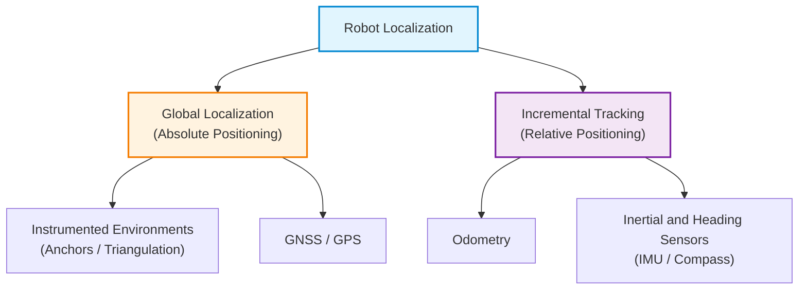

---

### The Concept of Dead Reckoning

The process of estimating the current position of a robot based solely on the integration of its velocity vector (magnitude and direction) starting from a known initial position is called **Dead Reckoning** (historically derived from *deduced reckoning*).

$$\mathbf{x}_k = \mathbf{x}_{k-1} + \int_{t_{k-1}}^{t_k} \mathbf{v}(t) \, dt$$

> **[KEY CONCEPT: Error Accumulation in Dead Reckoning]**  
> Dead Reckoning is a process subject to an inevitable **accumulation of integrative error (drift)**. Small inaccuracies in measuring orientation (*heading*) and translation propagate and amplify quadratically over time. 
> 
> *Intuitive analogy*: Corresponds to the human sensation of walking with closed eyes in a dark room. Relying solely on the vestibular system and limb proprioception, after a few steps one loses the accurate perception of one's absolute position, increasing the risk of collision.

#### Orientation (*Heading*) and Robot Safety
Orientation estimation does not concern only the yaw angle (*Yaw* $\psi$) on the horizontal plane, which is fundamental to avoid long-term trajectory deviations, but also includes pitch inclination (*Pitch* $\theta$). Knowing the inclination on a slope is a critical parameter for mechanical stability and rollover safety of the robot.

---

### Inertial and Orientation Sensors

The fundamental components used in inertial navigation systems are divided into accelerometers, gyroscopes, and magnetometers.

#### 1. Accelerometers
An accelerometer measures the specific acceleration to which a proof mass is subjected, converting the resulting inertial force into an electrical signal.

* **Piezoelectric Accelerometers**: Acceleration compresses or bends an element made of piezoelectric material, generating a potential difference $V$ proportional to the applied force:
  $$F = m \cdot a \implies V \propto F$$
* **Capacitive Accelerometers (MEMS)**: Fabricated using micro-electro-mechanical systems (*MEMS - Micro-Electro-Mechanical Systems*) technology. A proof mass suspended on micro-springs changes its position relative to fixed plates of a capacitor. The variation in capacitance $\Delta C$ is proportional to the acceleration:
  $$\Delta C \propto \Delta x \propto a$$

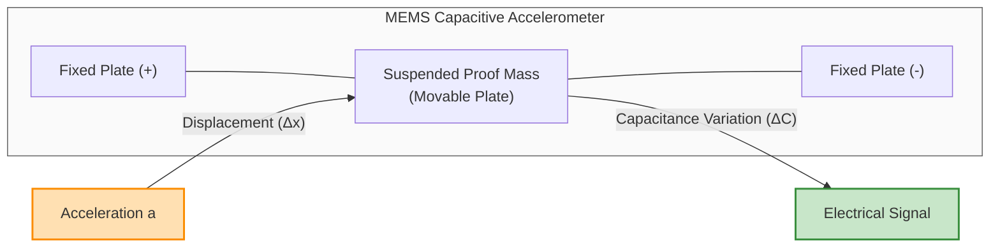

#### 2. Gyroscopes
Gyroscopes measure angular velocity ($\omega$) around one or more axes. They are mainly divided into three technological categories:

1. **Mechanical Gyroscopes**: Based on the conservation of angular momentum of a high-speed rotating wheel (*spinning wheel*). Any attempt to rotate the axis of rotation generates a measurable gyroscopic torque. They are precise but bulky, heavy, and power-hungry.
2. **Vibrating Structure MEMS Gyroscopes**: They exploit the Coriolis force on micro-mechanical elements set into oscillation. They feature extremely small dimensions, low cost, and low power consumption.
3. **Fiber Optic Gyroscopes (FOG - Fiber Optic Gyroscopes)**: They exploit the **Sagnac effect** (*Sagnac effect*). Two laser light beams are injected in opposite directions (clockwise and counter-clockwise) inside a fiber optic coil. When the sensor rotates, one beam will travel a slightly longer optical path than the other, creating a phase difference $\Delta \Phi$ shifted proportionally to the angular velocity $\Omega$:
   $$\Delta \Phi = \frac{4 \pi L R}{\lambda c} \Omega$$
   *(Where $L$ is the length of the fiber, $R$ the radius of the coil, $\lambda$ the wavelength of light, and $c$ the speed of light).*

#### 3. Compasses and Magnetometers
They serve to estimate absolute orientation (*heading*) by measuring the Earth's magnetic field.

* **Hall Effect Transducers**: They exploit the deflection experienced by electric charges in a semiconductor traversed by an orthogonal magnetic field, generating a Hall voltage $V_H$.
* **Fluxgate Compasses**: Composed of a core made of high magnetic permeability material wound with two coils:
  * **Drive Coil**: Injects an alternating current that cyclically brings the core to opposite magnetic saturation (+S and -S).
  * **Sense Coil**: Detects variations in magnetic flux. In the presence of an external magnetic field, core saturation becomes asymmetrical; the sense coil detects this asymmetry, measuring the local component of the magnetic field with very high accuracy.

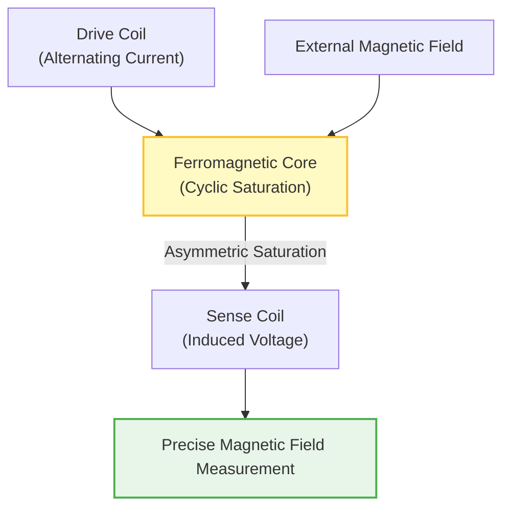

> **[KEY CONCEPT: Limitations of Magnetometers in Robotics]**  
> The use of magnetic compasses in indoor or industrial contexts presents significant criticalities:
> 1. The Earth's magnetic field has low intensity.
> 2. Presence of **local magnetic disturbances (hard/soft iron distortions)** caused by current-carrying cables, motors, power outlets, and metallic structural elements of the building. 
> 
> Such interference causes strong local variations in the detected field that do not correspond to an actual change in the robot's orientation.

---

### Inertial Measurement Unit (IMU) and IMU/GNSS Integration

#### The Structure of an IMU Unit
A modern **Inertial Measurement Unit (IMU)** integrates up to 9 sensors into a single, ultra-compact solid-state device (often referred to as a *9-Axis IMU*):
* **3 Accelerometers** (X, Y, Z axes)
* **3 Gyroscopes** (Roll, Pitch, Yaw axes)
* **3 Magnetometers** (X, Y, Z axes)

The IMU's internal firmware continuously executes sensor fusion algorithms (e.g., Kalman Filters or Complementary Filters) to compute the **6 Degrees of Freedom (6-DOF)** kinematics of the system: three-dimensional position $(x, y, z)$ and attitude angles (Roll $\phi$, Pitch $\theta$, Yaw $\psi$).

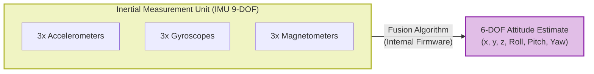

#### Synergy Between IMU and GNSS (Automotive/Robotics Navigation)
Pairing a GNSS (GPS) receiver with an IMU resolves the intrinsic shortcomings of each individual sensor:

* **Scenario A: Loss of GNSS Signal (e.g., Entering a Tunnel)**  
  Inside a tunnel, the satellite connection is interrupted. The navigation system switches to pure *Dead Reckoning* mode using the IMU. While inside the tunnel, the position updates continuously, but accumulates *drift*. Upon exiting the tunnel, reacquiring the GPS signal imposes an **instantaneous correction** (a position jump physically visible on the map) to eliminate the accumulated integration error.

* **Scenario B: GPS Outlier Filtering and Map Matching**  
  Commercial GPS systems exhibit noticeable positioning errors (up to 5–7 meters). To prevent the car from oscillating off the road on the screen:
  1. A **Map Matching** constraint is applied (the estimated position is projected onto the road network of the digital map).
  2. The IMU provides high-frequency kinematic estimates of orientation. If the GPS provides off-trajectory points incompatible with the yaw angle read by the gyroscopes (e.g., at a junction), the fusion filter discards the erroneous satellite measurements (outliers) or delays the deviation until the IMU confirms the vehicle's actual turn.

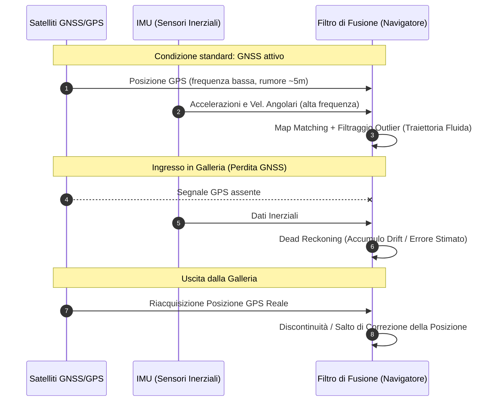

---

### Sensor Classification: Proprioception vs. Exteroception

During the lecture, the functional role of inertial sensors was analyzed with respect to the definitions of **Proprioceptive** sensor (measuring the robot's internal state) and **Exteroceptive** sensor (measuring the external world).

| Sensor | Classification | Rationale / Logical Notes |
| :--- | :--- | :--- |
| **Accelerometer** | **Proprioceptive** *& (in part)* **Exteroceptive** | It is **proprioceptive** because it measures the acceleration due to the robot's own change in velocity. It is **exteroceptive** because it is constantly subject to the Earth's gravitational field $\vec{g} \approx 9.81 \text{ m/s}^2$. When used as an *inclinometer* to measure orientation relative to the horizon, it exploits the gravity vector (an external reference). |
| **Gyroscope** | **Proprioceptive** | It measures solely the angular velocity of the robot's structure relative to its own mass/axis of inertia, without referencing any external point or force field. |
| **Magnetometer / Compass** | **Exteroceptive** | It directly measures a physical entity belonging to the external environment: the magnetic field (Earth's or local). |

---

### Fundamentals of Digital Vision and the Pinhole Model

Digital cameras represent one of the most important and widespread sensors in mobile robotics. Their basic operation is based on an array of photosensitive sites — **CCD (Charge-Coupled Device)** or **CMOS (Complementary Metal-Oxide-Semiconductor)** sensors — capable of accumulating photons and converting the incident light energy into an electrical signal, which is then amplified and digitized.

An optical system (lens system) focuses the light from the scene onto the sensor. The fundamental mathematical model describing image formation is the **Pinhole Camera Model**.

> **Key Concept: Loss of the Third Dimension**  
> By projecting a three-dimensional world ($\mathbb{R}^3$) onto a two-dimensional image plane ($\mathbb{R}^2$), the camera intrinsically loses depth information ($Z$). Every point on the 2D image corresponds to a projective ray in 3D space, making it impossible to estimate the distance of an object from a single frame without additional geometric constraints or *Computer Vision* models.

To understand visual perception in robots, one must consider the behavior of light in the environment:
1. A light source (e.g., artificial or solar illumination) irradiates the objects present in the scene.
2. Objects reflect incident light **in all directions** (diffuse/Lambertian reflection).

> **Note:** The omnidirectional reflection of light is the reason why the object remains visible from whichever perspective or angle the visual sensor moves to.

#### The Impact of Deep Learning in Robotics
In the past, computer vision was considered a secondary and unreliable sensor due to the sensitivity of traditional algorithms to variations in illumination and viewpoint. With the advent of **Deep Learning**, neural network-based models have proven extremely robust, making cameras the primary sensor of modern robotics (used even in commercial robot vacuum cleaners for navigation and obstacle recognition tasks).

---

### Specialized and Broad-Spectrum Vision Sensors

In addition to classic grayscale or RGB images, advanced visual sensors capable of extracting information invisible to the human eye are used in robotics.

#### Multispectral and Near-Infrared (NIR) Cameras
**Multispectral Cameras** acquire light in bands of the electromagnetic spectrum outside the visible range, such as **Near-Infrared (NIR)**, which is characterized by wavelengths longer than those of red.

*   **Material applications:** The reflectance of a surface in the NIR domain varies significantly based on its chemical composition. This allows a robot to distinguish visually identical materials in the RGB field (for example, differentiating two distinct types of plastic or identifying wood compared to a synthetic material).

---

### Advanced Optical Geometries: Fisheye and Omnidirectional Cameras

In many robotic applications, standard narrow-field-of-view lenses are not used; instead, wide-aperture optics that introduce strong geometric distortions are employed to maximize perception of the surrounding environment.

#### Fisheye Cameras (Wide-Angle)
In conventional lenses, the focal length determines the field of view angle (**Field of View - FOV**). 
*   **Wide-Angle:** Vision systems with $FOV > 100^\circ$.
*   **Fisheye:** Extreme optical systems with $FOV \approx 180^\circ$ (or higher), capable of capturing the scene even laterally relative to the optical axis.

The image projected onto the CCD/CMOS sensor by a fisheye lens is heavily distorted. However, knowing the intrinsic parameters of the lens (via distortion calibration models), it is possible to reconstruct the actual geometric structure of the scene:
*   A human operator requires a **dewarped** image (reprojected without distortion).
*   A robotic algorithm can process **the distorted image directly**, saving computational resources.

> **Application Example (Automotive):** $360^\circ$ vision systems in automobiles (top view or *bird's-eye view*) are created by combining and processing video streams from $4$ or $6$ fisheye cameras placed around the perimeter of the vehicle.

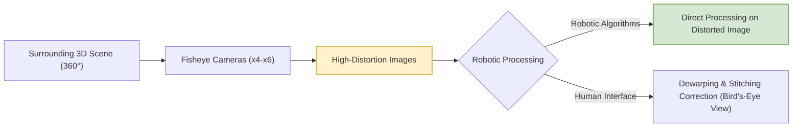

#### Catadioptric Systems and Omnidirectional Cameras
**Omnidirectional Cameras** combine a traditional vision sensor with a suitably shaped curved mirror (**Catadioptric System**).

*   Incident light rays first strike the mirror and are deflected toward the camera lens according to the local curvature of the mirror.
*   The resulting image has a circular shape and covers an azimuthal angle of $360^\circ$ in a single shot.
*   **Projection Model:** They do not follow the flat Pinhole model, but rather the **Spherical Projection Model**.
*   **Reconstruction:** The circular image can be "unwarped" through a coordinate transformation to obtain a rectangular panoramic view.
*   **Main use:** Flying robots (drones) for rapid obstacle tracking and urban mapping systems (e.g., *Google Street View*).

---

### Event Cameras (Neuromorphic Sensors)

**Event Cameras** represent a radical paradigm shift compared to traditional vision technology. Although they employ Pinhole-type optics, the sensor operates according to **neuromorphic** principles (inspired by the functioning of the biological retina).

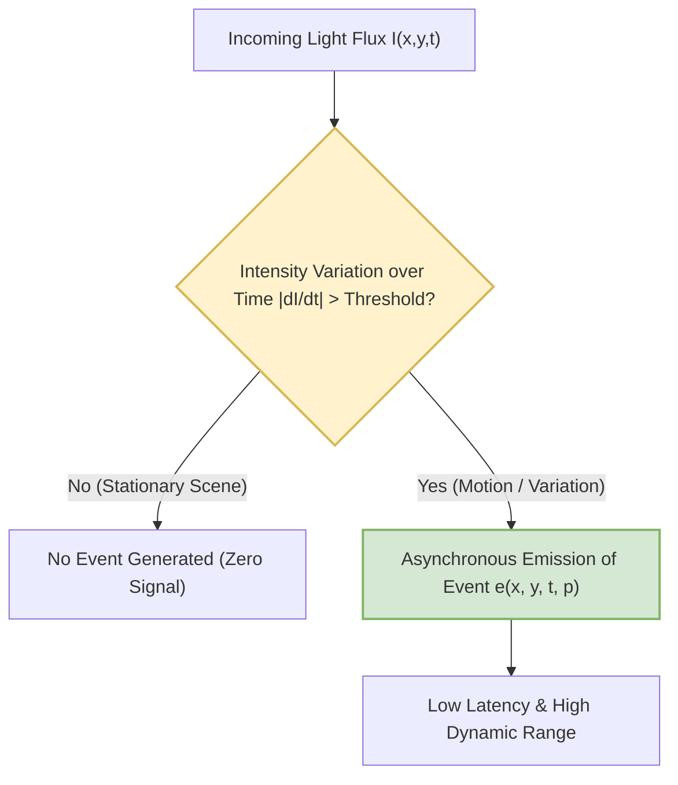

#### Operating Principle
In conventional (*frame-based*) cameras, acquisition is **synchronous**: at every fixed time interval, the charge of all pixels is measured, the array is reset, and the entire frame is transferred.

In event cameras, each pixel operates **independently and asynchronously**. Each pixel integrates a comparator circuit that detects the **relative variation in light intensity** (photon flux) over time:

$$\Delta \ln I(x,y,t) = \ln I(x,y,t) - \ln I(x,y,t - \Delta t)$$

If the variation exceeds a given threshold $C$, the pixel emits an **event** described by the quadruple $e = (x, y, t, p)$, where:
*   $(x, y)$ are the spatial coordinates of the pixel.
*   $t$ is the timestamp with microsecond resolution.
*   $p \in \{-1, +1\}$ is the polarity (increase or decrease in brightness).

> **Key Concept: Zero-Signal Sensor on Static Scenes**  
> If the camera is stationary and pointed at a perfectly static scene, the sensor **does not generate any data** (the output image is completely black). Data are generated **only** where relative motion occurs between the scene and the camera.

#### Biological Analogy and Saccadic Movements
The human retina does not transmit continuous absolute brightness levels to the brain, but reacts to translations and contrast gradients. To prevent the "decay" of the visual signal on stationary objects, the human eye involuntarily performs microscopic, ultra-high-frequency movements called **Saccadic Movements**, which generate continuous temporal variations on the retina that are essential for reconstructing vision.

#### Advantages of Event Cameras

| Property | Frame-Based Cameras | Event Cameras |
| :--- | :--- | :--- |
| **Acquisition** | Synchronous (Full frames at intervals $T$) | Asynchronous (Only changed pixels) |
| **Latency** | High ($\sim 10 - 33\text{ ms}$) | Very low ($\sim \text{microsecondi}$) |
| **Motion Blur** | High during rapid motion | Almost absent |
| **Dynamic Range (HDR)** | Limited ($\sim 60\text{ dB}$) | Very high ($> 120\text{ dB}$) |
| **Data Throughput** | Constant and high (all pixels) | Variable and reduced (events only) |

#### High-Reactivity Applications in Robotics
Thanks to their near-zero latency, event cameras are ideal for **high-speed autonomous navigation** and **Dynamic Obstacle Avoidance** in fast drones.

> **Practical Example:** A drone equipped with an event camera having a ball thrown at it at high speed. In the generated event stream, the stationary background (shifted by the drone's motion) produces a uniform pattern, whereas the ball exhibits a distinctly different trajectory and temporal variation profile. This allows the algorithm to segment the obstacle and execute the evasive maneuver within a few milliseconds.

---

### Distance Measurement and Active Time-of-Flight (ToF) Sensors

Conventional cameras perform a perspective projection from the 3D world onto the 2D image plane, intrinsically losing depth information (length along the projective ray). To directly recover this third dimension, **active distance sensors** based on the **Time-of-Flight (ToF)** principle are used.

The core principle of ToF consists of emitting an energy signal (acoustic or electromagnetic) toward an object and measuring the time taken by the pulse to travel to the surface, be reflected, and return to the sensor.

This measurement can take place in two ways:
1. **Point-wise:** measuring the distance along a single direction in space.
2. **Range Image / Depth Map:** using a model analogous to the *pinhole* model, a 2D matrix is acquired in which each pixel stores not a luminous intensity or color value, but the distance $d$ detected along the corresponding projective ray.

From the 2D depth map, it is possible to mathematically reconstruct a **Point Cloud**, that is, an explicit 3D geometric representation of the surrounding environment.

---

#### Fundamental Principle of Distance Calculation

Knowing that the signal travels the distance between the sensor and the obstacle twice (round trip), the basic ToF formula is:

$$d = \frac{v \cdot \Delta t}{2}$$

Where:
* $d$ is the distance to the object;
* $v$ is the propagation speed of the wave in the medium;
* $\Delta t$ is the time interval measured between emission and reception.

---

#### Ultrasonic Sensors (Sonar)

The simplest and least expensive distance sensor is **Sonar (Sound Navigation and Ranging)**. Being an active sensor, Sonar is composed of two fundamental elements:
* **Emitter (Speaker):** usually based on piezoelectric surfaces that, when electrically vibrated, generate high-frequency acoustic waves (ultrasound, inaudible to the human ear).
* **Receiver (Microphone):** typically a capacitive microphone designed to detect the sound pressure variations reflected by surfaces.

Sonar sensors are commonly deployed organized in **Arrays** (groups of sensors oriented in different directions) to cover wider fields of view, as occurs in automotive parking assistance systems.

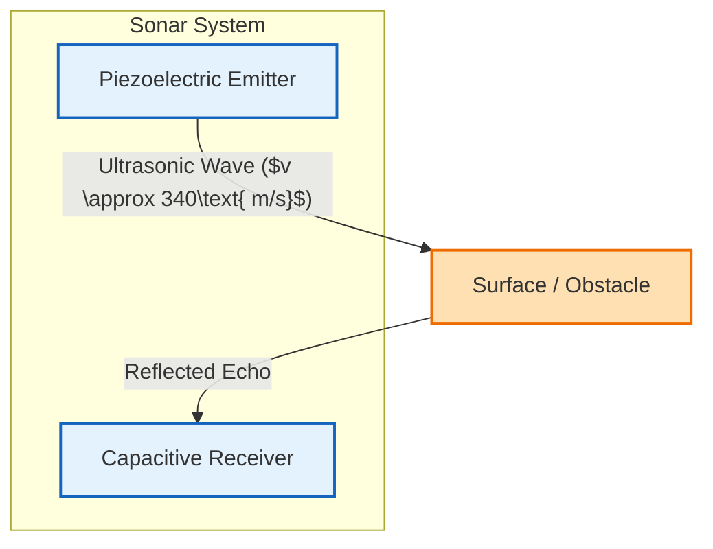

##### Physical and Operational Limits of Sonar

> **Key Concept: Angular Integration and Positional Error of Sonar**  
> Sonar has a very wide beam cone (or aperture cone). The sensor does not return the exact position of a point, but **integrates information over the entire solid angle of the cone**.  
> * Implication: If a thin obstacle (e.g., a pole) is present inside the cone, the Sonar correctly detects the presence of an obstacle at distance $d$, but **is unable to determine its angular position or width**.  
> * Practical use: Excellent for *collision avoidance* in low-cost applications, but unsuitable for accurate map reconstruction or precision navigation for mobile robots.

The main characteristics of Sonar are:
* **Propagation speed:** $v_{suono} \approx 340 \text{ m/s}$.
* **Useful range:** Limited (approximately $2 \div 4 \text{ metri}$). Beyond 3-4 meters, the attenuation of sound intensity makes the return signal too weak and noisy.
* **Cost:** Extremely low.

---

#### Optical Sensors: Laser Range Finder and Lidar

To overcome the resolution and range limitations of Sonar, electromagnetic radiation in the form of laser light (**Light Detection and Ranging, Lidar**) can be used.

Fundamental difference in speed:
* Sound wave: $v_{suono} \approx 3.4 \times 10^2 \text{ m/s}$
* Light wave: $c \approx 3.0 \times 10^8 \text{ m/s}$ ($300.000 \text{ km/s}$)

The speed of light is approximately **6 orders of magnitude ($10^6$) higher** than that of sound.

##### Rotating Mirror Mechanical Architecture

To scan the environment without having to move the entire heavy assembly composed of the emitting diode and the receiving sensor, a **rotating mirror** configuration is used.

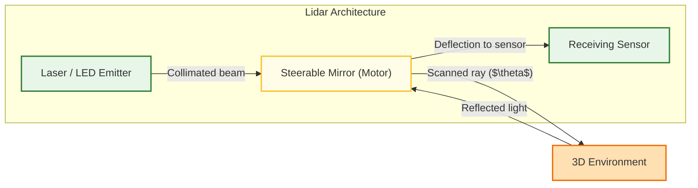

A diode emits a laser beam collimated through a lens. The beam strikes a mirror inclined at $45^\circ$ and driven by an electric motor. By rotating the mirror, the beam is directed radially into space. The same mirror collects the return light reflected from the environment and converges it onto the receiving sensor.

We usually distinguish:
* **Laser Range Finder (LRF):** A sensor that scans on a single 2D plane (single beam or laser line).
* **Lidar:** A sensor consisting of multiple stacked laser lines (e.g., 16, 32, 64, or 128 beams) that rotate to generate a high-density 3D point cloud.

##### Optical Time-of-Flight Measurement Techniques

Directly measuring $\Delta t$ for light over short distances requires extremely complex electronics, given that the time fractions involved are on the order of **picoseconds or nanoseconds** ($\approx 3.3 \text{ ns}$ per meter). To overcome this problem, two approaches are used:

###### 1. Phase Shift Measurement
Instead of sending a single pulse and timing it, a frequency-modulated light signal is transmitted. A portion of the emitted signal is sent directly inside the sensor as a reference.

By detecting the phase shift $\Delta \phi$ between the emitted wave $s_e(t)$ and the reflected return wave $s_r(t)$, the distance $d$ is determined:

$$\Delta \phi = 2\pi f \cdot \Delta t = 2\pi f \cdot \left( \frac{2d}{c} \right) = \frac{4\pi d}{\lambda}$$

From which the distance $d$ is obtained:

$$d = \frac{\lambda \cdot \Delta \phi}{4\pi}$$

Where $\lambda$ is the modulation wavelength and $c$ is the speed of light.

> **Key Concept: Phase Measurement vs. Direct Time Measurement**  
> Phase shift measurement ($\Delta \phi$) transforms an ultra-high-frequency timing problem (nanoseconds) into a problem of comparing amplitudes and phases of alternating signals, proving electronically simpler to implement for medium-short distances.

###### 2. Direct Time Measurement (Direct ToF)
Used in high-end devices integrated with high-speed digital timers (*Time-to-Digital Converter, TDC*), capable of directly estimating $\Delta t$.

##### Mechanical Lidar vs. Solid-State Lidar

* **Mechanical Lidar (Rotating Lidar):** The mirror (or the entire sensor head) physically rotates.
  * *Advantages:* Less expensive, wide field of view up to $360^\circ$.
  * *Disadvantages:* The presence of moving mechanical parts makes them subject to wear and tear and susceptible to vibrations.
* **Solid-State Lidar (Optical Phased Array - OPA):** They have no moving mechanical parts. They exploit an *Optical Phased Array* to steer the direction of the laser beam by varying the phase of individual micro-electronic emitting elements.
  * *Advantages:* Maximum mechanical robustness, ideal for vehicles operating on uneven ground (*rough terrain*).
  * *Disadvantages:* Much more expensive than mechanical systems.

---

#### Radio Frequency Sensors (Radar)

**Radar (Radio Detection and Ranging)** exploits the same physical principle of Time-of-Flight, but uses electromagnetic waves in the **radio frequency** spectrum (wavelengths significantly longer than the visible or infrared light of a laser).

##### Advantages and Disadvantages of Radar Compared to Sonar and Lidar

> **Key Concept: Environmental Robustness of Radar**  
> The main problem with Lidar is its sensitivity to adverse weather conditions: fog, dust, rain, and snow contain water micro-droplets or suspended particles with dimensions comparable to the wavelength of laser light. The laser is reflected by these particles, generating false obstacles.  
> **Radar radio waves**, having a much longer wavelength, pass unaltered through fog, dust, and rain, reflecting only off macroscopic objects (other vehicles, infrastructure, pedestrians).

* **Advantages of Radar:**
  * Extreme robustness against weather agents (fog, snow, rain, dust).
  * Long range (up to hundreds of meters).
* **Disadvantages of Radar:**
  * **Low angular and spatial resolution:** The accuracy in reconstructing object contours is noticeably lower than that offered by a Lidar.

Modern automotive Radars employ high frequencies (Short-Range and Long-Range Radar) to increase spatial resolution and are used alongside cameras and Lidar in autonomous driving systems to ensure sensing redundancy (*Sensor Fusion*).

---

#### Comparative Table of Active Distance Sensors

| Feature | Sonar (Ultrasound) | Lidar (Laser) | Radar (Radio Waves) |
| :--- | :--- | :--- | :--- |
| **Wave Type** | Acoustic (Mechanical) | Electromagnetic (Optical) | Electromagnetic (Radio) |
| **Propagation Speed ($v$)** | $\approx 340 \text{ m/s}$ | $\approx 3.0 \times 10^8 \text{ m/s}$ | $\approx 3.0 \times 10^8 \text{ m/s}$ |
| **Typical Range** | Short ($2 \div 4 \text{ m}$) | High (up to $100 \div 200 \text{ m}$) | Very High ($100 \div 300 \text{ m}$) |
| **Angular Resolution** | Very Low (wide cone) | Excellent (very high) | Medium / Low |
| **Resistance to Fog/Dust** | High | **Low** (sensitive to particles) | **Maximum** |
| **Hardware Cost** | Very Inexpensive | High (especially Solid-State) | Medium / High |
| **Typical Application** | Parking, basic collision avoidance | 3D navigation, robotic mapping | Adaptive Cruise Control (ACC), fog alert |

---

### Stereoscopic Cameras and Depth Maps

In many mobile and autonomous robotics applications, the use of a single camera (monocular vision) presents an inherent limitation: the loss of depth information. To overcome this problem, **Stereoscopic Vision** (*Stereo Vision*) systems are used, based on two or more cameras placed at a known distance.

#### The Principle of Parallax and Disparity

When two cameras observe the same scene from two distinct viewpoints, the objects projected onto their respective sensors undergo a relative displacement. This phenomenon is known as **parallax** (*parallax*). 

The fundamental quantity that allows estimating the distance of objects is **Disparity** (*Disparity*), defined as the difference in image coordinates between two corresponding points observed by the two cameras:

$$d = x_L - x_R$$

where $x_L$ and $x_R$ indicate the horizontal position of the same 3D point in the left image and in the right image, respectively.

Through simple geometric triangulation based on the pinhole camera model (*pinhole camera model*), the depth $Z$ of a point in space is inversely proportional to its disparity $d$:

$$Z = \frac{f \cdot B}{d}$$

Where:
- $Z$ is the distance (depth) of the object relative to the focal plane;
- $f$ is the focal length (*focal length*) of the cameras;
- $B$ is the baseline, i.e., the physical distance between the optical centers of the two cameras;
- $d$ is the measured disparity ($x_L - x_R$).

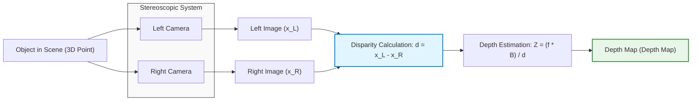

Unlike a LiDAR sensor that generates a sparse **Point Cloud** (*Point Cloud*), the stereoscopic system generates a **Depth Map** (*Depth Map*): a continuous estimate of distance for every single pixel in the image grid. 

Today, the use of **Deep Neural Networks** (*Deep Neural Networks - DNN*) has drastically improved algorithm performance in calculating and estimating disparity, making stereo cameras one of the primary options for 3D environment reconstruction in modern robots.

---

### The Correspondence Problem (Correspondence Problem)

Although the mathematical formulation of disparity is simple, practical application presents significant algorithmic challenges. 

To be able to calculate disparity $d$, it is first necessary to identify with absolute precision that a specific pixel in the left image corresponds to the exact same physical point in the right image. This process is called the **Correspondence Problem** (*Correspondence Problem*).

> **KEY CONCEPT: The Two Main Challenges of Stereoscopic Vision**
> 1. **System Calibration (*Camera Calibration*):** It is essential to accurately calibrate the intrinsic and extrinsic parameters of the cameras to align the pixel rows (rectification).
> 2. **Feature Matching (*Feature Matching*):** The same details (*features*) must be identified in both images. If a surface lacks texture (e.g., a smooth white wall), the algorithm cannot find unique reference points and disparity calculation **fails**.

---

### Structured Light Sensors (Structured Light 3D Cameras)

How can the correspondence problem be solved on featureless or feature-poor surfaces (*featureless* or *feature-poor*)?

The engineering solution consists of using **active systems**, i.e., artificially creating features (*features*) on the surface to be measured.

#### Operating Principle of Structured Light

Instead of relying on ambient light and the natural texture of the object, a **light projector** projects a known light pattern onto the scene (e.g., a grid, a set of points, or infrared stripes).

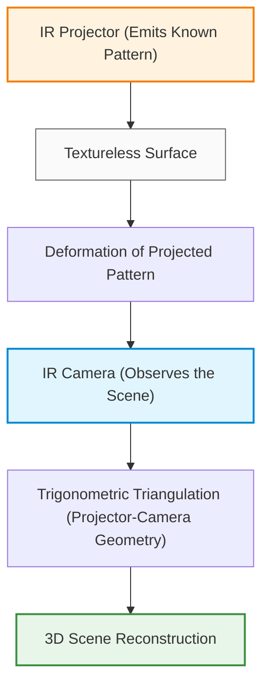

1. The projector sends a known geometric pattern onto the surface of the environment.
2. The camera, placed at a known distance (baseline) from the projector, captures the scene.
3. If the surface is flat, the pattern appears unaltered; if the surface exhibits depth variations or complex 3D shapes, the pattern undergoes an **optical deformation**.
4. By leveraging the known trigonometry between the projector and the camera, the system analyzes how the projected pattern has changed in the image and reconstructs the 3D structure of the environment with high accuracy.

An emblematic commercial example of this technology is the **Microsoft Kinect** sensor (first version), which projected a grid of invisible points in the infrared (IR) spectrum. Originally created for the video game industry, it became a fundamental tool for research and development in 3D robotic perception thanks to its low cost and measurement effectiveness.