# Sensori Inerziali, Navigazione Stimata (Dead Reckoning) e Unità di Misura Inerziale (IMU)

## Overview Didattica

La lezione prosegue la panoramica sui sensori per la robotica, spostando l'attenzione dai sistemi di **localizzazione globale (*Global Localization*)** — basati su punti di riferimento esterni noti come *ancore (Anchors)* o sistemi satellitari *GNSS (Global Navigation Satellite System)* — alle tecniche di **stima incrementale del moto**, fondamentali quando non sono disponibili riferimenti assoluti nell'ambiente.

I concetti chiave introdotti in questa sessione includono:

* **Navigazione Stimata (*Dead Reckoning* / *Deduced Reckoning*)**: il processo di aggiornamento della posizione del robot a partire da una posa iniziale nota, integrando le stime del vettore velocità e dell'orientamento (*Heading*). Viene evidenziato il limite intrinseco di questo approccio: l'accumulo progressivo degli errori di misura porta inevitabilmente a una deriva della posizione stimata nel tempo.
* **Importanza dell'Orientamento (*Heading* e *Pitch*)**: la misura accurata della direzione sul piano orizzontale ($\theta$) e dell'inclinazione (*Pitch*) non è solo essenziale per ridurre la principale fonte di incertezza sulla posizione durante traslazioni e rotazioni, ma anche per garantire la sicurezza operativa del robot (ad esempio durante la discesa lungo una pendenza).
* **Unità di Misura Inerziale (*Inertial Measurement Unit*, IMU)**: dispositivo compatto ed economico che integra in un unico modulo i sensori necessari per il tracciamento del moto e dell'orientamento, includendo spesso anche una *bussola (Compass)* o magnetometro riferito al campo magnetico terrestre.
* **Principi di funzionamento dei componenti dell'IMU**:
  * **Accelerometro (*Accelerometer*)**: sensore utilizzato per misurare l'accelerazione (e stimare per integrazione la velocità), analizzato nelle varianti *piezoelettrica (Piezoelectric)* e *capacitiva (Capacitive)*, quest'ultima comunemente realizzata su scala micrometrica tramite tecnologia *MEMS (Micro-Electro-Mechanical Systems)*.
  * **Giroscopio (*Gyroscope*)**: sensore dedicato alla stima dell'orientamento basato sul principio fisico della conservazione del momento angolare (*Conservation of Angular Momentum*).

---

### Localizzazione Globale vs. Stima Incrementale della Posizione

Nelle applicazioni di robotica mobile, la determinazione della posizione del veicolo nello spazio può essere affrontata mediante due approcci concettualmente differenti:

1. **Localizzazione Globale (Global Localization)**: Consente di stimare la posizione assoluta del robot all'interno di un sistema di riferimento mappa/mondo. Si avvale di sensori esterocettivi e di infrastrutture esterne:
   * **Ambienti Strumentati**: Utilizzano punti di riferimento a posizione nota (detti *Ancore* o *Anchors*) dotati di *landmark* attivi per triangolare la posizione.
   * **Sistemi di Navigazione Satellitare (GNSS - Global Navigation Satellite System)**: Utilizzano segnali satellitari (es. GPS) per la trilaterazione della posizione sulla superficie terrestre.

2. **Tracking Incrementale del Moto (Incremental Motion Tracking)**: Fornisce informazioni relative al movimento a partire da uno stato iniziale noto, senza misurare direttamente la posizione assoluta nel mondo.
   * **Odometria (Odometry)**: Misura le rotazioni delle ruote per stimare lo spostamento.
   * **Sensori Inerziali e di Orientamento (Inertial and Heading Sensors)**: Misurano le accelerazioni e le velocità angolari per integrare la traiettoria nel tempo.

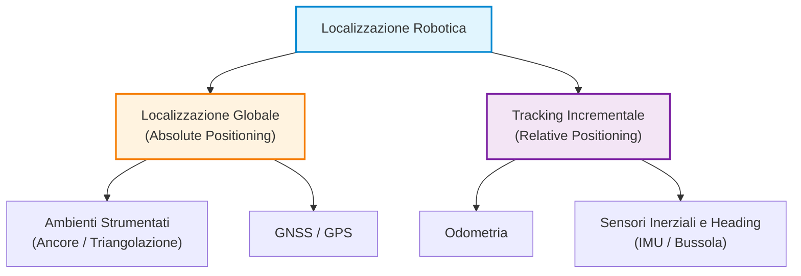

---

### Il Concetto di Dead Reckoning

Il processo di stima della posizione corrente di un robot basato unicamente sull'integrazione del suo vettoriale di velocità (modulo e direzione) a partire da una posizione iniziale nota prende il nome di **Dead Reckoning** (storicamente derivato da *deduced reckoning*, calcolo stimato).

$$\mathbf{x}_k = \mathbf{x}_{k-1} + \int_{t_{k-1}}^{t_k} \mathbf{v}(t) \, dt$$

> **[CONCETTO CHIAVE: Accumulo dell'Errore nel Dead Reckoning]**  
> Il Dead Reckoning è un processo soggetto a un ineluttabile **accumulo dell'errore integrativo (drift)**. Piccole imprecisioni nella misura dell'orientamento (*heading*) e della traslazione si propagano e amplificano quadraticamente nel tempo. 
> 
> *Analogia intuitiva*: Corrisponde alla sensazione umana di camminare a occhi chiusi in una stanza buia. Basandosi solo sul sistema vestibolare e sulla propriocezione degli arti, dopo pochi passi si perde la percezione accurata della propria posizione assoluta, aumentando il rischio di collisione.

#### Orientamento (*Heading*) e Sicurezza del Robot
La stima dell'orientamento non riguarda unicamente l'angolo di imbardata (*Yaw* $\psi$) sul piano orizzontale, fondamentale per evitare deviazioni di traiettoria a lungo termine, ma include anche l'inclinazione di beccheggio (*Pitch* $\theta$). Conoscere l'inclinazione su un pendio è un parametro critico per la stabilità meccanica e la sicurezza antiribaltamento del robot.

---

### Sensori Inerziali e di Orientamento

I componenti fondamentali impiegati nei sistemi di navigazione inerziale si dividono in accelerometri, giroscopi e magnetometri.

#### 1. Accelerometri (Accelerometers)
Un accelerometro misura l'accelerazione specifica a cui è soggetta una massa di prova, convertendo la forza d'inerzia risultante in un segnale elettrico.

* **Accelerometri Piezoelettrici**: L'accelerazione comprime o flette un elemento in materiale piezoelettrico, generando una differenza di potenziale $V$ proporzionale alla forza applicata:
  $$F = m \cdot a \implies V \propto F$$
* **Accelerometri Capacitivi (MEMS)**: Realizzati in tecnologia micro-elettromeccanica (*MEMS - Micro-Electro-Mechanical Systems*). Una massa sismica sospesa su micro-molle varia la sua posizione rispetto a armature fisse di un condensatore. La variazione di capacità $\Delta C$ è proporzionale all'accelerazione:
  $$\Delta C \propto \Delta x \propto a$$

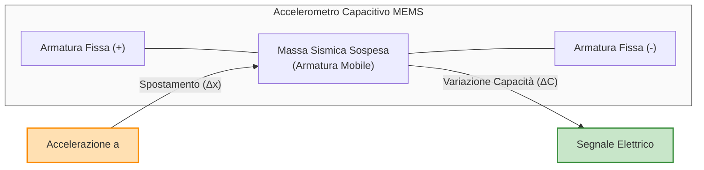

#### 2. Giroscopi (Gyroscopes)
I giroscopi misurano la velocità angolare ($\omega$) attorno a uno o più assi. Si dividono principalmente in tre categorie tecnologiche:

1. **Giroscopi Meccanici**: Basati sulla conservazione del momento angolare di una ruota ad alta velocità di rotazione (*spinning wheel*). Qualsiasi tentativo di ruotare l'asse di rotazione genera una coppia giroscopica misurabile. Sono precisi ma ingombranti, pesanti e ad alto consumo energetico.
2. **Giroscopi MEMS a Struttura Vibrante**: Sfruttano la forza di Coriolis su elementi micro-meccanici posti in oscillazione. Presentano dimensioni estremamente ridotte, basso costo e ridotto consumo energetico.
3. **Giroscopi a Fibra Ottica (FOG - Fiber Optic Gyroscopes)**: Sfruttano l'**Effetto Sagnac** (*Sagnac effect*). Due fasci di luce laser vengono iniettati in direzioni opposte (oraria e antioraria) all'interno di una bobina di fibra ottica. Quando il sensore ruota, un fascio percorrerà un tragitto ottico leggermente più lungo rispetto all'altro, creando una differenza di fase $\Delta \Phi$ sfasata proporzionalmente alla velocità angolare $\Omega$:
   $$\Delta \Phi = \frac{4 \pi L R}{\lambda c} \Omega$$
   *(Dove $L$ è la lunghezza della fibra, $R$ il raggio della bobina, $\lambda$ la lunghezza d'onda della luce e $c$ la velocità della luce).*

#### 3. Bussole e Magnetometri (Compasses / Magnetometers)
Servono a stimare l'orientamento assoluto (*heading*) misurando il campo magnetico terrestre.

* **Trasduttori ad Effetto Hall (Hall Effect Transducers)**: Sfruttano la deviazione subita dalle cariche elettriche in un semiconduttore attraversato da un campo magnetico ortogonale, generando una tensione di Hall $V_H$.
* **Bussole Fluxgate (Fluxgate Compasses)**: Composte da un nucleo in materiale ad alta permeabilità magnetica avvolto da due bobine:
  * **Bobina di Drive (Drive Coil)**: Inietta una corrente alternata che porta ciclicamente il nucleo a saturazione magnetica opposta (+S e -S).
  * **Bobina di Sense (Sense Coil)**: Rileva le variazioni del flusso magnetico. In presenza di un campo magnetico esterno, la saturazione del nucleo diventa asimmetrica; la bobina di sense rileva questa dissimetria misurando con elevatissima accuratezza la componente locale del campo magnetico.

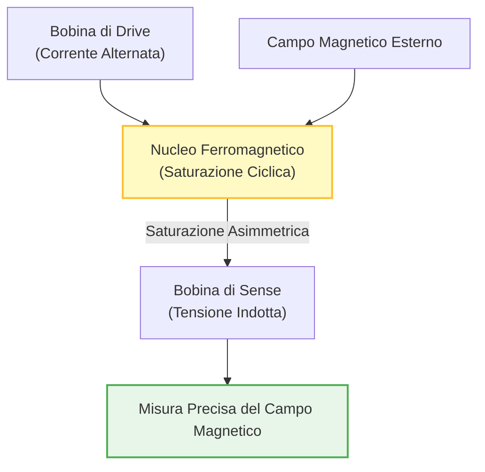

> **[CONCETTO CHIAVE: Limiti dei Magnetometri in Robotica]**  
> L'utilizzo delle bussole magnetiche in contesti indoor o industriali presenta notevoli criticità:
> 1. Il campo magnetico terrestre è di debole intensità.
> 2. Presenza di **disturbi magnetici locali (hard/soft iron distortions)** causati da cavi percorsi da corrente elettrica, motori, prese di alimentazione ed elementi strutturali metallici dell'edificio. 
> 
> Tali interferenze provocano forti variazioni locali del campo rilevato che non corrispondono a un'effettiva variazione di orientamento del robot.

---

### Unità di Misura Inerziale (IMU) e Integrazione IMU/GNSS

#### La Struttura di un'Unità IMU
Un'**Unità di Misura Inerziale (IMU - Inertial Measurement Unit)** moderna integra in un singolo dispositivo a stato solido compatissimo fino a 9 sensori (spesso definiti *IMU a 9 Assi*):
* **3 Accelerometri** (Assi X, Y, Z)
* **3 Giroscopi** (Assi Roll, Pitch, Yaw)
* **3 Magnetometri** (Assi X, Y, Z)

Il firmware interno all'IMU esegue continuamente algoritmi di fusione sensoriale (es. Filtri di Kalman o Filtri Complementari) per calcolare la cinematica del sistema a **6 Gradi di Libertà (6-DOF)**: posizione tridimensionale $(x, y, z)$ ed angoli di assetto (Roll $\phi$, Pitch $\theta$, Yaw $\psi$).

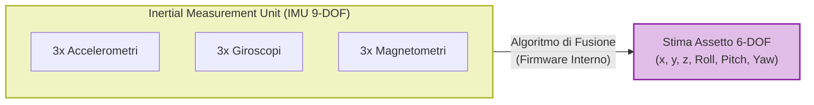

#### Sinergia tra IMU e GNSS (Navigazione Automobilistica/Robotica)
L'accoppiamento tra un ricevitore GNSS (GPS) e un'unità IMU risolve i difetti intrinseci di ciascun singolo sensore:

* **Scenario A: Perdita del segnale GNSS (es. Ingresso in Galleria)**  
  All'interno di un tunnel, la connessione satellitare si interrompe. Il sistema di navigazione passa alla modalità *Dead Reckoning* pura tramite l'IMU. Durante la galleria la posizione si aggiorna continuamente, ma acumula *drift*. All'uscita dal tunnel, la riacquisizione del segnale GPS impone un **correttivo istantaneo** (salto di posizione fisicamente visibile sulla mappa) per eliminare l'errore d'integrazione accumulato.

* **Scenario B: Filtraggio degli Outlier GPS e Map Matching**  
  I sistemi GPS commerciali presentano errori di posizionamento marcati (fino a 5-7 metri). Per evitare che l'auto oscilli fuori dalla carreggiata sullo schermo:
  1. Si applica un vincolo di **Map Matching** (la posizione stimata viene proiettata sulla rete stradale della mappa digitale).
  2. L'IMU fornisce stime cinematiche ad alta frequenza dell'orientamento. Se il GPS fornisce punti fuori traiettoria incompatibili con l'angolo di imbardata letto dai giroscopi (es. ad un bivio), il filtro di fusione scarta le misurazioni satellitari errate (outlier) o ritarda la deviazione finché l'IMU non conferma l'effettiva svolta del veicolo.

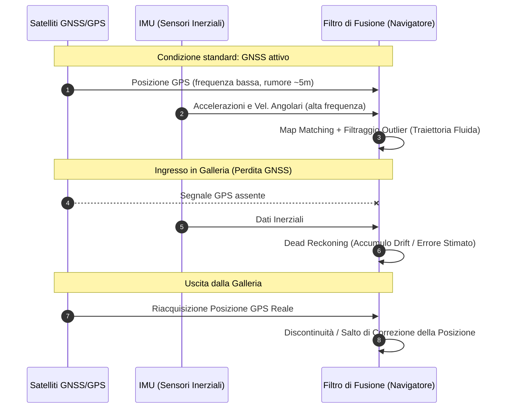

---

### Classificazione dei Sensori: Propriocezione vs. Esterocezione

Nel corso della lezione è stato analizzato il ruolo funzionale dei sensori inerziali rispetto alle definizioni di sensore **Propriocettivo** (misura dello stato interno del robot) ed **Esterocettivo** (misura del mondo esterno).

| Sensore | Classificazione | Motivazione / Note Logiche |
| :--- | :--- | :--- |
| **Accelerometro** | **Propriocettivo** *& (in parte)* **Esterocettivo** | È **propriocettivo** poiché misura l'accelerazione dovuta al cambio di velocità proprio del robot. È **esterocettivo** poiché è costantemente soggetto al campo gravitazionale terrestre $\vec{g} \approx 9.81 \text{ m/s}^2$. Quando usato come *inclinometro* per misurare l'orientamento rispetto all'orizzonte, sfrutta il vettore di gravità (riferimento esterno). |
| **Giroscopio** | **Propriocettivo** | Misura unicamente la velocità angolare della struttura del robot rispetto alla propria massa/asse di inerzia, senza fare riferimento ad alcun punto o campo di forza esterno. |
| **Magnetometro / Bussola** | **Esterocettivo** | Misura direttamente un'entità fisica appartenente all'ambiente esterno: il campo magnetico (terrestre o locale). |

---

### Fondamenti della Visione Digitale e Modello Pinhole

Le telecamere digitali rappresentano uno dei sensori più importanti e diffusi in robotica mobile. Il loro funzionamento di base si fonda su un array di siti fotosensibili — sensori **CCD (Charge-Coupled Device)** o **CMOS (Complementary Metal-Oxide-Semiconductor)** — capaci di accumulare fotoni e convertire l'energia luminosa incidente in un segnale elettrico, che viene poi amplificato e digitalizzato.

Un'ottica (sistema di lenti) focalizza la luce della scena sul sensore. Il modello matematico fondamentale che descrive la formazione dell'immagine è il **Modello Pinhole (Pinhole Camera Model)**.

> **Concetto Chiave: Perdita della Terza Dimensione**  
> Proiettando un mondo tridimensionale ($\mathbb{R}^3$) su un piano immagine bidimensionale ($\mathbb{R}^2$), la fotocamera perde intrinsecamente l'informazione sulla profondità ($Z$). Ogni punto sull'immagine 2D corrisponde a un raggio proiettivo nello spazio 3D, rendendo impossibile stimare la distanza di un oggetto da un singolo fotogramma senza ulteriori vincoli geometrici o modelli di *Computer Vision*.

Per comprendere la percezione visiva nei robot, occorre considerare il comportamento della luce nell'ambiente:
1. Una sorgente luminosa (es. illuminazione artificiale o solare) irradia gli oggetti presenti nella scena.
2. Gli oggetti riflettono la luce incidente **in tutte le direzioni** (riflessione diffusa/Lambertiana).

> **Nota:** La riflessione omnidirezionale della luce è il motivo per cui l'oggetto rimane visibile da qualsiasi prospettiva o angolazione si sposti il sensore visivo.

#### L'Impatto del Deep Learning in Robotica
In passato la visione computazionale era considerata un sensore secondario e poco affidabile a causa della sensibilità degli algoritmi tradizionali alle variazioni di illuminazione e di punto di vista. Con l'avvento del **Deep Learning**, i modelli basati su reti neurali si sono dimostrati estremamente robusti, rendendo le telecamere il sensore primario della robotica moderna (impiegate persino nei robot aspirapolvere commerciali per compiti di navigazione e riconoscimento ostacoli).

---

### Sensori di Visione Specializzati e Ad Ampio Spettro

Oltre alle classiche immagini a livelli di grigio (*grayscale*) o RGB, in robotica si utilizzano sensori visivi avanzati in grado di estrarre informazioni non visibili all'occhio umano.

#### Telecamere Multispettrali e Near-Infrared (NIR)
Le **Telecamere Multispettrali (Multispectral Cameras)** acquisiscono la luce in bande dello spettro elettromagnetico esterne al visibile, come il **Vicino Infrarosso (Near-Infrared - NIR)**, caratterizzato da lunghezze d'onda superiori a quelle del rosso.

*   **Applicazioni nei materiali:** La riflettanza di una superficie nel dominio NIR varia significativamente in base alla sua composizione chimica. Questo permette a un robot di distinguere materiali visivamente identici nel campo RGB (ad esempio, differenziare due tipologie di plastica distinte o identificare il legno rispetto a un materiale sintetico).

---

### Geometrie Ottiche Avanzate: Fisheye e Fotocamere Omnidirezionali

In molte applicazioni robotiche non si utilizzano lenti standard a campo visivo stretto, bensì ottiche ad ampia apertura che introducono forti distorsioni geometriche per massimizzare la percezione dell'ambiente circolare.

#### Telecamere Fisheye (Wide-Angle)
Nelle lenti convenzionali, la distanza focale determina l'angolo di campo visivo (**Field of View - FOV**). 
*   **Wide-Angle:** Sistemi visivi con $FOV > 100^\circ$.
*   **Fisheye:** Sistemi ottici estremi con $FOV \approx 180^\circ$ (o superiore), in grado di catturare la scena anche lateralmente rispetto all'asse ottico.

L'immagine proiettata sul sensore CCD/CMOS da una lente fisheye è fortemente distorta. Tuttavia, conoscendo i parametri intrinseci della lente (tramite modelli di calibrazione della distorsione), è possibile risalire alla struttura geometrica reale della scena:
*   Un operatore umano necessita di un'immagine **dewarped** (ri-proiettata senza distorsione).
*   Un algoritmo robotico può elaborare **direttamente l'immagine distorta**, risparmiando risorse computazionali.

> **Esempio Applicativo (Automotive):** I sistemi di visione a $360^\circ$ nelle automobili (vista dall'alto o *bird's-eye view*) sono realizzati combinando ed elaborando i flussi video di $4$ o $6$ telecamere fisheye disposte lungo il perimetro del veicolo.

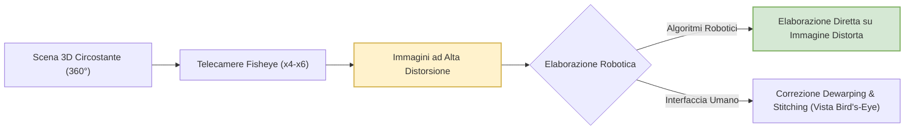

#### Sistemi Catadiottrici e Fotocamere Omnidirezionali
Le **Telecamere Omnidirezionali (Omnidirectional Cameras)** combinano un sensore di visione tradizionale con uno specchio curvo opportunamente sagomato (sistema **Catadiottrico / Catadioptric System**).

*   I raggi luminosi incidenti colpiscono prima lo specchio e vengono deviatore verso la lente della telecamera in base alla curvatura locale dello specchio.
*   L'immagine risultante è di forma circolare e copre un angolo azimutale di $360^\circ$ in un unico scatto.
*   **Modello di Proiezione:** Non seguono il modello Pinhole piatto, ma il **Modello di Proiezione Sferica (Spherical Projection Model)**.
*   **Ricostruzione:** L'immagine circolare può essere "srotolata" (*unwarped*) tramite una trasformazione di coordinate per ottenere una vista panoramica rettangolare.
*   **Uso principale:** Robot volanti (droni) per il tracciamento rapido degli ostacoli e sistemi di mappatura urbana (es. *Google Street View*).

---

### Telecamere ad Eventi (Event Cameras / Neuromorphic Sensors)

Le **Telecamere ad Eventi (Event Cameras)** rappresentano un cambio di paradigma radicale rispetto alla tecnologia visiva tradizionale. Pur impiegando ottiche di tipo Pinhole, il sensore lavora secondo principi **neuromorfici** (ispirati al funzionamento della retina biologica).

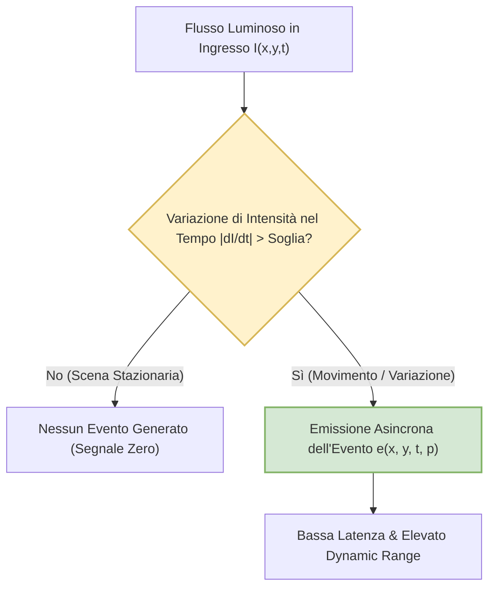

#### Principio di Funzionamento
Nelle telecamere convenzionali (*frame-based*), l'acquisizione è **sincrona**: ad ogni intervallo di tempo fisso si misura la carica di tutti i pixel, si azzera la matrice e si trasferisce l'intero frame.

Nelle telecamere ad eventi, ciascun pixel opera in modo **indipendente e asincrono**. Ogni pixel integra un circuito comparatore che rileva la **variazione relativa dell'intensità luminosa** (flusso fotonico) nel tempo:

$$\Delta \ln I(x,y,t) = \ln I(x,y,t) - \ln I(x,y,t - \Delta t)$$

Se la variazione supera una determinata soglia $C$, il pixel emette un **evento** descritto dalla quadrupla $e = (x, y, t, p)$, dove:
*   $(x, y)$ sono le coordinate spaziali del pixel.
*   $t$ è il timestamp con risoluzione al microsecondo.
*   $p \in \{-1, +1\}$ è la polarità (incremento o decremento di luminosità).

> **Concetto Chiave: Sensore a Segnale Nullo su Scena Statica**  
> Se la telecamera è fissa ed è puntata su una scena perfettamente statica, il sensore **non genera alcun dato** (l'immagine output è completamente nera). I dati vengono generati **solo** dove si verifica un movimento relativo tra la scena e la fotocamera.

#### Analogia Biologica e Movimenti Saccadici
La retina umana non trasmette al cervello livelli assoluti di luminosità continua, ma reagisce alle traslazioni e ai gradienti di contrasto. Per evitare il "de decadimento" del segnale visivo su oggetti fermi, l'occhio umano compie involontariamente microscopici movimenti ad altissima frequenza detti **Movimenti Saccadici (Saccadic Movements)**, i quali generano continue variazioni temporali sulla retina indispensabili per ricostruire la visione.

#### Vantaggi delle Telecamere ad Eventi

| Proprietà | Telecamere Frame-Based | Telecamere ad Eventi |
| :--- | :--- | :--- |
| **Acquisizione** | Sincrona (Frame completi a intervalli $T$) | Asincrona (Solo pixel variati) |
| **Latenza (Latency)** | Alta ($\sim 10 - 33\text{ ms}$) | Bassissima ($\sim \text{microsecondi}$) |
| **Motion Blur** | Elevato in presenza di movimenti rapidi | Quasi assente |
| **Dynamic Range (HDR)** | Limitato ($\sim 60\text{ dB}$) | Molto elevato ($> 120\text{ dB}$) |
| **Throughput Dati** | Costante ed elevato (tutti i pixel) | Variabile e ridotto (solo eventi) |

#### Applicazioni ad Alta Reattività in Robotica
Grazie alla latenza quasi nulla, le telecamere ad eventi sono ideali per la **navigazione autonoma ad alta velocità** e per la **schivata dinamica degli ostacoli (Dynamic Obstacle Avoidance)** nei droni veloci.

> **Esempio Pratico:** Un drone dotato di telecamera ad eventi a cui viene lanciata contro una palla a grande velocità. Nel flusso di eventi generato, lo sfondo stazionario (traslato dal movimento del drone) produce un pattern uniforme, mentre la palla presenta una traiettoria e un profilo di variazione temporale nettamente distinto. Questo consente all'algoritmo di segmentare l'ostacolo ed eseguire la manovra evasiva in pochi millisecondi.

---

### Misurazione della Distanza e Sensori Attivi Time-of-Flight (ToF)

Le telecamere convenzionali effettuano una proiezione prospettica dal mondo 3D al piano immagine 2D, perdendo intrinsecamente l'informazione sulla profondità (lunghezza lungo il raggio proiettivo). Per recuperare direttamente questa terza dimensione si utilizzano **sensori di distanza attivi** basati sul principio del **Tempo di Volo (Time-of-Flight, ToF)**.

Il principio cardine del ToF consiste nell'emettere un segnale energetico (sonoro o elettromagnetico) verso un oggetto e misurare il tempo impiegato dall'impulso per viaggiare fino alla superficie, essere riflesso e ritornare al sensore.

Questa misurazione può avvenire in due modi:
1. **Puntuale (Point-wise):** misurazione della distanza lungo una singola direzione dello spazio.
2. **Immagine di Distanza / Mappa di Profondità (Range Image / Depth Map):** utilizzando un modello analogo a quello del *pinhole*, si acquisisce una matrice 2D in cui ogni pixel non memorizza un valore di intensità luminosa o colore, ma la distanza $d$ rilevata lungo il raggio proiettivo corrispondente.

Dalla mappa di profondità 2D è possibile ricostruire matematicamente una **Nuvola di Punti (Point Cloud)**, ossia una rappresentazione geometrica 3D esplicita dell'ambiente circostante.

---

#### Principio Fondamentale di Calcolo della Distanza

Sapendo che il segnale percorre la distanza tra sensore ed ostacolo due volte (andata e ritorno), la formula base del ToF è:

$$d = \frac{v \cdot \Delta t}{2}$$

Dove:
* $d$ è la distanza dall'oggetto;
* $v$ è la velocità di propagazione dell'onda nel mezzo;
* $\Delta t$ è l'intervallo di tempo misurato tra emissione e ricezione.

---

#### Sensori ad Ultrasuoni (Sonar)

Il sensore di distanza più semplice ed economico è il **Sonar (Sound Navigation and Ranging)**. Trattandosi di un sensore attivo, il Sonar è composto da due elementi fondamentali:
* **Emettitore (Speaker):** solitamente basato su superfici piezoelettriche che, messe in vibrazione elettricamente, generano onde acustiche ad alta frequenza (ultrasuoni, non udibili dall'orecchio umano).
* **Ricevitore (Microfono):** tipicamente un microfono capacitivo progettato per rilevare le variazioni di pressione sonora riflesse dalle superfici.

I Sonar vengono comunemente impiegati organizzati in **Array** (gruppi di sensori orientati in direzioni diverse) per coprire angoli di visione più ampi, come avviene nei sistemi di assistenza al parcheggio degli autoveicoli.

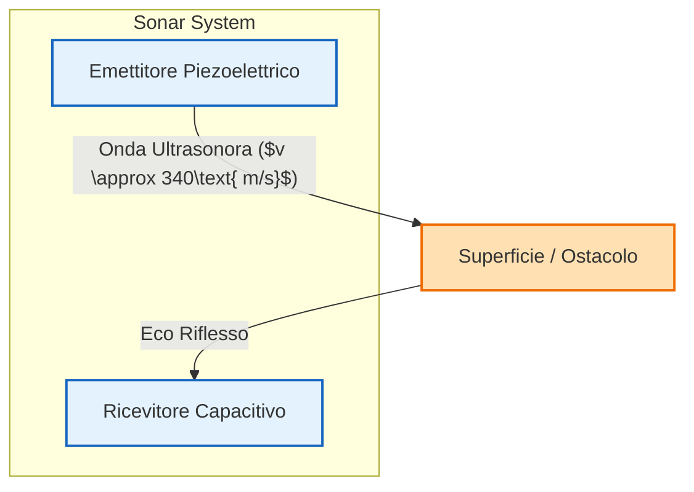

##### Limiti Fisici e Operativi del Sonar

> **Concetto Chiave: Integrazione Angolare ed Errore Posizionale del Sonar**  
> Il Sonar presenta un cono d'ombra (o cono di apertura) molto ampio. Il sensore non restituisce la posizione esatta di un punto, ma **integra l'informazione su tutto il solido d'angolo del cono**.  
> * Implicazione: Se all'interno del cono è presente un ostacolo sottile (es. un palo), il Sonar rileva correttamente la presenza di un ostacolo alla distanza $d$, ma **non è in grado di determinarne la posizione angolare o la larghezza**.  
> * Uso pratico: Ottimo per l'evitamento di collisioni (*collision avoidance*) in ambiti economici, ma inadatto alla ricostruzione accurata di mappe o alla navigazione di precisione per robot mobili.

Le caratteristiche principali del Sonar sono:
* **Velocità di propagazione:** $v_{suono} \approx 340 \text{ m/s}$.
* **Portata utile:** Limitata (circa $2 \div 4 \text{ metri}$). Oltre i 3-4 metri, l'attenuazione dell'intensità sonora rende il segnale di ritorno troppo debole e rumoroso.
* **Costo:** Estremamente basso.

---

#### Sensori Ottici: Laser Range Finder e Lidar

Per superare i limiti di risoluzione e portata del Sonar, è possibile impiegare la radiazione elettromagnetica sotto forma di luce laser (**Light Detection and Ranging, Lidar**).

Differenza fondamentale di velocità:
* Onda sonora: $v_{suono} \approx 3.4 \times 10^2 \text{ m/s}$
* Onda luminosa: $c \approx 3.0 \times 10^8 \text{ m/s}$ ($300.000 \text{ km/s}$)

La velocità della luce è di circa **6 ordini di grandezza ($10^6$) superiore** a quella del suono.

##### Architettura Meccanica a Specchio Rotante

Per eseguire la scansione dell'ambiente senza dover muovere l'intero blocco pesante composto da diodo emettitore e sensore ricevitore, si utilizza una configurazione ad **uno specchio rotante**.

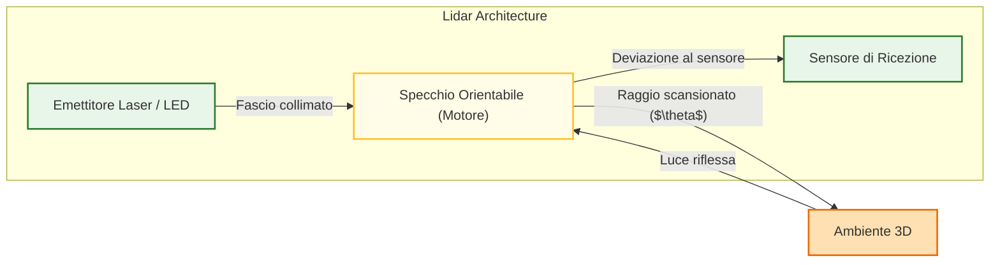

Un diodo emette un fascio laser collimato tramite una lente. Il raggio incide su uno specchio inclinato a $45^\circ$ e mosso da un motore elettrico. Ruotando lo specchio, il raggio viene indirizzato radialmente nello spazio. Lo stesso specchio raccoglie la luce di ritorno riflessa dall'ambiente e la fa convergere sul sensore di ricezione.

Distinguiamo solitamente:
* **Laser Range Finder (LRF):** Sensore che opera una scansione su un singolo piano 2D (singolo raggio o linea laser).
* **Lidar:** Sensore costituito da più linee laser sovrapposte (es. 16, 32, 64 o 128 fasci) che ruotano per generare una nuvola di punti 3D ad alta densità.

##### Tecniche di Misura del Tempo di Volo Ottico

Misurare direttamente $\Delta t$ per la luce su brevi distanze richiede un'elettronica estremamente complessa, dato che le frazioni di tempo in gioco sono nell'ordine dei **piconsecondi o nanosecondi** ($\approx 3.3 \text{ ns}$ per metro). Per ovviare a questo problema si utilizzano due approcci:

###### 1. Misura dello Sfasamento di Fase (Phase Shift)
Anziché inviare un singolo impulso e cronometrarlo, si trasmette un segnale luminoso modulato in frequenza. Una parte del segnale emesso viene inviata direttamente all'interno del sensore come riferimento.

Rilevando lo sfasamento $\Delta \phi$ tra l'onda emessa $s_e(t)$ e l'onda riflessa di ritorno $s_r(t)$, si risale alla distanza $d$:

$$\Delta \phi = 2\pi f \cdot \Delta t = 2\pi f \cdot \left( \frac{2d}{c} \right) = \frac{4\pi d}{\lambda}$$

Da cui si ricava la distanza $d$:

$$d = \frac{\lambda \cdot \Delta \phi}{4\pi}$$

Dove $\lambda$ è la lunghezza d'onda della modulazione e $c$ la velocità della luce.

> **Concetto Chiave: Misura di Fase vs Misura Diretta del Tempo**  
> La misurazione dello sfasamento di fase ($\Delta \phi$) trasforma un problema di cronometraggio ad altissima frequenza (nanosecondi) in un problema di confronto di ampiezze e fasi di segnali alternati, risultando elettronicamente più semplice da realizzare per distanze medio-brevi.

###### 2. Misura Diretta del Tempo (Direct ToF)
Utilizzata nei dispositivi di fascia alta integrati con cronometri digitali ad alta velocità (*Time-to-Digital Converter, TDC*), capaci di stimare direttamente $\Delta t$.

##### Lidar Meccanici vs Lidar a Stato Solido (Solid-State Lidar)

* **Lidar Meccanici (Rotating Lidar):** Lo specchio (o l'intera testa del sensore) ruota fisicamente.
  * *Vantaggi:* Più economici, campo di vista esteso fino a $360^\circ$.
  * *Svantaggi:* La presenza di parti meccaniche in movimento li rende soggetti ad usura e suscettibili alle vibrazioni.
* **Lidar a Stato Solido (Solid-State Lidar / Optical Phased Array - OPA):** Non possiedono parti meccaniche in movimento. Sfruttano la matrice di fase ottica (*Optical Phased Array*) per pilotare la direzione del fascio laser variando la fase dei singoli elementi emettitori micro-elettronici.
  * *Vantaggi:* Massima robustezza meccanica, ideali per veicoli che operano su terreni sconnessi (*rough terrain*).
  * *Svantaggi:* Molto più costosi dei sistemi meccanici.

---

#### Sensori a Radiofrequenza (Radar)

Il **Radar (Radio Detection and Ranging)** sfrutta lo stesso principio fisico del Time-of-Flight, ma utilizza onde elettromagnetiche nello spettro delle **radiofrequenze** (lunghezze d'onda nettamente maggiori rispetto alla luce visibile o infrarossa del laser).

##### Vantaggi e Svantaggi del Radar rispetto a Sonar e Lidar

> **Concetto Chiave: Robustezza Ambientale del Radar**  
> Il problema principale del Lidar è la sensibilità alle condizioni atmosferiche avverse: nebbia, polvere, pioggia e neve contengono micro-gocce d'acqua o particelle sospese con dimensioni comparabili alla lunghezza d'onda della luce laser. Il laser viene riflesso da queste particelle, generando falsi ostacoli.  
> Le **onde radio del Radar**, avendo una lunghezza d'onda molto maggiore, attraversano inalterate nebbia, polvere e pioggia, riflettendosi solo su oggetti macroscopici (altre autovetture, infrastrutture, pedoni).

* **Vantaggi del Radar:**
  * Estrema robustezza ad agenti atmosferici (nebbia, neve, pioggia, polvere).
  * Portata elevata (fino a centinaia di metri).
* **Svantaggi del Radar:**
  * **Bassa risoluzione angolare e spaziale:** La precisione nella ricostruzione dei contorni dell'oggetto è sensibilmente inferiore a quella offerta da un Lidar.

I Radar automotive moderni impiegano frequenze elevate (Short-Range e Long-Range Radar) per aumentare la risoluzione spaziale e vengono impiegati parallelamente a telecamere e Lidar nei sistemi di guida autonoma per garantire la ridondanza della sensata (*Sensor Fusion*).

---

#### Quadro Comparativo dei Sensori di Distanza Attivi

| Caratteristica | Sonar (Ultrasuoni) | Lidar (Laser) | Radar (Onde Radio) |
| :--- | :--- | :--- | :--- |
| **Tipo di Onda** | Acustica (Meccanica) | Elettromagnetica (Ottica) | Elettromagnetica (Radio) |
| **Velocità di Propagazione ($v$)** | $\approx 340 \text{ m/s}$ | $\approx 3.0 \times 10^8 \text{ m/s}$ | $\approx 3.0 \times 10^8 \text{ m/s}$ |
| **Portata Tipica** | Ridotta ($2 \div 4 \text{ m}$) | Alta (fino a $100 \div 200 \text{ m}$) | Molto Alta ($100 \div 300 \text{ m}$) |
| **Risoluzione Angolare** | Molto Bassa (ampio cono) | Eccellente (elevatissima) | Media / Bassa |
| **Resistenza a Nebbia/Polvere** | Elevata | **Bassa** (sensibile alle particelle) | **Massima** |
| **Costo Hardware** | Molto Economico | Elevato (specialmente Solid-State) | Medio / Elevato |
| **Applicazione Tipica** | Parcheggio, anti-collisione base | Navigazione 3D, mappatura robotica | Cruise Control Adattivo (ACC), allerta nebbia |

---

### Telecamere Stereoscopiche e Mappe di Profondità

In molte applicazioni di robotica mobile e autonoma, l'uso di una singola telecamera (visione monoculare) presenta un limite intrinseco: la perdita della informazione di profondità. Per ovviare a questo problema si utilizzano i sistemi di **Visione Stereoscopica** (*Stereo Vision*), basati su due o più telecamere posposte a una distanza nota.

#### Il Principio della Parallasse e della Disparità

Quando due telecamere osservano la medesima scena da due punti di vista distinti, gli oggetti proiettati sui rispettivi sensori subiscono uno spostamento relativo. Questo fenomeno è noto come **parallasse** (*parallax*). 

La grandezza fondamentale che permette di stimare la distanza degli oggetti è la **Disparità** (*Disparity*), definita come la differenza nelle coordinate dell'immagine tra due punti corrispondenti osservati dalle due telecamere:

$$d = x_L - x_R$$

dove $x_L$ e $x_R$ indicano la posizione orizzontale dello stesso punto 3D rispettivamente nell'immagine sinistra e nell'immagine destra.

Attraverso una semplice triangolazione geometrica basata sulla geometria stenopeica (*pinhole camera model*), la profondità $Z$ di un punto nello spazio è inversamente proporzionale alla sua disparità $d$:

$$Z = \frac{f \cdot B}{d}$$

Dove:
- $Z$ è la distanza (profondità) dell'oggetto rispetto al piano focale;
- $f$ è la distanza focale (*focal length*) delle telecamere;
- $B$ è la baseline, ovvero la distanza fisica tra i centri ottici delle due telecamere;
- $d$ è la disparità misurata ($x_L - x_R$).

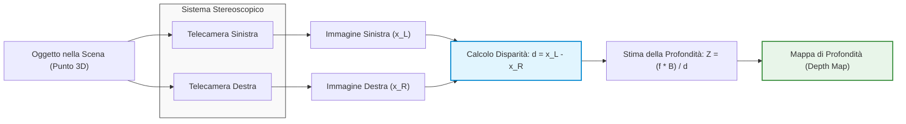

A differenza di un sensore LiDAR che genera una **Nuvola di Punti** (*Point Cloud*) sparsa, il sistema stereoscopico genera una **Mappa di Profondità** (*Depth Map*): una stima continua della distanza per ogni singolo pixel della griglia dell'immagine. 

Oggi, l'uso delle **Reti Neurali Profonde** (*Deep Neural Networks - DNN*) ha migliorato drasticamente le prestazioni degli algoritmi nel calcolo e nella stima della disparità, rendendo le telecamere stereo una delle opzioni primarie per la ricostruzione 3D dell'ambiente nei robot moderni.

---

### Il Problema della Corrispondenza (Correspondence Problem)

Nonostante la formulazione matematica della disparità sia semplice, l'applicazione pratica presenta sfide algoritmiche notevoli. 

Per poter calcolare la disparità $d$, è prima necessario identificare con assoluta precisione che un determinato pixel dell'immagine sinistra corrisponda esattamente allo stesso punto fisico nell'immagine destra. Questo processo prende il nome di **Problema della Corrispondenza** (*Correspondence Problem*).

> **CONCETTO CHIAVE: Le due sfide principali della Visione Stereoscopica**
> 1. **Calibrazione del Sistema (*Camera Calibration*):** È indispensabile calibrare accuratamente i parametri intrinseci ed estrinseci delle telecamere per allineare le righe di pixel (rettificazione).
> 2. **Abbinamento delle Caratteristiche (*Feature Matching*):** Bisogna identificare i medesimi dettagli (*features*) in entrambe le immagini. Se una superficie è priva di texture (es. una parete bianca e liscia), l'algoritmo non trova punti di riferimento univoci e il calcolo della disparità **fallisce**.

---

### Sensori a Luce Strutturata (Structured Light 3D Cameras)

Come risolvere il problema della corrispondenza su superfici prive di dettagli (*featureless* o *feature-poor*)?

La soluzione ingegneristica consiste nell'utilizzare **sistemi attivi**, ovvero creare artificialmente delle caratteristiche (*features*) sulla superficie da misurare.

#### Principio di Funzionamento della Luce Strutturata

Invece di affidarsi alla luce ambientale e alla texture naturale dell'oggetto, un **proiettore di luce** proietta sulla scena un pattern luminoso noto (es. una griglia, un insieme di punti o di strisce a infrarossi). 

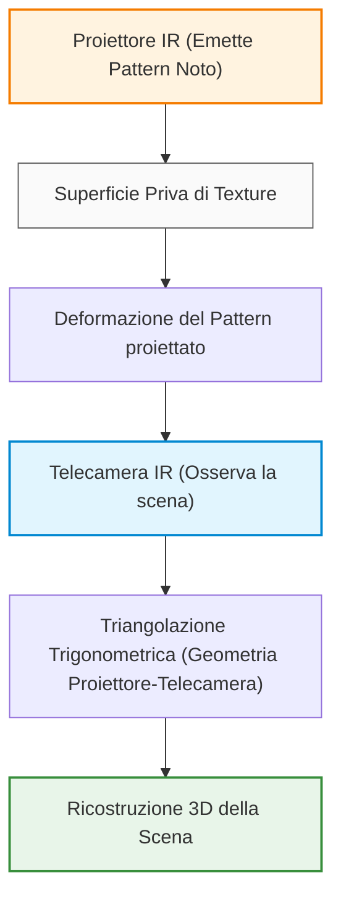

1. Il proiettore invia un pattern geometrico conosciuto sulla superficie dell'ambiente.
2. La telecamera, posta a una distanza nota (baseline) dal proiettore, cattura la scena.
3. Se la superficie è piana, il pattern appare inalterato; se la superficie presenta variazioni di profondità o forme 3D complesse, il pattern subito una **deformazione ottica**.
4. Sfruttando la trigonometria nota tra il proiettore e la telecamera, il sistema analizza come il pattern proiettato si sia modificato nell'immagine e ricostruisce la struttura 3D dell'ambiente con elevata accuratezza.

Un esempio commerciale emblematico di questa tecnologia è rappresentato dal sensore **Microsoft Kinect** (prima versione), che proiettava una griglia di punti invisibili nello spettro dell'infrarosso (IR). Nato originariamente per l'industria videoludica, è diventato uno strumento fondamentale per la ricerca e lo sviluppo della percezione robotica 3D grazie al costo contenuto e all'efficacia della misura.