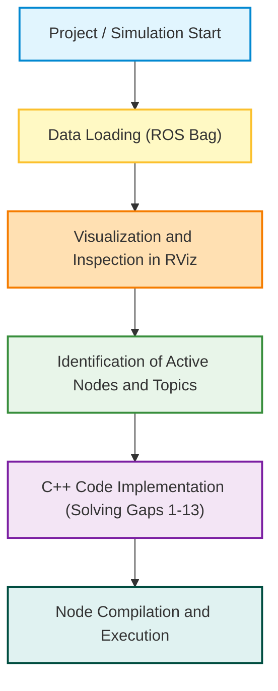
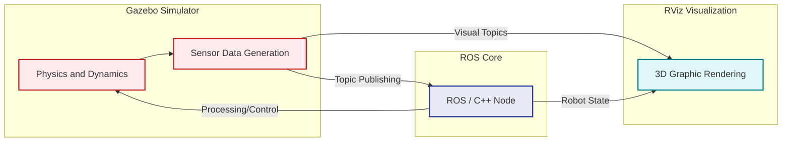
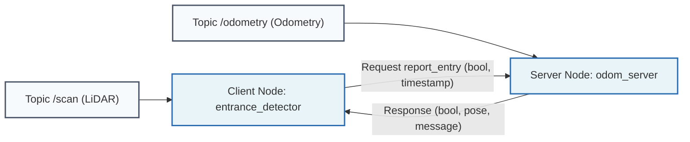
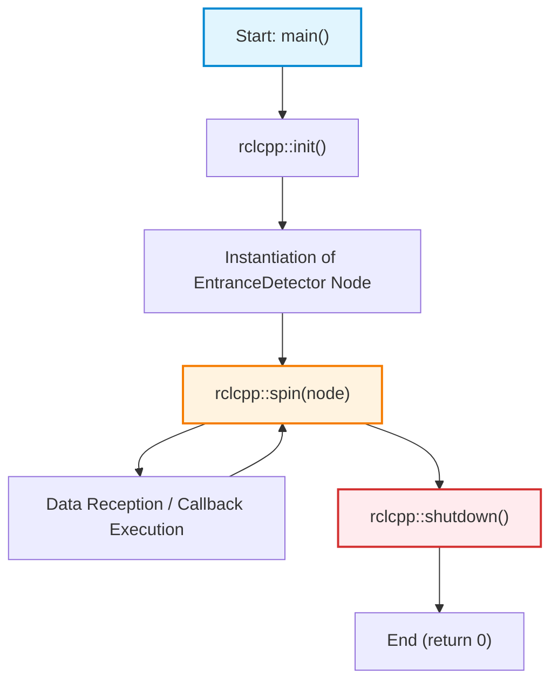

# Open Lab: Simulation Review, C++ Programming, and Visualization with Rviz

## Didactic Overview

The lecture is structured as an **Open Lab** session dedicated to practical support, resolving doubts, and analyzing the difficulties encountered in completing the full simulation (structured up to *gap* 13). Through an initial diagnostic questionnaire, the instructor assessed the class's progress—largely around the first 5–6 *gaps*—to focus teaching support on the critical points that emerged.

The key concepts and methodological aspects addressed include:

* **C++ Proficiency and Algorithmic Logic:** the need to gain confidence in **C++** syntax and the implementation of basic algorithms was emphasized, taking as a reference the difficulties encountered in computing the minimum between two datasets (item 3, whose textual description will also be clarified).
* **Key Concept – Preliminary Inspection with Rviz:** the fundamental importance of using **Rviz** (*ROS Visualization*) as the first operational tool before starting to write code was reiterated. Visualizing the data recorded in the **ROS Bag** (*bag file*) makes it possible to:
  * understand the spatial and physical context of the scene (e.g., recognizing via *laser* sensor data the robot's movement between an initial room, a corridor, and a second room);
  * accurately identify the **Nodes** involved in communication and the exact names of the available **Topics**.
* **Development Environment Setup:** the absence of the C++ syntax-checking extension inside **Visual Studio Code** (*VS Code*) on the lab machines was identified, for which installation will be requested.
* **Support Planning:** in response to requests emerging from the survey, the second part of the lab includes a practical demonstration on the effective use of *Rviz* applied to the simulation *bag*.

---

### Open Lab Organization and Exam Simulation Feedback

#### Purpose of the Open Lab and Progress Assessment
Today's lab is structured as an **Open Lab**: no new theoretical material is introduced; instead, the focus is on clarifying doubts, solving code issues, and guided completion of the *Exam Simulation*. 

The main objective is to enable every student to independently complete all $13$ items of the simulation (called *Gaps*), which represent the standard structure of the practical exam. 

From the analysis of the initial feedback questionnaire, answered by most students, the following progress data emerge:
* **Gaps 1-5**: Completed by most of the class.
* **Gaps 6-13**: Reached or completed by only a limited number of students (1-2 people finished the entire simulation).
* **C++ Level**: The majority did not encounter insurmountable difficulties on the first gaps, though some uncertainties emerge regarding syntax or the logic of specific algorithms.

> **Key Concept**: The exam simulation must not be memorized. Being able to mechanically replicate a few lines of code is not enough to pass the practical exam: it is necessary to understand the operating logic of ROS nodes, C++ syntax, and how to properly explore the system using visualization tools.



---

#### Analysis of Difficulties Emerging from the Simulation Gaps

A detailed analysis of the questionnaire responses highlighted three critical areas:

1. **Understanding the Gap Text (e.g., Gap 3)**:
   Gap 3 required implementing an algorithm to find the minimum value across two datasets taken from sensors (e.g., laser measurements).
   * *Reported issue*: Difficulty in interpreting the algorithm specifications or implementing them syntactically in C++.
   * *Logical formula*: Given two data vectors $S_1$ and $S_2$, find the absolute minimum:
     $$x_{\min} = \min \left( \min_{i} \{S_{1,i}\}, \min_{j} \{S_{2,j}\} \right)$$
   * *Solution*: The wording in exam papers will be refined to avoid interpretative ambiguity, while keeping unchanged the requirement to know how to code simple search algorithms in C++.

2. **Time Management and Parallel Workload**:
   Several students cited overlapping deadlines from other courses (e.g., *Reinforcement Learning*) as the reason for not completing the simulation. It is recommended to distribute the work across the remaining 5-6 lab sessions.

3. **Integration between C++ and the ROS Framework**:
   The *Intelligent Robotics* course, together with the *Computer Vision* course, constitutes the pillar of the Master's degree for learning and consolidating C++ in an engineering context.

---

### Operational Development Strategy and Diagnostic Tools (RViz vs Gazebo)

#### Importance of Data Visualization with RViz

A frequently observed methodological mistake is attempting to write C++ code without first inspecting the graphical environment and the data through **RViz**.

> **Key Concept**: Before touching any line of code, it is essential to launch **RViz** and play back the recorded data (*ROS bag*). RViz allows you to immediately understand the robot's operational context and the ROS network structure.

Using RViz before coding provides two immediate operational advantages:
1. **Contextual Understanding**: By analyzing the *LaserScan* sensor scans, it is possible to visually observe the geometry of the environment (for example: the robot positioned in a room, passing through a corridor, entering a second smaller room).
2. **ROS Network Inspection**: RViz and the related terminal commands allow you to identify the exact official *Topic* names ($\text{es. } \texttt{/scan}, \texttt{/cmd\_vel}$) and the associated message types, preventing syntax errors or type mismatches in the C++ code.

---

#### Distinction of Scopes Between RViz and Gazebo in the Course and Exam

During the lab sessions, two main software tools are used for distinct purposes:

* **RViz (ROS Visualization Tool)**: 
  It is a **visualization-only** tool. It does not simulate physics or dynamic motion: it receives data transmitted by ROS nodes (or from recorded files) and transforms it into 3D graphical elements (vectors, point clouds, occupancy grids, maps).
* **Gazebo (3D Robot Simulator)**:
  It is a **complete dynamic and physical simulator**. It models the geometric environment, rigid-body physics (gravity, friction, collisions), robot kinematics, and the synthetic generation of sensor signals.



> **Key Concept (Exam Rule)**: The 3D simulator **Gazebo will not be required at the exam**. Running a complete robotics *stack* on Gazebo would require excessive computing resources for the department servers (with over 90 students concurrently) and would be too complex to complete in 2 hours. The exam will **exclusively** test C++ syntax, ROS architectural structure, the creation of Nodes, Publishers, Subscribers, Services, and analysis through RViz.

However, Gazebo will continue to be used during the practical lab sessions to illustrate advanced concepts such as *Autonomous Navigation* and *Robotic Manipulation*. Practicing on a full stack in Gazebo helps consolidate the skills required for the simpler tasks in the exam.

---

### C++ Programming Requirements and Development Environment Configuration

#### C++ Language Proficiency in the Master's Course
The required level of C++ covers the standard structures necessary for managing ROS nodes:
* Management of variables, loops, and conditional structures.
* Use of standard libraries ($\text{STL}$ such as `std::vector`, `std::string`, `std::min_element`).
* Inclusion and management of ROS *header files* (e.g., `#include <sensor_msgs/LaserScan.h>`).
* Definition of *Callback Functions* passing parameters via references or *smart pointers*.

For students who encounter difficulties with C++ syntax, the recommendation is to practice independently by solving the simulation gaps or consulting online C++ self-study resources.

---

#### Tooling and Development Environment (VS Code)

During the feedback session, the absence or malfunction of the **C++ Syntax Checking Extension (C/C++ Linter / Extension)** inside the **Visual Studio Code** integrated development environment on the lab PCs was reported.

* **Corrective action**: Lab technicians have been asked to verify and install the *IntelliSense* / C++ extension in VS Code.
* **Objective**: To enable automatic highlighting of syntax errors while writing code during the exam, reducing manual debugging time via terminal without needing to rely on external connections.

---

### Comparative Table of ROS Framework Tools

The following table summarizes the roles, requirements, and scope of use of the main tools analyzed in the simulation:

| Tool | Main Function | Used in the Exam? | Notes and Operational Tips |
| :--- | :--- | :---: | :--- |
| **C++ (ROS Node API)** | Writing control logic, managing Topics and Services. | **YES (Mandatory)** | Requires mastery of basic syntax and STL. |
| **RViz** | 3D data visualization, Topic and robot state inspection. | **YES (Recommended)** | **Always** use before writing code to understand Topic names. |
| **Gazebo** | 3D dynamic and physical simulation of environments, sensors, and robots. | **NO** | Used in labs for *Full-Stack Robotics*, excluded from the exam due to computing/time limits. |
| **Terminal / ROS CLI** | Command execution (`rosnode`, `rostopic`, `rosbag`), `catkin` compilation. | **YES (Mandatory)** | Essential for launching the system and verifying data transmission. |

---

### Problem Scenario and ROS2 Pipeline Architecture

To properly tackle a task in **ROS2 (Robot Operating System 2)**, the first step is not to write code right away, but to reason about the logical architecture of the system and verify how components communicate with each other.

#### Physical Context and Sensors
The scenario involves a mobile robot moving in an enclosed environment: initially, it navigates in an open area and subsequently enters a narrow passage, i.e., a corridor. The robot is equipped with two main data sources:
* **LiDAR (Light Detection and Ranging)**: a sensor based on light beams that measures distances to surrounding obstacles (the walls of the environment).
* **Odometry**: provides the robot's **pose** (position and orientation) and its velocity.

#### Objective and Client-Server Communication
The goal of the pipeline is to detect the exact instant the robot enters the narrow passage and obtain its pose at that precise moment. This logic is divided into two **nodes** that communicate according to a **Client-Server** model via a **service** named `report_entry`:

* **Client Node (`entrance_detector`)**: reads scans coming from the LiDAR, analyzes the data to detect entry into the narrow passage, sends a request to the service passing the entry timestamp, and, once the response is received, prints the robot's pose.
* **Server Node (odometry server)**: listens for odometry messages and stores them; when it receives a request on the `report_entry` service, it retrieves and returns the corresponding pose to the client.



---

### Structure of the ROS2 Package and Service

Once the architecture is clear, you need to inspect the provided **ROS2 package** folder to verify that the files match expectations. Inside the package, there are three main subfolders:

* **`include/`**: contains the **header files** of the two nodes (`entrance_detector` and odometry server), within which there are some missing sections (*gaps*) to be completed.
* **`src/` (source folder)**: contains the implementation of the two nodes, also with *gaps* to be filled in.
* **Service folder**: contains the definition of the `report_entry` service.

#### Anatomy of the Service File
The service definition file is provided ready-made and must not be modified. Like every ROS2 service, its structure is divided into two parts: **request** and **response**.

* **Request**:
  * A boolean value (`bool`).
  * A **timestamp**, indicating the entry instant for which the pose is requested.
* **Response**:
  * A boolean value (`bool`) signaling the success or failure of the operation.
  * The robot's pose (`pose` structure with timestamp, derived from ROS geometry messages).
  * A text string (`string`) for any status messages.

In total, the source and header files contain $13$ *gaps* to be completed, each characterized by a different complexity and its own score.

---

### ROS2 Bag Playback and Topic Inspection

The real sensor data and the robot's behavior in the environment do not come from a simulator started on the spot, but have been recorded inside a **ROS2 Bag** (a sequential archive of messages published on **topics**).

> **Practical note — Software updates:** In robotics, it is very common for an operating system or library update to cause sudden crashes or incompatibilities in working software. As a good operational practice (especially ahead of robotics demonstrations or competitions), it is advisable to avoid updating the system or libraries the day before the test.

#### Starting loop playback
To start working on the data, the first operation to execute from the terminal is to start the bag playback:

```bash
ros2 bag play <nome_della_bag> -l
```

* **Key Concept — Option `-l` (loop)**: a bag works similarly to a file read from beginning to end; once the last recording is reached, playback stops. Adding the `-l` flag forces the bag to automatically restart from the beginning in a continuous cycle (*loop*), avoiding the need to relaunch it manually each time during testing.

#### Checking active topics
While the bag is running in the background, you can list the available **topics** using the command:

```bash
ros2 topic list
```

If the bag (or a simulation or a real robot) were not running, this command would not show the recorded topics. With the bag active, however, the data streams actually recorded in the lab appear, including:
* `scan`: contains the LiDAR laser scans.
* `odometry`: contains the robot's odometry data.
* Other supporting topics present in the recording (such as `point`, `pose`, `initial_pose`).

---

### Data Visualization in RViz

To visually understand what the robot is doing and observe the moment it enters the narrow passage, **RViz** (`rviz2`) is used, which can be launched directly from the terminal while the bag runs in the background.

#### Choosing the fixed reference frame (`Fixed Frame`)
A robot has many **reference frames** associated with wheels, cameras, LiDAR, and so on. Upon opening RViz, the scene might appear empty or unreadable until the **Fixed Frame** (the fixed reference frame relative to which everything else is drawn) is correctly set.

* **Key Concept — Starting from `base_link`**: to easily orient oneself, it is good practice to select as `Fixed Frame` the frame `base_link` (or `base_footprint`), which represents the geometric center of the robot.
* **Behavior when changing frames**:
  * Selecting the frame `odometry` shifts the viewpoint to the robot's initial position in the world where the recording started.
  * Selecting a camera frame displays the scene from the specific camera's perspective, often making it difficult to understand the global geometry of the environment.
  * If after choosing a frame you cannot visualize the robot or the sensors, it is possible that a **transform** connecting that frame to the robot's other frames is missing; in such cases, it is advisable to try different frames from the list until you find the correctly connected one.

#### Adding Visualizations (`Add`)
Once the `Fixed Frame` is set, elements to visualize are added via the **Add** button in RViz, choosing between two modes:

1. **Tab *By topic* (by topic)**:
   * Allows direct selection of active topics in the bag (for example `scan`, `odometry`, `pose`, `initial_pose`, `point`, or other data types like a **Point Cloud** if present).
   * Selecting the topic `scan` (LaserScan), lines of points representing obstacles and walls detected by the LiDAR appear on the screen.
   * *Tip*: it is useful to increase the size of the displayed points in the display properties to make the walls clearer; additionally, take care not to manually enter an incorrect topic name, otherwise nothing will be drawn.
2. **Tab *By display type* (by display type)**:
   * Some data, such as transformations between frames, are not chosen per individual topic but by type. Adding the display **`TF` (Transforms)** displays all reference frames connected to the robot (that of the LiDAR, the multiple camera frames, etc.).
   * Expanding the `TF` tree in the interface allows you to view the full list and simultaneously see the robot's position and the surrounding environment.

By combining the visualization of `scan` and `TF` during loop playback of the bag, one can clearly observe the robot starting from a wide area and progressively approaching until entering the narrow corridor: exactly the event that the two nodes to be completed will need to detect and localize.

---

### Implementation of a C++ Client Node in ROS 2

Let's analyze the practical implementation of a ROS 2 (Robot Operating System 2) node developed in C++. Specifically, we will examine the node `entrance_detector`, which acts as a **Client Node** for an entrance registration service and as a **Subscriber** for data coming from a LiDAR (*LaserScan*) sensor.

#### Typical Structure of the `main` Function

The `main` function in a ROS 2 C++ node follows a standardized pattern. Understanding this structure is fundamental as it repeats almost identically in nearly all ROS 2 applications.



The sequential steps of the main function are:
1. **ROS 2 Context Initialization:** Call to `rclcpp::init(argc, argv)`.
2. **Node Instance Creation:** Creation of the node class coordinator object (e.g., `EntranceDetector`).
3. **Loop Execution (*Spinning*):** Call to `rclcpp::spin(node)`.
4. **Shutdown (*Shutdown*):** Call to `rclcpp::shutdown()` at the end of the node's lifecycle.

> **Key Concept**: The `rclcpp::spin()` function is **mandatory** in ROS 2. It allows the node to remain actively running within the ROS 2 environment, keeping it continuously listening for data coming from **Topics** and managing the invocation of **Callback** functions.

*Note: Passage integrated with educational clarity:*
```cpp
int main(int argc, char ** argv)
{
  // 1. Inizializzazione dell'ambiente ROS 2
  rclcpp::init(argc, argv);

  // 2. Creazione ed esecuzione in spinning del nodo EntranceDetector
  auto node = std::make_shared<EntranceDetector>();
  rclcpp::spin(node);

  // 3. Rilascio delle risorse e chiusura
  rclcpp::shutdown();
  return 0;
}
```

---

#### Constructor Initialization: Service Client and Subscriber

In the constructor of the `EntranceDetector` class, two fundamental ROS 2 components need to be initialized:
1. The **Service Client (*Service Client*)**, to send requests of type `RecordEntry`.
2. The **Subscription (*Subscription*)**, to receive topic data of type `sensor_msgs::msg::LaserScan`.

##### 1. Creation of the Service Client
Creating the client requires specifying the custom service type (`RecordEntry`) and the name of the service interface to connect to:

```cpp
client_ = this->create_client<my_package::srv::RecordEntry>("record_entry");
```

##### 2. Creation of the Scan Topic Subscription
To subscribe to a topic, you need to define:
* The message type (`sensor_msgs::msg::LaserScan`).
* The topic name (`scan`).
* The quality of service (QoS, Quality of Service).
* The **Callback** function bound via `std::bind`.

*Note: Passage integrated with educational clarity:*
```cpp
scan_sub_ = this->create_subscription<sensor_msgs::msg::LaserScan>(
  "scan", 
  10, 
  std::bind(&EntranceDetector::scan_callback, this, std::placeholders::_1)
);
```

Every time a new message is published on topic `scan` by the LiDAR sensor, ROS 2 automatically redirects the message object to the `scan_callback` function.

---

### Service Request and Response Handling

#### Creating and Populating the Request (*Request*)

When the robot detects that it is in a narrow passage (*narrow passage*), it must prepare and send a request (*Request*) to the server to record the event.

A ROS 2 service consists of two parts defined in the `.srv` file: a **Request (*Request*)** section and a **Response (*Response*)** section.

Suppose the request for service `RecordEntry` contains the following fields:
* `bool entered`: A boolean flag indicating entry.
* `builtin_interfaces::msg::Time entry_stamp`: The timestamp of the event.

```cpp
void EntranceDetector::send_request()
{
  // 1. Creazione dell'oggetto request tramite lo struct dedicato
  auto request = std::make_shared<my_package::srv::RecordEntry::Request>();

  // 2. Valorizzazione dei campi della Request
  request->entered = true;
  request->entry_stamp = this->now(); // Timestamp corrente dell'evento

  // 3. Invio asincrono della richiesta al server
  auto result_future = client_->async_send_request(
    request, 
    std::bind(&EntranceDetector::response_callback, this, std::placeholders::_1)
  );
}
```

---

#### Receiving and Logging the Response (*Response*)

Once the server processes the request, it returns a `Response` structure. In our case, the response contains three fields:
1. `bool success`: Outcome of the operation.
2. `geometry_msgs::msg::PoseStamped pose`: Estimated current pose of the robot.
3. `std::string message`: Informational or error message.

To explore and extract the data contained in the response, object fields are accessed using the arrow operator (`->`). For printing to the terminal, the **ROS 2 Logger** system (`RCLCPP_INFO`) is used.

```cpp
void EntranceDetector::response_callback(
  rclcpp::Client<my_package::srv::RecordEntry>::SharedFuture future)
{
  auto response = future.get();

  if (response->success) {
    // Logging con livello INFO
    RCLCPP_INFO(this->get_logger(), "Registrazione completata con successo!");
    RCLCPP_INFO(this->get_logger(), "Messaggio dal Server: %s", response->message.c_str());
    RCLCPP_INFO(
      this->get_logger(), "Posizione Robot - X: %f, Y: %f",
      response->pose.pose.position.x, 
      response->pose.pose.position.y
    );
  } else {
    RCLCPP_WARN(this->get_logger(), "Registrazione fallita.");
  }
}
```

---

### Sensor Data Processing: LaserScan Analysis

#### Geometric Filtering and Identification of Sector Minima

The most computationally significant part of the node consists of processing the range vectors returned by the LiDAR sensor (`sensor_msgs::msg::LaserScan`).

##### Robot Angular Reference Frame
In the robot's conventional reference frame:
* Axis $X$: Directed forward.
* Axis $Y$: Directed towards the robot's left.
* Angles vary in the interval $[-\pi, \pi]$ radians ($[-180^\circ, 180^\circ]$).
* The left sector of the robot is centered at $\theta_{left} = +\frac{\pi}{2}$ rad ($+90^\circ$).
* The right sector of the robot is centered at $\theta_{right} = -\frac{\pi}{2}$ rad ($-90^\circ$).

```
            +X (Avanti, 0 rad)
                   ^
                   |
   +Y (Sinistra)   |   -Y (Destra)
   (+pi/2 rad) <---|---> (-pi/2 rad)
                   |
            -X (Indietro, +-pi rad)
```

##### Algorithm `sector_mean` / Minimum Search
The algorithmic goal is to identify the minimum distance measured by the sensor within an angular neighborhood (*neighborhood*) of $\pm 10^\circ$ ($\approx \pm 0.174 \text{ rad}$) relative to the two sector centers ($+\frac{\pi}{2}$ and $-\frac{\pi}{2}$).

Extracting the minimum value in these two directions makes it possible to determine the robot's proximity to the side walls of a narrow passage.

*Note: Passage integrated with educational clarity:*
```cpp
float EntranceDetector::compute_sector_min(
  const sensor_msgs::msg::LaserScan::SharedPtr scan_msg, 
  float target_angle_rad, 
  float delta_angle_rad)
{
  float min_distance = std::numeric_limits<float>::infinity();

  // Iterazione su tutti i raggruppamenti di scansione (laser beams)
  for (size_t i = 0; i < scan_msg->ranges.size(); ++i) {
    // Calcolo dell'angolo associato al raggio i-esimo
    float current_angle = scan_msg->angle_min + i * scan_msg->angle_increment;

    // Controllo se il raggio cade all'interno del settore angolare richiesto
    if (current_angle >= (target_angle_rad - delta_angle_rad) &&
        current_angle <= (target_angle_rad + delta_angle_rad)) 
    {
      float range = scan_msg->ranges[i];

      // Filtraggio delle misurazioni non valide (out of bounds)
      if (std::isfinite(range) && range >= scan_msg->range_min && range <= scan_msg->range_max) {
        if (range < min_distance) {
          min_distance = range;
        }
      }
    }
  }

  return min_distance;
}
```

> **Key Concept**: Processing data from sensors such as LiDAR always requires iterating over the array of range fields (`ranges`). It is essential to verify the physical validity of each ray by filtering undefined or out-of-range values using the interval $[\text{range\_min}, \text{range\_max}]$.

---

### Course Organization and Next Steps

* **Code Solutions:** The complete solutions for all steps of the ROS 2 node are available for download on the course Moodle platform.
* **Implementation Flexibility:** There are multiple valid approaches in C++ to iterate over vectors and filter LaserScan data; the proposed solution represents a teaching standard, but logically equivalent alternative approaches are fully accepted.
* **Upcoming Teaching Activities:**
  * The in-person lectures for the next two days will be replaced by asynchronous online material with an associated self-assessment test (*quiz*).
  * The practical C++ / ROS 2 lab sessions will be held regularly in person with the support of the Teaching Assistants (TAs).

---

> [!NOTE]
> ### Exam Notes and Instructor Announcements
> - **Exam language and content**: The exam will be in **C++** and will assess knowledge and understanding of **ROS2** syntax and structure, as well as proficiency in using **Rviz** for data visualization.
> - **Preparing with the simulation**: Studying or memorizing only the exam simulation **is not sufficient** to pass the test; the simulation merely represents an example of the exam structure.
> - **Topics EXCLUDED from the exam**: No topics or exercises regarding 3D simulation on **Gazebo** will be required (developing a full-stack autonomous robot in 2 hours is not required in the exam for time and server-load reasons).
> - **Code grading criteria**: For the algorithmic code sections (such as implementing the minimum calculation in the laser scan data), the instructor specified that there are several ways to solve the exercise and alternative solutions to the reference one will also be accepted.