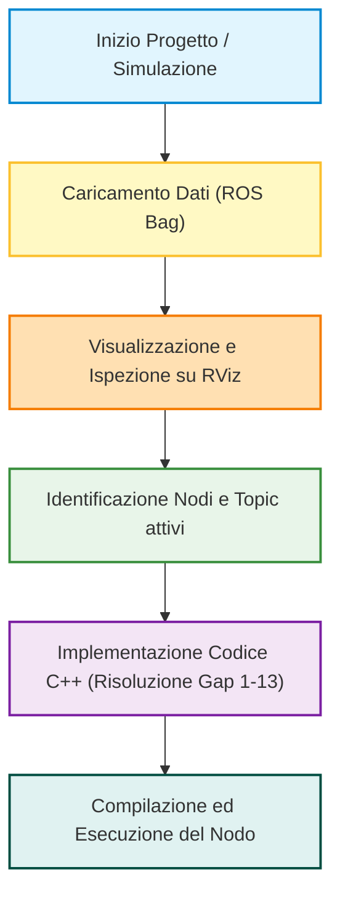
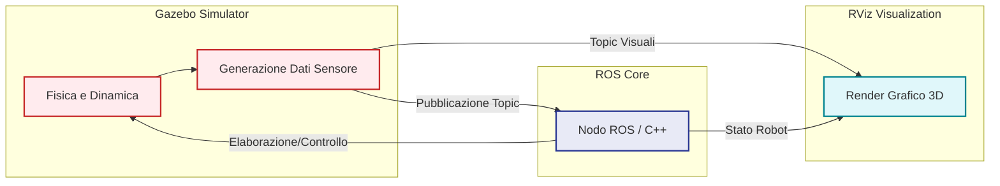
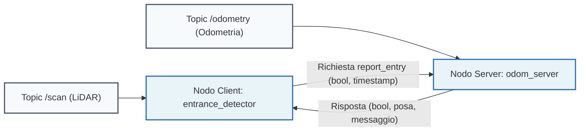
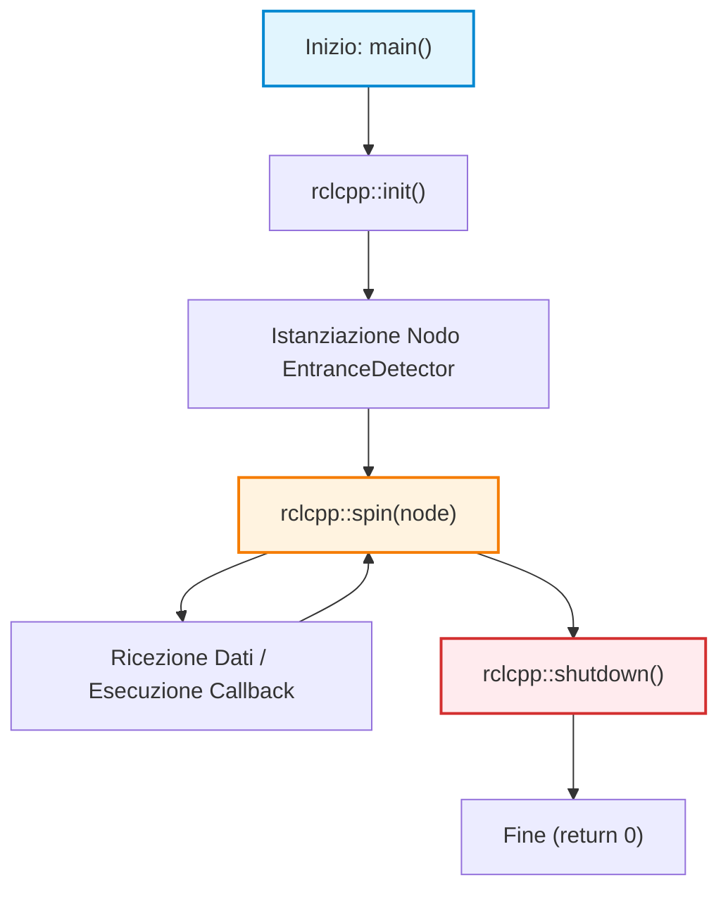

# Open Lab: Revisione della Simulazione, Programmazione C++ e Visualizzazione con Rviz

## Overview Didattica

La lezione si configura come una sessione di **Open Lab** (laboratorio aperto) dedicata al supporto pratico, alla risoluzione dei dubbi e all'analisi delle difficoltà incontrate nello svolgimento completo della simulazione (articolata fino al *gap* 13). Attraverso un questionario diagnostico iniziale, il docente ha valutato lo stato di avanzamento della classe — fermo in larga parte intorno ai primi 5–6 *gap* — per orientare il supporto didattico sui punti critici emersi.

I concetti e gli aspetti metodologici chiave affrontati includono:

* **Padronanza di C++ e Logica Algoritmica:** è stata sottolineata la necessità di acquisire sicurezza nella sintassi **C++** e nell'implementazione di algoritmi di base, prendendo come riferimento le difficoltà riscontrate sul calcolo del minimo tra due insiemi di dati (punto 3, di cui verrà anche chiarita la descrizione testuale).
* **Concetto Chiave – Ispezione Preliminare con Rviz:** è stata ribadita l'importanza fondamentale di utilizzare **Rviz** (*ROS Visualization*) come primo strumento operativo prima di iniziare a scrivere codice. Visualizzare i dati registrati nella **ROS Bag** (*bag file*) permette infatti di:
  * comprendere il contesto spaziale e fisico della scena (es. riconoscere tramite i dati del sensore *laser* il movimento del robot tra una stanza iniziale, un corridoio e una seconda stanza);
  * individuare con esattezza i **Nodi** (*Nodes*) coinvolti nella comunicazione e i nomi precisi dei **Topic** (*Topics*) disponibili.
* **Configurazione dell'Ambiente di Sviluppo:** è stata individuata la mancanza dell'estensione per il controllo della sintassi C++ all'interno di **Visual Studio Code** (*VS Code*) sulle macchine di laboratorio, aspetto per cui verrà richiesta l'installazione.
* **Pianificazione del Supporto:** in risposta alle richieste emerse dal sondaggio, la seconda parte del laboratorio prevede una dimostrazione pratica sull'utilizzo efficace di *Rviz* applicato alla *bag* di simulazione.

---

### Organizzazione del Laboratorio Open e Feedback sulla Simulazione d'Esame

#### Finalità del Laboratorio Open e Valutazione dei Progressi
Il laboratorio odierno è strutturato come **Laboratorio Aperto (Open Lab)**: non viene introdotto nuovo materiale teorico, ma ci si concentra sul chiarimento dei dubbi, sulla risoluzione di problemi di codice e sul completamento guidato della *Simulazione d'Esame (Exam Simulation)*. 

L'obiettivo principale è mettere ciascuno studente nelle condizioni di completare in autonomia tutti i $13$ punti della simulazione (denominati *Gap (Gaps)*), che rappresentano la struttura tipo della prova pratica di esame. 

Dall'analisi del questionario iniziale di feedback, a cui ha risposto la maggior parte degli studenti, emergono i seguenti dati sullo stato di avanzamento:
* **Gap 1-5**: Completati dalla maggior parte della classe.
* **Gap 6-13**: Raggiunti o completati solo da un numero limitato di studenti (1-2 persone hanno terminato l'intera simulazione).
* **Livello di C++**: La maggioranza non ha incontrato difficoltà insormontabili sui primi gap, ma emergono alcune perplessità sulla sintassi o sulla logica di specifici algoritmi.

> **Concetto Chiave**: La simulazione d'esame non deve essere imparata a memoria. Non è sufficiente saper replicare meccanicamente alcune righe di codice per superare la prova pratica: occorre comprendere la logica di funzionamento dei nodi ROS, la sintassi C++ e saper esplorare correttamente il sistema mediante gli strumenti di visualizzazione.



---

#### Analisi delle Difficoltà Emerse dai Gap della Simulazione

L'analisi puntuale delle risposte al questionario ha messo in evidenza tre aree critiche:

1. **Comprensione del Testo dei Gap (es. Gap 3)**:
   Nel Gap 3 si richiedeva di implementare un algoritmo per la ricerca del valore minimo tra due insiemi di dati presi da sensori (es. misurazioni laser).
   * *Problema espresso*: Difficoltà nell'interpretare le specifiche dell'algoritmo o nell'implementarlo sintatticamente in C++.
   * *Formula logica*: Dati due vettori di dati $S_1$ e $S_2$, trovare il minimo assoluto:
     $$x_{\min} = \min \left( \min_{i} \{S_{1,i}\}, \min_{j} \{S_{2,j}\} \right)$$
   * *Soluzione*: Verrà affinata la descrizione del testo nei temi d'esame per evitare ambiguità interpretative, mantenendo invariata la richiesta di saper codificare semplici algoritmi di ricerca in C++.

2. **Gestione del Tempo e Carico di Lavoro Parallelizzato**:
   Diversi studenti hanno indicato come causa del mancato completamento la sovrapposizione con le consegne di altri corsi (es. *Apprendimento per Rinforzo (Reinforcement Learning)*). Si raccomanda di distribuire il lavoro nelle prossime 5-6 lezioni di laboratorio rimanenti.

3. **Integrazione tra C++ e Framework ROS**:
   Il corso di *Robotica Intelligente (Intelligent Robotics)*, insieme al corso di *Visione Artificiale (Computer Vision)*, costituisce il pilastro della Laurea Magistrale per l'apprendimento e il consolidamento del C++ in ambito ingegneristico.

---

### Strategia Operativa per lo Sviluppo e Strumenti di Diagnosi (RViz vs Gazebo)

#### Importanza della Visualizzazione dei Dati con RViz

Un errore metodologico riscontrato frequentemente è il tentativo di scrivere il codice C++ senza aver prima ispezionato l'ambiente grafico e i dati tramite **RViz**.

> **Concetto Chiave**: Prima di toccare qualsiasi riga di codice, è fondamentale lanciare **RViz** ed eseguire la riproduzione dei dati registrati (*ROS bag*). RViz permette di comprendere immediatamente il contesto operativo del robot e la struttura di rete di ROS.

Utilizzare RViz prima di codificare offre due vantaggi operativi immediati:
1. **Comprensione Contestuale**: Analizzando le scansioni del sensore *LaserScan*, è possibile osservare visivamente la geometria dell'ambiente (ad esempio: robot posizionato in una stanza, passaggio attraverso un corridoio, ingresso in una seconda stanza più piccola).
2. **Ispezione della Rete ROS**: RViz ed i comandi da terminale correlati consentono di identificare esattamente i nomi ufficiali dei *Topic* ($\text{es. } \texttt{/scan}, \texttt{/cmd\_vel}$) ed i tipi di messaggio associati, prevenendo errori di sintassi o mismatch di tipi nel codice C++.

---

#### Distinzione degli Ambiti tra RViz e Gazebo nel Percorso Didattico e nell'Esame

Durante le esercitazioni vengono utilizzati due strumenti software principali con finalità distinte:

* **RViz (ROS Visualization Tool)**: 
  È uno strumento di **sola visualizzazione**. Non simula la fisica né il movimento dinamico: riceve i dati trasmessi dai nodi ROS (o da file registrati) e li trasforma in elementi grafici 3D (vettori, nuvole di punti, occupanti di griglia, mappe).
* **Gazebo (3D Robot Simulator)**:
  È uno **simulatore dinamico e fisico completo**. Modellizza l'ambiente geometrico, la fisica dei corpi rigidi (gravità, attrito, collisioni), la cinematica del robot e la generazione sintetica dei segnali sensoriali.



> **Concetto Chiave (Regola d'Esame)**: Il simulatore 3D **Gazebo non sarà richiesto all'esame**. Eseguire uno *stack* robotico completo su Gazebo richiederebbe risorse di calcolo eccessive per i server di dipartimento (con oltre 90 studenti contemporanei) e risulterebbe troppo complesso da completare in 2 ore. L'esame verificherà **esclusivamente** la sintassi C++, la struttura di architettura ROS, la creazione di Nodi, Publisher, Subscriber, Servizi e l'analisi tramite RViz.

Tuttavia, Gazebo continuerà a essere impiegato durante le lezioni pratiche di laboratorio per illustrare concetti avanzati quali la *Navigazione Autonoma (Autonomous Navigation)* e la *Manipolazione Robotica (Robotic Manipulation)*. Esercitarsi su uno stack completo in Gazebo aiuta a consolidare le competenze richieste per le prove più semplici dell'esame.

---

### Requisiti di Programmazione C++ e Configurazione dell'Ambiente di Sviluppo

#### Competenza nel Linguaggio C++ nel Corso Magistrale
Il livello di C++ richiesto si attesta sulle strutture standard necessarie alla gestione dei nodi ROS:
* Gestione di variabili, cicli e strutture condizionali.
* Utilizzo delle librerie standard ($\text{STL}$ come `std::vector`, `std::string`, `std::min_element`).
* Inclusione e gestione degli *header file* di ROS (es. `#include <sensor_msgs/LaserScan.h>`).
* Definizione di funzioni di *Callback (Callback Functions)* con passaggio di parametri tramite riferimenti o puntatori intelligenti (*smart pointers*).

Per gli studenti che riscontrano difficoltà con la sintassi C++, il suggerimento è di fare pratica autonoma risolvendo i gap della simulazione o consultando le risorse di auto-apprendimento C++ disponibili online.

---

#### Strumentazione e Ambiente di Sviluppo (VS Code)

Durante il feedback è stata segnalata l'assenza o il mancato funzionamento dell'**Estensione di Controllo Sintattico C++ (C/C++ Linter / Extension)** all'interno dell'ambiente di sviluppo integrato **Visual Studio Code** presente sui PC del laboratorio.

* **Azione correttiva**: È stato richiesto ai tecnici di laboratorio di verificare ed installare l'estensione di *IntelliSense* / C++ in VS Code.
* **Obiettivo**: Permettere l'evidenziamento automatico degli errori di sintassi in fase di scrittura del codice durante la prova d'esame, riducendo i tempi di debug manuale via terminale senza dover ricorrere a connessioni esterne.

---

### Tabella Comparativa degli Strumenti del Framework ROS

La seguente tabella riassume ruoli, requisiti ed ambito di utilizzo dei principali strumenti analizzati nella simulazione:

| Strumento / Tool | Funzione Principale | Utilizzo all'Esame? | Note e Suggerimenti Operativi |
| :--- | :--- | :---: | :--- |
| **C++ (ROS Node API)** | Scrittura della logica di controllo, gestione di Topic e Servizi. | **SÌ (Obbligatorio)** | Richiede padronanza della sintassi base ed STL. |
| **RViz** | Visualizzazione dati 3D, ispezione dei Topic e dello stato del robot. | **SÌ (Consigliato)** | Da usare **sempre prima** di scrivere il codice per capire i nomi dei Topic. |
| **Gazebo** | Simulazione dinamica e fisica 3D di ambienti, sensori e robot. | **NO** | Usato nei laboratori per *Full-Stack Robotics*, escluso dall'esame per limiti di calcolo/tempo. |
| **Terminal / ROS CLI** | Esecuzione dei comandi (`rosnode`, `rostopic`, `rosbag`), compilazione `catkin`. | **SÌ (Obbligatorio)** | Indispensabile per avviare il sistema e verificare la trasmissione dei dati. |

---

### Scenario del problema e architettura della pipeline ROS2

Per affrontare correttamente un compito in **ROS2 (Robot Operating System 2)**, il primo passo non è scrivere subito codice, ma ragionare sull'architettura logica del sistema e verificare come i componenti comunicano tra loro.

#### Il contesto fisico e i sensori
Lo scenario riguarda un robot mobile che si muove in un ambiente chiuso: inizialmente naviga in un'area aperta e successivamente entra in un passaggio stretto, ovvero un corridoio (*narrow passage*). Il robot è equipaggiato con due fonti principali di dati:
* **LiDAR (Light Detection and Ranging)**: un sensore basato su fasci di luce (*light beams*) che misura le distanze dagli ostacoli circostanti (le pareti dell'ambiente).
* **Odometria (Odometry)**: fornisce la **posa (pose)** del robot (posizione e orientamento) e la relativa velocità.

#### Obiettivo e comunicazione Client-Server
L'obiettivo della pipeline è rilevare l'istante esatto in cui il robot entra nel passaggio stretto e ottenere la sua posa in quel preciso momento. Questa logica è suddivisa in due **nodi (nodes)** che comunicano secondo un modello **Client-Server** tramite un **servizio (service)** denominato `report_entry`:

* **Nodo Client (`entrance_detector`)**: legge le scansioni provenienti dal LiDAR, analizza i dati per individuare l'ingresso nel passaggio stretto, invia una richiesta al servizio passando l'istante di ingresso e, ricevuta la risposta, stampa la posa del robot.
* **Nodo Server (server dell'odometria)**: rimane in ascolto dei messaggi di odometria e li memorizza; quando riceve una richiesta sul servizio `report_entry`, recupera e restituisce la posa corrispondente al client.



---

### Struttura del pacchetto ROS2 e del servizio

Una volta chiara l'architettura, occorre ispezionare la cartella del **pacchetto ROS2 (ROS2 package)** fornito per verificare che i file corrispondano alle attese. All'interno del pacchetto si trovano tre sottocartelle principali:

* **`include/`**: contiene i file di intestazione (**header files**) dei due nodi (`entrance_detector` e server di odometria), all'interno dei quali sono presenti alcune sezioni mancanti (*gap*) da completare.
* **`src/` (cartella sorgente)**: contiene l'implementazione dei due nodi, anch'essa con *gap* da riempire.
* **Cartella del servizio**: contiene la definizione del servizio `report_entry`.

#### Anatomia del file di servizio
Il file di definizione del servizio viene fornito già pronto e non deve essere modificato. Come ogni servizio ROS2, la sua struttura è divisa in due parti: **richiesta (request)** e **risposta (response)**.

* **Richiesta (Request)**:
  * Un valore booleano (`bool`).
  * Una marca temporale (**timestamp**), che indica l'istante di ingresso di cui si vuole conoscere la posa.
* **Risposta (Response)**:
  * Un valore booleano (`bool`) che segnala il successo o il fallimento dell'operazione.
  * La posa del robot (struttura `pose` con timestamp, derivata dai messaggi geometrici di ROS).
  * Una stringa di testo (`string`) per eventuali messaggi di stato.

Complessivamente, i file sorgente e gli header contengono $13$ *gap* da completare, ciascuno caratterizzato da una diversa complessità e da un proprio punteggio.

---

### Riproduzione della ROS2 Bag e ispezione dei topic

I dati reali dei sensori e il comportamento del robot nell'ambiente non provengono da un simulatore avviato sul momento, ma sono stati registrati all'interno di una **ROS2 Bag** (un archivio sequenziale dei messaggi pubblicati sui **topic**).

> **Nota pratica — Aggiornamenti software:** In ambito robotico è molto frequente che un aggiornamento del sistema operativo o delle librerie causi crash improvvisi o incompatibilità nel software funzionante. Come buona norma operativa (soprattutto in vista di dimostrazioni o competizioni di robotica), conviene evitare di aggiornare il sistema o le librerie il giorno prima della prova.

#### Avvio della riproduzione in loop
Per iniziare a lavorare sui dati, la prima operazione da eseguire da terminale è avviare la riproduzione della bag:

```bash
ros2 bag play <nome_della_bag> -l
```

* **Concetto Chiave — Opzione `-l` (loop)**: una bag funziona in modo simile a un file letto dall'inizio alla fine; una volta raggiunta l'ultima registrazione, la riproduzione si interrompe. Aggiungere il flag `-l` forza la bag a ripartire automaticamente dall'inizio in ciclo continuo (*loop*), evitando di doverla rilanciare manualmente ogni volta durante i test.

#### Verifica dei topic attivi
Mentre la bag è in esecuzione in background, è possibile elencare i **topic** disponibili tramite il comando:

```bash
ros2 topic list
```

Se la bag (oppure una simulazione o un robot reale) non fosse in esecuzione, questo comando non mostrerebbe i topic registrati. Con la bag attiva, invece, compaiono i flussi di dati effettivamente registrati in laboratorio, tra cui:
* `scan`: contiene le scansioni laser del LiDAR.
* `odometry`: contiene i dati di odometria del robot.
* Altri topic di supporto presenti nella registrazione (come `point`, `pose`, `initial_pose`).

---

### Visualizzazione dei dati in RViz

Per capire visivamente cosa sta facendo il robot e osservare il momento in cui entra nel passaggio stretto, si utilizza **RViz** (`rviz2`), avviabile direttamente da terminale mentre la bag gira in background.

#### Scelta del sistema di riferimento fisso (`Fixed Frame`)
Un robot dispone di moltissimi **sistemi di riferimento (reference frames)** associati alle ruote, alle telecamere, al LiDAR e così via. All'apertura di RViz, la scena potrebbe risultare vuota o illeggibile finché non si imposta correttamente il **Fixed Frame** (sistema di riferimento fisso rispetto al quale viene disegnato tutto il resto).

* **Concetto Chiave — Partire da `base_link`**: per orientarsi facilmente è buona regola selezionare come `Fixed Frame` il frame `base_link` (oppure `base_footprint`), che rappresenta il centro geometrico del robot.
* **Comportamento cambiando frame**:
  * Selezionando il frame `odometry`, il punto di vista si sposta sulla posizione iniziale del robot nel mondo da cui è partita la registrazione.
  * Selezionando un frame della telecamera, la scena viene mostrata dal punto di vista specifico della camera, rendendo spesso difficile capire la geometria globale dell'ambiente.
  * Se dopo aver scelto un frame non si riesce a visualizzare il robot o i sensori, è possibile che manchi una **trasformazione (transform)** che colleghi quel frame agli altri frame del robot; in questi casi conviene provare diversi frame dall'elenco finché non si individua quello connesso correttamente.

#### Aggiunta delle visualizzazioni (`Add`)
Una volta impostato il `Fixed Frame`, si aggiungono gli elementi da visualizzare tramite il pulsante **Add** di RViz, scegliendo tra due modalità:

1. **Scheda *By topic* (per topic)**:
   * Permette di selezionare direttamente i topic attivi nella bag (ad esempio `scan`, `odometry`, `pose`, `initial_pose`, `point`, oppure altri tipi di dati come una **Nuvola di Punti (Point Cloud)** se presente).
   * Selezionando il topic `scan` (LaserScan), compaiono sullo schermo delle linee di punti che rappresentano gli ostacoli e le pareti rilevate dal LiDAR.
   * *Suggerimento*: è utile aumentare la dimensione dei punti visualizzati nelle proprietà del display per rendere più nitide le pareti; inoltre, occorre fare attenzione a non inserire manualmente un nome di topic errato, altrimenti non verrà disegnato nulla.
2. **Scheda *By display type* (per tipo di visualizzazione)**:
   * Alcuni dati, come le trasformazioni tra i frame, non si scelgono per singolo topic ma per tipo. Aggiungendo il display **`TF` (Transforms)**, compaiono tutti i sistemi di riferimento collegati al robot (quello del LiDAR, i molteplici frame della telecamera, ecc.).
   * Espandendo l'albero di `TF` nell'interfaccia è possibile consultarne l'elenco completo e vedere contemporaneamente la posizione del robot e l'ambiente circostante.

Combinando la visualizzazione di `scan` e `TF` durante la riproduzione della bag in loop, si osserva chiaramente il robot partire da una zona ampia e avvicinarsi progressivamente fino a entrare nel corridoio stretto: esattamente l'evento che i due nodi da completare dovranno rilevare e localizzare.

---

### Implementazione di un Nodo Client C++ in ROS 2

Analizziamo l'implementazione pratica di un nodo ROS 2 (Robot Operating System 2) sviluppato in C++. Nello specifico, prenderemo in esame il nodo `entrance_detector`, che agisce come **Nodo Client (*Client Node*)** per un servizio di registrazione ingressi e come **Sottoscrittore (*Subscriber*)** per i dati provenienti da un sensore LiDAR (*LaserScan*).

#### Struttura Tipica della Funzione `main`

La funzione `main` in un nodo C++ di ROS 2 segue un pattern standardizzato. Comprendere questa struttura è fondamentale poiché si ripete in modo quasi identico in quasi tutte le applicazioni ROS 2.



I passaggi sequenziali della funzione principale sono:
1. **Inizializzazione del contesto ROS 2:** Chiamata a `rclcpp::init(argc, argv)`.
2. **Creazione dell'istanza del nodo:** Creazione dell'oggetto coordinatore della classe del nodo (es. `EntranceDetector`).
3. **Esecuzione in loop (*Spinning*):** Chiamata a `rclcpp::spin(node)`.
4. **Arresto (*Shutdown*):** Chiamata a `rclcpp::shutdown()` al termine del ciclo di vita del nodo.

> **Concetto Chiave**: La funzione `rclcpp::spin()` è **obbligatoria** in ROS 2. Consente al nodo di rimanere in esecuzione attiva all'interno dell'ambiente ROS 2, mantenendolo in ascolto continuo dei dati provenienti dai **Topic** e gestendo l'invocazione delle funzioni di **Callback**.

*Nota: Passaggio integrato con chiarezza didattica:*
```cpp
int main(int argc, char ** argv)
{
  // 1. Inizializzazione dell'ambiente ROS 2
  rclcpp::init(argc, argv);

  // 2. Creazione ed esecuzione in spinning del nodo EntranceDetector
  auto node = std::make_shared<EntranceDetector>();
  rclcpp::spin(node);

  // 3. Rilascio delle risorse e chiusura
  rclcpp::shutdown();
  return 0;
}
```

---

#### Inizializzazione del Costruttore: Client di Servizio e Subscriber

Nel costruttore della classe `EntranceDetector`, occorre inizializzare due componenti ROS 2 fondamentali:
1. Il **Client di Servizio (*Service Client*)**, per inviare richieste di tipo `RecordEntry`.
2. La **Sottoscrizione (*Subscription*)**, per ricevere i dati del topic di tipo `sensor_msgs::msg::LaserScan`.

##### 1. Creazione del Client di Servizio
La creazione del client richiede di specificare il tipo di servizio personalizzato (`RecordEntry`) e il nome dell'interfaccia di servizio a cui connettersi:

```cpp
client_ = this->create_client<my_package::srv::RecordEntry>("record_entry");
```

##### 2. Creazione della Sottoscrizione al Topic Scan
Per sottoscriversi a un topic, occorre definire:
* Il tipo di messaggio (`sensor_msgs::msg::LaserScan`).
* Il nome del topic (`scan`).
* La qualità del servizio (QoS, Quality of Service).
* La funzione di **Callback** collegata tramite `std::bind`.

*Nota: Passaggio integrato con chiarezza didattica:*
```cpp
scan_sub_ = this->create_subscription<sensor_msgs::msg::LaserScan>(
  "scan", 
  10, 
  std::bind(&EntranceDetector::scan_callback, this, std::placeholders::_1)
);
```

Ogni volta che sul topic `scan` viene pubblicato un nuovo messaggio dal sensore LiDAR, ROS 2 reindirizza automaticamente l'oggetto messaggio alla funzione `scan_callback`.

---

### Gestione delle Richieste e Risposte di Servizio

#### Creazione e Popolamento della Richiesta (*Request*)

Quando il robot rileva di trovarsi in un passaggio stretto (*narrow passage*), deve preparare e inviare una richiesta (*Request*) al server per registrare l'evento.

Un servizio ROS 2 si compone di due parti definite nel file `.srv`: una sezione di **Richiesta (*Request*)** e una di **Risposta (*Response*)**. 

Supponiamo che la richiesta del servizio `RecordEntry` contenga i seguenti campi:
* `bool entered`: Un flag booleano per indicare l'avvenuto ingresso.
* `builtin_interfaces::msg::Time entry_stamp`: Il timestamp dell'evento.

```cpp
void EntranceDetector::send_request()
{
  // 1. Creazione dell'oggetto request tramite lo struct dedicato
  auto request = std::make_shared<my_package::srv::RecordEntry::Request>();

  // 2. Valorizzazione dei campi della Request
  request->entered = true;
  request->entry_stamp = this->now(); // Timestamp corrente dell'evento

  // 3. Invio asincrono della richiesta al server
  auto result_future = client_->async_send_request(
    request, 
    std::bind(&EntranceDetector::response_callback, this, std::placeholders::_1)
  );
}
```

---

#### Ricezione e Logging della Risposta (*Response*)

Una volta che il server elabora la richiesta, restituisce una struttura `Response`. Nel nostro caso, la risposta contiene tre campi:
1. `bool success`: Esito dell'operazione.
2. `geometry_msgs::msg::PoseStamped pose`: Posizione corrente stimata del robot.
3. `std::string message`: Messaggio informativo o di errore.

Per esplorare ed estrarre i dati contenuti nella risposta, si accede ai campi dell'oggetto tramite l'operatore freccia (`->`). Per la stampa a terminale, si utilizza il sistema di **Logger di ROS 2** (`RCLCPP_INFO`).

```cpp
void EntranceDetector::response_callback(
  rclcpp::Client<my_package::srv::RecordEntry>::SharedFuture future)
{
  auto response = future.get();

  if (response->success) {
    // Logging con livello INFO
    RCLCPP_INFO(this->get_logger(), "Registrazione completata con successo!");
    RCLCPP_INFO(this->get_logger(), "Messaggio dal Server: %s", response->message.c_str());
    RCLCPP_INFO(
      this->get_logger(), "Posizione Robot - X: %f, Y: %f",
      response->pose.pose.position.x, 
      response->pose.pose.position.y
    );
  } else {
    RCLCPP_WARN(this->get_logger(), "Registrazione fallita.");
  }
}
```

---

### Elaborazione dei Dati Sensoriali: Analisi del LaserScan

#### Filtraggio Geometrico e Identificazione dei Minimi nei Settori

La parte computazionalmente più rilevante del nodo consiste nell'elaborazione dei vettori di distanza restituiti dal sensore LiDAR (`sensor_msgs::msg::LaserScan`). 

##### Sistema di Riferimento Angular del Robot
Nel sistema di riferimento convenzionale del robot:
* Asse $X$: Diretto in avanti.
* Asse $Y$: Diretto verso la sinistra del robot.
* Gli angoli variano nell'intervallo $[-\pi, \pi]$ radianti ($[-180^\circ, 180^\circ]$).
* Il settore sinistro del robot ha centro a $\theta_{left} = +\frac{\pi}{2}$ rad ($+90^\circ$).
* Il settore destro del robot ha centro a $\theta_{right} = -\frac{\pi}{2}$ rad ($-90^\circ$).

```
            +X (Avanti, 0 rad)
                   ^
                   |
   +Y (Sinistra)   |   -Y (Destra)
   (+pi/2 rad) <---|---> (-pi/2 rad)
                   |
            -X (Indietro, +-pi rad)
```

##### Algoritmo `sector_mean` / Ricerca del Minimo
L'obiettivo algoritmico è identificare la distanza minima misurata dal sensore all'interno di un intorno angolare (*neighborhood*) di $\pm 10^\circ$ ($\approx \pm 0.174 \text{ rad}$) rispetto ai due centri settoriali ($+\frac{\pi}{2}$ e $-\frac{\pi}{2}$). 

L'estrazione del valore minimo in queste due direzioni consente di determinare la vicinanza del robot alle pareti laterali di un passaggio stretto.

*Nota: Passaggio integrato con chiarezza didattica:*
```cpp
float EntranceDetector::compute_sector_min(
  const sensor_msgs::msg::LaserScan::SharedPtr scan_msg, 
  float target_angle_rad, 
  float delta_angle_rad)
{
  float min_distance = std::numeric_limits<float>::infinity();

  // Iterazione su tutti i raggruppamenti di scansione (laser beams)
  for (size_t i = 0; i < scan_msg->ranges.size(); ++i) {
    // Calcolo dell'angolo associato al raggio i-esimo
    float current_angle = scan_msg->angle_min + i * scan_msg->angle_increment;

    // Controllo se il raggio cade all'interno del settore angolare richiesto
    if (current_angle >= (target_angle_rad - delta_angle_rad) &&
        current_angle <= (target_angle_rad + delta_angle_rad)) 
    {
      float range = scan_msg->ranges[i];

      // Filtraggio delle misurazioni non valide (out of bounds)
      if (std::isfinite(range) && range >= scan_msg->range_min && range <= scan_msg->range_max) {
        if (range < min_distance) {
          min_distance = range;
        }
      }
    }
  }

  return min_distance;
}
```

> **Concetto Chiave**: L'elaborazione dati da sensori come il LiDAR richiede sempre l'iterazione sull'array dei campi di distanza (`ranges`). È essenziale verificare la validità fisica di ciascun raggio filtrando i valori non definiti o fuori scala mediante l'intervallo $[\text{range\_min}, \text{range\_max}]$.

---

### Organizzazione Didattica e Prossimi Passi

* **Soluzioni del Codice:** Le soluzioni complete di tutti i passaggi del nodo ROS 2 sono disponibili e scaricabili sulla piattaforma Moodle dell'insegnamento.
* **Flessibilità di Implementazione:** Esistono molteplici approcci validi in C++ per iterare sui vettori e filtrare i dati del LaserScan; la soluzione proposta rappresenta uno standard didattico, ma approcci alternativi logicamente equivalenti sono pienamente accettati.
* **Attività Didattiche successive:**
  * Le lezioni frontali dei prossimi due giorni saranno sostituite da materiale asincrono fruibile online con relativo test di autovalutazione (*quiz*).
  * Le esercitazioni pratiche di laboratorio C++ / ROS 2 si terranno regolarmente in presenza con il supporto dei Tutor Didattici (TA).

---

> [!NOTE]
> ### Note per l'Esame e Avvisi del Docente
> - **Linguaggio e contenuti dell'esame**: L'esame sarà in **C++** e valuterà la conoscenza e la comprensione della sintassi e della struttura di **ROS2**, oltre alla padronanza nell'uso di **Rviz** per la visualizzazione dei dati.
> - **Preparazione sulla simulazione**: Studiare o imparare a memoria la sola simulazione d'esame **non è sufficiente** per superare la prova; la simulazione rappresenta unicamente un esempio della struttura dell'esame.
> - **Argomenti ESCLUSI dall'esame**: Non verranno richiesti argomenti né esercizi riguardanti la simulazione 3D su **Gazebo** (sviluppare un full-stack di un robot autonomo in 2 ore non è richiesto all'esame per motivi di tempo e di carico sui server).
> - **Criteri di valutazione del codice**: Per le parti di codice algoritmico (come l'implementazione del calcolo del minimo nei dati del laser scan), il docente ha specificato che esistono diversi modi per risolvere l'esercizio e verranno accettate anche soluzioni alternative rispetto a quella di riferimento.