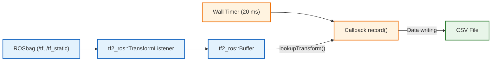
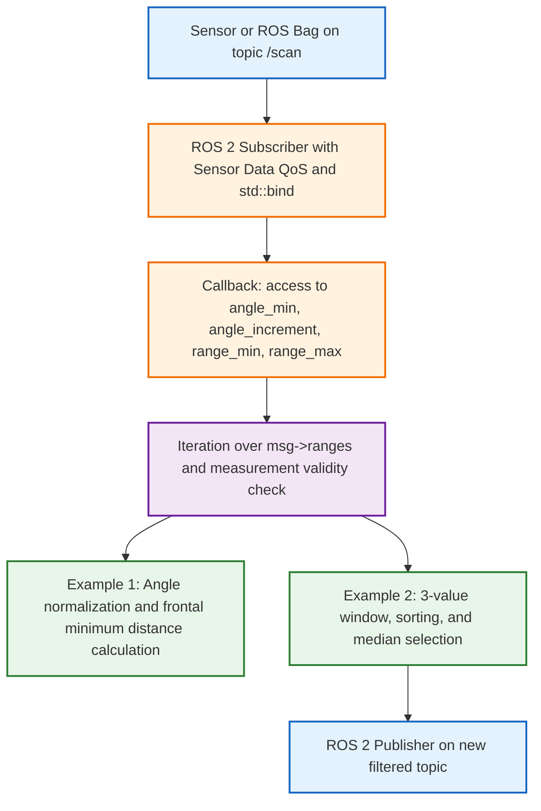
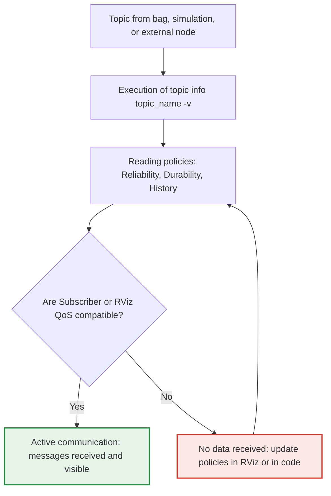

# Practical Summary in ROS 2: Rosbag, Transforms (TF2), and AprilTag

## Educational Overview

This lesson provides an operational summary of several fundamental **ROS 2 (Robot Operating System 2)** tools through the analysis and guided solution of a practical case study (**Exercise 4**). The goal is to show how to integrate the inspection of recorded data, the geometric management of three-dimensional space, and the development of processing nodes to reconstruct the behavior of a robotic system.

Throughout the discussion, the following **Key Concepts** are consolidated:

*   **Data Recording and Playback (`rosbag`)**: an essential tool for capturing and replaying messages exchanged between **Nodes** across various system *topics*. It allows you to perform analysis, debugging, and simulations of real experiments without having direct access to the physical hardware.
*   **Reference Frame Management (`TF2`)**: a library dedicated to tracking multiple **Reference Frames** (such as those of sensors, wheels, joints, or the robot base) organized into a **Transform Tree**. Spatial relationships (expressed via translation and quaternion rotation) are accessed through the **TF Buffer** and **TF Listener** pair, which acquire data from the `/tf` and `/tf_static` topics.
*   **Localization via `AprilTag`**: the use of planar **Visual Markers** to detect and estimate the three-dimensional **Pose** of specific objects within a camera's field of view.
*   **Exercise Workflow**: applying these concepts to a scenario monitored by an overhead ceiling camera, in which three different AprilTags identify the floor—chosen as the **World Reference Frame**—a charging station, and a moving vacuum cleaner robot. The workflow unfolds in three phases:
    1. Command-line inspection of the *rosbag* and three-dimensional visualization of the transforms using **RViz**.
    2. Development of a class-structured C++ node to query the *TF Buffer*, reconstruct the robot's trajectory, compute its distance from the charging station over time, and export the results to a CSV file.
    3. Post-processing and plotting of the extracted data using a Python script.

---

### Theoretical Review and Exercise 4 Scenario

Before going into the details of the solution, let us briefly recap the three fundamental tools on which the exercise is based:

* **ROSbag**: a ROS tool used to record messages exchanged between nodes. It is extremely useful because it allows you to replay and simulate real experiments at a later time, without having direct access to the physical hardware.
* **Transforms and the TF2 library**: in a robotic application, numerous **Reference Frames** coexist—for example, for the wheels, the chassis (`base_link`), the joints, or the sensors (cameras, LiDAR). Transforms describe the position and orientation of one reference frame with respect to another. In ROS 2, the **TF2** library manages these relationships through a **TF Buffer** and a **TF Listener** that read from the `/tf` and `/tf_static` topics.
* **AprilTags**: planar Visual Markers that allow a camera to estimate the **Pose**—that is, the position and orientation in $3\text{D}$ space—of the objects to which they are attached.

#### The Operational Scenario
In the exercise scene, we have a ceiling-mounted camera observing from above a vacuum cleaner robot and its charging station. Three AprilTags are present in the environment:
* **`tag_0`**: placed on the laboratory floor; it serves as the fixed World Reference Frame.
* **`tag_1`**: placed on top of the charging station.
* **`tag_2`**: placed on top of the moving vacuum cleaner robot.

The exercise is divided into three Tasks:
1. Inspect and play back the provided `rosbag`, visualizing its contents in **RViz**.
2. Write a ROS 2 node in C++ that uses TF2 to compute the positions of the robot and the station relative to the floor, reconstruct the trajectory and mutual distance over time, and save everything into a CSV file.
3. Write a simple Python script to read the CSV and plot the results.

---

### Task 1: ROSbag Inspection and Visualization in RViz

When we receive a `rosbag` whose internal structure we do not yet know, the first step is to start it in continuous playback (loop) so that we can query it:

```bash
ros2 bag play <nome_bag> -l
```

The `-l` option keeps the bag running cyclically, giving us all the time we need to inspect the published data.

#### Topic and Message Structure Analysis
With the bag active, we verify which topics are being published using the command:

```bash
ros2 topic list
```

Among the main topics, we find the AprilTag detections topic and the transform topics `/tf` and `/tf_static`. To examine the actual content of each message, we use `ros2 topic echo`:

* **Detections topic**: each message contains a header (`header`) with the **Timestamp** and the `frame_id` (typically the camera's optical reference frame, i.e., the sensor performing the detection). This is followed by an array of detections (`detections`), where each element reports the tag family, its ID, and the image coordinates $(X, Y)$ of the four corners (`corners`).
* **`/tf` topic**: contains an array of transforms. Each transform has a `header` (with timestamp and `frame_id` of the parent node), a `child_frame_id` field (the child node), and the actual geometric transform. The latter consists of:
  * **Translation**: Cartesian coordinates $(x, y, z)$.
  * **Rotation**: represented by a **Quaternion**.

Recall that TF2 organizes all reference frames into a **Transform Tree**, in which a *parent* node can have many *children* nodes.

#### Visualization in RViz
To visually observe the scene, we open **RViz**. If the 3D view appears empty, simply click on *Add* $\rightarrow$ *By display type* $\rightarrow$ *TF* (optionally enabling the option to show frame names).

> **Key Concept — Configuring the Fixed Frame in RViz:**
> To avoid visualization errors and properly observe the relative motion of objects, it is essential to set the global **Fixed Frame** to `tag_0` (the fixed reference on the floor). If buffer or synchronization errors appear at the start of playback or when the loop restarts, simply press the **Reset** button in RViz to properly restore the display of the frames (`tag_0` stationary on the floor, `tag_1` on the station, `tag_2` moving, and the camera frames on the ceiling). Being able to confidently inspect a bag via RViz is an indispensable practical skill.

---

### Task 2: C++ Node with TF2 for Trajectory Tracking

In the second task, we must implement a ROS 2 node in C++ capable of querying TF2, computing positions and relative distance, and saving the results to a CSV file.

#### Node Architecture (`TrajectoryRecorder`)
In ROS 2, it is good practice to structure nodes as C++ classes inheriting from `rclcpp::Node`. We therefore create the `TrajectoryRecorder` class, equipped with the following member variables:

* **`tf_buffer_`** and **`tf_listener_`**: the listener automatically subscribes to the `/tf` and `/tf_static` topics and temporarily stores the received transforms inside the buffer. Our code will then query the buffer to obtain the desired transforms.
* **CSV file stream**: the object to manage writing to the output file.
* **`timer_`**: a *wall timer* to periodically execute the **Callback Function**.



In the class **constructor**, we execute in order:
1. Initialization of the node named `trajectory_recorder`.
2. Instantiation of `tf_buffer_`.
3. Instantiation of `tf_listener_`, passing the buffer to it (the listener strictly requires the buffer in order to operate).
4. Opening/creating the CSV file and writing the first header row.
5. Creating the *wall timer* configured to invoke the `record()` callback every $20\text{ ms}$.

#### Logic of the `record()` Callback
Inside the callback function, we need to retrieve the position of the robot (`tag_2`) and of the charging station (`tag_1`) with respect to the floor (`tag_0`) using the `lookupTransform()` method of the TF2 buffer.

1. **Retrieving the robot transform (`tag_2`)**:
   We call `lookupTransform("tag_0", "tag_2", tf2::TimePointZero)`. By passing `tf2::TimePointZero` as the third argument (the requested time instant), we instruct TF2 to return the **latest available measurement** in the buffer.
2. **Checking data freshness**:
   We check the timestamp of the transform just read against the last saved one. If the timestamp is equal to the previous one, it means no new update has arrived and we can avoid writing duplicate rows to the CSV.
3. **Retrieving the station transform (`tag_1`)**:
   We call `lookupTransform("tag_0", "tag_1", ...)` again to obtain the pose of the station with respect to `tag_0`.

> **Key Concept — Time Consistency and Exception Handling:**
> * **Same Timestamp**: in the second call to `lookupTransform`, instead of using `tf2::TimePointZero` again, it is essential to pass **the same timestamp** obtained from the first transform (`tag_2`). In this way, we ensure that the two positions are compared at the exact same instant in time, avoiding errors due to asynchrony.
> * **`try-catch` block**: all calls to `lookupTransform` must be enclosed in a `try-catch` block. In fact, it may happen that at certain instants the transform is not yet available in the buffer (for example at startup or when a tag is not visible). By catching the exception, the node simply skips that cycle and waits for the next call after $20\text{ ms}$ without crashing.

#### Data Extraction and Distance Calculation
Once the two valid transforms have been obtained, we extract the planar coordinates $(x, y)$ from the `transform.translation` field. We denote by $(x_{\text{tag2}}, y_{\text{tag2}})$ the position of the vacuum cleaner and by $(x_{\text{tag1}}, y_{\text{tag1}})$ the position of the charging station with respect to `tag_0`.

We then compute the components of the relative position and the Euclidean distance $d$ between the robot and the charging station:

$$\Delta x = x_{\text{tag2}} - x_{\text{tag1}}, \qquad \Delta y = y_{\text{tag2}} - y_{\text{tag1}}$$

$$d = \sqrt{\Delta x^2 + \Delta y^2}$$

*(Note: Step integrated for pedagogical clarity).*

Finally, we write a new row to the CSV file containing:
* the timestamp of the measurement;
* the coordinates $(x_{\text{tag2}}, y_{\text{tag2}})$ of the robot;
* the coordinates $(x_{\text{tag1}}, y_{\text{tag1}})$ of the charging station;
* the relative components $(\Delta x, \Delta y)$;
* the distance $d$;

and we print a debug message on the console to monitor the execution.

#### Execution and Verification
To generate the CSV, we proceed from the terminal inside our workspace:
1. We launch the newly compiled C++ node via `ros2 run`.
2. In another terminal, we play back the `rosbag` once (without the `-l` option).
3. We wait for the bag to finish and stop the node.

By opening the generated CSV file, we verify that all columns (timestamp, vacuum cleaner coordinates, station coordinates, relative position, and distance) have been populated correctly.

---

### Task 3: Python Script for Plotting and Results Analysis

The final task requires a Python script (located in the `scripts` folder of the package) to read the generated CSV file and graphically display the data in order to interpret the robot's behavior.

The script reads the CSV file line by line (passing its path as a command-line argument at execution time) and generates two main plots:
1. **Trajectory in the $(x, y)$ plane**: shows the path followed by the vacuum cleaner robot relative to the position of the charging station.
2. **Distance over time**: shows the trend of the distance $d$ between the robot and the station as a function of time.

#### Plot Interpretation and Handling of Missing Data
Observing both plots, it is clearly visible that the vacuum cleaner is trying to approach the charging station (the overall distance tends to decrease over time).

However, some **gaps (holes)** are visible in the plots where position estimates are missing. Why do they occur?
* During the real experiment recorded in the bag, it may happen that for brief time intervals one of the AprilTags is temporarily **not visible** to the ceiling camera (for example due to an occlusion or unfavorable recording conditions).
* This does not compromise the functioning of the system: thanks to the `try-catch` block implemented in the C++ node (Task 2), the temporary absence of the transform is safely handled by skipping the missing frames until the tag becomes visible again.

---

### Anatomy and Geometry of the LaserScan Message

In ROS 2, one of the most widely used data types for environmental perception is the `LaserScan` message (belonging to the `sensor_msgs` package). It is the digital representation of the measurements collected by a two-dimensional laser scanner sensor (2D *Laser Rangefinder*).

#### The 2D Laser Sensor and the Reference Frame

A 2D laser sensor emits an ordered series — effectively an array — of light beams that all lie on a single plane. Each beam returns the distance measurement between the sensor and the closest obstacle along that specific direction.

To correctly interpret these data, it is essential to define the **Reference Frame**:
* By robotics convention, the robot has its own reference frame in which the $x$ axis points in the direction of travel (forward), the $y$ axis is oriented laterally (to the left), and the $z$ axis points upward.
* The laser sensor also has its own reference frame identified by the `frame_id`. For initial simplicity, it can be assumed that the sensor's reference frame coincides with that of the robot; beam angles are therefore measured with respect to the $x$ axis.

#### Main Parameters and Message Fields

The structure of the `LaserScan` message directly reflects the physical and operational characteristics of the sensor. In addition to the `header` — which contains the *timestamp* (the acquisition time instant) and the `frame_id` — the fundamental fields to know and be able to manipulate are:

* **`angle_min` and `angle_max`**: define the starting angle and ending angle (in radians) of the sector covered by the scan with respect to the $x$ axis. A sensor can cover a full $360^\circ$ rotation (for example from $0$ to $2\pi\text{ rad}$), or only a frontal portion, such as the interval $\left[-\frac{\pi}{2}, +\frac{\pi}{2}\right]$ or a narrower cone between $-45^\circ$ and $+45^\circ$.
* **`angle_increment`**: represents the angular step (angular resolution) between one laser beam and the next. For example, covering $360^\circ$ with an increment of $1^\circ$ (approximately $\frac{\pi}{180}\text{ rad}$) yields $360$ beams per scan; depending on the sensor, this step can be finer or coarser.
* **`range_min` and `range_max`**: indicate the minimum and maximum length (in meters) within which a measurement is considered physically valid. Below a certain threshold (for example $10\text{ cm}$, i.e., `range_min` $= 0.1\text{ m}$, or $0\text{ m}$), the sensor cannot measure accurately; similarly, `range_max` sets the maximum range (typically $3\text{ m}$, $4\text{ m}$, up to $10\text{ m}$ or $20\text{ m}$ in more advanced devices).
* **`ranges`**: is the actual vector (*array*) containing all detected distance measurements, one for each beam emitted in the interval from `angle_min` to `angle_max`.
* **`intensities`**: is an array parallel to `ranges` that reports the intensity of the reflected signal. If the sensor (or simulator) does not provide this information, all values are set to $0$.

> **Key Concept:** To be able to use any laser data in ROS 2, it is essential to master the meaning of and access to the fields `angle_min`, `angle_max`, `angle_increment`, `range_min`, `range_max`, and the measurement vector `ranges`.

#### Parameter Limitation and Terminal Inspection

When purchasing or starting a sensor, the driver publishes the nominal parameters provided by the manufacturer. However, it is often useful and sensible to **limit these parameters via software** (all except `ranges`, which contains the raw measurements from the environment):
1. **Handling occlusions**: if part of the robot's structure covers a portion of the sensor's field of view, those directions become unusable or return fixed measurements on the chassis itself.
2. **Computational efficiency**: narrowing the angular field or maximum range reduces the amount of data to process, improving system performance.
3. **Control of the observed space**: the exact region of space of interest for the robot's task is selected (optionally also applying dedicated filters to exclude specific sectors).

To inspect live the structure and actual values of a scan recorded in a *ROS Bag* (for example on the topic `/scan`), the following terminal command is used:

```bash
ros2 topic echo /scan
```

Inspecting the output of a typical simulation, we observe:
* `header` with `frame_id: base_scan`;
* `angle_min: 0.0` and `angle_max` equal to $2\pi$ (approximately $6.28\text{ rad}$);
* `angle_increment` equal to approximately $\frac{\pi}{180}\text{ rad}$ (that is, $1^\circ$);
* `range_min` close to $0\text{ m}$ and `range_max` equal to $20.0\text{ m}$;
* `ranges` populated with measurements in meters and `intensities` composed solely of zeros.

*(Note: in the voice transcription the value of `angle_max` is rendered phonetically inaccurately; since it is a full rotation of $360^\circ$ in radians, the correct value is $2\pi$).*

---

### Processing LaserScan in C++: Frontal Obstacle Detection

A first practical example of manipulating laser data in C++ consists of writing a ROS 2 node capable of identifying the distance to the closest obstacle within a frontal sector (for example $\pm 30^\circ$ around the direction of travel).

#### ROS 2 Node Structure and Subscription

The node is based on creating a *Subscriber* attached to the `/scan` topic with message type `sensor_msgs::msg::LaserScan`:
* A *Quality of Service (QoS)* profile suitable for sensor data is specified (covered separately).
* The message handling function (*Callback*) is bound to the subscriber via `std::bind` in C++, so that it is automatically invoked whenever a new scan arrives.

#### Callback Logic and Field Access

Inside the callback function, the code performs the following operations step by step:

1. **Angular threshold conversion**: the desired aperture (e.g., $30^\circ$) is converted to radians, since in ROS all angular quantities use the International System of Units.
2. **Iteration over all measurements**: a `for` loop is set up with index $i$ running from index $0$ up to `msg->ranges.size()`, so as to examine every single ray contained in the `ranges` vector.
3. **Computing the angle of the $i$-th ray**: by combining the message fields, the angle corresponding to the current index $i$ is obtained:
   $$\theta_i = \text{angle\_min} + i \cdot \text{angle\_increment}$$
4. **Reading the measurement and limits**: the current distance `msg->ranges[i]` and the validity limits `msg->range_min` and `msg->range_max` are extracted.
5. **Angle normalization**: if the sensor publishes angles in the interval $[0, 2\pi]$, the angle $\theta_i$ is normalized into the interval $[-\pi, \pi]$. In this way, the frontal sector of $\pm 30^\circ$ around the $x$ axis is continuous around $0$ instead of being split between $0^\circ$ and $360^\circ$.
   *(Note: Step integrated for instructional clarity — in the spoken explanation the initial interval is cited as $[0, \pi]$, but normalization into $[-\pi, \pi]$ applies to angles coming from $[0, 2\pi]$ in order to properly handle negative values to the right of the $x$ axis).*
6. **Filtering and finding the minimum**: for each ray, the code verifies that:
   * the normalized angle falls within the frontal sector of interest (e.g., $|\theta_{\text{norm}}| \le 30^\circ$);
   * the distance value is not infinite (`!std::isinf`);
   * the measurement respects the physical limits of the sensor:
     $$\text{range\_min} \le \text{ranges}[i] \le \text{range\_max}$$
   If all conditions are satisfied, the recorded minimum distance is updated and printed to the screen using ROS 2 *logging* macros.

> **Key Concept:** The fundamental understanding of this exercise lies in knowing how to properly access the internal fields of the message (`ranges`, `angle_min`, `angle_increment`, `range_min`, `range_max`) and knowing how to iterate over the distance vector to associate each measurement with its corresponding angle $\theta_i$.

---

### Data Filtering: The Median Filter and Republishing

In addition to extracting summary information such as the minimum distance, it is very common to need to **clean the laser signal** from noise (for example, isolated spikes due to spurious reflections) before passing it to other modules of the robot. Although many ready-to-use filter packages already exist in ROS 2, implementing a simple **Median Filter** demonstrates the complete pattern of acquiring, manipulating, and republishing a `LaserScan` message.

#### Measurement Validation and Sliding Window Algorithm

The node subscribes to the `/scan` topic (with QoS for sensor data and `std::bind` to the callback) and declares a *Publisher* on a new output topic intended to host the filtered data. Four logical steps are executed in the callback:

1. **Message copy**: the received message is saved in a new modifiable variable that will retain the same metadata (`header`, angles, limits).
2. **Validation (*Sanity Check*)**: all elements of `ranges` are checked; values that do not fall within the interval $[\text{range\_min}, \text{range\_max}]$ are discarded and replaced with a `NaN` (*Not a Number*) value.
   *(Note: Step integrated for instructional clarity — in speech it is referred to as "set them as none"; in the C++ and ROS standard for the `float` fields of `LaserScan`, invalid rays are marked as `NaN`).*
3. **Applying the 3-element window Median Filter**:
   * We iterate over the `ranges` vector starting from index $i = 1$ up to the second-to-last element ($i < \text{ranges.size()} - 1$), so as not to exceed array bounds when reading adjacent elements.
   * For each position $i$, a local window of $3$ adjacent values is constructed:
     $$W_i = \left[\text{ranges}[i-1],\; \text{ranges}[i],\; \text{ranges}[i+1]\right]$$
   * The $3$ values in the window are sorted in ascending order (from minimum to maximum).
   * The **median value**, i.e., the central element of the sorted window (the one in the middle position, index $1$ of the window), is selected and saved at position $i$ of the filtered message.
4. **Republishing**: once the loop is complete, the new `LaserScan` message with the filtered rays is published on the output topic via the *Publisher*, thus becoming available to the other nodes in the system.

#### Summary of the Manipulation Pipeline in ROS 2

The workflow of both examples highlights the typical architecture of a sensor processing node in ROS 2: receiving the message via a *Subscriber*, iterating over the geometric fields and measurements in the *Callback*, and finally producing useful information (a log or a new topic via a *Publisher*).


*(Diagram: Architecture of the subscription, processing, and republishing pipeline for a LaserScan message in ROS 2 — `accTitle`: LaserScan processing pipeline in ROS 2; `accDescr`: Flowchart showing the data path from the /scan topic to the subscriber, through the validation and ray iteration callback, up to obstacle detection or filtered republishing).*

---

### Quality of Service (QoS)

**Quality of Service (QoS)** literally defines the quality and manner in which messages are exchanged between *Publishers* and *Subscribers*. When defining a *Publisher* and a *Subscriber*, both declare through their QoS **Policies** how information can be sent and received.

There are ready-made QoS profiles optimized for specific purposes — for example, the profile for **Sensor Data** — but it is always possible to define a custom QoS. In the very first examples seen in the basic documentation, one generally limited oneself to setting only the queue depth (for example, a value equal to $10$), leaving all other fields at the system's *default* values, namely **Reliable** and **Volatile**.

#### The Four Fundamental QoS Policies

> **Key Concept**
> To properly configure communication between nodes, it is essential to master three fundamental policies — **History**, **Reliability**, and **Durability** — alongside the queue size (**Depth**).

Here is the operational meaning of each of these four parameters:

*   **History:** establishes how samples in the queue must be managed.
    *   *Keep Last*: the *Subscriber* (or *Publisher*) stores up to a maximum number of recent samples, defined by the queue size.
    *   *Keep All*: all samples arriving from the *Publisher* are kept without discarding them.
*   **Depth:** represents the *queue size*, that is, the integer number $N$ of samples to retain when *History* is set to *Keep Last*.
    *   *Clarification on the queue constraint:* if you set the queue size to $N = 1$, you literally constrain the *Subscriber* to process and retain only one data item at a time; upon connection, it will read exclusively that single element present in the queue.
*   **Reliability:** indicates how guaranteed data delivery is.
    *   *Best Effort*: prioritizes speed over completeness; some packets or samples may be lost along the way.
    *   *Reliable*: guarantees that all samples are actually delivered to the recipient.
*   **Durability:** defines what happens to messages sent before a *Subscriber* connects to the topic.
    *   *Volatile*: when a *Subscriber* joins the topic, it receives only new messages published from that moment onward, losing previous ones.
    *   *Transient Local*: the *Publisher* keeps already published messages in memory and also provides them to *Subscribers* that connect later.

#### Publisher and Subscriber Compatibility: Example with Bag and RViz

> **Key Concept**
> For communication to occur successfully, **Publisher and Subscriber must use compatible QoS policies**. Even a visualizer like **RViz** effectively acts as a *Subscriber* (or a *Publisher* depending on the actions performed): if its QoS does not match that of the node publishing the data, nothing can be displayed.

Let's look at the practical flow shown in class using a recorded *bag* and RViz:

1.  **Bag inspection:** by running the *bag* and listing the available topics, one can analyze topic `scan` in detail using the verbose inspection command (`--verbose` or `-v`):
    ```bash
    topic info scan -v
    ```
    Option `-v` returns extended information, including the actual QoS of the message published by the *bag*:
    *   *Reliability*: `Reliable`
    *   *Depth*: `Unknown` (not relevant during external inspection)
    *   *Durability*: `Volatile`
    This configuration corresponds precisely to the framework's *default* profile.
2.  **Configuration in RViz:** by opening RViz, selecting the correct *reference frame* associated with the laser sensor, and adding the `LaserScan` topic. Initially, RViz's QoS policies match those of the *bag*, and the scan points appear normally on screen.
3.  **Checking for incompatibility:** if in RViz's display settings one manually modifies one of the QoS parameters making it incompatible with that of the *Publisher* in the *bag*, data immediately stops being displayed.

**Practical debugging rule:** when you are certain that the topic name and *reference frame* are correct, but no data is received or displayed, the cause is almost always a **QoS mismatch**. While on nodes written from scratch you have full control over how to configure communication, when working with *bags*, simulations, or third-party nodes, it is always best to run `topic info <nome_topic> -v` to read the real QoS and configure your *Subscribers* or RViz accordingly.



---

### Overview of Sensor Messages

In addition to the `LaserScan` message analyzed in detail for planar laser sensors ($2\text{D}$), the standard library for sensor messages (*sensor messages*) provides numerous other data structures to interface with real or simulated hardware:

*   **Camera:** structures dedicated to transmitting images coming from cameras.
*   **Joystick (`Joy`):** format used when connecting a joystick or controller to the system. Its structure is very straightforward and includes:
    *   `header`: standard timestamp and reference information;
    *   `axes`: a vector with analog axis values (e.g., thumbsticks);
    *   `buttons`: a vector representing the state of pressed buttons.
*   **Point Cloud (*Point Cloud*):** the typical format of sensors that acquire data in three dimensions ($3\text{D}$), such as a 3D LiDAR (which no longer returns a simple planar `LaserScan`, but precisely a *Point Cloud*). Its structure includes:
    *   `header`: metadata and reference *frame* $3\text{D}$ common to the points;
    *   a set of three-dimensional points;
    *   `channels`: additional channels to associate further attributes with each point, such as **RGB** color information.

---

### Introduction to Actions and Next Steps

At the end of the lesson, the existence of a specific library dedicated to **Actions** and related APIs for handling specific actions, services, and messages (for example, in the context of navigation) is introduced.

Although the detailed operation of actions is postponed to the next lesson dedicated to navigation, the code examples already show how the structure remains consistent with that of the standard nodes already seen: inside the node, the action goal (*goal*) is constructed by appropriately populating the fields of a geometry message (*geometry message*), and then sending it to the system responsible for execution.

---

> [!NOTE]
> ### Exam Notes and Instructor Notices
> - **Task 3 of Exercise 4 (Python script for plots):** The instructor explicitly stated that the Python code for reading the CSV file and plotting the graphs is not part of the exam and is not required for the test.
> - **Quality of Service (QoS):** The instructor indicated that, for exam purposes, one can focus on the three minimum required policies (*history*, *reliability*, and *durability*) plus the *depth* parameter.