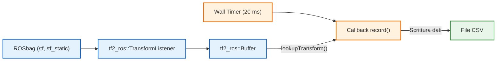
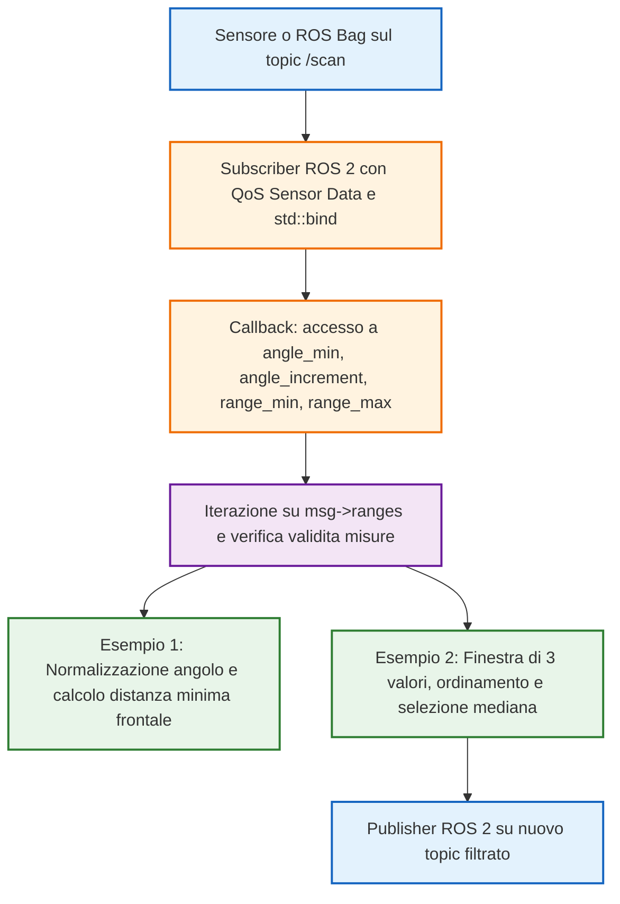
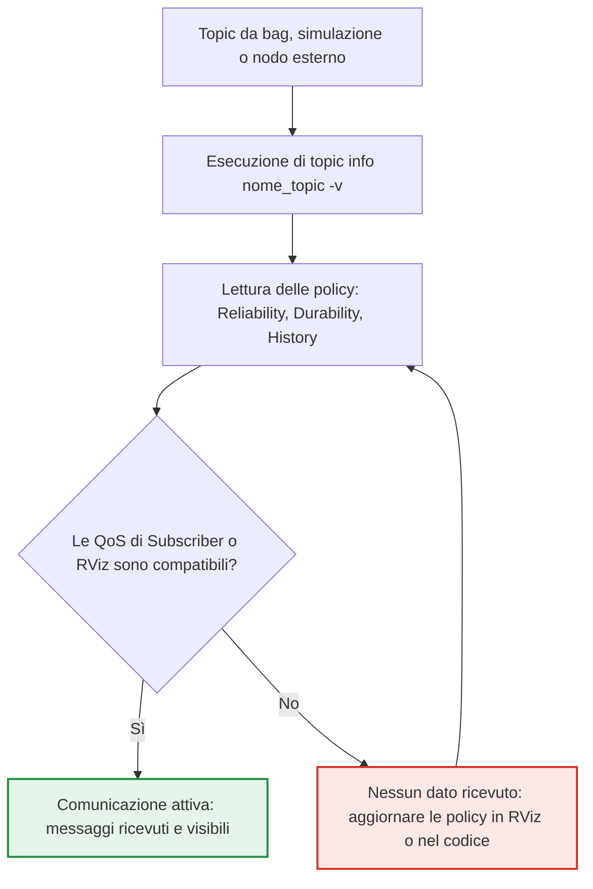

# Riepilogo Pratico in ROS 2: Rosbag, Trasformazioni (TF2) e AprilTag

## Overview Didattica

La lezione affronta un riepilogo operativo di alcuni strumenti fondamentali di **ROS 2 (Robot Operating System 2)** attraverso l'analisi e la risoluzione guidata di un caso di studio pratico (**Esercizio 4**). L'obiettivo è mostrare come integrare l'ispezione dei dati registrati, la gestione geometrica dello spazio tridimensionale e lo sviluppo di nodi di elaborazione per ricostruire il comportamento di un sistema robotico.

Nel corso della trattazione vengono consolidati i seguenti **Concetti Chiave**:

*   **Registrazione e Riproduzione dei Dati (`rosbag`)**: strumento essenziale per catturare e riprodurre i messaggi scambiati tra i **Nodi (Nodes)** sui vari *topic* di sistema. Consente di effettuare analisi, debug e simulazioni di esperimenti reali senza avere accesso diretto all'hardware fisico.
*   **Gestione dei Sistemi di Riferimento (`TF2`)**: libreria dedicata al tracciamento di molteplici **Sistemi di Riferimento (Reference Frames)** (come quelli di sensori, ruote, giunti o base del robot) organizzati in un **Albero delle Trasformazioni (Transform Tree)**. L'accesso alle relazioni spaziali (espresse tramite traslazione e rotazione in quaternioni) avviene tramite l'accoppiata **TF Buffer** e **TF Listener**, che acquisiscono i dati dai topic `/tf` e `/tf_static`.
*   **Localizzazione tramite `AprilTag`**: utilizzo di **Marcatori Visivi (Visual Markers)** planari per rilevare e stimare la **Posa (Pose)** tridimensionale di oggetti specifici all'interno del campo visivo di una telecamera.
*   **Flusso Operativo dell'Esercitazione**: applicazione dei concetti a uno scenario monitorato da una telecamera a soffitto, in cui tre diversi AprilTag identificano il pavimento — scelto come **Sistema di Riferimento Globale (World Reference Frame)** —, una stazione di ricarica e un robot aspirapolvere in movimento. Il flusso si sviluppa in tre fasi:
    1. Ispezione da riga di comando della *rosbag* e visualizzazione tridimensionale delle trasformazioni tramite **RViz**.
    2. Sviluppo di un nodo C++ strutturato a classi per interrogare il *TF Buffer*, ricostruire la traiettoria del robot, calcolarne la distanza dalla stazione di ricarica nel tempo ed esportare i risultati in un file CSV.
    3. Post-elaborazione e rappresentazione grafica dei dati estratti mediante uno script Python.

---

### Richiamo Teorico e Scenario dell'Esercizio 4

Prima di entrare nel dettaglio della soluzione, ricapitoliamo brevemente i tre strumenti fondamentali su cui si basa l'esercizio:

* **ROSbag**: strumento di ROS utilizzato per registrare i messaggi scambiati tra i nodi. È estremamente utile perché permette di riprodurre e simulare esperimenti reali in un secondo momento, senza avere accesso diretto all'hardware fisico.
* **Trasformate (Transforms) e libreria TF2**: in un'applicazione robotica coesistono numerosi **Sistemi di Riferimento (Reference Frames)** — ad esempio per le ruote, il telaio (`base_link`), i giunti o i sensori (telecamere, LiDAR). Le trasformate descrivono la posizione e l'orientamento di un sistema di riferimento rispetto a un altro. In ROS 2, la libreria **TF2** gestisce queste relazioni attraverso un **Buffer (TF Buffer)** e un **Listener (TF Listener)** che leggono dai topic `/tf` e `/tf_static`.
* **AprilTags**: marcatori visivi planari (Visual Markers) che consentono a una telecamera di stimare la **Posa (Pose)** — ovvero posizione e orientamento nello spazio $3\text{D}$ — degli oggetti su cui sono applicati.

#### Lo Scenario Operativo
Nella scena dell'esercizio abbiamo una telecamera montata sul soffitto che osserva dall'alto un robot aspirapolvere (vacuum cleaner) e la sua stazione di ricarica (charging station). Nell'ambiente sono presenti tre AprilTag:
* **`tag_0`**: posizionato sul pavimento del laboratorio; funge da sistema di riferimento fisso del mondo (World Reference Frame).
* **`tag_1`**: posizionato sopra la stazione di ricarica.
* **`tag_2`**: posizionato sopra il robot aspirapolvere in movimento.

L'esercizio è suddiviso in tre compiti (Task):
1. Ispezionare e riprodurre la `rosbag` fornita, visualizzandone il contenuto in **RViz**.
2. Scrivere un nodo ROS 2 in C++ che usi TF2 per calcolare le posizioni di robot e stazione rispetto al pavimento, ricostruire la traiettoria e la distanza reciproca nel tempo, e salvare tutto in un file CSV.
3. Scrivere un semplice script Python per leggere il CSV e graficare i risultati.

---

### Task 1: Ispezione della ROSbag e Visualizzazione in RViz

Quando riceviamo una `rosbag` di cui non conosciamo ancora la struttura interna, il primo passo è avviarla in riproduzione continua (loop) per poterla interrogare:

```bash
ros2 bag play <nome_bag> -l
```

L'opzione `-l` mantiene la bag in esecuzione ciclica, lasciandoci tutto il tempo necessario per ispezionare i dati pubblicati.

#### Analisi dei Topic e della Struttura dei Messaggi
Con la bag attiva, verifichiamo quali topic vengono pubblicati tramite il comando:

```bash
ros2 topic list
```

Tra i topic principali troviamo il topic delle rilevazioni degli AprilTag e i topic di trasformata `/tf` e `/tf_static`. Per esaminare il contenuto effettivo di ciascun messaggio usiamo `ros2 topic echo`:

* **Topic delle rilevazioni (Detections)**: ogni messaggio contiene un'intestazione (`header`) con la **Marca Temporale (Timestamp)** e il `frame_id` (tipicamente il sistema di riferimento ottico della telecamera, cioè il sensore che effettua la rilevazione). Segue un array di rilevazioni (`detections`), dove ciascun elemento riporta la famiglia del tag, il suo ID e le coordinate immagine $(X, Y)$ dei quattro angoli (`corners`).
* **Topic `/tf`**: contiene un array di trasformate. Ogni trasformata possiede un `header` (con timestamp e `frame_id` del nodo genitore), un campo `child_frame_id` (il nodo figlio) e la trasformata geometrica vera e propria. Quest'ultima è composta da:
  * **Traslazione (Translation)**: coordinate cartesiane $(x, y, z)$.
  * **Rotazione (Rotation)**: rappresentata mediante un **Quaternione (Quaternion)**.

Ricordiamo che TF2 organizza tutti i sistemi di riferimento in un **Albero delle Trasformate (Transform Tree)**, in cui un nodo genitore (*parent*) può avere molti nodi figli (*children*).

#### Visualizzazione in RViz
Per osservare visivamente la scena, apriamo **RViz**. Se la vista 3D appare vuota, è sufficiente cliccare su *Add* $\rightarrow$ *By display type* $\rightarrow$ *TF* (attivando eventualmente l'opzione per mostrare i nomi dei frame).

> **Concetto Chiave — Configurazione del Fixed Frame in RViz:**
> Per evitare errori di visualizzazione e osservare correttamente il movimento relativo degli oggetti, è fondamentale impostare il **Fixed Frame** globale su `tag_0` (il riferimento fisso sul pavimento). Se all'avvio della riproduzione o al riavvio del loop dovessero comparire errori di buffer o sincronizzazione, basta premere il pulsante **Reset** in RViz per ripristinare correttamente la visualizzazione dei frame (`tag_0` fermo sul pavimento, `tag_1` sulla stazione, `tag_2` in movimento e i frame della telecamera sul soffitto). Saper ispezionare con sicurezza una bag tramite RViz è una competenza pratica indispensabile.

---

### Task 2: Nodo C++ con TF2 per il Tracciamento della Traiettoria

Nel secondo task dobbiamo implementare un nodo ROS 2 in C++ capace di interrogare TF2, calcolare posizioni e distanza relativa, e salvare i risultati in un file CSV.

#### Architettura del Nodo (`TrajectoryRecorder`)
In ROS 2 è buona norma strutturare i nodi come classi C++ che ereditano da `rclcpp::Node`. Creiamo quindi la classe `TrajectoryRecorder`, dotata dei seguenti attributi (member variables):

* **`tf_buffer_`** e **`tf_listener_`**: il listener si sottoscrive automaticamente ai topic `/tf` e `/tf_static` e salva temporaneamente le trasformate ricevute all'interno del buffer. Il nostro codice interrogherà poi il buffer per ottenere le trasformate desiderate.
* **Stream del file CSV**: l'oggetto per gestire la scrittura su file di output.
* **`timer_`**: un *wall timer* per eseguire periodicamente la **Funzione di Callback (Callback Function)**.



Nel **costruttore** della classe eseguiamo in ordine:
1. L'inizializzazione del nodo con nome `trajectory_recorder`.
2. L'istanziazione del `tf_buffer_`.
3. L'istanziazione del `tf_listener_`, passandogli il buffer (il listener necessita obbligatoriamente del buffer per poter operare).
4. L'apertura/creazione del file CSV e la scrittura della prima riga di intestazione (header).
5. La creazione del *wall timer* configurato per invocare la callback `record()` ogni $20\text{ ms}$.

#### Logica della Callback `record()`
All'interno della funzione di callback dobbiamo ricavare la posizione del robot (`tag_2`) e della stazione di ricarica (`tag_1`) rispetto al pavimento (`tag_0`) utilizzando il metodo `lookupTransform()` del buffer TF2.

1. **Recupero della trasformata del robot (`tag_2`)**:
   Chiamiamo `lookupTransform("tag_0", "tag_2", tf2::TimePointZero)`. Passando `tf2::TimePointZero` come terzo argomento (l'istante temporale richiesto), indichiamo a TF2 di restituirci l'**ultima misura disponibile** nel buffer.
2. **Verifica della freschezza del dato**:
   Controlliamo il timestamp della trasformata appena letta rispetto all'ultimo salvato. Se il timestamp è uguale al precedente, significa che non è arrivato un nuovo aggiornamento e possiamo evitare di scrivere righe duplicate nel CSV.
3. **Recupero della trasformata della stazione (`tag_1`)**:
   Chiamiamo nuovamente `lookupTransform("tag_0", "tag_1", ...)` per ottenere la posa della stazione rispetto a `tag_0`.

> **Concetto Chiave — Coerenza Temporale e Gestione delle Eccezioni:**
> * **Stesso Timestamp**: nella seconda chiamata a `lookupTransform`, invece di usare nuovamente `tf2::TimePointZero`, è fondamentale passare **lo stesso timestamp** ottenuto dalla prima trasformata (`tag_2`). In questo modo garantiamo che le due posizioni vengano confrontate esattamente nello stesso istante temporale, evitando errori dovuti ad asincronia.
> * **Blocco `try-catch`**: tutte le chiamate a `lookupTransform` devono essere racchiuse in un blocco `try-catch`. Può capitare, infatti, che in determinati istanti la trasformata non sia ancora disponibile nel buffer (ad esempio all'avvio o quando un tag non è visibile). Catturando l'eccezione, il nodo ignora semplicemente quel ciclo e attende la chiamata successiva dopo $20\text{ ms}$ senza andare in crash.

#### Estrazione dei Dati e Calcolo della Distanza
Ottenute le due trasformate valide, estraiamo le coordinate planari $(x, y)$ dal campo `transform.translation`. Indichiamo con $(x_{\text{tag2}}, y_{\text{tag2}})$ la posizione dell'aspirapolvere e con $(x_{\text{tag1}}, y_{\text{tag1}})$ la posizione della stazione di ricarica rispetto a `tag_0`.

Calcoliamo quindi le componenti della posizione relativa e la distanza euclidea $d$ tra il robot e la stazione di ricarica:

$$\Delta x = x_{\text{tag2}} - x_{\text{tag1}}, \qquad \Delta y = y_{\text{tag2}} - y_{\text{tag1}}$$

$$d = \sqrt{\Delta x^2 + \Delta y^2}$$

*(Nota: Passaggio integrato con chiarezza didattica).*

Infine, scriviamo una nuova riga nel file CSV contenente:
* il timestamp della misura;
* le coordinate $(x_{\text{tag2}}, y_{\text{tag2}})$ del robot;
* le coordinate $(x_{\text{tag1}}, y_{\text{tag1}})$ della stazione di ricarica;
* le componenti relative $(\Delta x, \Delta y)$;
* la distanza $d$;

e stampiamo un messaggio di debug sulla console per monitorare l'esecuzione.

#### Esecuzione e Verifica
Per generare il CSV procediamo da terminale all'interno del nostro workspace:
1. Avviamo il nodo C++ appena compilato tramite `ros2 run`.
2. In un altro terminale, riproduciamo la `rosbag` una sola volta (senza l'opzione `-l`).
3. Attendiamo la fine della bag e arrestiamo il nodo.

Aprendo il file CSV generato, verifichiamo che tutte le colonne (timestamp, coordinate dell'aspirapolvere, coordinate della stazione, posizione relativa e distanza) siano state popolate correttamente.

---

### Task 3: Script Python per il Plotting e Analisi dei Risultati

L'ultimo task richiede uno script Python (collocato nella cartella `scripts` del pacchetto) per leggere il file CSV generato e visualizzare graficamente i dati al fine di interpretare il comportamento del robot.

Lo script legge il file CSV riga per riga (passandone il percorso come argomento da riga di comando al momento dell'esecuzione) e genera due grafici principali:
1. **Traiettoria nel piano $(x, y)$**: mostra il percorso seguito dal robot aspirapolvere rispetto alla posizione della stazione di ricarica.
2. **Distanza nel tempo**: mostra l'andamento della distanza $d$ tra robot e stazione in funzione del tempo.

#### Interpretazione dei Grafici e Gestione dei Dati Mancanti
Osservando entrambi i grafici si nota chiaramente che l'aspirapolvere sta cercando di avvicinarsi alla stazione di ricarica (la distanza complessiva tende a ridursi nel tempo).

Tuttavia, nei grafici sono visibili alcune **interruzioni (buchi)** in cui mancano le stime di posizione. Come mai si verificano?
* Durante l'esperimento reale registrato nella bag, può accadere che per alcuni brevi intervalli di tempo uno degli AprilTag risulti temporaneamente **non visibile** alla telecamera sul soffitto (ad esempio per un'occlusione o per condizioni di ripresa sfavorevoli).
* Questo non compromette il funzionamento del sistema: grazie al blocco `try-catch` implementato nel nodo C++ (Task 2), l'assenza momentanea della trasformata viene gestita in modo sicuro saltando i frame mancanti fino a quando il tag non torna visibile.

---

### Anatomia e Geometria del Messaggio LaserScan

In ROS 2, uno dei tipi di dato più utilizzati per la percezione ambientale è il messaggio `LaserScan` (appartenente al pacchetto `sensor_msgs`). Si tratta della rappresentazione digitale delle misure raccolte da un sensore laser scanner bidimensionale (2D *Laser Rangefinder*).

#### Il Sensore Laser 2D e il Sistema di Riferimento

Un sensore laser 2D emette una serie ordinata — di fatto un array — di raggi luminosi (*light beams*) che giacciono tutti su un unico piano. Ogni raggio restituisce la misura della distanza tra il sensore e l'ostacolo più vicino lungo quella specifica direzione.

Per interpretare correttamente questi dati è fondamentale definire il **Sistema di Riferimento (*Reference Frame*)**:
* Per convenzione robotica, il robot possiede un proprio sistema di riferimento in cui l'asse $x$ punta nella direzione di avanzamento (in avanti), l'asse $y$ è orientato lateralmente (verso sinistra) e l'asse $z$ punta verso l'alto.
* Anche il sensore laser possiede un proprio sistema di riferimento identificato dal `frame_id`. Per semplicità di trattazione iniziale, si può assumere che il sistema di riferimento del sensore coincida con quello del robot; gli angoli dei raggi vengono quindi misurati rispetto all'asse $x$.

#### Parametri Principali e Campi del Messaggio

La struttura del messaggio `LaserScan` rispecchia direttamente le caratteristiche fisiche e operative del sensore. Oltre all'`header` — che contiene il *timestamp* (l'istante temporale di acquisizione) e il `frame_id` — i campi fondamentali da conoscere e saper manipolare sono:

* **`angle_min` e `angle_max`**: definiscono l'angolo iniziale e l'angolo finale (in radianti) del settore coperto dalla scansione rispetto all'asse $x$. Un sensore può coprire un intero giro di $360^\circ$ (ad esempio da $0$ a $2\pi\text{ rad}$), oppure soltanto una porzione frontale, come l'intervallo $\left[-\frac{\pi}{2}, +\frac{\pi}{2}\right]$ o un cono più stretto compreso tra $-45^\circ$ e $+45^\circ$.
* **`angle_increment`**: rappresenta il passo angolare (risoluzione angolare) tra un raggio laser e il successivo. Ad esempio, coprendo $360^\circ$ con un incremento di $1^\circ$ (circa $\frac{\pi}{180}\text{ rad}$), si ottengono $360$ raggi per ogni scansione; a seconda del sensore, questo passo può essere più fitto o più rado.
* **`range_min` e `range_max`**: indicano la lunghezza minima e massima (in metri) entro cui una misura è considerata fisicamente valida. Sotto una certa soglia (ad esempio $10\text{ cm}$, cioè `range_min` $= 0.1\text{ m}$, o $0\text{ m}$), il sensore non riesce a misurare correttamente; analogamente, `range_max` fissa la portata massima (tipicamente $3\text{ m}$, $4\text{ m}$, fino a $10\text{ m}$ o $20\text{ m}$ nei dispositivi più avanzati).
* **`ranges`**: è il vettore (*array*) vero e proprio che contiene tutte le misure di distanza rilevate, una per ciascun raggio emesso nell'intervallo da `angle_min` ad `angle_max`.
* **`intensities`**: è un array parallelo a `ranges` che riporta l'intensità del segnale riflesso. Se il sensore (o il simulatore) non fornisce questa informazione, tutti i valori sono impostati a $0$.

> **Concetto Chiave:** Per saper utilizzare qualsiasi dato laser in ROS 2 è indispensabile padroneggiare il significato e l'accesso ai campi `angle_min`, `angle_max`, `angle_increment`, `range_min`, `range_max` e al vettore delle misure `ranges`.

#### Limitazione dei Parametri e Ispezione via Terminale

Quando si acquista o si avvia un sensore, il driver pubblica i parametri nominali forniti dal costruttore. Tuttavia, è spesso utile e sensato **limitare via software** questi parametri (tutti tranne `ranges`, che contiene le misure grezze dall'ambiente):
1. **Gestione delle occlusioni**: se parte della struttura del robot copre una porzione del campo visivo del sensore, quelle direzioni risultano inutilizzabili o restituiscono misure fisse sul telaio stesso.
2. **Efficienza computazionale**: restringere il campo angolare o il raggio massimo riduce la quantità di dati da elaborare, migliorando le prestazioni del sistema.
3. **Controllo dello spazio osservato**: si seleziona esattamente la regione di spazio di interesse per il task del robot (eventualmente applicando anche filtri dedicati per escludere settori specifici).

Per verificare dal vivo la struttura e i valori reali di una scansione registrata in una *ROS Bag* (ad esempio sul topic `/scan`), si utilizza il comando da terminale:

```bash
ros2 topic echo /scan
```

Ispezionando l'output di una simulazione tipica, si osservano:
* `header` con `frame_id: base_scan`;
* `angle_min: 0.0` e `angle_max` pari a $2\pi$ (circa $6.28\text{ rad}$);
* `angle_increment` pari a circa $\frac{\pi}{180}\text{ rad}$ (ovvero $1^\circ$);
* `range_min` prossimo a $0\text{ m}$ e `range_max` pari a $20.0\text{ m}$;
* `ranges` popolato dalle misure in metri e `intensities` composto da soli zeri.

*(Nota: nella trascrizione vocale il valore di `angle_max` viene reso foneticamente in modo impreciso; trattandosi di un giro completo di $360^\circ$ in radianti, il valore corretto è $2\pi$).*

---

### Elaborazione di LaserScan in C++: Rilevamento Ostacolo Frontale

Un primo esempio pratico di manipolazione dei dati laser in C++ consiste nello scrivere un nodo ROS 2 capace di individuare la distanza dell'ostacolo più vicino all'interno di un settore frontale (ad esempio $\pm 30^\circ$ attorno alla direzione di marcia).

#### Struttura del Nodo ROS 2 e Sottoscrizione

Il nodo si basa sulla creazione di un *Subscriber* (sottoscrittore) agganciato al topic `/scan` con tipo di messaggio `sensor_msgs::msg::LaserScan`:
* Viene specificato un profilo di *Quality of Service (QoS)* adatto ai dati dei sensori (approfondito separatamente).
* La funzione di gestione del messaggio (*Callback*) viene associata al subscriber tramite `std::bind` in C++, in modo che venga invocata automaticamente ogni volta che arriva una nuova scansione.

#### Logica della Callback e Accesso ai Campi

All'interno della funzione di callback, il codice esegue passo dopo passo le seguenti operazioni:

1. **Conversione della soglia angolare**: l'apertura desiderata (es. $30^\circ$) viene convertita in radianti, poiché in ROS tutte le grandezze angolari usano il Sistema Internazionale.
2. **Iterazione su tutte le misure**: si imposta un ciclo `for` con indice $i$ che scorre dall'indice $0$ fino a `msg->ranges.size()`, così da esaminare ogni singolo raggio contenuto nel vettore `ranges`.
3. **Calcolo dell'angolo del raggio $i$-esimo**: combinando i campi del messaggio, si ricava l'angolo corrispondente all'indice corrente $i$:
   $$\theta_i = \text{angle\_min} + i \cdot \text{angle\_increment}$$
4. **Lettura della misura e dei limiti**: si estraggono la distanza corrente `msg->ranges[i]` e i limiti di validità `msg->range_min` e `msg->range_max`.
5. **Normalizzazione dell'angolo**: se il sensore pubblica angoli nell'intervallo $[0, 2\pi]$, l'angolo $\theta_i$ viene normalizzato nell'intervallo $[-\pi, \pi]$. In questo modo, il settore frontale di $\pm 30^\circ$ attorno all'asse $x$ risulta continuo attorno allo $0$ anziché spezzato tra $0^\circ$ e $360^\circ$.
   *(Nota: Passaggio integrato con chiarezza didattica — nella spiegazione parlata viene citato l'intervallo iniziale come $[0, \pi]$, ma la normalizzazione in $[-\pi, \pi]$ si applica agli angoli provenienti da $[0, 2\pi]$ per gestire correttamente i valori negativi a destra dell'asse $x$).*
6. **Filtraggio e ricerca del minimo**: per ogni raggio, il codice verifica che:
   * l'angolo normalizzato rientri nel settore frontale di interesse (es. $|\theta_{\text{norm}}| \le 30^\circ$);
   * il valore della distanza non sia infinito (`!std::isinf`);
   * la misura rispetti i limiti fisici del sensore:
     $$\text{range\_min} \le \text{ranges}[i] \le \text{range\_max}$$
   Se tutte le condizioni sono soddisfatte, si aggiorna la distanza minima registrata e la si stampa a schermo tramite le macro di *logging* di ROS 2.

> **Concetto Chiave:** La comprensione fondamentale di questo esercizio risiede nel saper accedere correttamente ai campi interni del messaggio (`ranges`, `angle_min`, `angle_increment`, `range_min`, `range_max`) e nel sapere iterare sul vettore delle distanze per associare a ogni misura il relativo angolo $\theta_i$.

---

### Filtraggio dei Dati: Il Filtro Mediano e la Ripubblicazione

Oltre a estrarre informazioni sintetiche come la distanza minima, è molto frequente dover **ripulire il segnale laser** dal rumore (ad esempio picchi isolati dovuti a riflessi spuri) prima di passarlo ad altri moduli del robot. Sebbene in ROS 2 esistano già molti pacchetti di filtri pronti all'uso, implementare un semplice **Filtro Mediano (*Median Filter*)** mostra il pattern completo di acquisizione, manipolazione e ripubblicazione di un messaggio `LaserScan`.

#### Validazione delle Misure e Algoritmo a Finestra Mobile

Il nodo sottoscrive il topic `/scan` (con QoS per dati sensoriali e `std::bind` verso la callback) e dichiara un *Publisher* (editore) su un nuovo topic di uscita destinato a ospitare i dati filtrati. Nella callback vengono eseguiti quattro passaggi logici:

1. **Copia del messaggio**: il messaggio ricevuto viene salvato in una nuova variabile modificabile che manterrà gli stessi metadati (`header`, angoli, limiti).
2. **Validazione (*Sanity Check*)**: si controllano tutti gli elementi di `ranges`; i valori che non rientrano nell'intervallo $[\text{range\_min}, \text{range\_max}]$ vengono scartati e sostituiti con un valore `NaN` (*Not a Number*).
   *(Nota: Passaggio integrato con chiarezza didattica — nel parlato viene indicato come "set them as none"; nello standard C++ e ROS per i campi `float` di `LaserScan`, i raggi non validi vengono marcati come `NaN`).*
3. **Applicazione del Filtro Mediano a finestra di 3**:
   * Si itera sul vettore `ranges` partendo dall'indice $i = 1$ fino al penultimo elemento ($i < \text{ranges.size()} - 1$), in modo da non sforare i limiti dell'array quando si leggono gli elementi adiacenti.
   * Per ogni posizione $i$, si costruisce una finestra locale di $3$ valori adiacenti:
     $$W_i = \left[\text{ranges}[i-1],\; \text{ranges}[i],\; \text{ranges}[i+1]\right]$$
   * Si ordinano i $3$ valori della finestra in ordine crescente (dal minimo al massimo).
   * Si seleziona il **valore mediano**, ovvero l'elemento centrale della finestra ordinata (quello in posizione centrale, indice $1$ della finestra), e lo si salva nella posizione $i$ del messaggio filtrato.
4. **Ripubblicazione**: una volta completato il ciclo, il nuovo messaggio `LaserScan` con i raggi filtrati viene pubblicato sul topic di uscita tramite il *Publisher*, risultando così disponibile per gli altri nodi del sistema.

#### Riepilogo della Pipeline di Manipolazione in ROS 2

Il flusso operativo di entrambi gli esempi evidenzia l'architettura tipica di un nodo di elaborazione sensoriale in ROS 2: ricevere il messaggio tramite *Subscriber*, iterare sui campi geometrici e sulle misure nella *Callback* e infine produrre un'informazione utile (log o nuovo topic tramite *Publisher*).


*(Schema: Architettura della pipeline di sottoscrizione, elaborazione e ripubblicazione di un messaggio LaserScan in ROS 2 — `accTitle`: Pipeline elaborazione LaserScan in ROS 2; `accDescr`: Diagramma di flusso che mostra il percorso dei dati dal topic /scan al subscriber, attraverso la callback di validazione e iterazione sui raggi, fino al rilevamento ostacoli o alla ripubblicazione filtrata).*

---

### La Qualità del Servizio (Quality of Service, QoS)

La **Qualità del Servizio (Quality of Service, QoS)** definisce letteralmente la qualità e le modalità con cui i messaggi vengono scambiati tra *Publisher* (pubblicatori) e *Subscriber* (sottoscrittori). Quando si definiscono un *Publisher* e un *Subscriber*, entrambi dichiarano attraverso le proprie **Politiche (Policies)** di QoS in che modo l'informazione può essere inviata e ricevuta.

Esistono profili di QoS già pronti e ottimizzati per scopi specifici — ad esempio il profilo per i **dati dei sensori (Sensor Data)** — ma è sempre possibile definire una propria QoS personalizzata. Nei primissimi esempi visti nella documentazione base, ci si limitava in genere a impostare unicamente la profondità della coda (ad esempio un valore pari a $10$), lasciando tutti gli altri campi ai valori predefiniti (*default*) del sistema, ovvero **Reliable** e **Volatile**.

#### Le quattro politiche fondamentali della QoS

> **Concetto Chiave**
> Per configurare correttamente la comunicazione tra nodi, è indispensabile padroneggiare tre politiche fondamentali — **History**, **Reliability** e **Durability** — affiancate dalla dimensione della coda (**Depth**).

Ecco il significato operativo di ciascuno di questi quattro parametri:

*   **Storia (*History*):** stabilisce come devono essere gestiti i campioni in coda.
    *   *Keep Last*: il *Subscriber* (o il *Publisher*) memorizza fino a un numero massimo di campioni recenti, definito dalla dimensione della coda.
    *   *Keep All*: vengono conservati tutti i campioni in arrivo dal *Publisher* senza scartarli.
*   **Profondità (*Depth*):** rappresenta la dimensione della coda (*queue size*), cioè il numero intero $N$ di campioni da trattenere quando la *History* è impostata su *Keep Last*.
    *   *Chiarimento sul vincolo della coda:* se si imposta la dimensione della coda a $N = 1$, si vincola letteralmente il *Subscriber* a elaborare e trattenere un solo dato alla volta; al momento della connessione, leggerà esclusivamente quell'unico elemento presente nella coda.
*   **Affidabilità (*Reliability*):** indica quanto è garantita la consegna dei dati.
    *   *Best Effort*: privilegia la velocità rispetto alla completezza; alcuni pacchetti o campioni possono andare persi lungo il percorso.
    *   *Reliable*: garantisce che tutti i campioni vengano effettivamente consegnati al destinatario.
*   **Persistenza / Durata (*Durability*):** definisce cosa accade ai messaggi inviati prima che un *Subscriber* si colleghi al topic.
    *   *Volatile*: quando un *Subscriber* si unisce al topic, riceve solo i nuovi messaggi pubblicati da quel momento in poi, perdendo quelli precedenti.
    *   *Transient Local*: il *Publisher* mantiene in memoria i messaggi già pubblicati e li fornisce anche ai *Subscriber* che si connettono in un secondo momento.

#### Compatibilità tra Publisher e Subscriber: esempio con Bag e RViz

> **Concetto Chiave**
> Affinché la comunicazione avvenga con successo, **Publisher e Subscriber devono utilizzare politiche QoS compatibili**. Anche un visualizzatore come **RViz** si comporta di fatto come un *Subscriber* (o un *Publisher* in base alle azioni eseguite): se la sua QoS non coincide con quella del nodo che pubblica i dati, non sarà possibile visualizzare nulla.

Vediamo il flusso pratico mostrato a lezione utilizzando una *bag* registrata e RViz:

1.  **Ispezione della bag:** eseguendo la *bag* ed elencando i topic disponibili, si può analizzare nel dettaglio il topic `scan` tramite il comando di ispezione in modalità verbosa (`--verbose` o `-v`):
    ```bash
    topic info scan -v
    ```
    L'opzione `-v` restituisce informazioni estese, tra cui la QoS effettiva del messaggio pubblicato dalla *bag*:
    *   *Reliability*: `Reliable`
    *   *Depth*: `Unknown` (non rilevante in fase di ispezione esterna)
    *   *Durability*: `Volatile`
    Questa configurazione corrisponde proprio al profilo di *default* del framework.
2.  **Configurazione in RViz:** aprendo RViz, si seleziona il sistema di riferimento (*reference frame*) corretto associato al sensore laser e si aggiunge il topic `LaserScan`. Inizialmente, le politiche QoS di RViz coincidono con quelle della *bag* e i punti della scansione appaiono regolarmente a schermo.
3.  **Verifica dell'incompatibilità:** se nelle impostazioni del display di RViz si modifica manualmente uno dei parametri QoS rendendolo incompatibile con quello del *Publisher* nella *bag*, i dati smettono immediatamente di essere visualizzati.

**Regola pratica per il debugging:** quando si è certi che il nome del topic e il *frame* di riferimento siano corretti, ma non si riceve o non si visualizza alcun dato, la causa è quasi sempre una **mancata corrispondenza della QoS**. Mentre sui nodi scritti da zero si ha il pieno controllo su come impostare la comunicazione, quando si lavora con *bag*, simulazioni o nodi di terze parti conviene sempre eseguire `topic info <nome_topic> -v` per leggere le QoS reali e configurare di conseguenza i propri *Subscriber* o RViz.



---

### Panoramica sui Messaggi dei Sensori (Sensor Messages)

Oltre al messaggio `LaserScan` analizzato in dettaglio per i sensori laser planari ($2\text{D}$), la libreria standard dei messaggi per sensori (*sensor messages*) mette a disposizione numerose altre strutture dati per interfacciarsi con l'hardware reale o simulato:

*   **Camera:** strutture dedicate alla trasmissione delle immagini provenienti da telecamere.
*   **Joystick (`Joy`):** formato utilizzato quando si collega un joystick o un controller al sistema. La sua struttura è molto lineare e comprende:
    *   `header`: le informazioni temporali e di riferimento standard;
    *   `axes`: un vettore con i valori analogici degli assi (es. levette direzionali);
    *   `buttons`: un vettore che rappresenta lo stato dei pulsanti premuti.
*   **Nuvola di Punti (*Point Cloud*):** è il formato tipico dei sensori che acquisiscono dati in tre dimensioni ($3\text{D}$), ad esempio un LiDAR tridimensionale (che non restituisce più un semplice `LaserScan` planare, ma appunto una *Point Cloud*). La sua struttura include:
    *   `header`: metadati e *frame* di riferimento $3\text{D}$ comune ai punti;
    *   un insieme di punti tridimensionali;
    *   `channels`: canali aggiuntivi per associare ulteriori attributi a ciascun punto, come ad esempio le informazioni di colore **RGB**.

---

### Introduzione alle Azioni (Actions) e Prossimi Passi

In chiusura della lezione, viene introdotta l'esistenza di una specifica libreria dedicata alle **Azioni (Actions)** e alle relative API per gestire azioni, servizi e messaggi specifici (ad esempio nel contesto della navigazione).

Sebbene il funzionamento dettagliato delle azioni venga rimandato alla lezione successiva dedicata alla navigazione, gli esempi di codice mostrano già come la struttura rimanga coerente con quella dei normali nodi già visti: all'interno del nodo si costruisce l'obiettivo dell'azione (*goal*) popolando opportunamente i campi di un messaggio geometrico (*geometry message*), per poi inviarlo al sistema responsabile dell'esecuzione.

---

> [!NOTE]
> ### Note per l'Esame e Avvisi del Docente
> - **Task 3 dell'Esercizio 4 (script Python per i grafici):** Il docente ha dichiarato esplicitamente che il codice Python per leggere il file CSV e plottare i grafici non fa parte dell'esame e non è necessario per la prova.
> - **Quality of Service (QoS):** Il docente ha indicato che, ai fini dell'esame, ci si può concentrare sulle tre policy minime richieste (*history*, *reliability* e *durability*) più il parametro *depth*.