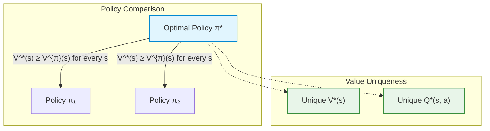
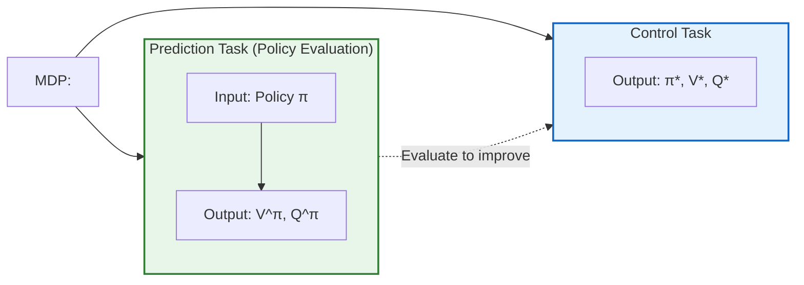
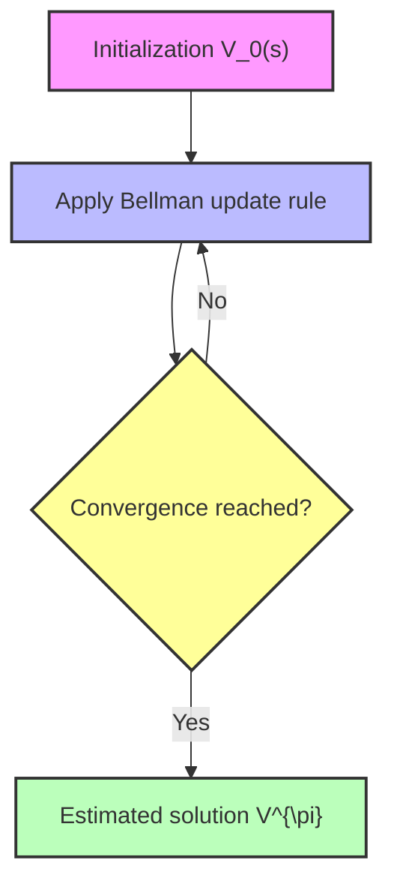
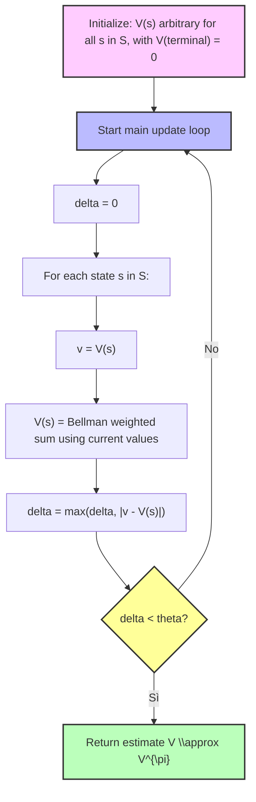
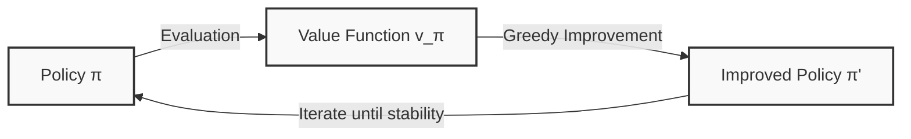

# Lecture 5: Bellman Equations and Introduction to Dynamic Programming

## Didactic Overview
In this lecture, the **Bellman equations** introduced in the previous lecture are reviewed and explored in depth, introducing the fundamental transition toward **Dynamic Programming**. The central concepts of the state-value ($V$) and state-action pair ($Q$) functions are recalled, emphasizing their recursive nature and validity for a generic policy (expectation equations). Subsequently, the focus shifts to finding the optimal strategy, laying the groundwork for the formulation of the **Bellman optimality equations**, which are specifically valid for the optimal policy ($\pi^*$). Finally, organizational announcements regarding the course, labs, and thesis assignment procedures are provided.

---

### Recap: From Expectation Equations to Finding the Optimum

In the previous lectures, we introduced the first two fundamental equations: the **Bellman Expectation Equations**. These equations recursively decompose the value of a state or a state-action pair:

- **State-Value Function**: $V^\pi(s)$ represents the expected return starting from state $s$ and following policy $\pi$:
  $$V^\pi(s) = \mathbb{E}_\pi [G_t \mid S_t = s]$$
- **Action-Value Function**: $Q^\pi(s, a)$ represents the expected return starting from state $s$, taking action $a$, and subsequently following policy $\pi$:
  $$Q^\pi(s, a) = \mathbb{E}_\pi [G_t \mid S_t = s, A_t = a]$$

Leveraging the intrinsic recursive structure of the Markov Decision Process (MDP), we expressed $V^\pi$ in terms of $Q^\pi$ and vice versa, obtaining a system where each variable is defined in terms of itself:

$$V^\pi(s) = \sum_{a \in \mathcal{A}} \pi(a \mid s) \left[ R(s, a) + \gamma \sum_{s' \in \mathcal{S}} P(s' \mid s, a) V^\pi(s') \right]$$

$$Q^\pi(s, a) = R(s, a) + \gamma \sum_{s' \in \mathcal{S}} P(s' \mid s, a) \sum_{a' \in \mathcal{A}} \pi(a' \mid s') Q^\pi(s', a')$$

These equations are **linear**. Consequently, if we exactly know the environment model—meaning the transition probability matrix $P$ and the reward function $R$—and if the state space has limited dimensions, we can compute the solution analytically by solving a linear system with $|\mathcal{S}|$ equations and $|\mathcal{S}|$ unknowns.

However, the expectation equations have an application limit: they describe the value of a *specific* assigned policy $\pi$, whether it is arbitrary, suboptimal, or very effective. In Reinforcement Learning, the ultimate goal is to identify the **best possible strategy**: the optimal policy.

---

### Policy Ordering and the Existence of the Optimum

To formally define what an optimal policy is, we introduce a partial ordering relation between policies.

#### Definition of Policy Ordering
A policy $\pi$ is defined as better than or equal to a policy $\pi'$ ($\pi \ge \pi'$) if and only if the expected value of $\pi$ is greater than or equal to that of $\pi'$ for **every single state** in the state space:

$$\pi \ge \pi' \iff V^\pi(s) \ge V^{\pi'}(s), \quad \forall s \in \mathcal{S}$$

Not all pairs of policies are pairwise comparable: one policy might perform better in certain states and worse in others. Despite this, a fundamental theoretical result holds for finite MDPs.

> **Key Concept: Optimal Policy Existence Theorem**
> For any finite MDP (with a finite number of states, actions, and rewards):
> 1. There always exists **at least one** optimal policy $\pi^*$ such that $\pi^* \ge \pi$ for any other policy $\pi$.
> 2. All optimal policies share the same **optimal state-value function**:
>    $$V^*(s) = \max_\pi V^\pi(s), \quad \forall s \in \mathcal{S}$$
> 3. All optimal policies share the same **optimal action-value function**:
>    $$Q^*(s, a) = \max_\pi Q^\pi(s, a), \quad \forall s \in \mathcal{S}, a \in \mathcal{A}$$

The optimal policy $\pi^*$ is not necessarily unique: multiple optimal policies may exist (for example, in the case of equivalent actions leading to the exact same expected return), but the associated value functions $V^*(s)$ and $Q^*(s, a)$ are unique.



---

### From the Knowledge of $Q^*$ to the Optimal Policy

If an oracle provided the exact value of $Q^*(s, a)$, extracting the optimal policy would be immediate. When in a generic state $s$, it is not necessary to average over actions stochastically: the agent simply chooses the action that maximizes the expected future return:

$$\pi^*(a \mid s) = \begin{cases} 1 & \text{if } a = \operatorname{argmax}_{a \in \mathcal{A}} Q^*(s, a) \\ 0 & \text{otherwise} \end{cases}$$

In the case of multiple actions that tie for the maximum value, the probability can be distributed arbitrarily among them. This principle coincides with pure greedy exploration already seen in multi-armed bandit problems, extended here to all states of the system.

The central problem thus shifts toward computing $Q^*(s, a)$ and $V^*(s)$. To this end, we introduce the **Bellman Optimality Equations**.

---

### The Bellman Optimality Equations

To derive the equations, we analyze backup diagrams. Unlike expectation equations—where a weighted average over actions is calculated using the probabilities $\pi(a \mid s)$—in the optimal case, the agent chooses the absolute best choice. Graphically, this maximization step is denoted by a solid arc connecting the action branches outgoing from the state node.

```mermaid
flowchart TD
    S(("State s"))
    A1["Action a₁"]
    A2["Action a₂"]
    SPrime1(("State s'"))
    SPrime2(("State s''"))

    S ---|"max"| A1
    S ---|"max"| A2
    A1 -->|"P(s'|s, a₁), R"| SPrime1
    A1 -->|"P(s''|s, a₁), R"| SPrime2

    style S fill:#ffffff,stroke:#000000,stroke-width:2px
    style SPrime1 fill:#ffffff,stroke:#000000,stroke-width:2px
    style SPrime2 fill:#ffffff,stroke:#000000,stroke-width:2px
    style A1 fill:#000000,stroke:#000000,stroke-width:2px
    style A2 fill:#000000,stroke:#000000,stroke-width:2px
```



#### 1. Relation between $V^*$ and $Q^*$
The optimal value of a state is the value of the best possible action taken from that state:
$$V^*(s) = \max_{a \in \mathcal{A}} Q^*(s, a)$$

#### 2. Relation between $Q^*$ and $V^*$
Once action $a$ is taken, the intrinsic dynamics of the environment intervene. The environment assigns an immediate reward and transitions to a next state $s'$ according to the distribution $P(s' \mid s, a)$. From $s'$ onwards, the agent will again follow the optimal policy, obtaining a value equal to $V^*(s')$:
$$Q^*(s, a) = R(s, a) + \gamma \sum_{s' \in \mathcal{S}} P(s' \mid s, a) V^*(s')$$

#### 3. Closed Recursive Form

> **Key Concept: Bellman Optimality Equations**
> Substituting the second equation into the first (and vice versa), we obtain the two fundamental recursive forms:
> 
> - **For the State-Value Function ($V^*$):**
>   $$V^*(s) = \max_{a \in \mathcal{A}} \left[ R(s, a) + \gamma \sum_{s' \in \mathcal{S}} P(s' \mid s, a) V^*(s') \right]$$
> 
> - **For the Action-Value Function ($Q^*$):**
>   $$Q^*(s, a) = R(s, a) + \gamma \sum_{s' \in \mathcal{S}} P(s' \mid s, a) \max_{a' \in \mathcal{A}} Q^*(s', a')$$

These equations express an internal consistency constraint that must necessarily hold for the optimal policy on any state.

---

### Non-Linearity and the Limits of Analytical Resolution

Comparing the expectation equation with the optimality equation reveals a substantial algebraic difference:

| Property | Bellman Expectation Equation | Bellman Optimality Equation |
| :--- | :--- | :--- |
| **Objective** | Evaluate a generic policy $\pi$ | Characterize the optimal policy $\pi^*$ |
| **Operator on $\mathcal{A}$** | Weighted sum: $\sum_a \pi(a \mid s) [\dots]$ | Maximum operator: $\max_a [\dots]$ |
| **Nature of the System** | **Linear** | **Non-linear** |
| **Direct Resolution** | Possible via matrix inversion (for small state spaces) | **Not possible** via standard linear algebra |

The presence of the $\max$ operator destroys the linearity of the system of equations. We cannot isolate $V^*$ through simple matrix operations of the type $(I - \gamma P^\pi)^{-1} R^\pi$.

Consequently, to derive the solution of an MDP, it is not possible to rely on closed linear methods, making the use of **iterative methods** necessary. This theoretical observation constitutes the starting point of **Dynamic Programming**.

---

### The Two Fundamental Problems of Reinforcement Learning

Let us formalize the conceptual distinction between the two core operational problems that will guide the development of algorithms:



1. **Prediction Task / Policy Evaluation**:
   - **Objective:** Given any policy $\pi$, accurately compute the associated value functions $V^\pi(s)$ and $Q^\pi(s, a)$.
   - Answers the question: *"If I behave according to this strategy, how much return do I expect to accumulate?"*

2. **Control Task**:
   - **Objective:** Find the optimal policy $\pi^*$ that maximizes the overall expected return, jointly deriving $V^*(s)$ and $Q^*(s, a)$.
   - Answers the question: *"What is the best possible action strategy in this environment?"*

The two problems are intimately interconnected: as we will see with dynamic programming, the ability to evaluate a policy (prediction) serves as a fundamental operational element to progressively modify it until optimality is reached (control).

---

### Operating Conditions: Known vs Unknown Model

To properly frame the transition to dynamic programming, let us summarize the assumptions regarding model availability:

- **Known Model (Model-based Environment):** It is assumed that the MDP parameters are explicitly known, namely the transition function $P(s' \mid s, a)$ and the reward function $R(s, a)$.
  - In this scenario, expectation equations can be solved analytically (if the state space is small).
  - Optimality equations, due to non-linearity, require iterative algorithms based on **Dynamic Programming**.
- **Unknown Model (Model-free Environment):** The agent does not know $P$ and $R$ a priori, but can only interact with the environment by observing trajectories of transitions and rewards. This is the context of pure Reinforcement Learning (addressed later), in which Bellman operators will be adapted to work via sampling and stochastic approximation.

---

### Principles of Dynamic Programming and Iterative Policy Evaluation

#### Introduction to Dynamic Programming
**Dynamic Programming (DP)** is a very powerful class of methods, used not only in Reinforcement Learning but in various engineering and mathematical contexts, useful when we face problems that can be described and solved through a **divide and conquer** approach. 

A classic example is the routing problem: if we have to travel from New York to Los Angeles and know we must obligatorily pass through Chicago, we can break down the main problem into two smaller, manageable subproblems: finding the optimal path from New York to Chicago, and then from Chicago to Los Angeles.

For a problem to be solved effectively with dynamic programming, two fundamental properties must be satisfied:
1. **Optimal Substructure**: The optimal solution of the global problem can be found by combining the optimal solutions of its subproblems.
2. **Overlapping Subproblems**: The same subproblem must be solved over and over again within the resolution process.

Both of these characteristics are intrinsically present in **Markov Decision Processes (MDPs)**. In particular, the recursive nature of RL problems is guaranteed by the **Bellman Equations** (both Bellman Expectation and Bellman Optimality), which define the value function $V$ (or $Q$) in relation to itself. Thanks to this recursive structure, we can apply dynamic programming to solve both **Prediction** problems (evaluating how good a certain policy is) and **Control** problems (finding the optimal policy), assuming for now that the transition probability distributions $P$ and rewards $R$ are known.

---

#### Derivation and Role of the Bellman Expectation Equation
Recalling the definition of the State-Value Function for a given policy $\pi$, investigated through the law of iterated expectations, we can exploit the knowledge of $P$ and $R$ to move from the abstract concept of mathematical expectation to the exact enumeration of all possible future cases in a finite MDP:

$$V^{\pi}(s) = \sum_{a} \pi(a|s) \sum_{s', r} P(s', r | s, a) \left[ r + \gamma V^{\pi}(s') \right]$$

In this formulation, two key components emerge:
* **The agent-related component**: The summation over possible actions weighted by the policy $\pi(a|s)$ (which can be deterministic or stochastic).
* **The environment-related component**: The system dynamics defined by $P(s', r | s, a)$, which returns a reward $r$ and transitions the agent to the next state $s'$ with a certain probability.

The recursive nature is evident: the current state value $V(s)$ is defined as a function of the subsequent state values $V(s')$, and this relationship holds for every state $s$ in the state space $\mathcal{S}$.

---

#### Iterative Policy Evaluation

When the state space is very large, directly solving the associated system of linear equations can be computationally prohibitive. This is where the iterative approach of Dynamic Programming comes into play.

The fundamental idea is not to solve the equation in one shot, but to use it as an iterative **update rule**. 

Let us introduce an iteration counter $k$. Starting from an arbitrary (or "naive" initial estimate, for example all zeros, $V_0(s) = 0$, or based on domain a priori knowledge), we repeatedly apply the Bellman rule to generate a sequence of successive estimates:
$$v_0 \rightarrow v_1 \rightarrow v_2 \rightarrow v_3 \rightarrow \dots$$



<div class="key-concept">
<strong>Key Concept:</strong> By iterating the Bellman Expectation equation to infinity (or until convergence), the initial estimate, no matter how erroneous or far from reality it may be, will inevitably converge towards the true real-world solution $V^{\pi}$. The value function $V^{\pi}$ indeed represents a <em>fixed point</em> for this update operator.
</div>

---

#### Update Strategies: Synchronous vs Asynchronous

When we implement this update computationally, we must decide how to manage memory and the update order of states. There are mainly two strategies:

1. **Synchronous Update**:
   * A separate buffer is used to store the values of the previous estimate.
   * During an iteration, all values $V(s)$ are recalculated based *exclusively* on the values saved in the buffer (the estimate at the previous time step).
   * Only at the end of the loop over all states, the buffer is overwritten in block.
   * *Advantage*: It is more rigorous from a mathematical standpoint and guarantees that all states are updated simultaneously based on the same premises.

2. **In-Place / Asynchronous Update**:
   * No backup buffer is used.
   * States are traversed according to a certain order, and as soon as a new value $V(s)$ is computed, it immediately overwrites the old value in memory.
   * Consequently, subsequent computations within the same iteration will use the *already updated* values instead of the old ones.
   * *Advantage*: It is decidedly faster and more efficient in computational terms (conceptually similar to *Stochastic Gradient Descent* in Deep Learning), which is why in Reinforcement Learning practice this approach is often preferred to accelerate convergence.

---

#### Algorithm: Iterative Policy Evaluation

Below is the standard pseudocode for the **Iterative Policy Evaluation** algorithm, designed to solve the *Prediction* problem (finding $V^{\pi}$ given the policy $\pi$, transition probabilities $P$, and rewards $R$).



##### Implementation Details and Stopping Criteria
* **Convergence Criterion ($\theta$)**: Since we are engineers and cannot wait for an infinite number of iterations, we introduce a very small numerical tolerance threshold $\theta > 0$. We monitor the maximum variation (delta) recorded between the previous and current estimate across all states. When the variation drops below $\theta$, we consider the algorithm converged and interrupt the loop.
* **Value Function Initialization**: 
  * If no a-priori knowledge is available, $V(s) = 0$ can be initialized for each state.
  * If preliminary knowledge of the problem is possessed (e.g., optimistic estimates or domain knowledge), targeted initial values can be set to drastically accelerate convergence.
* **Terminal States**: <span class="key-concept">Fundamental Note:</span> If the MDP includes terminal states (states where the episode ends), it is **mandatory** to initialize and maintain the value of such states strictly at zero ($V(\text{terminal}) = 0$), since no further future rewards can be collected from the terminal state.

---

### Practical Example: The Small Grid World Environment

To understand the practical functioning of Dynamic Programming (DP) in Markov Decision Processes (MDPs), the classic educational environment of the **Small Grid World** is introduced.

```
+---+---+---+---+
| T |   |   |   |
+---+---+---+---+
|   |   |   |   |
+---+---+---+---+
|   |   |   |   |
+---+---+---+---+
|   |   |   | T |
+---+---+---+---+
```

#### Model Definition (MDP)
The environment consists of a $4 \times 4$ grid:
- **State space ($\mathcal{S}$):** 16 cells in total, distinct into:
  - 14 non-terminal states.
  - 2 terminal states ($T$), conventionally positioned in the top-left corner and bottom-right corner.
- **Action space ($\mathcal{A}$):** Four deterministic movements: $\mathcal{A} = \{\text{Up}, \text{Down}, \text{Right}, \text{Left}\}$ (equivalent to North, South, East, West).
- **Transition dynamics ($p(s'|s, a)$):** 100% deterministic. If the agent executes an action inside the grid, it moves to the designated adjacent cell.
- **Border effect:** All four actions are allowed in every state. If an action pushes the agent outside the grid border, the transition brings the agent back to the starting state (wall bounce).
- **Termination:** When the agent enters one of the two gray terminal states, the episode terminates.

#### Reward Dynamics and Objective
- **Reward Function:** For each transition performed (as long as one is not in a terminal state), the environment assigns a constant negative reinforcement:
  $$R_t = -1$$
- **Discount factor:** In this finite-episode scenario, $\gamma = 1$ is assumed (undiscounted episodic task).

> **Key Concept: Meaning of Negative Reward**  
> The formal objective of the agent is to maximize the expected return:
> $$G_t = \sum_{k=0}^{T-1} R_{t+k+1}$$
> Since every step entails a cost of $-1$, maximizing a negative quantity means **minimizing the number of steps required to reach the terminal state**. The agent is penalized for every instant spent inside the grid; the optimal strategy coincides with the shortest path.

---

### Iterative Policy Evaluation

Initially, let us consider the **prediction problem**: the objective is not to control the agent in an optimal way, but to evaluate a specific known policy.

We evaluate the uniform random policy $\pi$ (colloquially defined as the "drunk agent"), in which all 4 actions have the exact same probability:
$$\pi(a|s) = \frac{1}{4} = 0.25, \quad \forall a \in \mathcal{A}, \forall s \in \mathcal{S}$$

The update rule derived from the Bellman equation for $v_\pi$ applied iteratively is:
$$V_{k+1}(s) = \sum_{a \in \mathcal{A}} \pi(a|s) \sum_{s', r} p(s', r \mid s, a) \left[ r + \gamma V_k(s') \right]$$

#### Step $k=0$ and Step $k=1$
- **Initialization ($k=0$):**  
  All values are set to zero:
  $$V_0(s) = 0, \quad \forall s \in \mathcal{S}$$
- **First update ($k=1$):**  
  For any non-terminal state $s$, the agent has 4 possible equiprobable actions ($0.25$). Regardless of the chosen direction, it receives an immediate reward $r = -1$ and arrives at a next state whose current estimated value is $V_0(s') = 0$:
  $$V_1(s) = \sum_{a} 0.25 \cdot \left[ -1 + 1 \cdot 0 \right] = 4 \times 0.25 \times (-1) = -1.0$$
  For terminal states, the value remains null by definition:
  $$V(s_{\text{terminal}}) = 0$$

#### Step $k=2$ and Information Propagation
At step $k=2$, the spatial structure of the environment begins to emerge thanks to the presence of terminal states:

- **Generic state not adjacent to a terminal:** All 4 actions lead to states whose value at step $k=1$ was $-1.0$:
  $$V_2(s) = 4 \times 0.25 \cdot \left[ -1 + (-1.0) \right] = -2.0$$
- **State adjacent to a terminal state:** 3 actions lead to internal states ($V_1 = -1.0$), while 1 action leads to the terminal state ($V_1(s_{\text{terminal}}) = 0$):
  $$V_2(s) = 3 \times 0.25 \cdot [-1 + (-1.0)] + 1 \times 0.25 \cdot [-1 + 0] = 0.75 \times (-2.0) + 0.25 \times (-1.0) = -1.75$$

*Note: Passage integrated with didactic clarity to highlight the value deviation between central and perimeter states.*

#### Convergence ($k \to \infty$)
Iterating this algorithm until convergence ($k \to \infty$), the estimates $V_k$ converge to the true value function $v_\pi(s)$ under the random policy:
- A **value gradient** is created: states further away from the goal accumulate increasingly higher negative values (for example, values between $-14$ and $-22$).
- A value like $v_\pi(s) = -14$ indicates that, moving randomly with 25% probability per direction, an average of 14 steps will be required to terminate the episode starting from that state, due to the high frequency of wasted steps and bounces against the borders.

> *Bibliographic/didactic reference:* Interactive experiments on this grid propagation were popularized by Andrej Karpathy's educational demos (originally developed to visually showcase the Bellman update via dynamic programming).

---

### From Prediction Problem to Control: Policy Iteration

Once it is understood how to quantitatively evaluate any policy (Policy Evaluation), we tackle the **control problem**: finding the optimal policy $\pi^*$.

#### Policy Improvement
If the value function $v_\pi(s)$ associated with a given policy $\pi$ is available, we can construct a new policy $\pi'$ by choosing, in each state, the action that maximizes the expected one-step return. This decision criterion corresponds to **Greedy Action Selection**:

$$\pi'(s) = \arg\max_{a \in \mathcal{A}} \sum_{s', r} p(s', r \mid s, a) \left[ r + \gamma v_\pi(s') \right]$$

In the case of the deterministic Grid World with $r = -1$:
- The agent analyzes the adjacent states accessible via actions $\mathcal{A}$.
- It selects the direction that leads to the adjacent state with the **highest** (i.e., least negative) value $v(s')$.
- If multiple actions lead to the same maximum value (ex aequo), the policy assigns uniform probability among them (for example, 50% and 50% between two optimal directions).

Even based on a partial or inaccurate evaluation (such as the one obtained at $k=1$ or $k=2$), acting greedily with respect to such values produces a strictly better policy than the purely random one: the agent ceases to make counterproductive movements near the target and heads directly toward it.

#### The Policy Iteration Loop
The fundamental framework uniting evaluation and improvement is called **Policy Iteration**. The process unfolds in a recursive alternation:

1. **Policy Evaluation:** Given a policy $\pi_k$, $v_{\pi_k}$ is computed by solving the Bellman equation or iterating until convergence.
2. **Policy Improvement:** An improved policy $\pi_{k+1}$ is generated by making it greedy with respect to $v_{\pi_k}$.
3. The cycle is repeated until $\pi_{k+1} = \pi_k$, a condition certifying the achievement of convergence to the optimal policy $\pi^*$ and the optimal value function $v^*$.



This mechanism demonstrates the dual utility of dynamic programming in Reinforcement Learning: not only does it provide a computational method to calculate state utility (prediction), but it constitutes a formal algorithm to completely solve the optimal control problem.

---

> [!NOTE]
> ### Exam Notes and Instructor Announcements
> - **Format and type of test:** The exam examples available on Moodle are real exam papers. The exam structure may vary: computational exercises, open-ended questions, or multiple-choice questions may be present (any of these types can occur).
> - **Valid exam material:** The exam syllabus is strictly based on what is explained in class during lectures (the textbook serves as a recommended extension for further study and alternative examples).
> - **Pseudo-code request (synchronous vs asynchronous updates):** The instructor may ask to write the pseudo-code of an algorithm in its synchronous version (using a buffer to update all states simultaneously) or in its asynchronous/in-place version during the exam. It is not required to memorize pseudo-code line by line: what matters is thoroughly understanding the concept and the logical implementation structure.
> - **Theorems not required for the exam:** The theorem regarding the convergence of *policy iteration* towards the optimal policy (which will be demonstrated in class for conceptual conviction) will not be required for the exam.