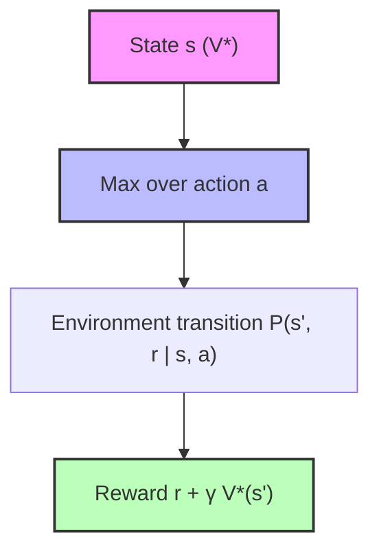
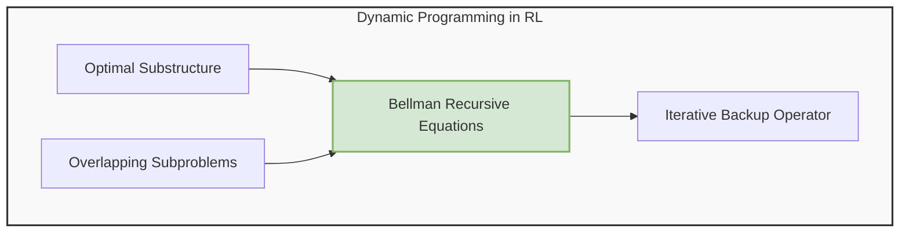
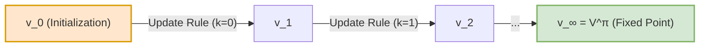
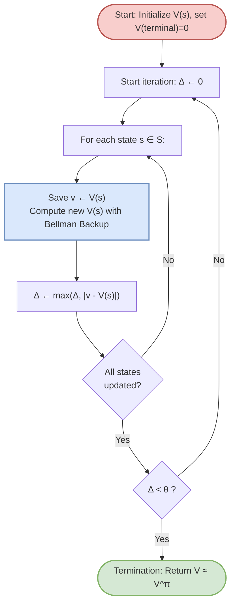
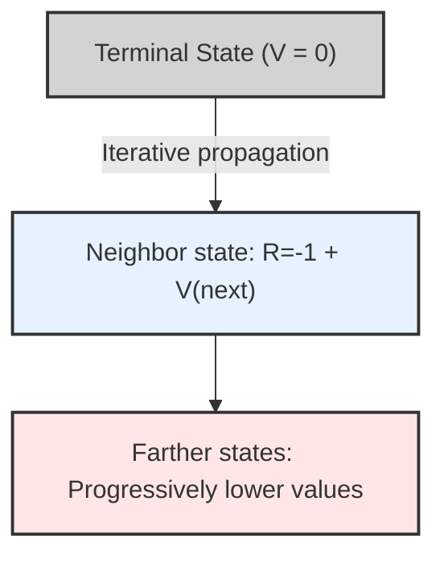
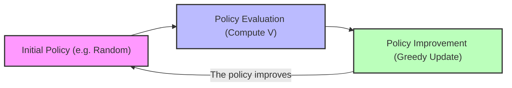

# Lecture 5: Bellman Optimality Equations and Introduction to Dynamic Programming

## Didactic Overview

This lecture marks the fundamental transition from **policy evaluation** (*Policy Evaluation*) to the search for the **optimal policy** (*Optimal Policy*, $\pi^*$) within Markov Decision Processes (*Markov Decision Processes*, MDPs). 

The main points covered include:
* **Review of the Bellman Expectation Equations (*Bellman Expectation Equations*):** Consolidation of the recursive nature of the value functions for state $V^\pi(s)$ (*State-Value Function*) and action $Q^\pi(s, a)$ (*Action-Value Function*). In a context with a known model (transition function $P$ and reward function $R$), these equations define a linear system that can be solved analytically for any arbitrary policy $\pi$.
* **Transition toward Optimality:** Definition of the primary objective of Reinforcement Learning, namely determining the best possible strategy $\pi^*$ and the corresponding optimal values $V^*(s)$ and $Q^*(s, a)$, moving beyond the analysis of a single pre-fixed policy.
* **Introduction to the Bellman Optimality Equations (*Bellman Optimality Equations*):** Core mathematical tool characterizing the optimal solution via non-linear maximization operators over allowable actions.
* **Fundamentals of Dynamic Programming (*Dynamic Programming*):** Introduction to the use of dynamic programming as an algorithmic method for solving MDPs, exploiting the optimal substructure property (*optimal substructure*) and the recursive decompositions of the Bellman equations.

---

### From Bellman Expectation Equations to the Bellman Optimality Equation

Returning to the topic of the Bellman equations, we know that they represent a fundamental tool for understanding the underlying mechanisms of Markov Decision Processes (MDPs). So far, we have analyzed the **Bellman Expectation Equations**, which describe the recursive relationship for a **generic policy $\pi$** (policy $\pi$), whether random or highly strategic.

These equations exhibit a very convenient property: they are **linear equations**. Consequently, if we have perfect knowledge of the model's transition probabilities $P$ and reward function $R$, we can solve them directly by setting up a system of linear equations, whose size (cardinality) is equal to the number of states of the problem.

#### The Limitation of Analytical Solutions and the Goal of Reinforcement Learning
However, in practical applications, we encounter two limitations:
1. Often, we do not have access to the true models of $P$ and $R$.
2. Even knowing them, in real-world large-scale problems the number of states is so high that solving a linear system analytically becomes impossible.

Above all, the ultimate goal of Reinforcement Learning (RL) is not simply to evaluate how good an arbitrary policy is, but rather to **find the absolute best strategy**, that is, the **optimal policy** ($\pi^*$, optimal policy).

---

### Ordering Between Policies and Existence of the Optimal Policy

To define what "optimal" means, we must first introduce an ordering relation among policies. 

> **Key Concept:** We say that a policy $\pi_1$ is better than or equal to another policy $\pi_2$ ($\pi_1 \ge \pi_2$) if, for every possible state $s$ in the state space, the expected value of the state-value function is greater than or equal:
> $$\begin{aligned}
> \pi_1 \ge \pi_2 \iff V^{\pi_1}(s) \ge V^{\pi_2}(s) \quad \forall s \in \mathcal{S}
> \end{aligned}$$

Thanks to this definition, we can state an important theoretical result (whose formal proof is omitted):

> **Theorem of Existence of the Optimum:** For any finite MDP (i.e., with finite state, action, and reward spaces, no matter how large), **there exists at least one optimal policy $\pi^*$** that is superior to or equal to all other possible policies:
> $$\begin{aligned}
> V^{\pi^*}(s) \ge V^{\pi}(s) \quad \forall s \in \mathcal{S}, \forall \pi
> \end{aligned}$$

It is important to note that the optimal policy **may not be unique**: there could be multiple distinct strategies that lead to the exact same maximum return. However, **all optimal policies share the same optimal value function** ($V^*$) and the same optimal action-value function ($Q^*$).

---

### The Optimal Policy Derived from $Q^*$

Assuming we know the optimal action-value function $Q^*(s, a)$ (i.e., the maximum expected return we can achieve starting from state $s$, taking action $a$, and thereafter following the optimal policy), defining the optimal policy becomes an immediate maximization operation:

$$\begin{aligned}
\pi^*(s) = \arg\max_{a \in \mathcal{A}(s)} Q^*(s, a)
\end{aligned}$$

Simply put: we are in state $s$, evaluate all possible actions, and choose the one that maximizes the expectation of future gain. This approach is conceptually identical to the concept of *exploitation* seen in the context of *multi-armed bandit* problems, extended here across the entire transition tree of the MDP.

---

### The Bellman Optimality Equation

Since no one provides us with the optimal $Q^*$ "for free", we must derive it mathematically. We therefore introduce a new tool: the **Bellman Optimality Equation**. Unlike the expectation equations, these hold **exclusively for the optimal policy ($\pi^*$)**.

Through backup diagrams, the weighted sum operation over the policy's probabilities is replaced by a maximum operator ($\max$). Indeed, the optimal policy does not choose actions stochastically (e.g., 80% one action, 20% another), but deterministically selects the best action.

Combining the environment transition and the optimal choice, we obtain the two fundamental optimality equations:

1. **Optimality equation for $V^*$ (expressed in terms of itself):**
   $$\begin{aligned}
   V^*(s) = \max_{a \in \mathcal{A}(s)} \sum_{s', r} P(s', r \mid s, a) \left[ r + \gamma V^*(s') \right]
   \end{aligned}$$

2. **Optimality equation for $Q^*$ (expressed in terms of itself):**
   $$\begin{aligned}
   Q^*(s, a) = \sum_{s', r} P(s', r \mid s, a) \left[ r + \gamma \max_{a'} Q^*(s', a') \right]
   \end{aligned}$$

---

### From the Linear Problem to Iterative Methods (Introduction to Dynamic Programming)

Examining the Bellman optimality equations closely, we observe the presence of the $\max$ operator inside both the equation for $V^*$ and the one for $Q^*$.

> **Key Concept:** The presence of the $\max$ makes the **Bellman Optimality Equation non-linear**. 

This means we can no longer solve the problem using a simple system of linear equations as we did for expectation. We need a new computational tool: **iterative methods**, which form the core of the next chapter dedicated to **Dynamic Programming**.

---

### Solving an MDP: Prediction vs Control

In the context of Markov Decision Processes (MDPs), formalized by the fundamental 5-tuple $\langle \mathcal{S}, \mathcal{A}, \mathcal{P}, \mathcal{R}, \gamma \rangle$, the objective of "solving" the process takes on two distinct and complementary meanings:

1. **Prediction or Policy Evaluation Problem**:
   Given a generic policy $\pi$ (whether optimal, sub-optimal, or purely random), the goal is to quantify how effective it is by determining the state-value function $V^\pi(s)$ or the state-action value function $Q^\pi(s, a)$. It answers the question: *«Given that I behave according to rule $\pi$, what expected cumulative return will I achieve starting from this state?»*.

2. **Control Problem**:
   The goal is to determine the optimal policy $\pi^*$ that maximizes the expected return for each state of the system, achieving the optimal value functions $V^*(s)$ and $Q^*(s, a)$.

> **Key Concept**: The two problems are closely intertwined. Solving the prediction problem (evaluating the efficacy of an existing policy) constitutes the fundamental operational building block for subsequently improving the policy itself and solving the control problem.

At this stage of study, it is assumed that the model of the environment is **perfectly known**: the transition probabilities $\mathcal{P}$ and the expected rewards $\mathcal{R}$ are known a priori. In subsequent chapters, we will address the Reinforcement Learning problem proper (Model-Free), where the agent does not have access to these matrices and must learn exclusively from experience. However, the theoretical foundations derived from Dynamic Programming remain the mathematical bedrock upon which Model-Free algorithms also rest.

---

### Fundamentals of Dynamic Programming

Dynamic Programming (DP) is a general class of algorithms applicable to complex problems that satisfy two fundamental structural properties:

* **Optimal Substructure**: The global solution of the problem can be decomposed and obtained by recombining the optimal solutions of smaller subproblems (*divide-and-conquer* approach).
* **Overlapping Subproblems**: The same subproblems appear repeatedly during the exploration of the solution space; by solving each subproblem and storing its result, one avoids having to recompute the same quantity from scratch every time.

#### Why Does DP Apply to MDPs?

DP is applicable to MDPs because the **Bellman Equations** inherently define a recursive relationship: the value of a state $s$ is defined as a function of the value of subsequent states $s'$:

$$V^\pi(s) = \sum_{a \in \mathcal{A}} \pi(a|s) \sum_{s' \in \mathcal{S}} \sum_{r \in \mathcal{R}} p(s', r \mid s, a) \left[ r + \gamma V^\pi(s') \right]$$

In this formulation:
* The **substructure** corresponds to the decision tree (*backup diagram*): evaluating the root state $s$ requires solving the subproblems corresponding to the evaluation of the leaf nodes $s'$.
* The **overlap** stems from the environment dynamics: from different states we can transition into the same subsequent states $s'$, or a circular path can lead back to the starting point. The value of $s'$ thus enters into the computation of multiple states $s$.

---

### From Analytical Form to Iterative Update Rule

For a finite-state MDP, the Bellman Expectation Equation represents a system of $|\mathcal{S}|$ linear equations in $|\mathcal{S}|$ unknowns. Although the exact analytical solution can be obtained via matrix inversion:

$$\mathbf{v}^\pi = (\mathbf{I} - \gamma \mathbf{P}^\pi)^{-1} \mathbf{r}^\pi$$

this operation incurs a computational complexity of $\mathcal{O}(|\mathcal{S}|^3)$, becoming prohibitive as the number of states grows.

Dynamic Programming overcomes this limitation by transforming Bellman's algebraic identity into an **iterative update rule**. Introducing an iteration index $k$, we define a sequence of value functions $\{v_k\}$:

$$v_{k+1}(s) \leftarrow \sum_{a \in \mathcal{A}} \pi(a|s) \sum_{s' \in \mathcal{S}} \sum_{r \in \mathcal{R}} p(s', r \mid s, a) \left[ r + \gamma v_k(s') \right], \quad \forall s \in \mathcal{S}$$

One begins with an arbitrary initial estimate $v_0$ (for example, setting all values to $0$ or relying on prior knowledge). At each step, the updated value $v_{k+1}(s)$ for state $s$ is computed by looking "one step ahead" (one-step lookahead) and exploiting the estimate from the previous step $v_k(s')$ for successor states.

Under the action of the Bellman operator, this sequence enjoys the contraction mapping property: as $k \to \infty$, the estimate $v_k$ converges asymptotically to the **fixed point** of the system, that is, to the true value function $V^\pi(s)$.

---

### Update Modes: Synchronous vs Asynchronous (In-Place)

When implementing the iterative update at the computational level, an architectural choice arises regarding how to manage memory during the loop over states $s \in \mathcal{S}$.

#### 1. Synchronous Update
In the standard synchronous approach, the algorithm maintains two separate arrays:
* An array containing the values of the current iteration $v_k$;
* A temporary array (buffer) where the new values $v_{k+1}$ are written.

All states $s \in \mathcal{S}$ are evaluated by reading exclusively from the array $v_k$. Only once the loop over all states is completed is the array $v_k$ overwritten with the contents of the buffer $v_{k+1}$.
* **Advantages**: Mathematically rigorous and strictly faithful to the theory of parallel iterations.
* **Disadvantages**: Requires twice the memory space ($\mathcal{O}(2|\mathcal{S}|)$) and exhibits slower convergence.

#### 2. Asynchronous or In-Place Update
In the *in-place* approach, a single memory vector $V(s)$ is allocated. States are swept according to a certain order (arbitrary or predetermined), and each computed value immediately overwrites the previous value:

$$V(s) \leftarrow \sum_{a \in \mathcal{A}} \pi(a|s) \sum_{s' \in \mathcal{S}} \sum_{r \in \mathcal{R}} p(s', r \mid s, a) \left[ r + \gamma V(s') \right]$$

If a successor state $s'$ has already been updated within the same sweep, the computation for the current state $s$ will immediately use the most recent updated value rather than the old one.
* **Advantages**: Reduces memory consumption to $\mathcal{O}(|\mathcal{S}|)$ and systematically converges faster, as it immediately leverages the freshest available information.
* **Practical behavior**: It is the standard preferred approach in real-world Reinforcement Learning implementations.

---

### The Iterative Policy Evaluation Algorithm

The **Iterative Policy Evaluation** algorithm translates these concepts into a structured computational procedure to estimate $V^\pi$.

#### Termination Criterion
Since perfect convergence is asymptotic ($k \to \infty$), from an engineering standpoint it is necessary to define a practical stopping criterion. A tolerance threshold $\theta > 0$ is introduced. During each complete iteration over all states, the maximum change experienced by any single state is tracked:

$$\Delta \leftarrow \max_{s \in \mathcal{S}} |v - V(s)|$$

where $v$ represents the old value stored before the update. When $\Delta < \theta$, the overall change is considered negligible and the algorithm terminates, returning $V \approx V^\pi$.

#### Initialization Conditions
* **Non-Terminal States**: The array $V(s)$ can be initialized with completely arbitrary values (e.g., all zeros). If domain knowledge is available a priori, an *optimistic initialization* can be performed to significantly accelerate convergence times.
* **Terminal States**: 

> **Fundamental Rule**: If the environment includes terminal states (episodic tasks), the value associated with terminal states must **strictly be set to zero** for the entire duration of the algorithm:
> $$V(\text{terminal}) = 0$$
> Once the agent arrives at a terminal state, the episode ends; no further rewards can be obtained in the future, hence the expected return starting from that state is identically zero. Failing to respect this constraint prevents convergence to the true value.

---

### The "Grid World" as an Example Environment

To understand how the algorithms work in practice, we introduce a classic and widely used environment: the **Small Grid World**. 

Imagine an environment consisting of a finite set of states (in our example, 14 non-terminal states and 2 terminal states shaded in gray). An agent moves within the grid by taking actions:
- Available actions: move up, down, right, left (or equivalently North, East, South, West).
- Dynamics: the transition probability matrix $P$ is deterministic. If the agent is in a cell and chooses to go right, it will move to the cell on the right with a probability of $100\%$. 
- Boundary constraints: if the agent chooses an action that would take it off the grid (or into a wall), the environment simply bounces it back, leaving it in the same starting cell. All 4 actions are always permissible in every state.
- Stopping condition: if the agent reaches one of the two terminal states (the gray cells), the episode terminates immediately.

The reward is defined very simply: each time the agent takes an action, it incurs a penalty equal to $R = -1$. 

> **Key Concept: The Agent's Goal**
> Because every transition accumulates a negative reward of $-1$, the agent's objective is to **maximize the cumulative reward**. With all values being negative, maximizing the sum practically means **minimizing losses**, i.e., reaching a terminal state in the fewest possible steps, wasting the least time along the path.

---

### Policy Evaluation in Action

For now, we address a **prediction problem**, evaluating a "stupid" policy: a drunk agent (*drunk agent*) that moves completely randomly, selecting each of the four directions with a uniform probability of $25\%$.

We begin with an initialization of zero for all states at time $k=0$: 
$$V_0(s) = 0 \quad \forall s$$

If we apply the iterative update equation using knowledge of the model ($P$ and $R$), step by step the estimated values propagate outwards from the terminal states (which remain at zero). 

Iterating this process infinitely, we obtain the true value function $V^\pi$ for the uniform policy. Surprisingly, due to the random movements, for some distant cells it takes on average around 14 or even 40 steps to randomly hit the target.

> **Fun Facts and Further Reading**
> This genre of interactive grid world simulations was popularized by prominent figures in machine learning such as **Andrej Karpathy** (OpenAI founder, former head of autonomous driving at Tesla, and creator of highly successful educational content such as tutorials for building ChatGPT from scratch).

---

### From Prediction Problems to Control: The Interaction Between Evaluation and Improvement

So far, we have seen how to evaluate how good a fixed policy is (even a poor one, like the random policy). The more interesting problem in Reinforcement Learning, however, is the **control problem**: finding an optimal strategy.

To do this, we combine two fundamental concepts into an iterative framework called **Policy Iteration**:
1. **Policy Evaluation**: Given a policy $\pi$, we compute how good it is (finding $V^\pi$).
2. **Policy Improvement**: We improve the policy by acting in a **greedy** fashion with respect to the newly computed values, i.e., selecting in each state the action that guarantees the highest expected return.

By cyclically repeating these two steps, the policy becomes progressively better until it converges to an **optimal policy** (*optimal policy*).

#### Practical Example of Greedy Improvement
Suppose we are in a specific cell of the grid and examine the estimated values of adjacent cells under the initial random policy. If the action moving right leads to a cell with a better expected return compared to the other directions, our new policy will no longer choose at random, but will decisively opt to go right. 

Acting greedily on the accumulated knowledge:
- Near the goal, the agent immediately learns to head straight for the terminal state.
- At more distant points, the policy evolves by abandoning incorrect movements in favor of the shortest paths.

By iteratively applying this dynamic programming scheme (*dynamic programming*), we do not merely evaluate a policy; we solve the control problem by finding the optimal paths that minimize the costs to reach the goal.

---

> [!NOTE]
> ### Exam Notes and Instructor Notices
> - **Exam Format**: The exam examples available on the Moodle page are representative of the actual exams; the structure may vary and include exercises, open-ended questions, or multiple-choice questions (or a combination thereof).
> - **Exam Material**: The syllabus and material subject to examination correspond to what was covered in class (the textbook serves to explore topics in greater depth and examine additional examples).
> - **Potential Exam Questions/Exercises**: On the exam, you might be asked to write the pseudocode of the update in its synchronous version (with buffer) or in its asynchronous / in-place version.
> - **Topics/Proofs Not Required**: The formal proof of the theorem regarding the convergence of *policy iteration* to the optimal policy (covered in the next lecture) will **not** be asked on the exam.