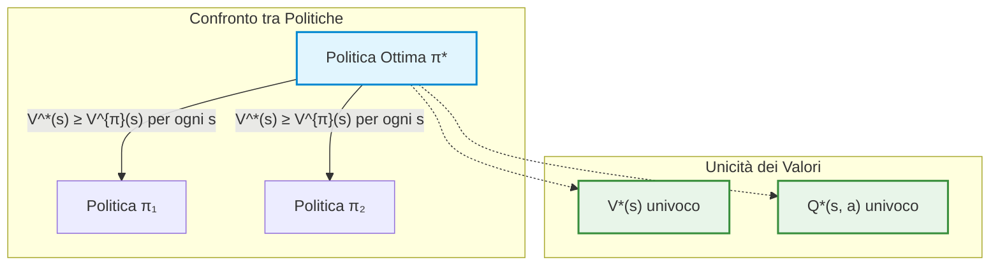
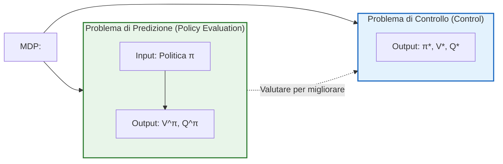
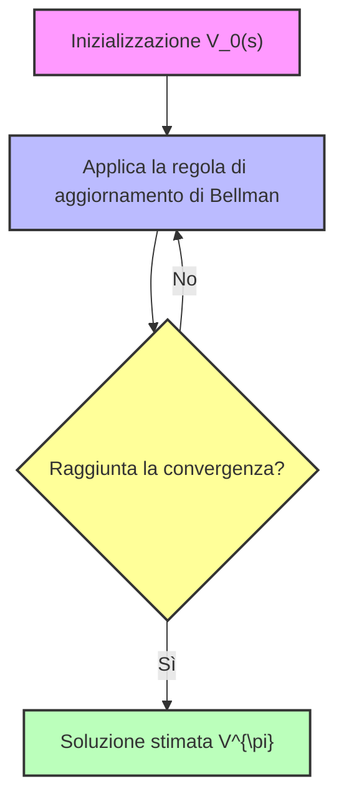
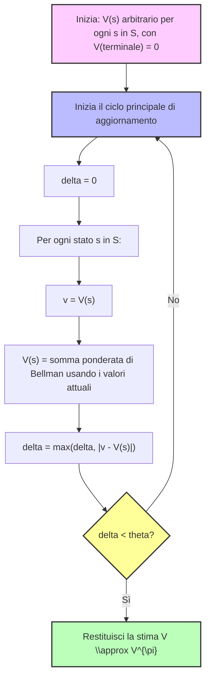
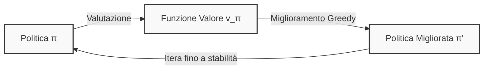

# Lezione 5: Equazioni di Bellman e Introduzione alla Programmazione Dinamica

## Overview Didattica
In questa lezione vengono riprese e approfondite le **equazioni di Bellman (Bellman equations)** viste nella lezione precedente, introducendo il passaggio fondamentale verso la **programmazione dinamica (Dynamic Programming)**. Vengono richiamati i concetti centrali delle funzioni di valore per lo stato ($V$) e per la coppia stato-azione ($Q$), sottolineando la loro natura ricorsiva e la loro validità per una politica generica (equazioni di aspettativa). Successivamente, il focus si sposta sulla ricerca della strategia ottimale, ponendo le basi per la formulazione delle **equazioni di ottimalità di Bellman (Bellman optimality equations)**, valide specificamente per la politica ottima ($\pi^*$). Infine, vengono fornite comunicazioni organizzative relative al corso, ai laboratori e alle modalità di assegnazione delle tesi.

---

### Recap: Dalle Equazioni di Aspettazione alla Ricerca dell'Ottimo

Nelle lezioni precedenti abbiamo introdotto le prime due equazioni fondamentali: le **Equazioni di Aspettazione di Bellman** (*Bellman Expectation Equations*). Queste equazioni scompongono in modo ricorsivo il valore di uno stato o di una coppia stato-azione:

- **Funzione Valore dello Stato** (*State-Value Function*): $V^\pi(s)$ rappresenta il ritorno atteso partendo dallo stato $s$ e seguendo la politica $\pi$:
  $$V^\pi(s) = \mathbb{E}_\pi [G_t \mid S_t = s]$$
- **Funzione Valore dell'Azione** (*Action-Value Function*): $Q^\pi(s, a)$ rappresenta il ritorno atteso partendo dallo stato $s$, eseguendo l'azione $a$, e seguendo successivamente la politica $\pi$:
  $$Q^\pi(s, a) = \mathbb{E}_\pi [G_t \mid S_t = s, A_t = a]$$

Sfruttando la struttura ricorsiva intrinseca del Processo Decisionale di Markov (*Markov Decision Process*, MDP), abbiamo espresso $V^\pi$ in funzione di $Q^\pi$ e viceversa, ottenendo un sistema in cui ogni variabile è definita rispetto a se stessa:

$$V^\pi(s) = \sum_{a \in \mathcal{A}} \pi(a \mid s) \left[ R(s, a) + \gamma \sum_{s' \in \mathcal{S}} P(s' \mid s, a) V^\pi(s') \right]$$

$$Q^\pi(s, a) = R(s, a) + \gamma \sum_{s' \in \mathcal{S}} P(s' \mid s, a) \sum_{a' \in \mathcal{A}} \pi(a' \mid s') Q^\pi(s', a')$$

Queste equazioni sono **lineari**. Di conseguenza, se conosciamo esattamente il modello dell'ambiente — ovvero la matrice delle probabilità di transizione $P$ e la funzione di ricompensa $R$ — e se lo spazio degli stati ha dimensioni contenute, possiamo calcolare la soluzione analiticamente risolvendo un sistema lineare con $|\mathcal{S}|$ equazioni e $|\mathcal{S}|$ incognite.

Tuttavia, le equazioni di aspettazione presentano un limite applicativo: descrivono il valore di una *specifica* politica assegnata $\pi$, sia essa arbitraria, subottima o molto efficace. In Reinforcement Learning, l'obiettivo ultimo è individuare la **strategia migliore possibile**: la politica ottima.

---

### Ordinamento tra Politiche ed Esistenza dell'Ottimo

Per definire formalmente cosa sia una politica ottima, introduciamo una relazione d'ordine parziale tra politiche.

#### Definizione di Ordine tra Politiche
Una politica $\pi$ è definita migliore o uguale a una politica $\pi'$ ($\pi \ge \pi'$) se e solo se il valore atteso di $\pi$ è maggiore o uguale a quello di $\pi'$ per **ogni singolo stato** dello spazio degli stati:

$$\pi \ge \pi' \iff V^\pi(s) \ge V^{\pi'}(s), \quad \forall s \in \mathcal{S}$$

Non tutte le coppie di politiche sono confrontabili a coppie: una politica potrebbe performare meglio in certi stati e peggio in altri. Nonostante ciò, per gli MDP finiti vale un risultato teorico fondamentale.

> **Concetto Chiave: Teorema dell'Esistenza della Politica Ottima**
> Per qualsiasi MDP finito (con un numero finito di stati, azioni e ricompense):
> 1. Esiste sempre **almeno una** politica ottima $\pi^*$ tale che $\pi^* \ge \pi$ per ogni altra politica $\pi$.
> 2. Tutte le politiche ottime condividono la medesima **funzione valore dello stato ottima**:
>    $$V^*(s) = \max_\pi V^\pi(s), \quad \forall s \in \mathcal{S}$$
> 3. Tutte le politiche ottime condividono la medesima **funzione valore dell'azione ottima**:
>    $$Q^*(s, a) = \max_\pi Q^\pi(s, a), \quad \forall s \in \mathcal{S}, a \in \mathcal{A}$$

La politica ottima $\pi^*$ non è necessariamente unica: possono esistere più politiche ottime (ad esempio nel caso di azioni equivalenti che portano allo stesso identico ritorno atteso), ma le funzioni valore $V^*(s)$ e $Q^*(s, a)$ associate sono univoche.



---

### Dalla Conoscenza di $Q^*$ alla Politica Ottima

Se un oracolo fornisse il valore esatto di $Q^*(s, a)$, estrarre la politica ottima sarebbe immediato. Trovandosi in un generico stato $s$, non è necessario mediare sulle azioni in modo stocastico: l'agente sceglie semplicemente l'azione che massimizza il ritorno futuro atteso:

$$\pi^*(a \mid s) = \begin{cases} 1 & \text{se } a = \operatorname{argmax}_{a \in \mathcal{A}} Q^*(s, a) \\ 0 & \text{altrimenti} \end{cases}$$

Nel caso di più azioni che massimizzano a pari merito il valore, la probabilità può essere ripartita arbitrariamente tra esse. Questo principio coincide con la pura esplorazione greedy già vista nei problemi di bandito multi-braccio (*Multi-Armed Bandit*), applicata qui estendendola a tutti gli stati del sistema.

Il problema centrale trasla quindi verso il calcolo di $Q^*(s, a)$ e $V^*(s)$. A tale scopo introduciamo le **Equazioni di Bellman per l'Ottimalità** (*Bellman Optimality Equations*).

---

### Le Equazioni di Bellman per l'Ottimalità

Per derivare le equazioni, analizziamo i diagrammi di backup (*backup diagrams*). A differenza delle equazioni di aspettazione — dove si calcola la media ponderata sulle azioni ponderata con le probabilità $\pi(a \mid s)$ — nel caso ottimo l'agente sceglie la scelta migliore in assoluto. Graficamente, questo passaggio di massimizzazione è denotato da un arco continuo che unisce i rami delle azioni uscenti dal nodo di stato.

```mermaid
flowchart TD
    S(("Stato s"))
    A1["Azione a₁"]
    A2["Azione a₂"]
    SPrime1(("Stato s'"))
    SPrime2(("Stato s''"))

    S ---|"max"| A1
    S ---|"max"| A2
    A1 -->|"P(s'|s, a₁), R"| SPrime1
    A1 -->|"P(s''|s, a₁), R"| SPrime2

    style S fill:#ffffff,stroke:#000000,stroke-width:2px
    style SPrime1 fill:#ffffff,stroke:#000000,stroke-width:2px
    style SPrime2 fill:#ffffff,stroke:#000000,stroke-width:2px
    style A1 fill:#000000,stroke:#000000,stroke-width:2px
    style A2 fill:#000000,stroke:#000000,stroke-width:2px
```



#### 1. Relazione tra $V^*$ e $Q^*$
Il valore ottimo di uno stato è il valore della migliore azione possibile intrapresa da quello stato:
$$V^*(s) = \max_{a \in \mathcal{A}} Q^*(s, a)$$

#### 2. Relazione tra $Q^*$ e $V^*$
Una volta intrapresa l'azione $a$, interviene la dinamica intrinseca dell'ambiente. L'ambiente assegna una ricompensa immediata e transiziona verso uno stato successivo $s'$ secondo la distribuzione $P(s' \mid s, a)$. Da $s'$ in poi, l'agente seguirà nuovamente la politica ottima, ottenendo un valore pari a $V^*(s')$:
$$Q^*(s, a) = R(s, a) + \gamma \sum_{s' \in \mathcal{S}} P(s' \mid s, a) V^*(s')$$

#### 3. Forma Ricorsiva Chiusa

> **Concetto Chiave: Equazioni di Bellman per l'Ottimalità**
> Sostituendo la seconda equazione all'interno della prima (e viceversa), otteniamo le due forme ricorsive fondamentali:
> 
> - **Per lo State-Value Function ($V^*$):**
>   $$V^*(s) = \max_{a \in \mathcal{A}} \left[ R(s, a) + \gamma \sum_{s' \in \mathcal{S}} P(s' \mid s, a) V^*(s') \right]$$
> 
> - **Per l'Action-Value Function ($Q^*$):**
>   $$Q^*(s, a) = R(s, a) + \gamma \sum_{s' \in \mathcal{S}} P(s' \mid s, a) \max_{a' \in \mathcal{A}} Q^*(s', a')$$

Queste equazioni esprimono un vincolo di consistenza interna che deve valere obbligatoriamente per la politica ottima su qualsiasi stato.

---

### La Non-Linearità e i Limiti della Risoluzione Analitica

Confrontando l'equazione di aspettazione con quella di ottimalità emerge una differenza algebrica sostanziale:

| Proprietà | Bellman Expectation Equation | Bellman Optimality Equation |
| :--- | :--- | :--- |
| **Obiettivo** | Valutare una generica politica $\pi$ | Caratterizzare la politica ottima $\pi^*$ |
| **Operatore su $\mathcal{A}$** | Somma ponderata: $\sum_a \pi(a \mid s) [\dots]$ | Operatore di massimo: $\max_a [\dots]$ |
| **Natura del Sistema** | **Lineare** | **Non-lineare** |
| **Risoluzione Diretta** | Possibile tramite inversione matriciale (per piccoli spazi di stato) | **Non possibile** tramite algebra lineare standard |

La presenza dell'operatore $\max$ distrugge la linearità del sistema di equazioni. Non possiamo isolare $V^*$ tramite semplici operazioni su matrici del tipo $(I - \gamma P^\pi)^{-1} R^\pi$.

Di conseguenza, per ricavare la soluzione di un MDP non è possibile fare affidamento su metodi lineari chiusi, rendendo necessario l'utilizzo di **metodi iterativi**. Questa constatazione teorica costituisce il punto di partenza della **Programmazione Dinamica** (*Dynamic Programming*).

---

### I Due Problemi Fondamentali dell'Apprendimento per Rinforzo

Formalizziamo la distinzione concettuale tra i due problemi operativi cardine che guideranno lo sviluppo degli algoritmi:



1. **Problema di Predizione o Valutazione della Politica** (*Prediction Task / Policy Evaluation*):
   - **Obiettivo:** Data una politica qualsiasi $\pi$, calcolare accuratamente le funzioni valore associate $V^\pi(s)$ e $Q^\pi(s, a)$.
   - Risponde alla domanda: *"Se mi comporto secondo questa strategia, quanto ritorno mi aspetto di accumulare?"*

2. **Problema di Controllo** (*Control Task*):
   - **Obiettivo:** Trovare la politica ottima $\pi^*$ che massimizza il ritorno atteso complessivo, derivando congiuntamente $V^*(s)$ e $Q^*(s, a)$.
   - Risponde alla domanda: *"Qual è la migliore strategia d'azione possibile in questo ambiente?"*

I due problemi sono intimamente interconnessi: come vedremo con la programmazione dinamica, la capacità di valutare una politica (predizione) funge da elemento operativo fondamentale per modificarla progressivamente fino a raggiungere l'ottimalità (controllo).

---

### Condizioni Operative: Modello Noto vs Ignoto

Per inquadrare correttamente il passaggio alla programmazione dinamica, riassumiamo le assunzioni relative alla disponibilità del modello:

- **Modello Noto (Ambiente Model-based):** Si assume di conoscere esplicitamente i parametri dell'MDP, ovvero la funzione di transizione $P(s' \mid s, a)$ e la funzione di ricompensa $R(s, a)$.
  - In questo scenario, le equazioni di aspettazione possono essere risolte analiticamente (se lo spazio degli stati è piccolo).
  - Le equazioni di ottimalità, a causa della non-linearità, richiedono algoritmi iterativi basati su **Programmazione Dinamica**.
- **Modello Ignoto (Ambiente Model-free):** L'agente non conosce a priori $P$ e $R$, ma può solo interagire con l'ambiente osservando traiettorie di transizioni e ricompense. Questo è il contesto del Reinforcement Learning puro (affrontato successivamente), in cui gli operatori di Bellman verranno adattati per funzionare tramite campionamento ed approssimazione stocastica.

---

### Principi di Dynamic Programming e Iterative Policy Evaluation

#### Introduzione alla Dynamic Programming (Programmazione Dinamica)
La **Programmazione Dinamica (Dynamic Programming, DP)** è una classe di metodi molto potente, utilizzata non solo nel Reinforcement Learning ma in svariati contesti ingegneristici e matematici, utile quando ci troviamo di fronte a problemi che possono essere descritti e risolti attraverso un approccio **divide and conquer** (dividi et impera). 

Un esempio classico è il problema del routing: se dobbiamo viaggiare da New York a Los Angeles e sappiamo di dover passare obbligatoriamente per Chicago, possiamo scomporre il problema principale in due sottoproblemi più piccoli e gestibili: trovare il percorso ottimale da New York a Chicago, e poi quello da Chicago a Los Angeles.

Affinché un problema possa essere risolto efficacemente con la programmazione dinamica, devono essere soddisfatte due proprietà fondamentali:
1. **Presenza di una sottostruttura ottima (Substructure)**: La soluzione ottimale del problema globale può essere trovata combinando le soluzioni ottimali dei suoi sottoproblemi.
2. **Problemi sovrapposti (Overlapping subproblems)**: Lo stesso sottoproblema deve essere risolto più e più volte all'interno del processo di risoluzione.

Entrambe queste caratteristiche sono intrinsecamente presenti nei **Processi Decisionali di Markov (Markov Decision Processes, MDPs)**. In particolare, la natura ricorsiva dei problemi di RL è garantita dalle **Equazioni di Bellman** (sia di Bellman Expectation che di Bellman Optimality), le quali definiscono la funzione di valore $V$ (o $Q$) in relazione a se stessa. Grazie a questa struttura ricorsiva, possiamo applicare la programmazione dinamica per risolvere sia problemi di **Prediction** (valutare quanto sia buona una certa politica) sia problemi di **Control** (trovare la politica ottimale), assumendo per il momento che le distribuzioni di probabilità di transizione $P$ e le ricompense $R$ siano note.

---

#### Derivazione e Ruolo dell'Equazione di Bellman Expectation
Riprendendo la definizione della State-Value Function per una data politica $\pi$, indagata tramite la legge delle aspettative iterate, possiamo sfruttare la conoscenza di $P$ e $R$ per passare dal concetto astratto di attesa matematica alla enumerazione esatta di tutti i possibili casi futuri in un MDP finito:

$$V^{\pi}(s) = \sum_{a} \pi(a|s) \sum_{s', r} P(s', r | s, a) \left[ r + \gamma V^{\pi}(s') \right]$$

In questa formulazione emergono due componenti chiave:
* **La componente legata all'agente**: La sommatoria sulle azioni possibili ponderata dalla politica $\pi(a|s)$ (che può essere deterministica o stocastica).
* **La componente legata all'ambiente**: La dinamica del sistema definita da $P(s', r | s, a)$, che restituisce una ricompensa $r$ e fa transire l'agente nello stato successivo $s'$ con una certa probabilità.

La natura ricorsiva è evidente: il valore dello stato corrente $V(s)$ è definito in funzione dei valori degli stati successivi $V(s')$, e questa relazione vale per ogni stato $s$ nello spazio degli stati $\mathcal{S}$.

---

#### Iterative Policy Evaluation (Valutazione Iterativa della Politica)

Quando lo spazio degli stati è molto grande, risolvere direttamente il sistema di equazioni lineari associato può risultare computazionalmente proibitivo. È qui che entra in gioco l'approccio iterativo della Programmazione Dinamica.

L'idea fondamentale non è risolvere l'equazione in un colpo solo, ma utilizzarla come una **regola di aggiornamento (update rule)** iterativa. 

Introduciamo un contatore di iterazione $k$. Partendo da una stima iniziale arbitraria (o "stupida", ad esempio tutta a zeri, $V_0(s) = 0$, oppure basata su conoscenza a priori del dominio), applichiamo ripetutamente la regola di Bellman per generare una sequenza di stime successive:
$$v_0 \rightarrow v_1 \rightarrow v_2 \rightarrow v_3 \rightarrow \dots$$



<div class="key-concept">
<strong>Concetto Chiave:</strong> Iterando l'equazione di Bellman Expectation all'infinito (o fino a convergenza), la stima iniziale, per quanto errata o lontana dalla realtà possa essere, convergerà inevitabilmente verso la vera soluzione del mondo reale $V^{\pi}$. La funzione di valore $V^{\pi}$ rappresenta infatti un <em>punto fisso (fixed point)</em> per questo operatore di aggiornamento.
</div>

---

#### Strategie di Aggiornamento: Synchronous vs Asynchronous

Nel momento in cui implementiamo questo aggiornamento computazionalmente, dobbiamo decidere come gestire la memoria e l'ordine di aggiornamento degli stati. Esistono principalmente due strategie:

1. **Aggiornamento Sincrono (Synchronous Update)**:
   * Si utilizza un buffer separato per memorizzare i valori della stima precedente.
   * Durante un'iterazione, tutti i valori $V(s)$ vengono ricalcolati basandosi *esclusivamente* sui valori salvati nel buffer (la stima al tempo precedente).
   * Solo al termine del ciclo su tutti gli stati, il buffer viene sovrascritto in blocco.
   * *Vantaggio*: È più rigoroso dal punto di vista matematico e garantisce che tutti gli stati vengano aggiornati simultaneamente sulla base delle stesse premesse.

2. **Aggiornamento In-Place / Asincrono (Asynchronous / In-place Update)**:
   * Non si utilizza alcun buffer di supporto.
   * Si scorrono gli stati secondo un certo ordine, e non appena un nuovo valore $V(s)$ viene calcolato, esso sovrascrive immediatamente il vecchio valore in memoria.
   * Di conseguenza, i calcoli successivi all'interno della stessa iterazione utilizzeranno i valori *già aggiornati* anziché quelli vecchi.
   * *Vantaggio*: È decisamente più rapido ed efficiente in termini computazionali (concettualmente simile allo *Stochastic Gradient Descent* nel Deep Learning), motivo per cui nella pratica del Reinforcement Learning si preferisce spesso questo approccio per accelerare la convergenza.

---

#### Algoritmo: Iterative Policy Evaluation

Di seguito viene presentato lo pseudocodice standard per l'algoritmo di **Iterative Policy Evaluation**, progettato per risolvere il problema di *Prediction* (trovare $V^{\pi}$ noti la politica $\pi$, le probabilità di transizione $P$ e le ricompense $R$).



##### Dettagli di Implementazione e Criteri di Arresto
* **Criterio di Convergenza ($\theta$)**: Poiché siamo ingegneri e non possiamo attendere un numero infinito di iterazioni, introduciamo una soglia di tolleranza numerica molto piccola $\theta > 0$. Monitoriamo la massima variazione (delta) registrata tra la stima precedente e quella corrente su tutti gli stati. Quando la variazione scende al di sotto di $\theta$, consideriamo l'algoritmo converso e interrompiamo il ciclo.
* **Inizializzazione della Funzione di Valore**: 
  * Se non si dispone di alcuna conoscenza a priori (a-priori knowledge), si può inizializzare $V(s) = 0$ per ogni stato.
  * Se si possiede una conoscenza preliminare del problema (es. stime ottimistiche o domain knowledge), è possibile impostare valori iniziali mirati per accelerare drasticamente la convergenza.
* **Stati Terminali (Terminal States)**: <span class="key-concept">Nota fondamentale:</span> Se l'MDP prevede degli stati terminali (stati in cui l'episodio giunge al termine), è **obbligatorio** inizializzare e mantenere il valore di tali stati rigorosamente a zero ($V(\text{terminale}) = 0$), poiché dallo stato terminale non è possibile raccogliere ulteriori ricompense future.

---

### Esempio Pratico: L'Ambiente Small Grid World

Per comprendere il funzionamento pratico della Programmazione Dinamica (Dynamic Programming, DP) nei Processi Decisionali di Markov (Markov Decision Processes, MDP), si introduce l'ambiente didattico classico del **Small Grid World**.

```
+---+---+---+---+
| T |   |   |   |
+---+---+---+---+
|   |   |   |   |
+---+---+---+---+
|   |   |   |   |
+---+---+---+---+
|   |   |   | T |
+---+---+---+---+
```

#### Definizione del Modello (MDP)
L'ambiente consiste in una griglia $4 \times 4$:
- **Spazio degli stati ($\mathcal{S}$):** 16 celle in totale, distinte in:
  - 14 stati non terminali.
  - 2 stati terminali ($T$), posizionati convenzionalmente nell'angolo in alto a sinistra e nell'angolo in basso a destra.
- **Spazio delle azioni ($\mathcal{A}$):** Quattro movimenti deterministici: $\mathcal{A} = \{\text{Up}, \text{Down}, \text{Right}, \text{Left}\}$ (equivalenti a Nord, Sud, Est, Ovest).
- **Dinamica di transizione ($p(s'|s, a)$):** Deterministica al 100%. Se l'agente esegue un'azione interna alla griglia, si sposta nella cella adiacente designata.
- **Condizione al contorno (Border effect):** Tutte e quattro le azioni sono permesse in ogni stato. Se un'azione spinge l'agente al di fuori del bordo della griglia, la transizione riporta l'agente nello stato di partenza (rimbalzo sulla parete).
- **Terminazione:** Quando l'agente entra in uno dei due stati terminali grigi, l'episodio ha termine.

#### Dinamica delle Ricompense e Obiettivo
- **Funzione di Ricompensa:** Per ogni transizione compiuta (fintanto che non si è in uno stato terminale), l'ambiente assegna un rinforzo costante negativo:
  $$R_t = -1$$
- **Fattore di sconto:** In questo scenario a episodi finiti si assume $\gamma = 1$ (episodic task non scontato).

> **Concetto Chiave: Significato della Ricompensa Negativa**  
> L'obiettivo formale dell'agente è massimizzare il ritorno atteso:
> $$G_t = \sum_{k=0}^{T-1} R_{t+k+1}$$
> Poiché ogni passo comporta un costo di $-1$, massimizzare una quantità negativa significa **minimizzare il numero di passi necessari per raggiungere lo stato terminale**. L'agente viene penalizzato per ogni istante speso all'interno della griglia; la strategia ottimale coincide con il cammino minimo (shortest path).

---

### Valutazione Iterativa della Politica (Iterative Policy Evaluation)

Consideriamo inizialmente il **problema di predizione** (Prediction Problem): l'obiettivo non è controllare l'agente in modo ottimale, ma valutare una specifica politica nota.

Si valuta la politica casuale uniforme $\pi$ (definita colloquialmente "drunk agent" o agente ubriaco), in cui tutte le 4 azioni hanno la medesima probabilità:
$$\pi(a|s) = \frac{1}{4} = 0.25, \quad \forall a \in \mathcal{A}, \forall s \in \mathcal{S}$$

La regola di aggiornamento ricavata dall'equazione di Bellman per $v_\pi$ applicata iterativamente è:
$$V_{k+1}(s) = \sum_{a \in \mathcal{A}} \pi(a|s) \sum_{s', r} p(s', r \mid s, a) \left[ r + \gamma V_k(s') \right]$$

#### Passo $k=0$ e Passo $k=1$
- **Inizializzazione ($k=0$):**  
  Tutti i valori vengono impostati a zero:
  $$V_0(s) = 0, \quad \forall s \in \mathcal{S}$$
- **Primo aggiornamento ($k=1$):**  
  Per qualsiasi stato non terminale $s$, l'agente ha 4 azioni possibili equiprobabili ($0.25$). Indipendentemente dalla direzione scelta, riceve una ricompensa immediata $r = -1$ e approda in uno stato successivo il cui valore stimato corrente è $V_0(s') = 0$:
  $$V_1(s) = \sum_{a} 0.25 \cdot \left[ -1 + 1 \cdot 0 \right] = 4 \times 0.25 \times (-1) = -1.0$$
  Per gli stati terminali, il valore resta per definizione nullo:
  $$V(s_{\text{terminal}}) = 0$$

#### Passo $k=2$ e Propagazione dell'Informazione
Al passo $k=2$ comincia a emergere la struttura spaziale dell'ambiente grazie alla presenza degli stati terminali:

- **Stato generico non adiacente a un terminale:** Tutte e 4 le azioni portano a stati il cui valore al passo $k=1$ era $-1.0$:
  $$V_2(s) = 4 \times 0.25 \cdot \left[ -1 + (-1.0) \right] = -2.0$$
- **Stato adiacente a uno stato terminale:** 3 azioni portano a stati interni ($V_1 = -1.0$), mentre 1 azione conduce allo stato terminale ($V_1(s_{\text{terminal}}) = 0$):
  $$V_2(s) = 3 \times 0.25 \cdot [-1 + (-1.0)] + 1 \times 0.25 \cdot [-1 + 0] = 0.75 \times (-2.0) + 0.25 \times (-1.0) = -1.75$$

*Nota: Passaggio integrato con chiarezza didattica per evidenziare la deviazione di valore tra stati centrali e perimetrali.*

#### Convergenza ($k \to \infty$)
Iterando questo algoritmo fino a convergenza ($k \to \infty$), le stime $V_k$ convergono alla vera funzione valore $v_\pi(s)$ sotto la politica casuale:
- Si crea un **gradiente di valore**: gli stati più distanti dal traguardo accumulano valori negativi sempre più alti (ad esempio valori compresi tra $-14$ e $-22$).
- Un valore come $v_\pi(s) = -14$ indica che, muovendosi a caso con probabilità del 25% per direzione, saranno necessari in media 14 passi per terminare l'episodio partendo da quello stato, a causa dell'alta frequenza di passi a vuoto e rimbalzi contro i bordi.

> *Riferimento bibliografico/didattico:* Esperimenti interattivi su questa propagazione a griglia sono stati resi popolari dalle demo educative di Andrej Karpathy (sviluppate originariamente per mostrare visualmente l'aggiornamento di Bellman tramite dynamic programming).

---

### Dal Problema di Predizione al Controllo: Policy Iteration

Una volta compreso come valutare quantitativamente una politica qualsiasi (Policy Evaluation), si affronta il **problema di controllo** (Control Problem): trovare la politica ottima $\pi^*$.

#### Miglioramento della Politica (Policy Improvement)
Se si dispone della funzione valore $v_\pi(s)$ associata a una data politica $\pi$, è possibile costruire una nuova politica $\pi'$ scegliendo, in ogni stato, l'azione che massimizza il ritorno atteso a un passo. Questo criterio decisionale corrisponde all'**azione ingorda (Greedy Action Selection)**:

$$\pi'(s) = \arg\max_{a \in \mathcal{A}} \sum_{s', r} p(s', r \mid s, a) \left[ r + \gamma v_\pi(s') \right]$$

Nel caso del Grid World deterministico con $r = -1$:
- L'agente analizza gli stati adiacenti accessibili tramite le azioni $\mathcal{A}$.
- Seleziona la direzione che conduce allo stato adiacente con il valore $v(s')$ **più alto** (ovvero meno negativo).
- Se più azioni portano allo stesso valore massimo (ex aequo), la politica assegna probabilità uniforme tra di esse (ad esempio 50% e 50% tra due direzioni ottime).

Anche basandosi su una valutazione parziale o imprecisa (come quella ottenuta a $k=1$ o $k=2$), agire in modo greedy rispetto a tali valori produce una politica strettamente migliore di quella puramente casuale: l'agente cessa di compiere movimenti controproducenti in prossimità del traguardo e vi si dirige direttamente.

#### Il Ciclo di Policy Iteration
Il framework fondamentale che unisce valutazione e miglioramento prende il nome di **Iterazione di Politica (Policy Iteration)**. Il processo si articola in un'alternanza ricorsiva:

1. **Policy Evaluation:** Data una politica $\pi_k$, si calcola $v_{\pi_k}$ risolvendo l'equazione di Bellman o iterando fino a convergenza.
2. **Policy Improvement:** Si genera una politica migliorata $\pi_{k+1}$ rendendola greedy rispetto a $v_{\pi_k}$.
3. Si ripete il ciclo fino a quando $\pi_{k+1} = \pi_k$, condizione che certifica il raggiungimento della convergenza alla politica ottima $\pi^*$ e alla funzione valore ottima $v^*$.



Questo meccanismo dimostra la duplice utilità della programmazione dinamica nel Reinforcement Learning: non solo fornisce un metodo computazionale per calcolare l'utilità degli stati (predizione), ma costituisce un algoritmo formale per risolvere completamente il problema del controllo ottimale.

---

> [!NOTE]
> ### Note per l'Esame e Avvisi del Docente
> - **Formato e tipologia della prova:** Gli esempi di esami disponibili su Moodle sono prove d'esame reali. La struttura dell'esame può variare: possono essere presenti esercizi di calcolo, domande a risposta aperta oppure quesiti a risposta multipla (può capitare una qualsiasi di queste tipologie).
> - **Materiale valido per l'esame:** Il programma d'esame si basa strettamente su quanto spiegato a lezione in aula (il libro di testo funge da estensione consigliata per approfondire e consultare esempi alternativi).
> - **Richiesta di pseudo-codice (aggiornamenti sincroni vs asincroni):** Il docente può chiedere all'esame di scrivere lo pseudo-codice di un algoritmo nella versione sincrona (con utilizzo di un buffer per aggiornare tutti gli stati simultaneamente) oppure nella versione asincrona/in-place. Non è richiesto imparare lo pseudo-codice riga per riga a memoria: ciò che conta è comprendere a fondo il concetto e la struttura logica di implementazione.
> - **Teoremi non richiesti all'esame:** Il teorema relativo alla convergenza della *policy iteration* verso la politica ottima (che verrà dimostrato a lezione per convinzione concettuale) non sarà richiesto all'esame.