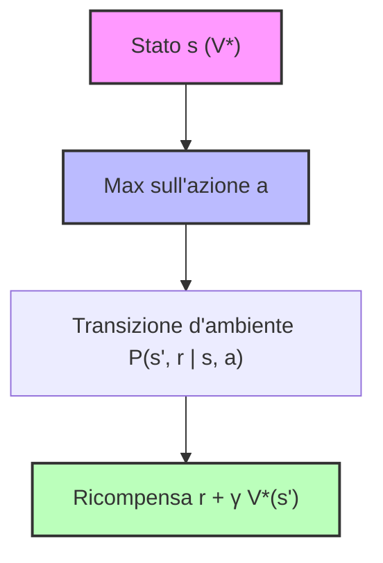
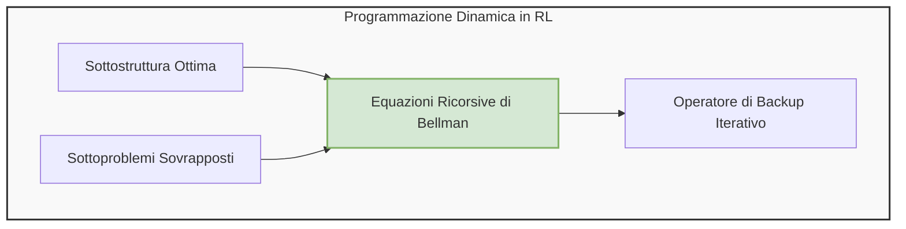
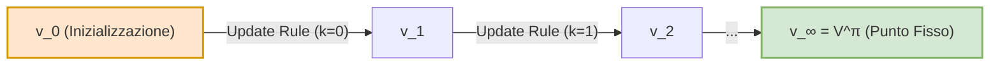
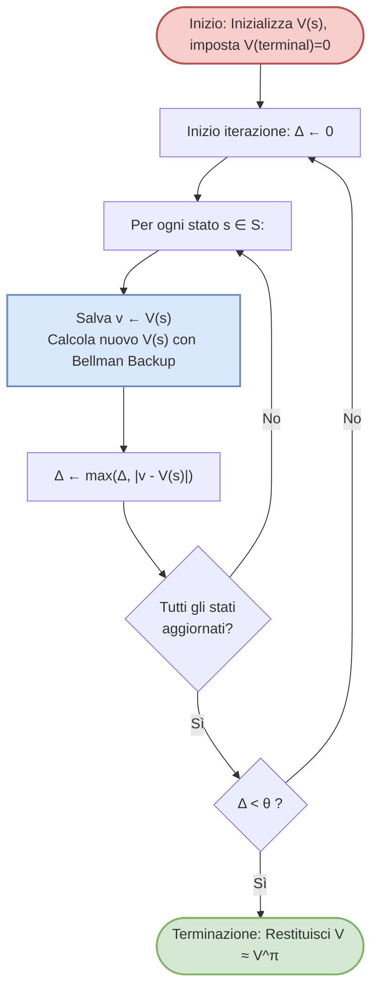
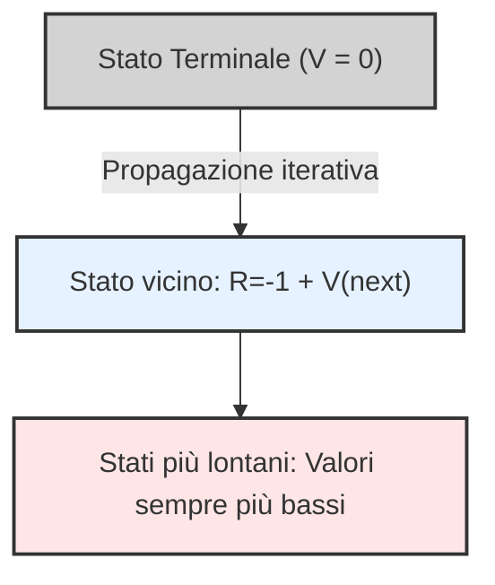
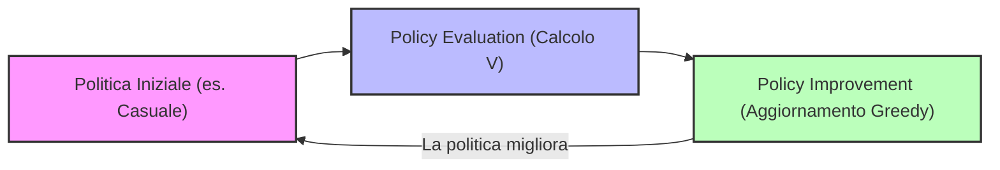

# Lezione 5: Equazioni di Ottimalità di Bellman e Introduzione alla Programmazione Dinamica

## Overview Didattica

La lezione segna il passaggio fondamentale dalla **valutazione di una politica** (*Policy Evaluation*) alla ricerca della **politica ottima** (*Optimal Policy*, $\pi^*$) all'interno dei Processi Decisionali di Markov (*Markov Decision Processes*, MDP). 

I punti salienti trattati includono:
* **Richiamo delle Equazioni di Aspettazione di Bellman (*Bellman Expectation Equations*):** Consolidamento della natura ricorsiva delle funzioni di valore per lo stato $V^\pi(s)$ (*State-Value Function*) e per l'azione $Q^\pi(s, a)$ (*Action-Value Function*). In un contesto con modello noto (funzione di transizione $P$ e funzione di ricompensa $R$), tali equazioni definiscono un sistema lineare risolvibile analiticamente per qualsiasi politica arbitraria $\pi$.
* **Transizione verso l'Ottimalità:** Definizione dell'obiettivo primario del Reinforcement Learning, ovvero determinare la migliore strategia possibile $\pi^*$ e i corrispettivi valori ottimi $V^*(s)$ e $Q^*(s, a)$, superando l'analisi di una singola politica prefissata.
* **Introduzione alle Equazioni di Ottimalità di Bellman (*Bellman Optimality Equations*):** Strumento matematico cardine che caratterizza la soluzione ottima tramite operatori non lineari di massimizzazione sulle azioni ammissibili.
* **Fondamenti di Programmazione Dinamica (*Dynamic Programming*):** Introduzione all'uso della programmazione dinamica come metodo algoritmico per risolvere gli MDP, sfruttando la proprietà di sottostruttura ottima (*optimal substructure*) e le decomposizioni ricorsive delle equazioni di Bellman.

---

### Dalle Bellman Expectation Equations alla Bellman Optimality Equation

Riprendendo il discorso sulle equazioni di Bellman, sappiamo che esse rappresentano uno strumento fondamentale per comprendere i meccanismi sottostanti ai processi decisionali di Markov (Markov Decision Processes - MDP). Finora abbiamo analizzato le **Bellman Expectation Equations**, le quali descrivono la relazione ricorsiva per una **politica generica $\pi$** (policy $\pi$), sia essa casuale o altamente strategica.

Queste equazioni presentano una proprietà molto comoda: sono **equazioni lineari**. Di conseguenza, se conosciamo perfettamente le probabilità di transizione del modello $P$ e la funzione di ricompresa $R$, possiamo risolverle direttamente impostando un sistema di equazioni lineari, la cui dimensione (cardinalità) è pari al numero di stati del problema.

#### Il limite della risoluzione analitica e l'obiettivo di Reinforcement Learning
Tuttavia, nella pratica reale, incontriamo due limitazioni:
1. Spesso non abbiamo accesso ai modelli reali di $P$ e $R$.
2. Anche conoscendoli, in problemi reali su larga scala il numero di stati è così elevato da rendere impossibile la risoluzione analitica di un sistema lineare.

Ma soprattutto, l'obiettivo ultimo del Reinforcement Learning (RL) non è semplicemente valutare quanto sia buona una politica qualsiasi, bensì **trovare la strategia migliore in assoluto**, ovvero la **politica ottimale** ($\pi^*$, optimal policy).

---

### Ordinamento tra Politiche e Esistenza della Politica Ottimale

Per definire cosa significhi "ottimale", dobbiamo prima introdurre una relazione d'ordine tra le politiche. 

> **Concetto Chiave:** Diciamo che una politica $\pi_1$ è migliore o uguale a un'altra politica $\pi_2$ ($\pi_1 \ge \pi_2$) se, per ogni possibile stato $s$ dello spazio degli stati, il valore atteso della funzione di valore dello stato è maggiore o uguale:
> $$\begin{aligned}
> \pi_1 \ge \pi_2 \iff V^{\pi_1}(s) \ge V^{\pi_2}(s) \quad \forall s \in \mathcal{S}
> \end{aligned}$$

Grazie a questa definizione, possiamo enunciare un importante risultato teorico (di cui omettiamo la dimostrazione formale):

> **Teorema di Esistenza dell'Ottimo:** Per qualsiasi MDP finito (ovvero con spazi di stati, azioni e ricompense finiti, per quanto grandi), **esiste almeno una politica ottimale $\pi^*$** che è superiore o uguale a tutte le altre politiche possibili:
> $$\begin{aligned}
> V^{\pi^*}(s) \ge V^{\pi}(s) \quad \forall s \in \mathcal{S}, \forall \pi
> \end{aligned}$$

È importante notare che la politica ottimale **può non essere unica**: potrebbero esserci più strategie diverse che conducono allo stesso identico ritorno massimo. Tuttavia, **tutte le politiche ottimali condividono la stessa funzione di valore ottimale** ($V^*$) e la stessa funzione di azione-valore ottimale ($Q^*$).

---

### La Politica Ottimale a partire da $Q^*$

Supponendo di conoscere la funzione di azione-valore ottimale $Q^*(s, a)$ (cioè il massimo ritorno atteso che possiamo ottenere partendo dallo stato $s$, compiendo l'azione $a$ e seguendo poi la politica ottimale), definire la politica ottimale diventa un'operazione immediata di massimizzazione:

$$\begin{aligned}
\pi^*(s) = \arg\max_{a \in \mathcal{A}(s)} Q^*(s, a)
\end{aligned}$$

In parole povere: ci troviamo nello stato $s$, valutiamo tutte le azioni possibili e scegliamo quella che massimizza l'aspettativa di guadagno futuro. Questo approccio è concettualmente identico al concetto di *sfruttamento* (exploitation) visto nel contesto dei problemi *multi-armed bandit*, esteso qui all'intero albero di transizione dell'MDP.

---

### La Bellman Optimality Equation (Equazione di Ottimalità di Bellman)

Poiché non abbiamo nessuno che ci fornisca "gratis" la $Q^*$ ottimale, dobbiamo ricavarla matematicamente. Introduciamo quindi un nuovo strumento: la **Bellman Optimality Equation**. A differenza delle equazioni di aspettativa, queste valgono **unicamente per la politica ottimale ($\pi^*$)**.

Attraverso i diagrammi di backup (backup diagrams), l'operazione di somma pesata sulle probabilità della politica viene sostituita da un operatore di massimo ($\max$). La politica ottimale, infatti, non sceglie le azioni in modo stocastico (es. 80% un'azione, 20% un'altra), ma seleziona deterministicamente l'azione migliore.

Combinando la transizione d'ambiente e la scelta ottima, otteniamo le due equazioni fondamentali di ottimalità:

1. **Equazione di ottimalità per $V^*$ (espressa in funzione di se stessa):**
   $$\begin{aligned}
   V^*(s) = \max_{a \in \mathcal{A}(s)} \sum_{s', r} P(s', r \mid s, a) \left[ r + \gamma V^*(s') \right]
   \end{aligned}$$

2. **Equazione di ottimalità per $Q^*$ (espressa in funzione di se stessa):**
   $$\begin{aligned}
   Q^*(s, a) = \sum_{s', r} P(s', r \mid s, a) \left[ r + \gamma \max_{a'} Q^*(s', a') \right]
   \end{aligned}$$

---

### Dal Problema Lineare ai Metodi Iterativi (Introduzione alla Programmazione Dinamica)

Osservando attentamente le equazioni di ottimalità di Bellman, notiamo la presenza dell'operatore $\max$ sia all'interno dell'equazione per $V^*$ che per $Q^*$.

> **Concetto Chiave:** La presenza del $\max$ rende la **Bellman Optimality Equation non lineare**. 

Questo significa che non possiamo più risolvere il problema tramite un semplice sistema di equazioni lineari come facevamo per l'expectation. Abbiamo bisogno di un nuovo strumento computazionale: i **metodi iterativi** (iterative methods), che costituiscono il nucleo del prossimo capitolo dedicato alla **Programmazione Dinamica (Dynamic Programming)**.

---

### Risolvere un MDP: Predizione vs Controllo

Nel contesto dei Processi Decisionali di Markov (Markov Decision Processes, MDP), formalizzati dalla cinquina fondamentale $\langle \mathcal{S}, \mathcal{A}, \mathcal{P}, \mathcal{R}, \gamma \rangle$, l'obiettivo di "risolvere" il processo assume due significati distinti e complementari:

1. **Problema di Predizione o Valutazione della Politica (Prediction / Policy Evaluation Problem)**:
   Data una generica politica $\pi$ (sia essa ottimale, sub-ottimale o puramente casuale), l'obiettivo consiste nel quantificare quanto essa sia efficace determinando la funzione valore di stato $V^\pi(s)$ o la funzione valore stato-azione $Q^\pi(s, a)$. Risponde alla domanda: *«Dato che mi comporto secondo la regola $\pi$, quanto ritorno cumulato atteso otterrò a partire da questo stato?»*.

2. **Problema di Controllo (Control Problem)**:
   L'obiettivo consiste nel determinare la politica ottima $\pi^*$ che massimizza il ritorno atteso per ogni stato del sistema, raggiungendo le funzioni valore ottimali $V^*(s)$ e $Q^*(s, a)$.

> **Concetto Chiave**: I due problemi sono strettamente interconnessi. Risolvere il problema di predizione (valutare l'efficacia di una politica esistente) costituisce il tassello operativo fondamentale per poter poi migliorare la politica stessa e risolvere il problema di controllo.

In questa fase di studio, si assume che il modello dell'ambiente sia **perfettamente noto**: le probabilità di transizione $\mathcal{P}$ e le ricompense attese $\mathcal{R}$ sono note a priori. Nei capitoli successivi affronteremo il problema di Reinforcement Learning propriamente detto (Model-Free), in cui l'agente non ha accesso a queste matrici e deve apprendere esclusivamente dall'esperienza. Tuttavia, le basi teoriche derivate dalla Programmazione Dinamica restano il fondamento matematico su cui si reggono anche gli algoritmi Model-Free.

---

### Fondamenti di Programmazione Dinamica (Dynamic Programming)

La Programmazione Dinamica (Dynamic Programming, DP) è una classe generale di algoritmi applicabile a problemi complessi che soddisfano due proprietà strutturali fondamentali:

* **Sottostruttura Ottima (Optimal Substructure)**: La soluzione globale del problema può essere decomposta e ottenuta ricombinando le soluzioni ottime di sottoproblemi più piccoli (approccio *divide-et-impera*).
* **Sottoproblemi Sovrapposti (Overlapping Subproblems)**: Gli stessi sottoproblemi compaiono ripetutamente durante l'esplorazione dello spazio delle soluzioni; risolvendo ciascun sottoproblema e memorizzandone il risultato, si evita di dover ricalcolare la medesima quantità da zero ogni volta.

#### Perché la DP si applica agli MDP?

La DP è applicabile agli MDP perché le **Equazioni di Bellman** definiscono per loro natura una relazione ricorsiva: il valore di uno stato $s$ viene definito in funzione del valore degli stati successivi $s'$:

$$V^\pi(s) = \sum_{a \in \mathcal{A}} \pi(a|s) \sum_{s' \in \mathcal{S}} \sum_{r \in \mathcal{R}} p(s', r \mid s, a) \left[ r + \gamma V^\pi(s') \right]$$

In questa formulazione:
* La **sottostruttura** corrisponde all'albero delle decisioni (*backup diagram*): valutare lo stato radice $s$ richiede di risolvere i sottoproblemi corrispondenti alla valutazione dei nodi foglia $s'$.
* La **sovrapposizione** deriva dalla dinamica dell'ambiente: da stati diversi possiamo transire verso i medesimi stati successivi $s'$, oppure un percorso circolare può riportare al punto di partenza. Il valore di $s'$ entra dunque nel calcolo di molteplici stati $s$.

---

### Dalla Forma Analitica alla Regola di Aggiornamento Iterativa

Per un MDP a stati finiti, l'Equazione di Bellman per l'aspettativa (Bellman Expectation Equation) rappresenta un sistema di $|\mathcal{S}|$ equazioni lineari in $|\mathcal{S}|$ incognite. Sebbene la soluzione analitica esatta sia ottenibile tramite inversione matriciale:

$$\mathbf{v}^\pi = (\mathbf{I} - \gamma \mathbf{P}^\pi)^{-1} \mathbf{r}^\pi$$

questa operazione comporta una complessità computazionale pari a $\mathcal{O}(|\mathcal{S}|^3)$, risultando proibitiva al crescere del numero di stati.

La Programmazione Dinamica supera questa limitazione trasformando l'identità algebrica di Bellman in una **regola di aggiornamento iterativo (update rule)**. Introducendo un indice di iterazione $k$, definiamo una successione di funzioni valore $\{v_k\}$:

$$v_{k+1}(s) \leftarrow \sum_{a \in \mathcal{A}} \pi(a|s) \sum_{s' \in \mathcal{S}} \sum_{r \in \mathcal{R}} p(s', r \mid s, a) \left[ r + \gamma v_k(s') \right], \quad \forall s \in \mathcal{S}$$

Si parte da una stima iniziale $v_0$ arbitraria (ad esempio ponendo tutti i valori a $0$ o basandosi su conoscenza a priori). A ogni passo, il valore aggiornato $v_{k+1}(s)$ per lo stato $s$ viene calcolato guardando "un passo avanti" (one-step lookahead) e sfruttando la stima del passo precedente $v_k(s')$ per gli stati successivi.

Sotto l'azione dell'operatore di Bellman, questa successione gode della proprietà di contrattura: per $k \to \infty$, la stima $v_k$ converge asintoticamente al **punto fisso (fixed point)** del sistema, ovvero alla reale funzione valore $V^\pi(s)$.

---

### Modalità di Aggiornamento: Sincrono vs Asincrono (In-Place)

Quando si implementa l'aggiornamento iterativo a livello computazionale, emerge una scelta architetturale sul modo di gestire la memoria durante il ciclo sugli stati $s \in \mathcal{S}$.

#### 1. Aggiornamento Sincrono (Synchronous Update)
Nell'approccio sincrono standard, l'algoritmo mantiene due array separati:
* Un array contenente i valori dell'iterazione corrente $v_k$;
* Un array di appoggio (buffer) in cui vengono scritti i nuovi valori $v_{k+1}$.

Tutti gli stati $s \in \mathcal{S}$ vengono valutati leggendo esclusivamente dall'array $v_k$. Solo una volta completato il ciclo per tutti gli stati, l'array $v_k$ viene sovrascritto con i contenuti del buffer $v_{k+1}$.
* **Vantaggi**: Matematicamente rigoroso e strettamente fedele alla teoria delle iterazioni parallele.
* **Svantaggi**: Richiede il doppio dello spazio in memoria ($\mathcal{O}(2|\mathcal{S}|)$) e risulta più lento nella convergenza.

#### 2. Aggiornamento Asincrono o In-Place (Asynchronous / In-Place Update)
Nell'approccio *in-place*, si alloca un singolo vettore di memoria $V(s)$. Gli stati vengono scanditi secondo un certo ordine (arbitrario o predeterminato) e ogni valore calcolato sovrascrive immediatamente il valore precedente:

$$V(s) \leftarrow \sum_{a \in \mathcal{A}} \pi(a|s) \sum_{s' \in \mathcal{S}} \sum_{r \in \mathcal{R}} p(s', r \mid s, a) \left[ r + \gamma V(s') \right]$$

Se uno stato successivo $s'$ è già stato aggiornato all'interno dello stesso ciclo, il calcolo per lo stato corrente $s$ utilizzerà immediatamente il valore aggiornato più recente invece di quello vecchio.
* **Vantaggi**: Riduce il consumo di memoria a $\mathcal{O}(|\mathcal{S}|)$ e converge sistematicamente più velocemente, poiché sfrutta subito le informazioni più aggiornate disponibili.
* **Comportamento pratico**: È l'approccio standard preferito nelle implementazioni reali di Reinforcement Learning.

---

### L'Algoritmo di Iterative Policy Evaluation

L'algoritmo **Iterative Policy Evaluation** traduce questi concetti in una procedura computazionale strutturata per stimare $V^\pi$.

#### Criterio di Terminazione
Poiché la convergenza perfetta è asintotica ($k \to \infty$), da un punto di vista ingegneristico è necessario definire un criterio di arresto pratico. Si introduce una soglia di tolleranza $\theta > 0$. Durante ogni iterazione completa su tutti gli stati, si traccia la massima variazione subita da un singolo stato:

$$\Delta \leftarrow \max_{s \in \mathcal{S}} |v - V(s)|$$

dove $v$ rappresenta il vecchio valore memorizzato prima dell'aggiornamento. Quando $\Delta < \theta$, la variazione globale è ritenuta trascurabile e l'algoritmo termina, restituendo $V \approx V^\pi$.

#### Condizioni di Inizializzazione
* **Stati Non-Terminali**: L'array $V(s)$ può essere inizializzato con valori del tutto arbitrari (ad esempio tutti zeri). Se si possiede conoscenza di dominio a priori (domain knowledge), è possibile effettuare una *inizializzazione ottimistica* per accelerare sensibilmente i tempi di convergenza.
* **Stati Terminali**: 

> **Regola Fondamentale**: Se l'ambiente prevede stati terminali (compiti episodici), il valore associato agli stati terminali deve essere **tassativamente imposto pari a zero** per tutta la durata dell'algoritmo:
> $$V(\text{terminal}) = 0$$
> Una volta che l'agente approda in uno stato terminale, l'episodio si conclude; non è possibile ottenere ulteriori ricompense in futuro, dunque il ritorno atteso a partire da tale stato è identicamente nullo. Non rispettare questo vincolo impedisce la convergenza al valore reale.

---

### Il "Grid World" come Ambiente di Esempio

Per capire come funzionano gli algoritmi in pratica, introduciamo un ambiente classico e molto utilizzato: il **Piccolo Mondo a Griglia (Small Grid World)**. 

Immaginiamo un ambiente costituito da un insieme finito di stati (nel nostro esempio 14 stati non terminali e 2 stati terminali colorati in grigio). Un agente si muove nella griglia compiendo azioni:
- Azioni disponibili: muoversi in alto, in basso, a destra, a sinistra (o equivalentemente Nord, Est, Sud, Ovest).
- Dinamica: la matrice di probabilità di transizione $P$ è deterministica. Se l'agente si trova in una cella e sceglie di andare a destra, si sposterà nella cella a destra con probabilità del $100\%$. 
- Vincoli sui bordi: se l'agente sceglie un'azione che lo porterebbe fuori dalla griglia (o contro un muro), l'ambiente lo fa semplicemente rimbalzare, lasciandolo nella stessa cella di partenza. Tutte e 4 le azioni sono sempre lecite in ogni stato.
- Condizione di arresto: se l'agente raggiunge uno dei due stati terminali (le celle grigie), l'episodio termina immediatamente.

La ricompensa (reward) è definita in modo molto semplice: ogni volta che l'agente compie un'azione riceve una penalità pari a $R = -1$. 

> **Concetto Chiave: Obiettivo dell'Agente**
> Poiché ogni transizione accumula una ricompensa negativa di $-1$, l'obiettivo dell'agente è **massimizzare la ricompensa cumulativa**. Avendo tutti valori negativi, massimizzare la somma significa in pratica **minimizzare le perdite**, ovvero raggiungere uno stato terminale nel minor numero di step possibile, sprecando meno tempo lungo il percorso.

---

### Valutazione di una Politica (Policy Evaluation) in Azione

Per ora affrontiamo un **problema di predizione (prediction problem)**, valutando una politica "stupida": un agente ubriaco (*drunk agent*) che si muove in modo completamente casuale, scegliendo ciascuna delle quattro direzioni con probabilità uniforme del $25\%$.

Partiamo con un'inizializzazione a zero per tutti gli stati al tempo $k=0$: 
$$V_0(s) = 0 \quad \forall s$$

Se applichiamo l'equazione di aggiornamento iterativo sfruttando la conoscenza del modello ($P$ e $R$), passo dopo passo i valori stimati si propagano a partire dagli stati terminali (che rimangono a zero). 

Iterando questo processo all'infinito, otteniamo la vera funzione di valore $V^\pi$ per la politica uniforme. Sorprendentemente, a causa dei movimenti casuali, per alcune celle lontane ci vogliono in media circa 14 o addirittura 40 passi per raggiungere casualmente il traguardo.

> **Curiosità e Approfondimenti**
> Questo genere di simulazioni interattive di grid world è stato reso celebre da figure di spicco del machine learning come **Andrej Karpathy** (fondatore di OpenAI, ex responsabile della guida autonoma in Tesla e creatore di contenuti didattici di grande successo come i tutorial per costruire ChatGPT da zero).

---

### Dai Problemi di Predizione al Controllo: L'Interazione tra Valutazione e Miglioramento

Finora abbiamo visto come valutare quanto sia buona una politica fissa (anche se pessima, come quella casuale). Il problema più interessante nelReinforcement Learning è però il **problema di controllo (control problem)**: trovare una strategia ottimale.

Per farlo, uniamo due concetti fondamentali in un framework iterativo chiamato **Policy Iteration** (Iterazione della Politica):
1. **Policy Evaluation**: Data una politica $\pi$, calcoliamo quanto è buona (trovando $V^\pi$).
2. **Policy Improvement**: Miglioriamo la politica agendo in modo **greedy** (goloso) rispetto ai valori appena calcolati, cioè scegliendo in ogni stato l'azione che garantisce il ritorno atteso più alto.

Ripetendo ciclicamente questi due passi, la politica diventa via via migliore fino a convergere a una **politica ottimale** (*optimal policy*).

#### Esempio Pratico di Miglioramento Greedy
Supponiamo di trovarci in una cella specifica della griglia e di esaminare i valori stimati delle celle adiacenti tramite la politica casuale iniziale. Se l'azione verso destra ci porta su una cella con un ritorno atteso migliore rispetto alle altre direzioni, la nostra nuova politica non sceglierà più a caso, ma opterà decisamente per andare a destra. 

Agendo in modo greedy sulla conoscenza accumulata:
- Nelle vicinanze del traguardo, l'agente impara subito a puntare dritto verso lo stato terminale.
- Nei punti più distanti, la politica si evolve abbandonando i movimenti errati in favore dei percorsi più brevi.

Applicando iterativamente questo schema di programmazione dinamica (*dynamic programming*), non ci limitiamo a valutare una politica, ma risolviamo il problema di controllo trovando i cammini ottimali che minimizzano i costi per raggiungere il traguardo.

---

> [!NOTE]
> ### Note per l'Esame e Avvisi del Docente
> - **Formato della prova d'esame**: Gli esempi di esami disponibili sulla pagina Moodle sono rappresentativi delle prove d'esame; la struttura può variare e comprendere esercizi, domande aperte o domande a risposta multipla (o una combinazione di queste).
> - **Materiale d'esame**: Il programma e il materiale oggetto d'esame corrispondono a quanto spiegato a lezione (il libro di testo serve per approfondire ed esaminare ulteriori esempi).
> - **Possibili domande/esercizi d'esame**: All'esame potrebbe essere richiesto di scrivere il pseudocodice dell'aggiornamento nella versione sincrona (con buffer) oppure nella versione asincrona / in-place.
> - **Argomenti/dimostrazioni non richiesti**: La dimostrazione formale del teorema relativo alla convergenza della *policy iteration* verso la policy ottimale (trattata nella lezione successiva) **non** verrà chiesta all'esame.