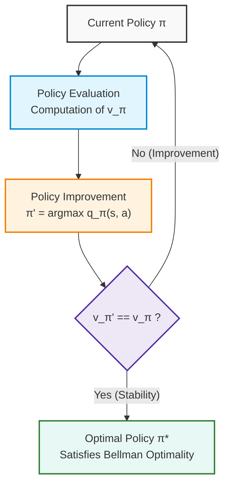
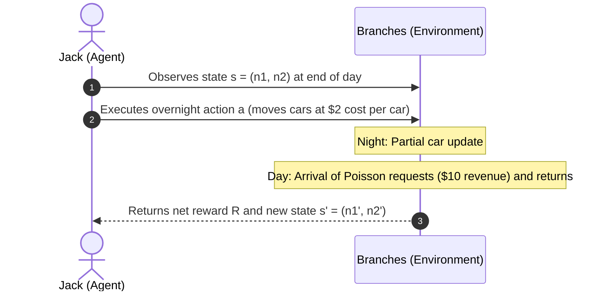
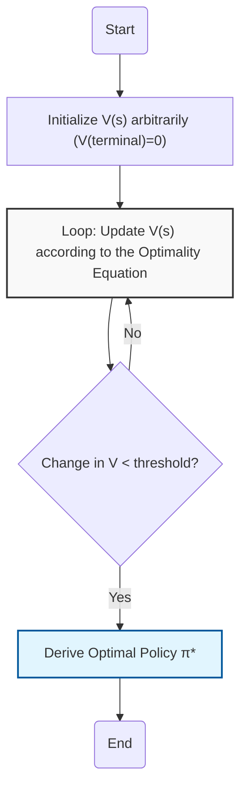
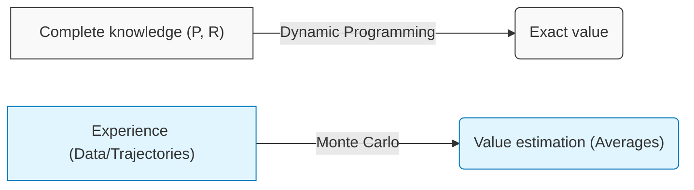
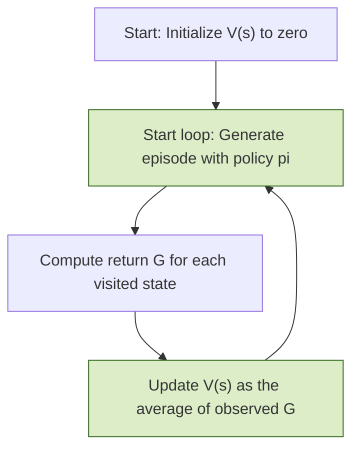
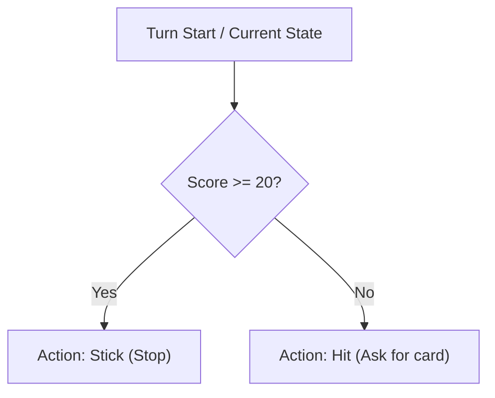

# Introduction to Policy Iteration and Control in Markov Decision Processes (MDPs)

## Educational Overview
The lecture introduces the fundamental concept of **Policy Iteration**, which marks the transition from the simple evaluation of a strategy to solving the control problem in a Markov Decision Process (MDP). The core of the method lies in an iterative process composed of two cyclical phases:
1.  **Evaluation (Prediction/Evaluation):** The Bellman expectation equation is used to determine the value of the current policy ($V^\pi$).
2.  **Improvement:** The policy is updated by acting greedily with respect to the acquired knowledge, selecting the action that maximizes the expected return.

The cycle repeats until the policy converges to the **optimal policy** ($\pi^*$), ensuring a monotonic improvement of the strategy at each iteration. This approach represents the logical integration of the mathematical tools defined in previous chapters, focusing on the agent's ability to autonomously refine its decisions based on statistical evidence.

---

### Introduction to Policy Iteration and Scope of the Control Problem

We dive into Chapter 5 by tackling the full Reinforcement Learning problem, where some environmental information is not directly known a priori and the agent must learn it.

Let us briefly recall the two fundamental problems in Markov Decision Processes (MDPs):
- **Prediction or Evaluation Problem**: the goal is to evaluate how good a certain policy $\pi$ is (whether optimal or extremely suboptimal) by computing the associated value function.
- **Control Problem**: the goal is to find the optimal policy, denoted by $\pi^*$, along with the corresponding optimal value functions $V^*$ and $Q^*$.

The general strategy for solving the control problem relies on an iterative process of learning and improvement: one starts from an initial policy, evaluates how good it is (prediction phase), and subsequently improves the policy by acting **greedily** with respect to the acquired knowledge. This cycle is repeated until the optimal policy is reached.

---

### The Policy Iteration Framework

The procedure known as **Policy Iteration** consists of two fundamental steps repeated cyclically:
1. **Prediction Phase (Policy Evaluation)**: using Dynamic Programming and the Bellman Expectation Equation, the value function for the current policy $\pi$ is computed.
2. **Improvement Phase (Policy Improvement)**: the policy is updated by acting greedily with respect to the current estimates, yielding a new policy $\pi'$.

Each new policy $\pi'$ will be better than or equal to the previous one ($\pi' \ge \pi$), eventually converging to the optimal policy $\pi^*$.

#### Pseudocode and Greedy Update
In transitioning from a policy $\pi$ to the new improved policy $\pi'$, the action chosen for a given state is no longer strictly bound by the old policy, but is selected by maximizing the action-value function $Q^\pi(s, a)$ over all possible actions:

$$\pi'(s) = \text{arg}\max_{a} Q^\pi(s, a)$$

This approach leverages the informational richness of $Q^\pi(s,a)$, which provides us with the expected return not only for the action usually chosen by $\pi$, but for *any* action $a$ available in that state.

---

### Convergence Proof of Policy Improvement

To have mathematical certainty that this iterative process actually leads to the optimal policy, we introduce a formal proof based on value function inequalities.

> **Key Concept**: A rigorous understanding of notation (in particular the fundamental distinction between *reward* $R$, which is immediate, and *return* $G$, which accumulates all the future) is essential to follow the logical steps and avoid confusion between the symbols $V$ and $Q$.

Consider a policy $\pi$ and its improved version $\pi'$ defined via the greedy choice on the function $Q^\pi(s, a)$:

$$\pi'(s) = \text{arg}\max_{a} Q^\pi(s, a)$$

We want to prove that the new policy is guaranteed to be better than or equal to the previous one:

$$V^{\pi'}(s) \ge V^\pi(s)$$

We start from the definition of $V^\pi(s)$ evaluated on the action chosen by the original policy:

$$V^\pi(s) = Q^\pi(s, \pi(s))$$

Since $\pi'(s)$ is defined as the action that maximizes $Q^\pi(s, a)$ over all possible actions, it will necessarily be greater than or equal to the value obtained with the old action:

$$Q^\pi(s, \pi(s)) \le \max_{a} Q^\pi(s, a) = Q^\pi(s, \pi'(s))$$

Proceeding with telescoping arguments (standard in Reinforcement Learning proofs), the recursive relation is expanded to show that the entire expected return along the new trajectory guided by $\pi'$ dominates or equals that of the previous policy $\pi$, thus ensuring the monotonicity of the improvement and subsequent convergence to optimality.

---

### Policy Improvement Theorem

Before analyzing the practical application, let us complete the theoretical framework underlying the **Policy Iteration** algorithm, mathematically proving why the greedy choice guarantees a monotonic improvement in agent performance.

#### Definition of the New Policy and Fundamental Inequality

Consider a current deterministic policy $\pi(s)$ and the corresponding state-value function $v_\pi(s)$. We define a new deterministic policy $\pi'(s)$ by choosing in each state the action that maximizes the expected value of the current action with respect to the action-value function $q_\pi(s, a)$:

$$\pi'(s) \doteq \arg\max_{a \in \mathcal{A}} q_\pi(s, a)$$

Consequently, by construction, the value obtained by executing the action suggested by the new policy $\pi'(s)$ satisfies the following relationship with respect to the value of the old policy:

$$q_\pi(s, \pi'(s)) = \max_{a \in \mathcal{A}} q_\pi(s, a) \ge q_\pi(s, \pi(s)) = v_\pi(s)$$

> **Key Concept**: The inequality $q_\pi(s, \pi'(s)) \ge v_\pi(s)$ includes the case of equality ($\ge$ and not just $>$) because the initial policy $\pi$ might have already selected the optimal action in that specific state.

#### Telescoping Proof of Improvement

To prove that the entire expected value of the new policy $v_{\pi'}(s)$ is greater than or equal to that of the previous policy for every state $s \in \mathcal{S}$, we recursively expand the definition of $q_\pi(s, \pi'(s))$ through the Bellman equation:

$$v_\pi(s) \le q_\pi(s, \pi'(s)) = \mathbb{E}\left[ R_{t+1} + \gamma v_\pi(S_{t+1}) \;\middle|\; S_t = s, A_t = \pi'(s) \right]$$

Applying the fundamental inequality again to the next state $S_{t+1}$, we have $v_\pi(S_{t+1}) \le q_\pi(S_{t+1}, \pi'(S_{t+1}))$. Substituting iteratively:

$$\begin{aligned}
v_\pi(s) &\le \mathbb{E}_{\pi'}\left[ R_{t+1} + \gamma v_\pi(S_{t+1}) \;\middle|\; S_t = s \right] \\
&\le \mathbb{E}_{\pi'}\left[ R_{t+1} + \gamma q_\pi(S_{t+1}, \pi'(S_{t+1})) \;\middle|\; S_t = s \right] \\
&= \mathbb{E}_{\pi'}\left[ R_{t+1} + \gamma R_{t+2} + \gamma^2 v_\pi(S_{t+2}) \;\middle|\; S_t = s \right] \\
&\;\; \vdots \\
&\le \mathbb{E}_{\pi'}\left[ R_{t+1} + \gamma R_{t+2} + \gamma^2 R_{t+3} + \dots \;\middle|\; S_t = s \right] = v_{\pi'}(s)
\end{aligned}$$

Thanks to the discount factor $\gamma < 1$, in the infinite limit the term $\gamma^k v_\pi(S_{t+k})$ decays to zero as $k \to \infty$. We have thus obtained:

$$v_\pi(s) \le v_{\pi'}(s) \quad \forall s \in \mathcal{S}$$

This guarantees that the new policy $\pi'$ is overall better than or, in the worst case, equivalent to $\pi$.

#### Stopping Condition and Convergence to the Optimum

What happens if, at an iteration, we obtain perfect equality, i.e., $v_{\pi'}(s) = v_\pi(s)$ for all states?
If the improvement stops, it means that:

$$v_{\pi'}(s) = \max_{a \in \mathcal{A}} q_{\pi'}(s, a) = \max_{a \in \mathcal{A}} \mathbb{E}\left[ R_{t+1} + \gamma v_{\pi'}(S_{t+1}) \;\middle|\; S_t = s, A_t = a \right]$$

This is precisely the **Bellman Optimality Equation**. Therefore, when the policy can no longer be improved, we are not stuck at an arbitrary point: we have mathematically reached the **optimal policy** $\pi^*$ and the **optimal value function** $v^*$.

---

### Practical Application: Jack's Car Rental Problem

To see dynamic programming at work in a real control problem, let us analyze a classic inventory management example: **Jack's Car Rental**.

#### Operational Scenario Description

Jack manages two locations of a car rental agency (for example, location 1 near an airport and location 2 in the city center). The economic objective is to maximize net profit:
* **Earnings per rental**: each customer pays $\$10$ to rent a car for a day, provided a vehicle is available at that branch. If cars are out of stock, the request is lost.
* **Transfer cost**: overnight, Jack can redistribute the fleet by moving cars between the two locations. The transport cost is $\$2$ per car (fuel and personnel expenses).

#### Formalization of the MDP

Let us define the five core elements of the Markov Decision Process (MDP):

##### 1. State Space $\mathcal{S}$
At each branch, a maximum of $20$ cars can be parked simultaneously (any excess returned cars are turned away or reallocated elsewhere by the central office).
* The state $s$ at the end of the day is described by the ordered pair:

  $$s = (n_1, n_2) \quad \text{with } n_1, n_2 \in \{0, 1, 2, \dots, 20\}$$

* The cardinality of the state space is therefore:

  $$|\mathcal{S}| = 21 \times 21 = 441 \text{ states}$$

##### 2. Action Space $\mathcal{A}$
The agent (Jack) can decide overnight how many cars to move between the two locations, up to a maximum of $5$ cars per night:
* An action $a > 0$ indicates the transfer of $a$ cars from branch 1 to branch 2.
* An action $a < 0$ indicates the transfer of $|a|$ cars from branch 2 to branch 1.
* The action $a = 0$ indicates no vehicles moved.
* The set of admissible actions comprises $11$ discrete options:

  $$\mathcal{A} = \{-5, -4, -3, -2, -1, 0, 1, 2, 3, 4, 5\}$$

##### 3. Transition Dynamics $\mathcal{P}$ and Poisson Distribution
The number of cars requested (*demand*) and returned (*returns*) at each location every day is a random variable following a Poisson distribution with mean parameter $\lambda$:

$$P(X = k) = \frac{\lambda^k}{k!} e^{-\lambda}$$

The mean parameters differ to account for the nature of the two locations:
* **Branch 1**: $\lambda_{\text{requests}} = 3$, $\lambda_{\text{returns}} = 3$.
* **Branch 2**: $\lambda_{\text{requests}} = 4$, $\lambda_{\text{returns}} = 2$.

Branch 2 exhibits a structural deficit on average: it has more rental requests (4) than returned vehicles (2). In contrast, branch 1 is balanced on average (3 requests and 3 returns).

##### 4. Reward Function $\mathcal{R}$
The immediate reward $R_{t+1}$ associated with transitioning from state $s$ by taking action $a$ consists of two components:
1. **Immediate overnight cost**: $-2 \times |a|$ dollars.
2. **Expected daily revenue**: $+10$ dollars for each car actually rented to customers the next day across both locations (capped by the actual availability after the overnight transfer).

##### 5. Discount Factor $\gamma$ and Time Horizon
The problem has an infinite horizon with daily time step discretization (*daily time steps*). The chosen discount factor is:

$$\gamma = 0.9$$

---

### Solution via Policy Iteration

Applying the Policy Iteration algorithm to Jack's model:

1. **Initialization**: 
   We start from a trivial yet conservative policy: never move any car, regardless of the state:
   $$\pi_0(s) = 0 \quad \forall s \in \mathcal{S}$$

2. **Policy Evolution**:
   * Through policy evaluation (*Policy Evaluation*), the expected returns of this initial choice are computed.
   * Through greedy improvement (*Policy Improvement*), the algorithm learns to move cars from locations that have an abundance to those that have few, to avoid losing customers due to stock shortages.
   
3. **Asymmetry of the Optimal Policy**:
   As convergence approaches, the resulting decision map is not symmetric with respect to the two branches. Because branch 2 has higher average demand than returns ($\lambda = 4$ requests versus $\lambda = 2$ returns), it naturally tends to deplete day after day. The optimal policy systematically favors the overnight transfer of cars from branch 1 to branch 2, maximizing overall revenue against the modest transfer cost.

---

### Optimization: from Policy Iteration to Value Iteration

Having analyzed **Policy Iteration**, we understood that the policy evaluation process (*Policy Evaluation*) can require substantial computation time to converge to the exact value function $V^{\pi}$.

However, in the field of Reinforcement Learning (RL) and, more broadly, in the optimization of complex systems (such as vehicle fleet management or intelligent mobility), computational time is a critical resource. Often, we do not need total convergence of the estimate of $V^{\pi}$ to start improving our decision strategy.

#### The Limitation of Policy Iteration
In traditional Policy Iteration, we perform two distinct, iterative steps:
1.  **Policy Evaluation**: We compute the value function $V^{\pi}$ for the current policy until convergence (theoretically infinite).
2.  **Policy Improvement**: We update the policy making it "greedy" with respect to $V^{\pi}$.

**Key Concept:** In practical settings, it is possible to obtain an optimal policy well before the evaluation $V^{\pi}$ has converged. Often, an approximate estimate is sufficient to identify the best action in each state.

#### Value Iteration: The "Extreme" Approach
**Value Iteration** arises as an "extreme" version of Policy Iteration, in which the evaluation process is drastically truncated: we perform a single update step of the value estimate and immediately apply a greedy choice.

Instead of cleanly separating the phases, Value Iteration merges the evaluation and improvement operations into a single update equation, which derives directly from the **Bellman Optimality Equation**:

$$V_{k+1}(s) = \max_{a} \sum_{s', r} p(s', r | s, a) [r + \gamma V_k(s')]$$

#### Operational Differences
*   **Policy Iteration**: The inner evaluation loop continues until the change in $V$ is zero (convergence).
*   **Value Iteration**: We do not wait for the evaluation to converge. At each iteration $k$, we update the value of each state by choosing the action that maximizes the immediate expected gain based on the current estimate $V_k$.

#### Logical Comparison
It is useful to visualize the comparison between the two approaches:

| Feature | Policy Iteration | Value Iteration |
| :--- | :--- | :--- |
| **Objective** | Find optimal $\pi$ via $V^{\pi}$ | Find optimal $\pi$ via $V^*$ |
| **Evaluation** | Full (until convergence) | Partial (a single sweep) |
| **Speed** | Slower (computationally expensive) | Very fast |
| **Foundation** | Bellman Expectation Equation | Bellman Optimality Equation |

#### Implementation Considerations
*   **Termination**: Just as in Policy Evaluation, we must define a stopping criterion. Since we are no longer iterating toward a specific $\pi$ but toward the optimal value function $V^*$, the stopping criterion will be based on the maximum change in value between two successive iterations:
    $$\Delta = \max_{s \in S} |V_{k+1}(s) - V_k(s)|$$
    When $\Delta$ is lower than a pre-established threshold, the process terminates.
*   **Initialization**: It is critical that terminal states are initialized to $0$, since the termination value is null by definition.
*   **Grid World Example**: In a simple grid, Value Iteration manages to propagate value information from the target state (goal) to adjacent states in just a few steps. Even if our initial estimate of $V$ is far from the true value (e.g., $-3$ versus the true $-20$), the *choice* of action (the greedy policy) will often already be optimal after very few iterations, confirming that understanding the problem's structure is more important than the absolute mathematical precision of the value function.

**Key Concept:** Value Iteration is not "making a mistake" by not computing the exact value; it is simply using the partial estimate as "scaffolding" to build the optimal policy efficiently.

---

### Generalized Policy Iteration (GPI)

In the previous lecture, we saw how value iteration and policy iteration are two extremes of a broader concept: **Generalized Policy Iteration (GPI)**.

*   **The Concept:** GPI describes the interaction between two processes: policy evaluation (*policy evaluation*) and policy improvement (*policy improvement*).
*   **Flexibility:** While in value iteration we execute a single evaluation step followed by improvement, in GPI we can choose to execute an arbitrary number of evaluation steps (from 1 to infinity) before proceeding to improvement.
*   **Key Concept:** The chosen approach (how many evaluation steps to run) does not change the nature of the problem: both processes aim to converge toward the optimal solution, moving in a coordinated fashion along the policy space.

### Methodological Note: Efficiency in Updates

When solving control or prediction problems, computational efficiency is paramount. We discussed the difference between **synchronous** updates (updating all states simultaneously) and **asynchronous** updates (*in-place updates*).

*   **Asynchronous Updates:** Allow algorithms to run faster, since they do not require a rigorous, systematic sweep of all states.
*   **Advanced Strategies:** More intelligent updating techniques exist (which we will explore in Chapter 8) that allow selective updating of states where uncertainty is greatest, similar to what happens in certain *active learning* strategies in supervised machine learning.

---

### Introduction to Monte Carlo Methods

With Chapter 5, we drop the assumption of having perfect knowledge of the environment. So far, we have assumed knowledge of the transition probabilities $P$ and the reward functions $R$ of a Markov Decision Process (MDP). In real-world practice, this information is rarely available.

#### The Paradigm Shift
No longer able to rely on $P$ and $R$, we cannot analytically solve the Bellman equations. However, the objective remains the same:
1.  **Prediction Problem:** Estimate $V_{\pi}$ or $Q_{\pi}$ for a given policy $\pi$.
2.  **Control Problem:** Find the optimal policy $\pi^*$.

**How do we proceed without $P$ and $R$?** We use **experience (data)**. Instead of computing the expectation via mathematical models, we estimate it via **sample averages** based on trajectories (episodes) experienced by the agent.

#### The Sample Average Principle
If we want to know the expected value of an event but do not know its distribution, statistics teaches us that we can simulate it many times and compute its average.
*   **Example:** To estimate the value of a die roll or compute the number $\pi$ via geometric simulations, we do not look for the theoretical formula, but accumulate data until the empirical mean converges to the real value.
*   **In RL:** We collect trajectories of the form $(S_0, A_0, R_1, S_1, A_1, R_2, \dots, S_T)$. The expected value of a policy $V_{\pi}(s)$ will be the average of the returns obtained starting from state $s$.

---

### Monte Carlo Algorithm (Prediction)

To estimate $V_{\pi}(s)$ without knowing $P$, we use the definition of return $G_t$ as the sum of future rewards.

*   **Definition of Return:**
    $$G_t = R_{t+1} + \gamma R_{t+2} + \dots + \gamma^{T-1} R_T$$
    Recall the recursive (telescoping) property:
    $$G_t = R_{t+1} + \gamma G_{t+1}$$

*   **Operational Procedure:**
    1. Generate a complete episode following policy $\pi$.
    2. For each state $s$ visited in the episode, compute the obtained return.
    3. Update the estimate of $V(s)$ as the average of the observed returns for that state.

#### Logical Structure of the Algorithm
*   **Key Concept:** Unlike dynamic programming, here we introduce an outer loop over **trajectories** (episodes). The agent "lives" the environment, gathers experience, and uses that memory to refine estimates.

**Educational Note:** This approach is conceptually identical to what was seen with *Multi-Armed Bandits*, where we estimated the value of an action via the average of received payoffs. The main difference here is that the payoff (the return) depends not only on the action, but on the sequence of future states that follow from it.

---

### Algorithmic Optimizations and Visiting Strategies

When working with episodes in Reinforcement Learning, computational efficiency is crucial. Even seemingly minor choices can make a significant difference when an algorithm must process thousands of episodes.

#### Backward Calculation of Returns
Consider computing the return $G$ for a 5-step episode. In the most direct way, we sum the contributions forward, requiring a certain number of operations (for example, 10 addition operations).

However, since the episode has already concluded and we have collected all experience, we can proceed **backward**. We start from the final state, very close to termination, and compute the return incrementally: the return at time $t$ is simply the immediate reward plus the already computed return at time $t+1$.
This approach reduces the number of operations (approximately halving them), proving extremely advantageous when the algorithm must iterate learning tens of thousands of times.

#### Trajectory-Based Updates and Efficiency
Two key aspects of this practical implementation are:
1. **Selective Updating:** Every time we collect a trajectory, we update *only* the states that were actually visited. This is essential for very large state spaces, as it avoids wasting computations on unexplored states.
2. **True Averages vs. Incremental Updates:** We can retain the memory of all collected rewards to compute true averages, or use incremental updates (as seen in previous lectures) for faster yet effective estimates.

#### First-Visit vs. Every-Visit Monte Carlo
Another implementation choice concerns how we handle states that appear multiple times within the same trajectory:
* **Every-Visit Estimation:** Every time we pass through a state $s$ in a trajectory, we treat that occurrence as a new valid data point and append the computed return. The underlying philosophy is: *"the more data we have, the better"*.
* **First-Visit Estimation:** We consider the return associated with a state $s$ only the *first* time it is visited within a given trajectory. The philosophy here ties back to the theoretical definition of return, which looks at everything that happens from that moment forward until the end of time.
* *Note:* In terms of implementation, *First-Visit* requires a check to verify whether the state has already been visited in the current episode. There is no absolute trade-off of accuracy or efficiency between the two methods; they simply reflect different philosophies and can be used interchangeably (unless explicitly required in exam questions).

---

### Case Study: Blackjack as an MDP (Markov Decision Process)

To understand the practical application of these concepts, let us analyze a classic problem: the game of **Blackjack** (in its simplified version against the dealer/house, using a 52-card deck).

#### Problem Formalization
* **Objective:** Get as close as possible to a score of 21 with the cards in hand without exceeding it (which would result in *busting*, leading to an immediate loss).
* **Card Values:** 
  * Number cards retain their face value.
  * Face cards (Jack, Queen, King) and the 10 are worth 10 points.
  * The **Ace** is the most versatile card: it can be worth 1 or 11 points depending on player convenience (thus avoiding *busting*).
* **Available Actions for the Player (Action Space, $\mathcal{A}$):**
  * `Hit`: Request another card.
  * `Stick`: Keep current cards and end turn.
* **State Space ($\mathcal{S}$):** To keep the problem compact and efficient, the agent's state does not track the individual cards dealt, but three key pieces of information:
  1. The player's current point sum.
  2. The dealer's showing card.
  3. The presence or absence of a usable ace (usable as 11).

#### Evaluating a Simple Policy
Imagine a naive (very poor) policy:
* If the score is 20 or 21 $\rightarrow$ `Stick`.
* If the score is less than 20 $\rightarrow$ `Hit`.

Through experience (e.g., simulating thousands or millions of episodes), we can estimate the expected returns for this policy. The results clearly show that:
* This policy is extremely weak: in most cases, the player loses or busts.
* Performance worsens further if the dealer shows a strong card (a 10 or an Ace).
* The presence of a usable ace provides a slight advantage (slightly higher value surface), but it is not enough to rescue the strategy.

This demonstrates the need to move to more advanced **control problems** to find optimal policies capable of beating the dealer.

---

> [!NOTE]
### Exam Notes and Instructor Notices
- **In-Class Exercises:** The instructor explicitly stated that the *grid world* examples (covered in class) are simple and represent the type of exercises he likes to include in exam papers (partial exams). He recommended practicing the calculations associated with these models.
- **Knowledge of Notation:** Although the instructor does not require writing theoretical proofs during exams or assignments, he emphasized that it is essential to know the notation perfectly ($V, Q, \pi, \pi^*$, etc.) and the meaning of each symbol. He may ask direct questions on this aspect.
- **Pseudocode:** Students are required to be able to write the pseudocode for algorithms such as *Value Iteration* and *Policy Iteration*.
- **Exam Structure:** The instructor confirmed that the concepts covered in this lecture (Bellman equations, dynamic programming, Monte Carlo methods) and the summary tables shown in class are examinable material.
- **Algorithm Specifications:** The instructor specified that when asking to write the pseudocode for *Value Iteration*, he expects the single-update-step version of the algorithm (the "faster" method).
- **Excluded Topics:** The instructor explicitly stated that he will not ask in the exam about advanced asynchronous/synchronous update strategies in detail, nor complex implementation variants presented purely for practical/research purposes.