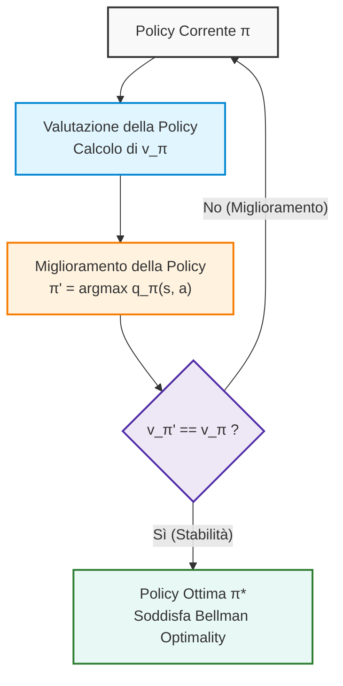
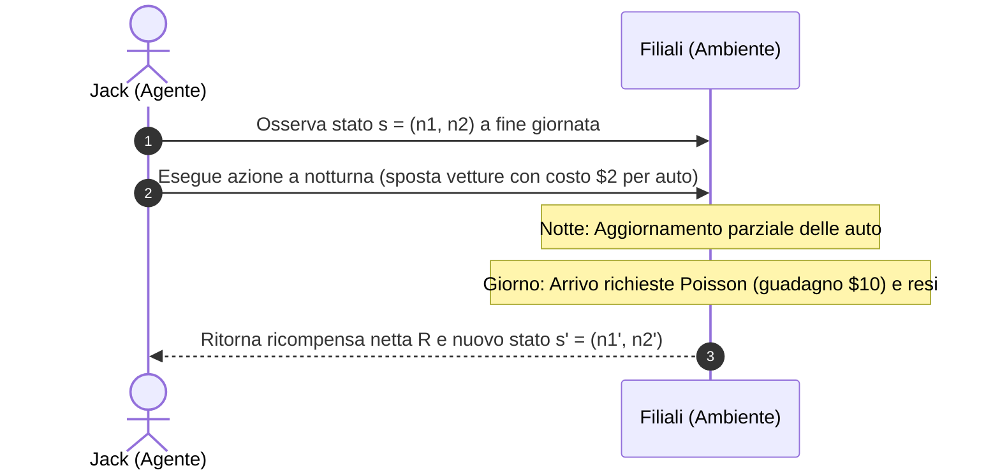
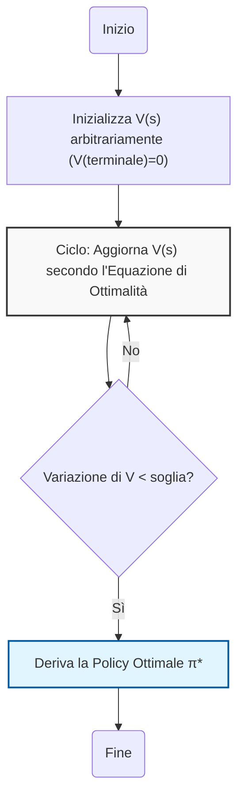
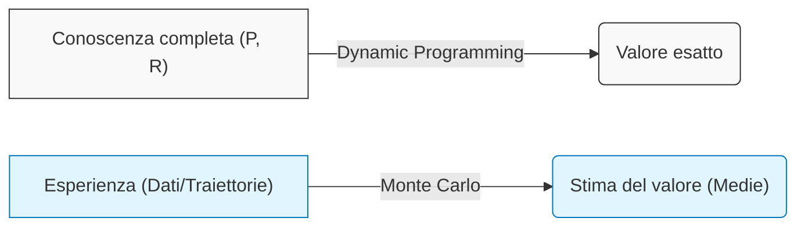
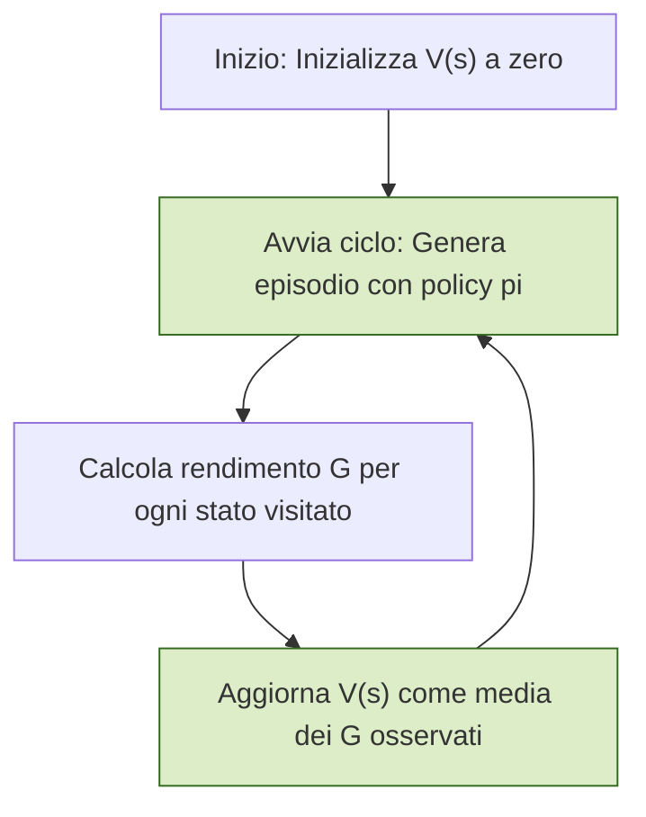
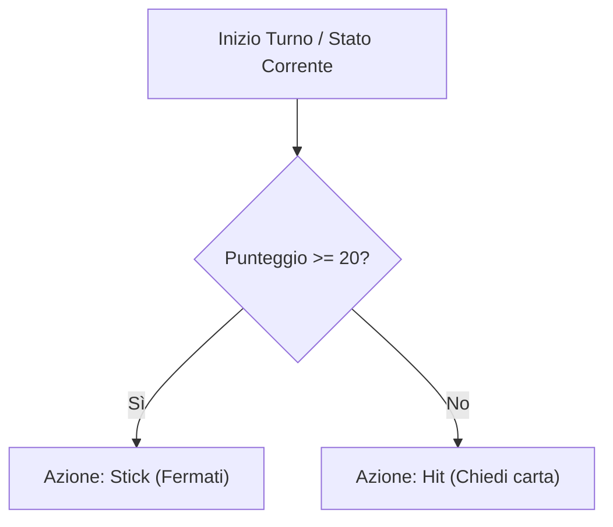

# Introduzione alla Policy Iteration e al Controllo nei Processi Decisionali di Markov (MDP)

## Overview Didattica
La lezione introduce il concetto fondamentale di **Policy Iteration** (Iterazione della Politica), che segna il passaggio dalla semplice valutazione di una strategia alla risoluzione del problema di controllo in un Processo Decisionale di Markov (Markov Decision Process, MDP). Il core del metodo risiede in un processo iterativo composto da due fasi cicliche:
1.  **Valutazione (Prediction/Evaluation):** Si utilizza l'equazione di aspettativa di Bellman (Bellman expectation equation) per determinare il valore della politica corrente ($V^\pi$).
2.  **Miglioramento (Improvement):** Si aggiorna la politica agendo in modo "avido" (greedy) rispetto alle conoscenze acquisite, selezionando l'azione che massimizza il ritorno atteso.

Il ciclo si ripete finché la politica non converge verso la **politica ottimale** ($\pi^*$), garantendo un miglioramento monotòno della strategia ad ogni iterazione. Questo approccio rappresenta l'integrazione logica degli strumenti matematici definiti nei capitoli precedenti, focalizzandosi sulla capacità dell'agente di raffinare autonomamente le proprie decisioni basandosi sull'evidenza statistica.

---

### Introduzione alla Policy Iteration e Dimensione del Problema di Controllo

Entriamo nel vivo del Capitolo 5 affrontando il problema di Reinforcement Learning completo, in cui alcune informazioni ambientali non sono direttamente note a priori e l'agente deve apprenderle. 

Ricordiamo brevemente i due problemi fondamentali nei Processi Decisionali di Markov (Markov Decision Processes - MDP):
- **Problema di Predizione o Valutazione (Prediction/Evaluation Problem)**: l'obiettivo è valutare quanto sia buona una certa politica $\pi$ (sia essa ottimale o estremamente subottimale), calcolando la funzione di valore associata.
- **Problema di Controllo (Control Problem)**: l'obiettivo è trovare la politica ottimale, indicata con $\pi^*$, insieme alle relative funzioni di valore ottimali $V^*$ e $Q^*$.

La strategia generale per risolvere il problema di controllo si basa su un processo iterativo di apprendimento e miglioramento: si parte da una politica iniziale, si valuta quanto è buona (fase di predizione), e successivamente si migliora la politica agendo in modo **avido (greedy)** rispetto alle conoscenze acquisite. Questo ciclo viene ripetuto fino al raggiungimento della politica ottimale.

---

### Il Framework della Policy Iteration

Il procedimento noto come **Policy Iteration** (Iterazione della Politica) si compone di due passaggi fondamentali ripetuti ciclicamente:
1. **Fase di Predizione (Policy Evaluation)**: utilizzando la programmazione dinamica (Dynamic Programming) e l'equazione di Bellman di aspettazione (Bellman Expectation Equation), si calcola la funzione di valore per la politica corrente $\pi$.
2. **Fase di Miglioramento (Policy Improvement)**: si aggiorna la politica agendo in modo greedy rispetto alle stime correnti, ottenendo una nuova politica $\pi'$.

Ogni nuova politica $\pi'$ sarà migliore o uguale alla precedente ($\pi' \ge \pi$), fino a convergere alla politica ottimale $\pi^*$.

#### Pseudo-codice e Aggiornamento Greedy
Nel passaggio da una politica $\pi$ alla nuova politica migliorata $\pi'$, l'azione scelta per un dato stato non è più vincolata rigidamente dalla vecchia politica, ma viene selezionata massimizzando la funzione di azione-valore $Q^\pi(s, a)$ su tutte le azioni possibili:

$$\pi'(s) = \text{arg}\max_{a} Q^\pi(s, a)$$

Questo approccio sfrutta la ricchezza informativa di $Q^\pi(s,a)$, che ci fornisce il ritorno atteso non solo per l'azione solitamente scelta da $\pi$, ma per *qualsiasi* azione $a$ disponibile in quello stato.

---

### Dimostrazione di Convergenza della Policy Improvement

Per avere la certezza matematica che questo processo iterativo conduca effettivamente alla politica ottimale, introduciamo una dimostrazione formale basata sulle disuguaglianze delle funzioni di valore.

> **Concetto Chiave**: La comprensione rigorosa della notazione (in particolare la distinzione fondamentale tra *ricompensa* $R$, che è immediata, e *ritorno* $G$, che accumula tutto il futuro) è essenziale per seguire i passaggi logici ed evitare confusione tra i simboli $V$ e $Q$.

Consideriamo una politica $\pi$ e la sua versione migliorata $\pi'$ definita tramite la scelta greedy sulla funzione $Q^\pi(s, a)$:

$$\pi'(s) = \text{arg}\max_{a} Q^\pi(s, a)$$

Vogliamo dimostrare che la nuova politica è garantita essere migliore o uguale alla precedente:

$$V^{\pi'}(s) \ge V^\pi(s)$$

Partiamo dalla definizione di $V^\pi(s)$ valutata sull'azione scelta dalla politica originaria:

$$V^\pi(s) = Q^\pi(s, \pi(s))$$

Poiché $\pi'(s)$ è definita come l'azione che massimizza $Q^\pi(s, a)$ su tutte le azioni possibili, essa sarà necessariamente maggiore o uguale al valore ottenuto con la vecchia azione:

$$Q^\pi(s, \pi(s)) \le \max_{a} Q^\pi(s, a) = Q^\pi(s, \pi'(s))$$

Proseguendo con argomenti di tipo telescopico (standard nelle dimostrazioni di Reinforcement Learning), si espande la relazione ricorsiva per mostrare che l'intero ritorno atteso lungo la nuova traiettoria guidata da $\pi'$ domina o eguaglia quello della politica precedente $\pi$, garantendo così la monotonicità del miglioramento e la successiva convergenza all'ottimalità.

---

### Teorema di Miglioramento della Policy (Policy Improvement Theorem)

Prima di analizzare l'applicazione pratica, completiamo il quadro teorico alla base dell'algoritmo di **Iterazione di Policy** (*Policy Iteration*), dimostrando matematicamente perché la scelta ingorda (*greedy*) garantisce un miglioramento monotono delle prestazioni dell'agente.

#### Definizione della Nuova Policy e Disuguaglianza Fondamentale

Consideriamo una policy deterministica corrente $\pi(s)$ e la corrispondente funzione valore dello stato $v_\pi(s)$. Definiamo una nuova policy deterministica $\pi'(s)$ scegliendo in ogni stato l'azione che massimizza il valore atteso dell'azione corrente rispetto alla funzione valore-azione (*action-value function*) $q_\pi(s, a)$:

$$\pi'(s) \doteq \arg\max_{a \in \mathcal{A}} q_\pi(s, a)$$

Di conseguenza, per costruzione, il valore ottenuto eseguendo l'azione suggerita dalla nuova policy $\pi'(s)$ soddisfa la seguente relazione rispetto al valore della vecchia policy:

$$q_\pi(s, \pi'(s)) = \max_{a \in \mathcal{A}} q_\pi(s, a) \ge q_\pi(s, \pi(s)) = v_\pi(s)$$

> **Concetto Chiave**: La disuguaglianza $q_\pi(s, \pi'(s)) \ge v_\pi(s)$ include il caso di uguaglianza ($\ge$ e non solo $>$) perché la policy iniziale $\pi$ potrebbe aver già selezionato l'azione ottima in quello specifico stato.

#### Dimostrazione Telescopica del Miglioramento

Per dimostrare che l'intero valore atteso della nuova policy $v_{\pi'}(s)$ è maggiore o uguale a quello della policy precedente per ogni stato $s \in \mathcal{S}$, espandiamo ricorsivamente la definizione di $q_\pi(s, \pi'(s))$ attraverso l'equazione di Bellman:

$$v_\pi(s) \le q_\pi(s, \pi'(s)) = \mathbb{E}\left[ R_{t+1} + \gamma v_\pi(S_{t+1}) \;\middle|\; S_t = s, A_t = \pi'(s) \right]$$

Applicando nuovamente la disuguaglianza fondamentale allo stato successivo $S_{t+1}$, abbiamo che $v_\pi(S_{t+1}) \le q_\pi(S_{t+1}, \pi'(S_{t+1}))$. Sostituendo iterativamente:

$$\begin{aligned}
v_\pi(s) &\le \mathbb{E}_{\pi'}\left[ R_{t+1} + \gamma v_\pi(S_{t+1}) \;\middle|\; S_t = s \right] \\
&\le \mathbb{E}_{\pi'}\left[ R_{t+1} + \gamma q_\pi(S_{t+1}, \pi'(S_{t+1})) \;\middle|\; S_t = s \right] \\
&= \mathbb{E}_{\pi'}\left[ R_{t+1} + \gamma R_{t+2} + \gamma^2 v_\pi(S_{t+2}) \;\middle|\; S_t = s \right] \\
&\;\; \vdots \\
&\le \mathbb{E}_{\pi'}\left[ R_{t+1} + \gamma R_{t+2} + \gamma^2 R_{t+3} + \dots \;\middle|\; S_t = s \right] = v_{\pi'}(s)
\end{aligned}$$

Grazie al fattore di sconto $\gamma < 1$, nei passaggi infiniti il termine $\gamma^k v_\pi(S_{t+k})$ decade a zero per $k \to \infty$. Abbiamo così ottenuto:

$$v_\pi(s) \le v_{\pi'}(s) \quad \forall s \in \mathcal{S}$$

Questo garantisce che la nuova policy $\pi'$ sia complessivamente migliore o, nel peggiore dei casi, equivalente a $\pi$.

#### Condizione di Arresto e Convergenza all'Ottimo

Cosa accade se a un'iterazione otteniamo un'uguaglianza perfetta, ossia $v_{\pi'}(s) = v_\pi(s)$ per tutti gli stati?
Se il miglioramento si arresta, significa che:

$$v_{\pi'}(s) = \max_{a \in \mathcal{A}} q_{\pi'}(s, a) = \max_{a \in \mathcal{A}} \mathbb{E}\left[ R_{t+1} + \gamma v_{\pi'}(S_{t+1}) \;\middle|\; S_t = s, A_t = a \right]$$

Questa è esattamente l'**Equazione di Ottimalità di Bellman** (*Bellman Optimality Equation*). Pertanto, quando non è più possibile migliorare la policy, non siamo bloccati in un punto casuale: abbiamo matematicamente raggiunto la **policy ottima** $\pi^*$ e la **funzione valore ottima** $v^*$.

---

### Applicazione Pratica: Il Problema del Noleggio Auto di Jack

Per vedere all'opera la programmazione dinamica in un problema di controllo reale, analizziamo un classico esempio di gestione dell'inventario: **Jack's Car Rental**.

#### Descrizione dello Scenario Operativo

Jack gestisce due filiali di un'agenzia di noleggio auto (ad esempio, filiale 1 vicino a un aeroporto e filiale 2 in centro città). L'obiettivo economico è massimizzare il profitto netto:
* **Guadagno per noleggio**: ogni cliente paga $\$10$ per noleggiare un'auto per un giorno, a patto che ci sia un veicolo disponibile nella filiale. Se le auto sono esaurite, la richiesta va persa.
* **Costo di trasferimento**: durante la notte, Jack può redistribuire la flotta spostando auto tra le due sedi. Il costo di trasporto è di $\$2$ per ciascuna vettura (spese di carburante e personale).

#### Formalizzazione dell'MDP

Definiamo i cinque elementi cardine del Processo Decisionale di Markov (*Markov Decision Process - MDP*):

##### 1. Spazio degli Stati $\mathcal{S}$
In ciascuna filiale possono stazionare al massimo $20$ auto contemporaneamente (le eventuali auto in eccesso restituite vengono respinte o riallocate altrove dalla sede centrale).
* Lo stato $s$ al termine della giornata è descritto dalla coppia ordinata:

  $$s = (n_1, n_2) \quad \text{con } n_1, n_2 \in \{0, 1, 2, \dots, 20\}$$

* La cardinalità dello spazio degli stati è quindi:

  $$|\mathcal{S}| = 21 \times 21 = 441 \text{ stati}$$

##### 2. Spazio delle Azioni $\mathcal{A}$
L'agente (Jack) può decidere durante la notte quante auto spostare tra le due filiali, fino a un massimo di $5$ vetture a notte:
* Un'azione $a > 0$ indica il trasferimento di $a$ auto dalla filiale 1 alla filiale 2.
* Un'azione $a < 0$ indica il trasferimento di $|a|$ auto dalla filiale 2 alla filiale 1.
* L'azione $a = 0$ indica nessun veicolo spostato.
* L'insieme delle azioni ammissibili comprende $11$ opzioni discrete:

  $$\mathcal{A} = \{-5, -4, -3, -2, -1, 0, 1, 2, 3, 4, 5\}$$

##### 3. Dinamica Transizionale $\mathcal{P}$ e Distribuzione di Poisson
Il numero di auto richieste (*demand*) e restituite (*returns*) in ciascuna sede ogni giorno è una variabile casuale che segue una distribuzione di Poisson con parametro medio $\lambda$:

$$P(X = k) = \frac{\lambda^k}{k!} e^{-\lambda}$$

I parametri medi differiscono per tenere conto della natura delle due sedi:
* **Filiale 1**: $\lambda_{\text{richieste}} = 3$, $\lambda_{\text{resi}} = 3$.
* **Filiale 2**: $\lambda_{\text{richieste}} = 4$, $\lambda_{\text{resi}} = 2$.

La filiale 2 presenta in media un deficit strutturale: ha più richieste di noleggio (4) di quanti siano i veicoli restituiti (2). Al contrario, la filiale 1 è mediamente in equilibrio (3 richieste e 3 resi).

##### 4. Funzione di Ricompensa $\mathcal{R}$
La ricompensa immediata $R_{t+1}$ associata alla transizione dallo stato $s$ compiendo l'azione $a$ si compone di due voci:
1. **Costo immediato notturno**: $-2 \times |a|$ dollari.
2. **Ricavo atteso giornaliero**: $+10$ dollari per ogni auto effettivamente noleggiata ai clienti il giorno successivo in entrambe le sedi (limitato dalla disponibilità effettiva dopo il trasferimento notturno).

##### 5. Fattore di Sconto $\gamma$ e Orizzonte Temporale
Il problema è a orizzonte infinito con discretizzazione a passi giornalieri (*daily time steps*). Il fattore di sconto scelto è:

$$\gamma = 0.9$$

---

### Risoluzione Tramite Policy Iteration

Applicando l'algoritmo di Policy Iteration al modello di Jack:

1. **Inizializzazione**: 
   Si parte da una policy banale ma conservativa: non spostare mai alcuna vettura, indipendentemente dallo stato:
   $$\pi_0(s) = 0 \quad \forall s \in \mathcal{S}$$

2. **Evoluzione della Policy**:
   * Attraverso la valutazione della policy (*Policy Evaluation*), si calcolano i rendimenti attesi di questa scelta iniziale.
   * Tramite il miglioramento ingordo (*Policy Improvement*), l'algoritmo apprende a spostare le auto dalle sedi che ne hanno in abbondanza verso quelle che ne hanno poche, per evitare di perdere clienti per mancanza di scorte.
   
3. **Asimmetria della Policy Ottima**:
   All'avvicinarsi della convergenza, la mappa decisionale risultante non è simmetrica rispetto alle due filiali. Poiché la filiale 2 ha una domanda media superiore ai resi ($\lambda = 4$ richieste contro $\lambda = 2$ resi), essa tende a svuotarsi naturalmente giorno dopo giorno. La policy ottima privilegia sistematicamente il trasferimento notturno di auto dalla filiale 1 verso la filiale 2, massimizzando gli introiti complessivi a fronte del modesto costo di trasferimento.

---

### Ottimizzazione: dalla Policy Iteration alla Value Iteration

Dopo aver analizzato la **Policy Iteration** (iterazione della politica), abbiamo compreso che il processo di valutazione della politica (*Policy Evaluation*) può richiedere un tempo computazionalmente elevato per convergere verso la funzione valore esatta $V^{\pi}$. 

Tuttavia, nell'ambito del *Reinforcement Learning* (RL) e, più in generale, nell'ottimizzazione di sistemi complessi (come la gestione di flotte di veicoli o mobilità intelligente), il tempo di calcolo è una risorsa critica. Spesso, non abbiamo bisogno della convergenza totale della stima di $V^{\pi}$ per iniziare a migliorare la nostra strategia decisionale.

#### Il limite della Policy Iteration
Nella Policy Iteration tradizionale, eseguiamo due passi distinti e iterativi:
1.  **Policy Evaluation**: Calcoliamo la funzione valore $V^{\pi}$ per la policy corrente fino alla convergenza (teoricamente infinita).
2.  **Policy Improvement**: Aggiorniamo la policy rendendola "greedy" (golosa) rispetto a $V^{\pi}$.

**Concetto Chiave:** In contesti pratici, è possibile ottenere una policy ottimale ben prima che la valutazione $V^{\pi}$ sia giunta a convergenza. Spesso, una stima approssimativa è sufficiente a identificare l'azione migliore in ogni stato.

#### Value Iteration: l'approccio "estremo"
La **Value Iteration** (iterazione del valore) nasce come una versione "estrema" della Policy Iteration, in cui il processo di valutazione viene troncato drasticamente: effettuiamo un solo passo di aggiornamento della stima del valore e immediatamente applichiamo una scelta greedy.

Invece di separare nettamente le fasi, la Value Iteration fonde l'operazione di valutazione e quella di miglioramento in un'unica equazione di aggiornamento, che deriva direttamente dall'**Equazione di Ottimalità di Bellman** (*Bellman Optimality Equation*):

$$V_{k+1}(s) = \max_{a} \sum_{s', r} p(s', r | s, a) [r + \gamma V_k(s')]$$

#### Differenze operative
*   **Policy Iteration**: Il loop di valutazione interno prosegue fino a quando la variazione di $V$ è nulla (convergenza).
*   **Value Iteration**: Non attendiamo la convergenza della valutazione. Ad ogni iterazione $k$, aggiorniamo il valore di ogni stato scegliendo l'azione che massimizza il guadagno atteso immediato basato sulla stima attuale $V_k$.

#### Confronto logico
È utile visualizzare il confronto tra i due approcci:

| Caratteristica | Policy Iteration | Value Iteration |
| :--- | :--- | :--- |
| **Obiettivo** | Trovare $\pi$ ottimale via $V^{\pi}$ | Trovare $\pi$ ottimale via $V^*$ |
| **Valutazione** | Completa (fino a convergenza) | Parziale (un solo sweep) |
| **Velocità** | Più lenta (computazione onerosa) | Molto veloce |
| **Fondamento** | Equazione di Aspettativa di Bellman | Equazione di Ottimalità di Bellman |

#### Considerazioni sull'implementazione
*   **Terminazione**: Proprio come nella Policy Evaluation, dobbiamo definire un criterio di arresto. Poiché non stiamo più iterando verso una $\pi$ specifica ma verso la funzione valore ottima $V^*$, il criterio di arresto sarà basato sulla variazione massima del valore tra due iterazioni successive:
    $$\Delta = \max_{s \in S} |V_{k+1}(s) - V_k(s)|$$
    Quando $\Delta$ è inferiore a una soglia prestabilita, il processo termina.
*   **Inizializzazione**: È fondamentale che gli stati terminali siano inizializzati a $0$, poiché il valore di terminazione è nullo per definizione.
*   **Esempio di Grid World**: In una griglia semplice, la Value Iteration riesce a propagare l'informazione del valore dallo stato target (goal) verso gli stati adiacenti in pochi passaggi. Anche se la nostra stima iniziale di $V$ è molto distante dal valore reale (ad esempio $-3$ contro il vero $-20$), la *scelta* dell'azione (la policy greedy) risulterà spesso già ottimale dopo pochissime iterazioni, confermando che la conoscenza della struttura del problema è più importante della precisione matematica assoluta della funzione valore.

**Concetto Chiave:** La Value Iteration non sta "sbagliando" nel non calcolare il valore esatto; sta semplicemente utilizzando la stima parziale come "scaffolding" (impalcatura) per costruire la policy ottimale in modo efficiente.

---

### Generalized Policy Iteration (GPI)

Nella lezione precedente abbiamo visto come l'iterazione del valore (*value iteration*) e l'iterazione della politica (*policy iteration*) siano due estremi di un concetto più ampio: la **Generalized Policy Iteration (GPI)**.

*   **Il concetto:** La GPI descrive l'interazione tra due processi: la valutazione della politica (*policy evaluation*) e il miglioramento della politica (*policy improvement*).
*   **Flessibilità:** Mentre nell'iterazione del valore eseguiamo un singolo passo di valutazione seguito da un miglioramento, nella GPI possiamo scegliere di eseguire un numero arbitrario di passi di valutazione (da 1 a infinito) prima di procedere al miglioramento.
*   **Concetto Chiave:** L'approccio scelto (quanti passi di valutazione eseguire) non cambia la natura del problema: entrambi i processi mirano a convergere verso la soluzione ottimale, muovendosi in modo coordinato lungo lo spazio delle politiche.

### Nota metodologica: Efficienza negli aggiornamenti

Nel risolvere problemi di controllo o previsione, l'efficienza computazionale è fondamentale. Abbiamo discusso la differenza tra aggiornamenti **sincroni** (aggiornando tutti gli stati contemporaneamente) e **asincroni** (*in-place updates*).

*   **Aggiornamenti asincroni:** Consentono di essere più veloci, poiché non richiedono un aggiornamento rigoroso e sistematico di tutti gli stati.
*   **Strategie avanzate:** Esistono tecniche più intelligenti per gli aggiornamenti (che esploreremo nel Capitolo 8) che permettono di aggiornare selettivamente gli stati in cui l'incertezza è maggiore, similmente a quanto avviene in alcune strategie di *active learning* nel machine learning supervisionato.

---

### Introduzione ai Metodi Monte Carlo

Con il Capitolo 5 abbandoniamo l'ipotesi di avere una conoscenza perfetta dell'ambiente. Finora abbiamo assunto di conoscere le probabilità di transizione $P$ e le funzioni di ricompensa $R$ di un processo decisionale di Markov (MDP). Nella pratica reale, queste informazioni raramente sono disponibili.

#### Il cambiamento di paradigma
Non potendo più contare su $P$ e $R$, non siamo in grado di risolvere analiticamente le equazioni di Bellman. Tuttavia, l'obiettivo rimane lo stesso:
1.  **Problema di previsione (*Prediction*):** Stimare $V_{\pi}$ o $Q_{\pi}$ per una data politica $\pi$.
2.  **Problema di controllo (*Control*):** Trovare la politica ottimale $\pi^*$.

**Come procediamo senza $P$ e $R$?** Utilizziamo l'**esperienza (dati)**. Invece di calcolare l'aspettativa tramite modelli matematici, la stimiamo tramite **medie campionarie** basate su traiettorie (episodi) vissute dall'agente.

#### Il principio della media campionaria
Se vogliamo conoscere il valore atteso di un evento ma non ne conosciamo la distribuzione, la statistica ci insegna che possiamo simularlo molte volte e calcolarne la media.
*   **Esempio:** Per stimare il valore di un lancio di dadi o il calcolo del numero $\pi$ tramite simulazioni geometriche, non cerchiamo la formula teorica, ma accumuliamo dati finché la media empirica non converge al valore reale.
*   **Nell'RL:** Raccogliamo traiettorie del tipo $(S_0, A_0, R_1, S_1, A_1, R_2, \dots, S_T)$. Il valore atteso di una politica $V_{\pi}(s)$ sarà la media dei rendimenti (*returns*) ottenuti partendo dallo stato $s$.

---

### Algoritmo di Monte Carlo (Prediction)

Per stimare $V_{\pi}(s)$, non conoscendo $P$, utilizziamo la definizione di rendimento $G_t$ come somma delle ricompense future.

*   **Definizione di rendimento:**
    $$G_t = R_{t+1} + \gamma R_{t+2} + \dots + \gamma^{T-1} R_T$$
    Ricordiamo la proprietà ricorsiva (telescopica):
    $$G_t = R_{t+1} + \gamma G_{t+1}$$

*   **Procedura operativa:**
    1. Genera un episodio completo seguendo la politica $\pi$.
    2. Per ogni stato $s$ visitato nell'episodio, calcola il rendimento ottenuto.
    3. Aggiorna la stima di $V(s)$ come media dei rendimenti osservati per quello stato.

#### Struttura logica dell'algoritmo
*   **Concetto Chiave:** A differenza della programmazione dinamica, qui introduciamo un ciclo esterno sulle **traiettorie** (episodi). L'agente "vive" l'ambiente, colleziona esperienza e usa tale memoria per affinare le stime.

**Nota didattica:** Questo approccio è concettualmente identico a quanto visto con i *Banditi Multi-armati*, dove stimavamo il valore di un'azione tramite la media dei payoff ricevuti. La differenza principale qui è che il payoff (il rendimento) dipende non solo dall'azione, ma dalla sequenza di stati futuri che ne conseguono.

---

### Ottimizzazioni Algoritmiche e Strategie di Visita

Quando lavoriamo con gli episodi in Reinforcement Learning, l'efficienza computazionale è fondamentale. Anche scelte apparentemente marginali possono fare una grande differenza quando un algoritmo deve elaborare migliaia di episodi.

#### Calcolo dei Returns a Ritroso (Backward Calculation)
Consideriamo il calcolo del ritorno (return) $G$ per un episodio di 5 passi. Nel modo più diretto, sommiamo i contributi in avanti, richiedendo un certo numero di operazioni (ad esempio, 10 operazioni di somma). 

Tuttavia, poiché l'episodio è già concluso e abbiamo raccolto tutta l'esperienza, possiamo procedere **a ritroso** (backward). Partiamo dall'ultimo stato, vicinissimo alla terminazione, e calcoliamo il ritorno in modo incrementale: il ritorno al tempo $t$ è semplicemente la ricompensa immediata più il ritorno già calcolato al tempo $t+1$. 
Questo approccio riduce il numero di operazioni (dimezzandole circa), risultando estremamente vantaggioso quando l'algoritmo deve iterare l'apprendimento per decine di migliaia di volte.

#### Aggiornamenti basati su Traiettorie ed Efficienza
Due aspetti chiave di questa implementazione pratica sono:
1. **Aggiornamento selettivo:** Ogni volta che raccogliamo una traiettoria, aggiorniamo *solamente* gli stati che sono stati effettivamente visitati. Questo è fondamentale per spazi degli stati molto grandi, poiché evita di sprecare calcoli su stati non esplorati.
2. **Medie vere vs Aggiornamenti incrementali:** Possiamo mantenere la memoria di tutte le ricompense raccolte per calcolare le medie reali, oppure utilizzare aggiornamenti incrementali (come visto nelle lezioni precedenti) per stime più rapide ma comunque efficaci.

#### First-Visit vs Every-Visit Monte Carlo
Un'altra scelta implementativa riguarda il modo in cui gestiamo gli stati che compaiono più volte all'interno della stessa traiettoria:
* **Every-Visit Estimation:** Ogni volta che passiamo attraverso uno stato $s$ in una traiettoria, consideriamo quell'occorrenza come un nuovo dato valido e aggiungiamo il ritorno calcolato. La filosofia di fondo è: *"più dati abbiamo, meglio è"*.
* **First-Visit Estimation:** Consideriamo il ritorno associato a uno stato $s$ solo la *prima* volta che questo viene visitato all'interno di una data traiettoria. La filosofia qui è legata alla definizione teorica del ritorno, che guarda a tutto ciò che accade da quel momento in poi fino alla fine dei tempi. 
* *Nota:* Implementativamente, il *First-Visit* richiede un controllo per verificare se lo stato è già stato visitato nell'episodio corrente. Non esiste un trade-off assoluto di precisione o efficienza tra i due metodi; rispondono semplicemente a filosofie diverse e possono essere usati indifferentemente (salvo esplicite richieste nei testi d'esame).

---

### Studio di Caso: Il Blackjack come MDP (Markov Decision Process)

Per comprendere l'applicazione pratica di questi concetti, analizziamo un problema classico: il gioco del **Blackjack** (nella sua versione semplificata contro il banco/casa, utilizzando un mazzo da 52 carte).

#### Formalizzazione del Problema
* **Obiettivo:** Avvicinarsi il più possibile a un punteggio di 21 con le carte in mano, senza superarlo (il che comporterebbe lo "sballare" o *busting*, con conseguente perdita immediata).
* **Valore delle carte:** 
  * Le carte numeriche mantengono il loro valore nominale.
  * Figura (Jack, Queen, King) e il 10 valgono 10 punti.
  * L'**asso (Ace)** è la carta più flessibile: può valere 1 o 11 punti a seconda della convenienza del giocatore (evitando così il *busting*).
* **Azioni disponibili per il giocatore (Action Space, $\mathcal{A}$):**
  * `Hit`: Chiedi un'altra carta.
  * `Stick`: Mantieni le carte attuali e ferma il turno.
* **Spazio degli Stati (State Space, $\mathcal{S}$):** Per mantenere il problema compatto ed efficiente, lo stato dell'agente non tiene conto delle singole carte ricevute, ma di tre informazioni chiave:
  1. La somma corrente dei punti del giocatore.
  2. La carta visibile del dealer (il banco).
  3. La presenza o meno di un asso utilizzabile come 11 (usable ace).

#### Valutazione di una Politica Semplice
Immaginiamo una politica ingenua (molto scarsa):
* Se il punteggio è 20 o 21 $\rightarrow$ `Stick`.
* Se il punteggio è inferiore a 20 $\rightarrow$ `Hit`.

Attraverso l'esperienza (es. simulando migliaia o milioni di episodi), possiamo stimare i ritorni attesi per questa politica. I risultati mostrano chiaramente che:
* Questa politica è estremamente debole: nella maggior parte dei casi si perde o si sballa.
* Le performance peggiorano ulteriormente se il dealer mostra una carta forte (un 10 o un asso).
* La presenza di un asso utilizzabile offre un leggero vantaggio (superficie di valore leggermente superiore), ma non basta a salvare la strategia.

Questo dimostra la necessità di passare a problemi di **controllo** (control problem) più avanzati per trovare politiche ottimali in grado di battere il banco.

---

> [!NOTE]
### Note per l'Esame e Avvisi del Docente
- **Esercizi in aula:** Il docente ha dichiarato esplicitamente che gli esempi di *grid world* (svolti in classe) sono semplici e rappresentano il tipo di esercizi che gli piace inserire nei compiti d'esame (partial exams). Ha raccomandato di esercitarsi con i calcoli relativi a questi modelli.
- **Conoscenza della notazione:** Sebbene il docente non richieda di scrivere dimostrazioni teoriche durante l'esame o i compiti, ha sottolineato che è fondamentale conoscere perfettamente la notazione ($V, Q, \pi, \pi^*$, ecc.) e il significato di ogni simbolo. Potrebbe porre domande dirette su questo aspetto.
- **Pseudocodice:** È richiesta la capacità di scrivere lo pseudocodice di algoritmi come la *Value Iteration* e la *Policy Iteration*.
- **Struttura dell'esame:** Il docente ha confermato che i concetti trattati in questa lezione (equazioni di Bellman, dinamica di programmazione, metodi Monte Carlo) e le tabelle riassuntive mostrate a lezione sono materiale d'esame.
- **Specifiche sugli algoritmi:** Il docente ha specificato che quando chiede di scrivere lo pseudocodice della *Value Iteration*, si aspetta la versione dell'algoritmo basata su un singolo passaggio di aggiornamento (il metodo "più veloce").
- **Argomenti esclusi:** Il docente ha dichiarato esplicitamente che non chiederà all'esame le strategie avanzate di aggiornamento asincrono/sincrono nel dettaglio, né le varianti complesse delle implementazioni presentate a scopo puramente pratico/di ricerca.