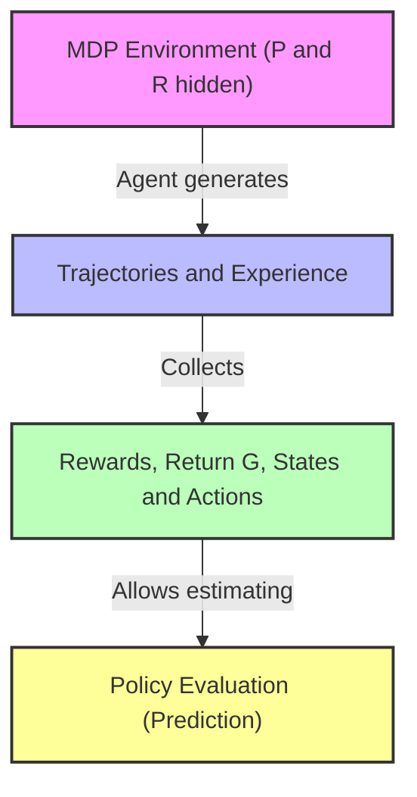
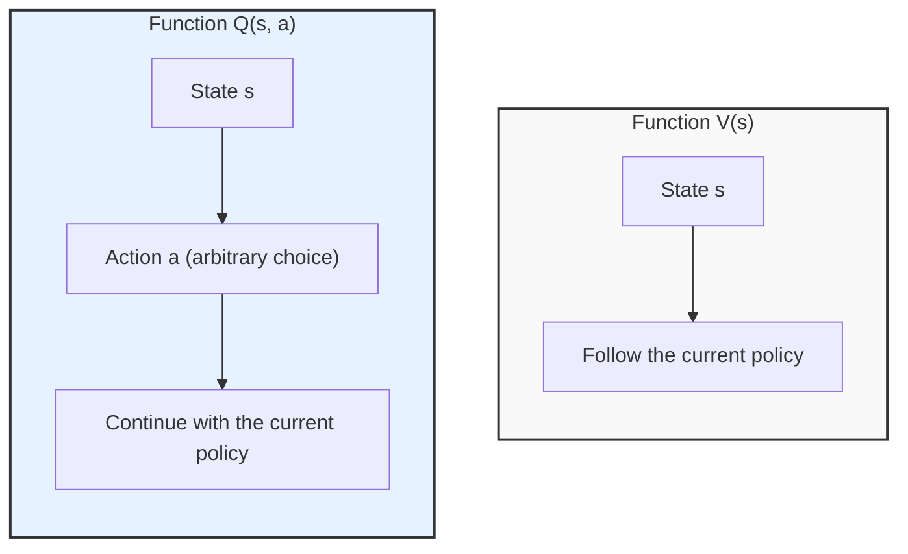
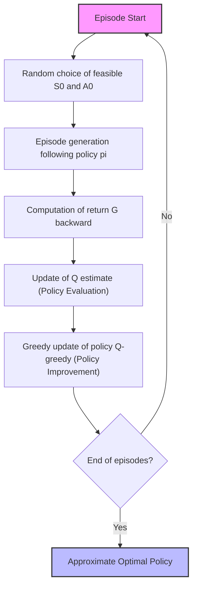
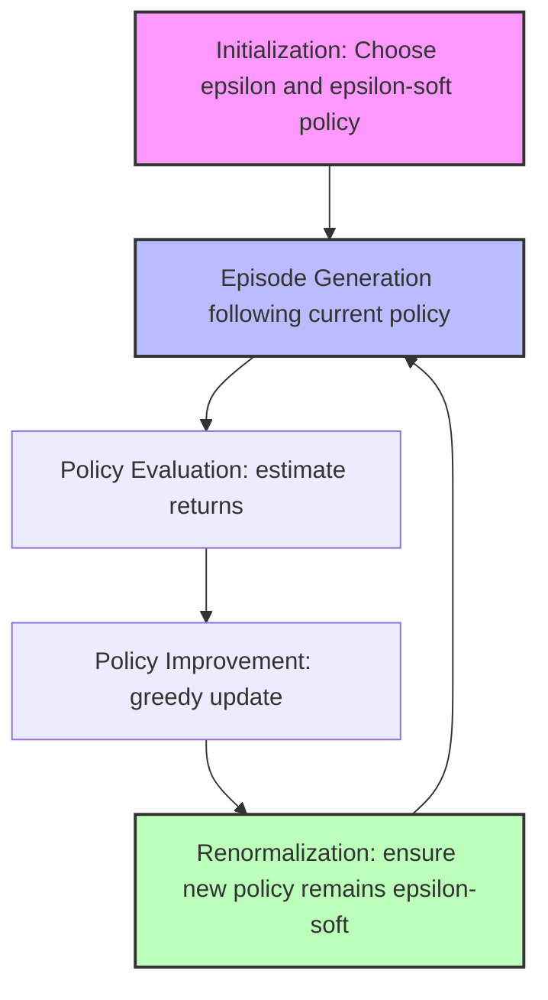
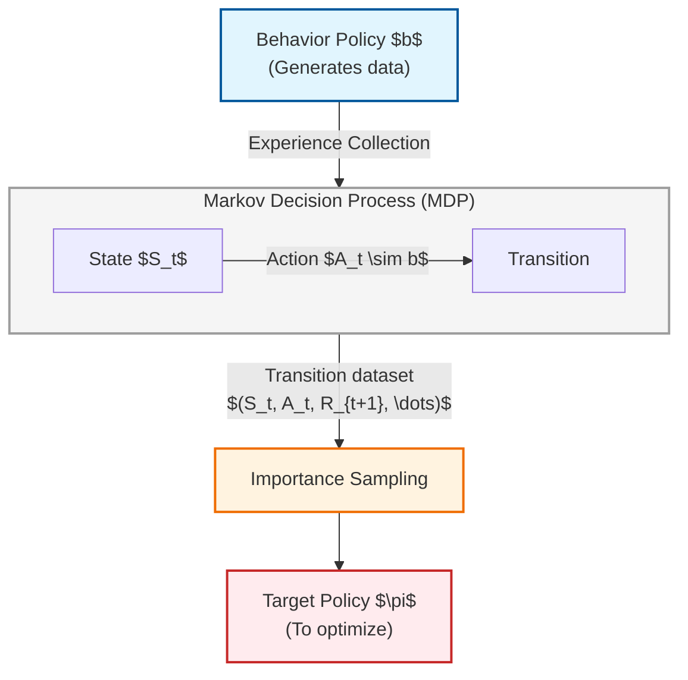
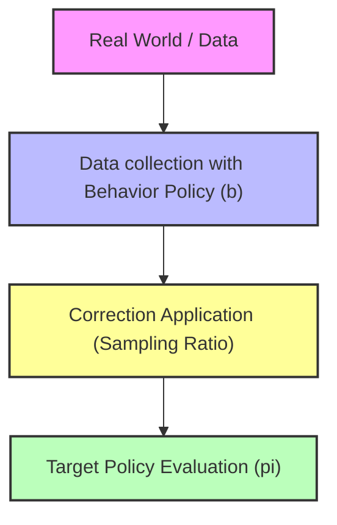

# Introduction to Full Reinforcement Learning: From Model-Based Control to Learning Through Experience

## Educational Overview
In this lecture, we officially introduce the **full Reinforcement Learning (RL)** problem, in which the agent no longer has access to a priori knowledge of fundamental environmental quantities: the transition probability matrix $P$ and the reward distribution $R$ (environment model). 

Despite the absence of the model, the **Markov Decision Process (MDP)** formalism remains the underlying theoretical reference framework. The agent interacts with the environment by collecting interaction sequences called **trajectories**, from which it observes states, actions, and rewards, accumulating **experience data**. 

A crucial concept emphasized by the instructor is that the goal of reinforcement learning is not to explicitly estimate $P$ and $R$ (as this is computationally too expensive and superfluous), but rather to directly derive an **optimal policy** ( $\pi^*$). 

To extend control to the model-free case, we attempt to exploit the **Generalized Policy Iteration (GPI)** framework previously seen in the context of Dynamic Programming. Although the prediction phase (evaluating a policy via methods such as **Monte Carlo**) is possible thanks to sample estimation of the expectations of the value functions $V^\pi$ and $Q^\pi$, structural criticalities emerge in the transition to optimization (policy improvement), since the greedy action usually requires knowledge of $P$.

---

### Introduction to Experience-Based Reinforcement Learning

In our study of Reinforcement Learning (RL), we finally make the leap to the full control problem. Let us briefly recap the previous lectures: so far, we have worked knowing two fundamental quantities of the environment, namely the transition probability matrix $P$ and the reward distribution $R$. 

In the context of real Reinforcement Learning, however, we abandon this assumption of perfect knowledge and must rely entirely on **experience** (experience data). This is why RL fully belongs to the domain of Machine Learning.

An important clarification must be made to avoid confusion: the Markov Decision Process (MDP) does not disappear. The MDP continues to exist and formally describe the environment, with its transitions and rewards. The crucial difference is that **we no longer see them**. 

The only things we have access to are **trajectories**. We observe the agent moving through the environment, accumulating:
* The rewards obtained along the way.
* The return $G$ (return).
* The state-action pairs and the resulting next states.

By accumulating multiple trajectories and experiences, we already have data-driven strategies, such as the **Monte Carlo** method, to solve the *prediction problem* (evaluating how good a certain policy is). However, we do not yet have a complete strategy to solve the *control problem*, that is, finding the optimal policy.

---

### The Paradigm Shift: From Expectations to Data

If we recall the Bellman equations used so far, you will notice that they contain many **expectations**. These stem directly from the very definition of the value functions $V$ (state-value function) and $Q$ (action-value function), defined as the expected return starting from a given state or a given state-action pair following a specific policy.

These quantities are central, and we have exploited them recursively thanks to Bellman equations. However, now that we no longer have access to $P$ and $R$, we cannot compute those expectations analytically. 

* **The solution:** We replace the analytical calculation of the expectation with a **sample estimate** based on sampled data. We collect the data, observe an empirical outcome, and use it as a *proxy* (approximation) of the true expectation.

#### A Fundamental Parallel with Multi-Armed Bandits
This approach recalls what was seen at the beginning of the course with *Multi-Armed Bandits* problems. In that case as well, we did not have the true probability distribution. 

::: andamento Nota: Concetto Chiave :::
> **Focus on the final goal:** The goal of RL is not to estimate $P$ and $R$. As with bandits, the goal is not to waste resources estimating the underlying probability distributions (an extremely expensive and inefficient process, especially in complex real-world contexts), but rather **to find an optimal policy directly** ($\pi^*$ - optimal policy).
> 
> Even though an imperfect estimate of $P$ and $R$ could theoretically allow us to derive an optimal policy, the computational and real-world cost (e.g., "burning money" or "failing with patients") is too high. We will therefore develop algorithms that bypass estimating $P$ and $R$ to aim directly at policy optimization.

---

### Limitations of Dynamic Programming and the Search for a Solution

In the context of **Dynamic Programming**, we had the tools to move from prediction to control. But Dynamic Programming requires exact knowledge of $P$ and $R$. 

Now that $P$ and $R$ are no longer available, we cannot apply dynamic programming in its classical form. However:
1. We know how to solve the prediction problem using data (e.g., via Monte Carlo approaches).
2. We know the general framework of **Generalized Policy Iteration (GPI)**.

Briefly recapping how GPI works:
* If we know how good a policy is ($\pi$), we can act greedily with respect to it to derive a new, improved policy ($\pi'$).
* We evaluate how good the new policy is $\pi'$.
* We repeat this cycle iteratively to converge to the optimal policy $\pi^*$.

We have seen several variants of this scheme:
* **Value Iteration**: An extremely greedy approach where short steps of evaluation and improvement are alternated.
* **Policy Iteration**: A version where the current policy is fully evaluated before moving to improvement.

The crucial question at this point is: *will this framework still work if we apply it in the full experience-based Reinforcement Learning setting?* 

Even though we do not have $P$ and $R$, we still have data and sample expectations. Even starting from an arbitrary policy $\pi$ , the presence of data allows us to take the first steps within the policy iteration cycle.

---

### The Limitation of the $V$ Function and the Shift to the $Q$

In the study of Reinforcement Learning (RL), we saw how applying the Generalized Policy Improvement framework might seem resolved in theory, but we run into a fundamental practical limitation when we do not know the model of the environment, namely the transition probabilities $P$ and the reward functions $R$.

Even if we are able to estimate the state-value function $V^\pi$ (State-Value Function) through experience (by collecting data and transition samples), we get stuck at the next step: to act greedily ($\text{greedy}$), that is, to derive a new improved policy $\pi'$, we need to identify which action, among all available ones, maximizes the expected return based on $V$. 

However, to do this, the transition again requires knowledge of $P$ and $R$:

$$ \pi'(s) = \arg\max_{a} \sum_{s', r} P(s', r \mid s, a) [r + \gamma V(s')] $$

Thus, we had solved half of the problem (estimation), but the other half remained blocked by the absence of the model. How do we overcome this hurdle? By exploiting another fundamental quantity: the action-value function $Q^\pi$ (Action-Value Function).

#### Difference between $V^\pi$ and $Q^\pi$
*   $V^\pi(s)$: Tells us, for a given state $s$, what the expected return is if we follow policy $\pi$.
*   $Q^\pi(s, a)$: Combines the state and a specific action $a$ (not necessarily the one suggested by the current policy), telling us what expected return we can achieve by taking that action in that state and *then* continuing to follow policy $\pi$.

The beauty of $Q^\pi(s,a)$ is that **it does not require knowledge of $P$ and $R$ to take the greedy action**. We can simply choose the action that maximizes $Q$ directly:

$$ \pi'(s) = \arg\max_{a} Q(s, a) $$

This makes $Q$ not only richer in information compared to $V$, but extremely **actionable** in the model-free context of Reinforcement Learning.

---

### The Exploration Challenge and the Data Problem

Now that we have decided to use $Q$, we must estimate it by collecting data from experience (experience in the form of trajectories). However, estimating $Q$ involves greater complexity compared to $V$:
*   The function $V(s)$ has the cardinality of the state space: $|S|$.
*   The function $Q(s, a)$ has the cardinality of the state space multiplied by that of the action space: $|S| \times |A|$.

Since the table (or matrix) to be estimated is much larger, we need **much more experience (data)** to obtain accurate estimates through the sample averages of the observed rewards.

#### The Exploration Problem
If our trajectories blindly follow a pure exploitation policy ($\text{exploitation}$), we risk never visiting certain state-action pairs $(s, a)$. Some actions will never be chosen from a given state, and some states might never be reached. 

Recalling the concept previously seen in *Multi-Armed Bandits*, managing the exploration-exploitation trade-off becomes crucial in a dynamic, sequential environment. We must find strategies to ensure that the agent explores the environment sufficiently.

---

### Exploration Strategy: Exploring Starts

A first and intuitive strategy to force exploration without continuously modifying the policy at every single step is the **Exploring Starts** method.

*   **How it works:** Instead of inserting a random exploration probability at every single step (as in the $\epsilon\text{-greedy}$approach), the *Exploring Starts* strategy requires that the trajectory begins by choosing the **first state-action pair $(S_0, A_0)$ completely at random** among all possible pairs in the space.
*   **Effect on the system:** We are not changing how the policy acts throughout the rest of the trajectory (it continues to follow its logic, e.g., always study or stick at 20 in blackjack), but we force data collection to start from points in the state-action space that might otherwise never have been reached.

Over time and with a sufficient number of episodes, random initialization guarantees that every pair $(s, a)$ is visited at least once, allowing the Monte Carlo method to compute a proper estimate of $Q(s, a)$.

---

### Summary of the Monte Carlo Exploring Starts Algorithm

By combining Monte Carlo estimation, the Exploring Starts policy, and Generalized Policy Improvement (GPI), we obtain a complete procedure to solve the optimal control problem (finding the optimal policy $\pi^*$).

The algorithm typically starts from:
1.  **Initialization:** An arbitrary initial policy $\pi$ is chosen (often random, if no a priori knowledge is available) and the values of the function $Q(s, a)$ are initialized arbitrarily or to zero for every state and action.
2.  **Trajectory generation:** An episode is started using the *Exploring Starts* technique (randomly sampling $S_0$ and $A_0$), and then continuing following policy $\pi$.
3.  **Evaluation and Improvement:** Empirical returns are computed to update the estimate of $Q$ and the policy is updated greedily with respect to $Q$.

---

### From Estimating $V$ to Estimating $Q$ in Monte Carlo Control

So far, we have analyzed prediction problems, focusing on estimating the state-value function $V$. In the context of control, however, the main objective is to find an optimal policy. To do this without knowing the environment model (namely the transition probabilities $P$ and reward functions $R$), we need to estimate the **action-value function** ($Q$-function, *Action-Value Function*). 

Knowing $Q(s, a)$ indeed allows us to improve the policy by acting greedily with respect to it, even in the absence of an exact model of the environment.

#### Data Organization and Episode Loop
Unlike dynamic programming (*Dynamic Programming*), where the update loop systematically explores all states $S$ or state-action pairs $(S, A)$, in experience-based Monte Carlo methods the loop is driven by data collected during episodes:
1. **Trajectory initialization**: An initial pair is chosen, formed by a state $S_0$ and an action $A_0$ taken randomly among those *feasible* for that state ($A_0 \in \mathcal{A}(S_0)$).
   * *Note on infeasible actions*: If we are near a "wall" or in a state where certain moves are illegal, the action is infeasible and does not require estimation. To exclude it from an argmax operator ($\arg\max$), an extremely low numerical value is assigned to that pair (e.g., $-\infty$ or $-1.000.000$).
2. **Episode generation**: An entire episode is generated starting from $(S_0, A_0)$ strictly following the current policy $\pi$.
3. **Backward Update**: To maximize computational efficiency, the computation of the total return $G_t$ is performed moving backward, from the final time step to the initial one.

#### Algorithm Variants: First-Visit vs Every-Visit
Different versions of the code exist depending on how visits to states/actions within the same episode are handled:
* **First-Visit Monte Carlo**: Updates the estimate of $Q(s,a)$ considering only the *first* time the state-action pair is visited in an episode.
* **Every-Visit Monte Carlo**: Averages the returns of *all* visits to the same pair $(s,a)$ within the same episode. This version is obtained simply by removing the first-visit checking condition.

#### Logical Scheme of the Monte Carlo Control Algorithm

---

### Practical Application: Blackjack

To understand the practical effectiveness of these methods, we return to the **Blackjack** problem introduced in the previous lecture.

#### 1. Failure of the Naive Policy
In the previous lecture, we evaluated a very simple (and rather naive) policy: stick if the card total is 20 or 21, and hit for any value equal to or less than 19, regardless of the dealer's cards. Monte Carlo simulations demonstrated that this strategy leads to losing money in the long run.

#### 2. Formalization of State and Action Spaces
To find an optimal policy, we rigorously define the elements of the problem:
* **State Space ($\mathcal{S}$)**:
  * The player's card sum (from 12 to 21; for values below 12 it is always advantageous to hit).
  * The dealer's showing card (from 1 to 10).
  * Usable ace: a boolean variable indicating whether the player holds an ace that can count as 11 without busting, or whether it is already committed to counting as 1.
  * *Note on the deck*: For simplicity, it is assumed that each drawn card is replaced into the deck (*with replacement*), making probabilities stationary and preventing card counting.
* **Action Space ($\mathcal{A}$)**: 
  * $\text{Hit}$ (hit)
  * $\text{Stick}$ (stick)

#### 3. Handling Exploring Starts in Blackjack
In pure Blackjack, we cannot arbitrarily choose the initial state $S_0$ (our card sum and the dealer's card are determined by the random distribution of the initial deal). However, by playing a sufficiently large number of games, the intrinsic randomness of the game drives us to visit a huge variety of different states. We can therefore consider the *Exploring Starts* condition satisfied thanks to the stochastic nature of the environment.

#### 4. Optimization Result ($\pi^*$)
Applying the Monte Carlo control algorithm, the resulting optimal policy becomes much more sophisticated than the naive initial strategy: for example, if the player holds a usable ace, the optimal strategy advises sticking for higher or different totals compared to a hand without a usable ace.

---

### Limitations of Epsilon-Soft Policies and the Transition to Off-Policy Methods

Returning to the analysis of Blackjack, the results obtained via Reinforcement Learning (RL) algorithms confirm and closely replicate the strategies developed over decades by expert players and documented in dedicated literature. Unlike extremely complex problems such as the game of *Go* — where advanced systems like AlphaGo and AlphaZero discovered moves and strategies unprecedented in human history — in more constrained settings RL rediscovers already known knowledge.

However, analyzing expected returns reveals a sobering fact: even when adopting the optimal policy, the long-term expected value in Blackjack remains negative. The house holds a structural advantage, which is why, statistically, the casino always tends to win.

---

### Beyond Random Initialization: The Spurious Start Problem

In the preceding paragraphs, we introduced the assumption of an exploring / spurious start (*spurious start*), namely the ability to start an episode from any state-action pair $(S, A)$ to guarantee exploration. In the real world, however, this assumption is often unfeasible:
* **Financial portfolio management:** It is not possible in the real world to find oneself with an arbitrary initial capital of 2 billion dollars if one is in a financial start-up phase.
* **Autonomous driving:** It is not possible to force a vehicle to start its execution already moving at a constant speed of $100\text{ km/h}$ right at the initial instant of the episode; such a condition can arise *during* the episode, not as an enforced starting point.

To overcome this limitation and ensure continuous exploration without relying on forced starts, we can relax the requirement by spreading exploration throughout the entire duration of the episode, echoing the approach previously seen for multi-armed bandits.

---

### Soft Policies and $\epsilon$-Soft Policies

To formalize continuous exploration throughout the entire episode, we introduce some fundamental definitions:

* **Soft Policy:** A stochastic policy is called *soft* if it assigns a non-zero probability to all possible actions in any state:
  $$\pi(a|s) > 0 \quad \forall s \in \mathcal{S}, \forall a \in \mathcal{A}(s)$$
* ** $\epsilon$-Soft Policy ($\epsilon$-soft policy):** It is a special soft policy where the probability of selecting any legal action in a given state is constrained to be at least equal to a small fraction $\epsilon$. Formally, for a given state $s$ and a set of admissible actions $\mathcal{A}(s)$ of cardinality $|\mathcal{A}(s)|$, the policy satisfies:
  $$\pi(a|s) \ge \frac{\epsilon}{|\mathcal{A}(s)|} \quad \forall a \in \mathcal{A}(s)$$

This normalized formulation ensures that, at any instant, there exists a minimum probability equal to $\epsilon$ of taking an exploratory action other than the greedy one, while preserving a consistent policy structure.

---

### Monte Carlo Control Algorithm with $\epsilon$-Soft Policies

By leveraging an $\epsilon$-Soft policy, we modify the Monte Carlo control algorithm by removing the need for exploring/spurious starts. 

* **Initialization Phase:** A parameter $\epsilon \in (0, 1)$ that balances the trade-off between exploration and exploitation, and the policy $\pi$ is initialized, ensuring it is of $\epsilon$-soft type.
* **Episode Generation:** The episode is generated directly following the $\epsilon$-soft policy $\pi$. It is no longer necessary to manually force initial random actions, since the very nature of the policy guarantees intrinsic exploratory coverage throughout the entire trajectory.
* **Evaluation and Improvement:** One proceeds with value estimation (policy evaluation) and subsequent policy update (policy improvement) greedily with respect to the estimated values, while applying the $\epsilon$-soft normalization to the newly generated policy $\pi'$ .

---

### The Optimality Dilemma with Continuous Exploration

**Key Concept:** *The perpetual use of an $\epsilon$-soft policy prevents the agent from converging to the strictly optimal policy.*

If we maintain constant exploration ($\epsilon > 0$) to ensure that the agent keeps collecting data and exploring, the algorithm will never stabilize on the 100% optimal solution. Even having identified the absolute best action, the presence of the $\epsilon$ component will force the agent to periodically take sub-optimal actions with a small probability.

This fundamental trade-off leads us to distinguish between two needs:
1. **Continuously explore** to discover hidden dynamics of the environment (essential in stochastic or non-stationary environments that change over time).
2. **Exploit** the acquired knowledge ($\epsilon \to 0$ over time) to achieve optimal performance once the environment is thoroughly understood. 

In most of the problems addressed in this course, the ultimate goal requires progressively eliminating exploration to reach optimal convergence.

---

### Foundations of Off-Policy Methods and Introduction to Importance Sampling

Up to now, we have focused exclusively on **on-policy** approaches ("learning on the job"). In an on-policy setting, the generation of experience (the data collected by the agent) and the policy we seek to optimize coincide. However, to overcome the limitations related to the need to continuously explore the environment (which often prevents a policy from becoming optimal or introduces inefficiencies), we introduce the family of **off-policy** methods.

#### The Off-Policy Approach
The core idea behind off-policy is similar to "looking over someone else's shoulder": we use data generated by one policy to improve a *different* one. To manage this distinction, we introduce two different policies and a consistent color coding:

*   **Target Policy ( $\pi$):** Represented in orange. It is the policy that we want to evaluate and improve over time (our true goal).
*   **Behavior Policy ( $b$):** Represented in light blue/green. It is the policy actually followed by the agent interacting with the environment and collecting data (experience).

##### Why Use an Off-Policy Approach?
1.  **Separation between exploration and optimization:** We can assign complex exploration tasks to the behavior policy $b$, while the target policy $\pi$ can become deterministic and aim directly for optimality.
2.  **Data reuse (Data Efficiency):** In the real world, data is scarce and expensive. Exploiting past experience (even generated by different agents or humans, such as watching other players at a blackjack table without betting money) allows learning without wasting resources.
3.  **Avoiding discarding data:** With on-policy methods, every time we update the policy ($\pi \to \pi'$), past experience becomes obsolete because it was based on the old policy. With off-policy, we can reuse the same historical data to update different policies.
4.  **Multi-objective learning:** From the same dataset, we can simultaneously train policies with different objectives (e.g., a policy to drive as fast as possible and an extremely safe policy).

---

### The Three Fundamental Requirements for Off-Policy

To successfully apply off-policy methods, we need three fundamental elements. Two are conceptually "gentle" and intuitive, the third is technically more complex:

1.  **Knowledge of the Target Policy ($\pi$):** We must know the probability with which the target policy selects actions (standard assumption).
2.  **Knowledge of the Behavior Policy ($b$):** We must know the probability distribution followed by the agent that collected the data.
3.  **Coverage:** This requirement is crucial both conceptually and mathematically. If the target policy $\pi$ assigns a non-zero probability to an action in a given state, the behavior policy $b$ must also have a non-zero probability of choosing that same action:
    $$\pi(a \mid s) > 0 \implies b(a \mid s) > 0$$
    *Key concept:* If the behavior policy never takes a certain action, we will never be able to observe data regarding it, making it impossible to evaluate or improve it for our target policy.

---

### Importance Sampling

The third element, the one that is not "gentle", is **Importance Sampling**. 

This is a general technique for estimating the expected value (expectation) of a probability distribution when the available data has been sampled from a different distribution. In our case, we want to estimate returns according to policy $\pi$, but the data is generated by $b$.

#### Mathematical Derivation
Suppose we want to estimate the expected value of a quantity (typically the return) under policy $\pi$. By definition of expected value, we write:

$$\mathbb{E}_{\pi}[X]$$

The Importance Sampling trick consists in multiplying and dividing by the probability generated by the behavior policy $b$:

$$\mathbb{E}_{\pi}[X] = \sum_{x} P(x; \pi) X(x)$$

By introducing and manipulating the probabilities of the trajectories generated by the two policies, we obtain a ratio, called the **Importance Sampling Ratio ($\rho$)**:

$$\rho_t = \frac{\text{Probabilità della traiettoria sotto } \pi}{\text{Probabilità della traiettoria sotto } b}$$

More formally, expressing the ratio between the target policy and the behavior policy:

$$\rho = \frac{\pi(A_t \mid S_t)}{b(A_t \mid S_t)}$$

Rewriting the expectation, we can shift the statistical reference directly to the distribution of the behavior policy $b$:

$$\mathbb{E}_{\pi}[V(s)] = \mathbb{E}_{b} \left[ \rho \cdot V(s) \right]$$

#### Practical Interpretation
*   At an operational level, we are computing averages over the data collected with $b$, but we weight each sample by multiplying it by the correction factor $\rho$.
*   If an action is very likely under $\pi$ but rare under $b$, its weight $\rho$ will be large to correct the estimate.
*   The coverage requirement ($b(a \mid s) > 0$) prevents division by zero within the ratio $\rho$.

---

### LECTURE SUMMARY

#### Practical Application of Importance Sampling

In this final section, the instructor revisits the concept of correction via the importance sampling ratio and applies it through a numerical example in a setting similar to a bandit problem (Multi-Armed Bandit), which forms the foundation for the future extension to full Reinforcement Learning problems.

The fundamental problem addressed is the discrepancy between the policy we use to collect data in the real world (the **behavior policy**, $b$) and the policy we want to optimize and evaluate (the **target policy**, $\pi$).

---

#### Numerical Correction Example

Let us imagine being in a context where we collect data following the behavior policy $b$, but we want to estimate the expected value according to our target policy $\pi$.

##### First step (First collected data point):
- We take an action (e.g., pull lever 1) and obtain a return equal to $R = 1$.
- To correct this estimate and make it consistent with the target policy $\pi$, we must apply the correction factor based on the probabilities of choosing the action under the two different policies.

Suppose the probabilities are:
- Probability under the target policy: $\pi(\text{azione} \mid \text{stato}) = 0.3$
- Probability under the behavior policy: $b(\text{azione} \mid \text{stato}) = 0.85$

Even though we obtained a good return ($+1$), this specific action is *less likely* under our target policy than under the behavior policy. Consequently, the weight of this return in the overall estimate must be downweighted, since the target policy would have chosen that action with a lower frequency.

##### Second step:
Consider a second example where another action is taken, generating a return equal to $3$, which is executed by the behavior policy with a certain probability. If this action is even more unbalanced in the ratio between the two policies, the correction factor (the ratio $\frac{\pi}{b}$) will change accordingly. Averaging these values over time allows us to correctly estimate the expected return for policy $\pi$ while using data sampled from $b$.

---

#### Extension to Full Reinforcement Learning

> [!IMPORTANT]
> **Key Concept:** The use of the importance sampling ratio is not limited to single isolated events (as in *bandits*), but **must be applied step by step for each individual step within a given trajectory**.

In full Reinforcement Learning, an experience consists of a sequence of transitions:
$$\text{stato, azione, ricompensa } (S_t, A_t, R_{t+1}, S_{t+1}, \dots)$$

Since actions within the trajectory are taken following policy $b$ (to explore), but we want to evaluate policy $\pi$, at each individual time step we will need to consider the probability ratio between the two policies. This topic will be revisited and expanded upon in the next lecture to formalize the computation along an entire trajectory.