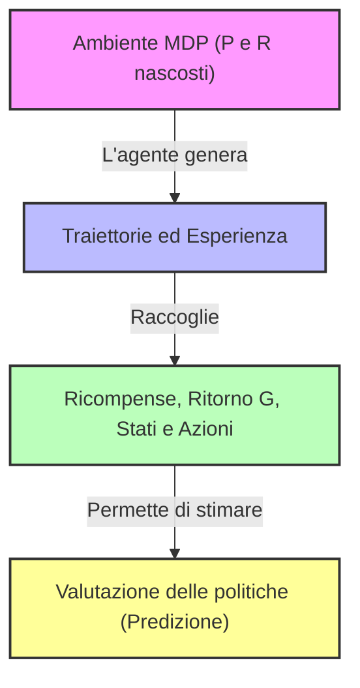
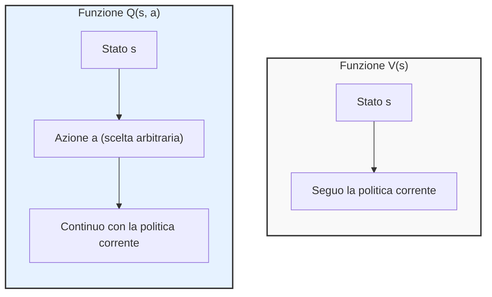
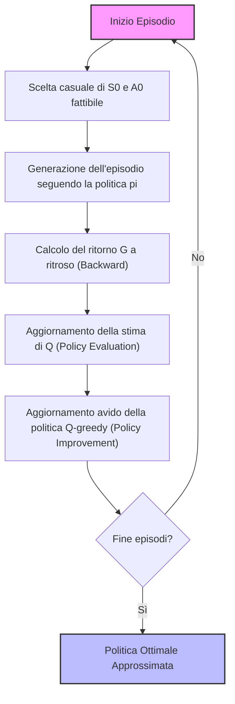
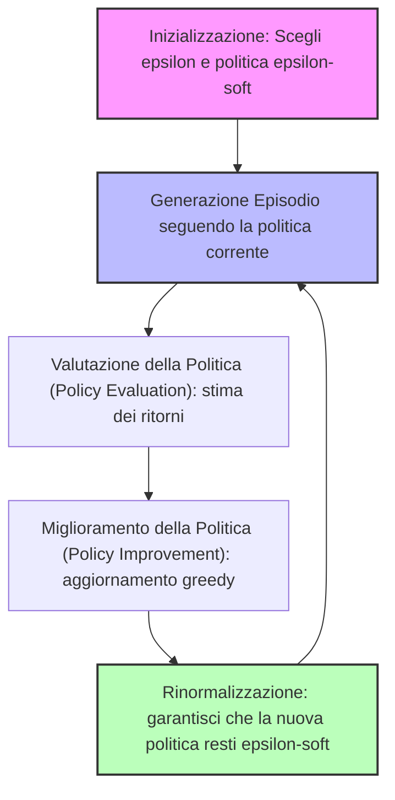
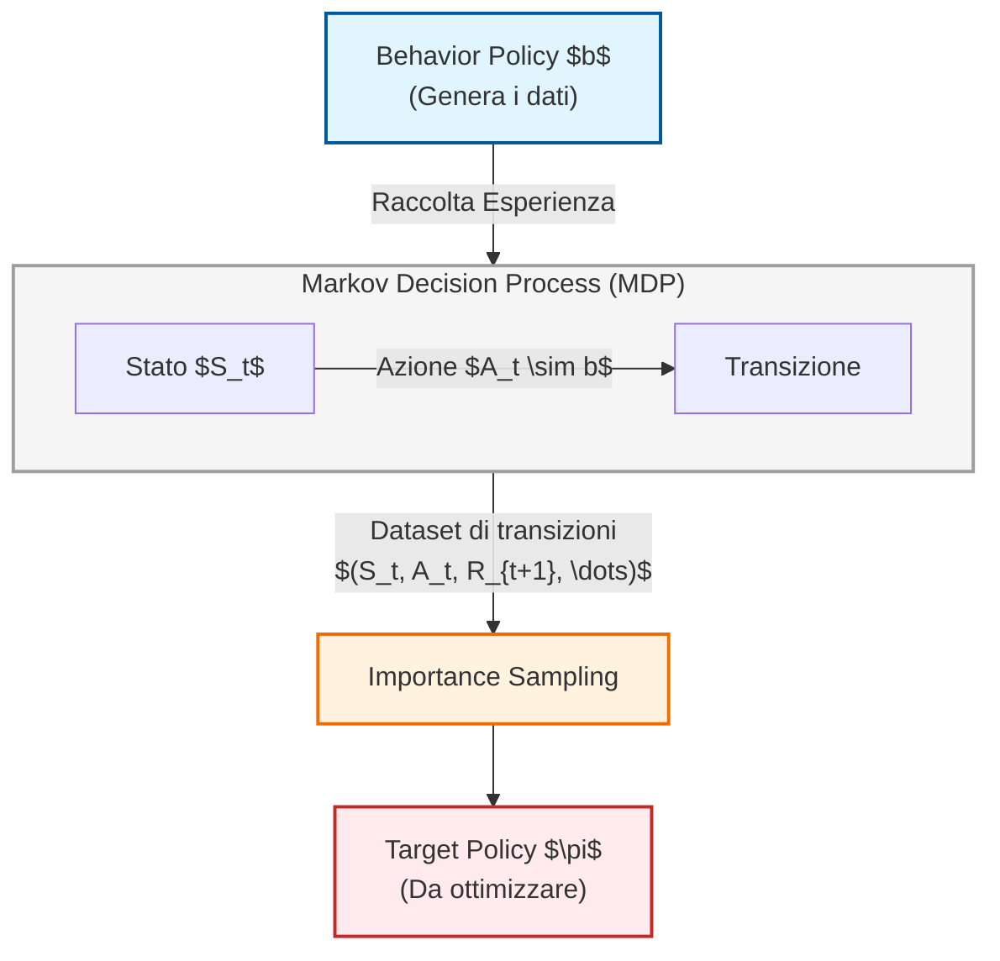
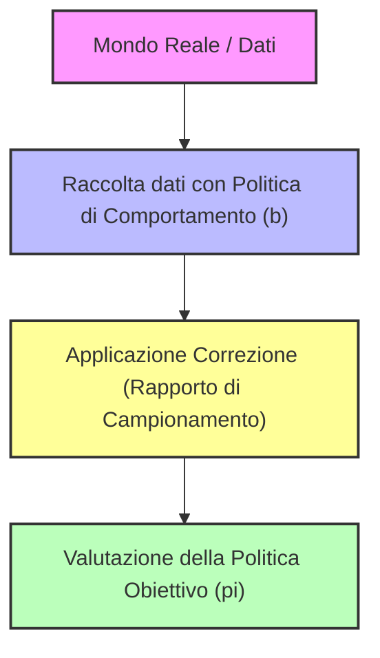

# Introduzione al Reinforcement Learning Completo: Dal Controllo basato su Modello all'Apprendimento tramite Esperienza

## Overview Didattica
In questa lezione si introduce ufficialmente il problema del **Reinforcement Learning (RL) completo**, in cui l'agente non ha più accesso a conoscenza a priori delle quantità ambientali fondamentali: la matrice di probabilità di transizione $P$ e la distribuzione delle ricompense $R$ (modello dell'ambiente). 

Nonostante l'assenza del modello, il formalismo del **Processo Decisionale di Markov (Markov Decision Process - MDP)** rimane il framework teorico di riferimento sottostante. L'agente interagisce con l'ambiente raccogliendo sequenze di interazione denominate **traiettorie** (*trajectories*), dalle quali osserva stati, azioni e ricompense, accumulando **esperienza** (*experience data*). 

Un concetto cruciale ribadito dal docente è che l'obiettivo del reinforcement learning non è stimare esplicitamente $P$ ed $R$ (poiché computazionalmente troppo costoso e superfluo), bensì derivare direttamente una **politica ottimale** (*optimal policy*, $\pi^*$). 

Per estendere il controllo al caso privo di modello, si tenta di sfruttare il framework di **Generalized Policy Iteration (GPI)** già visto nel contesto della Programmazione Dinamica (*Dynamic Programming*). Sebbene la fase di predizione (valutazione di una politica tramite metodi come **Monte Carlo**) sia possibile grazie alla stima campionaria delle aspettative delle funzioni di valore $V^\pi$ e $Q^\pi$, emergono criticità strutturali nel passaggio all'ottimizzazione (miglioramento della politica), poiché l'azione golosa (*greedy action*) richiede solitamente la conoscenza di $P$.

---

### Introduzione al Reinforcement Learning Basato sull'Esperienza

Nel percorso di studio del Reinforcement Learning (Apprendimento per Rinforzo, RL), affrontiamo finalmente il salto verso il problema di controllo completo. Facciamo un breve ricapito delle puntate precedenti: finora abbiamo lavorato conoscendo due quantità fondamentali dell'ambiente, ovvero la matrice delle probabilità di transizione $P$ e la distribuzione delle ricompense $R$. 

Nel contesto del Reinforcement Learning reale, invece, abbandoniamo questa ipotesi di conoscenza perfetta e dobbiamo affidarci interamente all'**esperienza** (experience data). Questo è il motivo per cui il RL rientra a pieno titolo nell'area del Machine Learning (Apprendimento Automatico).

Va fatta una precisazione importante per evitare confusione: il Modello di Decisione di Markov (Markov Decision Process, MDP) non scompare. L'MDP continua a esistere e a descrivere formalmente l'ambiente, con le sue transizioni e le sue ricompense. La differenza cruciale è che **noi non le vediamo più**. 

L'unica cosa a cui abbiamo accesso sono le **traiettorie** (trajectories). Osserviamo l'agente che si muove nell'ambiente accumulando:
* Le ricompense ottenute lungo il cammino.
* Il ritorno $G$ (return).
* Le coppie di stato-azione e i conseguenti stati successivi.

Accumulando molteplici traiettorie ed esperienze, disponiamo già di strategie basate sui dati, come il metodo **Monte Carlo**, per risolvere il *problema della predizione* (valutare quanto sia buona una certa politica). Tuttavia, non abbiamo ancora una strategia completa per risolvere il *problema del controllo*, ovvero trovare la politica ottimale.

---

### Il Cambiamento di Paradigma: Dalle Aspettative ai Dati

Se ripensiamo alle equazioni di Bellman che abbiamo usato finora, noterete che contengono molte **aspettative** (expectations). Queste derivano direttamente dalla definizione stessa delle funzioni di valore $V$ (state-value function) e $Q$ (action-value function), definite come il ritorno atteso a partire da un certo stato o da una certa coppia stato-azione seguendo una determinata politica.

Queste quantità sono centrali e le abbiamo sfruttate in modo ricorsivo grazie alle equazioni di Bellman. Tuttavia, ora che non abbiamo più accesso a $P$ e $R$, non possiamo calcolare analiticamente quelle aspettative. 

* **La soluzione:** Sostituiamo il calcolo analitico dell'aspettativa con una sua **stima semplificata** basata sui dati campionati. Raccogliamo i dati, osserviamo un risultato empirico e lo usiamo come *proxy* (approssimazione) della vera aspettativa.

#### Un parallelismo fondamentale con i Multi-Armed Bandits
Questo approccio richiama quanto visto all'inizio del corso con i problemi dei *Banditi Armati* (Multi-Armed Bandits). Anche in quel caso non avevamo la distribuzione di probabilità vera. 

::: andamento Nota: Concetto Chiave :::
> **Attenzione all'obiettivo finale:** L'obiettivo del RL non è stimare $P$ e $R$. Come nei banditi, l'obiettivo non è sprecare risorse per stimare le distribuzioni di probabilità sottostanti (un processo estremamente costoso e inefficiente, specialmente in contesti reali complessi), bensì **trovare direttamente una politica ottimale** ($\pi^*$ - optimal policy).
> 
> Anche se una stima imperfetta di $P$ e $R$ potrebbe teoricamente permetterci di ricavare una politica ottimale, il costo computazionale e reale (es. "bruciare monete" o "fallire con i pazienti") è troppo elevato. Svilupperemo quindi algoritmi che saltano la stima di $P$ e $R$ per puntare dritti all'ottimizzazione della politica.

---

### Limiti della Programmazione Dinamica e la Ricerca di una Soluzione

Nel contesto della **Programmazione Dinamica** (Dynamic Programming), avevamo a disposizione gli strumenti per passare dalla predizione al controllo. Ma la Programmazione Dinamica richiede la conoscenza esatta di $P$ e $R$. 

Ora che $P$ e $R$ non ci sono più, non possiamo applicare la programmazione dinamica nella sua forma classica. Tuttavia:
1. Sappiamo come risolvere il problema della predizione usando i dati (es. tramite approcci Monte Carlo).
2. Conosciamo il framework generale della **Generalized Policy Iteration (GPI)**.

Ricapitolando brevemente come funziona la GPI:
* Se sappiamo quanto è buona una politica ($\pi$), possiamo agire in modo goloso (*greedy*) rispetto a essa per derivare una nuova politica migliorata ($\pi'$).
* Valutiamo quanto sia buona la nuova politica $\pi'$.
* Ripetiamo questo ciclo iterativamente per convergere alla politica ottimale $\pi^*$.

Abbiamo visto diverse varianti di questo schema:
* **Value Iteration**: Un approccio estremamente greedy in cui si alternano passi ridotti di valutazione e miglioramento.
* **Policy Iteration**: Una versione in cui si stima completamente la politica corrente prima di passare al miglioramento.

La domanda cruciale a questo punto è: *questo framework funzionerà ancora se lo applichiamo nel setting completo di Reinforcement Learning basato sull'esperienza?* 

Anche se non disponiamo di $P$ e $R$, disponiamo comunque dei dati e delle aspettative campionarie. Anche partendo da una politica $\pi$ qualsiasi, la presenza di dati ci permette di compiere i primi passi all'interno del ciclo di iterazione della politica.

---

### Il Limite della Funzione $V$ e il Passaggio alla Funzione $Q$

Nello studio del Reinforcement Learning (RL), avevamo visto come applicare il framework di miglioramento della politica (Generalized Policy Improvement) potesse sembrare risolto in teoria, ma ci scontriamo con un limite pratico fondamentale quando non conosciamo il modello dell'ambiente, ovvero le probabilità di transizione $P$ e le funzioni di ricompensa $R$.

Anche se riusciamo a stimare la funzione di valore dello stato $V^\pi$ (State-Value Function) tramite l'esperienza (raccogliendo dati e trappole di transizione), ci bloccamo al passo successivo: per agire in modo goloso ($\text{greedy}$), cioè per derivare una nuova politica migliorata $\pi'$, abbiamo bisogno di identificare quale azione, tra tutte quelle disponibili, massimizzi il rendimento atteso basandosi su $V$. 

Ma per fare questo, la transizione richiede nuovamente la conoscenza di $P$ e $R$:

$$ \pi'(s) = \arg\max_{a} \sum_{s', r} P(s', r \mid s, a) [r + \gamma V(s')] $$

Quindi, avevamo risolto metà del problema (la stima), ma l'altra metà rimaneva bloccata dall'assenza del modello. Come si supera questo scoglio? Sfruttando un'altra quantità fondamentale: la funzione di valore stato-azione $Q^\pi$ (Action-Value Function).

#### Differenza tra $V^\pi$ e $Q^\pi$
*   $V^\pi(s)$: Ci dice, per un dato stato $s$, quale sia il rendimento atteso se seguiamo la politica $\pi$.
*   $Q^\pi(s, a)$: Combina lo stato e una specifica azione $a$ (non necessariamente quella suggerita dalla politica corrente), dicendoci quale rendimento atteso possiamo ottenere compiendo quell'azione in quello stato e *poi* continuando a seguire la politica $\pi$.

La bellezza di $Q^\pi(s,a)$ è che **non richiede la conoscenza di $P$ e $R$ per compiere l'azione greedy**. Possiamo semplicemente scegliere l'azione che massimizza $Q$ direttamente:

$$ \pi'(s) = \arg\max_{a} Q(s, a) $$

Questo rende $Q$ non solo più ricca di informazioni rispetto a $V$, ma estremamente **operativa** nel contesto model-free del Reinforcement Learning.

---

### La Sfida dell'Esplorazione e il Problema dei Dati

Ora che abbiamo deciso di utilizzare $Q$, dobbiamo stimarla raccogliendo dati dall'esperienza (esperienza sotto forma di traiettorie). Tuttavia, stimare $Q$ comporta una complessità maggiore rispetto a $V$:
*   La funzione $V(s)$ ha la cardinalità dello spazio degli stati: $|S|$.
*   La funzione $Q(s, a)$ ha la cardinalità dello spazio degli stati moltiplicata per quella dello spazio delle azioni: $|S| \times |A|$.

Poiché la tabella (o matrice) da stimare è molto più grande, abbiamo bisogno di **molta più esperienza (dati)** per ottenere stime accurate tramite le medie delle ricompense osservate.

#### Il problema dell'esplorazione (Exploration Problem)
Se le nostre traiettorie seguono ciecamente una politica di puro sfruttamento ($\text{exploitation}$), rischieremo di non visitare mai determinate coppie stato-azione $(s, a)$. Alcune azioni non verranno mai scelte da un dato stato, e alcuni stati potrebbero non essere mai raggiunti. 

Riprendendo il concetto già visto nei *Multi-Armed Bandits*, la gestione del compromesso tra esplorazione e sfruttamento diventa cruciale in un ambiente dinamico e sequenziale. Dobbiamo trovare strategie per garantire che l'agente esplori l'ambiente a sufficienza.

---

### Strategia di Esplorazione: Exploring Starts

Una prima e intuitiva strategia per forzare l'esplorazione senza modificare continuamente la politica a ogni singolo passo è il metodo **Exploring Starts**.

*   **Come funziona:** Invece di inserire una probabilità di esplorazione casuale a ogni singolo passo (come avviene nell'approccio $\epsilon\text{-greedy}$), la strategia degli *Exploring Starts* impone che la traiettoria inizi scegliendo la **prima coppia stato-azione $(S_0, A_0)$ in modo del tutto casuale** tra tutte le coppie possibili nello spazio.
*   **Effetto sul sistema:** Non stiamo cambiando il modo in cui la politica agisce nel resto della traiettoria (quella continua a seguire la sua logica, es. studiare sempre o fermarsi a 20 a blackjack), ma forziamo l'avvio della raccolta dati da punti nello spazio stato-azione che altrimenti potrebbero non essere mai stati toccati.

Col passare del tempo e con un numero sufficiente di episodi, l'inizializzazione casuale garantisce che ogni coppia $(s, a)$ venga visitata almeno una volta, permettendo al metodo Monte Carlo di calcolare una stima corretta di $Q(s, a)$.

---

### Sintesi dell'Algoritmo Monte Carlo Exploring Starts

Unendo la stima basata su Monte Carlo, la politica di Exploring Starts e il Generalized Policy Improvement (GPI), otteniamo una procedura completa per risolvere il problema di controllo ottimo (trovare la politica ottima $\pi^*$).

L'algoritmo parte tipicamente da:
1.  **Inizializzazione:** Si sceglie una politica iniziale arbitraria $\pi$ (spesso casuale, se non si dispone di conoscenza a priori) e si inizializzano a piacimento o a zero i valori della funzione $Q(s, a)$ per ogni stato e azione.
2.  **Generazione della traiettoria:** Si avvia un episodio utilizzando la tecnica degli *Exploring Starts* (campionando casualmente $S_0$ e $A_0$), e proseguendo poi seguendo la politica $\pi$.
3.  **Valutazione e Miglioramento:** Si calcolano i ritorni empirici per aggiornare la stima di $Q$ e si aggiorna la politica in modo greedy rispetto a $Q$.

---

### Dalla stima di $V$ alla stima di $Q$ nel Controllo Monte Carlo

Finora abbiamo analizzato problemi di predizione, concentrandoci sulla stima della funzione di valore dello stato $V$. Nel contesto del controllo, tuttavia, l'obiettivo principale è trovare una politica ottimale. Per farlo senza conoscere il modello dell'ambiente (ovvero le probabilità di transizione $P$ e le funzioni di ricompensa $R$), abbiamo bisogno di stimare la **funzione di valore azione-stato** ($Q$-function, *Action-Value Function*). 

Conoscere $Q(s, a)$ ci permette infatti di migliorare la politica agendo in modo avido (*greedy*) rispetto ad essa, anche in assenza di un modello esatto dell'ambiente.

#### Organizzazione dei dati e ciclo dell'episodio
A differenza della programmazione dinamica (*Dynamic Programming*), dove il ciclo di aggiornamento esplora sistematicamente tutti gli stati $S$ o le coppie stato-azione $(S, A)$, nel metodo Monte Carlo basato sull'esperienza il ciclo è guidato dai dati raccolti durante gli episodi:
1. **Inizializzazione della traiettoria**: Si sceglie una coppia iniziale formata da uno stato $S_0$ e da un'azione $A_0$ presa casualmente tra quelle *fattibili* per quello stato ($A_0 \in \mathcal{A}(S_0)$).
   * *Nota sulle azioni non fattibili*: Se ci troviamo in prossimità di un "muro" o in uno stato in cui certe mosse sono illegali, l'azione non è fattibile e non richiede stima. Per escluderla da un operatore di massimo ($\arg\max$), si assegna a quella coppia un valore numerico estremamente basso (es. $-\infty$ o $-1.000.000$).
2. **Generazione dell'episodio**: Si genera un intero episodio partendo da $(S_0, A_0)$ seguendo rigorosamente la politica corrente $\pi$.
3. **Aggiornamento a ritroso (*Backward Update*)**: Per massimizzare l'efficienza computazionale, il calcolo del ritorno totale $G_t$ viene eseguito muovendosi a ritroso, dall'ultimo passo temporale fino a quello iniziale.

#### Varianti dell'algoritmo: First-Visit vs Every-Visit
Esistono diverse versioni del codice a seconda di come vengono gestite le visite agli stati/azioni all'interno dello stesso episodio:
* **First-Visit Monte Carlo**: Aggiorna la stima di $Q(s,a)$ considerando solo la *prima* volta che la coppia stato-azione viene visitata in un episodio.
* **Every-Visit Monte Carlo**: Media i ritorni di *tutte* le visite alla stessa coppia $(s,a)$ all'interno dello stesso episodio. Questa versione si ottiene semplicemente rimuovendo la condizione di controllo della prima visita.

#### Schema logico dell'algoritmo di Controllo Monte Carlo

---

### Applicazione pratica: Il Blackjack

Per capire l'efficacia pratica di questi metodi, riprendiamo il problema del **Blackjack** introdotto nella lezione precedente.

#### 1. Fallimento della politica ingenua
Nel corso precedente avevamo valutato una politica molto semplice (e piuttosto "stupi*da*"): fermarsi (*stick*) se il totale delle carte è 20 o 21, e chiedere un'altra carta (*hit*) per qualsiasi valore pari o inferiore a 19, indipendentemente dalle carte del banco. Le simulazioni Monte Carlo hanno dimostrato che questa strategia porta a perdere denaro sul lungo periodo.

#### 2. Formalizzazione dello Spazio degli Stati e delle Azioni
Per trovare una politica ottimale, definiamo rigorosamente gli elementi del problema:
* **Spazio degli Stati ($\mathcal{S}$)**:
  * La somma delle carte del giocatore (da 12 a 21; per valori inferiori a 12 è sempre conveniente chiedere carta).
  * La carta scoperta del dealer (da 1 a 10).
  * L'utilità dell'asso (*usable ace*): una variabile booleana che indica se il giocatore possiede un asso che può valere 11 senza sballare, oppure se è già "committato" a valere 1.
  * *Nota sul mazzo*: Per semplicità, si assume che ogni carta estratta venga rimessa nel mazzo (*replacement*), rendendo le probabilità stazionarie e impedendo il conteggio delle carte (*card counting*).
* **Spazio delle Azioni ($\mathcal{A}$)**: 
  * $\text{Hit}$ (chiedi carta)
  * $\text{Stick}$ (fermati)

#### 3. Gestione dell'*Exploring Starts* nel Blackjack
Nel Blackjack puro non possiamo scegliere arbitrariamente lo stato iniziale $S_0$ (la somma delle nostre carte e quella del dealer sono decise dalla distribuzione casuale della distribuzione iniziale). Tuttavia, giocando un numero sufficientemente elevato di partite, la casualità intrinseca del gioco ci spinge a visitare una grandissima varietà di stati diversi. Possiamo quindi considerare soddisfatta la condizione di *Exploring Starts* grazie alla natura stocastica dell'ambiente.

#### 4. Risultato dell'ottimizzazione ($\pi^*$)
Applicando l'algoritmo di controllo Monte Carlo, la politica ottimale risultante diventa molto più sofisticata rispetto alla strategia iniziale ingenua: ad esempio, se il giocatore possiede un asso utilizzabile (*usable ace*), la strategia ottimale consiglia di mantenere la mano (fermarsi) per totali più alti o differenti rispetto a una mano senza asso utilizzabile.

---

### I Limiti delle Politiche Epsilon-Soft e la Transizione ai Metodi Off-Policy

Riprendendo l'analisi sul Blackjack, i risultati ottenuti tramite gli algoritmi di Reinforcement Learning (RL) confermano e ricalcano fedelmente le strategie sviluppate nel corso dei decenni dai giocatori esperti e riportate nella letteratura dedicata. A differenza di problemi estremamente complessi come il gioco del *Go* — in cui sistemi avanzati come AlphaGo e AlphaZero hanno scoperto mosse e strategie inedite nella storia umana — in contesti più circoscritti il RL ritrova una conoscenza già nota.

Tuttavia, analizzando i ritorni attesi (*expected returns*), emerge un dato amaro: anche adottando la politica ottimale, il valore atteso a lungo termine nel Blackjack rimane negativo. Il banco vanta un vantaggio strutturale, motivo per cui, statisticamente, il casinò tende sempre a vincere.

---

### Oltre l'Inizializzazione Casuale: Il Problema della *Spurious Start*

Nei paragrafi precedenti abbiamo introdotto l'assunzione di una partenza spuria (*spurious start*), ovvero la capacità di iniziare un episodio da qualsiasi coppia stato-azione $(S, A)$ per garantire l'esplorazione. Nel mondo reale, però, questa ipotesi risulta spesso irrealizzabile:
* **Gestione di un portafoglio finanziario:** Non è possibile trovarsi nel mondo reale con un capitale iniziale arbitrario di 2 miliardi di dollari se ci si trova in una fase di start-up finanziaria.
* **Guida autonoma:** Non è possibile imporre a un veicolo di iniziare la sua esecuzione trovandosi già a una velocità costante di $100\text{ km/h}$ proprio all'istante iniziale dell'episodio; una simile condizione può manifestarsi *durante* l'episodio, non come punto di partenza imposto.

Per superare questo limite e garantire un'esplorazione continua senza dipendere da partenze forzate, possiamo rilassare il requisito spostando l'esplorazione lungo tutto l'arco dell'episodio, ricalcando l'approccio già visto per i problemi multi-armati (*multi-armed bandits*).

---

### Politiche Soft e Politiche $\epsilon$-Soft

Per formalizzare l'esplorazione continua lungo l'intero episodio, introduciamo alcune definizioni fondamentali:

* **Politica Soft (Soft Policy):** Una politica stocastica viene definita *soft* se assegna una probabilità maggiore di zero a tutte le azioni possibili in qualsiasi stato:
  $$\pi(a|s) > 0 \quad \forall s \in \mathcal{S}, \forall a \in \mathcal{A}(s)$$
* **Politica $\epsilon$-Soft ($\epsilon$-soft policy):** È una particolare politica soft in cui la probabilità di scegliere qualsiasi azione legale in un dato stato è vincolata a essere almeno pari a una piccola frazione $\epsilon$. Formalmente, per un dato stato $s$ e un insieme di azioni ammissibili $\mathcal{A}(s)$ di cardinalità $|\mathcal{A}(s)|$, la politica soddisfa:
  $$\pi(a|s) \ge \frac{\epsilon}{|\mathcal{A}(s)|} \quad \forall a \in \mathcal{A}(s)$$

Questo accorgimento normalizzato garantisce che, in ogni istante, esista una probabilità minima pari a $\epsilon$ di compiere un'azione esplorativa diversa da quella greedy, preservando al contempo una struttura coerente della politica.

---

### Algoritmo Monte Carlo Control con Politiche $\epsilon$-Soft

Sfruttando una politica $\epsilon$-Soft, modifichiamo l'algoritmo di controllo Monte Carlo eliminando la necessità di una partenza spuria. 

* **Fase di Inizializzazione:** Si sceglie un parametro iperboreo $\epsilon \in (0, 1)$ che bilancia il trade-off tra esplorazione ed exploitation, e si inizializza la politica $\pi$ assicurandosi che sia di tipo $\epsilon$-soft.
* **Generazione dell'Episodio:** L'episodio viene generato seguendo direttamente la politica $\epsilon$-soft $\pi$. Non è più necessario forzare manualmente azioni casuali iniziali, poiché la natura stessa della politica garantisce una copertura esplorativa intrinseca lungo tutta la traiettoria.
* **Valutazione e Miglioramento:** Si procede alla stima dei valori (policy evaluation) e al successivo aggiornamento della politica (policy improvement) in modo greedy rispetto ai valori stimati, applicando tuttavia la normalizzazione $\epsilon$-soft per la nuova politica $\pi'$ generata.

---

### Il Dilemma dell'Ottimalità con Esplorazione Continua

**Concetto Chiave:** *L'utilizzo perpetuo di una politica $\epsilon$-soft impedisce all'agente di convergere verso la politica rigidamente ottimale.*

Se manteniamo un'esplorazione costante ($\epsilon > 0$) per garantire che l'agente continui a raccogliere dati e a esplorare, l'algoritmo non si stabilizzerà mai sulla soluzione ottimale al 100%. Pur avendo individuato l'azione migliore in assoluto, la presenza della componente $\epsilon$ costringerà l'agente a compiere periodicamente azioni sub-ottimali con una piccola probabilità.

Questo trade-off fondamentale ci porta a distinguere due esigenze:
1. **Esplorare** continuamente per scoprire dinamiche nascoste dell'ambiente (indispensabile in contesti stocastici o non stazionari che cambiano nel tempo).
2. **Sfruttare** la conoscenza acquisita ($\epsilon \to 0$ nel tempo) per ottenere prestazioni ottimali una volta che l'ambiente è stato compreso a fondo. 

Nella maggior parte dei problemi affrontati in questo corso, l'obiettivo finale richiede di eliminare progressivamente l'esplorazione per raggiungere la convergenza ottimale.

---

### Fondamenti dei metodi Off-Policy e introduzione all'Importance Sampling

Fino ad ora ci siamo concentrati esclusivamente su approcci di tipo **on-policy** ("imparare sul lavoro"). In un contesto on-policy, la generazione dell'esperienza (i dati raccolti dall'agente) e la politica che cerchiamo di ottimizzare coincidono. Tuttavia, per superare i limiti legati alla necessità di esplorare continuamente l'ambiente (il che spesso impedisce a una politica di diventare ottimale o introduce inefficienze), introduciamo la famiglia dei metodi **off-policy**.

#### L'approccio Off-Policy
L'idea alla base dell'off-policy è simile a quella di "guardare sopra la spalla di qualcun altro": utilizziamo i dati generati da una politica per migliorarne una *diversa*. Per gestire questa distinzione, introduciamo due politiche differenti e un codice di colore coerente:

*   **Target Policy (Politica Target - $\pi$):** Rappresentata in arancione. È la politica che vogliamo valutare e migliorare nel tempo (la nostra vera meta).
*   **Behavior Policy (Politica di Comportamento - $b$):** Rappresentata in azzurro/verde. È la politica effettivamente seguita dall'agente che sta interagendo con l'ambiente e raccogliendo i dati (l'esperienza).

##### Perché usare un approccio Off-Policy?
1.  **Separazione tra esplorazione e ottimizzazione:** Possiamo lasciare compiti di esplorazione complessa alla politica di comportamento $b$, mentre la politica target $\pi$ può diventare deterministica e puntare direttamente all'ottimalità.
2.  **Riuso dei dati (Data Efficiency):** Nel mondo reale i dati sono scarsi e costosi. Sfruttare esperienze passate (anche generate da agenti diversi o umani, come osservare altri giocatori a un tavolo di blackjack senza puntare soldi) permette di apprendere senza sprecare risorse.
3.  **Evitare di buttare via dati:** Con i metodi on-policy, ogni volta che aggiorniamo la politica ($\pi \to \pi'$), l'esperienza passata diventa obsoleta perché basata sulla vecchia politica. Con l'off-policy possiamo riutilizzare gli stessi dati storici per aggiornare politiche differenti.
4.  **Apprendimento multi-obiettivo:** Partendo dallo stesso set di dati, possiamo addestrare contemporaneamente politiche con scopi diversi (es. una politica per guidare il più velocemente possibile e una politica estremamente sicura).

---

### I tre requisiti fondamentali per l'Off-Policy

Per applicare con successo metodi off-policy, abbiamo bisogno di tre elementi fondamentali. Due sono concettualmente "gentili" e intuitivi, il terzo è tecnicamente più complesso:

1.  **Conoscenza della Target Policy ($\pi$):** Dobbiamo conoscere la probabilità con cui la politica target seleziona le azioni (assunzione standard).
2.  **Conoscenza della Behavior Policy ($b$):** Dobbiamo conoscere la legge di probabilità seguita dall'agente che ha raccolto i dati.
3.  **Copertura (Coverage):** Questo requisito è cruciale sia a livello concettuale che matematico. Se la politica target $\pi$ assegna una probabilità non nulla a un'azione in un dato stato, anche la politica di comportamento $b$ deve avere una probabilità non nulla di scegliere quella stessa azione:
    $$\pi(a \mid s) > 0 \implies b(a \mid s) > 0$$
    *Concetto chiave:* Se la behavior policy non compie mai una determinata azione, non potremo mai osservare dati relativi a essa, rendendo impossibile valutarla o migliorarla per la nostra politica target.

---

### Importance Sampling

Il terzo elemento, quello non "gentile", è l'**Importance Sampling** (campionamento d'importanza). 

Si tratta di una tecnica generale per stimare il valore atteso (expectation) di una distribuzione di probabilità quando i dati disponibili sono stati campionati da una distribuzione differente. Nel nostro caso, vogliamo stimare i ritorni secondo la politica $\pi$, ma i dati sono generati da $b$.

#### Derivazione Matematica
Supponiamo di voler stimare il valore atteso di una quantità (tipicamente il ritorno) sotto la politica $\pi$. Per definizione di valore atteso, scriviamo:

$$\mathbb{E}_{\pi}[X]$$

Il trucco dell'Importance Sampling consiste nel moltiplicare e dividere per la probabilità generata dalla behavior policy $b$:

$$\mathbb{E}_{\pi}[X] = \sum_{x} P(x; \pi) X(x)$$

Introducendo e manipolando le probabilità delle traiettorie generate dalle due politiche, otteniamo un rapporto, detto **Importance Sampling Ratio ($\rho$)**:

$$\rho_t = \frac{\text{Probabilità della traiettoria sotto } \pi}{\text{Probabilità della traiettoria sotto } b}$$

Più formalmente, esprimendo il rapporto tra la politica target e la behavior policy:

$$\rho = \frac{\pi(A_t \mid S_t)}{b(A_t \mid S_t)}$$

Riscrivendo l'attesa, possiamo spostare il riferimento statistico direttamente sulla distribuzione della behavior policy $b$:

$$\mathbb{E}_{\pi}[V(s)] = \mathbb{E}_{b} \left[ \rho \cdot V(s) \right]$$

#### Interpretazione pratica
*   A livello operativo, stiamo calcolando le medie sui dati raccolti con $b$, ma ponderiamo ciascun campione moltiplicandolo per il fattore di correzione $\rho$.
*   Se un'azione è molto probabile in $\pi$ ma rara in $b$, il suo peso $\rho$ sarà grande per correggere la stima.
*   Il requisito della copertura ($b(a \mid s) > 0$) evita divisioni per zero all'interno del rapporto $\rho$.

---

### SINTESI DELLA LEZIONE

#### Applicazione Pratica del Campionamento d'Importanza (Importance Sampling)

In questa sezione finale, il docente riprende il concetto di correzione tramite il rapporto di campionamento d'importanza (importance sampling ratio) e lo applica attraverso un esempio numerico in un contesto simile a un problema di *bandit* (Multi-Armed Bandit), che costituisce la base per la futura estensione ai problemi completi di Reinforcement Learning.

Il problema fondamentale affrontato è la discrepanza tra la politica che utilizziamo per raccogliere i dati nel mondo reale (la **politica di comportamento** o *behavior policy*, $b$) e la politica che vogliamo ottimizzare e valutare (la **politica obiettivo** o *target policy*, $\pi$).

---

#### Esempio Numerico di Correzione

Immaginiamo di trovarci in un contesto in cui raccogliamo dati seguendo la politica di comportamento $b$, ma vogliamo stimare il valore atteso secondo la nostra politica target $\pi$.

##### Primo passo (Primo dato raccolto):
- Eseguiamo un'azione (es. tirare la leva 1) e otteniamo un ritorno pari a $R = 1$.
- Per correggere questa stima e renderla coerente con la politica target $\pi$, dobbiamo applicare il fattore di correzione basato sulle probabilità di scelta dell'azione sotto le due diverse politiche.

Supponiamo che le probabilità siano:
- Probabilità secondo la politica target: $\pi(\text{azione} \mid \text{stato}) = 0.3$
- Probabilità secondo la politica di comportamento: $b(\text{azione} \mid \text{stato}) = 0.85$

Anche se abbiamo ottenuto un buon ritorno ($+1$), questa specifica azione è *meno probabile* sotto la nostra politica target rispetto a quanto lo sia sotto la politica di comportamento. Di conseguenza, il peso di questo ritorno nella stima complessiva dovrà essere ridotto, poiché la politica target avrebbe scelto quell'azione con una frequenza minore.

##### Secondo passo:
Consideriamo un secondo esempio in cui viene compiuta un'altra azione che genera un ritorno pari a $3$, la quale viene eseguita dalla politica di comportamento con una certa probabilità. Se questa azione risulta ancora più sbilanciata nel rapporto tra le due politiche, il fattore di correzione (il rapporto $\frac{\pi}{b}$) cambierà di conseguenza. Mediare questi valori nel tempo ci permette di stimare correttamente il ritorno atteso per la politica $\pi$ pur utilizzando dati campionati da $b$.

---

#### Estensione al Reinforcement Learning Completo

> [!IMPORTANT]
> **Concetto Chiave:** L'uso del rapporto di campionamento d'importanza non si limita a singoli eventi isolati (come nei *bandits*), ma **deve essere applicato passo dopo passo per ogni singolo step all'interno di una data traiettoria**.

Nel Reinforcement Learning completo, un'esperienza è costituita da una sequenza di transizioni:
$$\text{stato, azione, ricompensa } (S_t, A_t, R_{t+1}, S_{t+1}, \dots)$$

Poiché le azioni all'interno della traiettoria vengono intraprese seguendo la politica $b$ (per esplorare), ma noi vogliamo valutare la politica $\pi$, a ogni singolo passo temporale dovremo considerare il rapporto di probabilità tra le due politiche. Questo argomento verrà ripreso e approfondito nella lezione successiva per formalizzare il calcolo lungo un'intera traiettoria.