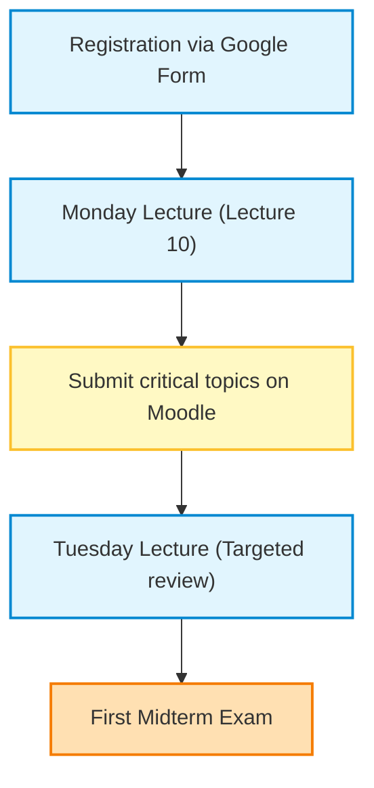
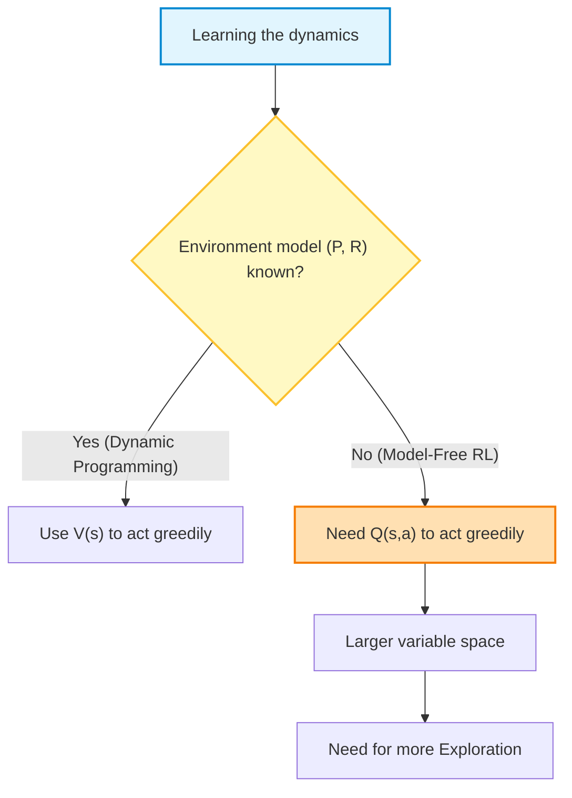
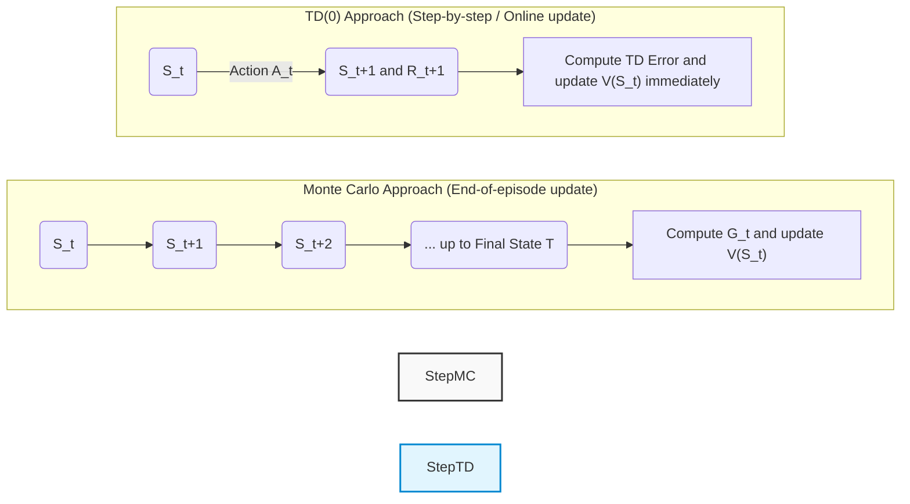
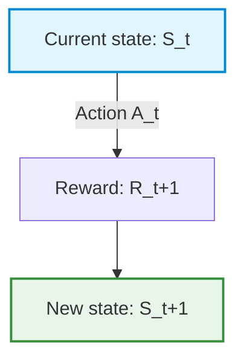
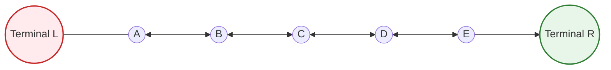

# Lecture 9: Off-Policy Monte Carlo Methods and Introduction to Temporal Difference Learning

## Teaching Overview

In this lecture we complete our treatment of **Monte Carlo Methods** applied to Reinforcement Learning (RL) and introduce **Temporal Difference Learning (TD Learning)**.

The key points covered include:

* **Model-Free Setting**: Analysis of the context in which the environment dynamics — represented by the transition probability matrix $P$ and the reward function $R$ — are not known a priori, making it necessary to learn exclusively from the experience generated by interaction.
* **From $V(s)$ to $Q(s,a)$ in Control**: Theoretical motivation for moving from the state-value function $V(s)$ to the state-action value function $Q(s,a)$ (*Action-Value Function*) in order to perform *Generalized Policy Improvement (GPI)* without a model of the environment.
* **Exploration vs. Exploitation Trade-off**: Limits of *On-Policy* approaches in reaching a strictly optimal policy while maintaining adequate exploratory coverage of the state-action space.
* **The *Off-Policy* Paradigm**: The concept of decoupling the **Behavior Policy**, used to generate trajectories and explore the environment, from the **Target Policy**, i.e. the optimal policy being evaluated and improved.
* **Introduction to TD Learning**: Placing the Temporal Difference algorithm as a pillar of RL, able to combine the ability of Monte Carlo methods to learn directly from experience without a model with the *bootstrapping* technique typical of *Dynamic Programming*.

---

### Lecture Outline and Introduction to Temporal Difference Learning

In this lecture we will conclude our analysis of Chapter 5, completing the treatment of *Off-Policy* approaches, and then begin the study of Chapter 6, the last topic included in the syllabus of the first midterm exam.

Chapter 6 introduces a fundamental algorithm for the entire discipline: **Temporal Difference Learning** (or **TD Learning**).

> **Key Concept: The Importance of Temporal Difference Learning**
> Unlike *Monte Carlo Methods*, which are a conceptual tool shared with general statistics and *Machine Learning*, **TD Learning** is an approach native and exclusive to *Reinforcement Learning*. This algorithm plays a central role because it encapsulates and synthesizes all the core concepts of the reinforcement learning paradigm.

---

### Supplementary Resources: Blackjack Lab

As for the practical sessions, no in-person lab dedicated to the game of Blackjack will be held. However, recorded teaching material (by Dr. Nicolò Turgato) is available, showing the practical application of the Reinforcement Learning algorithms seen in class to the Blackjack setting. The code and the demonstration make it possible to observe concretely how the theoretical concepts analyzed work.

---

### Roadmap to the First Midterm

The path to completing the syllabus ahead of the first midterm exam is shown below:



#### Preparation phases and deadlines:

*   **Exam registration:** You must register via the dedicated Google Form by the end of the current week to be included in the official list of candidates.
*   **Completing the syllabus:** Lecture 10 (scheduled for next Monday) will define the final boundary of the topics subject to assessment. For those who want to get ahead with their studies, the recording of the same topic from the previous academic year is already available on the portal.
*   **Review session:** Next Tuesday's lecture will be entirely devoted to a concise review of the concepts that have historically been the most difficult. The topics covered will be selected based on the reports and questions submitted by students through the Moodle platform by Monday.

---

### Organization of the Written Exam

The operational details for the written exam are as follows:

*   **Duration:** $1.5\text{ hours}$ ($90\text{ minutes}$).
*   **Allowed tools:** Scientific calculator and writing materials.

> **Key Concept: Managing Space and Assessment**
> Assessment will be based **exclusively** on what is written on the *official exam sheet* provided. Additional sheets will be made available for scratch work, but nothing written on them will be taken into account for the score. It is therefore essential to manage efficiently the ratio between available time and writing space on the sheet you hand in.

The structure of the exam will follow the type of questions (numerical exercises and theoretical questions) already used in the exams of previous years.

---

### Overview: Transition to Model-Free RL and the Need for $Q(s,a)$

In moving to true **Reinforcement Learning** (RL) methods, we abandon the Dynamic Programming assumption in which the transition probability matrix $P$ and the reward function $R$ are known. We are in the *model-free* setting: the agent must learn exclusively through experience and the data collected by interacting with the environment.

In both **Prediction** and **Control** problems, the balance between exploration and exploitation (*Exploration-Exploitation Trade-off*) becomes central again.

> **Key Concept: Why Do We Need $Q(s,a)$ in Control, and Is $V(s)$ Not Enough?**
>
> In moving from prediction to control (in both Monte Carlo and *Temporal Difference Learning*), we can no longer rely solely on the state-value function $V(s)$. Since we do not know the environment's transition probabilities $P(s'|s,a)$, we would not be able to choose the greedy action simply by looking at the values of the successor states. We must instead estimate the action-value function $Q(s,a)$.
>
> Using $Q(s,a)$ increases the complexity of the problem: $Q$ is a matrix (or a two-dimensional function) rather than a vector. Consequently, the space to be explored is much larger, and collecting enough data for every state-action pair requires a significantly greater exploratory effort.



---

### Distinguishing On-Policy and Off-Policy Approaches

In previous lectures we covered **On-Policy** approaches: the policy that collects the data coincides with the policy being evaluated and improved.

#### Limits of the On-Policy Approach
If a single policy is used both to explore and to optimize, the target policy can never become strictly optimal. Techniques such as *Exploring Starts* or $\epsilon$-soft policies keep inserting random/exploratory actions even after the structure of the problem has been learned, preventing the theoretical optimal performance from being reached.

#### Advantages of the Off-Policy Paradigm
In **Off-Policy** approaches, responsibilities are decoupled by defining two distinct policies:
1. **Target Policy** ($\pi$): The policy we want to evaluate, improve, and make optimal.
2. **Behavior Policy** ($b$): The policy used by the agent to interact with the environment and generate experience (data).

The main reasons for adopting an Off-Policy approach are:
* **Reuse of past experience**: Data is valuable in machine learning. In the *Generalized Policy Improvement* (GPI) scheme, at every policy update the data generated by previous policies ($\pi, \pi', \pi'', \dots$) would become unusable in an on-policy regime. Off-policy allows them to be reused.
* **Learning from external demonstrations**: The target policy can be updated by observing the actions generated by another agent (a human or an expert system).
* **Exploration separated from optimization**: Policy $b$ can remain highly exploratory, while policy $\pi$ converges toward a greedy, optimal strategy.

---

### The Three Fundamental Requirements for Off-Policy Learning

To apply an Off-Policy approach, **three essential conditions** must be satisfied:

1. **Knowledge of the Target Policy ($\pi$) and the Behavior Policy ($b$)**: The agent must know the analytical action-selection probabilities under both policies.
2. **Coverage Condition**: The behavior policy $b$ must be able to explore all the actions that the target policy $\pi$ could theoretically choose.

> **Key Concept: Coverage Condition**
>
> Formally, for every state $s \in \mathcal{S}$ and action $a \in \mathcal{A}$:
> $$\pi(a|s) > 0 \implies b(a|s) > 0$$
> If the target policy $\pi$ assigns a positive probability to action $a$ in state $s$, the behavior policy $b$ **must** have a strictly positive probability of taking that same action. Otherwise, no data will ever be collected on that action and it will be impossible to evaluate $\pi$.

3. **Importance Sampling**: A mathematical mechanism that reweights and normalizes the returns obtained through policy $b$ so that they become representative of policy $\pi$.

---

### Derivation of Importance Sampling

#### Intuition: The Multi-Armed Bandit Example
Imagine two players operating two shared levers following a balanced behavior policy $b$ (a random 50/50 choice between actions $a_1$ and $a_2$). A third person observes the results obtained by the two players without spending any money of their own: this observer wants to evaluate their own target policy $\pi$, which would choose action $a_1$ with probability $75\%$ and action $a_2$ with probability $25\%$.

* **Case A**: The players take action $a_2$ and obtain a reward of $+1$. For the players, the average estimate is $+1$. For the observer, however, action $a_2$ is less likely under $\pi$ ($25\%$) than under $b$ ($50\%$). The information is scaled down by weighting it by the ratio of the probabilities:
  $$\text{Weight} = \frac{\pi(a_2)}{b(a_2)} = \frac{0.25}{0.50} = 0.5 \implies \text{Weighted Value} = 1 \times 0.5 = 0.5$$

* **Case B**: The players take action $a_1$ and obtain $+2$. For the observer, this action is more likely under $\pi$ ($75\%$) than under $b$ ($50\%$):
  $$\text{Weight} = \frac{\pi(a_1)}{b(a_1)} = \frac{0.75}{0.50} = 1.5 \implies \text{Weighted Value} = 2 \times 1.5 = 3.0$$

**Importance Sampling** balances the discrepancy between the frequency with which an action is observed in the data and the frequency with which it would be taken by the target policy.

#### Extension to Complete Trajectories in RL
In sequential RL problems, an episode generates a trajectory made up of a sequence of states, actions, and rewards:
$$S_t, A_t, R_{t+1}, S_{t+1}, A_{t+1}, R_{t+2}, \dots, S_T$$

The probability of observing a given trajectory starting from state $S_t$ up to time $T$, under an arbitrary policy, depends on two factors: the policy's choices and the environment's transitions.

Under the target policy $\pi$:
$$\mathbb{P}(\text{Trajectory} | \pi) = \prod_{k=t}^{T-1} \pi(A_k|S_k) P(S_{k+1}|S_k, A_k)$$

Under the behavior policy $b$:
$$\mathbb{P}(\text{Trajectory} | b) = \prod_{k=t}^{T-1} b(A_k|S_k) P(S_{k+1}|S_k, A_k)$$

The **Importance Sampling Ratio** for the entire trajectory, $\rho_{t:T-1}$, is defined as the ratio between these two probabilities:

$$\rho_{t:T-1} = \frac{\prod_{k=t}^{T-1} \pi(A_k|S_k) P(S_{k+1}|S_k, A_k)}{\prod_{k=t}^{T-1} b(A_k|S_k) P(S_{k+1}|S_k, A_k)}$$

> **Key Concept: Cancellation of the Environment Dynamics**
>
> Since both policies act on the **same environment**, the MDP's state transition probabilities $P(S_{k+1}|S_k, A_k)$ in the numerator and denominator are identical and **cancel out**.
> The ratio depends exclusively on the action probabilities determined by the two policies:
>
> $$\rho_{t:T-1} = \prod_{k=t}^{T-1} \frac{\pi(A_k|S_k)}{b(A_k|S_k)}$$

---

### Off-Policy Monte Carlo Algorithm for Prediction

Below is a simplified, didactic version of the Off-Policy Monte Carlo prediction algorithm for estimating $V(s)$.

> **Note:** Compared to the reference text (Sutton & Barto), this formulation is simplified to maximize operational clarity.

```
Initialization:
    For each s in S:
        V(s) <- arbitrary value
        C(s) <- 0  (accumulator of the weights)
    Initialize V(terminal_state) = 0  [MANDATORY]

Loop for each episode:
    Generate a trajectory following the behavior policy b:
        S_0, A_0, R_1, S_1, A_1, R_2, ..., S_{T-1}, A_{T-1}, R_T

    G <- 0
    W <- 1   (cumulative Importance Sampling weight)

    Loop backward for t = T-1, T-2, ..., 0:
        G <- gamma * G + R_{t+1}
        C(S_t) <- C(S_t) + W
        V(S_t) <- V(S_t) + (W / C(S_t)) * (G - V(S_t))

        W <- W * ( pi(A_t | S_t) / b(A_t | S_t) )

        If W == 0:
            Stop the loop for the current episode (Break)
```

*(Note: step added for didactic clarity, to explain the loop's stopping condition.)*

#### Analysis of the Algorithm's Characteristics
1. **Initialization of Terminal States**: It is essential to set $V(\text{terminal state}) = 0$. Initializing it to different values compromises the convergence of the estimates.
2. **Backward Computation**: The cumulative return $G$ and the weight $W$ are computed backward (from $T-1$ down to $0$) in order to reuse sub-computations and optimize computational complexity.
3. **Early Exit Condition ($W = 0$)**: If at any step $t$ the target policy $\pi$ assigns zero probability to the action chosen by the behavior policy ($\pi(A_t|S_t) = 0$), the weight $W$ becomes zero. Since $W$ is updated by multiplying subsequent factors, all earlier steps in the episode would have a weighted value of zero. Interrupting the backward loop saves useless computation.

> **Operational Remark on Off-Policy Monte Carlo Control**
>
> Although in theory it is possible to extend this scheme to the Off-Policy Monte Carlo Control problem (replacing $V(s)$ with $Q(s,a)$ and applying an $\arg\max$ operation), in practice this approach suffers from **infinite or very high variance** due to the continuous product of importance ratios over long trajectories.
> For effective Off-Policy control, refer to approaches based on *Temporal Difference Learning* (Chapter 6).

---

### Introduction to Temporal Difference (TD) Learning

**Temporal Difference Learning** (or **TD Learning**) is one of the most central and defining concepts of the whole of Reinforcement Learning (RL). Historically, the birth and success of TD Learning in the early 1990s marked a genuine turning point in the field, notably thanks to famous successes such as **TD-Gammon**, an algorithm capable of learning to play Backgammon at levels far superior to human ones.

Beyond engineering and artificial intelligence, the mathematical foundations of TD Learning have found remarkable confirmation in neuroscience: the mechanism of dopamine release in the human and animal brain follows a dynamic that closely matches the temporal difference error.

From an operational point of view:
* We remain in a **Model-Free Setting**: we do not know the dynamics of the world (state transitions and rewards) and must learn exclusively from the data and experience collected.
* We introduce the concept of **Bootstrapping**: the algorithm's ability to update an estimate (e.g. the value of a state) based on another previous estimate, without having to wait for the final outcome of the entire sequence.

---

### Limits of the Monte Carlo Method vs. the Intuition of TD Learning

In the **Monte Carlo** (MC) methods studied previously, the agent must wait for the end of the entire episode before it can make a single update of the value function. This approach has clear limitations:
1. **Prolonged waiting:** If an episode lasts a very long time (or is potentially infinite), the agent learns nothing along the way.
2. **Inefficient use of information:** The agent collects rewards and transitions at every step, but ignores this intermediate data until the end of the trajectory.

#### The Concept of the "Value of Information"
Imperfect information provided **at the right time** is far more valuable than perfect information provided **too late**.
* *Example:* Receiving the exact list of exam questions after completing the exam is useless. Knowing instead the general topics a few weeks beforehand allows you to act and adapt your behavior.

#### The Driver Example (Monte Carlo vs. TD)
Imagine a driver who has to get home from work:
* **Monte Carlo Approach:** The driver initially estimates that it will take 30 minutes. During the trip they run into sudden traffic and rain, and have to stop for fuel. However, they **never update the estimate** given to their family along the way. Only when they arrive home after 43 minutes do they communicate the error.
* **Temporal Difference Approach:** Every time an event occurs (e.g. they get on the highway and see rain), the driver **immediately recalculates the estimate of the remaining time** and updates their knowledge about their own state.

---

### Mathematical Formulation: From the Incremental Method to TD(0)

To understand the mathematical derivation of TD Learning, we start from the incremental averaging update formula used in both *Multi-Armed Bandits* and Monte Carlo methods.

In general, the update of the estimate of the value of a state $V(S_t)$ has the form:

$$\text{New Estimate} \leftarrow \text{Old Estimate} + \alpha \cdot \left[ \text{Target} - \text{Old Estimate} \right]$$

where $\alpha \in (0, 1]$ is the *learning rate*.

#### 1. The Target in the Monte Carlo Method
In the Monte Carlo method, the $\text{Target}$ is the actual return $G_t$, i.e. the discounted sum of all rewards received up to the end of the episode:

$$V(S_t) \leftarrow V(S_t) + \alpha \cdot \left[ G_t - V(S_t) \right]$$

The problem is that $G_t$ is known **only at the end of the episode**.

#### 2. Derivation of the TD Estimate (Bootstrapping)
Telescopic decomposition of the return $G_t$:

$$G_t = R_{t+1} + \gamma R_{t+2} + \gamma^2 R_{t+3} + \dots = R_{t+1} + \gamma G_{t+1}$$

*Note: step added for didactic clarity.*
Since at time $t+1$ the agent has just observed the immediate reward $R_{t+1}$ and moved to state $S_{t+1}$, it does not know the true future value $G_{t+1}$. The best possible choice at time $t+1$ is to replace the future return $G_{t+1}$ with the **current estimate** of the value of the next state, namely $V(S_{t+1})$.

We thus obtain the **TD Target**:

$$\text{TD Target} = R_{t+1} + \gamma V(S_{t+1})$$

Substituting the TD Target into the incremental update formula, we obtain the update rule of the **TD(0)** algorithm:

$$V(S_t) \leftarrow V(S_t) + \alpha \cdot \left[ R_{t+1} + \gamma V(S_{t+1}) - V(S_t) \right]$$

> **KEY CONCEPT (Fundamental for the Exam)**
> * **TD Target:** $R_{t+1} + \gamma V(S_{t+1})$ represents the updated estimate of the overall return based on the current observation, and is the target toward which the old estimate is pushed.
> * **TD Error, denoted $\delta_t$:**
>   $$\delta_t = R_{t+1} + \gamma V(S_{t+1}) - V(S_t)$$
>   The TD error measures the difference between the estimate made at time $t$ and the (more informed) estimate made one step later, at time $t+1$.

---

### Structural Comparison: Monte Carlo vs. TD(0)

While the Monte Carlo method samples the actual return $G_t$ (an unbiased but high-variance estimate), the TD(0) method combines an observed real reward $R_{t+1}$ with a pre-existing estimate $V(S_{t+1})$. This introduces a slight initial bias (due to the initial estimates of $V$), but greatly reduces the variance and allows *online*, step-by-step learning.



---

### Tabular TD(0) Algorithm

Below is the pseudocode of the **TD(0)** algorithm for evaluating a given policy ($\pi$).

The agent does not wait for the end of the trajectory: within the episode loop, at every single time step it updates the matrix/table of state values $V$.

#### Detailed Pseudocode

1. **Initialization:**
   * Initialize the value function $V(s)$ arbitrarily for all states $s \in \mathcal{S}$ (e.g. $V(s) = 0$), and $V(\text{terminal state}) = 0$.
   * Set the learning parameter $\alpha \in (0, 1]$ and the discount factor $\gamma \in [0, 1]$.

2. **For each episode:**
   * Initialize the initial state $S$.
   * **For each step of the episode** (until $S$ is terminal):
     1. Choose the action $A$ dictated by the policy $\pi(\cdot|S)$ in state $S$.
     2. Execute action $A$, observe the reward $R$ and the new state $S'$.
     3. Update the estimate for the current state $S$:
        $$V(S) \leftarrow V(S) + \alpha \left[ R + \gamma V(S') - V(S) \right]$$
     4. Move to the next state: $S \leftarrow S'$.

> **Note on Terminology:**
> * The suffix **(0)** in **TD(0)** indicates that the computation looks only one time step into the future (*1-step lookahead*). This concept will later be extended to the family of $TD(\lambda)$ algorithms. For now, when we say "TD Learning" we mean the $TD(0)$ formulation.
> * The word **Tabular** specifies that we keep the value function $V(S)$ stored in an explicit table/vector for each finite state of the environment.

---

3. Backup Diagrams and the Concept of Bootstrapping

In methods based on *Temporal Differences (TD)*, **backup diagrams** let us visualize graphically how value information flows backward (*back-up*) from future states to present states.

A backup diagram for the TD(0) algorithm shows a single local transition:
1. We are in a state $S_t$.
2. We select an action $A_t$ following policy $\pi$.
3. The environment responds by providing an immediate reward $R_{t+1}$ and taking us to the new state $S_{t+1}$.

Unlike the Monte Carlo (MC) method, which must wait for the end of the episode to update its estimates, the TD method updates its estimate *while* the agent interacts with the environment, performing an operation known as **Bootstrapping**.



> **Key Concept — Bootstrapping:**
> Bootstrapping consists of updating an estimate on the basis of other existing estimates, without waiting for the final outcome of the trajectory.
>
> - **Dynamic Programming (DP):** Performs full bootstrapping, computing the exact expected value over all possible future states by means of the Bellman equations.
> - **Monte Carlo (MC):** Does not bootstrap; it updates estimates based solely on the actual return $G_t$ computed at the end of the episode.
> - **TD(0):** Combines sampling (like MC) and bootstrapping (like DP): it samples a single transition $(S_t, A_t, R_{t+1}, S_{t+1})$, but estimates the future via the estimated value $V(S_{t+1})$.

---

### 3. Practical Example: The 5-State Random Walk

To observe concretely the operational difference between Monte Carlo and TD(0), consider a simplified benchmark environment: a *Random Walk* made up of 5 non-terminal states.



#### Environment Rules:
- **Non-terminal states:** $\mathcal{S} = \{A, B, C, D, E\}$.
- **Terminal states:** $T_L$ (Left Terminal) and $T_R$ (Right Terminal).
- **Policy ($\pi$):** Equiprobable or uniform. In every state, the agent moves left with probability $0.5$ or right with probability $0.5$.
- **Rewards:**
  - Transition to $T_R$: $R = +1$.
  - Transition to $T_L$: $R = 0$.
  - All intermediate transitions: $R = 0$.
  - Discount factor: $\gamma = 1$.

#### True State Value Function $V_\pi(s)$:
In this scenario there is no penalty for each step taken (there is no time cost of $-1$). The optimal policy would be to always move to the right and end up in $T_R$. Following the indicated random policy, the true value function $V_\pi(s)$ varies linearly from left to right:
- The central state $C$ has an exact value of $V_\pi(C) = 0.5$ (50% probability of ending in $T_R$ with $+1$ and 50% of ending in $T_L$ with $0$).
- Moving to the right, the true values increase: $V_\pi(A) = 1/6 \approx 0.17$, $V_\pi(B) = 2/6 \approx 0.33$, $V_\pi(C) = 3/6 = 0.5$, $V_\pi(D) = 4/6 \approx 0.67$, $V_\pi(E) = 5/6 \approx 0.83$.

#### Model Initialization:
We set the initial estimates for all intermediate states to $V_0(s) = 0.5$ for every $s \in \{A, B, C, D, E\}$, with a learning rate $\alpha = 0.5$.

---

### 3. Dynamic Comparison: Monte Carlo vs. TD(0)

Let us analyze what happens during the learning phase in the first episodes.

```
       Execution of Episode 1: Path C -> D -> E -> T_R
```

1. **Behavior of TD(0):**
   Along the path through the intermediate states ($C \to D \to E$), the reward is $R=0$ and the initial estimated values are equal ($0.5$). The TD error is therefore zero:
   $$\delta_t = R_{t+1} + \gamma V(S_{t+1}) - V(S_t) = 0 + 0.5 - 0.5 = 0$$
   No update is performed until the last step. Only at the moment the agent enters the terminal state $T_R$ obtaining $R=+1$ does the algorithm update the **immediately preceding** state ($E$):
   $$V(E) \leftarrow V(E) + \alpha \left[ 1 - V(E) \right] = 0.5 + 0.5 \times (1 - 0.5) = 0.75$$
   All the other states along the path ($C$ and $D$) remain unchanged at $0.5$.

2. **Behavior of Monte Carlo:**
   The agent does not update anything during the trajectory. At the end of the episode, it computes the total return $G = +1$.
   At this point it applies the return to **all** the states visited during the episode ($C$, $D$, $E$):
   $$V(S) \leftarrow V(S) + \alpha \left[ G - V(S) \right] \quad \forall S \in \{C, D, E\}$$
   As a result, the values of $C$, $D$ and $E$ are simultaneously raised from $0.5$ to $0.75$.

> **Key Concept — The Credit Assignment Problem:**
> - **Monte Carlo** assigns responsibility for the final outcome (reward $+1$) to *all* the states visited during the trajectory, uniformly increasing the estimated value of each.
> - **TD(0)** assigns credit only locally and incrementally: on the first experience it updates only the last visited state. In subsequent episodes, the updated information of state $E$ will propagate back to $D$, then to $C$, spreading the error signal one step at a time.

---

### 3. Performance Evaluation and Sample Efficiency

To quantitatively evaluate the performance of the two approaches with respect to the number of episodes processed, we compute the **Root Mean Square Error (RMSE)** between the learned estimates and the true values provided by the oracle:

$$RMSE = \sqrt{\frac{1}{|\mathcal{S}|} \sum_{s \in \mathcal{S}} \left( V_{\text{true}}(s) - V(s) \right)^2}$$

*(Note: step added for didactic clarity, to formalize the error plot described in class.)*

```
RMSE
  ^
  |  \  (Monte Carlo)
  |   \____
  |    \   \____  (TD(0) - Faster learning)
  |     \_______
  +-----------------------------------> Number of Episodes
```

#### Comparison of Results:
- **Learning Rate ($\alpha$):** By varying $\alpha$, both families of algorithms converge to the true value as the number of episodes grows.
- **Convergence Speed:** **TD(0) is significantly faster than Monte Carlo**. It needs a much smaller number of episodes to drastically reduce the RMSE.

> **Key Concept — Sample Efficiency:**
> In operational, real-world settings (such as the theory of *Multi-Armed Bandits* or RL in medical/financial contexts), minimizing the number of episodes needed to learn is equivalent to minimizing **Regret**. TD(0) shows better sample efficiency because it immediately exploits the recursive structure of the environment at every single transition.

---

> [!NOTE]
> ### Exam Notes and Instructor Announcements
> - **Registration for the First Midterm**: Registrations via the dedicated Google Form close this week. The instructor recommends not waiting until the last minute.
> - **Syllabus of the First Midterm**: The material covered by the first midterm includes all the topics covered up to next week's Monday lecture (up to Chapter 6). Next Tuesday's lecture will instead be devoted to a general review, structured around the questions and requests sent by students via e-mail.
> - **Exam Format and Rules**:
>   - Duration of the exam: 1 hour and 30 minutes (1h 30m).
>   - Allowed tools: you may bring a calculator and pens.
>   - Exam sheets: an official exam sheet will be handed out. **Only** what is written on that sheet will be graded; scratch/draft sheets will not be taken into account.
>   - Exam structure: it will be fully in line with the exams and midterms of previous years.
> - **Specific Questions and Exercises Cited by the Instructor**:
>   - **Off-Policy Control Monte Carlo**: Sketching the pseudocode of an off-policy Monte Carlo control approach (using the elements and concepts seen in class) was explicitly indicated as a possible exam/midterm question.
>   - **Off-Policy Monte Carlo (Prediction)**: The exam will ask for the pseudocode in the simplified version shown in class on the slides (and not the more complex one from the book).
>   - **Fundamental definitions**: You are explicitly required to know how to define key concepts and formulas such as the **TD Target** and the **TD Error**.
>   - **Backup Diagrams**: You may be asked to draw/show a backup diagram to verify conceptual understanding of the algorithms.
