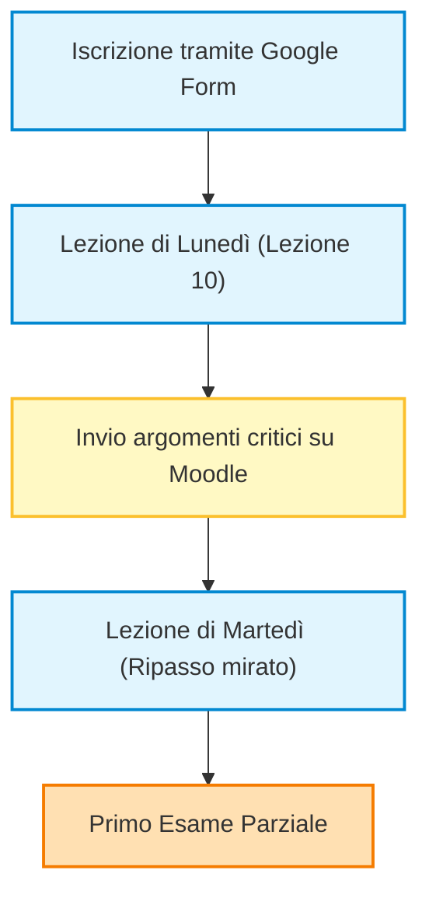
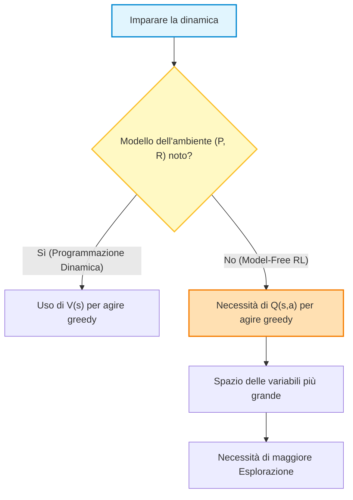
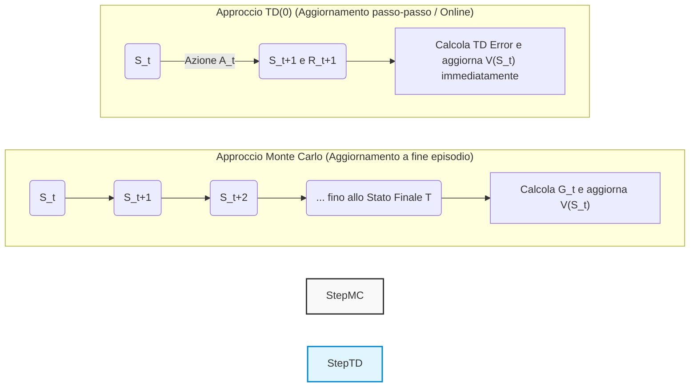
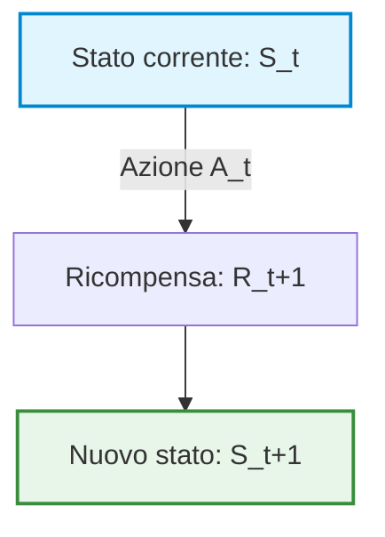
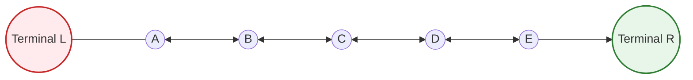

# Lezione 9: Metodi Monte Carlo Off-Policy e Introduzione al Temporal Difference Learning

## Overview Didattica

In questa lezione completiamo la trattazione dei **Metodi Monte Carlo (Monte Carlo Methods)** applicati al Reinforcement Learning (RL) e introduciamo l'**Apprendimento per Differenze Temporali (Temporal Difference Learning - TD Learning)**. 

I punti chiave trattati includono:

* **Inquadramento Model-Free**: Analisi del contesto in cui le dinamiche dell'ambiente — rappresentate dalla matrice delle probabilità di transizione $P$ e dalla funzione di ricompensa $R$ — non sono note a priori, rendendo necessario l'apprendimento basato esclusivamente sull'esperienza generata dall'interazione.
* **Transizione da $V(s)$ a $Q(s,a)$ nel Controllo**: Motivazione teorica del passaggio dalla funzione del valore di stato $V(s)$ alla funzione del valore di stato-azione $Q(s,a)$ (*Action-Value Function*) per consentire il *Miglioramento Generalizzato della Politica (Generalized Policy Improvement - GPI)* senza un modello dell'ambiente.
* **Trade-off tra Esplorazione ed Esploitamento (*Exploration vs. Exploitation*)**: Limiti degli approcci *On-Policy* nel raggiungere una politica strettamente ottimale mantenendo al contempo un'adeguata copertura esplorativa nello spazio stato-azione.
* **Paradigma *Off-Policy***: Concetto di disaccoppiamento tra la **Politica Comportamentale (*Behavior Policy*)**, utilizzata per generare le traiettorie ed esplorare l'ambiente, e la **Politica Target (*Target Policy*)**, ovvero la politica ottimale oggetto di valutazione e miglioramento.
* **Introduzione al TD Learning**: Contestualizzazione dell'algoritmo di Temporal Difference come pilastro dell'RL, in grado di coniugare la capacità dei metodi Monte Carlo di apprendere direttamente dall'esperienza senza modello con la tecnica del *bootstrapping* tipica della Programmazione Dinamica (*Dynamic Programming*).

---

### Programma della Lezione e Introduzione al Temporal Difference Learning

In questa lezione concluderemo l'analisi del Capitolo 5, completando la trattazione degli approcci *Fuori Politica* (*Off-Policy*), per poi avviare lo studio del Capitolo 6, l'ultimo argomento compreso nel programma del primo esame parziale.

Il Capitolo 6 introduce un algoritmo fondamentale per l'intera disciplina: l'**Apprendimento a Differenza Temporale** (*Temporal Difference Learning* o *TD Learning*). 

> **Concetto Chiave: Importanza del Temporal Difference Learning**  
> A differenza dei *Metodi Monte Carlo* (*Monte Carlo Methods*), che rappresentano uno strumento concettuale condiviso con la statistica generale e il *Machine Learning*, il **TD Learning** è un approccio nativo ed esclusivo del *Reinforcement Learning*. Questo algoritmo ha un ruolo centrale poiché racchiude e sintetizza in sé tutti i concetti cardine del paradigma di apprendimento per rinforzo.

---

### Risorse Integrative: Laboratorio sul Blackjack

Per quanto riguarda le esercitazioni pratiche, non verrà svolto un laboratorio in presenza dedicato al gioco del Blackjack. Tuttavia, è a disposizione materiale didattico registrato (a cura del Dr. Nicolò Turgato) in cui viene mostrata l'applicazione pratica degli algoritmi di *Reinforcement Learning* visti a lezione applicati al contesto del Blackjack. Il codice e la dimostrazione consentono di osservare concretamente il funzionamento dei concetti teorici analizzati.

---

### Tabella di Marcia verso il Primo Parziale

Di seguito viene illustrato il percorso di completamento del programma in vista del primo esame parziale:



#### Fasi di preparazione e scadenze:

*   **Iscrizione alla prova:** È necessario registrarsi tramite il Google Form dedicato entro la fine della settimana corrente per essere inclusi nell'elenco ufficiale dei candidati.
*   **Completamento del programma:** La Lezione 10 (prevista per lunedì prossimo) definirà il limite definitivo degli argomenti oggetto di valutazione. Per chi desidera portarsi avanti con lo studio, la registrazione dello stesso argomento relativa all'anno accademico precedente è già accessibile sul portale.
*   **Sessione di ripasso:** La lezione di martedì prossimo sarà interamente dedicata a un ripasso sintetico dei concetti storicamente più ostici. Gli argomenti trattati verranno selezionati sulla base delle segnalazioni e dei dubbi inviati dagli studenti tramite la piattaforma Moodle entro lunedì.

---

### Organizzazione della Prova Scritta

I dettagli operativi per lo svolgimento della prova scritta sono i seguenti:

*   **Durata:** $1.5\text{ ore}$ ($90\text{ minuti}$).
*   **Strumenti consentiti:** Calcolatrice scientifica e materiale da scrittura.

> **Concetto Chiave: Gestione dello Spazio e della Valutazione**  
> La valutazione avverrà **esclusivamente** sulla base di quanto riportato nel *foglio d'esame ufficiale* fornito. Verranno messi a disposizione fogli aggiuntivi per la brutta copia, la cui stesura non verrà in alcun modo presa in considerazione ai fini del punteggio. È pertanto fondamentale gestire in modo efficiente il rapporto tra tempo a disposizione e spazio di scrittura nel foglio consegnato.

La struttura della prova riprenderà la tipologia di quesiti (esercizi numerici e domande teoriche) già adottata nei temi d'esame degli anni precedenti.

---

<h3>Quadro Generale: Transizione a RL Model-Free e Necessità di $Q(s,a)$</h3>

Nel passaggio ai metodi di **Apprendimento per Rinforzo** (*Reinforcement Learning - RL*) veri e propri, abbandoniamo l'ipotesi della Programmazione Dinamica in cui la matrice delle probabilità di transizione $P$ e la funzione di ricompensa $R$ sono note. Siamo nel contesto *model-free*: l'agente deve imparare esclusivamente attraverso l'esperienza e i dati raccolti interagendo con l'ambiente.

Sia nei problemi di **Predizione** (*Prediction*) che in quelli di **Controllo** (*Control*), torna centrale il bilanciamento tra esplorazione e sfruttamento (*Exploration-Exploitation Trade-off*).

> **Concetto Chiave: Perché nel Controllo serve $Q(s,a)$ e non basta $V(s)$?**
>
> Nel passaggio dalla predizione al controllo (sia in Monte Carlo che in *Temporal Difference Learning*), non possiamo più basarci unicamente sulla funzione di valore dello stato $V(s)$. Poiché non conosciamo le probabilità di transizione dell'ambiente $P(s'|s,a)$, non saremmo in grado di scegliere l'azione greedy semplicemente guardando i valori degli stati successivi. Dobbiamo invece stimare la funzione di valore azione-stato $Q(s,a)$. 
> 
> L'utilizzo di $Q(s,a)$ aumenta la complessità del problema: $Q$ è una matrice (o una funzione bidimensionale) anziché un vettore. Di conseguenza, lo spazio da esplorare è molto più ampio e raccogliere dati sufficienti per ogni coppia stato-azione richiede un sforzo esplorativo nettamente superiore.



---

<h3>Distinzione tra Politiche On-Policy e Off-Policy</h3>

Nelle lezioni precedenti sono stati trattati approcci **On-Policy**: la politica che raccoglie i dati coincide con la politica che si sta cercando di valutare e migliorare.

#### Limiti dell'approccio On-Policy
Se si utilizza un'unica politica sia per esplorare che per ottimizzare, la politica target non potrà mai diventare strettamente ottimale. Tecniche come le *Exploring Starts* o le politiche $\epsilon$-soft continuano a inserire azioni casuali/esplorative anche dopo aver appreso la struttura del problema, impedendo il raggiungimento della prestazione d'ottimo teorico.

#### I vantaggi del paradigma Off-Policy
Negli approcci **Off-Policy** si disaccoppiano le responsabilità definendo due politiche distinte:
1. **Politica Target** ($\pi$): La politica che si vuole valutare, migliorare e rendere ottimale.
2. **Politica Comportamentale** (*Behavior Policy*, $b$): La politica utilizzata dall'agente per interagire con l'ambiente e generare l'esperienza (dati).

Le motivazioni principali per adottare un approccio Off-Policy sono:
* **Riutilizzo dell'esperienza passata**: I dati nell'apprendimento automatico sono preziosi. Nello schema di *Generalized Policy Improvement* (GPI), ad ogni aggiornamento della politica i dati generati dalle politiche precedenti ($\pi, \pi', \pi'', \dots$) diventerebbero inutilizzabili in un regime on-policy. L'off-policy permette di riusarli.
* **Apprendimento da dimostrazioni esterne**: È possibile aggiornare la politica target osservando le azioni generate da un altro agente (umano o sistema esperto).
* **Esplorazione separata dall'ottimizzazione**: La politica $b$ può rimanere altamente esplorativa, mentre la politica $\pi$ converge verso una strategia greedy ed ottimale.

---

<h3>I Tre Requisiti Fondamentali per l'Off-Policy</h3>

Per poter applicare un approccio Off-Policy, devono essere soddisfatte **tre condizioni essenziali**:

1. **Conoscenza della Politica Target ($\pi$) e Comportamentale ($b$)**: L'agente deve conoscere le probabilità analitiche di scelta delle azioni secondo entrambe le politiche.
2. **Condizione di Copertura** (*Coverage Condition*): La politica comportamentale $b$ deve poter esplorare tutte le azioni che la politica target $\pi$ potrebbe teoricamente scegliere.

> **Concetto Chiave: Condizione di Copertura**
> 
> Formamente, per ogni stato $s \in \mathcal{S}$ e azione $a \in \mathcal{A}$:
> $$\pi(a|s) > 0 \implies b(a|s) > 0$$
> Se la politica target $\pi$ assegna una probabilità positiva all'azione $a$ nello stato $s$, la politica comportamentale $b$ **deve** avere una probabilità strettamente maggiore di zero di eseguire quella stessa azione. In caso contrario, non si raccoglieranno mai dati su quell'azione e sarà impossibile valutare $\pi$.

3. **Campionamento di Importanza** (*Importance Sampling*): Un meccanismo matematico che ripesa e normalizza i ricavi ottenuti tramite la politica $b$ per renderli rappresentativi per la politica $\pi$.

---

<h3>Derivazione dell'Importance Sampling</h3>

#### Intuizione: Esempio dei Multi-Armed Bandit
Immaginiamo due giocatori che azionano due leve condivise seguendo una politica comportamentale $b$ bilanciata (scelta casuale 50/50 per le azioni $a_1$ e $a_2$). Una terza persona osserva i risultati ottenuti dai due giocatori senza spendere denaro proprio: questa osservatrice vuole valutare la propria politica target $\pi$, la quale sceglierebbe l'azione $a_1$ con probabilità del $75\%$ e l'azione $a_2$ con il $25\%$.

* **Caso A**: I giocatori eseguono l'azione $a_2$ e ottengono una ricompensa di $+1$. Per i giocatori, la stima media è $+1$. Per l'osservatrice, tuttavia, l'azione $a_2$ è meno probabile sotto $\pi$ ($25\%$) rispetto a $b$ ($50\%$). L'informazione viene ridimensionata pesandola per il rapporto tra le probabilità:
  $$\text{Peso} = \frac{\pi(a_2)}{b(a_2)} = \frac{0.25}{0.50} = 0.5 \implies \text{Valore Pesato} = 1 \times 0.5 = 0.5$$

* **Caso B**: I giocatori eseguono l'azione $a_1$ e ottengono $+2$. Per l'osservatrice, questa azione è più probabile sotto $\pi$ ($75\%$) che sotto $b$ ($50\%$):
  $$\text{Peso} = \frac{\pi(a_1)}{b(a_1)} = \frac{0.75}{0.50} = 1.5 \implies \text{Valore Pesato} = 2 \times 1.5 = 3.0$$

L'**Importance Sampling** bilancia la discrepanza tra la frequenza con cui un'azione viene osservata nei dati e la frequenza con cui verrebbe eseguita dalla politica target.

#### Estensione a Traiettorie Complete in RL
Nei problemi RL sequenziali, un episodio genera una traiettoria composta da una sequenza di stati, azioni e ricompense:
$$S_t, A_t, R_{t+1}, S_{t+1}, A_{t+1}, R_{t+2}, \dots, S_T$$

La probabilità di osservare una determinata traiettoria a partire dallo stato $S_t$ fino al tempo $T$, data una politica arbitraria, dipende da due fattori: le scelte della politica e le transizioni dell'ambiente.

Sotto la politica target $\pi$:
$$\mathbb{P}(\text{Traiettoria} | \pi) = \prod_{k=t}^{T-1} \pi(A_k|S_k) P(S_{k+1}|S_k, A_k)$$

Sotto la politica comportamentale $b$:
$$\mathbb{P}(\text{Traiettoria} | b) = \prod_{k=t}^{T-1} b(A_k|S_k) P(S_{k+1}|S_k, A_k)$$

Il **Rapporto di Campionamento di Importanza** (*Importance Sampling Ratio*) relativo all'intera traiettoria $\rho_{t:T-1}$ si definisce come il rapporto tra queste due probabilità:

$$\rho_{t:T-1} = \frac{\prod_{k=t}^{T-1} \pi(A_k|S_k) P(S_{k+1}|S_k, A_k)}{\prod_{k=t}^{T-1} b(A_k|S_k) P(S_{k+1}|S_k, A_k)}$$

> **Concetto Chiave: Elisione della Dinamica dell'Ambiente**
> 
> Poiché entrambe le politiche agiscono sul **medesimo ambiente**, le probabilità di transizione di stato del MDP $P(S_{k+1}|S_k, A_k)$ al numeratore e al denominatore sono identiche e si **elidono**. 
> Il rapporto dipende esclusivamente dalle probabilità delle azioni determinate dalle due politiche:
>
> $$\rho_{t:T-1} = \prod_{k=t}^{T-1} \frac{\pi(A_k|S_k)}{b(A_k|S_k)}$$

---

<h3>Algoritmo Monte Carlo Off-Policy per la Predizione</h3>

Di seguito viene presentata una versione didattica e semplificata dell'algoritmo di predizione Monte Carlo Off-Policy per la stima di $V(s)$.

> **Nota:** Rispetto al testo di riferimento (Sutton & Barto), questa formulazione è semplificata per massimizzare la chiarezza operativa.

```
Inizializzazione:
    Per ogni s in S:
        V(s) <- valore arbitrario
        C(s) <- 0  (accumulatore dei pesi)
    Inizializza V(stato_terminale) = 0  [OBLIGATORIO]

Loop per ogni episodio:
    Genera una traiettoria seguendo la politica comportamentale b:
        S_0, A_0, R_1, S_1, A_1, R_2, ..., S_{T-1}, A_{T-1}, R_T
    
    G <- 0
    W <- 1   (peso cumulativo dell'Importance Sampling)
    
    Loop all'indietro per t = T-1, T-2, ..., 0:
        G <- gamma * G + R_{t+1}
        C(S_t) <- C(S_t) + W
        V(S_t) <- V(S_t) + (W / C(S_t)) * (G - V(S_t))
        
        W <- W * ( pi(A_t | S_t) / b(A_t | S_t) )
        
        Se W == 0:
            Interrompi il ciclo dell'episodio corrente (Break)
```

*(Nota: Passaggio integrato con chiarezza didattica per spiegare la condizione d'arresto del ciclo).*

#### Analisi delle caratteristiche dell'algoritmo
1. **Inizializzazione degli Stati Terminali**: È fondamentale impostare $V(\text{stato terminale}) = 0$. Inizializzarlo a valori diversi compromette la convergenza delle stime.
2. **Calcolo Backward**: La ricompensa cumulativa $G$ e il peso $W$ vengono calcolati a ritroso (da $T-1$ a $0$) per riutilizzare i sotto-calcoli e ottimizzare la complessità computazionale.
3. **Condizione di Uscita Anticipata ($W = 0$)**: Se in un qualsiasi passo $t$ la politica target $\pi$ assegna probabilità nulla all'azione scelta dalla politica comportamentale ($\pi(A_t|S_t) = 0$), il peso $W$ diventa zero. Poiché $W$ viene aggiornato moltiplicando i fattori successivi, tutti i passi precedenti nell'episodio avrebbero valore pesato nullo. Interrompere il ciclo backward risparmia calcoli inutili.

> **Osservazione Operativa per il Controllo Monte Carlo Off-Policy**
> 
> Sebbene in teoria sia possibile estendere questo schema al problema del Controllo Monte Carlo Off-Policy (sostituendo $V(s)$ con $Q(s,a)$ e applicando un'operazione $\arg\max$), in pratica questo approccio soffre di un'**infinita o elevatissima varianza** dovuta al prodotto continuo dei rapporti di importanza su traiettorie lunghe. 
> Per il controllo Off-Policy efficace si rimanda agli approcci basati su *Temporal Difference Learning* (Capitolo 6).

---

### Introduzione al Temporal Difference (TD) Learning

L'**Apprendimento per Differenze Temporali** (*Temporal Difference Learning*, o **TD Learning**) rappresenta uno dei concetti più centrali e caratterizzanti dell'intero Apprendimento per Rinforzo (*Reinforcement Learning* - RL). Storicamente, la nascita e il successo del TD Learning nei primi anni '90 hanno segnato una vera e propria svolta nel campo, in particolare grazie a successi celebri come **TD-Gammon**, un algoritmo capace di apprendere a giocare a Backgammon a livelli di gran lunga superiori a quelli umani. 

Oltre all'ingegneria e all'intelligenza artificiale, le basi matematiche del TD Learning hanno trovato una conferma straordinaria nelle neuroscienze: il meccanismo di rilascio della dopamina nel cervello umano e animale segue una dinamica sovrapponibile a quella dell'errore di differenza temporale.

Dal punto di vista operativo:
* Restiamo in un contesto a **Modello Libero** (*Model-Free Setting*): non conosciamo la dinamica del mondo (transizioni di stato e ricompense) e dobbiamo apprendere esclusivamente sulla base dei dati e dell'esperienza raccolta.
* Introduciamo il concetto di **Bootstrapping** (*Bootstrapping*): la capacità dell'algoritmo di aggiornare una stima (es. il valore di uno stato) basandosi su un'altra stima precedente, senza dover attendere il risultato finale dell'intera sequenza.

---

### Limiti del Metodo Monte Carlo vs. Intuizione del TD Learning

Nei metodi **Monte Carlo** (MC) studiati in precedenza, l'agente deve attendere la fine dell'intero episodio prima di poter effettuare un singolo aggiornamento della funzione di valore. Questo approccio presenta limiti evidenti:
1. **Attesa prolungata:** Se un episodio dura molto a lungo (o è potenzialmente infinito), l'agente non impara nulla lungo il percorso.
2. **Inefficienza nell'uso dell'informazione:** L'agente raccoglie ricompense e transizioni a ogni passo, ma ignora questi dati intermedi fino al termine della traiettoria.

#### Il Concetto del "Valore dell'Informazione"
Un'informazione imperfetta ma fornita **al momento giusto** ha un valore nettamente superiore rispetto a un'informazione perfetta fornita **troppo tardi**.
* *Esempio:* Ricevere la lista esatta delle domande d'esame dopo aver completato la prova è inutile. Conoscere invece gli argomenti generali qualche settimana prima permette di agire e adattare il comportamento.

#### L'Esempio del Guidatore (Monte Carlo vs. TD)
Immaginiamo un guidatore che deve tornare a casa dal lavoro:
* **Approccio Monte Carlo:** Il guidatore stima inizialmente che impiegherà 30 minuti. Durante il viaggio trova traffico improvviso, pioggia e deve fare rifornimento. Tuttavia, **non aggiorna mai la stima** verso i propri familiari lungo il tragitto. Solo quando arriva a casa dopo 43 minuti comunica l'errore commesso.
* **Approccio Temporal Difference:** Ogni volta che si verifica un evento (es. entra in autostrada e vede la pioggia), il guidatore **ricalcola immediatamente la stima del tempo rimanente** e aggiorna la conoscenza sul proprio stato.

---

### Formulazione Matematica: Dal Metodo Incrementale al TD(0)

Per comprendere la derivazione matematica del TD Learning, partiamo dalla formula di aggiornamento incrementale della media usata sia nei *Multi-Armed Bandits* sia nei metodi Monte Carlo.

In generale, l'aggiornamento della stima del valore di uno stato $V(S_t)$ ha la forma:

$$\text{Nuova Stima} \leftarrow \text{Vecchia Stima} + \alpha \cdot \left[ \text{Target} - \text{Vecchia Stima} \right]$$

dove $\alpha \in (0, 1]$ è il tasso di apprendimento (*learning rate*).

#### 1. Il Target nel Metodo Monte Carlo
Nel metodo Monte Carlo, il $\text{Target}$ è il ritorno effettivo $G_t$, cioè la somma scontata di tutte le ricompense ricevute fino al termine dell'episodio:

$$V(S_t) \leftarrow V(S_t) + \alpha \cdot \left[ G_t - V(S_t) \right]$$

Il problema è che $G_t$ è noto **solo alla fine dell'episodio**.

#### 2. Derivazione della Stima TD (Bootstrapping)
Scomposizione telescopica del ritorno $G_t$:

$$G_t = R_{t+1} + \gamma R_{t+2} + \gamma^2 R_{t+3} + \dots = R_{t+1} + \gamma G_{t+1}$$

*Nota: Passaggio integrato con chiarezza didattica.*
Poiché al tempo $t+1$ l'agente ha appena osservato la ricompensa immediata $R_{t+1}$ ed è passato allo stato $S_{t+1}$, non conosce il vero valore futuro $G_{t+1}$. La scelta migliore possibile al tempo $t+1$ consiste nel sostituire il ritorno futuro $G_{t+1}$ con la **stima corrente** del valore dello stato successivo, ossia $V(S_{t+1})$.

Otteniamo quindi il **TD Target**:

$$\text{TD Target} = R_{t+1} + \gamma V(S_{t+1})$$

Sostituendo il TD Target nella formula di aggiornamento incrementale, otteniamo la regola di aggiornamento dell'algoritmo **TD(0)**:

$$V(S_t) \leftarrow V(S_t) + \alpha \cdot \left[ R_{t+1} + \gamma V(S_{t+1}) - V(S_t) \right]$$

> **CONCETTO CHIAVE (Fondamentale per l'Esame)**
> * **TD Target:** $R_{t+1} + \gamma V(S_{t+1})$ rappresenta la stima aggiornata del ritorno complessivo basata sull'osservazione corrente ed è il target verso cui viene spinta la vecchia stima.
> * **TD Error (Errore TD), indicato con $\delta_t$:**
>   $$\delta_t = R_{t+1} + \gamma V(S_{t+1}) - V(S_t)$$
>   L'errore TD misura la differenza tra la stima effettuata al tempo $t$ e la stima (più informata) effettuata un passo dopo, al tempo $t+1$.

---

### Confronto Strutturale: Monte Carlo vs. TD(0)

Mentre il metodo Monte Carlo campiona il ritorno effettivo $G_t$ (che è una stima non distorta, ma ad alta varianza), il metodo TD(0) combina una ricompensa reale osservata $R_{t+1}$ con una stima preesistente $V(S_{t+1})$. Questo introduce un leggero bias iniziale (dovuto alle stime iniziali di $V$), ma riduce enormemente la varianza e permette l'apprendimento *online* passo-passo.



---

### Algoritmo TD(0) Tabellare

Di seguito viene mostrato lo pseudocodice dell'algoritmo **TD(0)** per la valutazione di una politica dati ($\pi$).

L'agente non attende il termine della traiettoria: all'interno del ciclo dell'episodio, a ogni singolo passo temporale aggiorna la matrice/tabella dei valori di stato $V$.

#### Pseudocodice Dettagliato

1. **Inizializzazione:**
   * Inizializza la funzione di valore $V(s)$ arbitrariamente per tutti gli stati $s \in \mathcal{S}$ (es. $V(s) = 0$), e $V(\text{stato terminale}) = 0$.
   * Imposta il parametro di apprendimento $\alpha \in (0, 1]$ e il fattore di sconto $\gamma \in [0, 1]$.

2. **Per ogni episodio:**
   * Inizializza lo stato iniziale $S$.
   * **Per ogni passo dell'episodio** (finché $S$ non è terminale):
     1. Scegli l'azione $A$ dettata dalla politica $\pi(\cdot|S)$ nello stato $S$.
     2. Esegui l'azione $A$, osserva la ricompensa $R$ e il nuovo stato $S'$.
     3. Aggiorna la stima per lo stato corrente $S$:
        $$V(S) \leftarrow V(S) + \alpha \left[ R + \gamma V(S') - V(S) \right]$$
     4. Avanza allo stato successivo: $S \leftarrow S'$.

> **Nota di Terminologia:**
> * Il suffisso **(0)** in **TD(0)** indica che stiamo effettuando il calcolo considerando un solo passo temporale nel futuro (*1-step lookahead*). Più avanti si estenderà questo concetto alla famiglia di algoritmi $TD(\lambda)$, che include $TD(1), TD(2)$, ecc. Per il momento, quando diciamo "TD Learning" intendiamo la formulazione $TD(0)$.
> * La parola **Tabellare** (*Tabular*) specifica che manteniamo la funzione di valore $V(S)$ memorizzata all'interno di una tabella/vettore esplicito per ciascuno stato finito dell'ambiente.

---

3. Diagrammi di Backup e il Concetto di Bootstrap

Nei metodi basati su *Differenze Temporali (Temporal Difference - TD)*, i **diagrammi di backup (backup diagrams)** permettono di visualizzare graficamente come l'informazione del valore fluisce all'indietro (*back-up*) da stati futuri a stati presenti.

Un diagramma di backup per l'algoritmo TD(0) mostra una transizione locale singola:
1. Ci troviamo in uno stato $S_t$.
2. Selezioniamo un'azione $A_t$ seguendo la politica $\pi$.
3. L'ambiente risponde fornendo una ricompensa immediata $R_{t+1}$ e portandoci nel nuovo stato $S_{t+1}$.

A differenza del metodo Monte Carlo (MC), che deve attendere la fine dell'episodio per aggiornare le stime, il metodo TD aggiorna la propria stima *mentre* l'agente interagisce con l'ambiente, compiendo un'operazione nota come **Stima di Bootstrap (Bootstrapping)**.



> **Concetto Chiave — Bootstrap (Bootstrapping):** 
> Il *bootstrapping* consiste nell'aggiornare una stima sulla base di altre stime già esistenti, senza attendere il risultato finale della traiettoria.
> 
> - **Programmazione Dinamica (Dynamic Programming - DP):** Effettua bootstrapping completo, calcolando il valore atteso esatto su tutti i possibili stati futuri mediante le equazioni di Bellman.
> - **Monte Carlo (MC):** Non effettua bootstrapping; aggiorna le stime basandosi unicamente sul ritorno effettivo $G_t$ calcolato a fine episodio.
> - **TD(0):** Combina il campionamento (come MC) e il bootstrapping (come DP): campiona una singola transizione $(S_t, A_t, R_{t+1}, S_{t+1})$, ma stimando il futuro tramite il valore stimato $V(S_{t+1})$.

---

### 3. Esempio Pratico: Il Random Walk a 5 Stati

Per osservare concretamente la differenza operativa tra Monte Carlo e TD(0), consideriamo un ambiente di benchmark semplificato: una passeggiata aleatoria (*Random Walk*) composta da 5 stati non terminali.



#### Regole dell'Ambiente:
- **Stati non terminali:** $\mathcal{S} = \{A, B, C, D, E\}$.
- **Stati terminali:** $T_L$ (Terminale Sinistro) e $T_R$ (Terminale Destro).
- **Politica ($\pi$):** Equiprobabile o uniforme. Ad ogni stato, l'agente va a sinistra con probabilità $0.5$ o a destra con probabilità $0.5$.
- **Ricompense (Rewards):**
  - Transizione verso $T_R$: $R = +1$.
  - Transizione verso $T_L$: $R = 0$.
  - Tutte le transizioni intermedie: $R = 0$.
  - Fattore di sconto: $\gamma = 1$.

#### Valore Vero della Funzione di Stato $V_\pi(s)$:
In questo scenario non ci sono penalità per ogni passo compiuto (non c'è un costo temporale $-1$). La politica ottimale consisterebbe nel muoversi sempre verso destra per finire in $T_R$. Seguendo la politica casuale indicata, la funzione di valore reale $V_\pi(s)$ varia linearmente da sinistra a destra:
- Lo stato centrale $C$ ha un valore esatto di $V_\pi(C) = 0.5$ (50% di probabilità di finire in $T_R$ con $+1$ e 50% di finire in $T_L$ con $0$).
- Procedendo verso destra, i valori reali aumentano: $V_\pi(A) = 1/6 \approx 0.17$, $V_\pi(B) = 2/6 \approx 0.33$, $V_\pi(C) = 3/6 = 0.5$, $V_\pi(D) = 4/6 \approx 0.67$, $V_\pi(E) = 5/6 \approx 0.83$.

#### Inizializzazione del Modello:
Impostiamo le stime iniziali per tutti gli stati intermedie a $V_0(s) = 0.5$ per ogni $s \in \{A, B, C, D, E\}$ con un tasso di apprendimento $\alpha = 0.5$.

---

### 3. Confronto Dinamico: Monte Carlo vs. TD(0)

Analizziamo cosa accade durante la fase d'apprendimento nei primi episodi.

```
       Esecuzione dell'Episodio 1: Percorso C -> D -> E -> T_R
```

1. **Comportamento di TD(0):**
   Durante il percorso lungo gli stati intermedie ($C \to D \to E$), la ricompensa è $R=0$ e i valori stimati iniziali sono uguali ($0.5$). L'errore TD è quindi zero:
   $$\delta_t = R_{t+1} + \gamma V(S_{t+1}) - V(S_t) = 0 + 0.5 - 0.5 = 0$$
   Non viene eseguito alcun aggiornamento fino all'ultimo passo. Solo nell'istante in cui l'agente entra nello stato terminale $T_R$ ottenendo $R=+1$, l'algoritmo aggiorna lo stato **immediatamente precedente** ($E$):
   $$V(E) \leftarrow V(E) + \alpha \left[ 1 - V(E) \right] = 0.5 + 0.5 \times (1 - 0.5) = 0.75$$
   Tutti gli altri stati lungo il percorso ($C$ e $D$) rimangono invariati a $0.5$.

2. **Comportamento di Monte Carlo:**
   L'agente non aggiorna nulla durante la traiettoria. Giunto a fine episodio, calcola il ritorno totale $G = +1$.
   A questo punto applica il ritorno a **tutti** gli stati visitati nel corso dell'episodio ($C$, $D$, $E$):
   $$V(S) \leftarrow V(S) + \alpha \left[ G - V(S) \right] \quad \forall S \in \{C, D, E\}$$
   Di conseguenza, i valori di $C$, $D$ ed $E$ vengono contemporaneamente aumentati da $0.5$ a $0.75$.

> **Concetto Chiave — Problema dell'Attribuzione del Credito (Credit Assignment Problem):**
> - **Monte Carlo** assegna la responsabilità dell'esito finale (ricompensa $+1$) a *tutti* gli stati visitati durante la traiettoria, incrementando uniformemente il valore stimato di ognuno.
> - **TD(0)** attribuisce il credito solo in modo locale e incrementale: alla prima esperienza aggiorna solo l'ultimo stato visitato. Negli episodi successivi, l'informazione aggiornata dello stato $E$ retropropagherà verso $D$, poi verso $C$, propagando il segnale d'errore un passo alla volta.

---

### 3. Valutazione delle Prestazioni ed Efficienza Campionaria

Per valutare quantitativamente le prestazioni dei due approcci rispetto al numero di episodi elaborati, si calcola l'**Errore Quadratico Medio (Root Mean Square Error - RMSE)** tra le stime apprese e i valori reali forniti dall'oracolo:

$$RMSE = \sqrt{\frac{1}{|\mathcal{S}|} \sum_{s \in \mathcal{S}} \left( V_{\text{true}}(s) - V(s) \right)^2}$$

*(Nota: Passaggio integrato con chiarezza didattica per formalizzare il grafico di errore descritto a lezione).*

```
Errore RMSE
  ^
  |  \  (Monte Carlo)
  |   \____
  |    \   \____  (TD(0) - Apprendimento più rapido)
  |     \_______
  +-----------------------------------> Numero di Episodi
```

#### Confronto Risultati:
- **Tasso di Apprendimento ($\alpha$):** Variando $\alpha$, entrambe le famiglie di algoritmi convergono verso il valore reale al crescere degli episodi.
- **Velocità di Convergenza:** **TD(0) risulta significativamente più veloce di Monte Carlo**. Ha bisogno di un numero nettamente inferiore di episodi per ridurre drasticamente l'errore RMSE.

> **Concetto Chiave — Efficienza Campionaria:**
> In contesti operativi e reali (come la teoria dei *Multi-Armed Bandits* o il RL in contesti medici/finanziari), minimizzare il numero di episodi necessari ad apprendere equivale a minimizzare il **Rimpianto (Regret)**. TD(0) dimostra una migliore efficienza campionaria in quanto sfrutta immediatamente la struttura ricorsiva dell'ambiente ad ogni singola transizione.

---

> [!NOTE]
> ### Note per l'Esame e Avvisi del Docente
> - **Iscrizione al Primo Parziale**: Le iscrizioni tramite il Google Form dedicato scadono questa settimana. Il docente raccomanda di non attendere l'ultimo minuto.
> - **Programma del Primo Parziale**: Il materiale oggetto del primo parziale comprende tutti gli argomenti trattati fino alla lezione di lunedì della prossima settimana (fino al Capitolo 6). La lezione di martedì prossimo sarà invece dedicata a un ripasso generale, strutturato in base ai dubbi e alle richieste inviate dagli studenti via e-mail.
> - **Modalità d'Esame e Regole**:
>   - Durata della prova: 1 ora e 30 minuti (1h 30m).
>   - Strumenti consentiti: è possibile portare la calcolatrice e le penne.
>   - Fogli d'esame: verrà consegnato un foglio d'esame ufficiale (*exam sheet*). Verrà valutato **esclusivamente** ciò che viene riportato su tale foglio; i fogli di brutta/bozza non saranno presi in considerazione.
>   - Struttura della prova: sarà del tutto in linea con gli esami e le prove parziali degli anni precedenti.
> - **Domande ed Esercizi Specifici Citati dal Docente**:
>   - **Off-Policy Control Monte Carlo**: È stata espressamente indicata come possibile domanda d'esame/parziale la richiesta di abbozzare lo pseudocodice di un approccio di controllo Monte Carlo off-policy (sfruttando gli elementi e i concetti visti a lezione).
>   - **Off-Policy Monte Carlo (Prediction)**: All'esame verrà richiesto lo pseudocodice nella versione semplificata mostrata a lezione sulle slide (e non quella più complessa del libro).
>   - **Definizioni fondamentali**: Viene espressamente richiesto di saper definire concetti e formule chiave come il **TD Target** e il **TD Error**.
>   - **Diagrammi di backup (Backup Diagrams)**: Potrebbe essere richiesto di disegnare/mostrare un diagramma di backup per verificare la comprensione concettuale degli algoritmi.