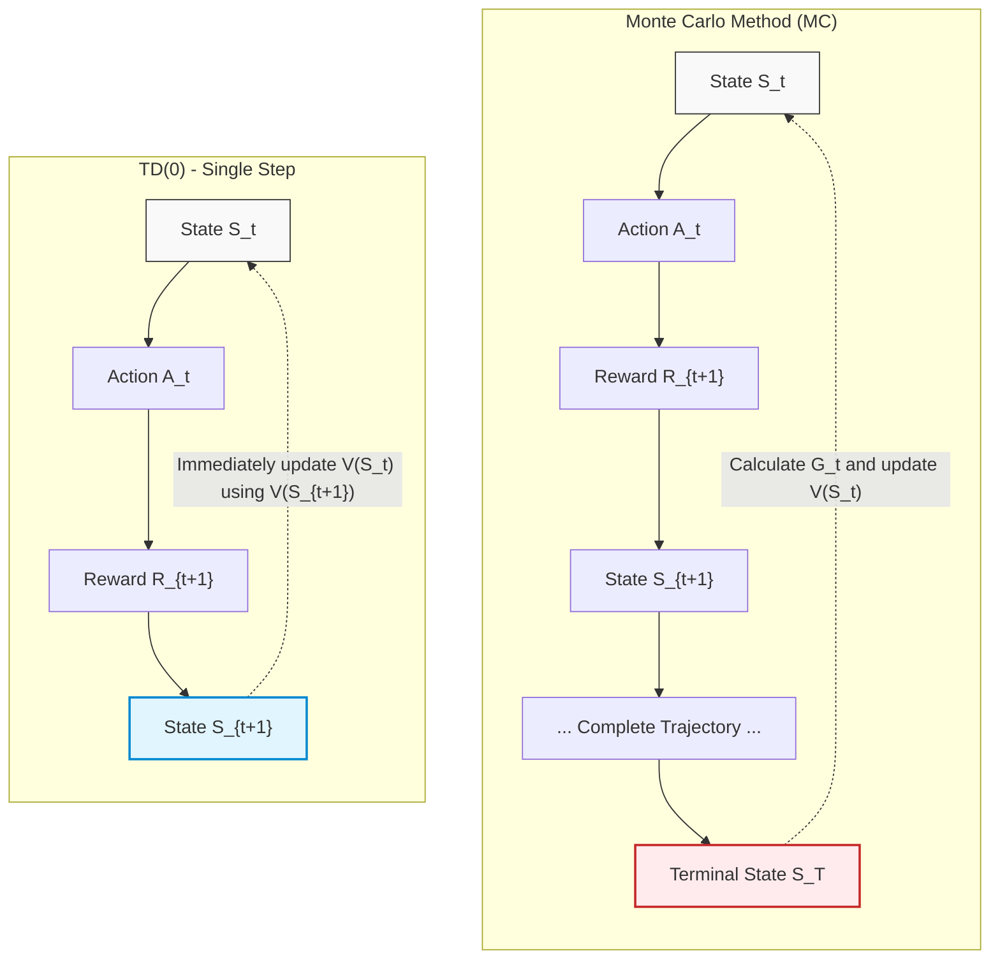
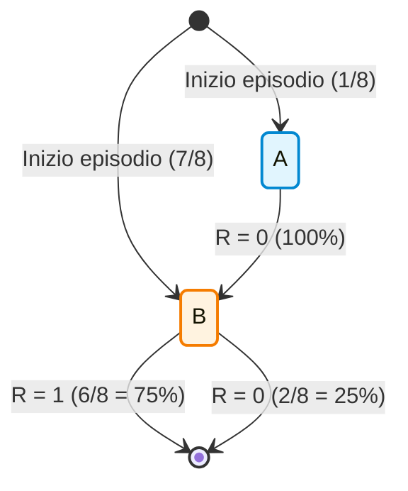
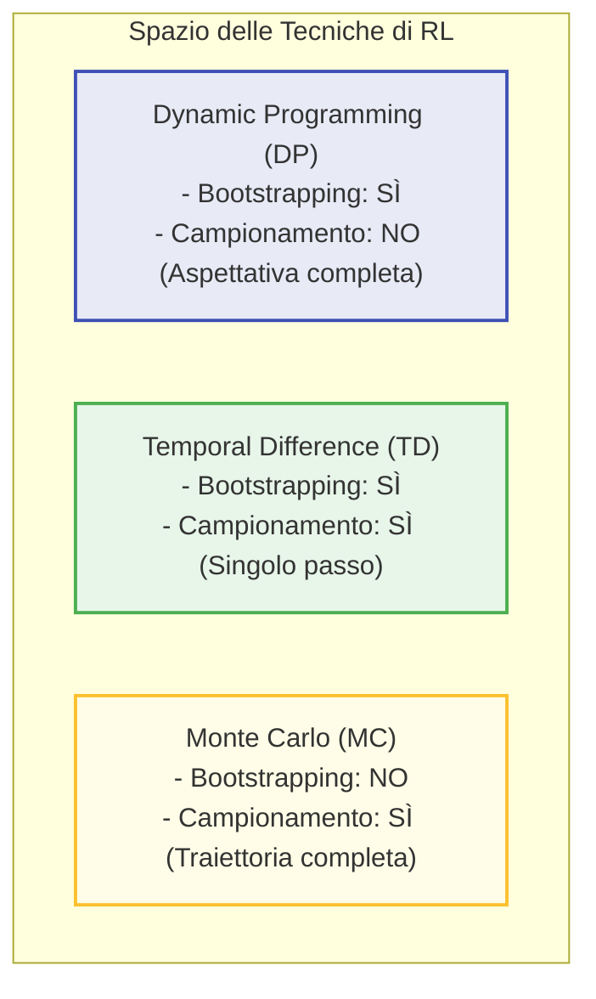
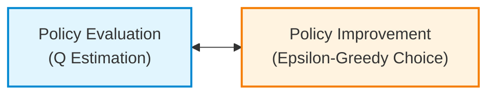
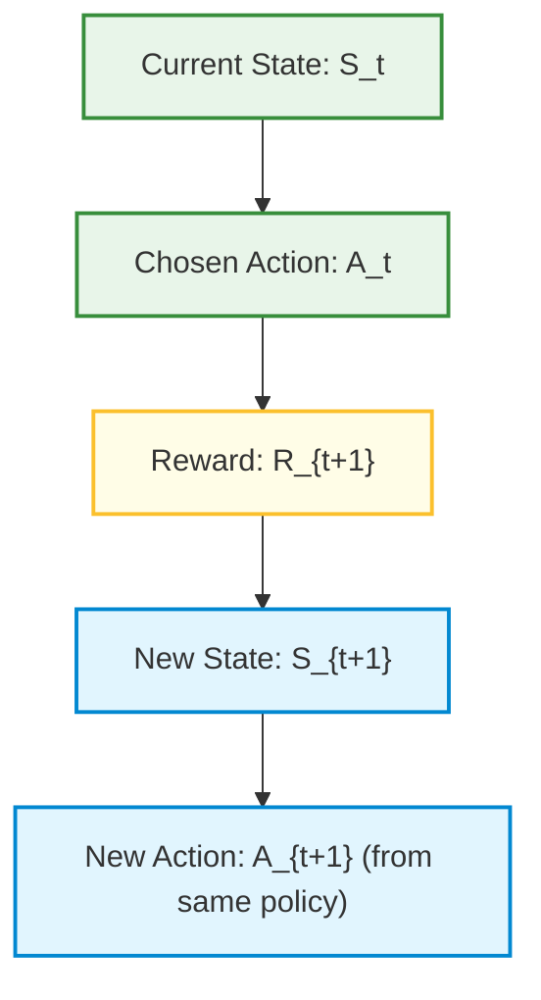

# Foundations of Temporal Difference Learning and Bootstrapping

## Educational Overview

In this lecture, the **Temporal Difference Learning** (TD Learning) paradigm is explored in depth, considered one of the core concepts of *Reinforcement Learning* (RL). The main objective is to analyze the structural differences between **Monte Carlo** methods and TD methods, with a focus on the **Prediction** problem and the foundations for **Control**.

The key points covered include:
* **Incremental vs. Every-Episode Update**: While Monte Carlo methods require completing the entire episode to calculate the actual return $G_t$, TD learning performs *online* and step-by-step (*one-step*) updates as soon as an immediate reward is obtained $R_{t+1}$.
* **Concept of Bootstrapping**: Definition of *bootstrapping* as the practice of updating an estimate based on a previous estimate. This mechanism, implicitly present in dynamic programming and Bellman equations, constitutes the mathematical engine of TD methods.
* **TD Target**: Decomposition of the future return $G_t$ into the sum of the immediate reward $R_{t+1}$ and the discounted estimate of the next state $\gamma V(S_{t+1})$. The value $R_{t+1} + \gamma V(S_{t+1})$ represents the best available approximation at time $t+1$ of the expected return.

---

### Introduction and Philosophy of Temporal Difference (TD) Learning

In the study of Reinforcement Learning (RL), **Temporal Difference Learning (TD Learning)** represents one of the fundamental concepts. The algorithm embodies the true essence of RL, combining the key ideas of the *Monte Carlo Method (MC)* and *Dynamic Programming (DP)*.

To understand the need for TD Learning, it is useful to analyze the main limitation of Monte Carlo methods:

1. **Limitation of Monte Carlo methods:** To update the value estimate of a state $V(s)$, Monte Carlo methods must wait for the end of the entire episode. This occurs because they use the **final return** $G_t$, defined as the discounted sum of all rewards obtained from time step $t$ until the end of the trajectory:
   $$G_t = R_{t+1} + \gamma R_{t+2} + \gamma^2 R_{t+3} + \dots = \sum_{k=0}^{\infty} \gamma^k R_{t+k+1}$$
   Having to wait for the episode to end creates an inefficiency: as soon as the agent takes a step and receives new information (a reward), it would be preferable to use it immediately rather than waiting for the process to finish.

2. **The Concept of Bootstrapping:** 
   The fundamental idea of TD Learning is to update an estimate based on a previous estimate, a mechanism known as *bootstrapping*. Although the word is used explicitly for temporal differences, the concept was already implicit in the *Bellman Equations* and Dynamic Programming, where the value of a state is defined recursively as a function of the value of subsequent states.

---

### Quantitative Mechanics of TD(0) for Prediction

In the **prediction** problem, the goal is to evaluate how good a given policy $\pi$is, by estimating the **state-value function** $V^\pi(s)$.

Instead of using exact averages or waiting for the return $G_t$, TD Learning adopts an **incremental update** at every single time step (hence the notation $TD(0)$).

#### Return Decomposition and Online Estimation
In a trajectory, the actual return $G_t$ can be decomposed into the first immediate reward $R_{t+1}$ plus the discounted return starting from the next state $S_{t+1}$:
$$G_t = R_{t+1} + \gamma G_{t+1}$$

Since at time step $t+1$ we do not know the true value of $G_{t+1}$, we replace it with our current best estimate of state $S_{t+1}$, namely $V(S_{t+1})$.

> **Key Concept**  
> One must never confuse the **short-term reward** ("$R_{t+1}$") with the **long-term return** ("$G_t$"). The single reward $R_{t+1}$ is not a proxy for the complete return, but represents only an immediate portion of it. The estimate $V(S_{t+1})$ covers all the missing part.

#### Update Equation of TD(0)
The fundamental update equation of $TD(0)$ for estimating $V(S_t)$ is:

$$V(S_t) \leftarrow V(S_t) + \alpha \left[ R_{t+1} + \gamma V(S_{t+1}) - V(S_t) \right]$$

Where:
* $\alpha \in (0, 1]$ is the **learning rate** (or *step-size*).
* $\gamma \in [0, 1]$ is the **discount factor**.
* **TD Target:** The quantity $R_{t+1} + \gamma V(S_{t+1})$ represents the best estimate of the return $G_t$ available at time $t+1$.
* **TD Error:** Usually denoted by $\delta_t$, defines the difference between the updated estimate (the TD Target) and the current estimate $V(S_t)$:
  $$\delta_t = R_{t+1} + \gamma V(S_{t+1}) - V(S_t)$$

---

### Structural Comparison: TD(0) vs Monte Carlo

The operational difference between Monte Carlo and Temporal Difference is reflected in the update structure and data requirements.



#### Advantages of TD Learning over Monte Carlo:
1. **Continuing Tasks:** Monte Carlo requires the presence of a terminal state to calculate $G_t$. In ongoing problems (continuing processes), Monte Carlo cannot be applied without approximations or mathematical tricks related to $\gamma$. TD Learning naturally handles tasks of infinite duration, as it only requires the transition $(S_t, A_t, R_{t+1}, S_{t+1})$.
2. **Incomplete or Interrupted Data:** In the presence of noisy sensors, loss of transmission, or interrupted sequences, Monte Carlo fails because the final outcome is missing. TD Learning, on the other hand, can update state values based on individual available valid transitions.
3. **Learning Speed:** TD modifies estimates *online* at every step. This generally makes it faster to converge and adapt compared to Monte Carlo.

---

### Parameter Analysis: The Role of the Learning Rate $\alpha$

In TD Learning, as well as in incrementalized Monte Carlo methods, the choice of the parameter $\alpha$ controls how aggressively new information overwrites past knowledge.

#### Trade-off between Learning Speed and Variance

* **High values of $\alpha$ (e.g., $\alpha = 0.15, 0.20$):**
  * *Advantage:* Extremely rapid reduction of error in the early stages of the learning process.
  * *Disadvantage:* High steady-state variance. The final estimate remains noisy because each new data point significantly alters $V(s)$, preventing the estimate from stabilizing.

* **Low values of $\alpha$ (e.g., $\alpha = 0.01, 0.04$):**
  * *Advantage:* Greater stability and a smooth/monotonic error trajectory. Final variance is minimal.
  * *Disadvantage:* Extreme initial slowness. If the starting estimate is arbitrary (e.g., all values initialized to $0$), it will take many episodes before information propagates.

```
Errore di Stima (MSE)
  ^
  |  \ (Alpha Alto: Discesa rapida, ma instabile nel finale)
  |   \____/\_/\/\___
  |   \
  |    \ (Alpha Basso: Discesa lenta, ma convergenza liscia)
  |     \___________
  +-----------------------------------> Numero di Episodi
```

> **Key Concept**  
> The optimal strategy for managing $\alpha$ consists in adopting a **variable/decaying learning rate (*learning rate decay*)**:
> 1. Set a high $\alpha$ **in the early stages** of training, when the estimate $V(s)$ is unreliable and it is necessary to learn quickly from new data.
> 2. **Progressively reduce $\alpha$** as accumulated experience increases, in order to dampen the impact of noise on individual samples and ensure convergence of the estimate.

This logic is entirely analogous to learning rate decay widely used in neural network training in *Deep Learning*.

#### Long-Term Convergence Properties
By indefinitely increasing the number of samples and episodes collected by the agent, both Monte Carlo methods and TD methods will converge toward the correct policy evaluation. The substantial difference lies in the computational efficiency of the convergence path and in the ability of TD Learning to operate in real time at every state transition.

---

### The Bias-Variance Trade-off in Reinforcement Learning

In comparing *Monte Carlo (MC)* and *Temporal Difference (TD) Learning*, there is no single method that dominates the other in an absolute sense. The choice between these two families of algorithms is governed by a fundamental **Bias-Variance Trade-off**.

To understand this concept in the context of Reinforcement Learning (RL), it is necessary to recall the basic statistical definitions:
* **Bias:** Measures how much the average estimated value differs from the true value of the quantity to be estimated. An estimator with high bias makes a systematic error, always oriented in the same direction.
* **Variance:** Measures the dispersion of estimates around their mean value. An estimator with high variance is correct on average (zero bias), but individual samples can fluctuate drastically.

```
       [Basso Bias, Bassa Varianza]       [Alto Bias, Bassa Varianza]
                 (Ideale)                      (Tipico di TD)
                    🎯                              🎯
                 (  •  )                         ( •   )
                 
       [Basso Bias, Alta Varianza]        [Alto Bias, Alta Varianza]
             (Tipico di MC)                      (Da evitare)
                    🎯                              🎯
                •  (   )  •                        • (   )
                 •   •                                 •   •
```

#### Origin of Bias and Variance in MC and TD

1. **Monte Carlo (No Bias, High Variance):**
   * The cumulative return $G_t = \sum_{k=0}^{\infty} \gamma^k R_{t+k+1}$ is an **unbiased estimator** of the true value function $V^\pi(s_t)$.
   * **High Variance:** To calculate $G_t$, the agent must accumulate rewards along an entire trajectory until the end of the episode. The accumulation of many stochastic decisions of the policy $\pi$, combined with the probabilistic transitions of the environment, sums the uncertainty of many time steps:
     $$Var(G_t) \text{ cresce con la lunghezza dell'episodio}$$

2. **TD Learning / TD(0) (Has Bias, Low Variance):**
   * The *TD Target*, defined as $R_{t+1} + \gamma V(S_{t+1})$, replaces the actual future return with the current estimate $V(S_{t+1})$. At the beginning of training, $V(S_{t+1})$ is inaccurate or arbitrary, introducing an **initial bias**.
   * **Reduced Variance:** Since the TD Target considers the random variables of a single time step ($R_{t+1}$ and $S_{t+1}$), the variability associated with it is very limited:
     $$Var(R_{t+1} + \gamma V(S_{t+1})) \ll Var(G_t)$$

> **Key Concept**: Monte Carlo guarantees zero bias at the cost of high variance in the estimates (long trajectories accumulate stochastic noise). TD(0) drastically reduces variance by considering a single time step, but pays a price in terms of bias, depending on a potentially wrong initial estimate (*Bootstrapping*).

Another fundamental operational difference lies in sensitivity to initial values: Monte Carlo is less influenced by the initialization of the value table $V_0(s)$, because it waits for the complete actual return before updating estimates. In contrast, TD(0) builds its updates directly on the existing estimate from the very first time step.

---

### Practical Example: The Two-State Problem $A$ and $B$

To understand the profound difference in **what** the two methods converge to, consider a simplified Markov Decision Process (MDP) composed of only two states, $A$ and $B$, with discount factor $\gamma = 1$.

Suppose we have a static experience dataset consisting of **8 episodes**:

* **1 episode:** Starts from $A$, transitions to $B$ receiving reward $0$, then terminates receiving reward $0$:
  $$A \xrightarrow{R=0} B \xrightarrow{R=0} \text{Fine}$$
* **6 episodes:** Start from $B$, receive reward $1$ and terminate:
  $$B \xrightarrow{R=1} \text{Fine} \quad (\text{ripetuto 6 volte})$$
* **1 episode:** Starts from $B$, receives reward $0$ and terminates:
  $$B \xrightarrow{R=0} \text{Fine} \quad (\text{ripetuto 1 volta})$$



#### Calculation of Value Estimates $V(B)$ and $V(A)$

1. **Estimation of the value of $B$, $V(B)$:**
   All 8 episodes pass through state $B$, from which a total of six rewards equal to $1$ and two rewards equal to $0$are observed. For both Monte Carlo and TD, the expected value from $B$ is the empirical mean of the returns:
   $$V(B) = \frac{6 \cdot 1 + 2 \cdot 0}{8} = \frac{6}{8} = \frac{3}{4} = 0.75$$

2. **Estimation of the value of $A$, $V(A)$:**
   Here the philosophies of Monte Carlo and TD diverge radically in the numerical outcome.

   * **Monte Carlo Approach:**
     Monte Carlo evaluates $V(A)$ considering exclusively the total returns observed in episodes that started in or passed through $A$. The only available episode for $A$ shows a total return equal to $G_A = 0 + 0 = 0$. Therefore:
     $$V_{MC}(A) = 0$$

   * **Temporal Difference Approach (TD(0)):**
     *Note: Step integrated with educational clarity.*
     TD(0) applies the update equation using the principle of bootstrapping: $V(A) = R_{A \to B} + \gamma V(B)$. Substituting the values estimated from the available data ($R_{A \to B} = 0$ and $V(B) = 3/4$):
     $$V_{TD}(A) = 0 + 1 \cdot \frac{3}{4} = \frac{3}{4} = 0.75$$

#### Convergence Properties: Minimum MSE vs Markov Model

The two values obtained ($V_{MC}(A) = 0$ and $V_{TD}(A) = 0.75$) show that both algorithms are logically correct, but optimize two different criteria:

* **Monte Carlo** converges to the value that minimizes the **Mean Squared Error (MSE)** with respect to the observed data in the dataset:
  $$\min \sum_{i} (G_i - V(S_i))^2$$
  MC ignores the causal state-transition structure of the MDP; it observes that when the agent was in $A$, at the end of the episode it obtained $0$.

* **TD(0)** converges to the solution of the **Maximum Likelihood Markov Model**. 
  TD implicitly builds a model of the underlying structure: it observes that from $A$ it always transitions to $B$ with probability $1.0$, and that the expected return from $B$ is $0.75$. Consequently, the consistent Markovian value for $A$ must be $0.75$.

> **Key Concept**: Monte Carlo memorizes the outcome of observed data by minimizing the MSE on the samples. TD(0) exploits the Markov property and adapts to the environment's structure, often being more efficient when the Markov assumption holds.

---

### Comparative Framework: DP, MC, and TD Compared

The three fundamental approaches to value prediction in Reinforcement Learning can be structured along two orthogonal conceptual axes:
1. **Bootstrapping:** The estimate update uses other estimates (yes) or relies only on actual returns (no).
2. **Sampling:** The update is based on samples of actual experience (yes) or requires the full theoretical expectation over all possible transitions via model (no).



The following table summarizes the key characteristics of the three algorithms:

| Property | Dynamic Programming (DP) | Monte Carlo (MC) | Temporal Difference (TD(0)) |
| :--- | :--- | :--- | :--- |
| **Requires Environment Model ($P, R$)?** | **Yes** (Expectation calculation) | **No** (Learns from experience) | **No** (Learns from experience) |
| **Performs Sampling?** | **No** (Examines all actions/states) | **Yes** (Follows a trajectory) | **Yes** (Follows a transition) |
| **Performs Bootstrapping?** | **Yes** (Uses $V(S')$) | **No** (Uses the final return $G_t$) | **Yes** (Uses $V(S_{t+1})$) |
| **Bias/Variance** | Low Bias / Zero Variance | Zero Bias / High Variance | Initial Bias / Low Variance |
| **Convergence Criterion** | Exact Bellman Equation | Minimum Mean Squared Error (MSE) | Maximum Likelihood Markov Model |
| **Update Depth (Backup)** | Single-step depth | Entire trajectory until terminal | Single-step depth |
| **Update Width (Backup)** | Full (Full tree) | Single sampled branch | Single sampled branch |

---

### Control in TD Learning: From State-Value to Action-Value Function

To move from the **Prediction** problem to the **Control** problem in **Temporal-Difference Learning (TD)**, we reuse the general paradigm of **Generalized Policy Iteration (GPI)**.



The core principle of control remains unchanged:
1. We evaluate the performance of the current policy.
2. We act greedily or near-greedily ($\epsilon$-*greedy*) with respect to newly acquired knowledge to improve the policy itself.

#### The Fundamental Transition: From $V(s)$ to $Q(s, a)$

In the prediction phase, we estimated the state-value function $V(s)$. However, in **model-free** control problems—where we do not know the environment's transition dynamics $P(s' | s, a)$ —, knowing only $V(s)$ is not sufficient to act greedily.

If we only had $V(s)$, to choose the best action we would need to compute:

$$\pi'(s) = \arg\max_{a} \sum_{s', r} P(s', r | s, a) \left[ r + \gamma V(s') \right]$$

Without the model $P(s', r | s, a)$, this computation is impossible. For this reason, in TD Learning for control as well, we replace the value function $V(s)$ with the **action-value function** $Q(s, a)$. With knowledge of $Q(s, a)$, the greedy decision becomes immediate and does not require knowledge of the environment:

$$\pi'(s) = \arg\max_{a} Q(s, a)$$

#### The Online Update Philosophy in TD Control

Unlike *Policy Iteration* (which waits for the perfect estimate of $Q^\pi$ before updating the policy) or the *Monte Carlo* method (which waits for the end of the entire episode), TD Learning updates the estimate step-by-step at every single step. As soon as we collect a new transition of data, we update the estimate of $Q$ and immediately adapt our policy accordingly.

---

### The SARSA Algorithm (On-Policy TD Control)

The first control algorithm we analyze is called **SARSA**. The term is an acronym derived directly from the sequence of elements that make up a single transition in the agent's trajectory:

$$\dots, S_t, A_t, R_{t+1}, S_{t+1}, A_{t+1}, \dots$$

namely: **S**tate ($S_t$), **A**ction ($A_t$), **R**eward ($R_{t+1}$), new **S**tate ($S_{t+1}$), new **A**ction ($A_{t+1}$).



#### SARSA Update Equation

Replacing $V$ with $Q$ in the classic TD(0) update equation, we obtain the SARSA update rule:

$$Q(S_t, A_t) \leftarrow Q(S_t, A_t) + \alpha \left[ R_{t+1} + \gamma Q(S_{t+1}, A_{t+1}) - Q(S_t, A_t) \right]$$

Where:
* **TD Target**: $R_{t+1} + \gamma Q(S_{t+1}, A_{t+1})$
* **TD Error**: $\delta_t = R_{t+1} + \gamma Q(S_{t+1}, A_{t+1}) - Q(S_t, A_t)$
* $\alpha \in (0, 1]$ is the learning rate.
* $\gamma \in [0, 1]$ is the discount factor.

> > **KEY CONCEPT: Importance of the order of operations and the On-Policy nature**
> 
> SARSA is an **On-Policy** algorithm. This means it estimates the value $Q^\pi(s, a)$ of policy $\pi$ that the agent is *actually executing* in the environment (including the exploration component, such as the $\epsilon$-greedy choice).
> 
> **Attention to order in implementation:**
> When updating $Q(S_t, A_t)$, the second action $A_{t+1}$ must **already have been chosen** following the current policy $\pi$ derived from $Q$ before modifying the table $Q$.
> 
> If you alter the order of these operations—for example, updating the policy before selecting $A_{t+1}$ or selecting $A_{t+1}$ via a pure $\arg\max$ without following its actual execution—**you are no longer executing SARSA**, but rather a different algorithm (such as *Q-Learning*). Changing the logical order of instructions in code leads to completely different mathematical behaviors.

---

### Pseudocode of the SARSA Algorithm

Let us analyze the structure of the algorithm. The intelligent update is performed inside the nested loop at every single spatial step, and not at the end of the episode.

#### SARSA Procedure (for estimating $Q \approx q_*$)

1. **Parameter Initialization:**
   * Arbitrarily initialize the matrix $Q(s, a), \forall s \in \mathcal{S}, a \in \mathcal{A}(s)$.
   * Set $Q(\text{stato terminale}, \cdot) = 0$.
   * Set parameters: learning rate $\alpha \in (0, 1]$ and exploration parameter $\epsilon > 0$.

2. **Loop for each episode:**
   * Initialize start state $S$.
   * Choose action $A$ from state $S$ using policy derived from $Q$ (e.g., $\epsilon$-*greedy*).
   
   * **Loop for each step of episode** (until $S$ is terminal):
     1. Take action $A$, observe reward $R$ and next state $S'$.
     2. Choose next action $A'$ from state $S'$ using policy derived from $Q$ (e.g., $\epsilon$-*greedy*).
     3. **TD Update:**
        $$Q(S, A) \leftarrow Q(S, A) + \alpha \left[ R + \gamma Q(S', A') - Q(S, A) \right]$$
     4. Advance state and action: 
        $$S \leftarrow S'$$
        $$A \leftarrow A'$$

---

### Case Study: Windy Gridworld

To appreciate the effectiveness of SARSA compared to Monte Carlo, consider the classic **Windy Gridworld** environment.

```mermaid
gridworld
```

#### Environment Characteristics:
* **2D Grid:** The agent starts from node $S$ (*Start*) and must reach the goal $G$ (*Goal*).
* **Possible actions:** North, South, East, West.
* **Reward:** $R = -1$ for each step taken until reaching $G$. The goal is to minimize the total number of steps.
* **Wind Effect:** In some middle columns, there is a constant upward wind (South $\rightarrow$ North) that pushes the agent upward by 1 or 2 extra cells on each move.

#### Why Monte Carlo Fails and TD (SARSA) Succeeds?

In a complex environment like *Windy Gridworld*, an initial random policy will make the agent wander for a long time before it randomly manages to reach the goal $G$. 
* **Limitation of Monte Carlo:** Since it requires completing the entire episode to calculate the return $G_t$ and perform the first update, Monte Carlo will take an enormously long time just to finish the first episode. If the episode does not end, the algorithm learns nothing.
* **Advantage of SARSA (TD):** SARSA updates values $Q(S, A)$ at every single transition. Even if the agent does not immediately see the goal $G$, it immediately starts penalizing states/actions that lead it to wander or run into walls (receiving the penalty of $-1$ per step), learning an effective policy long before completing a large number of episodes.

#### Interpretation of the Performance Graph

In RL benchmarks for *Windy Gridworld*, the $X$ axis plots the cumulative count of steps taken in the environment (*Step count*), while the $Y$ axis plots the number of completed episodes (*Episode count*).

* **Slope Analysis:** 
  * In the early stages, the curve is almost flat: the agent takes many steps to complete the first episode.
  * As SARSA learns the optimal trajectory, the curve becomes **steep and constant**.
  * A high slope indicates that very few steps are needed to complete each episode, demonstrating that the optimal policy to overcome the wind force and reach $G$ in the shortest possible time.

---

> [!NOTE]
> ### Exam Notes and Instructor Notices
> - **First Midterm Syllabus:** The first midterm exam will cover all topics discussed up to next Monday's lecture (including *TD control*). The reference material spans from Chapter 1 to Chapter 6 of the textbook, keeping in mind that the slides constitute the main course material.
> - **Exam Rules and Format:** During the exam, consulting or bringing notes/materials is **not** allowed (*closed book*). Only a calculator and pens are permitted. The exam will evaluate preparation on the algorithms and theoretical concepts covered in class.
> - **Topic NOT tested on the exam (Mathematical detail of Max Likelihood Markov Model):** The instructor specified that they will never ask for the specific formula/slide deriving the *max likelihood markov model* to which *TD zero* converges; however, it is essential to remember the concept of what TD and Monte Carlo respectively converge to.
> - **Topic NOT tested on the exam (Use of experience batches):** The technicality illustrated regarding repeated reuse of the same batch of episodes to guarantee convergence will not be tested on the exam.