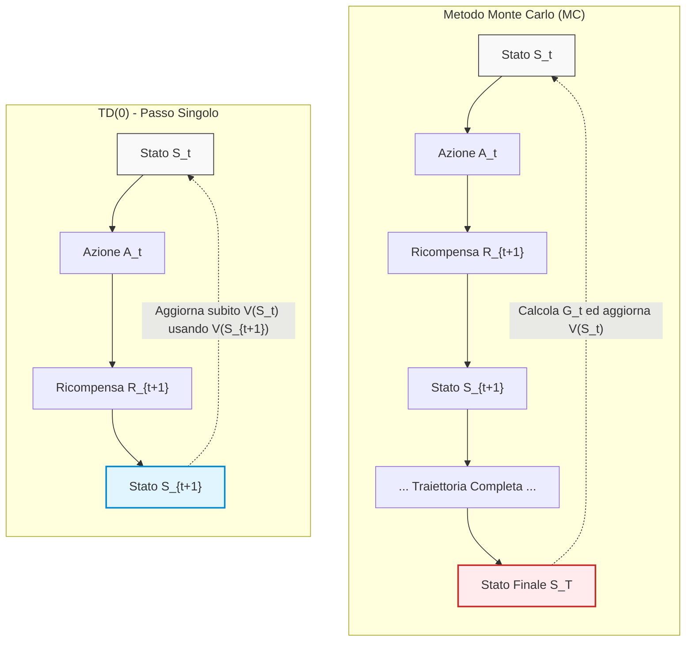
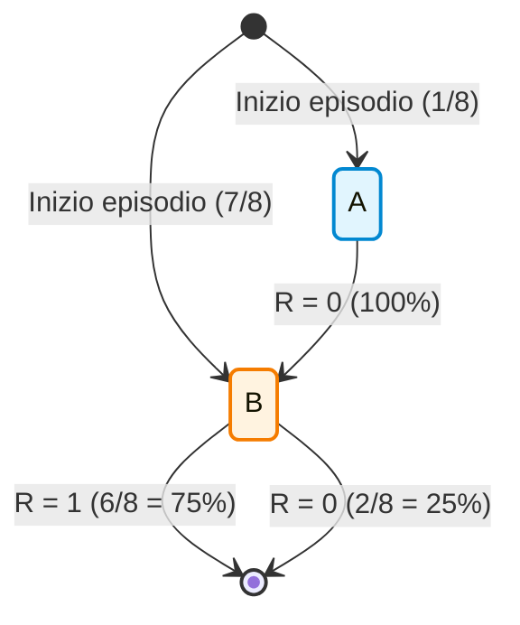
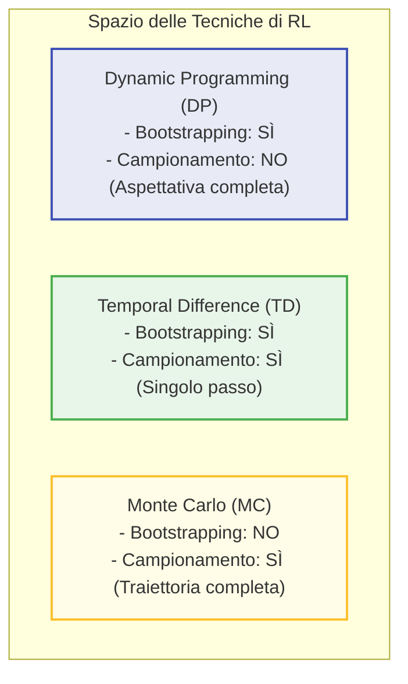
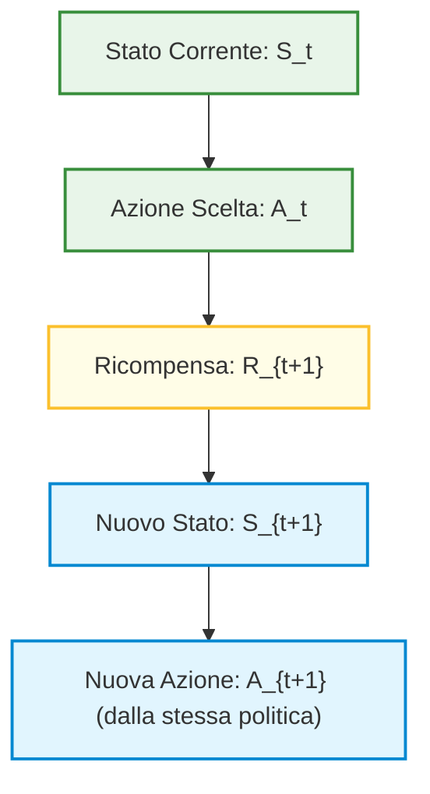

# Fondamenti di Apprendimento a Differenze Temporali (Temporal Difference Learning) e Bootstrapping

## Overview Didattica

In questa lezione viene approfondito il paradigma dell'**Apprendimento a Differenze Temporali** (*Temporal Difference Learning* - TD Learning), considerato uno dei concetti cardine del *Reinforcement Learning* (RL). L'obiettivo principale è analizzare le differenze strutturali tra i metodi **Monte Carlo** e i metodi TD, con particolare attenzione al problema della **Predizione** (*Prediction*) e alle basi per il **Controllo** (*Control*).

I punti chiave trattati includono:
* **Aggiornamento Incrementale vs. Ad Episodio Completo**: Mentre i metodi Monte Carlo richiedono il completamento dell'intero episodio per calcolare il ritorno reale $G_t$, l'apprendimento TD effettua aggiornamenti *online* e passo-passo (*one-step*) non appena si ottiene una ricompensa immediata $R_{t+1}$.
* **Concetto di Bootstrapping**: Definizione del *bootstrapping* come la pratica di aggiornare una stima sulla base di un'altra stima precedente. Questo meccanismo, implicitamente presente nella programmazione dinamica e nelle equazioni di Bellman, costituisce il motore matematico dei metodi TD.
* **Target TD (*TD Target*)**: Scomposizione del ritorno futuro $G_t$ nell'unione della ricompensa immediata $R_{t+1}$ e della stima discounted dello stato successivo $\gamma V(S_{t+1})$. Il valore $R_{t+1} + \gamma V(S_{t+1})$ rappresenta la migliore approssimazione disponibile al tempo $t+1$ del ritorno atteso.

---

### Introduzione e Filosofia del Temporal Difference (TD) Learning

Nello studio del Reinforcement Learning (RL), l'**Apprendimento per Differenze Temporali (*Temporal Difference Learning - TD Learning*)** rappresenta uno dei concetti fondamentali. L'algoritmo racchiude la vera essenza del RL, combinando le idee chiave del *Metodo Monte Carlo (Monte Carlo Method - MC)* e della *Programmazione Dinamica (Dynamic Programming - DP)*.

Per comprendere la necessità del TD Learning, è utile analizzare il limite principale dei metodi Monte Carlo:

1. **Limite dei metodi Monte Carlo:** Per aggiornare la stima del valore di uno stato $V(s)$, i metodi Monte Carlo devono attendere la fine dell'intero episodio. Questo accade perché utilizzano il **ritorno finale** $G_t$, definito come la somma scontata di tutte le ricompense ottenute dall'istante $t$ fino al termine della traiettoria:
   $$G_t = R_{t+1} + \gamma R_{t+2} + \gamma^2 R_{t+3} + \dots = \sum_{k=0}^{\infty} \gamma^k R_{t+k+1}$$
   Dover attendere la conclusione dell'episodio genera un'inefficienza: non appena l'agente compie un passo e riceve una nuova informazione (una ricompensa), sarebbe preferibile sfruttarla subito invece di attendere la fine del processo.

2. **Il concetto di Bootstrapping (*Bootstrapping*):** 
   L'idea fondamentale del TD Learning è aggiornare una stima basandosi su una stima precedente, un meccanismo noto come *bootstrapping*. Sebbene la parola sia usata esplicitamente per le differenze temporali, il concetto era già implicito nelle *Equazioni di Bellman* e nella Programmazione Dinamica, dove il valore di uno stato viene definito ricorsivamente in funzione del valore degli stati successivi.

---

### Meccanica Quantitativa del TD(0) per la Predizione

Nel problema della **predizione** (*prediction*), l'obiettivo è valutare quanto sia buona una determinata politica $\pi$, stimando la **funzione valore di stato** $V^\pi(s)$.

Invece di utilizzare medie esatte o attendere il ritorno $G_t$, il TD Learning adotta un **aggiornamento incrementale (*incremental update*)** ad ogni singolo passo temporale (da cui la notazione $TD(0)$).

#### Decomposizione del Ritorno e Stima On-line
In una traiettoria, il ritorno reale $G_t$ può essere scomposto nel primo premio immediato $R_{t+1}$ più il ritorno scontato a partire dallo stato successivo $S_{t+1}$:
$$G_t = R_{t+1} + \gamma G_{t+1}$$

Dal momento che all'istante $t+1$ non conosciamo il vero valore di $G_{t+1}$, lo sostituiamo con la nostra migliore stima corrente dello stato $S_{t+1}$, ovvero $V(S_{t+1})$.

> **Concetto Chiave**  
> Non bisogna mai confondere la **ricompensa a breve termine** ($R_{t+1}$) con il **ritorno a lungo termine** ($G_t$). La singola ricompensa $R_{t+1}$ non è un sostituto (*proxy*) del ritorno completo, ma ne rappresenta solo una porzione immediata. La stima $V(S_{t+1})$ copre tutta la parte mancante.

#### Equazione di Aggiornamento del TD(0)
L'equazione fondamentale di aggiornamento del $TD(0)$ per la stima di $V(S_t)$ è:

$$V(S_t) \leftarrow V(S_t) + \alpha \left[ R_{t+1} + \gamma V(S_{t+1}) - V(S_t) \right]$$

Dove:
* $\alpha \in (0, 1]$ è il **tasso di apprendimento** (*learning rate* o *step-size*).
* $\gamma \in [0, 1]$ è il **fattore di sconto** (*discount factor*).
* **Target TD (*TD Target*):** La quantità $R_{t+1} + \gamma V(S_{t+1})$ rappresenta la migliore stima del ritorno $G_t$ disponibile al tempo $t+1$.
* **Errore TD (*TD Error*):** Indicato solitamente con $\delta_t$, definisce la differenza tra la stima aggiornata (il Target TD) e la stima corrente $V(S_t)$:
  $$\delta_t = R_{t+1} + \gamma V(S_{t+1}) - V(S_t)$$

---

### Confronto Strutturale: TD(0) vs Monte Carlo

La differenza operativa tra Monte Carlo e Temporal Difference si riflette nella struttura dell'aggiornamento e nei requisiti sui dati.



#### Vantaggi del TD Learning rispetto al Monte Carlo:
1. **Compiti Continui (*Continuing Tasks*):** Monte Carlo richiede la presenza di uno stato terminale per calcolare $G_t$. Nei problemi senza fine (processi continui), Monte Carlo non può essere applicato senza approssimazioni o trucchi matematici legati a $\gamma$. Il TD Learning gestisce in modo naturale compiti di durata infinita, poiché necessita solo della transizione $(S_t, A_t, R_{t+1}, S_{t+1})$.
2. **Dati Incompleti o Interrotti:** In presenza di sensori rumorosi, perdite di trasmissione o sequenze interrotte, Monte Carlo fallisce poiché manca l'esito finale. Il TD Learning può invece aggiornare il valore degli stati basandosi sulle singole transizioni valide disponibili.
3. **Velocità di Apprendimento:** Il TD modifica le stime *on-line* ad ogni passo. Questo lo rende generalmente più rapido nel convergere e nell'adattarsi rispetto a Monte Carlo.

---

### Analisi dei Parametri: Il Ruolo del Tasso di Apprendimento $\alpha$

Nel TD Learning, così come nei metodi Monte Carlo incrementalizzati, la scelta del parametro $\alpha$ regola l'aggressività con cui le nuove informazioni sovrascrivono la conoscenza passata.

#### Trade-off tra Velocità di Apprendimento e Varianza

* **Valori di $\alpha$ elevati (es. $\alpha = 0.15, 0.20$):**
  * *Vantaggio:* Riduzione estremamente rapida dell'errore nelle prime fasi del processo di apprendimento.
  * *Svantaggio:* Elevata varianza a regime. La stima finale rimane rumorosa perché ogni nuovo punto dato altera sensibilmente $V(s)$, impedendo alla stima di stabilizzarsi.

* **Valori di $\alpha$ bassi (es. $\alpha = 0.01, 0.04$):**
  * *Vantaggio:* Maggiore stabilità e traiettoria di errore fluida/monotona. La varianza finale è minima.
  * *Svantaggio:* Estrema lentezza iniziale. Se la stima di partenza è arbitraria (ad es. tutti i valori inizializzati a $0$), ci vorranno molti episodi prima che l'informazione si propaghi.

```
Errore di Stima (MSE)
  ^
  |  \ (Alpha Alto: Discesa rapida, ma instabile nel finale)
  |   \____/\_/\/\___
  |   \
  |    \ (Alpha Basso: Discesa lenta, ma convergenza liscia)
  |     \___________
  +-----------------------------------> Numero di Episodi
```

> **Concetto Chiave**  
> La strategia ottimale per la gestione di $\alpha$ consiste nell'adottare un **tasso di apprendimento variabile/decrescente (*learning rate decay*)**:
> 1. Impostare un $\alpha$ **elevato nelle prime fasi** di addestramento, quando la stima $V(s)$ è inaffidabile ed è necessario apprendere velocemente dai nuovi dati.
> 2. **Ridurre progressivamente $\alpha$** con l'aumentare dell'esperienza accumulata, in modo da smorzare l'impatto del rumore sui singoli campioni e garantire la convergenza della stima.

Questa logica è del tutto analoga allo schienamento del *learning rate* ampiamente utilizzato nell'addestramento di reti neurali nel *Deep Learning*.

#### Proprietà di Convergenza a Lungo Termine
Aumentando indefinitamente il numero di campioni ed episodi raccolti dall'agente, sia i metodi Monte Carlo sia i metodi TD convergeranno verso la valutazione corretta della politica. La differenza sostanziale risiede nell'efficienza computazionale del percorso di convergenza e nella capacità del TD Learning di operare in tempo reale ad ogni transizione di stato.

---

### Il Trade-off Bias-Varianza nel Reinforcement Learning

Nel confronto tra *Monte Carlo (MC)* e *Temporal Difference (TD) Learning*, non esiste un metodo che domini l'altro in senso assoluto. La scelta tra queste due famiglie di algoritmi è governata da un fondamentale **Trade-off Bias-Varianza (Bias-Variance Trade-off)**.

Per comprendere questo concetto nel contest del Reinforcement Learning (RL), occorre richiamare le definizioni statistiche di base:
* **Distorsione (Bias):** Misura quanto il valore stimato medio differisca dal valore reale della quantità da stimare. Uno stimatore con alto bias commette un errore sistematico, orientato sempre nella stessa direzione.
* **Varianza (Variance):** Misura la dispersione delle stime attorno al loro valore medio. Uno stimatore ad alta varianza è corretto in media (bias nullo), ma i singoli campioni possono fluttuare drasticamente.

```
       [Basso Bias, Bassa Varianza]       [Alto Bias, Bassa Varianza]
                 (Ideale)                      (Tipico di TD)
                    🎯                              🎯
                 (  •  )                         ( •   )
                 
       [Basso Bias, Alta Varianza]        [Alto Bias, Alta Varianza]
             (Tipico di MC)                      (Da evitare)
                    🎯                              🎯
                •  (   )  •                        • (   )
                 •   •                                 •   •
```

#### Origine del Bias e della Varianza in MC e TD

1. **Monte Carlo (Nessun Bias, Alta Varianza):**
   * Il ritorno cumulato $G_t = \sum_{k=0}^{\infty} \gamma^k R_{t+k+1}$ è una **stima non distorta (unbiased estimator)** della funzione valore reale $V^\pi(s_t)$.
   * **Varianza Elevata:** Per calcolare $G_t$, l'agente deve accumulare ricompense lungo un'intera traiettoria fino alla fine dell'episodio. L'accumulo di molte decisioni stocastiche della politica $\pi$, unito alle transizioni probabilistiche dell'ambiente, somma l'incertezza di molti passi temporali:
     $$Var(G_t) \text{ cresce con la lunghezza dell'episodio}$$

2. **TD Learning / TD(0) (Presenta Bias, Bassa Varianza):**
   * Il *Target TD*, definito come $R_{t+1} + \gamma V(S_{t+1})$, sostituisce il ritorno futuro reale con la stima corrente $V(S_{t+1})$. All'inizio dell'addestramento, $V(S_{t+1})$ è inaccurata o arbitraria, introducendo un **bias iniziale**.
   * **Varianza Ridotta:** Poiché il Target TD considera le variabili casuali di un singolo passo temporale ($R_{t+1}$ e $S_{t+1}$), la variabilità ad esso associata è molto limitata:
     $$Var(R_{t+1} + \gamma V(S_{t+1})) \ll Var(G_t)$$

> **Concetto Chiave**: Monte Carlo garantisce assenza di bias a costo di un'alta varianza nelle stime (traiettorie lunghe accumulano rumore stocastico). TD(0) riduce drasticamente la varianza considerando un solo passo temporale, ma paga un prezzo in termini di bias, dipendendo da una stima iniziale potenzialmente errata (*Bootstrapping*).

Un'altra differenza operativa fondamentale risiede nella sensibilità ai valori iniziali: Monte Carlo è meno influenzato dall'inizializzazione della tabella dei valori $V_0(s)$, poiché attende il ritorno reale completo prima di aggiornare le stime. Al contrario, TD(0) costruisce i propri aggiornamenti direttamente sulla stima esistente fin dal primo passo temporale.

---

### Esempio Pratico: Il Problema dei due Stati $A$ e $B$

Per comprendere la differenza profonda su **cosa** convergano i due metodi, consideriamo un Processo Decisionale di Markov (*Markov Decision Process - MDP*) semplificato composto da due soli stati, $A$ e $B$, con fattore di sconto $\gamma = 1$.

Supponiamo di disporre di un dataset statico di esperienza composto da **8 episodi**:

* **1 episodio:** Parte da $A$, transita in $B$ ricevendo ricompensa $0$, poi termina ricevendo ricompensa $0$:
  $$A \xrightarrow{R=0} B \xrightarrow{R=0} \text{Fine}$$
* **6 episodi:** Partono da $B$, ricevono ricompensa $1$ e terminano:
  $$B \xrightarrow{R=1} \text{Fine} \quad (\text{ripetuto 6 volte})$$
* **1 episodio:** Parte da $B$, riceve ricompensa $0$ e termina:
  $$B \xrightarrow{R=0} \text{Fine} \quad (\text{ripetuto 1 volta})$$



#### Calcolo delle Stime di Valore $V(B)$ e $V(A)$

1. **Stima del valore di $B$, $V(B)$:**
   Tutti gli 8 episodi passano dallo stato $B$, dal quale si osservano complessivamente sei ricompense pari a $1$ e due ricompense pari a $0$. Sia per Monte Carlo che per TD, il valore atteso da $B$ è la media empirica dei ritorni:
   $$V(B) = \frac{6 \cdot 1 + 2 \cdot 0}{8} = \frac{6}{8} = \frac{3}{4} = 0.75$$

2. **Stima del valore di $A$, $V(A)$:**
   Qui le filosofie di Monte Carlo e TD divergono radicalmente nell'esito numerico.

   * **Approccio Monte Carlo:**
     Monte Carlo valuta $V(A)$ considerando esclusivamente i ritorni totali osservati negli episodi che sono iniziati o passati da $A$. L'unico episodio disponibile per $A$ mostra un ritorno totale pari a $G_A = 0 + 0 = 0$. Pertanto:
     $$V_{MC}(A) = 0$$

   * **Approccio Temporal Difference (TD(0)):**
     *Nota: Passaggio integrato con chiarezza didattica.*
     TD(0) applica l'equazione di aggiornamento sfruttando il principio del bootstrapping: $V(A) = R_{A \to B} + \gamma V(B)$. Inserendo i valori stimati dai dati disponibili ($R_{A \to B} = 0$ e $V(B) = 3/4$):
     $$V_{TD}(A) = 0 + 1 \cdot \frac{3}{4} = \frac{3}{4} = 0.75$$

#### Proprietà di Convergenza: Minimo MSE vs Modello Markoviano

I due valori ottenuti ($V_{MC}(A) = 0$ e $V_{TD}(A) = 0.75$) mostrano che entrambi gli algoritmi sono logicamente corretti, ma ottimizzano due criteri differenti:

* **Monte Carlo** converge al valore che minimizza l'**Errore Quadratico Medio (*Mean Squared Error - MSE*)** rispetto ai dati osservati nel dataset:
  $$\min \sum_{i} (G_i - V(S_i))^2$$
  MC ignora la struttura causale di transizione di stato dell'MDP; osserva che quando l'agente si è trovato in $A$, alla fine dell'episodio ha ottenuto $0$.

* **TD(0)** converge alla soluzione del **Modello Markoviano di Massima Verosimiglianza (*Maximum Likelihood Markov Model*)**. 
  TD costruisce implicitamente un modello della struttura sottostante: osserva che da $A$ si passa sempre a $B$ con probabilità $1.0$, e che l'aspettativa di ritorno da $B$ è $0.75$. Di conseguenza, il valore markoviano coerente per $A$ deve essere $0.75$.

> **Concetto Chiave**: Monte Carlo memorizza l'esito dei dati osservati minimizzando il MSE sui campioni. TD(0) sfrutta l'ipotesi markoviana e si adatta alla struttura dell'ambiente, risultando spesso più efficiente quando l'ipotesi di Markov è rispettata.

---

### Quadro Comparativo: DP, MC e TD a Confronto

I tre approcci fondamentali per la predizione del valore nel Reinforcement Learning possono essere strutturati lungo due assi concettuali ortogonali:
1. **Bootstrapping:** L'aggiornamento della stima utilizza altre stime (sì) o si basa solo su ritorni reali (no).
2. **Campionamento (Sampling):** L'aggiornamento si basa su campioni di esperienza reale (sì) o richiede l'aspettativa teorica completa su tutte le transizioni possibili via modello (no).



La seguente tabella riassume le caratteristiche distintive dei tre algoritmi:

| Proprietà | Dynamic Programming (DP) | Monte Carlo (MC) | Temporal Difference (TD(0)) |
| :--- | :--- | :--- | :--- |
| **Richiede Modello dell'Ambiente ($P, R$)?** | **Sì** (Calcolo aspettative) | **No** (Apprende dall'esperienza) | **No** (Apprende dall'esperienza) |
| **Effettua Campionamento (Sampling)?** | **No** (Esamina tutte le azioni/stati) | **Sì** (Segue una traiettoria) | **Sì** (Segue una transizione) |
| **Effettua Bootstrapping?** | **Sì** (Usa $V(S')$) | **No** (Usa il ritorno finale $G_t$) | **Sì** (Usa $V(S_{t+1})$) |
| **Bias/Varianza** | Bias Basso / Varianza Nulla | Bias Nullo / Varianza Alta | Bias Iniziale / Varianza Bassa |
| **Criterio di Convergenza** | Equazione di Bellman esatta | Minimo Errore Quadratico (MSE) | Modello Markoviano di Massima Verosimiglianza |
| **Profondità dell'Aggiornamento (*Backup*)** | Un singolo passo di profondità | Intera traiettoria fino alla fine | Un singolo passo di profondità |
| **Ampiezza dell'Aggiornamento (*Backup*)** | Totale (Albero completo) | Singolo ramo campionato | Singolo ramo campionato |

---

### Controllo nel TD Learning: Dal Valore di Stato alla Funzione di Azione

Per passare dal problema della **Predizione** (*Prediction*) a quello del **Controllo** (*Control*) nell'**Apprendimento a Differenze Temporali** (*Temporal-Difference Learning - TD*), riutilizziamo il paradigma generale dell'**Iterazione di Politica Generalizzata** (*Generalized Policy Iteration - GPI*).


Il principio base del controllo rimane inalterato:
1. Valutiamo le prestazioni della politica corrente.
2. Agiamo in modo avido (*greedy*) o quasi-avido ($\epsilon$-*greedy*) rispetto alle nuove conoscenze acquisite per migliorare la politica stessa.

#### Il passaggio fondamentale: da $V(s)$ a $Q(s, a)$

Nella fase di predizione abbiamo stimato la funzione di valore di stato $V(s)$. Tuttavia, nei problemi di controllo **privi di modello** (*model-free*) — dove non conosciamo le dinamiche di transizione dell'ambiente $P(s' | s, a)$ —, conoscere soltanto $V(s)$ non è sufficiente per agire avidamente. 

Se disponessimo solo di $V(s)$, per scegliere l'azione migliore dovremmo calcolare:

$$\pi'(s) = \arg\max_{a} \sum_{s', r} P(s', r | s, a) \left[ r + \gamma V(s') \right]$$

Senza il modello $P(s', r | s, a)$, questo calcolo è impossibile. Per questo motivo, anche nel TD Learning per il controllo, sostituiamo la funzione di valore $V(s)$ con la **funzione valore di azione** (*action-value function*) $Q(s, a)$. Con la conoscenza di $Q(s, a)$, la decisione avida diventa immediata e non richiede la conoscenza dell'ambiente:

$$\pi'(s) = \arg\max_{a} Q(s, a)$$

#### La filosofia di aggiornamento online nel TD Control

A differenza di *Policy Iteration* (che attende la stima perfetta di $Q^\pi$ prima di aggiornare la politica) o del metodo *Monte Carlo* (che attende la fine dell'intero episodio), il TD Learning aggiorna la stima ad ogni singolo passo (*step-by-step*). Non appena raccogliamo una nuova transizione di dati, aggiorniamo la stima di $Q$ e adattiamo subito la nostra politica di conseguenza.

---

### L'Algoritmo SARSA (On-Policy TD Control)

Il primo algoritmo di controllo che analizziamo prende il nome di **SARSA**. Il termine è un acronimo derivato direttamente dalla sequenza di elementi che compongono una singola transizione nella traiettoria dell'agente:

$$\dots, S_t, A_t, R_{t+1}, S_{t+1}, A_{t+1}, \dots$$

ovvero: **S**tato ($S_t$), **A**zione ($A_t$), **R**icompensa ($R_{t+1}$), nuovo **S**tato ($S_{t+1}$), nuova **A**zione ($A_{t+1}$).



#### Equazione di Aggiornamento di SARSA

Sostituendo $V$ con $Q$ nella classica equazione di aggiornamento del TD(0), otteniamo la regola di aggiornamento di SARSA:

$$Q(S_t, A_t) \leftarrow Q(S_t, A_t) + \alpha \left[ R_{t+1} + \gamma Q(S_{t+1}, A_{t+1}) - Q(S_t, A_t) \right]$$

Dove:
* **Target TD** (*TD Target*): $R_{t+1} + \gamma Q(S_{t+1}, A_{t+1})$
* **Errore TD** (*TD Error*): $\delta_t = R_{t+1} + \gamma Q(S_{t+1}, A_{t+1}) - Q(S_t, A_t)$
* $\alpha \in (0, 1]$ è il tasso di apprendimento (*learning rate*).
* $\gamma \in [0, 1]$ è il fattore di sconto (*discount factor*).

> > **CONCETTO CHIAVE: L'importanza dell'ordine delle operazioni e la natura On-Policy**
> 
> SARSA è un algoritmo **In-Politica** (*On-Policy*). Ciò significa che stima il valore $Q^\pi(s, a)$ della politica $\pi$ che l'agente sta *effettivamente eseguendo* nell'ambiente (inclusa la componente di esplorazione, come la scelta $\epsilon$-greedy).
> 
> **Attenzione all'ordine nell'implementazione:**
> Quando aggiorniamo $Q(S_t, A_t)$, la seconda azione $A_{t+1}$ dev'essere **già stata scelta** seguendo la politica corrente $\pi$ derivata da $Q$ prima di modificare la tabella $Q$. 
> 
> Se si altera l'ordine di queste operazioni — ad esempio aggiornando la politica prima di aver selezionato $A_{t+1}$ o scegliendo $A_{t+1}$ tramite un $\arg\max$ puro senza seguirne l'esecuzione reale — **non si sta più eseguendo SARSA**, bensì un algoritmo differente (come il *Q-Learning*). Cambiare l'ordine logico delle istruzioni nel codice porta a comportamenti matematici completamente differenti.

---

### Pseudo-codice dell'Algoritmo SARSA

Analizziamo la struttura dell'algoritmo. L'aggiornamento intelligente viene effettuato all'interno del ciclo nidificato ad ogni singolo passo spaziale, e non a fine episodio.

#### Procedura SARSA (per la stima di $Q \approx q_*$)

1. **Inizializzazione dei parametri:**
   * Inizializza arbitrariamente la matrice $Q(s, a), \forall s \in \mathcal{S}, a \in \mathcal{A}(s)$.
   * Imposta $Q(\text{stato terminale}, \cdot) = 0$.
   * Fissa i parametri: tasso di apprendimento $\alpha \in (0, 1]$ e parametro di esplorazione $\epsilon > 0$.

2. **Per ogni episodio:**
   * Inizializza lo stato iniziale $S$.
   * Scegli l'azione $A$ dallo stato $S$ usando la politica derivata da $Q$ (es. $\epsilon$-*greedy*).
   
   * **Per ogni passo dell'episodio** (finché $S$ non è terminale):
     1. Esegui l'azione $A$, osserva la ricompensa $R$ e il nuovo stato $S'$.
     2. Scegli la nuova azione $A'$ dallo stato $S'$ usando la politica derivata da $Q$ (es. $\epsilon$-*greedy*).
     3. **Aggiornamento TD:**
        $$Q(S, A) \leftarrow Q(S, A) + \alpha \left[ R + \gamma Q(S', A') - Q(S, A) \right]$$
     4. Avanza di stato e azione: 
        $$S \leftarrow S'$$
        $$A \leftarrow A'$$

---

### Caso di Studio: Il Mondo a Griglia Ventoso (*Windy Gridworld*)

Per apprezzare l'efficacia di SARSA rispetto a Monte Carlo, consideriamo l'ambiente classico **Windy Gridworld**.

```mermaid
gridworld
```

#### Caratteristiche dell'ambiente:
* **Griglia 2D:** L'agente parte dal nodo $S$ (*Start*) e deve raggiungere l'obiettivo $G$ (*Goal*).
* **Azioni possibili:** Nord, Sud, Est, Ovest.
* **Ricompensa (*Reward*):** $R = -1$ per ogni passo compiuto fino al raggiungimento di $G$. L'obiettivo è minimizzare il numero totale di passi.
* **Effetto Vento:** In alcune colonne centrali è presente un vento costante diretto verso l'alto (Sud $\rightarrow$ Nord) che spinge l'agente verso l'alto di 1 o 2 celle aggiuntive ad ogni mossa.

#### Per quale motivo Monte Carlo fallisce e TD (SARSA) ha successo?

In un ambiente complesso come il *Windy Gridworld*, una politica iniziale casuale farà vagare l'agente a lungo prima che questi riesca casualmente a raggiungere il goal $G$. 
* **Limitazione di Monte Carlo:** Poiché necessita del completamento dell'intero episodio per calcolare il ritorno $G_t$ ed effettuare il primo aggiornamento, Monte Carlo impiegherà un tempo enormemente lungo anche solo per terminare il primo episodio. Se l'episodio non termina, l'algoritmo non impara nulla.
* **Vantaggio di SARSA (TD):** SARSA aggiorna i valori $Q(S, A)$ ad ogni singola transizione. Anche se l'agente non vede subito il goal $G$, inizia immediatamente a penalizzare gli stati/azioni che lo portano a vagare o ad andare contro le pareti (ricevendo la penalità di $-1$ a passo), imparando una politica efficace molto prima di aver completato un numero elevato di episodi.

#### Interpretazione del Grafico delle Prestazioni

Nei benchmark di RL per il *Windy Gridworld*, sull'asse $X$ si riporta il conteggio cumulativo dei passi effettuati nell'ambiente (*Step count*), mentre sull'asse $Y$ si riporta il numero di episodi completati (*Episode count*).

* **Analisi della pendenza:** 
  * Nelle prime fasi, la curva è quasi piatta: l'agente impiega molti passi per completare il primo episodio.
  * Man mano che SARSA apprende la traiettoria ottimale, la curva diventa **ripida e costante**.
  * Una pendenza elevata indica che servono pochissimi passi per completare ciascun episodio, a dimostrazione del raggiungimento della politica ottimale per scavalcare la forza del vento e raggiungere $G$ nel minor tempo possibile.

---

> [!NOTE]
> ### Note per l'Esame e Avvisi del Docente
> - **Programma del Primo Parziale:** Il primo esame parziale coprirà tutti gli argomenti trattati fino alla lezione di lunedì prossimo (incluso il *TD control*). Il materiale di riferimento va dal Capitolo 1 al Capitolo 6 del libro di testo, ricordando che le slide costituiscono il materiale principale del corso.
> - **Modalità e Regole dell'Esame:** Durante l'esame **non** è consentito consultare o portare appunti/note (*closed book*). È permesso portare unicamente una calcolatrice e penne. La prova valuterà la preparazione sugli algoritmi e sui contenuti teorici svolti a lezione.
> - **Argomento NON chiesto all'esame (Dettaglio matematico Max Likelihood Markov Model):** Il docente ha specificato che non chiederà mai all'esame la formula/slide specifica con la derivazione del *max likelihood markov model* a cui converge *TD zero*; è fondamentale invece ricordare il concetto relativo a cosa convergono rispettivamente TD e Monte Carlo.
> - **Argomento NON chiesto all'esame (Uso dei batch di esperienza):** La tecnicismo illustrato sul riutilizzo ripetuto dello stesso batch di episodi per garantire la convergenza non sarà materia d'esame.