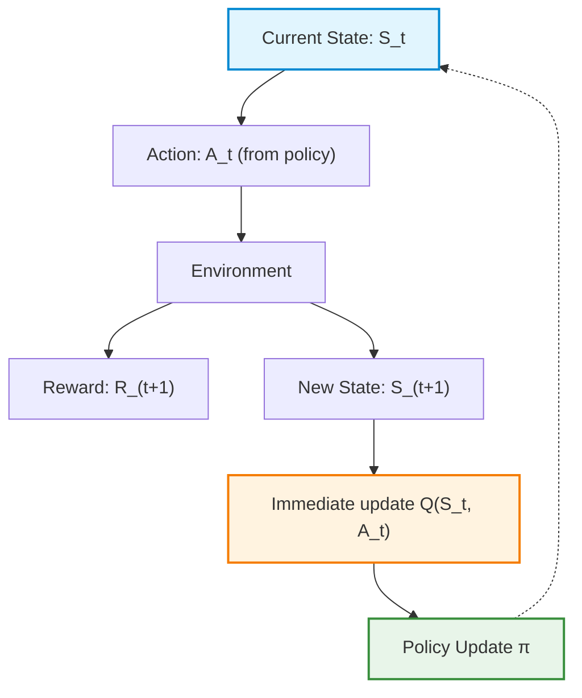
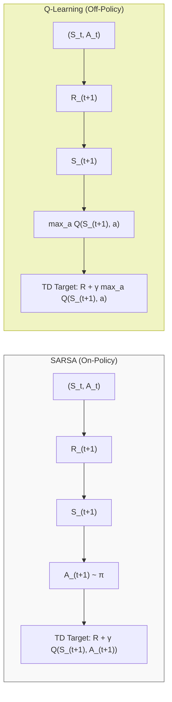
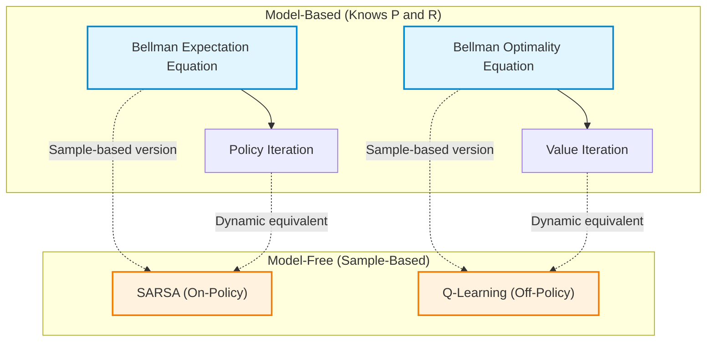
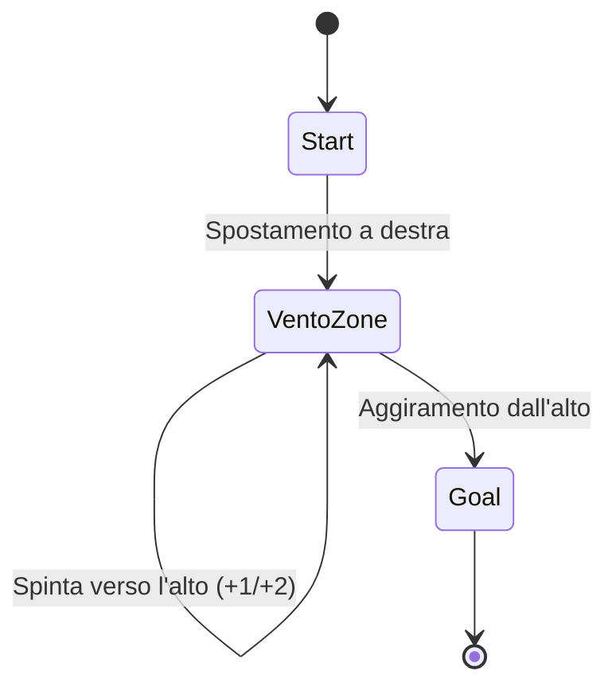
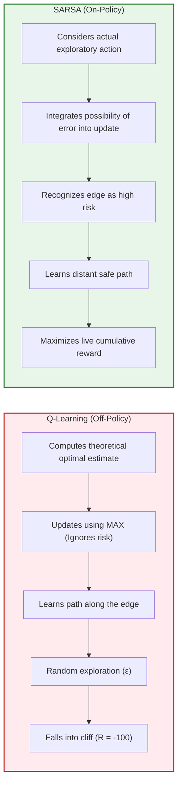

# Temporal Differences for Control: Sarsa, Q-Learning, and Expected Sarsa

## Educational Overview

This lecture concludes the discussion of the **Temporal-Difference Learning** (*TD Learning*) algorithm applied to the **Control** problem in **Model-Free** contexts.

The key points covered include:
- **Integration of TD Learning into GPI**: Analysis of how the **Generalized Policy Improvement** (*GPI*) paradigm adapts to temporal differences, performing incremental policy updates at every single step (*step-by-step*), rather than waiting for the conclusion of an entire episode.
- **Need for the Function $Q(s,a)$**: Theoretical motivation for moving from the **State-Value Function** $V(s)$ to the **Action-Value Function** $Q(s,a)$, indispensable for control in the absence of environment transition probabilities.
- **Review of the Sarsa Algorithm**: Analysis of the operation of the *On-Policy* Sarsa algorithm, focusing on the update cycle based on the quintuple $(S_t, A_t, R_{t+1}, S_{t+1}, A_{t+1})$ and on choosing the subsequent action consistent with the $\epsilon$-greedy policy (*$\epsilon$-greedy policy*).
- **Introduction to Q-Learning and Expected Sarsa**: Overview of methodological alternatives for TD control, laying the foundations for comparing *On-Policy* and *Off-Policy* approaches.

---

### Overview of Temporal Difference (TD) Learning for Control

In the context of Reinforcement Learning, **TD Learning** (*Temporal Difference Learning*) represents a fundamental framework positioned between Dynamic Programming methods and Monte Carlo methods.

#### Comparison Between TD Learning and Monte Carlo
* **Variance and Bias Management:** Compared to Monte Carlo methods, TD Learning allows balancing the variance-bias trade-off. The algorithm can be configured to reduce variance or bias depending on the specific target.
* **Convergence Speed:** TD Learning is generally faster in learning compared to Monte Carlo.
* **Continuous Tasks:** Unlike Monte Carlo (which requires the completion of the entire episode to compute the final return), TD Learning updates estimates at every single step (*step-by-step*). This makes it applicable to continuous scenarios lacking a terminal state.

#### Generalized Policy Improvement (GPI) in TD Learning
Control in TD Learning is based on the principle of **GPI** (*Generalized Policy Improvement*), alternating a evaluation phase (*Prediction*) with a policy improvement phase (*Control*).

In *Model-Free* control problems (where the transition probability matrix $P(s'|s,a)$ is not known), we cannot estimate the value of states alone $V(s)$. Instead, we must directly estimate the value of state-action pairs through the function **$Q(s,a)$** (*Action-Value Function*).



> **Key Concept**  
> **Why in TD Learning does the policy update advance in small steps at each step?**  
> In TD control methods, the value update $Q$ and the consequent refinement of policy $\pi$ occur **after every single transition** within the episode. One does not wait for the end of the episode to make a "big jump" update: every single data point collected is immediately used to update local knowledge and improve the policy incrementally.

---

### Review of the SARSA Algorithm (On-Policy TD Control)

The **SARSA** algorithm takes its name from the five elements of the transition sequence required to perform a single value update of $Q$:

$$(S_t, A_t, R_{t+1}, S_{t+1}, A_{t+1})$$

#### Operation of the Update Cycle
1. Being in state $S_t$, the agent selects and executes action $A_t$ following current policy $\pi$.
2. The environment reacts by returning a reward $R_{t+1}$ and moving the agent into new state $S_{t+1}$.
3. In state $S_{t+1}$, the agent **commits** to choosing the next action $A_{t+1}$, sampling it always via current policy $\pi$ (for example, an $\epsilon$-greedy policy).
4. An update of value function $Q(S_t, A_t)$is performed.

The SARSA update equation is:

$$Q(S_t, A_t) \leftarrow Q(S_t, A_t) + \alpha \left[ R_{t+1} + \gamma Q(S_{t+1}, A_{t+1}) - Q(S_t, A_t) \right]$$

Where:
* **TD Target:** $R_{t+1} + \gamma Q(S_{t+1}, A_{t+1})$
* **TD Error ($\delta_t$):** $R_{t+1} + \gamma Q(S_{t+1}, A_{t+1}) - Q(S_t, A_t)$
* **$\alpha$:** Learning Rate.
* **$\gamma$:** Discount Factor.

> **Key Concept**  
> **On-Policy Nature of SARSA**  
> SARSA is an **On-Policy** method. This means that the policy used to explore the environment and generate actions in the loop (*Behavior Policy*) is **the exact same policy** being evaluated and improved (*Target Policy*). The future action $A_{t+1}$ used in the TD Target is actually chosen and executed following policy $\pi$. Each modification implicitly made to $Q$ transforms policy $\pi$ into a new policy $\pi'$ for the next step.

---

### Presentation of Q-Learning (Off-Policy TD Control)

**Q-Learning** is one of the most famous and widely used algorithms across Reinforcement Learning. Compared to SARSA, it introduces a distinctly more greedy approach to updating estimates.

#### Structural Difference Compared to SARSA
In SARSA, to update $Q(S_t, A_t)$ one commits to action $A_{t+1}$ suggested by current policy $\pi$. 

In **Q-Learning**, on the other hand, **one does not commit to a specific future action for the update**. Once in the new state $S_{t+1}$, one observes the entire spectrum of possible actions and selects the maximum value of $Q$ obtainable from $S_{t+1}$.

The Q-Learning update equation is:

$$Q(S_t, A_t) \leftarrow Q(S_t, A_t) + \alpha \left[ R_{t+1} + \gamma \max_{a} Q(S_{t+1}, a) - Q(S_t, A_t) \right]$$



#### Off-Policy Nature of Q-Learning

> **Key Concept**  
> **Why is Q-Learning an Off-Policy algorithm?**  
> Q-Learning separates the data generation policy from the update policy:
> 1. **Behavior Policy:** It is the policy used to interact with the environment and select action $A_t$ to execute (typically an exploratory policy such as $\epsilon$-greedy on $Q$).
> 2. **Target Policy:** It is the policy being actually estimated and optimized during the TD Target update, which is **completely greedy** ($\max_a Q(S_{t+1}, a)$).  
> 
> Since data is collected with one policy ($\epsilon$-greedy) but the $Q$ value is updated assuming perfectly optimal (greedy) behavior, a mismatch exists between the two policies. Hence the definition of **Off-Policy**.

#### Computational Efficiency and Convergence Speed
A common comparison between the two algorithms concerns computational complexity:

* **Per-Step Complexity:** The operation $\max_a Q(S_{t+1}, a)$ in Q-Learning makes the execution of a single loop of code slightly slower on the computer compared to SARSA, due to searching for the maximum value among available actions.
* **Overall Efficiency (Number of Episodes):** Although the single-step cost is marginally higher, Q-Learning tends to require **fewer total episodes** to converge to an optimal policy. This occurs because the update looks ahead and directly estimates the maximum potential value, making value information propagation more efficient throughout the process.

---

### Connection Between TD Learning and Bellman Equations

Temporal-Difference Learning (TD Learning) does not abandon Bellman's theoretical framework, but represents its fundamental extension for contexts lacking a model of the world (*Model-Free*).

The recursive nature of the TD update directly reflects the structure of the Bellman equations. The substantial difference lies in the fact that TD algorithms replace theoretical expectation with an approximation based on empirical experience samples (*Sample-Based*).



*   **SARSA**: Is the *sample-based* version of the **Bellman Expectation Equation** and is directly associable with the *Policy Iteration* paradigm. It relies on the expectation of the current policy to determine the next action.
*   **Q-Learning**: Is the *sample-based* version of the **Bellman Optimality Equation** and is directly associable with *Value Iteration*. It applies a greedy approach at every update step, regardless of the policy followed to explore the environment.

#### Operational Distinction on Updates: Numerical Example

Both algorithms can use an $\epsilon$-greedy policy to explore the environment; consequently, the execution policy is typically stochastic. However, the difference lies in the quantity used to compute the *TD Target*.

> **KEY CONCEPT**
> **Update Difference**: SARSA computes the target based on the action $A'$ *actually sampled* from the current policy. Q-Learning computes the target by performing maximization $\max_{a} Q(S', a)$ over all possible actions in state $S'$, regardless of the action that will subsequently be executed.

To understand this difference, consider the following micro-scenario:
*   Current state: $S$, executed action: $A$. Current value $Q(S, A) = 1.0$.
*   Discount factor: $\gamma = 0.5$, Learning Rate: $\alpha = 0.1$.
*   Transition to state $S'$ with immediate reward $R = 0$.
*   In state $S'$ two actions are available:
    *   $A'_{su}$ with $Q(S', A'_{su}) = 4.0$
    *   $A'_{giù}$ with $Q(S', A'_{giù}) = 2.0$

*Note: Step integrated for instructional clarity to show the calculation of the two targets.*

1.  **SARSA Case (On-Policy)**:
    The update depends on action $A'$ suggested by stochastic policy $\pi$.
    *   If the policy chooses $A' = A'_{giù}$:
        $$TD_{\text{target}} = R + \gamma Q(S', A'_{giù}) = 0 + 0.5 \cdot 2.0 = 1.0$$
        $$Q(S, A) \leftarrow 1.0 + 0.1 \cdot (1.0 - 1.0) = 1.0$$
    *   If the policy chooses $A' = A'_{su}$:
        $$TD_{\text{target}} = R + \gamma Q(S', A'_{su}) = 0 + 0.5 \cdot 4.0 = 2.0$$
        $$Q(S, A) \leftarrow 1.0 + 0.1 \cdot (2.0 - 1.0) = 1.1$$

2.  **Q-Learning Case (Off-Policy)**:
    The update always chooses the maximum possible action value in the arrival state:
    $$TD_{\text{target}} = R + \gamma \max_{a'} Q(S', a') = 0 + 0.5 \cdot \max(4.0, 2.0) = 2.0$$
    $$Q(S, A) \leftarrow 1.0 + 0.1 \cdot (2.0 - 1.0) = 1.1$$

In this example, if SARSA's policy chooses the non-optimal action ($A'_{giù}$), the two algorithms produce a different $Q(S,A)$ value ($1.0$ versus $1.1$). If SARSA chooses the optimal action, the results coincide.

---

### Empirical Analysis 1: Windy Gridworld and Tuning of $\alpha$

The **Windy Gridworld** benchmark is a two-dimensional grid in which the agent must move from the start state to the *Goal*. The main feature of the environment is the presence of vertical wind currents in certain columns that push the agent upward by $+1$ or $+2$ cells at each step.

```
Griglia: Step reward = -1 per ogni mossa.
Vento:  [ 0  0  0  1  1  1  2  2  1  0 ] (forza spinta verso l'alto)
```

The goal is to reach the target in as few steps as possible.



#### Comparison Between SARSA and Q-Learning on Windy Gridworld
If equal starting parameters are set (same value of $\alpha = 0.5$ and same initialization of values $Q$), the behavior of the two algorithms differs in terms of sample efficiency (*Sample Efficiency*):

*   **Learning Efficiency**: Q-Learning converges to the optimal policy by taking a lower number of total steps in the environment compared to SARSA. In the performance plot (cumulative steps versus completed episodes), the Q-Learning curve shows a faster positive slope in the initial stages.
*   **Role of Learning Rate ($\alpha$)**:
    *   Q-Learning tolerates relatively high values of $\alpha$ because its target is anchored to the max operator $\max_{a} Q(S', a)$.
    *   SARSA clearly benefits from smaller step-sizes ($\alpha$). Since SARSA's target includes action $A'$ selected by the exploratory policy (which can be sub-optimal due to $\epsilon$), the update contains a higher rate of uncertainty. Reducing $\alpha$ allows better averaging of these fluctuations.

> **Empirical Rule for Tuning**: By reducing the learning rate $\alpha$ in SARSA relative to Q-Learning, SARSA asymptotically achieves the same performance as Q-Learning, but requires a significantly larger number of episodes/interactions with the environment to reach such convergence.

---

### Empirical Analysis 2: Cliff Walking and Risk Management

The **Cliff Walking** problem shows a scenario in which the *On-Policy* nature of SARSA proves advantageous compared to the *Off-Policy* nature of Q-Learning.

#### Environment Structure
*   **Grid**: The agent starts in the bottom-left corner and must reach the bottom-right corner.
*   **Rewards**: $-1$ for each standard step.
*   **The Cliff**: The entire bottom strip between start and end is a cliff. If the agent falls into the cliff:
    *   It receives a heavy penalty: $R = -100$.
    *   It is immediately reset to the initial state.

```
+---+---+---+---+---+---+---+---+
|   |   |   |   |   |   |   |   |
+---+---+---+---+---+---+---+---+
|   |   |   |   |   |   |   |   |  <-- Percorso Sicuro (Sicurezza)
+---+---+---+---+---+---+---+---+
| S | C | C | C | C | C | C | G |  <-- Percorso Ottimale (Rischio)
+---+---+---+---+---+---+---+---+
  S: Start, G: Goal, C: Cliff (Precipizio: R = -100)
```

#### Optimal Path vs. Safe Path

1.  **Optimal Path (Along the edge)**: Walk directly above the cliff line. It is the mathematically shortest trajectory to reach the goal.
2.  **Safe Path (Detour upward)**: Go up one or two rows before proceeding right. It requires more steps (slightly more negative cumulative reward due to the step reward $-1$), but keeps the agent away from the edge.

#### Algorithm Behavior in Online Execution ($\epsilon > 0$)

> **KEY CONCEPT**
> In the presence of a permanent exploration policy ($\epsilon$-greedy), **Q-Learning learns the optimal policy but obtains worse performance**, whereas **SARSA learns a sub-optimal policy that achieves higher cumulative reward**.



*   **Logical Explanation for Q-Learning**:
    In its update, Q-Learning uses $\max_{a} Q(S', a)$. When evaluating a state on the edge, the action of proceeding along the edge is optimal. The update does not "discount" the possibility that, during execution with $\epsilon$-greedy, a random choice causes the agent to fall south into the cliff. Consequently, Q-Learning constantly walks the edge and ends up falling into the cliff often during exploration, accumulating frequent penalties of $-100$.

*   **Logical Explanation for SARSA**:
    In its update, SARSA uses $Q(S', A')$, where $A'$ is the action actually selected by policy $\epsilon$-greedy. If the agent is on the edge, the probability $\epsilon$ of choosing an incorrect action and falling into the cliff enters directly into the update equation for $Q$. SARSA "learns" that states near the cliff have a low value due to the stochasticity of the exploratory policy. Consequently, it converges toward the **safe path**, avoiding falls.

---

### Guidelines for Algorithm Selection

Empirical evidence indicates the following guidelines for applying the two algorithms in real contexts:

1.  **Q-Learning (Default choice)**:
    *   It is the reference algorithm for most standard *Model-Free* applications.
    *   It has superior sample efficiency in problems without catastrophic penalties.
    *   It allows learning the optimal value function $Q^*$ directly offline or processing historical data.

2.  **SARSA (Specific use cases)**:
    *   **Online Control with safety constraints**: Usable when the system must learn directly in a real environment (e.g., robotics) where wrong actions entail physical damage or high costs (*safety-critical environments*).
    *   **Acquisition Computational Limits**: In systems with very high sampling rates, the computational cost of the maximization operation ($\max$) in Q-Learning can create a temporal bottleneck. The simple lookup of the chosen action $A'$ in SARSA is marginally faster in executing a single update.

---

### Stochastic Policies and the Limit of Standard SARSA

In previous lectures we considered stochastic policies ($\epsilon$-greedy or uniform). For example, at the beginning of learning, when there is no knowledge of the problem, it is common to start with a uniform policy: if there are 4 possible actions, each has a probability of $25\%$ of being chosen. 

As exploration continues, the policy consolidates, assigning, for instance, $70\%$ probability to the action considered best and $10\%$ to each of the other three exploratory actions.

In **standard SARSA**, updating the action-state value function $Q(S, A)$ occurs in the following way:
1. The agent is in state $S$ and executes action $A$.
2. Receives reward $R$ and arrives in state $S'$.
3. Samples an action $A'$ in state $S'$ following current policy $\pi(a|S')$.
4. Performs the update:
   $$Q(S, A) \leftarrow Q(S, A) + \alpha \left[ R + \gamma Q(S', A') - Q(S, A) \right]$$

#### The Problem of High Variance in SARSA
Since $A'$ is sampled randomly from the probability distribution defined by $\pi$, the update depends heavily on the specific action drawn. If the agent samples an exploratory action with probability $10\%$ that leads to a very negative outcome (e.g., $R = -1$), the entire value of $Q(S, A)$ will suffer a strong negative impact, even if $70\%$ of the time the agent would have chosen an excellent action ($R = +2$).

This sampling introduces **high variance** into SARSA updates.

---

### Expected SARSA: Mathematical Formulation

To solve the high variance problem while maintaining an estimation approach based on stochastic policies, **Expected SARSA** is introduced.

Instead of updating the estimate based on a single action $A'$ randomly sampled in state $S'$, the **expected value** of the $Q$ values is computed across all possible actions executable in state $S'$, weighted by the probability that policy $\pi$ has of selecting each action.

#### Update Equation
The update equation of Expected SARSA replaces the term $Q(S', A')$ with the weighted average over actions:

$$Q(S, A) \leftarrow Q(S, A) + \alpha \left[ R + \gamma \sum_{a} \pi(a|S') Q(S', a) - Q(S, A) \right]$$

Where:
* $\pi(a|S')$ is the probability of taking action $a$ in state $S'$ according to the current policy.
* $\sum_{a} \pi(a|S') Q(S', a)$ represents the expected value of function $Q$ at the next step ($\mathbb{E}_\pi [Q(S', a) | S']$).

> **Key Concept**: Expected SARSA eliminates the randomness of sampling action $A'$ in the update phase. Instead of following the outcome of a single stochastic draw, the update moves **deterministically** toward the expected mean of the possible actions.

```mermaid
flowchart TD
    classDef state fill:#e1f5fe,stroke:#0288d1,stroke-width:2px;
    classDef action fill:#fff3e0,stroke:#f57c00,stroke-width:2px;
    classDef exp fill:#e8f5e9,stroke:#388e3c,stroke-width:2px;

    S["State S, Action A"] ::: state --> R["Obtain Reward R and State S'"] ::: state
    R --> Split{"Evaluation of Actions in S'"} ::: action
    
    Split -->|"π(a1|S') = 0.70"| Q1["Q(S', a1)"] ::: exp
    Split -->|"π(a2|S') = 0.10"| Q2["Q(S', a2)"] ::: exp
    Split -->|"π(a3|S') = 0.10"| Q3["Q(S', a3)"] ::: exp
    Split -->|"π(a4|S') = 0.10"| Q4["Q(S', a4)"] ::: exp

    Q1 --> Sum["Σ π(a|S') * Q(S', a)"] ::: exp
    Q2 --> Sum
    Q3 --> Sum
    Q4 --> Sum

    Sum --> Update["Update Q(S, A)"] ::: state
```

---

### Comparison Between SARSA, Q-Learning, and Expected SARSA

Expected SARSA is conceptually positioned as an intermediate extension between classic SARSA and Q-Learning.

| Algorithm | Update Target for $S'$ | Algorithm Nature | Variance | Computational Cost / Step |
| :--- | :--- | :--- | :--- | :--- |
| **SARSA** | $Q(S', A')$ with $A' \sim \pi(\cdot\|S')$ | On-policy | High | Low |
| **Q-Learning** | $\max_{a} Q(S', a)$ | Off-policy | Low | Medium (max computation) |
| **Expected SARSA** | $\sum_{a} \pi(a\|S') Q(S', a)$ | Off-policy | Very Low | Medium (summation over $A$) |

#### Computational and Variance Trade-off
* **Per-step cost:** Expected SARSA requires slightly higher computation time per single loop than SARSA, as it must iterate over and weight all available actions in the summation $\sum_a$.
* **Learning efficiency:** Since estimates suffer from far less variance, the agent tends to learn more stably and often requires a **lower number of overall steps** to reach convergence compared to SARSA.

> **Key Concept**: Expected SARSA can be classified as an **off-policy** algorithm. Although the target policy can coincide with the behavior policy, the update rule does not compute the target on the specific action actually executed by the agent, but on the theoretical policy distribution.

#### Code Structure and Execution
From the perspective of main loop implementation (pseudocode), the order of operations in Expected SARSA reflects that of Q-Learning (Off-policy) rather than SARSA (On-policy):

* **SARSA (On-policy):** Choose $A$ $\rightarrow$ Execute $A$ $\rightarrow$ Observe $R, S'$ $\rightarrow$ Choose $A'$ $\rightarrow$ Update $Q(S,A)$ using $A'$.
* **Expected SARSA & Q-Learning (Off-policy):** Choose $A$ $\rightarrow$ Execute $A$ $\rightarrow$ Observe $R, S'$ $\rightarrow$ Update $Q(S,A)$ integrating over all actions $a$ in $S'$ $\rightarrow$ Choose next action $A'$.

---

### Empirical Behavior: The Cliff Walking Problem

If we analyze the behavior of the algorithms on the classic **Cliff Walking** benchmark:

1. **Q-Learning** learns the theoretically optimal path (along the edge of the cliff). However, since it continues to adopt an $\epsilon$-greedy policy during exploration, the stochastic component causes it to occasionally fall into the cliff.
2. **SARSA** learns a "safe" path, keeping its distance from the edge to avoid the negative consequences stemming from the random steps of the $\epsilon$-greedy policy.
3. **Expected SARSA** finds an ideal compromise: it learns a path that is safe but more efficient than SARSA's, logging on average **better accumulated rewards** and avoiding the excessive instability of Q-Learning.

Although empirical literature often tends to favor Q-Learning due to the simplicity of its max operator ($\max_a$), Expected SARSA offers extremely solid theoretical and practical performance that is less sensitive to random fluctuations in the exploration policy.

---

### Transition Toward Generalized TD ($n$-step TD)

The analysis performed on 1-step Temporal Difference Learning (1-step TD) allows summarizing the entire spectrum of learning methods covered so far through two extremes:

1. **Monte Carlo (MC):**
   * Update at the end of the episode (*Full return* $G_t$).
   * Zero bias ($0$ bias).
   * Very high variance (*High variance*).
2. **1-step TD Learning (TD(0)):**
   * Update at every single time step (via *bootstrapping*).
   * Low variance (*Low variance*).
   * High bias (*High bias*).

In engineering problems, positioning oneself at the two extremes is not always ideal. It is appropriate to have a control mechanism (a "tuning parameter") to position oneself at an optimal intermediate point. This topic forms the transition to **Multi-step Temporal Difference Learning** ($n$-step TD), where the update will not happen after a single step nor at the end of the episode, but after a fixed number $n$ of steps.

---

> [!NOTE]
> ### Exam Notes and Instructor Notices
> - **Topics for the first midterm**: Today's lecture concludes all material covered in the first midterm (Chapter 6 of the book). Chapter 7 topics covered starting next week will not be part of the upcoming exam.
> - **Type of question/request on the exam**: The instructor explicitly indicated that they might ask to **draw backup diagrams**, as they believe that knowing how to draw them demonstrates an understanding of the fundamental concepts.
> - **Recap lecture for the midterm**: A review (recap) lecture for the first midterm is planned to clarify the most complex topics, based also on requests submitted by students.