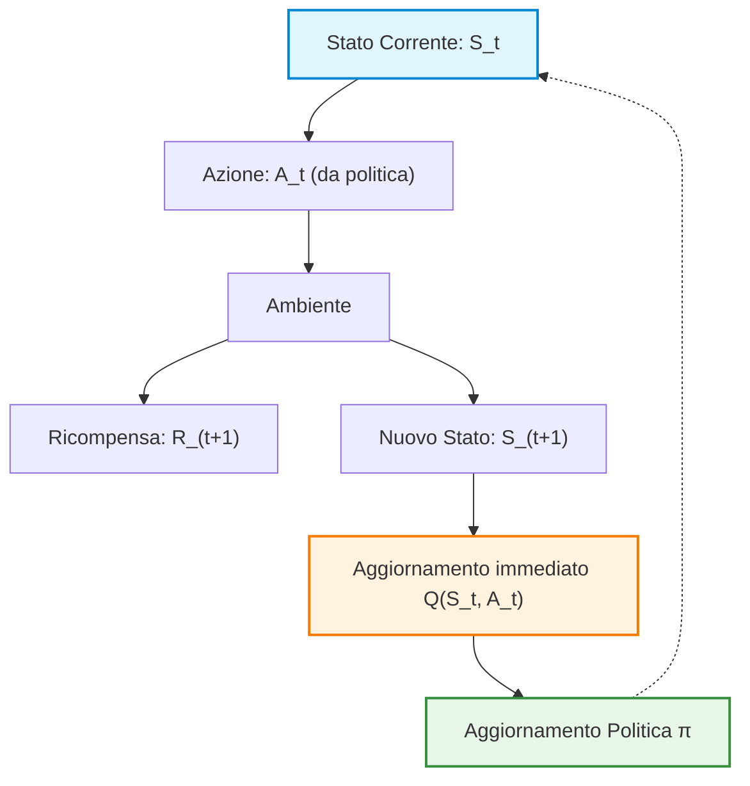
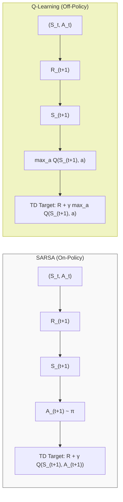
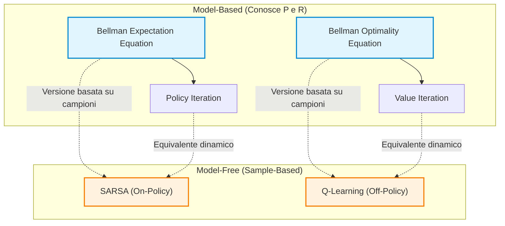
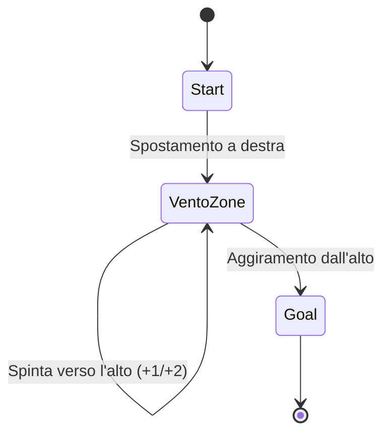
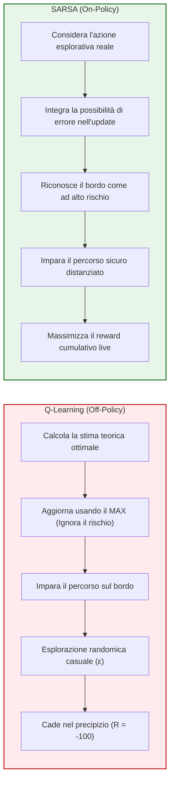

# Differenze Temporali per il Controllo: Sarsa, Q-Learning ed Expected Sarsa

## Overview Didattica

In questa lezione si conclude la trattazione dell'algoritmo di **Apprendimento per Differenze Temporali** (*Temporal-Difference Learning - TD Learning*) applicato al problema del **Controllo** (*Control*) in contesti **Senza Modello** (*Model-Free*).

I punti chiave trattati includono:
- **Integrazione del TD Learning nel GPI**: Analisi di come il paradigma del **Miglioramento della Politica Generalizzato** (*Generalized Policy Improvement - GPI*) si adatti alle differenze temporali, eseguendo aggiornamenti incrementali della politica a ogni singolo passo (*step-by-step*), anziché attendere la conclusione di un intero episodio.
- **Necessità della Funzione $Q(s,a)$**: Motivazione teorica del passaggio dalla **Funzione di Valore di Stato** (*State-Value Function*) $V(s)$ alla **Funzione di Valore Azione-Stato** (*Action-Value Function*) $Q(s,a)$, indispensabile per il controllo in assenza delle probabilità di transizione dell'ambiente.
- **Review dell'Algoritmo Sarsa**: Analisi del funzionamento dell'algoritmo *On-Policy* Sarsa, focalizzandosi sul ciclo di aggiornamento basato sulla quintupla $(S_t, A_t, R_{t+1}, S_{t+1}, A_{t+1})$ e sulla scelta dell'azione successiva coerente con la politica $\epsilon$-greedy (*$\epsilon$-greedy policy*).
- **Introduzione a Q-Learning ed Expected Sarsa**: Panoramica sulle alternative metodologiche per il controllo TD, ponendo le basi per il confronto tra approcci *On-Policy* ed *Off-Policy*.

---

### Panoramica del Temporal Difference (TD) Learning per il Controllo

Nel contesto del Reinforcement Learning, il **TD Learning** (*Temporal Difference Learning*) rappresenta un framework fondamentale che si colloca tra i metodi di Programmazione Dinamica (*Dynamic Programming*) e i metodi Monte Carlo (*Monte Carlo Methods*).

#### Confronto tra TD Learning e Monte Carlo
* **Gestione di Varianza e Bias:** Rispetto ai metodi Monte Carlo, il TD Learning consente di bilanciare il compromesso tra varianza e bias (*Variance-Bias Trade-off*). È possibile configurare l'algoritmo per ridurre la varianza o il bias a seconda del target specifico.
* **Velocità di Convergenza:** Il TD Learning è generalmente più veloce nell'apprendimento rispetto a Monte Carlo.
* **Compiti Continui (*Continuous Tasks*):** A differenza di Monte Carlo (che richiede il completamento dell'intero episodio per calcolare il ritorno finale), il TD Learning aggiorna le stime a ogni singolo passo (*step-by-step*). Questo lo rende applicabile a scenari continui privi di uno stato terminale (*Terminal State*).

#### Generalized Policy Improvement (GPI) in TD Learning
Il controllo nel TD Learning si basa sul principio del **GPI** (*Generalized Policy Improvement*), alternando una fase di valutazione (*Prediction*) a una di miglioramento della politica (*Control*).

Nelle problematiche di controllo *Model-Free* (in cui la matrice delle probabilità di transizione $P(s'|s,a)$ non è nota), non possiamo stimare il valore dei soli stati $V(s)$. Dobbiamo invece stimare direttamente il valore delle coppie stato-azione attraverso la funzione **$Q(s,a)$** (*Action-Value Function*).



> **Concetto Chiave**  
> **Perché nel TD Learning l'aggiornamento della politica avanza a piccoli passi ad ogni step?**  
> Nei metodi di controllo TD, l'aggiornamento del valore $Q$ e il conseguente affinamento della politica $\pi$ avvengono **dopo ogni singola transizione** all'interno dell'episodio. Non si attende la fine dell'episodio per fare un "grande salto" di aggiornamento: ogni singolo punto dati (*data point*) raccolto viene immediatamente sfruttato per aggiornare la conoscenza locale e migliorare la politica in modo incrementale.

---

### Ripasso dell'Algoritmo SARSA (On-Policy TD Control)

L'algoritmo **SARSA** prende il nome dai cinque elementi della sequenza di transizione necessari per effettuare un singolo aggiornamento del valore $Q$:

$$(S_t, A_t, R_{t+1}, S_{t+1}, A_{t+1})$$

#### Funzionamento del ciclo di aggiornamento
1. Trovandosi nello stato $S_t$, l'agente sceglie ed esegue l'azione $A_t$ seguendo la politica corrente $\pi$.
2. L'ambiente reagisce restituendo una ricompensa $R_{t+1}$ e portando l'agente nel nuovo stato $S_{t+1}$.
3. Nello stato $S_{t+1}$, l'agente **si vincola** alla scelta della successiva azione $A_{t+1}$, campionandola sempre tramite la politica corrente $\pi$ (ad esempio una politica $\epsilon$-greedy).
4. Viene effettuato l'aggiornamento della funzione valore $Q(S_t, A_t)$.

L'equazione di aggiornamento di SARSA è:

$$Q(S_t, A_t) \leftarrow Q(S_t, A_t) + \alpha \left[ R_{t+1} + \gamma Q(S_{t+1}, A_{t+1}) - Q(S_t, A_t) \right]$$

Dove:
* **TD Target:** $R_{t+1} + \gamma Q(S_{t+1}, A_{t+1})$
* **TD Error ($\delta_t$):** $R_{t+1} + \gamma Q(S_{t+1}, A_{t+1}) - Q(S_t, A_t)$
* **$\alpha$:** Tasso di apprendimento (*Learning Rate*).
* **$\gamma$:** Fattore di sconto (*Discount Factor*).

> **Concetto Chiave**  
> **Natura On-Policy di SARSA**  
> SARSA è un metodo **On-Policy**. Ciò significa che la politica utilizzata per esplorare l'ambiente e generare le azioni nel ciclo (*Behavior Policy*) è **la stessa identica politica** che si sta valutando e migliorando (*Target Policy*). L'azione futura $A_{t+1}$ usata nel TD Target viene effettivamente scelta ed eseguita seguendo la politica $\pi$. Ogni modifica implicitamente apportata a $Q$ trasforma la politica $\pi$ in una nuova politica $\pi'$ per lo step successivo.

---

### Presentazione del Q-Learning (Off-Policy TD Control)

Il **Q-Learning** è uno degli algoritmi più celebri e utilizzati nell'intero panorama del Reinforcement Learning. Rispetto a SARSA, introduce un approccio decisamente più "avidità" (*greedy*) nell'aggiornamento delle stime.

#### Differenza Strutturale rispetto a SARSA
In SARSA, per aggiornare $Q(S_t, A_t)$ ci si vincola all'azione $A_{t+1}$ suggerita dalla politica corrente $\pi$. 

Nel **Q-Learning**, invece, **non ci si vincola a una specifica azione futura per l'aggiornamento**. Una volta giunti nel nuovo stato $S_{t+1}$, si osserva l'intero spettro delle azioni possibili e si seleziona il valore massimo di $Q$ ottenibile da $S_{t+1}$.

L'equazione di aggiornamento del Q-Learning è:

$$Q(S_t, A_t) \leftarrow Q(S_t, A_t) + \alpha \left[ R_{t+1} + \gamma \max_{a} Q(S_{t+1}, a) - Q(S_t, A_t) \right]$$



#### Natura Off-Policy del Q-Learning

> **Concetto Chiave**  
> **Perché il Q-Learning è un algoritmo Off-Policy?**  
> Il Q-Learning separa la politica di generazione dei dati da quella di aggiornamento:
> 1. **Politica Comportamentale (*Behavior Policy*):** È la politica usata per interagire con l'ambiente e selezionare l'azione $A_t$ da eseguire (tipicamente una politica esplorativa come $\epsilon$-greedy su $Q$).
> 2. **Politica Target (*Target Policy*):** È la politica che si sta effettivamente stimando e ottimizzando durante l'aggiornamento del TD Target, la quale è **completamente greedy** ($\max_a Q(S_{t+1}, a)$).  
> 
> Poiché i dati vengono raccolti con una politica ($\epsilon$-greedy) ma il valore $Q$ viene aggiornato assumendo un comportamento perfettamente ottimale (greedy), esiste un disallineamento (*mismatch*) tra le due politiche. Da qui la definizione di **Off-Policy**.

#### Efficienza Computazionale e Velocità di Convergenza
Un confronto comune tra i due algoritmi riguarda la complessità del calcolo:

* **Complessità per Singolo Step:** L'operazione $\max_a Q(S_{t+1}, a)$ del Q-Learning rende l'esecuzione del singolo ciclo di codice leggermente più lenta al calcolatore rispetto a SARSA, a causa della ricerca del valore massimo tra le azioni disponibili.
* **Efficienza Complessiva (Numero di Episodi):** Nonostante il costo del singolo step sia marginalmente superiore, il Q-Learning tende a richiedere **meno episodi totali** per convergere a una politica ottimale. Questo avviene perché l'aggiornamento guarda in avanti e stima direttamente il valore massimo potenziale, rendendo la propagazione dell'informazione di valore più efficiente lungo il processo.

---

### Connessione tra TD Learning ed Equazioni di Bellman

L'Apprendimento a Differenze Temporali (*Temporal-Difference Learning*, TD Learning) non abbandona il quadro teorico di Bellman, ma ne rappresenta l'estensione fondamentale per contesti privi di modello del mondo (*Model-Free*). 

La natura ricorsiva dell'aggiornamento TD riflette direttamente la struttura delle equazioni di Bellman. La differenza sostanziale risiede nel fatto che gli algoritmi TD sostituiscono l'aspettativa teorica con un'approssimazione basata su campioni di esperienza empirica (*Sample-Based*).



*   **SARSA**: È la versione *sample-based* della **Bellman Expectation Equation** ed è direttamente associabile al paradigma del *Policy Iteration*. Si basa sull'aspettativa della politica attuale per determinare l'azione successiva.
*   **Q-Learning**: È la versione *sample-based* della **Bellman Optimality Equation** ed è direttamente associabile al *Value Iteration*. Applica un approccio *greedy* (avidità) ad ogni passo di aggiornamento, a prescindere dalla politica seguita per esplorare l'ambiente.

#### Distinzione operativa sugli update: Esempio Numerico

Entrambi gli algoritmi possono utilizzare una politica $\epsilon$-greedy per esplorare l'ambiente; di conseguenza, la politica di esecuzione è tipicamente stocastica. Tuttavia, la differenza risiede nella quantità usata per calcolare il *TD Target*.

> **CONCETTO CHIAVE**
> **Differenza di Update**: SARSA calcola il target basandosi sull'azione $A'$ *effettivamente estratta* dalla politica corrente. Q-Learning calcola il target eseguendo la massimizzazione $\max_{a} Q(S', a)$ su tutte le azioni possibili nello stato $S'$, indipendentemente dall'azione che verrà poi eseguita.

Per comprendere questa differenza, consideriamo il seguente micro-scenario:
*   Stato corrente: $S$, azione eseguita: $A$. Valore attuale $Q(S, A) = 1.0$.
*   Fattore di sconto: $\gamma = 0.5$, Tasso di apprendimento (*Learning Rate*): $\alpha = 0.1$.
*   Transizione verso lo stato $S'$ con ricompensa immediata $R = 0$.
*   Nello stato $S'$ sono disponibili due azioni:
    *   $A'_{su}$ con $Q(S', A'_{su}) = 4.0$
    *   $A'_{giù}$ con $Q(S', A'_{giù}) = 2.0$

*Nota: Passaggio integrato con chiarezza didattica per mostrare il calcolo dei due target.*

1.  **Caso SARSA (On-Policy)**:
    L'aggiornamento dipende dall'azione $A'$ suggerita dalla politica stocastica $\pi$.
    *   Se la politica sceglie $A' = A'_{giù}$:
        $$TD_{\text{target}} = R + \gamma Q(S', A'_{giù}) = 0 + 0.5 \cdot 2.0 = 1.0$$
        $$Q(S, A) \leftarrow 1.0 + 0.1 \cdot (1.0 - 1.0) = 1.0$$
    *   Se la politica sceglie $A' = A'_{su}$:
        $$TD_{\text{target}} = R + \gamma Q(S', A'_{su}) = 0 + 0.5 \cdot 4.0 = 2.0$$
        $$Q(S, A) \leftarrow 1.0 + 0.1 \cdot (2.0 - 1.0) = 1.1$$

2.  **Caso Q-Learning (Off-Policy)**:
    L'aggiornamento sceglie sempre il massimo valore di azione possibile nello stato di arrivo:
    $$TD_{\text{target}} = R + \gamma \max_{a'} Q(S', a') = 0 + 0.5 \cdot \max(4.0, 2.0) = 2.0$$
    $$Q(S, A) \leftarrow 1.0 + 0.1 \cdot (2.0 - 1.0) = 1.1$$

In questo esempio, se la politica di SARSA sceglie l'azione non ottimale ($A'_{giù}$), i due algoritmi producono un valore di $Q(S,A)$ differente ($1.0$ contro $1.1$). Se SARSA sceglie l'azione ottimale, i risultati coincidono.

---

### Analisi Empirica 1: Windy Gridworld e la taratura di $\alpha$

Il benchmark **Windy Gridworld** è una griglia bidimensionale in cui l'agente deve muoversi dallo stato iniziale al *Goal*. La particolarità dell'ambiente è la presenza di correnti di vento verticali in alcune colonne che spingono l'agente verso l'alto di $+1$ o $+2$ celle ad ogni passo.

```
Griglia: Step reward = -1 per ogni mossa.
Vento:  [ 0  0  0  1  1  1  2  2  1  0 ] (forza spinta verso l'alto)
```

L'obiettivo è raggiungere il target nel minor numero di passi possibile. 



#### Confronto tra SARSA e Q-Learning su Windy Gridworld
Se si impostano uguali parametri di partenza (stesso valore di $\alpha = 0.5$ e stessa inizializzazione dei valori $Q$), il comportamento dei due algoritmi differisce in termini di efficienza di campionamento (*Sample Efficiency*):

*   **Efficienza di Apprendimento**: Q-Learning converge alla politica ottimale compiendo un numero inferiore di passi totali nell'ambiente rispetto a SARSA. Nel grafico delle prestazioni (passi cumulativi rispetto agli episodi completati), la curva di Q-Learning mostra una pendenza positiva più rapida nelle fasi iniziali.
*   **Ruolo del Learning Rate ($\alpha$)**:
    *   Q-Learning tollera valori di $\alpha$ relativamente alti perché il suo target è ancorato all'operatore di massimo $\max_{a} Q(S', a)$.
    *   SARSA beneficia nettamente di **step-size ($\alpha$) più piccoli**. Poiché il target di SARSA include l'azione $A'$ selezionata dalla politica esplorativa (che può essere sub-ottimale a causa di $\epsilon$), l'aggiornamento contiene un tasso di incertezza maggiore. Ridurre $\alpha$ permette di mediare meglio queste fluttuazioni.

> **Regola empirica per la taratura**: Riducendo il tasso di apprendimento $\alpha$ in SARSA rispetto a Q-Learning, SARSA raggiunge asintoticamente le stesse prestazioni di Q-Learning, ma richiede un numero sensibilmente maggiore di episodi/interazioni con l'ambiente per arrivare a tale convergenza.

---

### Analisi Empirica 2: Cliff Walking e la gestione del rischio

Il problema del **Cliff Walking** mostra una situazione in cui la natura *On-Policy* di SARSA risulta vantaggiosa rispetto alla natura *Off-Policy* di Q-Learning.

#### Struttura dell'Ambiente
*   **Griglia**: L'agente parte dall'angolo in basso a sinistra e deve raggiungere l'angolo in basso a destra.
*   **Ricompense**: $-1$ per ogni passo standard.
*   **Il Precipizio (*Cliff*)**: L'intera fascia inferiore compresa tra inizio e fine è un precipizio. Se l'agente cade nel precipizio:
    *   Riceve una penalità pesante: $R = -100$.
    *   Viene immediatamente riposizionato allo stato iniziale.

```
+---+---+---+---+---+---+---+---+
|   |   |   |   |   |   |   |   |
+---+---+---+---+---+---+---+---+
|   |   |   |   |   |   |   |   |  <-- Percorso Sicuro (Sicurezza)
+---+---+---+---+---+---+---+---+
| S | C | C | C | C | C | C | G |  <-- Percorso Ottimale (Rischio)
+---+---+---+---+---+---+---+---+
  S: Start, G: Goal, C: Cliff (Precipizio: R = -100)
```

#### Percorso Ottimale vs. Percorso Sicuro

1.  **Percorso Ottimale (Lungo il bordo)**: Camminare direttamente sopra la linea del precipizio. È la traiettoria matematicamente più breve per raggiungere la meta.
2.  **Percorso Sicuro (Deviazione verso l'alto)**: Salire di una o due righe prima di procedere a destra. Richiede più passi (ricompensa cumulativa leggermente più negativa dovuta allo step reward $-1$), ma allontana l'agente dal bordo.

#### Comportamento degli Algoritmi in Esecuzione Online ($\epsilon > 0$)

> **CONCETTO CHIAVE**
> In presenza di una politica di esplorazione permanente ($\epsilon$-greedy), **Q-Learning impara la politica ottimale ma ottiene prestazioni peggiori**, mentre **SARSA impara una politica sub-ottimale che ottiene una ricompensa cumulativa superiore**.



*   **Spiegazione logica per Q-Learning**:
    Nel suo update, Q-Learning usa $\max_{a} Q(S', a)$. Quando valuta uno stato sul bordo, l'azione di proseguire sul bordo risulta ottimale. L'aggiornamento non "sconta" la possibilità che, durante l'esecuzione con $\epsilon$-greedy, una scelta casuale faccia cadere l'agente a sud nel precipizio. Di conseguenza, Q-Learning percorre costantemente il bordo e finisce per cadere spesso nel precipizio durante l'esplorazione, accumulando frequenti penalità da $-100$.

*   **Spiegazione logica per SARSA**:
    Nel suo update, SARSA usa $Q(S', A')$, dove $A'$ è l'azione effettivamente selezionata dalla politica $\epsilon$-greedy. Se l'agente si trova sul bordo, la probabilità $\epsilon$ di scegliere un'azione errata e cadere nel precipizio entra direttamente nell'equazione di aggiornamento di $Q$. SARSA "impara" che gli stati vicini al precipizio hanno un valore basso a causa della stocasticità della politica esplorativa. Di conseguenza, converge verso il **percorso sicuro**, evitando le cadute.

---

### Criteri Guida alla Scelta dell'Algoritmo

Le evidenze empiriche indicano le seguenti linee guida per l'applicazione dei due algoritmi in contesti reali:

1.  **Q-Learning (Scelta predefinita)**:
    *   È l'algoritmo di riferimento per la maggior parte delle applicazioni standard *Model-Free*.
    *   Ha un'efficienza di campionamento superiore nei problemi privi di penalità catastrofiche.
    *   Consente di apprendere la funzione valore ottimale $Q^*$ direttamente offline o elaborando dati storici.

2.  **SARSA (Casi d'uso specifici)**:
    *   **Online Control con vincoli di sicurezza**: Utilizzabile quando il sistema deve apprendere direttamente in un ambiente reale (es. robotica) dove azioni errate comportano danni fisici o costi elevati (*safety-critical environments*).
    *   **Limiti Computazionali d'Acquisizione**: In sistemi a frequenza di campionamento molto elevata, il costo computazionale dell'operazione di massimizzazione ($\max$) in Q-Learning può creare un collo di bottiglia temporale. Il semplice lookup dell'azione scelta $A'$ in SARSA risulta marginalmente più rapido nell'esecuzione del singolo aggiornamento.

---

### Politiche Stocastiche e il Limite di SARSA Standard

Nelle lezioni precedenti abbiamo considerato politiche stocastiche ($\epsilon$-greedy o uniformi). Ad esempio, all'inizio dell'apprendimento, quando non si ha alcuna conoscenza del problema, è comune iniziare con una politica uniforme (*Uniform Policy*): se ci sono 4 azioni possibili, ciascuna ha una probabilità del $25\%$ di essere scelta. 

Proseguendo con l'esplorazione, la politica si consolida, assegnando ad esempio il $70\%$ di probabilità all'azione ritenuta migliore e il $10\%$ a ciascuna delle altre tre azioni esplorative.

Nel **SARSA standard**, l'aggiornamento della funzione valore azione-stato $Q(S, A)$ avviene nel seguente modo:
1. L'agente si trova nello stato $S$ ed esegue l'azione $A$.
2. Riceve la ricompensa $R$ e giunge nello stato $S'$.
3. Campiona un'azione $A'$ nello stato $S'$ seguendo la politica corrente $\pi(a|S')$.
4. Esegue l'aggiornamento:
   $$Q(S, A) \leftarrow Q(S, A) + \alpha \left[ R + \gamma Q(S', A') - Q(S, A) \right]$$

#### Il Problema dell'Alta Variazione nel SARSA
Poiché $A'$ viene estratta casualmente dalla distribuzione di probabilità definita da $\pi$, l'aggiornamento dipende fortemente dall'azione specifica estratta. Se l'agente estrae un'azione esplorativa con probabilità $10\%$ che porta a un risultato molto negativo (es. $R = -1$), l'intero valore di $Q(S, A)$ subirà un forte impatto negativo, anche se il $70\%$ delle volte l'agente avrebbe scelto un'azione eccellente ($R = +2$).

Questo campionamento introduce una **varianza elevata** (*high variance*) negli aggiornamenti di SARSA.

---

### Expected SARSA: Formulazione Matematica

Per risolvere il problema dell'alta varianza mantenendo l'approccio di stima basato su politiche stocastiche, si introduce **Expected SARSA**.

Invece di aggiornare la stima basandosi sulla singola azione $A'$ campionata casualmente nello stato $S'$, si calcola il **valore atteso** (*expected value*) dei valori $Q$ su tutte le possibili azioni eseguibili nello stato $S'$, pesati dalla probabilità che la politica $\pi$ ha di scegliere ciascuna azione.

#### Equazione di Aggiornamento
L'equazione di aggiornamento di Expected SARSA sostituisce il termine $Q(S', A')$ con la media pesata delle azioni:

$$Q(S, A) \leftarrow Q(S, A) + \alpha \left[ R + \gamma \sum_{a} \pi(a|S') Q(S', a) - Q(S, A) \right]$$

Dove:
* $\pi(a|S')$ è la probabilità di prendere l'azione $a$ nello stato $S'$ secondo la politica corrente.
* $\sum_{a} \pi(a|S') Q(S', a)$ rappresenta il valore atteso della funzione $Q$ al passo successivo ($\mathbb{E}_\pi [Q(S', a) | S']$).

> **Concetto Chiave**: Expected SARSA elimina la casualità del campionamento dell'azione $A'$ nella fase di aggiornamento. Invece di seguire l'esito di una singola estrazione stocastica, l'aggiornamento si muove in modo **deterministico** verso la media attesa delle azioni possibili.

```mermaid
flowchart TD
    classDef state fill:#e1f5fe,stroke:#0288d1,stroke-width:2px;
    classDef action fill:#fff3e0,stroke:#f57c00,stroke-width:2px;
    classDef exp fill:#e8f5e9,stroke:#388e3c,stroke-width:2px;

    S["Stato S, Azione A"] ::: state --> R["Ottieni Ricompensa R e Stato S'"] ::: state
    R --> Split{"Valutazione Azioni in S'"} ::: action
    
    Split -->|"π(a1|S') = 0.70"| Q1["Q(S', a1)"] ::: exp
    Split -->|"π(a2|S') = 0.10"| Q2["Q(S', a2)"] ::: exp
    Split -->|"π(a3|S') = 0.10"| Q3["Q(S', a3)"] ::: exp
    Split -->|"π(a4|S') = 0.10"| Q4["Q(S', a4)"] ::: exp

    Q1 --> Sum["Σ π(a|S') * Q(S', a)"] ::: exp
    Q2 --> Sum
    Q3 --> Sum
    Q4 --> Sum

    Sum --> Update["Aggiorna Q(S, A)"] ::: state
```

---

### Confronto tra SARSA, Q-Learning ed Expected SARSA

Expected SARSA si posiziona concettualmente come un'estensione intermedia tra SARSA classico e Q-Learning.

| Algoritmo | Target di Aggiornamento per $S'$ | Natura dell'Algoritmo | Varianza | Costo Computazionale / Passo |
| :--- | :--- | :--- | :--- | :--- |
| **SARSA** | $Q(S', A')$ con $A' \sim \pi(\cdot\|S')$ | On-policy | Alta | Basso |
| **Q-Learning** | $\max_{a} Q(S', a)$ | Off-policy | Bassa | Medio (calcolo del max) |
| **Expected SARSA** | $\sum_{a} \pi(a\|S') Q(S', a)$ | Off-policy | Molto Bassa | Medio (sommatoria su $A$) |

#### Trade-off Computazionale e di Varianza
* **Costo per singolo step:** Expected SARSA richiede un tempo di calcolo per singolo ciclo leggermente superiore a SARSA, in quanto deve iterare e pesare tutte le azioni disponibili nella sommatoria $\sum_a$.
* **Efficienza di apprendimento:** Poiché le stime soffrono di molta meno varianza, l'agente tende ad apprendere in modo più stabile e necessita spesso di un **numero inferiore di passi complessivi** per raggiungere la convergenza rispetto a SARSA.

> **Concetto Chiave**: Expected SARSA è classificabile come un algoritmo **off-policy**. Sebbene la politica di target possa coincidere con la politica di comportamento (*behavior policy*), la regola di aggiornamento non calcola il target sulla specifica azione effettivamente eseguita dall'agente, ma sulla distribuzione teorica della politica.

#### Struttura del Codice ed Esecuzione
Dal punto di vista dell'implementazione del ciclo principale (pseudocodice), l'ordine delle operazioni in Expected SARSA riflette quello del Q-Learning (Off-policy) piuttosto che quello di SARSA (On-policy):

* **SARSA (On-policy):** Scegli $A$ $\rightarrow$ Esegui $A$ $\rightarrow$ Osserva $R, S'$ $\rightarrow$ Scegli $A'$ $\rightarrow$ Aggiorna $Q(S,A)$ usando $A'$.
* **Expected SARSA & Q-Learning (Off-policy):** Scegli $A$ $\rightarrow$ Esegui $A$ $\rightarrow$ Osserva $R, S'$ $\rightarrow$ Aggiorna $Q(S,A)$ integrando su tutte le azioni $a$ in $S'$ $\rightarrow$ Scegli la successiva azione $A'$.

---

### Comportamento Empirico: Il Problema del Cliff Walking

Se analizziamo il comportamento degli algoritmi nel classico benchmark del **Cliff Walking** (*Camminata sul Precipizio*):

1. **Q-Learning** impara la strada teoricamente ottimale (lungo il bordo del precipizio). Tuttavia, poiché continua ad adottare una politica $\epsilon$-greedy durante l'esplorazione, la componente stocastica lo fa cadere occasionalmente nel precipizio.
2. **SARSA** impara una strada "sicura", mantenendosi a distanza dal bordo per evitare le conseguenze negative derivanti dai passi casuali della politica $\epsilon$-greedy.
3. **Expected SARSA** trova un compromesso ideale: apprende un percorso sicuro ma più efficiente di quello di SARSA, registrando in media **ricompense accumulate migliori** ed evitando l'eccessiva instabilità del Q-Learning.

Sebbene in letteratura empirica si tenda spesso a preferire il Q-Learning per la sua semplicità nell'operatore di massimo ($\max_a$), Expected SARSA offre prestazioni teoriche e pratiche estremamente solide e meno sensibili alle fluttuazioni casuali della politica di esplorazione.

---

### Transizione Verso il TD Generalizzato ($n$-step TD)

L'analisi svolta sul Temporal Difference Learning a singolo passo (1-step TD) permette di riassumere l'intero spettro dei metodi di apprendimento affrontati finora attraverso due estremi:

1. **Monte Carlo (MC):**
   * Aggiornamento alla fine dell'episodio (*Full return* $G_t$).
   * Bias nullo ($0$ bias).
   * Varianza molto elevata (*High variance*).
2. **TD Learning a 1 passo (TD(0)):**
   * Aggiornamento a ogni singolo passo temporale (tramite *bootstrapping*).
   * Bassa varianza (*Low variance*).
   * Elevato Bias (*High bias*).

Nei problemi ingegneristici non è sempre ideale collocarsi ai due estremi. È opportuno disporre di un meccanismo di controllo (un "parametro di regolazione") per posizionarsi in un punto intermedio ottimale. Questo argomento costituisce la transizione verso il **Multi-step Temporal Difference Learning** ($n$-step TD), in cui l'aggiornamento non avverrà dopo un solo passo e nemmeno alla fine dell'episodio, ma dopo un numero prefissato $n$ di passi.

---

> [!NOTE]
> ### Note per l'Esame e Avvisi del Docente
> - **Argomenti del primo parziale**: La lezione odierna conclude tutto il materiale oggetto del primo parziale (Capitolo 6 del libro). Gli argomenti del Capitolo 7 che verranno trattati dalla settimana successiva non faranno parte della prova d'esame imminente.
> - **Tipologia di quesito/richiesta all'esame**: Il docente ha indicato esplicitamente che potrebbe chiedere di **disegnare i diagrammi di backup (*backup diagrams*)**, poiché ritiene che saperli tracciare dimostri la comprensione dei concetti fondamentali.
> - **Lezione di ripasso per il parziale**: È prevista una lezione di ripasso (recap) per il primo parziale per chiarire gli argomenti più complessi, basandosi anche sulle richieste inviate dagli studenti.