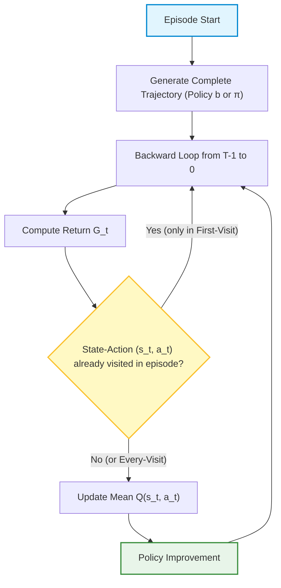
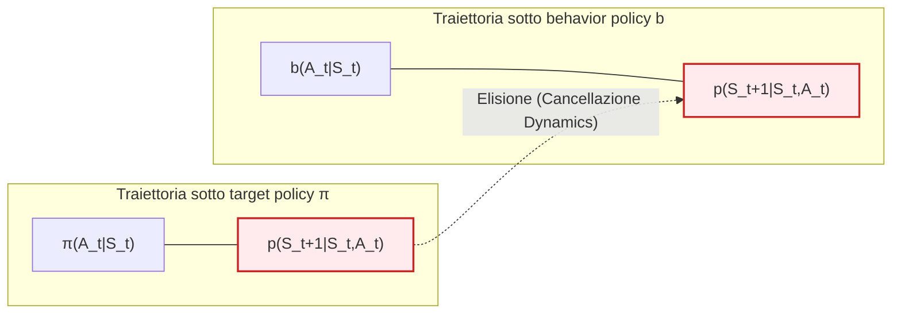
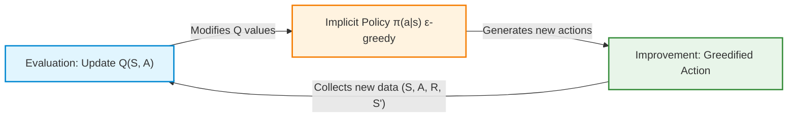

# Review of Reinforcement Learning Fundamentals: Multi-Armed Bandits and Exploration Strategies

## Educational Overview

This review lecture summarizes the key concepts related to the **Multi-Armed Bandit (*Multi-Armed Bandits*)** problem and the management of the **Exploration-Exploitation Dilemma (*Exploration-Exploitation Dilemma*)**.

The four main methodologies adopted to ensure adequate exploration of the action space are analyzed and compared:

1. **$\epsilon$-Greedy Policy ($\epsilon$-Greedy Policy):** Fundamental strategy where a random non-greedy action is chosen with probability $\epsilon$ and the action with the maximum estimated return with probability $1-\epsilon$. The technique of gradual decay of $\epsilon$ (*decaying $\epsilon$*) is also discussed.
2. **Optimistic Initialization (*Optimistic Initialization*):** Heuristic technique to force initial exploration by proactively overestimating expected return values.
3. **Upper Confidence Bound (*Upper Confidence Bound - UCB*):** Algorithm based on the principle of optimism in the face of uncertainty. The choice of action is not based solely on the empirical mean, but on the maximum potential defined by the sum of the estimated mean value and the uncertainty (width of the confidence interval).
4. **Gradient Bandit (*Gradient Bandits*):** Advanced approach based on the concept of action preferences rather than on the direct estimation of the reward value. Preferences are converted into selection probabilities via the **Softmax transformation (*Softmax Function*)**, updating the parameters based on the difference between the obtained reward and a baseline (*baseline*).

---

### Introduction to Multi-Armed Bandits and the Exploration-Exploitation Dilemma

In the context of reinforcement learning, examining **Multi-Armed Bandit (MAB)** problems represents the ideal starting point for understanding the celebrated **exploration-exploitation dilemma (exploration-exploitation dilemma)**. When an agent must make decisions in a stochastic environment, it constantly faces a fundamental tradeoff:
- **Exploitation (Exploitation)**: Choosing the action that, based on current estimates, yields the highest reward (reward). It is a short-sighted but necessary move to maximize immediate gain.
- **Exploration (Exploration)**: Choosing alternative and less known actions, with the goal of gathering information and discovering potentially better long-term strategies.

To resolve this dilemma in single-state problems (Bandits), the course analyzes four main theoretical and practical approaches: optimistic initialization, $\epsilon$-greedy, Upper Confidence Bound (UCB), and Gradient Bandits.

---

### Exploration Strategies for Bandits

#### 1. The $\epsilon$-greedy Approach
The **$\epsilon$-greedy** strategy represents the simplest and most intuitive approach to ensure exploration, and it is also reused in full Reinforcement Learning problems.
- With probability $1 - \epsilon$ the agent behaves in a **greedy (greedy)** manner, choosing the estimated best action.
- With probability $\epsilon$ (for example 1% or 10% of the time) the agent selects an action at random, exploring the environment.

*Practical rule of thumb*: Unlike what is often rigidly presented in textbooks, an excellent practice consists in starting with a high $\epsilon$ value (to explore extensively when the model is not reliable) and progressively decreasing it over time, eventually reaching $\epsilon = 0$ when estimates are stable.

#### 2. Upper Confidence Bound (UCB)
The **Upper Confidence Bound (UCB)** approach abandons the purely random choice logic of $\epsilon$-greedy exploration to embrace a philosophy based on **potential and uncertainty**.

Instead of basing the decision solely on the empirical average of past rewards, UCB selects the action that maximizes an upper bound of the confidence interval:
$$A_t = \arg\max_a \left[ Q_t(a) + c \sqrt{\frac{\ln t}{N_t(a)}} \right]$$

The underlying philosophy is as follows:
- If an action $a$ has been chosen many times, its count $N_t(a)$ is high, the uncertainty interval narrows, and the estimate is considered reliable.
- If an action has been explored few times, the uncertainty term grows, giving the action a high "potential" that encourages the agent to choose it to reduce ambiguity.

*Key characteristic*: In UCB algorithms, **no $\epsilon$ parameter is used**. Exploration is driven entirely by the dynamic evolution of the confidence interval.

#### 3. Gradient Bandits
The **Gradient Bandits** method represents the most sophisticated approach among those studied for bandits. Instead of directly estimating the expected value of rewards for each action, this method introduces the concept of **preference** ($H_t(a)$) for each action.

Preferences are not constrained to a specific range (they can be arbitrary numbers like $1000$ or $-200$) and are mapped into selection probabilities via a **softmax** transformation:
$$P_t(a) = \frac{e^{H_t(a)}}{\sum_{b} e^{H_t(b)}}$$

##### Preference Update Rule
When the agent chooses an action $A_t$ and receives a reward $R_t$, it compares the latter with the average reward expected up to that point $\bar{R}_t$ (the baseline). Preferences are updated with the following rule for the chosen action:
$$H_{t+1}(A_t) = H_t(A_t) + \alpha (R_t - \bar{R}_t)(1 - P_t(A_t))$$

And for all non-chosen actions ($a \neq A_t$):
$$H_{t+1}(a) = H_t(a) - \alpha (R_t - \bar{R}_t)P_t(a)$$

#### In-Depth Analysis: Why Update Non-Chosen Actions as Well?
A recurring question concerns the mathematical necessity of updating preferences $H$ also for actions *that were not selected* in the current time step. One might object: *"The softmax function already normalizes probabilities, wouldn't it be enough to update only the executed action?"*

```mermaid
flowchart TD
    A["Choose Action A_t and Receive Reward R_t"] --> B["Comparison with Baseline: R_t - R_bar"]
    B --> C{"R_t > R_bar?"}
    C -- "Yes (Reward higher than expected)" --> D["Increase preference of chosen action H(A_t)"]
    C -- "No (Reward lower than expected)" --> E["Decrease preference of chosen action H(A_t)"]
    D --> F["Coordinated update of non-chosen actions for normalized consistency"]
    E --> F
    F --> G["Recompute probabilities via Softmax"]

    style A fill:#2d3748,stroke:#cbd5e0,stroke-width:2px
    style B fill:#2b6cb0,stroke:#63b3ed,stroke-width:2px
    style C fill:#d69e2e,stroke:#f6e05e,stroke-width:2px
    style D fill:#2f855a,stroke:#68d391,stroke-width:2px
    style E fill:#c53030,stroke:#fc8181,stroke-width:2px
    style F fill:#4a5568,stroke:#a0aec0,stroke-width:2px
    style G fill:#2b6cb0,stroke:#63b3ed,stroke-width:2px
```



*Conceptual answer*: It is theoretically possible to derive a working algorithm that updates only the chosen action by slightly modifying the system. However, the standard formulation that updates *all* actions stems directly from a rigorous mathematical derivation based on **gradient ascent (gradient ascent)** with respect to the expected performance of the policy. Including the term for non-chosen actions ensures the correct direction of the stochastic gradient, inextricably linking the algorithm to optimization theory.

---

### The Role of the Hyperparameter $\alpha$ in Gradient Bandits

The hyperparameter $\alpha$ regulates the **learning step (learning rate)** in the preference update. Its impact on the agent's behavior is crucial:
- **If $\alpha$ is high**: The agent assigns enormous weight to recent updates. Experimentally, if an action initially considered the best is fixed with a very high $\alpha$ , the agent tends to aggressively reinforce that choice, reducing exploration and focusing heavily on deterministic **exploitation (exploitation)**.
- **If $\alpha$ is low**: The update is conservative, changes occur slowly, and the agent maintains behavior more inclined toward **exploration (exploration)**.

---

### On-Policy Monte Carlo Control and $\epsilon$-Soft Policies

#### Concept of an $\epsilon$-Soft Policy
In previous lectures, we analyzed the exploration problem in *Multi-Armed Bandit* problems. Transferring this concept to full *Reinforcement Learning (RL)* problems, we use **$\epsilon$-soft policies ($\epsilon$-soft policies)** to guarantee that the agent never stops exploring the environment.

A policy is defined as $\epsilon$-soft if, for every state $s \in \mathcal{S}$, the probability of selecting any available action $a \in \mathcal{A}(s)$ is strictly greater than zero and bounded by a minimum value:

$$\pi(a|s) \ge \frac{\epsilon}{|\mathcal{A}(s)|}$$

Where $|\mathcal{A}(s)|$ denotes the cardinality of the action space available in state $s$.

In practical terms, if we set an exploration level of $10\%$ ($\epsilon = 0.1$), the agent will dedicate $10\%$ of the time to exploration. This share of $10\%$ is divided equally among all available actions.

The probability distribution is then defined as:
*   **Non-greedy action (exploratory):** 
    $$\pi(a|s) = \frac{\epsilon}{|\mathcal{A}(s)|}$$
*   **Greedy action (exploitation/greedy action $a^*$):** 
    $$\pi(a^*|s) = 1 - \epsilon + \frac{\epsilon}{|\mathcal{A}(s)|}$$

The sum of all probabilities yields a valid distribution totaling $100\%$ ($1$).

#### Comparison: Exploring Starts vs. $\epsilon$-Soft
There are two main approaches to guarantee exploration in Monte Carlo (MC) methods:
1.  **Exploring Starts (Exploring Starts):** Exploration is forced exclusively at the first step of the episode (the initial state-action pair is chosen at random), while subsequent steps follow the current policy.
2.  ** $\epsilon$-soft policies:** Exploration is distributed along the entire trajectory; at each single time step of the episode, there is a probability $\epsilon$ of exploring.

> **Note:** The two methods are not mutually exclusive: it is possible to combine *Exploring Starts* initialization with an $\epsilon$-soft policy throughout the rest of the episode.

#### Algorithm Structure: First-Visit vs. Every-Visit
In Monte Carlo methods for control, the algorithm architecture follows the **Generalized Policy Iteration (Generalized Policy Iteration - GPI)** paradigm.



**Key Concept:** Unlike *Temporal Difference (TD) Learning*, in Monte Carlo methods the entire episode trajectory is generated in the **outer loop**. The update of action values and the policy occurs only at the end of the episode, processing experience backward (from the final step $T-1$ down to $0$) via a linear loop.

Depending on how we handle repeated visits to the same states within the same episode, we distinguish:
*   **First-Visit MC Control:** The return $G_t$ is computed and considered to update the estimated mean $Q(s_t, a_t)$ **only the first time** that the pair $(s_t, a_t)$ appears within the episode.
*   **Every-Visit MC Control:** The update of the estimated mean $Q(s_t, a_t)$ is executed **every time** that the pair $(s_t, a_t)$ is encountered in the episode, removing the first-visit check.

If during an exam the variant is not specified, one may use either the incremental update of means or the *first-visit/every-visit* version interchangeably, provided that the computation logic of the return $G_t$ remains consistent.

#### Policy Update in GPI
During the *Policy Improvement* phase, once the estimate $Q(s, a)$ is updated with the new return $G_t$, the $\epsilon$-soft policy must adapt:
1.  The new greedy action is identified: 
    $$a^* = \arg\max_{a} Q(s, a)$$
2.  If the action taken at the current step no longer coincides with the new greedy action $a^*$, the probability associated with that action is drastically reduced to the base exploration value $\frac{\epsilon}{|\mathcal{A}(s)|}$.
3.  The new greedy action $a^*$ absorbs most of the probability mass, that is $1 - \epsilon + \frac{\epsilon}{|\mathcal{A}(s)|}$.

---

### Importance Sampling for Off-Policy Monte Carlo

#### Motivation: Target Policy vs. Behavior Policy
In **Off-Policy** control, we separate the policy used to generate data from the one we are attempting to evaluate and optimize:
*   **Target Policy (Target Policy $\pi$):** The optimal policy we wish to learn (often deterministic or greedy).
*   **Behavior Policy (Behavior Policy $b$):** The policy used to interact with the environment and collect trajectory data (typically highly exploratory).

The fundamental problem is: *How can we estimate the expected value of returns under policy $\pi$, if trajectories were generated following policy $b$?*

The answer lies in **Importance Sampling (Importance Sampling - IS)**, a statistical technique that allows estimating the expected value of a distribution using samples drawn from a different distribution, appropriately weighting them.

#### Coverage Requirement (Coverage Assumption)
In order to apply Importance Sampling, the behavior policy $b$ must satisfy the **coverage (coverage)** assumption:

> **Key Concept:** For every state $s \in \mathcal{S}$ and action $a \in \mathcal{A}(s)$, if the target policy assigns a probability greater than zero of choosing action $a$, then the behavior policy must also have a probability greater than zero of choosing it:
> $$\pi(a|s) > 0 \implies b(a|s) > 0$$

If this condition is not met, there will be transitions possible for the target policy $\pi$ that the agent will never observe in the data collected with $b$, making off-policy learning impossible.

#### Derivation of the Importance Sampling Ratio on Trajectories
A trajectory $\tau$ starting from time step $t$ is defined by the sequence of states and actions:

$$\tau = (A_t, S_{t+1}, A_{t+1}, S_{t+2}, \dots, S_T)$$

The probability that this specific trajectory occurs following a generic policy $\pi$, given the environment dynamics described by the transition probability $p(s'|s,a)$, is the alternating product of the agent's probabilities and the environment's responses:

$$P(\tau | \pi) = \prod_{k=t}^{T-1} \pi(A_k | S_k) \, p(S_{k+1} | S_k, A_k)$$

In parallel, the probability of the same trajectory under the behavior policy $b$ is:

$$P(\tau | b) = \prod_{k=t}^{T-1} b(A_k | S_k) \, p(S_{k+1} | S_k, A_k)$$

To balance the discrepancy between the collected data and the policy we wish to learn, we define the **Importance Sampling Ratio (Importance Sampling Ratio)** $\rho_{t:T-1}$ as the ratio between the two trajectory probabilities:

$$\rho_{t:T-1} = \frac{P(\tau | \pi)}{P(\tau | b)} = \frac{\prod_{k=t}^{T-1} \pi(A_k | S_k) \, p(S_{k+1} | S_k, A_k)}{\prod_{k=t}^{T-1} b(A_k | S_k) \, p(S_{k+1} | S_k, A_k)}$$

Since the model/environment dynamics $p(S_{k+1} | S_k, A_k)$ is identical in both cases, the environment terms in the numerator and denominator cancel out perfectly.



We thus obtain the fundamental formula for the Importance Sampling weight on a trajectory:

$$\rho_{t:T-1} = \prod_{k=t}^{T-1} \frac{\pi(A_k | S_k)}{b(A_k | S_k)}$$

> **Key Concept:** There is no need to know the model dynamics (the environment transition probabilities $p$) to apply Importance Sampling in Model-Free Monte Carlo methods. It is sufficient to know the product ratio of the probabilities of the individual actions according to the two policies along the entire trajectory.

#### Intuitive Meaning and Returns Update
The value of $\rho_{t:T-1}$ acts as a scaling factor for the returns $G_t$ obtained from the environment:

$$\mathbb{E}_\pi [G_t] = \mathbb{E}_b \left[ \rho_{t:T-1} G_t \right]$$

*   **Case $\rho > 1$:** The sequence of actions taken was *much more probable* under the target policy $\pi$ compared to the behavior policy $b$. The observed return $G_t$ must have a **larger** impact (increased weight) in updating estimates for $\pi$.
*   **Case $\rho < 1$:** The trajectory was generated by actions that the target policy $\pi$ would choose very rarely. The return $G_t$ must have a **reduced** weight in the update.
*   **Case $\rho = 0$:** If during the trajectory the agent executes even a single action that the target policy would *never* have taken ($\pi(A_k|S_k) = 0$), the product vanishes ($\rho = 0$), invalidating the relevance of that trajectory for the target policy.

In Off-Policy Monte Carlo control, the backward update terminates as soon as the action taken by the behavior policy $b$ has zero probability under the target policy $\pi$, allowing significant computational savings during the *backward* loop.

---

### TD Control Loop and Implicit Policy

In the context of Temporal-Difference Learning for control (*Temporal-Difference Control*), a frequent doubt concerns the explicit role of policy $\pi$ during the update of the action-value function $Q(s, a)$.

In TD algorithms such as SARSA, Q-Learning, and Expected SARSA, exploration remains an essential element. The estimation of $Q$ is intrinsically more complex and sparse (*sparse*) compared to the estimation of the state-value function $V(s)$, making the management of the exploration-exploitation balance (*exploration-exploitation trade-off*) even more critical.

#### The Generalized Policy Iteration (GPI) Mechanism
In value-based TD control algorithms, policy $\pi$ is not represented as a separate table or function to be updated explicitly in a distinct step. The policy is **implicitly defined** from the current $Q$ function via an action selection rule, typically $\epsilon$-greedy (*$\epsilon$-greedy policy*):

* With probability $1 - \epsilon$, the action is chosen greedily: $\arg\max_a Q(s, a)$.
* With probability $\epsilon$, a random action is chosen to ensure exploration.



> **Key Concept**
> There is no separate *policy improvement* phase meant as distinct code. Every time the value of $Q(s, a)$ is modified by the TD update equation, **the policy $\pi$ automatically changes**. Modifying the values of $Q$ is equivalent to modifying the policy used to interact with the environment at the next step.

---

### Comparative Analysis: SARSA, Q-Learning, and Expected SARSA

The three main TD control algorithms differ fundamentally in the target value used in the temporal-difference error (*TD Error*).

#### 1. SARSA: On-Policy TD Control
The SARSA algorithm takes its name from the sequence of quantities involved in the update: $(S_t, A_t, R_{t+1}, S_{t+1}, A_{t+1})$.

The update equation is:
$$Q(S_t, A_t) \leftarrow Q(S_t, A_t) + \alpha \left[ R_{t+1} + \gamma Q(S_{t+1}, A_{t+1}) - Q(S_t, A_t) \right]$$

* **Operation**: After arriving in state $S_{t+1}$, the next action $A_{t+1}$ is chosen based on the current policy $\pi$ ($\epsilon$-greedy). The update is performed by committing (*committing*) to that action.
* **On-policy nature**: The data used for the update comes from exactly the same policy that is being evaluated and improved.

#### 2. Q-Learning: Off-Policy TD Control
Q-Learning modifies the TD target by replacing the action actually chosen at the next step with the maximum possible value over all executable actions in $S_{t+1}$.

The update equation is:
$$Q(S_t, A_t) \leftarrow Q(S_t, A_t) + \alpha \left[ R_{t+1} + \gamma \max_{a} Q(S_{t+1}, a) - Q(S_t, A_t) \right]$$

* **Lookahead Mechanism**: Instead of committing to the action suggested by the current policy, Q-Learning "looks ahead" (*lookahead*) evaluating the best possible option. This approach is conceptually analogous to *Nesterov momentum* in Deep Learning optimization.
* **Off-policy nature**: The target policy (*target policy*) is purely greedy with respect to $Q$, while the behavior policy (*behavior policy*) used to collect data in the environment remains $\epsilon$-greedy.
* **Connection with Bellman**: While SARSA derives from the Bellman Expectation Equation (*Bellman Expectation Equation*), Q-Learning is directly derived from the sampled Bellman Optimality Equation (*Bellman Optimality Equation*).

#### 3. Expected SARSA
Expected SARSA eliminates the variance associated with sampling action $A_{t+1}$ by computing the expected value of the $Q$ function in state $S_{t+1}$ with respect to the distribution of policy $\pi$.

The update equation is:
$$Q(S_t, A_t) \leftarrow Q(S_t, A_t) + \alpha \left[ R_{t+1} + \gamma \sum_{a} \pi(a|S_{t+1}) Q(S_{t+1}, a) - Q(S_t, A_t) \right]$$

* **Operation**: Instead of choosing a single action $A_{t+1}$ (as in SARSA) or taking the absolute maximum (as in Q-Learning), the weighted average of all possible actions is computed, where the weights are the probabilities assigned by policy $\pi(a|S_{t+1})$.
* **Properties**: It has lower variance compared to SARSA while maintaining stable convergence. It can operate in both *on-policy* and *off-policy* modes.

---

### Importance of the Order of Operations

The difference between SARSA and Q-Learning does not lie solely in the presence of the $\max$ operator, but also in the **sequential flow** of the algorithm.

```mermaid
flowchart TD
    subgraph SARSA ["SARSA Flow (On-Policy)"]
        node1["Choose A from S using π"] --> node2["Execute A, observe R, S'"]
        node2 --> node3["Choose A' from S' using π"]
        node3 --> node4["Update Q(S,A) with Q(S',A')"]
        node4 --> node5["S <- S', A <- A'"]
    end

    subgraph QLearning ["Q-Learning Flow (Off-Policy)"]
        qnode1["Choose A from S using π"] --> qnode2["Execute A, observe R, S'"]
        qnode2 --> qnode3["Update Q(S,A) with max_a Q(S',a)"]
        qnode3 --> qnode4["Choose A' from S' using NEW π (from new Q)"]
        qnode4 --> qnode5["S <- S'"]
    end
```



> **Key Concept**
> In **SARSA**, action $A'$ is chosen *before* updating $Q(S,A)$. The algorithm has already committed to executing $A'$ based on the old value of $Q$.
> In **Q-Learning**, the update of $Q(S,A)$ takes place *before* selecting the new action $A'$ for the next step. The choice of $A'$ will therefore occur by exploiting the already updated policy (*new $Q$*).

---

### But Why Isn't Importance Sampling Needed in Off-Policy TD Control?

A common confusion concerns why *off-policy* algorithms such as Q-Learning or Expected SARSA do not use Importance Sampling (*Importance Sampling*), unlike what occurs in Monte Carlo methods or in *off-policy* TD Prediction.

* **Absence of multi-step trajectories**: Importance Sampling is needed to compensate for the probabilistic discrepancy between two different distributions over *entire trajectories* of successive steps.
* **Single-step lookahead**: In Q-Learning and Expected SARSA we are not taking an actual transition driven by another policy at step $t+1$. Having arrived at $S_{t+1}$, we are simply analytically computing a target value ($ \max_a Q $ or the weighted average $\sum \pi(a|S')Q$) without executing an actual action based on a different trajectory.

Since the transition $(S_t, A_t \to R_{t+1}, S_{t+1})$ was generated by the environment and has already occurred, there is no need to reweight the distribution of future actions with any importance sampling ratio (*importance sampling ratio*).

---

3. Dynamic Programming and Connection with TD Learning

#### Why Do We Use Dynamic Programming?

**Dynamic Programming (Dynamic Programming - DP)** is a fundamental tool in Reinforcement Learning, but one often wonders why it is necessary even when the Markov Decision Process (Markov Decision Process - MDP) is completely known.

The main reasons are two:

1. **Control Problems and Non-Linearity**: In optimal control problems, searching for the best policy involves solving systems of non-linear equations (such as Bellman optimality equations). Such systems cannot be solved in closed form using traditional analytical mathematical tools.
2. **Computational Scalability**: When dealing with large-scale problems with thousands of states and equations to update over time, it is not feasible to apply direct algebraic solvers (such as direct matrix inversion). It is indispensable to resort to **recursive approaches** that progressively update estimates.

#### The Link Between Dynamic Programming and TD Learning

There is a direct conceptual and mathematical bridge between Dynamic Programming and **Temporal Difference Learning (Temporal Difference Learning - TD Learning)**:

* **In a known environment (known MDP)**: DP computes estimates recursively using the true transition probability function $P(s'|s,a)$ and the reward function $R(s,a,s')$.
* **In an unknown environment (unknown MDP)**: TD Learning preserves the same **recursive structure** of DP to update estimates of $V(s)$ or $Q(s,a)$, but replaces the theoretical knowledge of probabilities with **samples (sample)** derived from the agent's direct experience in the world.

> **Key Concept: TD Learning as Sampled DP**
> TD Learning is nothing other than a sampling-based version of Dynamic Programming (*sample-based dynamic programming*): instead of computing the exact expected value over all possible transitions, it updates estimates iteratively using the data and transitions actually observed.

---

### Synchronous vs. Asynchronous Evaluation and Pseudocode

#### Common Mistake in Synchronous Evaluation (Synchronous Evaluation)

In **Synchronous Policy Evaluation (Synchronous Policy Evaluation)**, the objective is to update the value function $V(s)$ for all states simultaneously at step $k+1$, using exclusively the values computed at step $k$.

A frequent implementation error consists in updating the variable $V(s)$ directly "in-place" (*in-place*) inside the loop that iterates over states.

> **Key Concept: Buffer Management in Synchronous Evaluation**
> If we update $V(s)$ directly inside the iteration loop over states, the next state $s'$ will read the value $V(s)$ that was just modified (at time $k+1$) rather than the old one (at time $k$). Being de facto in an *asynchronous* evaluation, we risk altering convergence or biasing the update.
>
> To ensure correct **synchronous** evaluation, it is necessary to save the current values in a **temporary buffer** and perform the overwrite of $V$ only outside or at the end of the sweep cycle (*sweep*) over all states.

#### Flexibility in Writing Pseudocode

Pseudocode is not source code intended for a compiler, but a communication tool between humans to illustrate the logic of an algorithm.

* It is permissible to be flexible with notation (for example by defining explicit loops over the order of states $S_1, S_2, \dots, S_N$).
* The decisive element is clarity: the algorithm must clearly show the order of operations, the correct allocation of buffers, and the recursive update logic.

---

### Policy Improvement Theorem and the Relationship Between $V$ and $Q$

#### Conceptual Relationship Between $V(s)$ and $Q(s,a)$

Understanding the relationship between the **State-Value Function (State-Value Function)** $V(s)$ and the **Action-Value Function (Action-Value Function)** $Q(s,a)$ is one of the cornerstones of the entire course.

Both functions express the expected return (expected return), but with a different level of detail:

1. **$V^\pi(s)$**: Represents the expected return starting from state $s$ and following policy $\pi$ for all future steps:
   $$V^\pi(s) = \mathbb{E}_\pi \left[ G_t \mid S_t = s \right]$$
2. **$Q^\pi(s,a)$**: Represents the expected return starting from state $s$, executing an arbitrary action $a$ (not necessarily the one recommended by policy $\pi$), and **subsequently** following policy $\pi$:
   $$Q^\pi(s,a) = \mathbb{E}_\pi \left[ G_t \mid S_t = s, A_t = a \right]$$

If the selected action $a$ coincides with the one prescribed by the current policy $a = \pi(s)$, the two functions are equivalent:
$$V^\pi(s) = Q^\pi(s, \pi(s))$$

> **Key Concept: The $Q$ Function as an Exploration Tool**
> The $Q(s,a)$ function allows us to evaluate the effect of "alternative" actions (not anticipated by the current policy) without having to immediately change the policy itself. This is the fundamental mechanism that enables control and policy improvement.

#### The Policy Improvement Theorem (Policy Improvement Theorem)

The theorem proves that if we define a new policy $\pi'$ by choosing in a **greedy (greedy)** manner the action that maximizes $Q^\pi(s,a)$:

$$\pi'(s) = \arg\max_{a \in \mathcal{A}} Q^\pi(s, a)$$

then the new policy $\pi'$ will produce an expected value always **greater than or equal** to that of the previous policy for all states $s \in \mathcal{S}$:

$$V^{\pi'}(s) \ge V^\pi(s)$$

* **Strict Improvement**: If there exists at least one state for which $Q^\pi(s, \pi'(s)) > V^\pi(s)$, overall performance increases.
* **Equality and Optimality**: If $V^{\pi'}(s) = V^\pi(s)$ for all states, it means that the Bellman optimality equation is satisfied. Consequently, we have reached the **Optimal Policy (Optimal Policy)** $\pi^*$.

---

### Generalized Policy Iteration (Generalized Policy Iteration - GPI)

The general process of solving Reinforcement Learning problems can be summarized by the continuous interaction between two distinct but interconnected phases:

1. **Prediction (Policy Evaluation - Policy Evaluation)**: Computation or precise estimation of the value function ($V$ or $Q$) for the current policy $\pi$.
2. **Control (Policy Improvement - Policy Improvement)**: Updating policy $\pi$ greedily with respect to the estimated value function.

```mermaid
flowchart TD
    accTitle: "Generalized Policy Iteration (GPI)"
    accDescr: "Interactive cycle between policy evaluation (Prediction) and greedy policy improvement (Control) until convergence to the optimum."

    subgraph GPI ["Generalized Policy Iteration (GPI)"]
        direction TB
        P ["Prediction (Policy Evaluation)<br>Estimation of V(s) or Q(s,a)"]
        C ["Control (Policy Improvement)<br>Greedy Policy with respect to Q/V"]
        P -->|"Provides the value function"| C
        C -->|"Defines the new policy"| P
    end

    Start(["Initial Policy π₀"]) --> P
    C --> Convergence{"V(s) = V'(s) ?"}
    Convergence -- "No (Improvement)" --> P
    Convergence -- "Yes (Optimality)" --> End(["Optimal Policy π* and V*"])

    style P fill:#e1f5fe,stroke:#0288d1,stroke-width:2px
    style C fill:#e8f5e9,stroke:#388e3c,stroke-width:2px
    style GPI fill:#fafafa,stroke:#616161,stroke-width:1px
```

* On the **upward** path (Prediction), the algorithm refines its knowledge of the value function based on the current policy.
* On the **downward** path (Control), the policy is modified to exploit current knowledge, making it greedy with respect to the obtained $Q(s,a)$ values.
* The process continues alternating these two phases until the value function and policy converge stably to $V^*$ and $\pi^*$.

---

> [!NOTE]
> ### Exam Notes and Instructor Warnings
> - **Equation and implementation of UCB (Upper Confidence Bound)**: The instructor highlighted that one must memorize the UCB equation because they might explicitly ask to implement it.
> - **Gradient Bandit Derivation**: The mathematical derivation connecting the Gradient Bandit algorithm to Gradient Ascent (from the textbook) is considered **optional** for exam purposes.
> - **Exploration framework in Bandits**: If asked on the exam to list methods to ensure exploration in Bandit problems, the instructor expects to see the four approaches covered in the course cited (Epsilon-greedy, Optimistic initialization, UCB, and Gradient bandit).
> - **Algorithm and pseudocode variant requests**: Algorithms will be asked on the exam. The instructor may explicitly request specific variants of the pseudocode (for example the *first-visit* or *every-visit* version in Monte Carlo, or adaptations with *optimistic initialization*), especially when paired with a numerical exercise to make grading consistent.
> - **Numerical exercises and Dynamic Programming calculations**: The instructor recommends practicing calculations on simplified grids (e.g. 3x3 as in previous years' exams), as this will serve to demonstrate understanding of the algorithm and the ability to apply or modify pseudocode.
> - **Formal proof of the Policy Improvement Theory**: The instructor explicitly confirmed that they will **NEVER ask** for the formal proof of the *Policy Improvement Theory*.
