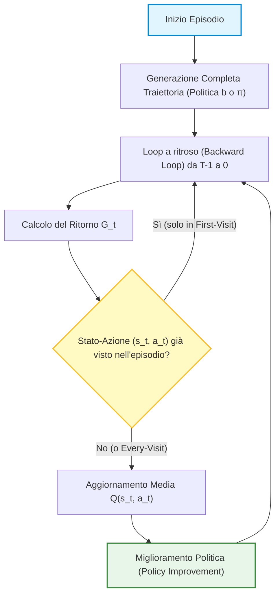
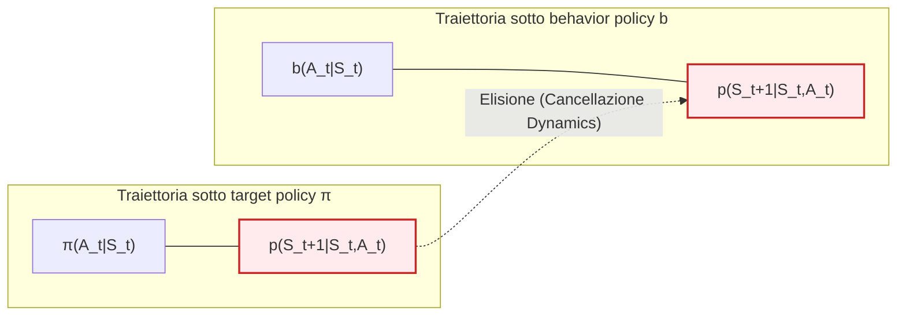

# Ripasso dei Fondamenti di Reinforcement Learning: Multi-Armed Bandits e Strategie di Esplorazione

## Overview Didattica

Questa lezione di ripasso sintetizza i concetti chiave legati al problema dei **Bandit Multi-Arm (*Multi-Armed Bandits*)** e alla gestione del **Dilemma Esplorazione-Sfruttamento (*Exploration-Exploitation Dilemma*)**. 

Vengono analizzate e messe a confronto le quattro metodologie principali adottate per garantire un'adeguata esplorazione dello spazio delle azioni:

1. **Politica $\epsilon$-Greedy ($\epsilon$-Greedy Policy):** Strategia fondamentale in cui si sceglie un'azione casuale non-greedy con probabilità $\epsilon$ e l'azione a ritorno massimo stimato con probabilità $1-\epsilon$. Viene discussa anche la tecnica del decadimento graduale di $\epsilon$ (*decaying $\epsilon$*).
2. **Inizializzazione Ottimistica (*Optimistic Initialization*):** Tecnica euristica per forzare l'esplorazione iniziale sovrastimando preventivamente i valori di ritorno attesi.
3. **Limite Superiore di Confidenza (*Upper Confidence Bound - UCB*):** Algoritmo basato sul principio dell'ottimismo in condizioni di incertezza. La scelta dell'azione non si basa unicamente sulla media empirica, ma sul potenziale massimo definito dalla somma tra valore medio stimato e incertezza (ampiezza dell'intervallo di confidenza).
4. **Gradient Bandit (*Gradient Bandits*):** Approccio avanzato basato sul concetto di preferenza delle azioni anziché sulla stima diretta del valore della ricompensa. Le preferenze vengono convertite in probabilità di selezione mediante la **trasformazione Softmax (*Softmax Function*)**, aggiornando i parametri in funzione dello scarto tra la ricompensa ottenuta e una linea di base (*baseline*).

---

### Introduzione ai Multi-Armed Bandits e Dilemma Esplorazione-Sfruttamento

Nel contesto dell'apprendimento per rinforzo, l'esame dei problemi di tipo **Multi-Armed Bandit (MAB)** costituisce il punto di partenza ideale per comprendere il celebre **dilemma tra esplorazione e sfruttamento (exploration-exploitation dilemma)**. Quando un agente deve compiere scelte in un ambiente stocastico, si trova costantemente di fronte a un compromesso fondamentale:
- **Sfruttamento (Exploitation)**: Scegliere l'azione che, in base alle stime attuali, garantisce la ricompensa (reward) più alta. È una mossa miope ma necessaria per massimizzare il guadagno immediato.
- **Esplorazione (Exploration)**: Scegliere azioni alternative e meno note, con l'obiettivo di raccogliere informazioni e scoprire potenziali strategie migliori nel lungo termine.

Per risolvere questo dilemma nei problemi a singolo stato (i Bandits), il corso analizza quattro principali approcci teorici e pratici: l'inizializzazione ottimistica, $\epsilon$-greedy, Upper Confidence Bound (UCB) e i Gradient Bandits.

---

### Strategie di Esplorazione per i Bandits

#### 1. Approccio $\epsilon$-greedy
La strategia **$\epsilon$-greedy** rappresenta l'approccio più semplice e intuitivo per garantire l'esplorazione, e viene riutilizzato anche nei problemi completi di Reinforcement Learning. 
- Con una probabilità $1 - \epsilon$ l'agente si comporta in modo **avido (greedy)**, scegliendo l'azione stimata migliore.
- Con una probabilità $\epsilon$ (ad esempio l'1% o il 10% delle volte) l'agente sceglie un'azione a caso, esplorando l'ambiente.

*Nota di buon senso pratico*: A differenza di quanto spesso riportato in modo rigido nei libri di testo, una pratica eccellente consiste nell'iniziare con un valore di $\epsilon$ alto (per esplorare molto quando il modello non è affidabile) e decrescerlo progressivamente nel tempo, arrivando eventualmente a $\epsilon = 0$ quando le stime sono stabili.

#### 2. Upper Confidence Bound (UCB)
L'approccio **Upper Confidence Bound (UCB)** abbandona la logica della scelta puramente casuale dell'esplorazione $\epsilon$-greedy per abbracciare una filosofia basata sul **potenziale e sull'incertezza**. 

Invece di basare la decisione unicamente sulla media empirica delle ricompense passate, UCB seleziona l'azione che massimizza una stima superiore dell'intervallo di confidenza:
$$A_t = \arg\max_a \left[ Q_t(a) + c \sqrt{\frac{\ln t}{N_t(a)}} \right]$$

La filosofia sottostante è la seguente:
- Se un'azione $a$ è stata scelta molte volte, il suo conteggio $N_t(a)$ è alto, l'intervallo di incertezza si restringe e la stima è considerata affidabile.
- Se un'azione è stata esplorata poche volte, il termine di incertezza cresce, conferendo all'azione un "potenziale" elevato che spinge l'agente a sceglierla per ridurne l'ambiguità.

*Caratteristica chiave*: Negli algoritmi UCB **non si utilizza alcun parametro $\epsilon$**. L'esplorazione è guidata interamente dall'evoluzione dinamica dell'intervallo di confidenza.

#### 3. Gradient Bandits
Il metodo dei **Gradient Bandits** rappresenta l'approccio più sofisticato tra quelli studiati per i bandit. Invece di stimare direttamente il valore atteso delle ricompense per ciascuna azione, questo metodo introduce il concetto di **preferenza** ($H_t(a)$) per ogni azione.

Le preferenze non sono limitate a un range specifico (possono essere numeri arbitrari come $1000$ o $-200$) e vengono mappate in probabilità di scelta tramite una trasformazione **softmax**:
$$P_t(a) = \frac{e^{H_t(a)}}{\sum_{b} e^{H_t(b)}}$$

##### Regola di aggiornamento delle preferenze
Quando l'agente sceglie un'azione $A_t$ e riceve una ricompensa $R_t$, confronta quest'ultima con la ricompensa media attesa fino a quel momento $\bar{R}_t$ (la baseline). Le preferenze vengono aggiornate con la seguente regola per l'azione scelta:
$$H_{t+1}(A_t) = H_t(A_t) + \alpha (R_t - \bar{R}_t)(1 - P_t(A_t))$$

E per tutte le azioni non scelte ($a \neq A_t$):
$$H_{t+1}(a) = H_t(a) - \alpha (R_t - \bar{R}_t)P_t(a)$$

#### Approfondimento: Perché aggiornare anche le azioni non scelte?
Una domanda ricorrente riguarda la necessità matematica di aggiornare le preferenze $H$ anche per le azioni *che non sono state scelte* nel passo temporale corrente. Qualcuno potrebbe obiettare: *"La funzione softmax normalizza già le probabilità, non basterebbe aggiornare solo l'azione eseguita?"*

```mermaid
flowchart TD
    A["Scelta Azione A_t e Ricezione Reward R_t"] --> B["Confronto con la Baseline: R_t - R_bar"]
    B --> C{"R_t > R_bar?"}
    C -- "Sì (Reward superiore alle attese)" --> D["Aumenta la preferenza dell'azione scelta H(A_t)"]
    C -- "No (Reward inferiore alle attese)" --> E["Diminuisce la preferenza dell'azione scelta H(A_t)"]
    D --> F["Aggiornamento coordinato delle azioni non scelte per coerenza normalizzata"]
    E --> F
    F --> G["Ricalcolo delle probabilità tramite Softmax"]

    style A fill:#2d3748,stroke:#cbd5e0,stroke-width:2px
    style B fill:#2b6cb0,stroke:#63b3ed,stroke-width:2px
    style C fill:#d69e2e,stroke:#f6e05e,stroke-width:2px
    style D fill:#2f855a,stroke:#68d391,stroke-width:2px
    style E fill:#c53030,stroke:#fc8181,stroke-width:2px
    style F fill:#4a5568,stroke:#a0aec0,stroke-width:2px
    style G fill:#2b6cb0,stroke:#63b3ed,stroke-width:2px
```



*Risposta concettuale*: È teoricamente possibile derivare un algoritmo funzionante che aggiorna solo l'azione scelta modificando leggermente il sistema. Tuttavia, la formulazione standard che aggiorna *tutte* le azioni discende direttamente da una rigorosa derivazione matematica basata sulla **salita del gradiente (gradient ascent)** rispetto alle performance attese della policy. L'inclusione del termine per le azioni non scelte garantisce la corretta direzione del gradiente stocastico, legando indissolubilmente l'algoritmo alla teoria dell'ottimizzazione.

---

### Il ruolo dell'Iperparametro $\alpha$ nei Gradient Bandits

L'iperparametro $\alpha$ regola il **passo di apprendimento (learning rate)** nell'aggiornamento delle preferenze. Il suo impatto sul comportamento dell'agente è cruciale:
- **Se $\alpha$ è alto**: L'agente attribuisce un peso enorme agli aggiornamenti recenti. Sperimentalmente, se si fissa un'azione considerata inizialmente la migliore con un $\alpha$ molto alto, l'agente tende a rinforzare in modo aggressivo quella scelta, riducendo l'esplorazione e focalizzandosi fortemente sull'**sfruttamento (exploitation)** deterministico.
- **Se $\alpha$ è basso**: L'aggiornamento è conservativo, i cambiamenti avvengono lentamente e l'agente mantiene un comportamento più incline all'**esplorazione (exploration)**.

---

### Monte Carlo Control On-Policy e Politiche $\epsilon$-Soft

#### Concetto di Politica $\epsilon$-Soft
Nelle lezioni precedenti abbiamo analizzato il problema dell'esplorazione nei problemi di tipo *Multi-Armed Bandit*. Trasferendo questo concetto nei problemi di *Apprendimento per Rinforzo (Reinforcement Learning - RL)* completi, utilizziamo le **politiche $\epsilon$-soft ($\epsilon$-soft policies)** per garantire che l'agente non smetta mai di esplorare l'ambiente.

Una politica si definisce $\epsilon$-soft se, per ogni stato $s \in \mathcal{S}$, la probabilità di selezionare una qualsiasi azione disponibile $a \in \mathcal{A}(s)$ è strettamente maggiore di zero e vincolata da un valore minimo:

$$\pi(a|s) \ge \frac{\epsilon}{|\mathcal{A}(s)|}$$

Dove $|\mathcal{A}(s)|$ indica la cardinalità dello spazio delle azioni disponibili nello stato $s$.

In termini pratici, se fissiamo un grado di esplorazione del $10\%$ ($\epsilon = 0.1$), l'agente dedicherà il $10\%$ del tempo all'esplorazione. Questa quota del $10\%$ viene suddivisa equamente tra tutte le azioni disponibili. 

La distribuzione di probabilità viene quindi definita come:
*   **Azione non-greedy (esplorativa):** 
    $$\pi(a|s) = \frac{\epsilon}{|\mathcal{A}(s)|}$$
*   **Azione greedy (sfruttamento/greedy action $a^*$):** 
    $$\pi(a^*|s) = 1 - \epsilon + \frac{\epsilon}{|\mathcal{A}(s)|}$$

La somma di tutte le probabilità garantisce una distribuzione valida pari al $100\%$ ($1$).

#### Confronto: Exploring Starts vs $\epsilon$-Soft
Esistono due approcci principali per garantire l'esplorazione nei metodi Monte Carlo (MC):
1.  **Inizio Esplorativo (Exploring Starts):** L'esplorazione viene forzata esclusivamente al primo passo dell'episodio (scelgo la coppia stato-azione iniziale a caso), mentre i passi successivi seguono la politica corrente.
2.  **Politiche $\epsilon$-soft:** L'esplorazione è distribuita lungo l'intera traiettoria; a ogni singolo passo temporale dell'episodio c'è una probabilità $\epsilon$ di esplorare.

> **Nota:** I due metodi non si escludono a vicenda: è possibile combinare l'inizializzazione *Exploring Starts* con una politica $\epsilon$-soft durante il prosieguo dell'episodio.

#### Struttura dell'Algoritmo: First-Visit vs Every-Visit
Nei metodi Monte Carlo per il controllo, l'architettura dell'algoritmo segue il paradigma dell'**Iterazione di Politica Generalizzata (Generalized Policy Iteration - GPI)**. 



**Concetto Chiave:** A differenza di *Temporal Difference (TD) Learning*, nei metodi Monte Carlo l'intera traiettoria dell'episodio viene generata nel **loop esterno**. L'aggiornamento dei valori delle azioni e della politica avviene solo alla fine dell'episodio, elaborando l'esperienza a ritroso (dal passo finale $T-1$ fino a $0$) tramite un loop lineare.

Dipendentemente da come gestiamo le visite ripetute agli stessi stati nello stesso episodio, distinguiamo:
*   **First-Visit MC Control:** Il ritorno $G_t$ viene calcolato e considerato per aggiornare la media stimata $Q(s_t, a_t)$ **solo la prima volta** che la coppia $(s_t, a_t)$ compare all'interno dell'episodio.
*   **Every-Visit MC Control:** L'aggiornamento della media stimata $Q(s_t, a_t)$ viene eseguito **ogni volta** che la coppia $(s_t, a_t)$ viene incontrata nell'episodio, rimuovendo il controllo di prima visita.

Se durante una prova d'esame non viene specificata la variante, è possibile utilizzare indistintamente l'aggiornamento incrementale delle medie o la versione *first-visit/every-visit*, purché la logica di calcolo del ritorno $G_t$ rimanga coerente.

#### Aggiornamento della Politica nel GPI
Durante la fase di *Policy Improvement*, una volta aggiornata la stima $Q(s, a)$ con il nuovo ritorno $G_t$, la politica $\epsilon$-soft deve riadattarsi:
1.  Si individua la nuova azione greedy: 
    $$a^* = \arg\max_{a} Q(s, a)$$
2.  Se l'azione presa nel passo corrente non coincide più con la nuova azione greedy $a^*$, la probabilità associata a quell'azione viene ridotta drasticamente al valore base di esplorazione $\frac{\epsilon}{|\mathcal{A}(s)|}$.
3.  La nuova azione greedy $a^*$ assorbe la maggior parte della massa di probabilità, cioè $1 - \epsilon + \frac{\epsilon}{|\mathcal{A}(s)|}$.

---

### Importance Sampling per Monte Carlo Off-Policy

#### Motivazione: Target Policy vs Behavior Policy
Nel controllo **Off-Policy**, separiamo la politica utilizzata per generare i dati da quella che stiamo cercando di valutare e ottimizzare:
*   **Politica Target (Target Policy $\pi$):** La politica ottimale che desideriamo apprendere (spesso deterministica o greedy).
*   **Politica Comportamentale (Behavior Policy $b$):** La politica usata per interagire con l'ambiente e raccogliere i dati di traiettoria (tipicamente molto esplorativa).

Il problema fondamentale è: *Come possiamo stimare il valore atteso dei ritorni sotto la politica $\pi$, se le traiettorie sono state generate seguendo la politica $b$?*

La risposta risiede nell'**Campionamento di Importanza (Importance Sampling - IS)**, una tecnica statistica che permette di stimare il valore atteso di una distribuzione usando campioni provenienti da una distribuzione diversa, ponderandoli opportunamente.

#### Requisito di Copertura (Coverage Assumption)
Per poter applicare l'Importance Sampling, la politica comportamentale $b$ deve soddisfare l'assunzione di **copertura (coverage)**:

> **Concetto Chiave:** Per ogni stato $s \in \mathcal{S}$ e azione $a \in \mathcal{A}(s)$, se la politica target attribuisce una probabilità maggiore di zero di scegliere l'azione $a$, allora anche la politica comportamentale deve avere una probabilità maggiore di zero di sceglierla:
> $$\pi(a|s) > 0 \implies b(a|s) > 0$$

Se questa condizione non è soddisfatta, ci saranno transizioni possibili per la politica target $\pi$ che l'agente non osserverà mai nei dati raccolti con $b$, rendendo impossibile l'apprendimento off-policy.

#### Derivazione del Rapporto di Importance Sampling su Traiettorie
Una traiettoria $\tau$ a partire dal passo temporale $t$ è definita dalla sequenza di stati e azioni:

$$\tau = (A_t, S_{t+1}, A_{t+1}, S_{t+2}, \dots, S_T)$$

La probabilità che questa specifica traiettoria si verifichi seguendo una politica generica $\pi$, data la dinamica dell'ambiente descritta dalla probabilità di transizione $p(s'|s,a)$, è il prodotto alternato delle probabilità dell'agente e delle risposte dell'ambiente:

$$P(\tau | \pi) = \prod_{k=t}^{T-1} \pi(A_k | S_k) \, p(S_{k+1} | S_k, A_k)$$

Parallelamente, la probabilità della stessa traiettoria sotto la politica comportamentale $b$ è:

$$P(\tau | b) = \prod_{k=t}^{T-1} b(A_k | S_k) \, p(S_{k+1} | S_k, A_k)$$

Per bilanciare la discrepanza tra i dati raccolti e la politica che vogliamo apprendere, definiamo il **Rapporto di Importance Sampling (Importance Sampling Ratio)** $\rho_{t:T-1}$ come il rapporto tra le due probabilità di traiettoria:

$$\rho_{t:T-1} = \frac{P(\tau | \pi)}{P(\tau | b)} = \frac{\prod_{k=t}^{T-1} \pi(A_k | S_k) \, p(S_{k+1} | S_k, A_k)}{\prod_{k=t}^{T-1} b(A_k | S_k) \, p(S_{k+1} | S_k, A_k)}$$

Poiché la dinamica del modello/ambiente $p(S_{k+1} | S_k, A_k)$ è identica nei due casi, i termini ambientali al numeratore e al denominatore si elidono perfettamente.



Otteniamo così la formula fondamentale per il peso di Importance Sampling su una traiettoria:

$$\rho_{t:T-1} = \prod_{k=t}^{T-1} \frac{\pi(A_k | S_k)}{b(A_k | S_k)}$$

> **Concetto Chiave:** Non serve conoscere la dinamica del modello (le probabilità di transizione dell'ambiente $p$) per applicare l'Importance Sampling nei metodi Monte Carlo Model-Free. È sufficiente conoscere il rapporto prodotto delle probabilità delle singole azioni secondo le due politiche lungo tutta la traiettoria.

#### Significato Intuitivo e Aggiornamento dei Ritorni
Il valore di $\rho_{t:T-1}$ agisce come un fattore di scala per i ritorni $G_t$ ottenuti dall'ambiente:

$$\mathbb{E}_\pi [G_t] = \mathbb{E}_b \left[ \rho_{t:T-1} G_t \right]$$

*   **Caso $\rho > 1$:** La sequenza di azioni intrappresa era *molto più probabile* sotto la politica target $\pi$ rispetto alla politica comportamentale $b$. Il ritorno osservato $G_t$ deve avere un impatto **maggiore** (peso aumentato) nell'aggiornamento delle stime per $\pi$.
*   **Caso $\rho < 1$:** La traiettoria è stata generata da azioni che la politica target $\pi$ sceglierebbe molto raramente. Il ritorno $G_t$ deve avere un peso **ridotto** nell'aggiornamento.
*   **Caso $\rho = 0$:** Se durante la traiettoria l'agente esegue anche una sola azione che la politica target non avrebbe *mai* compiuto ($\pi(A_k|S_k) = 0$), il prodotto si annulla ($\rho = 0$), invalidando la rilevanza di quella traiettoria per la politica target.

Nel controllo Monte Carlo Off-Policy, l'aggiornamento retrogrado si interrompe non appena l'azione presa dalla politica di comportamento $b$ ha probabilità nulla nella politica target $\pi$, consentendo un risparmio computazionale significativo durante il loop *backward*.

---

### Ciclo di Controllo TD e Politica Implicita

Nel contesto dell'Apprendimento a Differenze Temporali per il controllo (*Temporal-Difference Control*), un dubbio frequente riguarda il ruolo esplicito della politica $\pi$ durante l'aggiornamento della funzione valore azione $Q(s, a)$. 

Negli algoritmi TD come SARSA, Q-Learning ed Expected SARSA, l'esplorazione rimane un elemento essenziale. La stima di $Q$ è intrinsecamente più complessa e rada (*sparse*) rispetto alla stima della funzione valore di stato $V(s)$, rendendo la gestione del bilanciamento tra esplorazione e sfruttamento (*exploration-exploitation trade-off*) ancora più critica.

#### Il Meccanismo dell'Iterazione di Politica Generalizzata (GPI)
Negli algoritmi di controllo TD basati su valore, la politica $\pi$ non viene rappresentata come una tabella o una funzione separata da aggiornare esplicitamente in uno step distinto. La politica è **definita implicitamente** a partire dalla funzione $Q$ corrente mediante una regola di scelta delle azioni, tipicamente $\epsilon$-greedy (*$\epsilon$-greedy policy*):

* Con probabilità $1 - \epsilon$, si sceglie l'azione avidamente: $\arg\max_a Q(s, a)$.
* Con probabilità $\epsilon$, si sceglie un'azione casuale per garantire l'esplorazione.


> **Concetto Chiave**
> Non esiste una fase separata di *policy improvement* intesa come codice distinto. Ogni volta che il valore di $Q(s, a)$ viene modificato dall'equazione di aggiornamento TD, **la politica $\pi$ cambia automaticamente**. Modificare i valori di $Q$ equivale a modificare la politica usata per interagire con l'ambiente al passo successivo.

---

### Analisi Comparativa: SARSA, Q-Learning ed Expected SARSA

I tre principali algoritmi TD per il controllo differiscono fondamentalmente per il valore target utilizzato nell'errore di differenza temporale (*TD Error*).

#### 1. SARSA: TD Control On-Policy
L'algoritmo SARSA prende il nome dalla sequenza di quantità coinvolte nell'aggiornamento: $(S_t, A_t, R_{t+1}, S_{t+1}, A_{t+1})$.

L'equazione di aggiornamento è:
$$Q(S_t, A_t) \leftarrow Q(S_t, A_t) + \alpha \left[ R_{t+1} + \gamma Q(S_{t+1}, A_{t+1}) - Q(S_t, A_t) \right]$$

* **Funzionamento**: Dopo essere arrivati nello stato $S_{t+1}$, si sceglie la successiva azione $A_{t+1}$ basandosi sulla politica $\pi$ corrente ($\epsilon$-greedy). Si esegue l'aggiornamento vincolandosi (*committing*) a tale azione.
* **Natura On-policy**: I dati usati per l'aggiornamento derivano esattamente dalla stessa politica che si sta valutando e migliorando.

#### 2. Q-Learning: TD Control Off-Policy
Q-Learning modifica il target TD sostituendo l'azione effettivamente scelta al passo successivo con il valore massimo possibile su tutte le azioni eseguibili in $S_{t+1}$.

L'equazione di aggiornamento è:
$$Q(S_t, A_t) \leftarrow Q(S_t, A_t) + \alpha \left[ R_{t+1} + \gamma \max_{a} Q(S_{t+1}, a) - Q(S_t, A_t) \right]$$

* **Meccanismo di Lookahead**: Invece di vincolarsi all'azione suggerita dalla politica corrente, Q-Learning "guarda avanti" (*lookahead*) valutando l'opzione migliore possibile. Questo approccio è concettualmente analogo al *momentum di Nesterov* nell'ottimizzazione per il Deep Learning.
* **Natura Off-policy**: La politica target (*target policy*) è puramente greedy rispetto a $Q$, mentre la politica di comportamento (*behavior policy*) usata per raccogliere i dati nell'ambiente rimane $\epsilon$-greedy.
* **Connessione con Bellman**: Mentre SARSA deriva dall'Equazione di Aspettativa di Bellman (*Bellman Expectation Equation*), Q-Learning è direttamente derivato dall'Equazione di Ottimalità di Bellman (*Bellman Optimality Equation*) campionata.

#### 3. Expected SARSA
Expected SARSA elimina la varianza legata al campionamento dell'azione $A_{t+1}$ calcolando il valore atteso della funzione $Q$ nello stato $S_{t+1}$ rispetto alla distribuzione della politica $\pi$.

L'equazione di aggiornamento è:
$$Q(S_t, A_t) \leftarrow Q(S_t, A_t) + \alpha \left[ R_{t+1} + \gamma \sum_{a} \pi(a|S_{t+1}) Q(S_{t+1}, a) - Q(S_t, A_t) \right]$$

* **Funzionamento**: Invece di scegliere una singola azione $A_{t+1}$ (come in SARSA) o prendere il massimo assoluto (come in Q-Learning), si calcola la media pesata di tutte le azioni possibili, dove i pesi sono le probabilità assegnate dalla politica $\pi(a|S_{t+1})$.
* **Proprietà**: Ha una varianza inferiore rispetto a SARSA pur mantenendo una convergenza stabile. Può funzionare sia in modalità *on-policy* sia *off-policy*.

---

### Importanza dell'Ordine delle Operazioni

La differenza tra SARSA e Q-Learning non risiede unicamente nella presenza dell'operatore $\max$, ma anche nel **flusso sequenziale** dell'algoritmo.

```mermaid
flowchart TD
    subgraph SARSA ["Flusso SARSA (On-Policy)"]
        node1["Scegli A da S usando π"] --> node2["Esegui A, osserva R, S'"]
        node2 --> node3["Scegli A' da S' usando π"]
        node3 --> node4["Aggiorna Q(S,A) con Q(S',A')"]
        node4 --> node5["S <- S', A <- A'"]
    end

    subgraph QLearning ["Flusso Q-Learning (Off-Policy)"]
        qnode1["Scegli A da S usando π"] --> qnode2["Esegui A, osserva R, S'"]
        qnode2 --> qnode3["Aggiorna Q(S,A) con max_a Q(S',a)"]
        qnode3 --> qnode4["Scegli A' da S' usando NUOVA π (da nuovo Q)"]
        qnode4 --> qnode5["S <- S'"]
    end
```



> **Concetto Chiave**
> In **SARSA**, l'azione $A'$ viene scelta *prima* dell'aggiornamento di $Q(S,A)$. L'algoritmo si è già impegnato ad eseguire $A'$ basandosi sul vecchio valore di $Q$.
> In **Q-Learning**, l'aggiornamento di $Q(S,A)$ avviene *prima* di selezionare la nuova azione $A'$ per il passo successivo. La scelta di $A'$ avverrà quindi sfruttando la politica già aggiornata (*nuovo $Q$*).

---

### Però perché non serve l'Important Sampling nel Controllo TD Off-Policy?

Una perplessità comune riguarda il motivo per cui algoritmi *off-policy* come Q-Learning o Expected SARSA non utilizzino il Campionamento per Importanza (*Importance Sampling*), al contrario di quanto avviene nei metodi Monte Carlo o nel TD Prediction *off-policy*.

* **Assenza di traiettorie multi-step**: L'Importance Sampling serve a compensare la discrepanza probabilistica tra due diverse distribuzioni su *intere traiettorie* di passi successivi.
* **Lookahead ad un singolo passo**: In Q-Learning ed Expected SARSA non stiamo eseguendo una transizione reale guidata da un'altra politica al passo $t+1$. Giunti in $S_{t+1}$, stiamo semplicemente calcolando analiticamente un valore target ($ \max_a Q $ o la media pesata $\sum \pi(a|S')Q$) senza effettuare un'azione reale basata su una traiettoria diversa.

Poiché la transizione $(S_t, A_t \to R_{t+1}, S_{t+1})$ è stata generata dall'ambiente ed è già avvenuta, non occorre ripesare la distribuzione delle azioni future con alcun rapporto di importanza (*importance sampling ratio*).

---

3. Programmazione Dinamica e Connessione con il TD Learning

#### Perché usiamo la Programmazione Dinamica?

La **Programmazione Dinamica (Dynamic Programming - DP)** è uno strumento fondamentale nel Reinforcement Learning, ma spesso ci si chiede perché sia necessaria anche quando il Processo Decisionale di Markov (Markov Decision Process - MDP) è completamente noto. 

Le ragioni principali sono due:

1. **Problemi di Controllo e Non Linearità**: Nei problemi di controllo ottimale, la ricerca della politica migliore comporta la risoluzione di sistemi di equazioni non lineari (come le equazioni di ottimalità di Bellman). Tali sistemi non possono essere risolti in forma chiusa tramite i tradizionali strumenti matematici analitici.
2. **Scalabilità Computazionale**: Quando si affrontano problemi su larga scala con migliaia di stati ed equazioni da aggiornare nel tempo, non è possibile applicare solutori diretti algebrici (come l'inversione matriciale diretta). È indispensabile ricorrere ad **approcci ricorsivi** che aggiornano progressivamente le stime.

#### Il Legame tra Programmazione Dinamica e TD Learning

Esiste un ponte concettuale e matematico diretto tra la Programmazione Dinamica e l'**Apprendimento per Differenze Temporali (Temporal Difference Learning - TD Learning)**:

* **In ambiente noto (MDP noto)**: La DP calcola le stime ricorsivamente sfruttando la vera funzione di transizione di probabilità $P(s'|s,a)$ e la funzione di ricompensa $R(s,a,s')$.
* **In ambiente ignoto (MDP non noto)**: Il TD Learning conserva la stessa **struttura ricorsiva** della DP per aggiornare le stime di $V(s)$ o $Q(s,a)$, ma sostituisce la conoscenza teorica delle probabilità con i **campioni (sample)** derivati dall'esperienza diretta dell'agente nel mondo.

> **Concetto Chiave: TD Learning come DP Campionata**
> Il TD Learning non è altro che una versione della Programmazione Dinamica basata su campionamento (*sample-based dynamic programming*): invece di calcolare il valore atteso esatto su tutte le transizioni possibili, aggiorna le stime iterativamente utilizzando i dati e le transizioni effettivamente osservate.

---

### Valutazione Sincrona vs Asincrona e Pseudocodice

#### Errore Comune nella Valutazione Sincrona (Synchronous Evaluation)

Nella **Valutazione della Politica Sincrona (Synchronous Policy Evaluation)**, l'obiettivo è aggiornare la funzione di valore $V(s)$ per tutti gli stati contemporaneamente al passo $k+1$, utilizzando esclusivamente i valori calcolati al passo $k$.

Un errore di implementazione frequente consiste nell'aggiornare la variabile $V(s)$ direttamente "in loco" (*in-place*) all'interno del ciclo che scorre gli stati.

> **Concetto Chiave: Gestione del Buffer nella Valutazione Sincrona**
> Se aggiorniamo $V(s)$ direttamente dentro il ciclo di iterazione sugli stati, lo stato successivo $s'$ leggerà il valore $V(s)$ appena modificato (al tempo $k+1$) anziché quello vecchio (al tempo $k$). Trovandoci di fatto in una valutazione *asincrona*, rischiamo di alterare la convergenza o sbilanciare l'aggiornamento.
>
> Per garantire una corretta valutazione **sincrona**, occorre salvare i valori Correnti in un **buffer temporaneo** ed effettuare il sovrascrittura di $V$ solo all'esterno o al termine del ciclo di scansione (*sweep*) di tutti gli stati.

#### Flessibilità nella Scrittura dello Pseudocodice

Lo pseudocodice non è codice sorgente destinato a un compilatore, ma uno strumento di comunicazione tra esseri umani per illustrare la logica di un algoritmo. 

* È consentito essere flessibili con la notazione (ad esempio definendo cicli espliciti sull'ordine degli stati $S_1, S_2, \dots, S_N$).
* L'elemento determinante è la chiarezza: l'algoritmo deve mostrare chiaramente l'ordine delle operazioni, la corretta allocazione dei buffer e la logica di aggiornamento ricorsivo.

---

### Teorema di Miglioramento della Politica e Relazione tra $V$ e $Q$

#### Relazione Concettuale tra $V(s)$ e $Q(s,a)$

La comprensione della relazione tra la **Funzione di Valore dello Stato (State-Value Function)** $V(s)$ e la **Funzione di Valore Stato-Azione (Action-Value Function)** $Q(s,a)$ è uno dei pilastri dell'intero corso.

Entrambe le funzioni esprimono il ritornato atteso (expected return), ma con un diverso livello di dettaglio:

1. **$V^\pi(s)$**: Rappresenta il ritorno atteso partendo dallo stato $s$ e seguendo la politica $\pi$ per tutti i passi futuri:
   $$V^\pi(s) = \mathbb{E}_\pi \left[ G_t \mid S_t = s \right]$$
2. **$Q^\pi(s,a)$**: Rappresenta il ritorno atteso partendo dallo stato $s$, eseguendo un'azione arbitraria $a$ (non necessariamente quella raccomandata dalla politica $\pi$), e **successivamente** seguendo la politica $\pi$:
   $$Q^\pi(s,a) = \mathbb{E}_\pi \left[ G_t \mid S_t = s, A_t = a \right]$$

Se l'azione $a$ selezionata coincide con quella prescritta dalla politica corrente $a = \pi(s)$, le due funzioni equivalgono:
$$V^\pi(s) = Q^\pi(s, \pi(s))$$

> **Concetto Chiave: La Funzione $Q$ come Strumento di Esplorazione**
> La funzione $Q(s,a)$ ci permette di valutare l'effetto di azioni "alternative" (non previste dalla politica attuale) senza dover cambiare immediatamente la politica stessa. Questo è il meccanismo fondamentale che abilita il controllo e il miglioramento della politica.

#### Il Teorema di Miglioramento della Politica (Policy Improvement Theorem)

Il teorema dimostra che se definiamo una nuova politica $\pi'$ scegliendo in modo **avido (greedy)** l'azione che massimizza $Q^\pi(s,a)$:

$$\pi'(s) = \arg\max_{a \in \mathcal{A}} Q^\pi(s, a)$$

allora la nuova politica $\pi'$ produrrà un valore atteso sempre **maggiore o uguale** a quello della politica precedente per tutti gli stati $s \in \mathcal{S}$:

$$V^{\pi'}(s) \ge V^\pi(s)$$

* **Miglioramento Stretto**: Se esiste almeno uno stato per cui $Q^\pi(s, \pi'(s)) > V^\pi(s)$, le prestazioni complessive aumentano.
* **Uguaglianza e Ottimalità**: Se $V^{\pi'}(s) = V^\pi(s)$ per tutti gli stati, significa che l'equazione di ottimalità di Bellman è soddisfatta. Di conseguenza, abbiamo raggiunto la **Politica Ottimale (Optimal Policy)** $\pi^*$.

---

### Iterazione di Politica Generalizzata (Generalized Policy Iteration - GPI)

Il processo generale di risoluzione dei problemi di Reinforcement Learning può essere sintetizzato dall'interazione continua tra due fasi distinte ma interconnesse:

1. **Predizione (Valutazione della Politica - Policy Evaluation)**: Calcolo o stima precisa della funzione di valore ($V$ o $Q$) per la politica corrente $\pi$.
2. **Controllo (Miglioramento della Politica - Policy Improvement)**: Aggiornamento della politica $\pi$ in modo greedy rispetto alla funzione di valore stimata.

```mermaid
flowchart TD
    accTitle: Iterazione di Politica Generalizzata (GPI)
    accDescr: Ciclo interattivo tra la valutazione della politica (Predizione) e il miglioramento avido della politica (Controllo) fino alla convergenza all'ottimo.

    subgraph GPI ["Iterazione di Politica Generalizzata (GPI)"]
        direction TB
        P ["Predizione (Policy Evaluation)<br>Stima di V(s) o Q(s,a)"]
        C ["Controllo (Policy Improvement)<br>Politica Greedy rispetto a Q/V"]
        P -->|"Fornisce la funzione valore"| C
        C -->|"Definisce la nuova politica"| P
    end

    Start(["Politica Iniziale π₀"]) --> P
    C --> Convergence{"V(s) = V'(s) ?"}
    Convergence -- "No (Miglioramento)" --> P
    Convergence -- "Sì (Ottimalità)" --> End(["Politica Ottimale π* e V*"])

    style P fill:#e1f5fe,stroke:#0288d1,stroke-width:2px
    style C fill:#e8f5e9,stroke:#388e3c,stroke-width:2px
    style GPI fill:#fafafa,stroke:#616161,stroke-width:1px
```

* Nel percorso **verso l'alto** (Predizione), l'algoritmo affina la conoscenza della funzione di valore sulla base della politica corrente.
* Nel percorso **verso il basso** (Controllo), la politica viene modificata per sfruttare la conoscenza attuale, rendendola greedy rispetto ai valori $Q(s,a)$ ottenuti.
* Il processo continua ad alternare queste due fasi finché la funzione valore e la politica non convergono stabilmente verso $V^*$ e $\pi^*$.

---

> [!NOTE]
> ### Note per l'Esame e Avvisi del Docente
> - **Equazione e implementazione di UCB (Upper Confidence Bound)**: Il docente ha evidenziato che occorre ricordare a memoria l'equazione di UCB poiché potrebbe chiedere esplicitamente di implementarla.
> - **Derivazione del Gradient Bandit**: La derivazione matematica che collega l'algoritmo di Gradient Bandit al Gradient Ascent (ripresa dal libro) è considerata **opzionale** ai fini dell'esame.
> - **Framework per l'esplorazione nei Bandits**: Se all'esame viene chiesto di elencare i metodi per garantire l'esplorazione nei problemi Bandit, il docente si aspetta di vedere citati i quattro approcci visti nel corso (Epsilon-greedy, Optimistic initialization, UCB e Gradient bandit).
> - **Richiesta di algoritmi e varianti di pseudo-codice**: Gli algoritmi verranno chiesti all'esame. Il docente può richiedere espressamente varianti specifiche dello pseudo-codice (ad esempio la versione *first-visit* o *every-visit* in Monte Carlo, oppure adattamenti con *optimistic initialization*), specie se abbinati a un esercizio numerico per rendere omogenei i risultati di correzione.
> - **Esercizi numerici e calcoli di Programmazione Dinamica**: Il docente consiglia di esercitarsi sui calcoli con griglie semplificate (es. 3x3 come negli esami degli anni precedenti), in quanto servirà a dimostrare di aver compreso l'algoritmo e di saper applicare o modificare lo pseudo-codice.
> - **Dimostrazione formale della Policy Improvement Theory**: Il docente ha confermato esplicitamente che **NON chiederà MAI** la dimostrazione formale della *Policy Improvement Theory*.