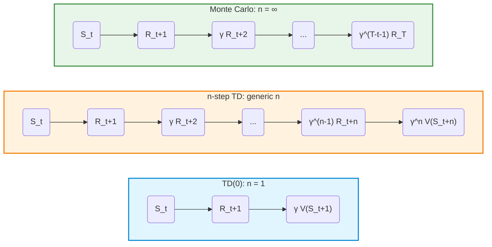
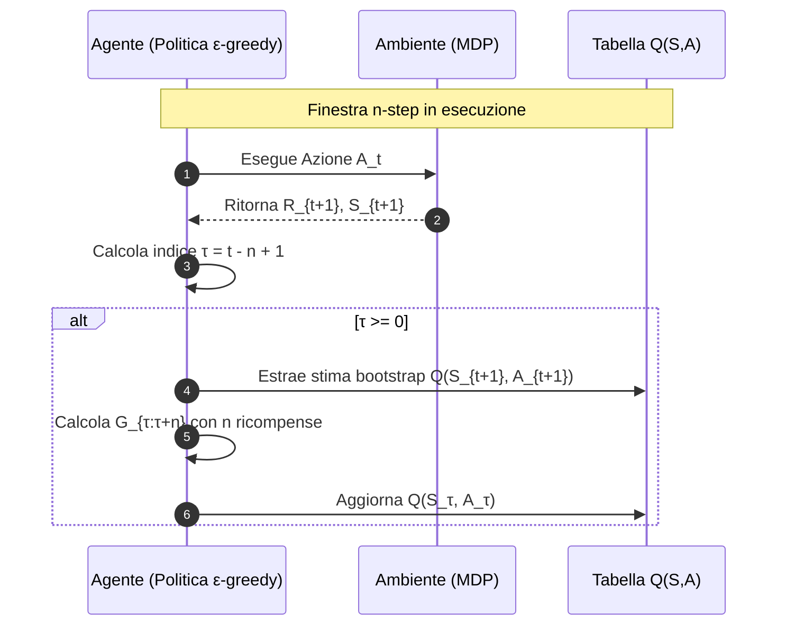
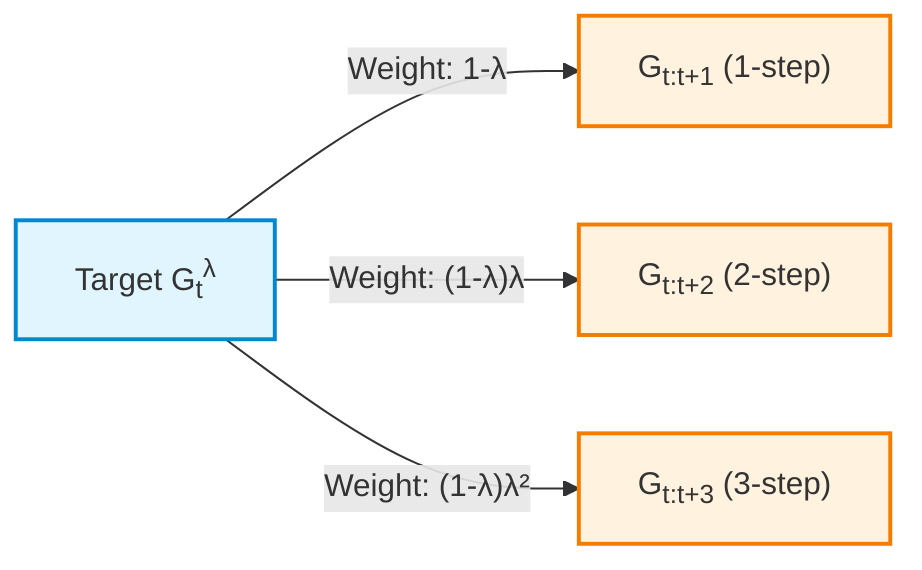
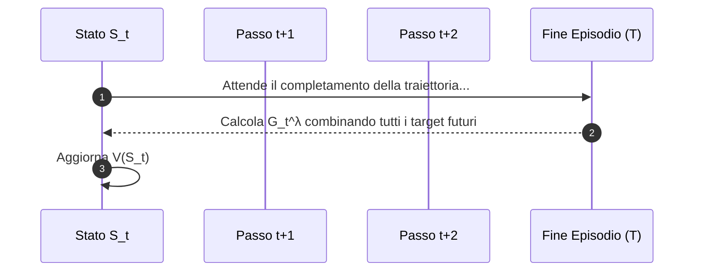

# Multi-Step TD Learning: Bias-Variance Trade-off and n-Step Bootstrapping

## Educational Overview

This lesson introduces the extension of Temporal-Difference Learning (*TD Learning*) methods through the **$n$-step bootstrapping** technique. So far, the sharp theoretical and practical contrast between the Monte Carlo approach and the single-step  $TD(0)$  approach has been analyzed:

* **Monte Carlo Methods**: offer unbiased estimates (zero bias), but are subject to high variance and require the completion of the entire episode to perform the update.
* ** $TD(0)$ Methods**: guarantee an immediate, low-variance update, but introduce bias due to direct dependence on the estimate of the next state (1-step bootstrap target).

The bias-variance trade-off makes the extremes unsatisfactory. Furthermore, both traditional approaches tackle the **Credit Assignment Problem** in a limited way, namely the difficulty of assigning proper responsibility for a long-term reward to previous states or actions.

The **$n$-step bootstrapping** acts as an ideal bridge along this spectrum: by collecting  $n$ real rewards before applying the value function at time  $t+n$, it allows modulating the dependence between environment sampling and the bootstrap estimate, optimizing the accuracy and stability of learning.

---

### The Bias-Variance Trade-off in Reinforcement Learning

In previous lessons, two fundamental approaches for estimating the value function were analyzed: **Monte Carlo (MC)** and **One-Step Temporal Difference Learning ($TD(0)$)**. Each presents clear advantages and disadvantages, stemming from the classic **Bias-Variance Trade-off**:

*   **Monte Carlo (MC):** Features **zero bias**. The update of the estimate is based on the actual return  $G_t$ collected until the end of the episode. However, since the return depends on a long sequence of stochastic states and actions, MC suffers from **high variance**.
*   **TD(0) / One-Step TD:** Features **low variance**, as the update is performed at every single time step based on the estimate of the next state's value. On the other hand, using *bootstrapping* (estimating a value based on another estimate) introduces **bias**.

> **Key Concept: The Absence of a Middle Ground**  
> Up to this point, the architecture of the learned methods imposes a dichotomous choice that is satisfying in very few real cases: either accept the high variance of Monte Carlo, or accept the bias of  $TD(0)$. The main educational objective of this section is to introduce a family of algorithms capable of positioning themselves continuously within this spectrum.

---

### The Credit Assignment Problem

To understand the need for an intermediate approach, consider the effect of the two strategies on a simple gridworld environment or on a random walk:

The following comparison describes a first episode with a reward only at termination, unit discounting, and identical initial estimates; its update behavior depends on these assumptions.

1.  **Monte Carlo Approach:** When the agent reaches a positive terminal state (receiving a reward of  $+1$), the estimated value of **all** states visited throughout the episode is increased. This behavior is often naive, as it blindly assigns the same credit to states that might not have significantly contributed to obtaining the final result.
2.  ** $TD(0)$ Approach:** Upon receiving the final reward of  $+1$, only the state immediately preceding the termination undergoes an increase in its value. Prior states remain completely unchanged during the first episode, requiring multiple episodes to "backpropagate" the reward.

This phenomenon highlights the **Credit Assignment Problem**: when an agent receives a reward signal (positive or negative), to which past actions and states should the responsibility for that outcome be attributed?

---

### Fundamentals of N-Step Bootstrapping

**N-Step Bootstrapping** ( $n$ -step bootstrapping) represents the natural extension unifying  $TD(0)$  and Monte Carlo. The key idea is to perform *bootstrapping* not after just one time step, but after  $n$  steps.

#### From One-Step Return to  $n$ -Step Return

Let us recall the target expression for  $TD(0)$, which can also be defined as the **1-step return**  $G_{t:t+1}$:

$$G_{t:t+1} = R_{t+1} + \gamma V_t(S_{t+1})$$

Where:
*   $R_{t+1}$  is the immediate reward observed when transitioning from state  $S_t$  to state  $S_{t+1}$.
*   $\gamma \in [0, 1]$ is the discount factor.
*   $V_t(S_{t+1})$  is the estimate of the future state value at time  $t$.

If we decide to wait **2 steps** before bootstrapping, we collect two real rewards ($R_{t+1}$  and  $R_{t+2}$) and estimate the rest of the trajectory starting from state  $S_{t+2}$. The **2-step return** becomes:

$$G_{t:t+2} = R_{t+1} + \gamma R_{t+2} + \gamma^2 V_{t+1}(S_{t+2})$$

Extending this reasoning to a generic number of steps  $n$, we obtain the formal definition of the ** $n$ -step return**  $G_{t:t+n}$:

$$G_{t:t+n} = R_{t+1} + \gamma R_{t+2} + \dots + \gamma^{n-1} R_{t+n} + \gamma^n V_{t+n-1}(S_{t+n})$$

For  $t+n \ge T$ (where  $T$  is the final time step of an episode), the terms beyond  $T$  vanish, and the  $n$-step return perfectly coincides with the full Monte Carlo return  $G_t$ .



---

### Critical Aspects of Notation and Time Synchronization

The introduction of the parameter  $n$  entails an increase in complexity regarding the temporal management of the algorithm:

1.  **Update Delay:** To update the value estimate of state  $S_t$  using the target  $G_{t:t+n}$, it is necessary to wait until time step  $t+n$. It is not possible to perform the update at time  $t$, because the rewards  $R_{t+1}, \dots, R_{t+n}$  and state  $S_{t+n}$  have not yet been observed by the agent.
2.  **Freshest Estimate:** In the term  $\gamma^n V_{t+n-1}(S_{t+n})$, the time index  $t+n-1$  indicates that the most up-to-date version of the value function available at the time of target calculation is used.

---

### Value Update Rule for N-Step TD

Using the  $n$ -step return  $G_{t:t+n}$, the update rule for the value function  $V(S_t)$  is formulated similarly to classic  $TD(0)$ , but with the appropriate synchronization of time indices:

$$V_{t+n}(S_t) = V_{t+n-1}(S_t) + \alpha \left[ G_{t:t+n} - V_{t+n-1}(S_t) \right]$$

Where:
*   $\alpha \in (0, 1]$  is the learning rate.
*   The $TD$ error at $n$ steps is expressed as  $\delta_{t:t+n} = G_{t:t+n} - V_{t+n-1}(S_t)$.
*   The update relative to state  $S_t$  is effectively recorded in the system's memory at time  $t+n$.

> **Key Concept: The parameter  $n$  as a Tuning Knob**  
> The entire mathematical development of n-step bootstrapping is summarized in managing the parameter  $n$:
> *   $n = 1 \implies$ **$TD(0)$**: Minimum variance, maximum bias, immediate update at each step.
> *   $n \to \infty \implies$ **Monte Carlo**: Maximum variance, zero bias, delayed update at episode end.
> *   $1 < n < \infty \implies$ **N-Step TD**: Compromise solution capable of balancing bias and variance, optimizing convergence speed and learning stability.

This formulation is applicable to both **episodic tasks** and **continuing tasks**, without requiring the environment to reach a terminal state to start updating estimates.

---

### Managing Algorithmic Complexity in  $n$-Step TD

The ** $n$-Step TD** (*$n$-Step Temporal Difference Prediction*) algorithm introduces an implementation complexity that does not concern the update equation itself (which remains conceptually simple), but rather the temporal management of indices and edge cases at the beginning and end of each episode.


#### The Three Time Indices ($t$, $T$, $\tau$)

To properly synchronize reward collection with the estimate of the past state value, the pseudocode manages three fundamental time variables:

1. **$t$  (Current time step counter):** Advances by one unit at each step of the episode ($t = 0, 1, 2, \dots$). It represents the moment when the agent is in the environment.
2. **$T$  (Episode termination time):** Represents the time step at which a terminal state is reached. Initially set to  $\infty$, it is fixed to the actual step value as soon as the terminal state is visited.
3. **$\tau$  (Time of the state to update):** Identifies the index of the state whose estimate is being updated. It is defined as:
   $$\tau = t - n + 1$$
   The update of the value function  $V(S_\tau)$  can only occur if  $\tau \ge 0$.

#### Managing Edge Cases (Beginning and End of Episode)

The complexity of the code derives directly from handling the two extreme conditions:

* **Beginning of episode ($\tau < 0$):** For the first  $n-1$  steps ($t < n-1$), the agent has not yet accumulated a sufficient number of transitions to compute the  $n$ -step return ($n$-step return). In this phase, no update is performed ($\tau < 0$).
* **End of episode ($t \ge T$):** When the episode ends, the agent can no longer collect rewards to complete the window of length  $n$. In this case, the target is truncated at the final time  $T$  replacing the estimate  $V(S_{t+n})$  with the actual return obtained until the end of the episode:
  $$G_{\tau:n} = \sum_{k=\tau+1}^{\min(\tau+n, T)} \gamma^{k-\tau-1} R_k + \gamma^{n} V_{\tau+n-1}(S_{\tau+n}) \quad \text{se } \tau + n < T$$
  If instead  $\tau + n \ge T$, the bootstrap estimate falls beyond the end of the episode and the term  $V(S_{\tau+n})$  disappears (or is 0), reducing to the actual Monte Carlo return:
  $$G_{\tau:n} = G_\tau = \sum_{k=\tau+1}^{T} \gamma^{k-\tau-1} R_k$$

#### Intuitive 2-Step Example ($n=2$)

Consider a Markov Decision Process (MDP) with state sequence $C \to D \to E \to \text{Terminale}$ and $n=2$. We adopt the pseudocode convention: at iteration $t$, the agent observes $R_{t+1}$ and $S_{t+1}$, then computes $\tau=t-n+1$.

1. **Iteration $t=0$ ($S_0=C \to S_1=D$, $R_1=-1$):**
   * $\tau=0-2+1=-1$. Only one transition is available: no update.
2. **Iteration $t=1$ ($S_1=D \to S_2=E$, $R_2=0$):**
   * $\tau=1-2+1=0$. Two transitions are available and $S_0=C$ is updated:
     $$G_{0:2} = R_1 + \gamma R_2 + \gamma^2 V(E)$$
     $$V(C) \leftarrow V(C) + \alpha \left[ G_{0:2} - V(C) \right]$$
3. **Iteration $t=2$ ($S_2=E \to S_3=\text{Terminale}$, $R_3=+1$):**
   * Set $T=3$, obtaining $\tau=1$. Update $S_1=D$ with $G_{1:3}=R_2+\gamma R_3$, without bootstrapping from the terminal state.
4. **Completing the updates, $t=3$:**
   * No further actions are taken in the environment. With $\tau=2=T-1$, update $S_2=E$ using $G_{2:3}=R_3$, then terminate the algorithm.

---

### Performance Analysis and Bias-Variance Trade-off

#### Experimental Results on 19-State Random Walk

To evaluate the impact of parameter  $n$, consider the *Random Walk* environment extended to 19 nonterminal states arranged between two terminal states, under a uniform policy  $\pi(A|S) = 0.5$.

The metric used to evaluate prediction is the **Root Mean Square Error (RMSE)** between the estimated value function  $V$  and the true value  $V^\pi$:

$$\text{RMSE} = \sqrt{\frac{1}{|\mathcal{S}|} \sum_{s \in \mathcal{S}} \left( V(s) - V^\pi(s) \right)^2}$$

> **Educational note:** The RMSE metric requires prior knowledge of the true value function  $V^\pi$. This is possible in benchmark environments or laboratory simulations, but it is not applicable in real-world Reinforcement Learning problems where  $V^\pi$  is unknown.

#### Key Concept: The Trade-off Between $n$ and Learning Rate $\alpha$

Empirical analysis of error curves as the step-size parameter $\alpha$ varies highlights a balance between **Bias** and **Variance**:

> **KEY CONCEPT: Relationship Between $n$ and $\alpha$**
> * **Small $n$ (e.g. $n=1$, TD(0)):** The target contains a high proportion of estimation ($V$), introducing **high bias**. However, because it considers few real transition steps, the **variance is very low** (little stochastic noise generated by the environment/policy). Consequently, the algorithm tolerates and is more efficient with **high values of $\alpha$**.
> * **Large $n$ (e.g. $n \to \infty$, Monte Carlo):** The target includes the sum of many real rewards observed along the trajectory, eliminating bootstrapping bias. Conversely, accumulating stochastic decisions along the trajectory introduces **very high variance**. The algorithm therefore requires **small values of $\alpha$** to average out and eliminate noise.

```
       Basso n (TD puro) <--------------------------> Alto n (Monte Carlo)
    ------------------------------------------------------------------------
    Bias:           Elevato                               Quasi nullo
    Varianza:       Molto bassa                           Elevata
    Alpha (α) opt:  Valori alti (es. 0.4 - 0.5)         Valori bassi (es. 0.05)
```

In complex problems such as the 19-state Random Walk, intermediate values (for example $n = 4$) generally offer the best performance (the lowest overall RMSE), balancing the drawbacks of the two extremes.

#### Note on Convergence (Error Reduction Property)

*Note: Optional theoretical content.*

The $n$-Step TD algorithm formally enjoys the **worst-case error reduction property**. It can be shown that the expectation of the $n$-step target guarantees a contraction of the maximum error relative to the true value function $V^\pi$:

$$\max_s \left| \mathbb{E}_\pi \left[ G_{t:t+n}(v) \mid S_t = s \right] - V^\pi(s) \right| \le \gamma^n \max_s \left| v(s) - V^\pi(s) \right|$$

Here $G_{t:t+n}(v)$ denotes the target constructed using a fixed bootstrap function $v$, under policy $\pi$. For $\gamma\in[0,1)$, the factor $\gamma^n<1$ expresses a contraction of the expected target; it does not by itself guarantee convergence of every sampled implementation. Tabular convergence also requires sufficient visits to states and appropriate conditions on learning step sizes. A constant step size may leave residual fluctuations.

---

### Control with  $n$-Step Methods:  $n$-Step SARSA

#### Extension to Action Values ($Q$-Function)

To move from prediction ($V$) to **control** ($Q$), we extend the architecture within the framework of **Generalized Policy Iteration (GPI)**. In this context, we update the action-value function  $Q(s, a)$.

The algorithm is called **$n$-Step SARSA**. The  $n$ -step return for a state-action pair is defined as:

$$G_{t:t+n} = R_{t+1} + \gamma R_{t+2} + \dots + \gamma^{n-1} R_{t+n} + \gamma^n Q_{t+n-1}(S_{t+n}, A_{t+n})$$

And the update rule for the state-action pair visited at time  $\tau = t - n + 1$  becomes:

$$Q(S_\tau, A_\tau) \leftarrow Q(S_\tau, A_\tau) + \alpha \left[ G_{\tau:\tau+n} - Q(S_\tau, A_\tau) \right]$$

The agent selects actions at current time  $t$  following an  $\epsilon$-greedy policy derived from the updated knowledge of  $Q$.



#### Operational Deep-Dive: On-Policy vs. Off-Policy in  $n$-Step (Overview)

The basic version of  $n$-step SARSA described is **On-Policy** (the policy gathering data is the same one being improved).

However, when extending the estimate over  $n$  steps into the future, the **Off-Policy** approach takes on important conceptual relevance:

1. During the time interval of  $n$  steps, the agent executes actions according to a **behavior policy**  $b(a|s)$.
2. To properly update the **target policy**  $\pi(a|s)$  with respect to the generated sequence, the discrepancy must be corrected using **Importance Sampling**.

The importance sampling correction factor  $\rho_{\tau:t}$  over the steps between  $\tau$  and  $t$  is defined by the product of probability ratios:

$$\rho_{\tau:t} = \prod_{k=\tau}^{\min(t, T-1)} \frac{\pi(A_k \mid S_k)}{b(A_k \mid S_k)}$$

The  $n$-step Off-Policy SARSA update is thus weighted by the value of  $\rho$:

$$Q(S_\tau, A_\tau) \leftarrow Q(S_\tau, A_\tau) + \alpha \, \rho_{\tau+1:\tau+n} \left[ G_{\tau:\tau+n} - Q(S_\tau, A_\tau) \right]$$

> **Educational Note:** Replacing the final bootstrap with a maximum or an expected value does not automatically correct the off-policy discrepancy along the whole trajectory. For Expected SARSA, averaging over the last action can remove the corresponding importance sampling factor; the other steps still require consistent treatment. Advanced variants fall outside the core requirements of this practical module.

---

### Summary and Limitations of the  $n$-Step TD Approach

Despite the effectiveness of  $n$-step methods in mediating between Temporal Difference and Monte Carlo, the architecture presents an unresolved structural limitation: **the need to fix a discrete parameter  $n$ a priori**.

* Choosing a fixed value  $n$  forces the algorithm to consider only that specific time horizon length for the entire learning process.
* In real-world contexts, the ideal informative horizon could vary dynamically during the episode.

This limitation introduces the theoretical need to integrate *all* possible horizons  $n$  simultaneously, laying the groundwork for introducing **Eligibility Traces** mechanisms and the **TD($\lambda$)**.

---

### Introduction to  $TD(\lambda)$  and Averaging  $N$-Step Targets

In previous lessons, we saw how the  $N$-step Temporal Difference ($N$-step TD) approach represents a middle ground between  $TD(0)$  (1-step) and Monte Carlo ($N \to \infty$). However, choosing the parameter  $N$  represents a critical hyperparameter that is not always trivial to tune.

To overcome this limitation, we introduce the **$TD(\lambda)$** algorithm. The key idea is simple: instead of having to choose a single value of  $N$, **we combine and average all possible  $N$-step targets** within a single estimator.

> **Reference Textbook Organization Note:**
> In the textbook (Sutton & Barto), Chapter 12 presents  $TD(\lambda)$  *after* introducing Value Function Approximation (VFA, Chapter 9). For educational clarity, we reverse the order: we address  $TD(\lambda)$  conceptually on tables first, before moving on to function approximation in large contexts.

---

### The $\lambda$-Return ($G_t^\lambda$): Definition and Properties

#### Intuition: Convex Combination

Imagine wanting to estimate the return  $G_t$  by combining two different  $N$-step estimates, for example for  $N=2$  and  $N=4$:

$$G_{t:t+2} = R_{t+1} + \gamma R_{t+2} + \gamma^2 V(S_{t+2})$$
$$G_{t:t+4} = R_{t+1} + \gamma R_{t+2} + \gamma^2 R_{t+3} + \gamma^3 R_{t+4} + \gamma^4 V(S_{t+4})$$

If we assign 50% weight to one and 50% to the other, we are forming a **Convex Combination**. To guarantee that the combined target remains a consistent estimate of the same return  $G_t$, the sum of the weights must strictly equal  $1$.

#### Mathematical Formulation for Infinite Horizon

Instead of combining only two estimates with arbitrary weights, $TD(\lambda)$ applies a weighted average over **all** $N$-step targets ($n = 1, 2, 3, \dots$), weighting them by a geometric decay factor governed by the parameter $\lambda \in [0, 1]$.

For $0\le\lambda<1$, define the **$\lambda$-Return ($TD(\lambda)$ Return)** $G_t^\lambda$ as:

$$G_t^\lambda = (1 - \lambda) \sum_{n=1}^{\infty} \lambda^{n-1} G_{t:t+n}$$

Where $G_{t:t+n}$ is the standard $N$-step return computed at time $t+n$.

#### Proof: Sum of Weights Equals 1

The weights assigned to each  $N$-step target are of the form  $(1 - \lambda)\lambda^{n-1}$. Let us verify that their sum equals 1 using the geometric series:

$$\sum_{n=1}^{\infty} (1 - \lambda)\lambda^{n-1} = (1 - \lambda) \sum_{k=0}^{\infty} \lambda^k$$

Knowing that for  $0 \le \lambda < 1$  the geometric series converges to  $\frac{1}{1 - \lambda}$:

$$(1 - \lambda) \cdot \frac{1}{1 - \lambda} = 1$$

The weights thus constitute a valid convex combination for $0\le\lambda<1$. The case $\lambda=1$ is handled using the episodic formulation below, or as a limit when that limit exists; one must not directly substitute $1$ into the infinite series.



#### Physical Meaning of  $\lambda$

The factor  $\lambda$ dampens the importance of steps further in the future.
* The further ahead we go in the trajectory, the greater the number of stochastic decisions (due to the policy and environment dynamics) that accumulate **noise and variance**.
* Assigning a geometrically decaying weight to future steps makes it possible to prioritize information closer in time, controlling the overall variance of the estimator.

---

### Formulation for Episodic Tasks

In episodic contexts, the episode ends at a final time step  $T$. It is therefore not possible to sum to infinity.

After time  $T$, we no longer need to use the value function estimate  $V(S_T)$, since we have the actual value of the final return  $G_t$. Therefore, we decouple the sum by separating the estimates of steps prior to the final step:

$$G_t^\lambda = (1 - \lambda) \sum_{n=1}^{T - t - 1} \lambda^{n-1} G_{t:t+n} + \lambda^{T - t - 1} G_t$$

Even in this truncated formulation, the property of convex combination is preserved and the total sum of weights remains exactly equal to  $1$.

---

### Edge Cases of  $\lambda$  and Bias-Variance Trade-off

The parameter  $\lambda$  acts as a continuous "knob" between two extremes:

1. **$\lambda = 0$ ($TD(0)$):** 
   All terms of the sum vanish except the first ($n=1$).
   $$G_t^{\lambda=0} = G_{t:t+1} = R_{t+1} + \gamma V(S_{t+1})$$
   We obtain exactly the target of single-step TD learning (minimum variance, maximum bias).

2. **$\lambda = 1$ ($TD(1)$  or Monte Carlo):**
   The factor  $(1-\lambda)$  sets all intermediate contributions to zero, leaving active only the last term associated with the actual episode return.
   $$G_t^{\lambda=1} = G_t$$
   We obtain the full Monte Carlo target (zero bias, maximum variance).

3. **$0 < \lambda < 1$:**
   A continuous balance between bias and variance is obtained.

> **Key Concept:** 
> Unlike the  $N$-step approach where changing  $N$  is discrete, in  $TD(\lambda)$  the parameter  $\lambda$  offers continuous adjustment. Furthermore,  $TD(\lambda)$  never completely discards long-term dynamics: even for small values with $0<\lambda<1$, the influence of subsequent steps is still considered with a reduced weight, reducing credit assignment errors.

---

### The Forward View and Its Limitations

The approach described here is defined as the **Forward View ($Forward\ View$) of $TD(\lambda)$**.



#### Operational Limitation of the Forward View

> **Warning — Fundamental Issue:** 
> To calculate the return  $G_t^\lambda$  using the Forward View, **it is necessary to wait for the end of the episode** (or the conclusion of the horizon  $T$) to collect all rewards  $R_{t+1}, R_{t+2}, \dots, R_T$.

This behavior undercuts one of the main advantages of TD learning: the ability to update state estimates **online, step-by-step**, without having to wait for the completion of the trajectory.

#### Empirical Performance

From the perspective of error (for instance, the root mean square error  $RMS$  on tasks like the *Random Walk*), the  $Forward\ TD(\lambda)$  method shows performance curves across varying  $\alpha$  very similar to those of  $N$-step TD.

| Property | $N$-step TD | $TD(\lambda)$ (Forward View) |
| :--- | :--- | :--- |
| **Hyperparameter** | $N \in \mathbb{N}^+$ (Discrete) | $\lambda \in [0, 1]$ (Continuous) |
| **Update** | Delayed by  $N$  steps | Delayed until  $T$  (end of episode) |
| **Combination** | Single horizon  $N$  | Weighted average of all horizons  $N$  |
| **Tuning Flexibility** | Limited to integer values | High (continuous) |

#### Preview: The Backward View

To resolve the limitation of the Forward View without sacrificing the theoretical formulation of the $\lambda$-Return, the **Backward View ($Backward\ View$) of $TD(\lambda)$** will be introduced.

Through a mechanism based on **Eligibility Traces**, the Backward View allows incremental updates to past states at every step. Exact equivalence with the forward view requires specifying the update convention: it holds in the offline formulation with values kept fixed during the episode; conventional online TD($\lambda$) is not generally identical to that offline return. True-online formulations achieve exact equivalence with a corresponding online forward view.

---

> [!NOTE]
> ### Exam Notes and Instructor Announcements
> - **Outcome and evaluation of midterm threshold questions:** Those who did not receive a notification email passed the threshold questions (scoring: +1 for correct answer, -0.5 for incorrect answer, minimum passing threshold equal to 2). Overall midterm results will be available in approximately one week.
> - **Uniweb Registrations ("Registrations"):** The exam sessions appearing on Uniweb named "registrations" are dummy sessions used by the instructor solely to record grades for students completing the project at a later date. You do not need to register for these sessions unless you need to record your project grade.
> - **Pseudocode Writing Format:** In the exam, you are not required to memorize or reproduce algorithm pseudocode exactly as presented in class; you may write it in a personal or alternative way, provided it is logically correct and implementable.
> - **Topics EXCLUDED from the exam (will NOT be asked):**
>   - The proof/error reduction property for the convergence of *n-step TD learning* (Section 7.1 of the textbook).
>   - The *off-policy* extension of *n-step SARSA* with *importance sampling* (covered as optional material).
