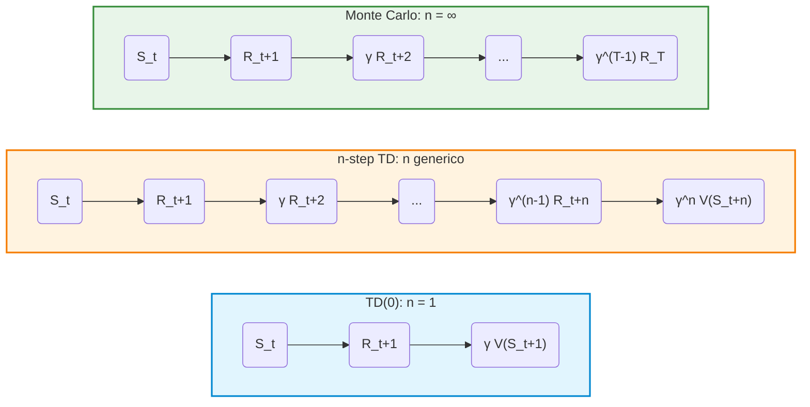
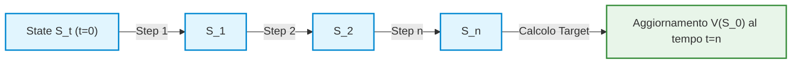
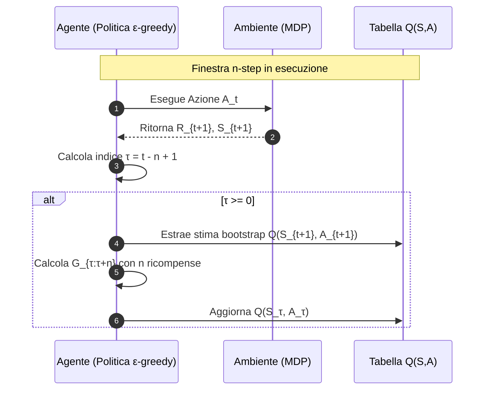
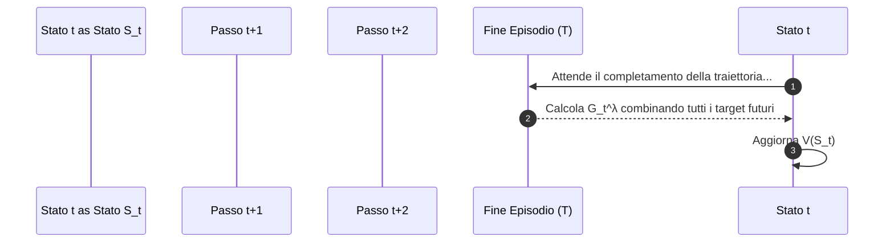

# Apprendimento TD Multipasso: Trade-off Bias-Varianza e n-Step Bootstrapping

## Overview Didattica

Questa lezione introduce l'estensione dei metodi ad Apprendimento per Differenze Temporali (*Temporal-Difference Learning* o *TD Learning*) attraverso la tecnica dell'**$n$-step bootstrapping**. Finora si è analizzata la netta contrapposizione teorica e pratica tra l'approccio Monte Carlo e l'approccio $TD(0)$ a singolo passo:

* **Metodi Monte Carlo**: offrono stime prive di distorsione (*unbiased* / zero bias), ma sono soggetti a un'elevata varianza (*high variance*) e richiedono il completamento dell'intero episodio per effettuare l'aggiornamento.
* **Metodi $TD(0)$**: garantiscono un'aggiornamento immediato e a bassa varianza (*low variance*), ma introducono distorsione (*bias*) a causa della dipendenza diretta dalla stima dello stato successivo (1-step bootstrap target).

Il bilanciamento tra distorsione e varianza (*bias-variance tradeoff*) rende insoddisfacenti gli estremi. Inoltre, entrambi gli approcci tradizionali affrontano in modo limitato il **problema dell'assegnazione del credito** (*Credit Assignment Problem*), ovvero la difficoltà di attribuire la corretta responsabilità di una ricompensa a lungo termine agli stati o alle azioni precedenti. 

L'**$n$-step bootstrapping** agisce come un ponte ideale lungo questo spettro: raccogliendo $n$ ricompense reali prima di applicare la funzione di valore al tempo $t+n$, consente di modulare la dipendenza tra il campionamento dell'ambiente e la stima bootstrap, ottimizzando l'accuratezza e la stabilità dell'apprendimento.

---

### Il Trade-off Bias-Varianza nel Reinforcement Learning

Nelle lezioni precedenti sono stati analizzati due approcci fondamentali per la stima della funzione di valore: **Monte Carlo (MC)** e **Temporal Difference Learning a un passo ($TD(0)$)**. Ciascuno di essi presenta vantaggi e svantaggi netti, riconducibili al classico **Trade-off Bias-Varianza (*Bias-Variance Trade-off*)**:

*   **Monte Carlo (MC):** Presenta **bias nullo (*zero bias*)**. L'aggiornamento della stima si basa sul ritorno reale $G_t$ raccolto fino al termine dell'episodio. Tuttavia, poiché il ritorno dipende da una lunga sequenza di stati e azioni stocastiche, MC soffre di un'**elevata varianza (*high variance*)**.
*   **TD(0) / One-Step TD:** Presenta una **bassa varianza (*low variance*)**, in quanto l'aggiornamento viene effettuato a ogni singolo passo temporale basandosi sulla stima del valore dello stato successivo. Di contro, l'uso del *bootstrapping* (stimare un valore basandosi su un'altra stima) introduce **bias**.

> **Concetto Chiave: L'assenza di una via di mezzo**  
> Fino a questo punto, l'architettura dei metodi appresi impone una scelta dicotomica soddisfacente in ben pochi casi reali: o si accetta l'elevata varianza di Monte Carlo, o si accetta il bias di $TD(0)$. L'obiettivo didattico fondamentale di questa sezione è introdurre una famiglia di algoritmi capaci di posizionarsi in modo continuo all'interno di questo spettro.

---

### Il Problema dell'Assegnazione del Credito (*Credit Assignment Problem*)

Per comprendere la necessità di un approccio intermedio, si consideri l'effetto delle due strategie su un semplice ambiente a griglia (*gridworld*) o su una passeggiata aleatoria (*random walk*):

1.  **Approccio Monte Carlo:** Quando l'agente raggiunge uno stato terminale positivo (ottenendo una ricompensa $+1$), il valore stimato di **tutti** gli stati visitati lungo l'episodio viene incrementato. Questo comportamento risulta spesso ingenuo (*naive*), in quanto assegna ciecamente lo stesso merito a stati che potrebbero non aver contribuito in modo determinante all'ottenimento del risultato finale.
2.  **Approccio $TD(0)$:** All'ottenimento della ricompensa finale $+1$, solo ed esclusivamente lo stato immediatamente precedente al momento del termine subisce un incremento nel proprio valore. Gli stati antecedenti rimangono del tutto inalterati durante il primo episodio, richiedendo molteplici episodi per "propagare" la ricompensa all'indietro.

Questo fenomeno evidenzia il **Problema dell'Assegnazione del Credito (*Credit Assignment Problem*)**: quando un agente riceve un segnale di ricompensa (positivo o negativo), a quali azioni e stati passati deve essere attribuita la responsabilità di tale risultato?

---

### Fondamenti dell'N-Step Bootstrapping

L'**N-Step Bootstrapping** (Bootstrapping a $n$ passi) rappresenta l'estensione naturale che unifica $TD(0)$ e Monte Carlo. L'idea chiave consiste nell'effettuare il *bootstrapping* non dopo un solo passo temporale, ma dopo $n$ passi.

#### Dal Ritorno ad un Passo al Ritorno a $n$ Passi

Richiamiamo l'espressione del target per $TD(0)$, definibile anche come **ritorno ad 1 passo (*1-step return*)** $G_{t:t+1}$:

$$G_{t:t+1} = R_{t+1} + \gamma V_t(S_{t+1})$$

Dove:
*   $R_{t+1}$ è la ricompensa immediata osservata passando dallo stato $S_t$ allo stato $S_{t+1}$.
*   $\gamma \in [0, 1]$ è il fattore di sconto (*discount factor*).
*   $V_t(S_{t+1})$ è la stima del valore dello stato futuro al tempo $t$.

Se decidiamo di attendere **2 passi** prima di effettuare il bootstrapping, raccoglieremo due ricompense reali ($R_{t+1}$ e $R_{t+2}$) e stimiamo il resto della traiettoria a partire dallo stato $S_{t+2}$. Il **ritorno a 2 passi (*2-step return*)** diventa:

$$G_{t:t+2} = R_{t+1} + \gamma R_{t+2} + \gamma^2 V_{t+1}(S_{t+2})$$

Estendendo il ragionamento per un numero generico di passi $n$, si ottiene la definizione formale di **Ritorno a $n$ passi (*n-step return*)** $G_{t:t+n}$:

$$G_{t:t+n} = R_{t+1} + \gamma R_{t+2} + \dots + \gamma^{n-1} R_{t+n} + \gamma^n V_{t+n-1}(S_{t+n})$$

Per $t+n \ge T$ (dove $T$ è l'istante finale di un episodio), i termini oltre $T$ si annullano e il ritorno $n$-step coincide perfettamente con il ritorno completo $G_t$ di Monte Carlo.



---

### Aspetti Critici della Notazione e Sincronizzazione Temporale

L'introduzione del parametro $n$ comporta un incremento di complessità nella gestione temporale dell'algoritmo:

1.  **Ritardo dell'aggiornamento (*Update Delay*):** Per aggiornare la stima del valore dello stato $S_t$ utilizzando il target $G_{t:t+n}$, è necessario attendere l'istante temporale $t+n$. Non è possibile effettuare l'aggiornamento al tempo $t$, in quanto le ricompense $R_{t+1}, \dots, R_{t+n}$ e lo stato $S_{t+n}$ non sono ancora stati osservati dall'agente.
2.  **Stima più recente (*Freshest Estimate*):** Nel termine $\gamma^n V_{t+n-1}(S_{t+n})$, l'indice temporale $t+n-1$ indica che si utilizza la versione più aggiornata della funzione di valore disponibile al momento del calcolo del target.

---

### Regola di Aggiornamento del Valore per N-Step TD

Utilizzando il ritorno a $n$ passi $G_{t:t+n}$, la regola di aggiornamento della funzione di valore $V(S_t)$ viene formulata in modo analogo al $TD(0)$ classico, ma con l'opportuna sincronizzazione degli indici temporali:

$$V_{t+n}(S_t) = V_{t+n-1}(S_t) + \alpha \left[ G_{t:t+n} - V_{t+n-1}(S_t) \right]$$

Dove:
*   $\alpha \in (0, 1]$ è il tasso di apprendimento (*learning rate*).
*   L'errore $TD$ a $n$ passi è espresso da $\delta_{t:t+n} = G_{t:t+n} - V_{t+n-1}(S_t)$.
*   L'aggiornamento relativo allo stato $S_t$ viene effettivamente registrato nella memoria del sistema al tempo $t+n$.

> **Concetto Chiave: Il parametro $n$ come manopola di regolazione (*tuning knob*)**  
> L'intero dello sviluppo matematico dell'n-step bootstrapping si riassume nella gestione del parametro $n$:
> *   $n = 1 \implies$ **$TD(0)$**: Minima varianza, massimo bias, aggiornamento immediato ad ogni passo.
> *   $n \to \infty \implies$ **Monte Carlo**: Massima varianza, bias nullo, aggiornamento ritardato a fine episodio.
> *   $1 < n < \infty \implies$ **N-Step TD**: Soluzione di compromesso in grado di bilanciare bias e varianza ottimizzando la velocità di convergenza e la stabilità dell'apprendimento.

Questa formulazione è applicabile sia a **compiti episodici (*episodic tasks*)** che a **compiti continui (*continuing tasks*)**, senza richiedere necessariamente che l'ambiente raggiunga uno stato terminale per iniziare l'aggiornamento delle stime.

---

### Gestione della Complessità Algoritmica in $n$-Step TD

L'algoritmo di **Predizione $n$-Step TD** (*$n$-Step Temporal Difference Prediction*) introduce una complessità implementativa che non riguarda l'equazione di aggiornamento in sé (che rimane concettualmente semplice), bensì la gestione temporale degli indici e dei casi limite (*edge cases*) all'inizio e alla fine di ciascun episodio.



#### I Tre Indici Temporali ($t$, $T$, $\tau$)

Per sincronizzare correttamente la raccolta delle ricompense con la stima del valore dello stato passato, lo pseudo-codice gestisce tre variabili temporali fondamentali:

1. **$t$ (Contatore del tempo corrente):** Avanza di una unità a ogni passo dell'episodio ($t = 0, 1, 2, \dots$). Rappresenta il momento in cui l'agente si trova nell'ambiente.
2. **$T$ (Tempo di terminazione dell'episodio):** Rappresenta il passo temporale in cui si raggiunge uno stato terminale. Inizialmente impostato a $\infty$, viene fissato al valore effettivo del passo appena il terminale viene visitato.
3. **$\tau$ (Tempo dello stato da aggiornare):** Identifica l'indice dello stato di cui stiamo aggiornando la stima. È definito come:
   $$\tau = t - n + 1$$
   L'aggiornamento della funzione valore $V(S_\tau)$ può avvenire soltanto se $\tau \ge 0$.

#### Gestione dei Casi Limite (Inizio e Fine Episodio)

La complessità del codice deriva direttamente dalla gestione delle due condizioni estreme:

* **Inizio episodio ($\tau < 0$):** Per i primi $n-1$ passi ($t < n-1$), l'agente non ha ancora accumulato un numero sufficiente di transizioni per calcolare il ritorno a $n$ passi ($n$-step return). In questa fase non viene effettuato alcun aggiornamento ($\tau < 0$).
* **Fine episodio ($t \ge T$):** Quando l'episodio termina, l'agente non può più raccogliere ricompense per completare la finestra di lunghezza $n$. In questo caso, il target viene troncato al tempo finale $T$ sostituendo la stima $V(S_{t+n})$ con il ritorno reale ottenuto fino al termine dell'episodio:
  $$G_{\tau:n} = \sum_{k=\tau+1}^{\min(\tau+n, T)} \gamma^{k-\tau-1} R_k + \gamma^{n} V_{\tau+n-1}(S_{\tau+n}) \quad \text{se } \tau + n < T$$
  Se invece $\tau + n \ge T$, la stima bootstrap cade oltre la fine dell'episodio e il termine $V(S_{\tau+n})$ scompare (o vale 0), riducendosi al ritorno effettivo Monte Carlo:
  $$G_{\tau:n} = G_\tau = \sum_{k=\tau+1}^{T} \gamma^{k-\tau-1} R_k$$

#### Esempio Intuitivo a 2 Step ($n=2$)

Si consideri un processo decisionale di Markov (MDP) con sequenza di stati $C \to D \to E \to \text{Terminale}$:

1. **Passo $t=1$ ($S_0=C \to S_1=D$, $R_1 = -1$):**
   * $\tau = 1 - 2 + 1 = 0$, ma dobbiamo ancora attendere di completare i 2 passi per aggiornare. Nessun aggiornamento completo effettuato.
2. **Passo $t=2$ ($S_1=D \to S_2=E$, $R_2 = 0$):**
   * $\tau = 2 - 2 + 1 = 1$. Sono stati compiuti 2 passi dal tempo 0.
   * Si può aggiornare lo stato visitato 2 passi prima ($S_0 = C$) utilizzando le ricompense reali $R_1, R_2$ e la stima bootstrap dello stato attuale $V(E)$:
     $$G_{0:2} = R_1 + \gamma R_2 + \gamma^2 V(E)$$
     $$V(C) \leftarrow V(C) + \alpha \left[ G_{0:2} - V(C) \right]$$
3. **Passo $t=3$ ($S_2=E \to Terminale$, $R_3 = +1$):**
   * Si aggiorna lo stato visibile 2 passi prima ($S_1 = D$).
   * Raggiunta la fine dell'episodio, si applicano gli aggiornamenti rimanenti per lo stato $E$ utilizzando il ritorno reale.

---

### Analisi Prestazionale e Trade-off Bias-Varianza

#### Risultati Sperimentali su Random Walk a 19 Stati

Per valutare l'impatto del parametro $n$, consideriamo l'ambiente *Random Walk* esteso a 19 stati interpolati tra due terminali ($0$ a sinistra, $+1$ a destra), sotto una politica uniforme $\pi(A|S) = 0.5$.

La metrica usata per la valutazione della predizione è la **Radice dell'Errore Quadratico Medio (Root Mean Square Error - RMSE)** tra la funzione valore stimata $V$ e il valore reale $V^\pi$:

$$\text{RMSE} = \sqrt{\frac{1}{|\mathcal{S}|} \sum_{s \in \mathcal{S}} \left( V(s) - V^\pi(s) \right)^2}$$

> **Nota didattica:** La metrica RMSE richiede la conoscenza a priori della vera funzione valore $V^\pi$. Questo è possibile in ambienti di benchmark o simulazioni di laboratorio, ma non è applicabile in problemi di Reinforcement Learning reale dove $V^\pi$ è incognita.

#### Concetto Chiave: Il Trade-off tra $n$ e il Tasso di Apprendimento $\alpha$

L'analisi empirica delle curve di errore al variare del parametro di passo $\alpha$ evidenzia un bilanciamento tra **Bias** e **Varianza**:

> **CONCETTO CHIAVE: Relazione tra $n$ e $\alpha$**
> * **$n$ piccolo (es. $n=1$, TD(0)):** Il target contiene un'elevata quota di stima ($V$), introducendo **alto bias**. Tuttavia, poiché considera pochi passi di transizione reali, la **varianza è molto bassa** (poco rumore stocastico generato dall'ambiente/politica). Di conseguenza, l'algoritmo tollera ed è più efficiente con **valori di $\alpha$ elevati**.
> * **$n$ grande (es. $n \to \infty$, Monte Carlo):** Il target include la somma di molte ricompense reali osservate lungo la traiettoria, azzerando il bias da bootstrap. Di contro, l'accumulo di decisioni stocastiche lungo la traiettoria introduce una **varianza molto elevata**. L'algoritmo richiede quindi **valori di $\alpha$ piccoli** per mediare ed eliminare il rumore.

```
       Basso n (TD puro) <--------------------------> Alto n (Monte Carlo)
    ------------------------------------------------------------------------
    Bias:           Elevato                               Quasi nullo
    Varianza:       Molto bassa                           Elevata
    Alpha (α) opt:  Valori alti (es. 0.4 - 0.5)         Valori bassi (es. 0.05)
```

In problemi complessi come il Random Walk a 19 stati, i valori intermedi (ad esempio $n = 4$) offrono generalmente le prestazioni migliori (minimo errore RMSE complessivo), bilanciando i difetti dei due estremi.

#### Nota sulla Convergenza (Proprietà di Riduzione dell'Errore)

*Nota: Contenuto teorico opzionale.*

L'algoritmo $n$-Step TD gode formalmente della **proprietà di riduzione dell'errore al caso peggiore** (*error reduction property*). È possibile dimostrare che l'aspettativa del target a $n$ passi garantisce una contrazione dell'errore massimo rispetto alla vera funzione valore $V^\pi$:

$$\max_s \left| \mathbb{E}_\pi \left[ G_{t:t+n} \mid S_t = s \right] - V^\pi(s) \right| \le \gamma^n \max_s \left| V_{t+n-1}(s) - V^\pi(s) \right|$$

Poiché $\gamma \in [0, 1)$, il fattore $\gamma^n < 1$ assicura che il valore stimato converga a $V^\pi$ per qualsiasi scelta valida di $n$.

---

### Controllo con Metodi $n$-Step: $n$-Step SARSA

#### Estensione a Valori Azione ($Q$-Function)

Per passare dalla predizione ($V$) al **controllo** ($Q$), estendiamo l'architettura all'interno dello schema di **Iterazione di Politica Generalizzata (Generalized Policy Iteration - GPI)**. In questo contesto aggiorniamo la funzione valore-azione $Q(s, a)$.

L'algoritmo prende il nome di **$n$-Step SARSA**. Il ritorno a $n$ passi per una coppia stato-azione è definito come:

$$G_{t:t+n} = R_{t+1} + \gamma R_{t+2} + \dots + \gamma^{n-1} R_{t+n} + \gamma^n Q_{t+n-1}(S_{t+n}, A_{t+n})$$

E la regola di aggiornamento per la coppia di stato-azione visitata al tempo $\tau = t - n + 1$ diventa:

$$Q(S_\tau, A_\tau) \leftarrow Q(S_\tau, A_\tau) + \alpha \left[ G_{\tau:\tau+n} - Q(S_\tau, A_\tau) \right]$$

L'agente seleziona le azioni al tempo corrente $t$ seguendo una politica $\epsilon$-greedy derivata dalla conoscenza aggiornata di $Q$.



#### Approfondimento Operativo: On-Policy vs. Off-Policy in $n$-Step (Cenni)

La versione base di $n$-step SARSA descritta è di tipo **On-Policy** (la politica che raccoglie i dati è la stessa che viene migliorata).

Tuttavia, quando si estende la stima su $n$ passi nel futuro, l'approccio **Off-Policy** assume una rilevanza concettuale importante:

1. Durante l'intervallo temporale dei $n$ passi, l'agente esegue azioni secondo una **politica di comportamento** (*behavior policy*) $b(a|s)$.
2. Per aggiornare correttamente la **politica target** (*target policy*) $\pi(a|s)$ relativamente alla sequenza generata, occorre correggere la discrepanza mediante il **Campionamento di Importanza (Importance Sampling)**.

Il fattore di correzione del campionamento di importanza $\rho_{\tau:t}$ lungo i passi compresi tra $\tau$ e $t$ è definito dal prodotto dei rapporti di probabilità:

$$\rho_{\tau:t} = \prod_{k=\tau}^{\min(t, T-1)} \frac{\pi(A_k \mid S_k)}{b(A_k \mid S_k)}$$

L'aggiornamento $n$-step SARSA Off-Policy viene dunque pesato dal valore di $\rho$:

$$Q(S_\tau, A_\tau) \leftarrow Q(S_\tau, A_\tau) + \alpha \, \rho_{\tau+1:\tau+n} \left[ G_{\tau:\tau+n} - Q(S_\tau, A_\tau) \right]$$

> **Nota Didattica:** Esistono estensioni $n$-step anche per algoritmi come **$n$-Step Q-Learning** e **$n$-Step Expected SARSA**, che eliminano la necessità del campionamento di importanza su determinati passi sostituendo l'azione futura con il valore massimo o atteso. Tali varianti esulano dai requisiti fondamentali di questo modulo pratico.

---

### Sintesi e Limiti dell'Approccio $n$-Step TD

Nonostante l'efficacia dei metodi $n$-step nel mediare tra Temporal Difference e Monte Carlo, l'architettura presenta un limite strutturale irrisolto: **la necessità di fissare aprioristicamente un parametro discreto $n$**.

* Scegliere un valore fisso $n$ forza l'algoritmo a considerare solo quella specifica lunghezza di orizzonte temporale per l'intero processo di apprendimento.
* In contesti reali, l'orizzonte informativo ideale potrebbe variare dinamicamente durante l'episodio.

Questa limitazione introduce la necessità teorica di integrare tra loro *tutti* i possibili orizzonti $n$ simultaneamente, ponendo le basi per l'introduzione dei meccanismi a **Traccia di Idoneità (Eligibility Traces)** e dell'algoritmo **TD($\lambda$)**.

---

### Introduzione a $TD(\lambda)$ e Media dei Target $N$-step

Nelle lezioni precedenti abbiamo visto come l'approccio $N$-step Temporal Difference ($N$-step TD) rappresenti una via di mezzo tra $TD(0)$ (1-step) e Monte Carlo ($N \to \infty$). Tuttavia, la scelta del parametro $N$ rappresenta un iperparametro critico e non sempre banale da sintonizzare.

Per superare questo limite, introduciamo l'algoritmo **$TD(\lambda)$**. L'idea fondamentale è semplice: anziché dover scegliere un singolo valore di $N$, **combiniamo e mediamo tutti i possibili target $N$-step** all'interno di un unico stimatore.

> **Nota di organizzazione del testo di riferimento:**
> Nel libro di testo (Sutton & Barto), il capitolo 12 presenta $TD(\lambda)$ *dopo* aver introdotto l'Approssimazione della Funzione di Valore (*Value Function Approximation - VFA*, Capitolo 9). Per chiarezza didattica, invertiamo l'ordine: affrontiamo prima $TD(\lambda)$ a livello concettuale sulle tabelle, per poi passare all'approssimazione funzionale su grandi contesti.

---

### Il Ritorno-$\lambda$ ($G_t^\lambda$): Definizione e Proprietà

#### Intuizione: Combinazione Convessa

Immaginiamo di voler stimare il ritorno $G_t$ combinando due diverse stime $N$-step, ad esempio per $N=2$ e $N=4$:

$$G_{t:t+2} = R_{t+1} + \gamma R_{t+2} + \gamma^2 V(S_{t+2})$$
$$G_{t:t+4} = R_{t+1} + \gamma R_{t+2} + \gamma^3 R_{t+3} + \gamma^4 R_{t+4} + \gamma^4 V(S_{t+4})$$

Se assegniamo il 50% di peso a una e il 50% all'altra, stiamo effettuando una **Combinazione Convessa (Convex Combination)**. Per garantire che il target combinato rimanga una stima consistente dello stesso ritorno $G_t$, la somma dei pesi deve essere rigorosamente pari a $1$.

#### Formulazione Matematica per Orizzonte Infinito

Anziché combinare solo due stime con pesi arbitrari, $TD(\lambda)$ applica una media pesata su **tutti** i target $N$-step ($n = 1, 2, 3, \dots$), ponderandoli con un fattore di decadimento geometrico regolato dal parametro $\lambda \in [0, 1]$.

Definiamo il **Ritorno-$\lambda$ ($TD(\lambda)$ Return)** $G_t^\lambda$ come:

$$G_t^\lambda = (1 - \lambda) \sum_{n=1}^{\infty} \lambda^{n-1} G_{t:t+n}$$

Dove $G_{t:t+n}$ è il ritorno $N$-step standard calcolato al tempo $t+n$.

#### Dimostrazione: Somma dei Pesi Pari a 1

I pesi assegnati a ciascun target $N$-step sono della forma $(1 - \lambda)\lambda^{n-1}$. Verifichiamo che la loro somma sia pari a 1 mediante la serie geometrica:

$$\sum_{n=1}^{\infty} (1 - \lambda)\lambda^{n-1} = (1 - \lambda) \sum_{k=0}^{\infty} \lambda^k$$

Sapendo che per $0 \le \lambda < 1$ la serie geometrica converge a $\frac{1}{1 - \lambda}$:

$$(1 - \lambda) \cdot \frac{1}{1 - \lambda} = 1$$

I pesi costituiscono quindi una combinazione convessa valida.

```mermaid
flowchart LR
    style A fill:#e1f5fe,stroke:#0288d1,stroke-width:2px
    style B fill:#fff3e0,stroke:#f57c00,stroke-width:2px
    style C fill:#fff3e0,stroke:#f57c00,stroke-width:2px
    style D fill:#fff3e0,stroke:#f57c00,stroke-width:2px

    A["Target G<sub>t</sub><sup>λ</sup>"] -->|Peso: 1-λ| B["G<sub>t:t+1</sub> (1-step)"]
    A -->|Peso: (1-λ)λ| C["G<sub>t:t+2</sub> (2-step)"]
    A -->|Peso: (1-λ)λ²| D["G<sub>t:t+3</sub> (3-step)"]
```

#### Significato Fisico di $\lambda$

Il fattore $\lambda$ smorza l'importanza dei passi più lontani nel futuro. 
* Più ci spingiamo avanti nella traiettoria, maggiore è il numero di decisioni stocastiche (dovute alla politica e alla dinamica dell'ambiente) che accumulano **rumore e varianza**.
* Assegnare un peso geometricamente decrescente ai passi futuri consente di dare priorità alle informazioni più vicine nel tempo, controllando la varianza complessiva dello stimatore.

---

### Formulazione per Task Episodici

Nei contesti episodici, l'episodio termina a un passo finale $T$. Non è quindi possibile sommare all'infinito. 

Dopo il tempo $T$, non abbiamo più bisogno di usare la stima della funzione di valore $V(S_T)$, poiché disponiamo del valore reale del ritorno finale $G_t$. Pertanto, disaccoppiamo la somma separando le stime dai passi precedenti al passo finale:

$$G_t^\lambda = (1 - \lambda) \sum_{n=1}^{T - t - 1} \lambda^{n-1} G_{t:t+n} + \lambda^{T - t - 1} G_t$$

Anche in questa formulazione troncata, la proprietà della combinazione convessa si conserva e la somma totale dei pesi rimane esattamente pari a $1$.

---

### Casi Limite di $\lambda$ e Trade-off Bias-Varianza

Il parametro $\lambda$ funge da "manopola" continua tra due estremi:

1. **$\lambda = 0$ ($TD(0)$):** 
   Tutti i termini della somma si annullano tranne il primo ($n=1$).
   $$G_t^{\lambda=0} = G_{t:t+1} = R_{t+1} + \gamma V(S_{t+1})$$
   Otteniamo esattamente il target dell'apprendimento TD a singolo passo (minima varianza, massimo bias).

2. **$\lambda = 1$ ($TD(1)$ o Monte Carlo):**
   Il fattore $(1-\lambda)$ azzera tutti i contributi intermedi, lasciando attivo solo l'ultimo termine associato all'effettivo ritorno dell'episodio.
   $$G_t^{\lambda=1} = G_t$$
   Otteniamo il target Monte Carlo completo (nessun bias, massima varianza).

3. **$0 < \lambda < 1$:**
   Si ottiene un bilanciamento continuo tra bias e varianza.

> **Concetto Chiave:** 
> A differenza dell'approccio $N$-step dove la variazione di $N$ è discreta, in $TD(\lambda)$ il parametro $\lambda$ offre una regolazione continua. Inoltre, $TD(\lambda)$ non scarta mai del tutto la dinamica a lungo termine: anche per valori piccoli di $\lambda$, l'influenza dei passi successivi viene comunque considerata con un peso ridotto, riducendo gli errori di attribuzione del credito (*credit assignment problem*).

---

### La Vista Frontale (Forward View) e i suoi Limiti

L'approccio qui descritto è definito **Vista Frontale ($Forward\ View$) di $TD(\lambda)$**. 



#### Limito Operativo del Forward View

> **Attenzione — Criticità Fondamentale:** 
> Per calcolare il ritorno $G_t^\lambda$ mediante la Vista Frontale, **è necessario attendere la fine dell'episodio** (o la conclusione dell'orizzonte $T$) per raccogliere tutte le ricompense $R_{t+1}, R_{t+2}, \dots, R_T$.

Questo comportamento mina uno dei vantaggi principali dell'apprendimento TD: la capacità di aggiornare le stime dello stato **online, passo dopo passo (step-by-step)**, senza dover attendere il completamento della traiettoria.

#### Prestazioni Empiriche

Dal punto di vista dell'errore (ad esempio l'errore quadratico medio $RMS$ su task come il *Random Walk*), il metodo $Forward\ TD(\lambda)$ mostra curve di prestazione al variare di $\alpha$ molto simili a quelle dell' $N$-step TD.

| Proprietà | $N$-step TD | $TD(\lambda)$ (Forward View) |
| :--- | :--- | :--- |
| **Iperparametro** | $N \in \mathbb{N}^+$ (Discreto) | $\lambda \in [0, 1]$ (Continuo) |
| **Aggiornamento** | Ritardato di $N$ passi | Ritardato fino a $T$ (fine episodio) |
| **Combinazione** | Singolo orizzonte $N$ | Media pesata di tutti gli orizzonti $N$ |
| **Flessibilità di Tuning** | Limitata a valori interi | Elevata (continua) |

#### Anticipazione: La Vista All'Indietro (Backward View)

Per risolvere il limite della Vista Frontale senza rinunciare alla formulazione teorica del Ritorno-$\lambda$, verrà introdotta la **Vista All'Indietro ($Backward\ View$) di $TD(\lambda)$**. 

Attraverso un meccansimo matematico basato sulle **Tracce di Elegibilità (*Eligibility Traces*)**, la Vista All'Indietro permette di ottenere **esattamente gli stessi aggiornamenti matematici** di $G_t^\lambda$, ma in modo totalmente incrementale, aggiornando gli stati passati a ogni singolo passo temporale.

---

> [!NOTE]
> ### Note per l'Esame e Avvisi del Docente
> - **Esito e valutazione delle domande soglia del parziale:** Chi non ha ricevuto un'e-mail di notifica ha superato le domande soglia (punteggio: +1 per risposta corretta, -0,5 per risposta errata, soglia minima per passare pari a 2). I risultati complessivi del parziale saranno disponibili approssimativamente entro una settimana.
> - **Iscrizioni Uniweb ("Registrations"):** Gli appelli che compaiono su Uniweb denominati "registrations" sono appelli fittizi utilizzati dal docente unicamente per registrare i voti di chi sostiene il progetto in differita. Non occorre iscriversi a tali appelli a meno che non si debba verbalizzare il voto del progetto.
> - **Modalità di scrittura dello pseudocodice:** All'esame non è richiesto di memorizzare o riprodurre lo pseudocodice degli algoritmi esattamente nella forma mostrata a lezione; è possibile scriverlo in modo personale o alternativo, purché sia logicamente corretto e implementabile.
> - **Argomenti ESCLUSI dall'esame (non verranno chiesti):**
>   - La dimostrazione/proprietà di riduzione dell'errore per la convergenza dell'*n-step TD learning* (Sezione 7.1 del libro).
>   - L'estensione *off-policy* dell'*n-step SARSA* con *importance sampling* (trattata come materiale opzionale).