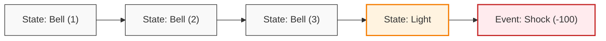
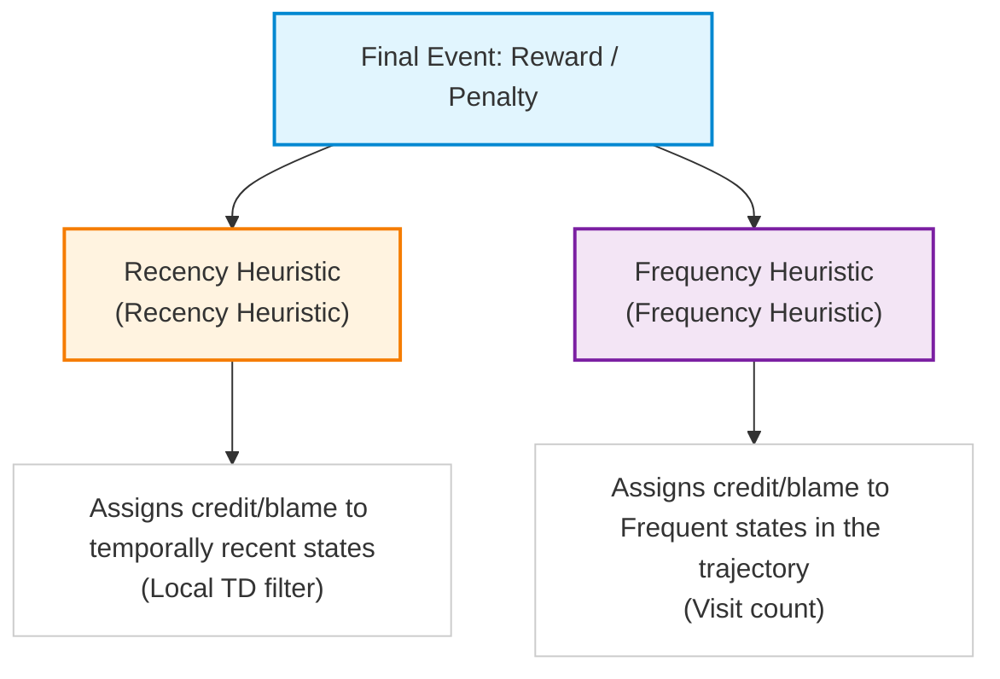
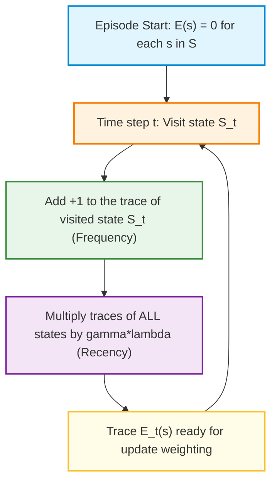
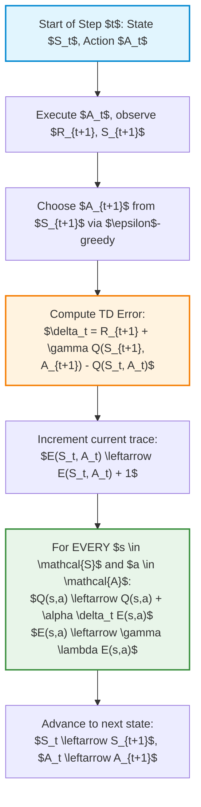
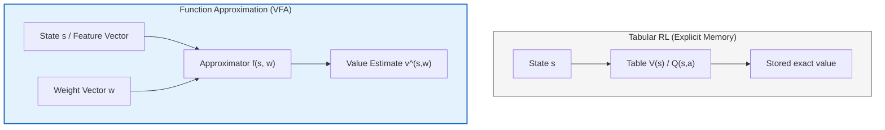

# Temporal-Difference Learning: TD($\lambda$), Backward View, and Introduction to Value Function Approximation

## Educational Overview

In this lecture, we complete the study of the **TD($\lambda$)** algorithm (*Temporal-Difference Learning with $\lambda$*), transitioning from the forward perspective (*Forward View*) defined in the previous lectures to its computationally efficient formulation: the **backward view** (*Backward View*).

The lecture is structured around three main axes:
1. **Recap and Theoretical Rationale of TD($\lambda$)**: Analysis of the transition from $n$ -step bootstrapping methods (*n-step bootstrapping*) to the **$\lambda$-Return** (*Lambda-Return*, $G_t^\lambda$). TD($\lambda$) acts as a generalization and continuous balance between **TD(0)** (characterized by low variance and high bias) and the **Monte Carlo** method (characterized by zero bias and high variance). The convex combination (*convex combination*) with geometric decay makes it possible to average over all horizon lengths, reducing the accumulation of stochastic noise generated by the environment and the policy along extended temporal trajectories.
2. **Backward View of TD($\lambda$)**: Introduction of causal and efficient mechanisms for online value updates via eligibility traces (*eligibility traces*).
3. **Introduction to Value Function Approximation** (*Value Function Approximation* - VFA): An initial overview of the fundamental paradigm that will allow extending the tabular techniques seen so far to continuous or high-dimensional state and action spaces, essential for solving large-scale engineering problems (*large-scale problems*).

---

### Review of the Forward View and Return-$\lambda$

#### From Bootstrapping over $n$-steps to the Return-$\lambda$

In previous lectures, we analyzed *Bootstrapping over $n$-steps* ($n$-step Bootstrapping) as a mechanism for finding an ideal balance between two extremes:
1. **TD(0) (0-step Temporal Difference):** Low variance, but with bias related to the initial approximation of the value function.
2. **Monte Carlo (MC):** Zero bias (it uses the actual return $G_t$), but very high variance due to stochasticity accumulated along the entire trajectory.

The main limitation of the method over $n$-steps lies in the choice of the hyperparameter $n$: without sound *a priori* knowledge of the problem, determining the optimal $n$ is complex. To overcome this rigidity, the algorithm $\text{TD}(\lambda)$ introduces a generalization: instead of choosing a single value of $n$, **all $n$-step returns are considered simultaneously**, with appropriate weights.

> **Key Concept: The Return-$\lambda$ ($G_t^\lambda$)**  
> The learning target of $\text{TD}(\lambda)$, called the **Return-$\lambda$** ($\lambda$-return), is defined as the convex combination of returns over $n$-steps $G_{t:t+n}$:
>
> $$G_t^\lambda = (1 - \lambda) \sum_{n=1}^{\infty} \lambda^{n-1} G_{t:t+n}$$
>
> Since the weights $(1-\lambda)\lambda^{n-1}$ form a geometric series whose sum equals 1, the combination is strictly convex for any $\lambda \in [0, 1)$.

The limiting cases reflect the formulations already known:
* For $\lambda = 0$, $G_t^\lambda$ collapses to $G_{t:t+1}$ (equivalent to **TD(0)**).
* For $\lambda = 1$, the weighting assigns all the weight to the final term of the episode, reducing to the **Monte Carlo** method.

The main reason for choosing $\lambda < 1$ (and thus preferring events that are closer in time) lies in the **stochasticity of the environment and the policy** (policy). As we move further into the future along a trajectory, accumulated noise increases. Damping future contributions with the factor $\lambda$ reduces the impact of this noise on the estimate update.

#### Limitations of the Forward View: The Need for Incremental Updates

The theoretical formulation based on the direct calculation of $G_t^\lambda$ is called the **Forward View** (*Forward View*). 

Although conceptually elegant, the Forward View presents a serious practical drawback: **it is neither a causal nor an online algorithm**. To calculate $G_t^\lambda$ at time $t$, the agent must await the unfolding of future steps (until the end of the episode in episodic tasks, or for a very extended time horizon).

In Engineering and applied Reinforcement Learning, the requirement is instead to update the value estimate $V(S_t)$ and modify the policy **incrementally step by step** (*online*), while the agent is interacting with the real environment. 

This limitation motivates the transition to the **Backward View** (*Backward View*) of $\text{TD}(\lambda)$, which implements the same weighted updates by propagating information from the present toward the past through *eligibility traces*.

---

### The Credit Assignment Problem

To understand the intuitive and mathematical operation of the Backward View, it is necessary to analyze one of the fundamental problems of reinforcement learning: the **Credit Assignment Problem** (*Credit Assignment Problem*).

> **Key Concept: Credit Assignment**  
> When an agent receives a significant reward (or penalty) at the end or at an advanced point of a trajectory, the algorithm must determine which states visited or actions taken in the past should be assigned the credit (or blame) for that outcome.

#### The Mouse Example (Recency vs Frequency)

Consider a classic thought experiment: a mouse inside a maze observes three rings of a bell (*Bell*), followed by a light turning on (*Light*), and immediately afterward receives an electric shock (*Shock*, large penalty).



Faced with the final negative event (the shock), how should blame be distributed among the preceding states? To resolve this dilemma, two fundamental heuristics are used:

1. **Recency Heuristic:**  
   The event closest in time to the final outcome is primarily responsible. In the example, the *Light* turned on immediately before the shock; therefore, it receives the largest share of credit/blame. This is the principle underlying the local update of **TD(0)**.

2. **Frequency Heuristic:**  
   The state or action that occurred most frequently along the trajectory is the triggering factor. In the example, the *Bell* rang three times before the shock. A state visited repeatedly accumulates more "responsibility". This principle reflects the logic of **every-visit Monte Carlo** methods.



> **Key Concept: Synthesis in the Backward View**  
> The Backward View of $\text{TD}(\lambda)$ mathematically combines the **Recency Heuristic** and the **Frequency Heuristic** within a single mechanism called the **Eligibility Trace** (*Eligibility Trace*). The trace increases each time a state is visited (frequency) and decays exponentially over time when the state is not visited (recency).

---

### Prospects for Scalability: Value Function Approximation

The need to perform incremental cause-and-effect updates via $\text{TD}(\lambda)$ is instrumental in handling large-scale problems (*large-scale problems*). 

In real engineering problems, the state space $S$ is often continuous or immense, making it impossible to use tables to store $V(s)$ or $Q(s, a)$ (tabular methods). The $\text{TD}(\lambda)$ algorithm in its Backward form constitutes the foundational structure for integrating **Value Function Approximation** (*Value Function Approximation* - VFA), in which the value function is estimated via a parameter vector $\mathbf{w}$ (for example, through linear models or neural networks):

$$\hat{v}(s, \mathbf{w}) \approx V_\pi(s)$$

The union between the backward mechanics of $\text{TD}(\lambda)$ and parametric approximation models represents the foundational framework for control and optimization in complex environments.

---

### The Trade-off Between Frequency and Recency: Beyond the $n$-step Method

In the previous lectures, we saw two extremes for estimating the value function:
1. **Monte Carlo (MC):** Gives equal importance to all states traversed along the entire trajectory of the episode.
2. **TD(0) (1-step Temporal Difference):** Considers only the latest visited state as important, ignoring past history.

The $n$-step TD method seeks a fixed compromise, but exhibits conceptual rigidity: it assigns uniform weight to the last $n$ steps and zero to all others. 

A more reasonable trade-off consists of assigning credit to all visited states, but weighting it according to two fundamental principles:
* **Frequency:** How many times a given state was visited along the trajectory.
* **Recency:** How recently the state was visited relative to the current moment.

While the **Forward View** (*Forward View*) looks ahead into the future along the trajectory to weight future returns, the **Backward View** (*Backward View*) looks back into the past to understand what responsibility previously visited states had for the reward just obtained.

---

### Eligibility Traces (*Eligibility Traces*)

> **KEY CONCEPT: Eligibility Traces ($E$)**
> 
> The **Eligibility Trace** (*Eligibility Trace*) is a fundamental quantity in temporal reinforcement learning. It is a temporal vector with the **same cardinality as the state space** ($|S|$), in which each element $E(s)$ measures how much state $s$ is "eligible" (i.e., responsible) to receive credit or blame for the currently observed error/reward signal.

At the beginning of each episode, the eligibility trace is initialized to zero for all states, since prior to the start of the trajectory no state bears any responsibility:

$$E_{-1}(s) = 0, \quad \forall s \in S$$

Each time the agent takes a time step $t$, the trace is updated by combining the two components of *recency* and *frequency*. 

In its classical form, known as the **Accumulating Trace** (*Accumulating Trace*), the update dynamics for a generic state $s$ is defined as:

$$E_t(s) = \gamma \lambda E_{t-1}(s) + \mathbf{1}(S_t = s)$$

where:
* $\mathbf{1}(S_t = s)$ is the indicator function (*Indicator Function*), which equals $1$ if the current state $S_t$ is $s$, and $0$ otherwise (**Frequency Component**).
* $\gamma \in [0, 1]$ is the discount factor (*Discount Factor*), a property of the MDP Environment.
* $\lambda \in [0, 1]$ is the trace decay parameter (*Trace Decay Parameter*), a hyperparameter chosen by the engineer.

Since the product $(\gamma \lambda) \in [0, 1]$, at each step all elements of the trace vector undergo a **geometric decay** (*Geometric Decay*). The only element that increments is the one corresponding to the state just visited.



#### Why Geometric Decay?
The use of geometric decay $(\gamma \lambda)$ is not only conceptually grounded, but also offers immense implementation advantages:
* **Incremental Memory:** There is no need to store the entire historical sequence of states along the trajectory. All past history is already summarized in the current value of $E(s)$.
* **Computational Efficiency:** The update reduces to a simple multiplication by a fixed scalar at each time step.

---

### Backward TD($\lambda$) Algorithm for Prediction

The backward view allows performing **online** updates (at every single step) by propagating information backward.

At each step $t$, after observing the reward $R_{t+1}$ and the new state $S_{t+1}$, the classic **One-step TD Error** (*One-step TD Error*) $\delta_t$:

$$\delta_t = R_{t+1} + \gamma V(S_{t+1}) - V(S_t)$$

Instead of updating only state $S_t$ as in TD(0), the error $\delta_t$ is transmitted to **all states in the state space**, weighted by their respective eligibility trace:

$$V(s) \leftarrow V(s) + \alpha \delta_t E_t(s), \quad \forall s \in S$$

> **KEY CONCEPT: Structural difference of loops in TD methods**
> 
> * **TD(0):** At each step, updates **only one state** ($S_t$).
> * **$n$-step TD:** Must wait $n$ steps to update **only one state** ($S_{t-n}$).
> * **TD($\lambda$) Backward:** At each step, updates **ALL states** $s \in S$ proportionally to their trace $E(s)$.

#### Educational Pseudocode: Backward TD($\lambda$) Prediction

1. Initialize the value function $V(s)$ arbitrarily (and $V(\text{terminale}) = 0$).
2. For each episode:
   * Initialize $E(s) = 0$, for each $s \in S$.
   * Initialize the initial state $S$.
   * For each step of the episode (until $S$ is terminal):
     * Choose an action $A$ using policy $\pi$.
     * Execute $A$, observe reward $R$ and next state $S'$.
     * $\delta \leftarrow R + \gamma V(S') - V(S)$
     * $E(S) \leftarrow E(S) + 1$ *(Frequency update for the current state)*
     * For all $s \in S$:
       * $V(s) \leftarrow V(s) + \alpha \delta E(s)$
       * $E(s) \leftarrow \gamma \lambda E(s)$
     * $S \leftarrow S'$

---

### Equivalence and Differences between Forward View and Backward View

The **Backward TD($\lambda$)** algorithm and the **Forward View of TD($\lambda$)** share the same formal objective, but operate with different operational modalities:

1. **Offline Case (*Offline Updates*):** 
   If value function updates are not performed step-by-step, but are accumulated and applied exclusively **at the end of the episode**, the Backward view is **mathematically equivalent** to the Forward view.

2. **Online Case (*Online Updates*):**
   In real practice, the *online* update (step by step) is favored, as it allows the agent to immediately exploit learned information. In online mode, the two views **are not strictly identical**:
   * The difference between the two views is governed by the learning rate (*Learning Rate*) $\alpha$.
   * For values of $\alpha \to 0$ (very small learning rates), the two views converge and yield nearly identical results.
   * For high values of $\alpha$ , the update trajectories diverge, but the online Backward view is significantly superior from computational and application standpoints.

---

### Variants of Eligibility Traces

In the Reinforcement Learning literature, several mathematical formulations exist for updating the trace $E_t(s)$. The most relevant are:

#### 1. Accumulating Traces (*Accumulating Traces*)
This is the standard version presented previously. Each new visit adds $+1$ to the previous trace value:
$$E_t(s) = \begin{cases} \gamma \lambda E_{t-1}(s) + 1 & \text{se } s = S_t \\ \gamma \lambda E_{t-1}(s) & \text{se } s \neq S_t \end{cases}$$

#### 2. Replacing Traces (*Replacing Traces*)
Prevents the trace from growing indefinitely or exceeding the value $1$ in case of frequent and closely spaced visits. When a state is visited, its trace is reset to exactly $1$, rather than adding $1$:
$$E_t(s) = \begin{cases} 1 & \text{se } s = S_t \\ \gamma \lambda E_{t-1}(s) & \text{se } s \neq S_t \end{cases}$$

#### 3. Dutch Traces (*Dutch Traces*)
Integrate the learning parameter $\alpha$ into the decay to handle online updates in a theoretically sound manner:
$$E_t(s) = \begin{cases} \gamma \lambda E_{t-1}(s) + (1 - \alpha \gamma \lambda E_{t-1}(s)) & \text{se } s = S_t \\ \gamma \lambda E_{t-1}(s) & \text{se } s \neq S_t \end{cases}$$

| Trace Type | Formulation at current state $S_t$ | Behavior upon repeated visits |
| :--- | :--- | :--- |
| **Accumulating** | $E(S_t) \leftarrow \gamma \lambda E(S_t) + 1$ | Can exceed $1$ if revisited frequently |
| **Replacing** | $E(S_t) \leftarrow 1$ | Saturates from above at $1$ |
| **Dutch** | $E(S_t) \leftarrow \gamma \lambda E(S_t) + (1 - \alpha \gamma \lambda E(S_t))$ | Balanced as a function of the rate $\alpha$ |

---

### From TD($\lambda$) for Prediction to Control: The SARSA($\lambda$) Algorithm

In Reinforcement Learning, once we understand how to evaluate a fixed policy (**Prediction** phase), the natural next step is the optimization of the policy itself (**Control** phase). 

The conceptual framework remains that of **Generalized Policy Iteration** (*Generalized Policy Iteration - GPI*): alternating value function evaluation with policy improvement by acting in an $\epsilon$-greedy manner. The novelty introduced with $TD(\lambda)$ concerns the way we update value estimates based on **Eligibility Traces** (*Eligibility Traces*).

---

#### Extension of Eligibility Traces to State-Action Pairs

In transitioning from calculating the value of states $V(s)$ to calculating the value of actions $Q(s, a)$, the structure of eligibility traces changes dimension to accommodate the new objective function:

> **Key Concept**: In the prediction problem, the eligibility trace is a vector of dimension equal to the cardinality of states $|\mathcal{S}|$. In the control problem, since we must update the State-Action Value Function (*State-Action Value Function*) $Q(s, a)$, the eligibility trace $E(s, a)$ becomes a **table (or matrix)** of dimension $|\mathcal{S}| \times |\mathcal{A}|$.

The update of the eligibility trace for each state-action pair at each time step $t$ is defined as:

$$E_t(s, a) = \gamma \lambda E_{t-1}(s, a) + \mathbf{1}(S_t = s, A_t = a)$$

where $\mathbf{1}(S_t = s, A_t = a)$ is the indicator function that equals $1$ if at time $t$ the specific pair $(s, a)$was visited, and $0$ otherwise.

The **Temporal Difference Error** (*Temporal Difference Error - TD Error*) for control, denoted by $\delta_t$, is calculated using the typical SARSA quintuple $(S_t, A_t, R_{t+1}, S_{t+1}, A_{t+1})$:

$$\delta_t = R_{t+1} + \gamma Q(S_{t+1}, A_{t+1}) - Q(S_t, A_t)$$

Consequently, the update rule for $Q(s, a)$ for **all** state-action pairs encountered in the past extends as:

$$Q(s, a) \leftarrow Q(s, a) + \alpha \delta_t E_t(s, a) \quad \forall s \in \mathcal{S}, a \in \mathcal{A}$$

---

#### Structure of the SARSA($\lambda$) Algorithm and On-Policy Nature

The **SARSA($\lambda$)** algorithm directly inherits the *on-policy* nature of standard SARSA:
1. The next action $A_{t+1}$ in state $S_{t+1}$ is selected based on the current policy (e.g., $\epsilon$-greedy applied to $Q$).
2. The TD error $\delta_t$ is computed using precisely the action $A_{t+1}$ already chosen (*commitment* to action $A'$).
3. The update is propagated backward in time to all pairs $(s, a)$ proportionally to their eligibility $E(s, a)$.

*Note: Step integrated with didactic clarity.* At the implementation level, the algorithm is structured into **three nested loops**:
1. **Outer loop**: Iteration over each episode.
2. **Middle loop**: Step-by-step advancement (step $t$) within the episode.
3. **Inner loop**: Simultaneous update of all cells of table $Q(s,a)$ and decay of their respective traces $E(s,a)$.



---

#### Operational Effectiveness and the "Mountain Car" Example

In practical control applications, using a value of $\lambda > 0$ (that is, employing $TD(\lambda)$ via eligibility traces) shows performance distinctly superior to the case $\lambda = 0$ ($TD(0)$ standard).

A classic benchmark in which this behavior emerges clearly is the **Mountain Car Problem** (*Mountain Car Problem*):
* In this environment, rewards are typically very sparse, since the agent receives a negative reward at each step until it reaches the mountain top.
* With $\lambda = 0$, the final reward takes many episodes to "climb back" through the preceding states, updating only one state at a time in each episode.
* With $\lambda > 0$ (e.g., in SARSA($\lambda$)), the reward signal is immediately propagated backward along the entire sequence of actions that led to success, dramatically accelerating the convergence of the optimal policy.

---

### From Tables to Function Approximation (*From Tabular to Function Approximation*)

Everything we have seen so far forms the fundamental backbone of Reinforcement Learning (RL): Generalized Policy Iteration (*Generalized Policy Iteration - GPI*), temporal differences, eligibility traces, and the estimation of value functions $V(s)$ or $Q(s,a)$. 

However, up to this point we have confined ourselves to the setting of **Tabular Reinforcement Learning** (*Tabular Reinforcement Learning*). In this regime, the agent maintains an array or table in memory containing an explicit estimate of the value for every single state or state-action pair.

#### Limitations of Tabular RL

The tabular approach shows severe limitations when attempting to apply it to real-world, large-scale problems for two main reasons:

1. **Memory (Size of memory space):** For high-dimensional or complex problems (such as the game of Go, robotics, or autonomous agent control), the table $Q(s,a)$ becomes immense and cannot be physically kept in memory. In continuous state spaces, the size of the table becomes theoretically infinite.
2. **Cardinality and Exploration (Data requirements):** Even when using eligibility traces to accelerate the propagation of the reward signal, updating every single cell of an enormous table requires an entirely unsustainable amount of data and exploration of the environment.

> **KEY CONCEPT: The Transition to Approximation**  
> To overcome the memory and cardinality limitations of the tabular model, we no longer store an explicit value for each state. We replace the table with a **Function Approximator** (*Function Approximator*), described by a parameter vector $\mathbf{w} \in \mathbb{R}^d$ (with $d \ll |\mathcal{S}|$).

The true value function $v_\pi(s)$ or $q_\pi(s,a)$ is approximated by means of a parameterized function:

$$\hat{v}(s, \mathbf{w}) \approx v_\pi(s)$$

$$\hat{q}(s, a, \mathbf{w}) \approx q_\pi(s, a)$$



---

### Intuitive Example: Dimensionality Reduction in a GridWorld

Consider a simple *GridWorld* $4 \times 4$ (16 total states) where the objective is to reach a terminal state with the minimum possible number of steps (reward of $-1$ for each transition).

```
[  0 ] [ -1 ] [ -2 ] [ -3 ]
[ -1 ] [ -2 ] [ -3 ] [ -4 ]
[ -2 ] [ -3 ] [ -4 ] [ -5 ]
[ -3 ] [ -4 ] [ -5 ] [ -6 ]
```

* **Tabular Approach:** We must store exactly 16 distinct numbers inside a vector.
* **Parametric (Approximated) Approach:** We can describe each state by means of its spatial coordinates $(x, y)$ on the plane.

We can define $\hat{v}(s, \mathbf{w})$ as a linear combination of the model coordinates:

$$\hat{v}(s, \mathbf{w}) = w_1 \cdot x + w_2 \cdot y + w_0$$

*Note: Step integrated with didactic clarity.* If we set $w_1 = -1$, $w_2 = -1$ and $w_0 = 0$ (assuming the origin $(0,0)$ at the top-left terminal state), the parameterized function returns exactly the value of any cell $s=(x,y)$ by simply computing $-(x + y)$. 

In this way, instead of storing **16 values**, it is sufficient to store the **3 parameters** of the vector $\mathbf{w} = [w_0, w_1, w_2]^T$. If the grid were to become $2000 \times 2000$, the table would require 4,000,000 cells, whereas the parametric model would still require only 3 parameters.

---

### Challenges and Limitations of Approximation

Replacing a table with an approximator introduces fundamental new issues:

1. **Non-linearity of the value surface:** A plane or a linear model is adequate only for very simple problems. In real applications, the surface of the value function $v_\pi(s)$ can be highly complex and non-linear, requiring high-expressive-capacity approximators.
2. **The State Descriptors Problem (*State Descriptors / Feature Problem*):** In the *GridWorld* example, choosing the coordinates $(x,y)$ as descriptors (features) is intuitive. In complex problems, however, defining what the relevant descriptors of the state are is far from trivial. Often descriptors are not directly provided by the environment and must be extracted or learned.

---

### Choice of Approximator and Incremental Learning

In the landscape of Machine Learning (*Machine Learning*), several approximation models exist (Linear Regression, Support Vector Machines, Decision Trees, Neural Networks). In Reinforcement Learning, the choice of approximator is guided by a precise operational constraint.

> **KEY CONCEPT: Incremental Learning (Online Learning)**  
> In Reinforcement Learning, the agent continuously collects data by interacting with the environment. It is essential that the approximator can update its parameters $\mathbf{w}$ **incrementally** at each single step or trajectory, without having to retrain the entire model from scratch on the entire historical dataset.

For this reason, the families of approximators most widely used in RL are:

1. **Linear Models (*Linear Models*):** Simple, mathematically tractable, and easily updated via Gradient Descent (*Gradient Descent*).
2. **Neural Networks (*Neural Networks / Deep RL*):** Excellent for handling complex non-linear surfaces and capable of automatically learning state descriptors from raw data (e.g., pixels). They are trained incrementally via the gradient-based error backpropagation algorithm (*Backpropagation*).

Conversely, models such as Decision Trees (*Decision Trees*) or traditional SVMs are poorly suited for step-by-step online updating, as they would require restructuring or global retraining whenever new experiences arrive.

#### Outlook for the Next Lectures
The introduction of function approximation does not overturn the theoretical architecture learned so far: we continue to estimate the value function and apply Generalized Policy Iteration (GPI) and Temporal Difference (TD) updates, but instead of directly updating values in a table, we will update the weight vector $\mathbf{w}$ of the approximator.

---

> [!NOTE]
> ### Exam Notes and Instructor Notices
> - **Exam material**: The lecture slides constitute the official exam material (the textbook serves solely as optional supplementary reading).
> - **Typical exam exercise/question**: The instructor stated that they often ask on the exam to show or implement variants of the algorithms based on different definitions of eligibility traces (e.g., modifying the trace formula or the update rule).
> - **Equivalence between Forward and Backward TD-lambda (What is NOT asked vs Exam question)**:
>   - The mathematical proof of the equivalence between forward and backward TD-lambda will **NEVER be asked**, nor will writing down its formal equations.
>   - You **may be asked on the exam** to explain under what conditions the two views are equivalent (answer: only in the *offline* case, i.e., when updates are performed only at the end of the episode).
> - **Topics NOT asked on the exam**: Supplementary recorded lectures on the fundamentals of neural networks and deep learning (and details such as choosing between ResNet and traditional CNNs or tuning the learning rate) are NOT part of the exam material and will not be tested.