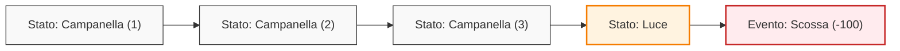
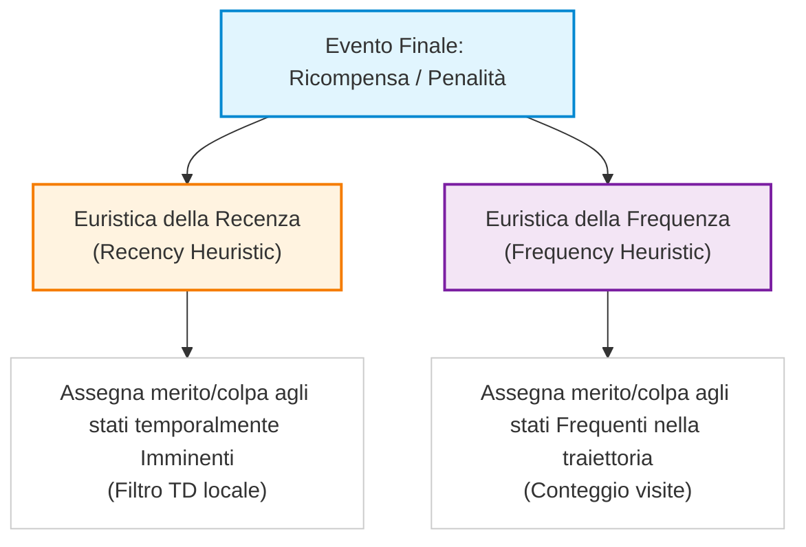
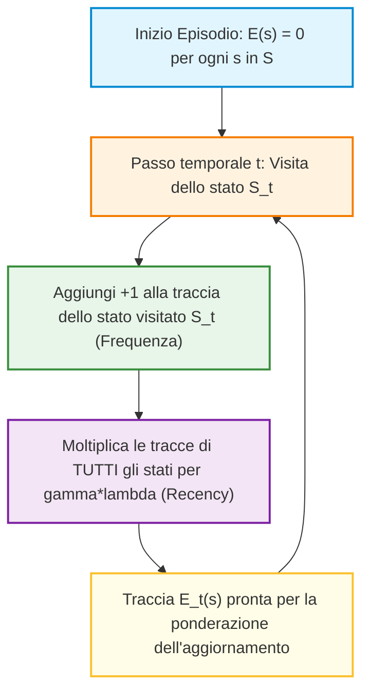
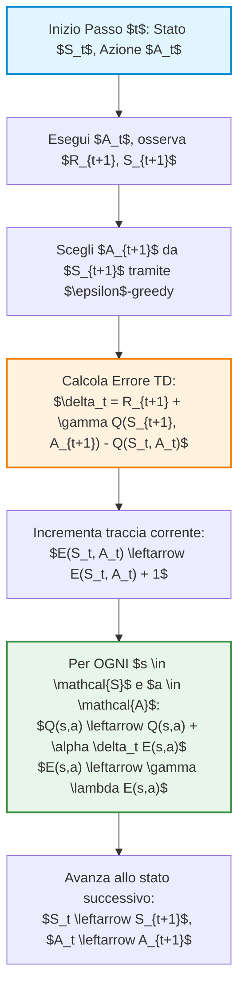
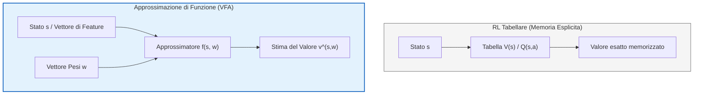

# Apprendimento per Differenze Temporali: TD($\lambda$), Vista all'Indietro e Introduzione all'Approssimazione Funzionale di Valore

## Overview Didattica

In questa lezione si completa lo studio dell'algoritmo **TD($\lambda$)** (*Temporal-Difference Learning with $\lambda$*), transizionando dalla prospettiva in avanti (*Forward View*) definita nelle lezioni precedenti alla sua formulazione computazionalmente efficiente: la **vista all'indietro** (*Backward View*).

La lezione si articola su tre direttrici principali:
1. **Ricapitolazione e Razionale Teoretico di TD($\lambda$)**: Analisi del passaggio dai metodi di *bootstrapping* a $n$ passi (*n-step bootstrapping*) al **Ritorno-$\lambda$** (*Lambda-Return*, $G_t^\lambda$). TD($\lambda$) agisce da generalizzazione e bilanciamento continuo tra **TD(0)** (caratterizzato da bassa varianza ed elevato bias) e il metodo **Monte Carlo** (caratterizzato da bias nullo ed elevata varianza). La combinazione convessa (*convex combination*) con decadimento geometrico consente di mediare su tutte le lunghezze di orizzonte, riducendo l'accumulo di rumore stocastico generato dall'ambiente e dalla politica lungo traiettorie temporali estese.
2. **Vista all'Indietro di TD($\lambda$)**: Introduzione dei meccanismi causali ed efficienti per l'aggiornamento dei valori online tramite tracce di idoneità (*eligibility traces*).
3. **Introduzione all'Approssimazione Funzionale di Valore** (*Value Function Approximation* - VFA): Una prima panoramica sul paradigma fondamentale che permetterà di estendere le tecniche tabulari viste finora a spazi di stato ed azioni continui o ad alta dimensione, essenziale per la risoluzione di problemi ingegneristici su vasta scala (*large-scale problems*).

---

### Richiamo della Visione Inoltrata (Forward View) e Return-$\lambda$

#### Dal Bootstrapping ad $n$-passi al Ritorno-$\lambda$

Nelle lezioni precedenti abbiamo analizzato il *Bootstrapping ad $n$-passi* ($n$-step Bootstrapping) come meccanismo per trovare un bilanciamento ideale tra due estremi:
1. **TD(0) (Temporal Difference a 0 passi):** Bassa varianza, ma presenza di bias legato all'approssimazione iniziale della funzione di valore.
2. **Monte Carlo (MC):** Bias nullo (utilizza il ritorno reale $G_t$), ma varianza molto elevata a causa della stocasticità accumulata lungo l'intera traiettoria.

Il limite principale del metodo ad $n$-passi risiede nella scelta dell'iperparametro $n$: senza una solida conoscenza *a priori* del problema, determinare l' $n$ ottimale è complesso. Per superare questa rigidità, l'algoritmo $\text{TD}(\lambda)$ introduce una generalizzazione: invece di scegliere un singolo valore di $n$, si considerano **tutti gli $n$-passi contemporaneamente**, pesandoli opportunamente.

> **Concetto Chiave: Il Ritorno-$\lambda$ ($G_t^\lambda$)**  
> Il target di apprendimento di $\text{TD}(\lambda)$, denominato **Ritorno-$\lambda$** ($\lambda$-return), è definito come la combinazione convessa dei ritorni ad $n$-passi $G_{t:t+n}$:
>
> $$G_t^\lambda = (1 - \lambda) \sum_{n=1}^{\infty} \lambda^{n-1} G_{t:t+n}$$
>
> Poiché i pesi $(1-\lambda)\lambda^{n-1}$ formano una serie geometrica la cui somma equivale a 1, la combinazione è strettamente convessa per qualsiasi $\lambda \in [0, 1)$.

I casi limite rispecchiano le formulazioni già note:
* Per $\lambda = 0$, $G_t^\lambda$ collassa su $G_{t:t+1}$ (equivalente a **TD(0)**).
* Per $\lambda = 1$, la ponderazione assegna tutto il peso al termine finale dell'episodio, degenerando nel metodo **Monte Carlo**.

La ragione principale per cui si sceglie $\lambda < 1$ (e quindi si preferiscono eventi temporalmente più vicini) risiede nella **stocasticità dell'ambiente e della politica** (policy). Man mano che ci si spinge lontano nel futuro lungo una traiettoria, il rumore accumulato cresce. Smorzare i contributi futuri con il fattore $\lambda$ riduce l'impatto di tale rumore sull'aggiornamento della stima.

#### Limiti della Visione Inoltrata: La Necessità dell'Aggiornamento Incrementale

La formulazione teorica basata sul calcolo diretto di $G_t^\lambda$ prende il nome di **Visione Inoltrata** (*Forward View*). 

Sebbene concettualmente elegante, la Forward View presenta un grave difetto pratico: **non è un algoritmo causale né online**. Per calcolare $G_t^\lambda$ al tempo $t$, l'agente deve attendere l'evoluzione dei passi futuri (fino alla fine dell'episodio nei compiti episodici, o per un orizzonte temporalmente molto esteso).

In Ingegneria e nel Reinforcement Learning applicato, la necessità è invece quella di aggiornare la stima del valore $V(S_t)$ e modificare la politica **in modo incrementale passo dopo passo** (*online*), mentre l'agente sta interagendo con l'ambiente reale. 

Questo limite motiva la transizione verso la **Visione all'Indietro** (*Backward View*) di $\text{TD}(\lambda)$, che implementa gli stessi aggiornamenti ponderati propagando l'informazione dal presente verso il passato tramite le *tracce di idoneità* (eligibility traces).

---

### Il Problema dell'Assegnazione del Credito (Credit Assignment Problem)

Per comprendere il funzionamento intuitivo e matematico della Backward View, è necessario analizzare uno dei problemi fondamentali dell'apprendimento per rinforzo: il **Problema dell'Assegnazione del Credito** (*Credit Assignment Problem*).

> **Concetto Chiave: Assegnazione del Credito**  
> Quando un agente riceve una ricompensa (o una penalità) significativa al termine o in un punto avanzato di una traiettoria, l'algoritmo deve stabilire a quali stati visitati o azioni compiute nel passato debba essere attribuito il merito (o la colpa) di tale risultato.

#### L'Esempio del Topo (Recenza vs Frequenza)

Si consideri un classico esperimento concettuale: un topo all'interno di un percorso osserva tre squilli di campanella (*Bell*), seguiti dall'accensione di una luce (*Light*), e subito dopo subisce una scossa elettrica (*Shock*, penalità elevata).



Di fronte all'evento negativo finalizzante (la scossa), come deve essere distribuita la colpa tra gli stati precedenti? Per risolvere questo dilemma, si utilizzano due euristiche fondamentali:

1. **Euristica della Recenza (Recency Heuristic):**  
   L'evento più vicino nel tempo al risultato finale è il principale responsabile. Nell'esempio, la *Luce* si è accesa immediatamente prima della scossa; pertanto, riceve la quota maggiore di credito/colpa. Questo è il principio su cui si basa l'aggiornamento locale di **TD(0)**.

2. **Euristica della Frequenza (Frequency Heuristic):**  
   Lo stato o l'azione che si è verificata con maggiore frequenza lungo la traiettoria è il fattore scatenante. Nell'esempio, la *Campanella* è suonata tre volte prima della scossa. Uno stato visitato ripetutamente accumulate più "responsabilità". Questo principio rispecchia la logica dei metodi **Monte Carlo con visite multiple** (every-visit MC).



> **Concetto Chiave: Sintesi nella Backward View**  
> La Backward View di $\text{TD}(\lambda)$ combina matematicamente l'**Euristica della Recenza** e l'**Euristica della Frequenza** all'interno di un unico meccanismo chiamato **Traccia di Idoneità** (*Eligibility Trace*). La traccia aumenta ogni volta che uno stato viene visitato (frequenza) e decade esponenzialmente nel tempo quando lo stato non viene visitato (recenza).

---

### Prospettive per la Scalabilità: Approssimazione della Funzione di Valore

L'esigenza di effettuare aggiornamenti incrementali causa-effetto tramite $\text{TD}(\lambda)$ è funzionale alla gestione di problemi su vasta scala (*large-scale problems*). 

Nei problemi reali d'ingegneria, lo spazio degli stati $S$ è spesso continuo o immenso, rendendo impossibile l'uso di tabelle per memorizzare $V(s)$ o $Q(s, a)$ (metodi tabulari). L'algoritmo $\text{TD}(\lambda)$ nella sua forma Backward costituisce la struttura fondamentale per integrare l'**Approssimazione della Funzione di Valore** (*Value Function Approximation* - VFA), in cui la funzione di valore viene stimata tramite un vettore di parametri $\mathbf{w}$ (ad esempio tramite modelli lineari o reti neurali):

$$\hat{v}(s, \mathbf{w}) \approx V_\pi(s)$$

L'unione tra la meccanica all'indietro di $\text{TD}(\lambda)$ e i modelli di approssimazione parametrica rappresenta il framework portante per il controllo e l'ottimizzazione in ambienti complessi.

---

### Il Compromesso tra Frequenza e Recency: Oltre il Metodo $n$-step

Nelle lezioni precedenti abbiamo visto due estremi per la stima della funzione valore:
1. **Monte Carlo (MC):** Dà uguale importanza a tutti gli stati attraversati lungo l'intera traiettoria dell'episodio.
2. **TD(0) (Temporal Difference a 1 passo):** Considera importante unicamente l'ultimo stato transito, ignorando la storia passata.

Il metodo $n$-step TD cerca una via di mezzo fissa, ma presenta una rigidità concettuale: assegna un peso uniforme agli ultimi $n$ passi e zero a tutti gli altri. 

Un compromesso più ragionevole consiste nell'assegnare credito a tutti gli stati visitati, ma pesandolo in base a due principi fondamentali:
* **Frequenza (*Frequency*):** Quante volte un determinato stato è stato visitato nella traiettoria.
* **Freschezza temporale (*Recency*):** Quanto di recente lo stato è stato visitato rispetto al momento attuale.

Mentre la **Vista Forward** (*Forward View*) guarda al futuro lungo la traiettoria per pesare i ritorni futuri, la **Vista Backward** (*Backward View*) guarda al passato per capire quale responsabilità abbiano avuto gli stati precedentemente visitati sulla ricompensa appena ottenuta.

---

### Le Tracce di Elegibilità (*Eligibility Traces*)

> **CONCETTO CHIAVE: Le Tracce di Elegibilità ($E$)**
> 
> La **Traccia di Elegibilità** (*Eligibility Trace*) è una quantità fondamentale nell'apprendimento per rinforzo temporale. È un vettore temporale con la **stessa cardinalità dello spazio degli stati** ($|S|$), in cui ogni elemento $E(s)$ misura quanto lo stato $s$ sia "elegibile" (ovvero responsabile) a ricevere credito o colpa per il segnale di errore/ricompensa attualmente osservato.

 All'inizio di ogni episodio, la traccia di elegibilità viene inizializzata a zero per tutti gli stati, poiché prima dell'inizio della traiettoria nessun stato ha alcuna responsabilità:

$$E_{-1}(s) = 0, \quad \forall s \in S$$

Ogni volta che l'agente compie un passo temporale $t$, la traccia viene aggiornata combinando le due componenti di *recency* e *frequency*. 

Nella forma classica, nota come **Traccia Accumulativa** (*Accumulating Trace*), la dinamica di aggiornamento per uno stato generico $s$ è definita come:

$$E_t(s) = \gamma \lambda E_{t-1}(s) + \mathbf{1}(S_t = s)$$

dove:
* $\mathbf{1}(S_t = s)$ è la funzione indicatore (*Indicator Function*), che vale $1$ se lo stato corrente $S_t$ è $s$, e $0$ altrimenti (**Componente di Frequenza**).
* $\gamma \in [0, 1]$ è il fattore di sconto (*Discount Factor*), proprietà dell'Ambiente MDP.
* $\lambda \in [0, 1]$ è il parametro di decadimento della traccia (*Trace Decay Parameter*), iperparametro scelto dall'ingegnere.

Poiché il prodotto $(\gamma \lambda) \in [0, 1]$, a ogni passo tutti gli elementi del vettore delle tracce subiscono un **decadimento geometrico** (*Geometric Decay*). L'unico elemento che incrementa è quello corrispondente allo stato appena visitato.



#### Perché il Decadimento Geometrico?
L'uso del decadimento geometrico $(\gamma \lambda)$ non è solo concettualmente fondato, ma presenta vantaggi implementativi immensi:
* **Memoria Incrementale:** Non occorre memorizzare l'intera sequenza storica degli stati della traiettoria. Tutta la storia passata è già riassunta nel valore corrente di $E(s)$.
* **Efficienza Computazionale:** L'aggiornamento si riduce a una semplice moltiplicazione per uno scalare fisso ad ogni passo temporale.

---

### Algoritmo TD($\lambda$) Backward per la Predizione

La vista backward consente di effettuare aggiornamenti **online** (a ogni singolo passo) propagando l'informazione a ritroso.

Ad ogni passo $t$, dopo aver osservato la ricompensa $R_{t+1}$ e il nuovo stato $S_{t+1}$, si calcola il classico **Errore TD ad un passo** (*One-step TD Error*) $\delta_t$:

$$\delta_t = R_{t+1} + \gamma V(S_{t+1}) - V(S_t)$$

Anziché aggiornare unicamente lo stato $S_t$ come in TD(0), l'errore $\delta_t$ viene trasmesso a **tutti gli stati dello spazio degli stati**, pesato dalla rispettiva traccia di elegibilità:

$$V(s) \leftarrow V(s) + \alpha \delta_t E_t(s), \quad \forall s \in S$$

> **CONCETTO CHIAVE: Differenza strutturale dei loop nei metodi TD**
> 
> * **TD(0):** Ad ogni passo, aggiorna **un solo stato** ($S_t$).
> * **$n$-step TD:** Deve attendere $n$ passi per aggiornare **un solo stato** ($S_{t-n}$).
> * **TD($\lambda$) Backward:** Ad ogni passo, aggiorna **TUTTI gli stati** $s \in S$ proporzionalmente alla loro traccia $E(s)$.

#### Pseudo-codice Didattico: TD($\lambda$) Backward Prediction

1. Inizializza la funzione valore $V(s)$ arbitrariamente (e $V(\text{terminale}) = 0$).
2. Per ogni episodio:
   * Inizializza $E(s) = 0$, per ogni $s \in S$.
   * Inizializza lo stato iniziale $S$.
   * Per ogni passo dell'episodio (finché $S$ non è terminale):
     * Scegli un'azione $A$ tramite la politica $\pi$.
     * Esegui $A$, osserva la ricompensa $R$ e il nuovo stato $S'$.
     * $\delta \leftarrow R + \gamma V(S') - V(S)$
     * $E(S) \leftarrow E(S) + 1$ *(Aggiornamento della frequenza per lo stato corrente)*
     * Per tutti gli $s \in S$:
       * $V(s) \leftarrow V(s) + \alpha \delta E(s)$
       * $E(s) \leftarrow \gamma \lambda E(s)$
     * $S \leftarrow S'$

---

### Equivalenza e Differenze tra Vista Forward e Vista Backward

L'algoritmo **TD($\lambda$) Backward** e la **Vista Forward di TD($\lambda$)** condividono lo stesso obiettivo formale, ma operano con modalità operative differenti:

1. **Caso Offline (*Offline Updates*):** 
   Se gli aggiornamenti della funzione valore non vengono effettuati passo-passo, ma vengono accumulati e applicati esclusivamente **alla fine dell'episodio**, la vista Backward è **matematicamente equivalente** alla vista Forward.

2. **Caso Online (*Online Updates*):**
   Nella pratica reale, si predilige l'aggiornamento *online* (passo dopo passo), poiché consente all'agente di sfruttare immediatamente l'informazione appresa. In modalità online, le due viste **non sono strettamente identiche**:
   * La differenza tra le due viste è governata dal tasso di apprendimento (*Learning Rate*) $\alpha$.
   * Per valori di $\alpha \to 0$ (tassi di apprendimento molto piccoli), le due viste convergono e forniscono risultati pressoché identici.
   * Per valori di $\alpha$ elevati, le traiettorie di aggiornamento divergono, ma la vista Backward online risulta decisamente superiore dal punto di vista computazionale e applicativo.

---

### Varianti delle Tracce di Elegibilità

Nella letteratura del Reinforcement Learning esistono diverse formulazioni matematiche per l'aggiornamento della traccia $E_t(s)$. Le più rilevanti sono:

#### 1. Tracce Accumulative (*Accumulating Traces*)
È la versione standard presentata in precedenza. Ogni nuova visita aggiunge $+1$ al valore di traccia precedente:
$$E_t(s) = \begin{cases} \gamma \lambda E_{t-1}(s) + 1 & \text{se } s = S_t \\ \gamma \lambda E_{t-1}(s) & \text{se } s \neq S_t \end{cases}$$

#### 2. Tracce di Sostituzione (*Replacing Traces*)
Evita che la traccia cresca all'infinito o superi il valore $1$ in caso di visite frequenti e ravvicinate. Quando uno stato viene visitato, la sua traccia viene resettata esattamente a $1$, anziché sommare $1$:
$$E_t(s) = \begin{cases} 1 & \text{se } s = S_t \\ \gamma \lambda E_{t-1}(s) & \text{se } s \neq S_t \end{cases}$$

#### 3. Tracce Olandesi (*Dutch Traces*)
Integrano il parametro di apprendimento $\alpha$ nel decadimento per gestire in modo teoricamente solido gli aggiornamenti online:
$$E_t(s) = \begin{cases} \gamma \lambda E_{t-1}(s) + (1 - \alpha \gamma \lambda E_{t-1}(s)) & \text{se } s = S_t \\ \gamma \lambda E_{t-1}(s) & \text{se } s \neq S_t \end{cases}$$

| Tipo di Traccia | Formulazione allo stato corrente $S_t$ | Comportamento in visite ripetute |
| :--- | :--- | :--- |
| **Accumulativa** | $E(S_t) \leftarrow \gamma \lambda E(S_t) + 1$ | Può superare $1$ se rivisitato di frequente |
| **Sostituzione** | $E(S_t) \leftarrow 1$ | Satura superiormente a $1$ |
| **Olandese** | $E(S_t) \leftarrow \gamma \lambda E(S_t) + (1 - \alpha \gamma \lambda E(S_t))$ | Bilanciata in funzione del tasso $\alpha$ |

---

### Dal TD($\lambda$) per la Predizione al Controllo: L'Algoritmo SARSA($\lambda$)

Nel Reinforcement Learning, una volta compreso come valutare una politica fissata (fase di **Predizione** / *Prediction*), il passo naturale successivo è l'ottimizzazione della politica stessa (fase di **Controllo** / *Control*). 

Il framework concettuale rimane quello dell'**Iterazione di Politica Generalizzata** (*Generalized Policy Iteration - GPI*): si alterna la valutazione della funzione di valore con il miglioramento della politica agendo in modo $\epsilon$-greedy. La novità introdotta con il $TD(\lambda)$ riguarda il modo in cui aggiorniamo le stime di valore basandoci sulle **Tracce di Eligibilità** (*Eligibility Traces*).

---

#### Estensione delle Tracce di Eligibilità alle Coppie Stato-Azione

Nel passaggio dal calcolo del valore degli stati $V(s)$ al calcolo del valore delle azioni $Q(s, a)$, la struttura delle tracce di eligibilità cambia dimensione per adattarsi alla nuova funzione obiettivo:

> **Concetto Chiave**: Nel problema di predizione, la traccia di eligibilità è un vettore di dimensione pari alla cardinalità degli stati $|\mathcal{S}|$. Nel problema di controllo, dovendo aggiornare la Funzione di Valore Stato-Azione (State-Action Value Function) $Q(s, a)$, la traccia di eligibilità $E(s, a)$ diventa una **tabella (o matrice)** di dimensione $|\mathcal{S}| \times |\mathcal{A}|$.

L'aggiornamento della traccia di eligibilità per ogni coppia stato-azione ad ogni passo temporale $t$ è definito come:

$$E_t(s, a) = \gamma \lambda E_{t-1}(s, a) + \mathbf{1}(S_t = s, A_t = a)$$

dove $\mathbf{1}(S_t = s, A_t = a)$ è la funzione indicatrice che vale $1$ se al tempo $t$ è stata visitata la coppia specifica $(s, a)$, e $0$ altrimenti.

L'**Errore di Differenza Temporale** (*Temporal Difference Error - TD Error*) per il controllo, indicato con $\delta_t$, viene calcolato utilizzando la quintupla tipica di SARSA $(S_t, A_t, R_{t+1}, S_{t+1}, A_{t+1})$:

$$\delta_t = R_{t+1} + \gamma Q(S_{t+1}, A_{t+1}) - Q(S_t, A_t)$$

Di conseguenza, la regola di aggiornamento di $Q(s, a)$ per **tutte** le coppie stato-azione incontrate nel passato si estende come:

$$Q(s, a) \leftarrow Q(s, a) + \alpha \delta_t E_t(s, a) \quad \forall s \in \mathcal{S}, a \in \mathcal{A}$$

---

#### Struttura dell'Algoritmo SARSA($\lambda$) e Natura On-Policy

L'algoritmo **SARSA($\lambda$)** eredita direttamente la natura *on-policy* dello standard SARSA:
1. Si seleziona l'azione successiva $A_{t+1}$ nello stato $S_{t+1}$ basandosi sulla politica attuale (es. $\epsilon$-greedy applicata a $Q$).
2. Si calcola l'errore TD $\delta_t$ usando proprio l'azione $A_{t+1}$ già scelta (*commitment* all'azione $A'$).
3. Si propaga l'aggiornamento all'indietro nel tempo su tutte le coppie $(s, a)$ proporzionalmente alla loro eligibilità $E(s, a)$.

*Nota: Passaggio integrato con chiarezza didattica.* A livello implementativo, l'algoritmo si struttura su **tre cicli annidati**:
1. **Ciclo esterno**: Iterazione su ciascun episodio.
2. **Ciclo intermedio**: Avanzamento passo-passo (step $t$) all'interno dell'episodio.
3. **Ciclo interno**: Aggiornamento simultaneo di tutte le celle della tabella $Q(s,a)$ e decadimento delle rispettive tracce $E(s,a)$.



---

#### Efficacia Operativa ed Esempio "Mountain Car"

Nelle applicazioni pratiche di controllo, l'utilizzo di un valore di $\lambda > 0$ (ovvero l'impiego del $TD(\lambda)$ tramite tracce di eligibilità) mostra prestazioni nettamente superiori rispetto al caso $\lambda = 0$ ($TD(0)$ standard).

Un benchmark classico in cui questo comportamento emerge chiaramente è il **Problema della Mountain Car** (*Mountain Car Problem*):
* In questo ambiente, le ricompense sono tipicamente molto rare (sparse), poiché l'agente riceve una ricompensa negativa a ogni passo finché non raggiunge la cima della montagna.
* Con $\lambda = 0$, la ricompensa finale impiega molti episodi per "risalire" a ritroso lungo gli stati precedenti, aggiornando un solo stato alla volta ad ogni episodio.
* Con $\lambda > 0$ (es. in SARSA($\lambda$)), il segnale di ricompensa viene immediatamente propagato a ritroso lungo l'intera sequenza di azioni che hanno condotto al successo, velocizzando enormemente la convergenza della politica ottimale.

---

### Dalle Tabelle all'Approssimazione di Funzione (*From Tabular to Function Approximation*)

Tutto ciò che abbiamo visto finora costituisce l'ossatura fondamentale del *Reinforcement Learning* (RL): l'Iterazione di Politica Generalizzata (*Generalized Policy Iteration - GPI*), le differenze temporali, gli *eligibility traces*, e la stima delle funzioni di valore $V(s)$ o $Q(s,a)$. 

Tuttavia, finora ci siamo limitati al contesto del **Reinforcement Learning Tabellare** (*Tabular Reinforcement Learning*). In questa modalità, l'agente mantiene in memoria un'array o una tabella contenente una stima esplicita del valore per ogni singolo stato o coppia stato-azione.

#### Limiti del RL Tabellare

L'approccio tabellare mostra forti limiti quando si cerca di applicarlo a problemi reali e di grande scala per due ragioni principali:

1. **Memoria (Dimensione dello spazio di memoria):** Per problemi ad alta dimensionalità o complessi (come il gioco del Go, la robotica o il controllo di agenti autonomi), la tabella $Q(s,a)$ diventa immensa e non può essere contenuta fisicamente in memoria. In spazi di stato continui, la dimensione della tabella diventa teoricamente infinita.
2. **Cardinalità ed Esplorazione (Fabbisogno di dati):** Anche utilizzando gli *eligibility traces* per accelerare la propagazione del segnale di ricompensa, aggiornare ogni singola cella di una tabella enorme richiede una quantità di dati e di esplorazione dell'ambiente del tutto insostenibile.

> **CONCETTO CHIAVE: Il passaggio all'Approssimazione**  
> Per superare i limiti di memoria e cardinalità del modello tabellare, non memorizziamo più un valore esplicito per ogni stato. Sostituiamo la tabella con un **Approssimatore di Funzione** (*Function Approximator*), descritto da un vettore di parametri $\mathbf{w} \in \mathbb{R}^d$ (con $d \ll |\mathcal{S}|$).

La funzione di valore reale $v_\pi(s)$ o $q_\pi(s,a)$ viene approssimata mediante una funzione parametrizzata:

$$\hat{v}(s, \mathbf{w}) \approx v_\pi(s)$$

$$\hat{q}(s, a, \mathbf{w}) \approx q_\pi(s, a)$$



---

### Esempio Intuitivo: Riduzione di Dimensionalità in un GridWorld

Consideriamo un semplice *GridWorld* $4 \times 4$ (16 stati totali) dove l'obiettivo è raggiungere uno stato terminale con il minor numero di passi possibili (ricompensa $-1$ per ogni transizione).

```
[  0 ] [ -1 ] [ -2 ] [ -3 ]
[ -1 ] [ -2 ] [ -3 ] [ -4 ]
[ -2 ] [ -3 ] [ -4 ] [ -5 ]
[ -3 ] [ -4 ] [ -5 ] [ -6 ]
```

* **Approccio Tabellare:** Dobbiamo memorizzare esattamente 16 numeri distinti all'interno di un vettore.
* **Approccio Parametrico (Approssimato):** Possiamo descrivere ogni stato mediante le sue coordinate spaziali $(x, y)$ sul piano.

Possiamo definire $\hat{v}(s, \mathbf{w})$ come una combinazione lineare delle coordinate del modello:

$$\hat{v}(s, \mathbf{w}) = w_1 \cdot x + w_2 \cdot y + w_0$$

*Nota: Passaggio integrato con chiarezza didattica.* Se impostiamo $w_1 = -1$, $w_2 = -1$ e $w_0 = 0$ (ipotizzando l'origine $(0,0)$ nello stato terminale in alto a sinistra), la funzione parametrizzata restituisce esattamente il valore di qualsiasi cella $s=(x,y)$ calcolando semplicemente $-(x + y)$. 

In questo modo, invece di memorizzare **16 valori**, è sufficiente memorizzare i **3 parametri** del vettore $\mathbf{w} = [w_0, w_1, w_2]^T$. Se la griglia diventasse $2000 \times 2000$, la tabella richiederebbe 4.000.000 di celle, mentre il modello parametrico necessiterebbe ancora dei soli 3 parametri.

---

### Sfide e Limitazioni dell'Approssimazione

Sostituire una tabella con un approssimatore introduce nuove problematiche fondamentali:

1. **Non-linearità della superficie di valore:** Un piano o un modello lineare è adeguato solo per problemi molto semplici. Nelle applicazioni reali, la superficie della funzione di valore $v_\pi(s)$ può essere altamente complessa e non lineare, richiedendo approssimatori ad alta capacità espressiva.
2. **Il Problema dei Descrittori di Stato (*State Descriptors / Feature Problem*):** Nell'esempio del *GridWorld*, la scelta delle coordinate $(x,y)$ come descrittori (feature) è intuitiva. In problemi complessi, tuttavia, definire quali siano i descrittori rilevanti dello stato non è affatto banale. Spesso i descrittori non sono forniti direttamente dall'ambiente e devono essere estratti o appresi.

---

### Scelta dell'Approssimatore e Apprendimento Incrementale

Nel panorama dell'Apprendimento Automatico (*Machine Learning*), esistono diversi modelli di approssimazione (Regressione Lineare, *Support Vector Machines*, Alberi Decisionali, Reti Neurali). Nel Reinforcement Learning, la scelta dell'approssimatore è guidata da un vincolo operativo preciso.

> **CONCETTO CHIAVE: Apprendimento Incrementale (Online Learning)**  
> Nel Reinforcement Learning l'agente raccoglie dati continuamente interagendo con l'ambiente. È indispensabile che l'approssimatore possa aggiornare i propri parametri $\mathbf{w}$ **in modo incrementale** ad ogni singolo passo o traiettoria, senza dover riaddestrare l'intero modello da zero sull'intero storico dei dati.

Per questa ragione, le famiglie di approssimatori maggiormente utilizzate nel RL sono:

1. **Modelli Lineari (*Linear Models*):** Semplici, matematicamente trattabili e aggiornabili facilmente tramite la Discesa lungo il Gradiente (*Gradient Descent*).
2. **Reti Neurali (*Neural Networks / Deep RL*):** Ottime per gestire superfici non lineari complesse e in grado di apprendere automaticamente i descrittori di stato a partire da dati grezzi (es. pixel). Vengono addestrate in modo incrementale tramite l'algoritmo di retropropagazione dell'errore (*Backpropagation*) basato su gradiente.

Al contrario, modelli come gli Alberi Decisionali (*Decision Trees*) o le SVM tradizionali sono poco adatti all'aggiornamento online passo-passo, in quanto richiederebbero una ri-strutturazione o un ri-addestramento globale al sopraggiungere di nuove esperienze.

#### Prospettiva per le prossime lezioni
L'introduzione dell'approssimazione di funzione non stravolge l'architettura teorica appresa finora: continuiamo a stimare la funzione di valore e ad applicare l'Iterazione di Politica Generalizzata (GPI) e gli aggiornamenti Temporal Difference (TD), ma invece di aggiornare direttamente i valori in una tabella, aggiorneremo il vettore dei pesi $\mathbf{w}$ dell'approssimatore.

---

> [!NOTE]
> ### Note per l'Esame e Avvisi del Docente
> - **Materiale d'esame**: Le slide lezioni costituiscono il materiale ufficiale d'esame (il libro di testo serve unicamente come approfondimento opzionale).
> - **Esercizio/Domanda tipica d'esame**: Il docente ha dichiarato di chiedere spesso all'esame di mostrare o implementare varianti degli algoritmi basate sulle diverse definizioni di *eligibility traces* (es. modificando la formula della traccia o la regola di aggiornamento).
> - **Equivalenza Forward e Backward TD-lambda (Cosa NON viene chiesto vs Domanda d'esame)**:
>   - **NON verrà mai chiesta** la dimostrazione matematica dell'equivalenza tra *forward* e *backward* TD-lambda, né di scriverne le equazioni formali.
>   - **Può essere chiesto all'esame** di spiegare in quali condizioni le due visioni sono equivalenti (risposta: solo nel caso *offline*, ovvero quando gli aggiornamenti vengono effettuati solo alla fine dell'episodio).
> - **Argomenti NON chiesti all'esame**: Le lezioni registrate integrative sulle basi delle reti neurali e del deep learning (e dettagli come la scelta tra ResNet e CNN tradizionali o la regolazione del *learning rate*) NON fanno parte del materiale d'esame e non saranno oggetto di domande.