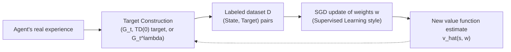
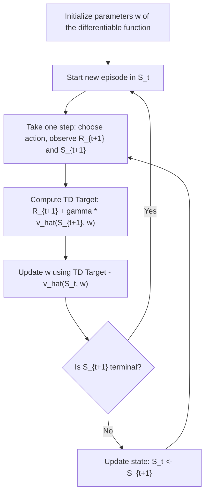
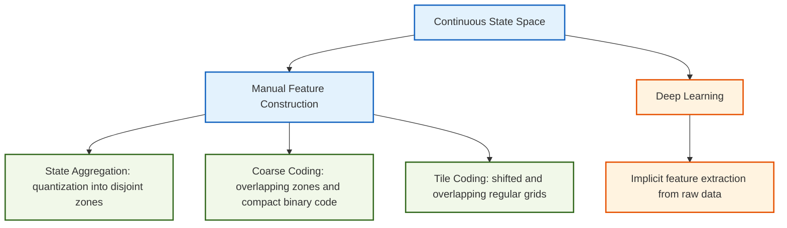

# Value Function Approximation and Generalization

## Educational Overview

This lecture revisits and deepens the topic of **Value Function Approximation** in Reinforcement Learning (RL), marking the fundamental transition from tabular methods to algorithms capable of operating on *large-scale problems*.

The main concepts introduced are:

* **Limitations of the tabular approach:** Managing the value functions $V(s)$ and $Q(s,a)$ using tables becomes impractical in real-world problems, especially in the presence of a continuous **Action Space** (e.g., deciding how much to accelerate while driving) or a very large **State Space**. There are two bottlenecks:
  1. **Memory:** Tables become too large or even infinite to store.
  2. **Sample efficiency:** To obtain a reliable estimate of the expected value of every single cell in the table, it would be necessary to collect a huge number of experiences for each state-action pair.
* **The idea of function approximation:** Instead of looking up rows and columns in a table, $V$ or $Q$ is modeled through a parametric function that takes the state $S$ (or the pair $S, A$) as input and returns an estimated numerical value. To compactly represent the states of a **Markov Decision Process (MDP)**, **Features** are used — for example, describing a $4 \times 4$ grid using only two features linearly combined with appropriate parameters.

> **Key Concept — Generalization:**
> Function approximation not only solves a scalability problem, but also introduces the ability to **generalize**. In tabular methods (including those with eligibility traces such as $\text{TD}(\lambda)$), the update involves exclusively the states actually visited along a trajectory: the system behaves like a simple *information retrieval* tool over what it has already seen. Conversely, in a parametric model, modifying a single parameter is simultaneously reflected in the estimate of the entire value function, making it possible to interpolate and estimate the value even of states never visited before.

---

### Introduction to Value Function Approximation

Up to this point we have worked mainly in tabular settings, but to tackle real-world large-scale problems it is necessary to make a conceptual leap by introducing **Value Function Approximation (VFA)**.

*(Organizational note on the material: the order in which these topics are presented does not strictly follow the linear sequence of the textbook; the discussion draws primarily from Chapter 9, while integrating elements from Chapters 10 and 11 and referencing Eligibility Traces from Chapter 12.)*

---

### Why Move Beyond the Tabular Approach

In tabular *Reinforcement Learning* (RL), we explicitly store an estimate for every state in the vector $V(s)$ or for every state-action pair in the table $Q(s, a)$. When we move to complex real-world problems, this approach breaks down for two fundamental reasons:

* **Memory limitations:** if the state or action space is huge — or even continuous, such as deciding how hard to press the accelerator while driving a car — the number of cells becomes barely manageable or ideally infinite, making it impossible to store the table.
* **Statistical and sampling limitations:** even if we could allocate the memory, to obtain a reliable estimate of the expected value of each element we would need to visit every single state (or state-action pair) a huge number of times. The tabular approach, therefore, does not scale.

The idea behind VFA is to replace the table with a **parametric function**: a "box" (model) governed by a set of parameters $\mathbf{w}$ that receives the same inputs as before — the state $S$ for $\hat{v}(S, \mathbf{w})$, or $(S, A)$ for $\hat{q}(S, A, \mathbf{w})$ — and directly returns an estimated numerical value.

#### The Real Strength: Generalization

Beyond solving the scalability problem, approximating the value function introduces a fundamental property across all of *Machine Learning*: **Generalization**.

> **Key Concept — Generalization vs Information Retrieval:**
> We do not want a system that merely performs *information retrieval*, that is, returning exactly what it has already observed in the past. We want a model capable of interpolating and estimating the value even of states never visited, leveraging the experience gathered from nearby or similar states.

To understand the difference compared to the tabular case, let us consider the example of a simple *Grid World* $4 \times 4$ in which the true value function has a linear trend:
* We can compactly describe each state using only two **Features** (for example, the coordinates) and combine these two features into a linear function with two parameters.
* In the tabular approach (even using algorithms like $TD(\lambda)$), every update modified exclusively the values of the states actually encountered along a trajectory.
* With a parametric approximator, instead, **modifying even a single parameter changes the estimate across the entire state space**. If the model is well configured, experience on a few states automatically improves predictions across the rest of the environment as well.

---

### Representation and Choice of the Approximating Model

Setting up a Value Function Approximation problem means transforming the estimation of $V$ or $Q$ into a problem similar to **Supervised Learning**, where given an input we want to predict a numerical output. This requires two steps:

1. **Defining the MDP (*Markov Decision Process*) features:** finding compact descriptors of the state. In simple problems (such as the $4 \times 4$ grid) it is easy to construct them by hand; in complex problems, one often resorts to neural networks capable of implicitly extracting features from raw data.
2. **Choosing the structure of the approximating function:** in RL practice, one mainly focuses on two model families — **linear approaches** and **Deep Learning** — for a specific reason: they are **differentiable**.

#### Why Differentiable Models Are Needed

Differentiability allows incremental learning via **Gradient Descent** or **Stochastic Gradient Descent (SGD)**. When the agent collects new experience, we do not have to discard the previous model and retrain everything from scratch: we compute the error made and shift the parameters $\mathbf{w}$ in the direction that reduces the cost function.

#### Trade-offs Between Linear Approaches and Deep Learning

* **Linear Models** (e.g., linear regression on features):
  * *Advantages:* simpler to study, interpret, and optimize.
  * *Limitations:* if the true value function $v_\pi$ or $q_\pi$ has a strongly nonlinear trend, a linear combination will never be able to represent it faithfully.
* **Neural Networks / Deep Learning**:
  * *Advantages:* they are **Universal Approximators**, capable of representing arbitrary and complex functions with the desired degree of accuracy.
  * *Limitations:* they typically require much more data and experience to be trained effectively.

---

### The Prediction Objective: Mean Squared Value Error

Since an approximator will rarely be perfect (for example, when we try to fit a line to points that do not lie on a line), we need a quantitative metric — a cost function — that measures how much our estimate deviates from the true value and tells us in which direction to update the parameters $\mathbf{w}$.

#### The Role of State Weighting

In Reinforcement Learning, not all states have the same importance. Suppose we observe that some states are visited very rarely (or never) during the execution of our agent, while other states are traversed continuously:
* If the model has limited capacity (such as a linear model) and cannot drive the error to zero everywhere, it is reasonable to **tollerate** a larger error on rare or irrelevant states, wait let me fix typo -> **tolerate a larger error on rare or irrelevant states**, provided we are very accurate on the states visited more often.

To formalize this priority, we weight the squared error of each state $s$ by a weighting function $\mu(s)$, obtaining the **Mean Squared Value Error ($\overline{\text{VE}}$)**:

$$\overline{\text{VE}}(\mathbf{w}) = \sum_{s \in \mathcal{S}} \mu(s) \left[ v_\pi(s) - \hat{v}(s, \mathbf{w}) \right]^2$$

where:
* $v_\pi(s)$ is the true value we want to predict (equivalent to the target label $Y$ in supervised learning);
* $\hat{v}(s, \mathbf{w})$ is the prediction provided by our parametric approximator;
* $\mu(s)$ represents the importance (the weight) assigned to state $s$.

#### Connection to the Policy in the On-Policy Case

> **Key Concept — From Theoretical Expectation to Real Data:**
> In the *on-policy* case, where we evaluate a policy $\pi$ by collecting experience precisely by following $\pi$, the weighting function $\mu(s)$ naturally coincides with the frequency with which the policy visits the different states.

We can therefore rewrite the objective by eliminating the explicit weighting function $\mu(s)$ and incorporating it into the expected value under policy $\pi$:

$$\overline{\text{VE}}(\mathbf{w}) = \mathbb{E}_\pi \left[ \left( v_\pi(S) - \hat{v}(S, \mathbf{w}) \right)^2 \right]$$

Even though at first glance this formula with the expectation $\mathbb{E}_\pi[\cdot]$ may seem more abstract, in practice it is extremely advantageous: just as we have always done in Reinforcement Learning, when we move to the practical algorithm we replace the expected value with the actual samples generated by executing $\pi$. In this way, states visited more frequently by the policy will appear more often in the data and will automatically receive greater weight in updating the parameters $\mathbf{w}$.

---

### Optimization via Stochastic Gradient Descent (SGD)

#### Operating Principle: Local and Global Minima
Once the objective function to be minimized with respect to the parameters $\mathbf{w}$ of our approximating function has been defined, the next step is to optimize it via **Stochastic Gradient Descent (SGD)**.

The basic idea of the algorithm is as follows:
* Instead of processing the entire dataset, a subset (or a single sample) of the available experience is sampled.
* The **gradient** is computed with respect to all parameters $\mathbf{w}$ that define the function (whether linear or non-linear, such as a neural network).
* The gradient indicates the direction in which, at least locally, one moves toward a reduction of the cost function.

It is essential to distinguish the behavior of the descent depending on the shape of the approximating function:
* **Linear case:** the cost function surface is convex, so **local minimum and global minimum coincide**.
* **Non-linear case (e.g., Neural Networks):** the objective function can take complex and irregular shapes. Classical SGD is guaranteed to move from the current point toward a **local minimum**: this still represents an improvement over the initial situation (unless already stuck in a local minimum), but does not guarantee reaching the global optimum (barring anomalous behaviors, such as update steps so large that they "jump" out of the current valley).

#### The Parameter Update Rule
In the tabular methods seen previously — such as Monte Carlo, TD(0), or TD($\lambda$) — gathering experience meant directly updating a single cell of a table or a vector ($V$ or $Q$). With Value Function Approximation (VFA), the principle remains identical (gathering data to improve the estimate), but **individual entries are no longer updated**; instead, the **parameters $\mathbf{w}$** of the function are updated.

Starting from the previous parameters, one observes the direction indicated by the gradient and moves in that direction by an amount proportional to the error made on the new data point relative to the true value, weighted by the **step size / learning rate** $\alpha$.

*(Note: Step integrated for pedagogical clarity)* Applying gradient descent to the mean squared cost function between the true value $v_\pi(S_t)$ and the estimate $\hat{v}(S_t, \mathbf{w})$ yields the general update rule:

$$\mathbf{w} \leftarrow \mathbf{w} + \alpha \big[ v_\pi(S_t) - \hat{v}(S_t, \mathbf{w}) \big] \nabla_{\mathbf{w}} \hat{v}(S_t, \mathbf{w})$$

* **Role of $\alpha$ and convergence guarantees:** the parameter $\alpha$ determines how aggressive each individual step toward the minimum is. Even when introducing approximation, **mathematical convergence guarantees** to the true value exist in the linear case, provided that specific conditions are met in choosing and varying the step size $\alpha$ over the course of the time steps.

#### The Linear Case and the Connection to Tabular Methods
In the specific case where the approximator is **linear**, the original state $s$ is mapped into a **feature** vector $\mathbf{x}(s)$ (for example, the coordinates along the horizontal and vertical axes of a grid), obtaining a much more compact representation than the original state space. For instance, a 9-state grid can be described compactly using only 3 parameters ($w_0, w_1, w_2$).

In this context, the gradient of the estimate with respect to the parameters simply coincides with the feature vector itself ($\nabla_{\mathbf{w}} \hat{v}(S_t, \mathbf{w}) = \mathbf{x}(S_t)$), simplifying the update rule to:

$$\mathbf{w} \leftarrow \mathbf{w} + \alpha \big[ v_\pi(S_t) - \hat{v}(S_t, \mathbf{w}) \big] \mathbf{x}(S_t)$$

This approach is not a concept completely disconnected from the past, but rather a **generalization of tabular methods**: in a pure tabular scenario, in fact, there is a one-to-one correspondence between states and features (each state is its own feature, with the same dimensionality as the original space), so the notation $\mathbf{x}(s)$ becomes superfluous and one falls back exactly to the point-wise update of the single entry.

---

### The Oracle Problem and Target Formulation

> **Key Concept: We Cannot "Cheat" as in Supervised Learning**
> Up to this point, the update rule has been presented exactly as in a **Supervised Learning** problem (such as linear regression or training a neural network), where historical data containing the true value $y$ is available to compute the error.
> However, in Reinforcement Learning **no oracle provides us with the true values $v_\pi$ or $q_\pi$**: estimating them is precisely the goal of the entire learning process!

To overcome this obstacle without resorting to unavailable data, we leverage the experience collected in the real world to generate **targets** that replace the unknown value $v_\pi(S_t)$. In this way, we can cast the problem into a format analogous to supervised learning by building a labeled dataset $\mathcal{D}$ (of cardinality $D$) containing state-target pairs.

Depending on the algorithm used, we can replace $v_\pi(S_t)$ in the update rule with:
* The **actual Monte Carlo return** $G_t$: it is not the exact expected value, but a real sample collected from experience.
* The **TD(0) target**: $R_{t+1} + \gamma \hat{v}(S_{t+1}, \mathbf{w})$.
* The **$\lambda$-return (lambda-return)**: $G_t^\lambda$.

---

### Monte Carlo Method with Value Function Approximation (VFA)

#### Algorithm Structure (Prediction)
Applying what we have seen to the **prediction** problem — where the policy $\pi$ is known and fixed — the Monte Carlo method with VFA uses the return $G_t$ as the target to update the entire differentiable function $\hat{v}(s, \mathbf{w})$ (whether linear or non-linear).

The logical structure of the algorithm follows these steps:
1. **Parameter initialization:** the weights $\mathbf{w}$ are initialized. When prior domain knowledge is available, it is always preferable to exploit it; otherwise, one proceeds randomly or arbitrarily (in neural networks there are specific guidelines such as *He* or *Xavier* initialization).
2. **Loop over episodes:** for each episode, since this is a Monte Carlo approach, the **entire episode** is generated and awaited until completion in order to observe the actual returns.
3. **Data collection and update:** for each time step $t$ of the episode (in the *every-visit* version, i.e., considering every visit made to the states), a data point is constructed by associating the visited state $S_t$ with its corresponding return $G_t$, and the parameters $\mathbf{w}$ of the approximating function are updated:

$$\mathbf{w} \leftarrow \mathbf{w} + \alpha \big[ G_t - \hat{v}(S_t, \mathbf{w}) \big] \nabla_{\mathbf{w}} \hat{v}(S_t, \mathbf{w})$$

*(Didactic note: in the simplified pseudocode shown in the lecture, the computation of $G_t$ is assumed directly available at the end of the episode without explicitly detailing the efficient step-by-step backward computation).*

#### Theoretical Properties and Convergence Guarantees
Moving from the tabular case to function approximation, the following fundamental properties hold for the Monte Carlo method:
* **Unbiased Estimator:** just as in the tabular case, the return $G_t$ remains an unbiased estimate of the true value.
* **Linear convergence:** if $\hat{v}(s, \mathbf{w})$ is a **linear** function, Monte Carlo prediction converges to the **global optimal approximation** of $v_\pi$.
* **Non-linear convergence:** if the approximator is **non-linear**, the algorithm guarantees convergence only to a **local optimum** (therefore there is no certainty of having found the best possible approximation).

> **Key Concept: Practical Impact of Local Optima**
> Although the lack of a global optimality guarantee in the non-linear case is an important property to be aware of, in the practice of **control** problems it is almost never a blocking obstacle: in such scenarios, in fact, the agent does not wait to estimate $v_\pi$ to perfection anyway, but acts *greedily* by changing policy along the way to see if performance improves.

---

### Practical Example: 3x3 Grid World and Generalization Capability

To understand the fundamental difference between the tabular approach and VFA, let us consider a simple deterministic grid environment (**Grid World**) $3 \times 3$:
* The agent always starts from the same state and follows a fixed policy that brings it to the end of the episode in 4 steps (receiving a reward of $-1$ per step, hence an initial return $G_0 = -4$).
* Due to the deterministic trajectory, **4 out of 9 states in the grid are never visited**, even when repeating the simulation for hundreds of episodes.
* To apply linear VFA, two very compact features based on spatial coordinates ($x$ and $y$) are defined, associating the weights $\mathbf{w}$ with a step size $\alpha = 0.05$.

The comparison between the two paradigms highlights a crucial property:
* **Tabular approach (even with Eligibility Traces):** after 200 or 300 episodes, the states along the trajectory converge perfectly, but **the states that are never visited are never updated**: the agent has no information about them.
* **VFA approach:** since the update acts on the global weights $\mathbf{w}$ shared across the entire state space, **already from the first data point of the episode ($G_0 = -4$) the value estimate for the entire grid is updated**, including the 4 states that were never visited.

In this example, VFA achieves excellent results that are very close to the true values of the environment even on unexplored cells. However, it is essential to keep in mind that this success strongly depends on the **quality of the chosen features**: in this simple problem the coordinates $(x, y)$ describe the value structure very well, whereas in complex problems designing equally effective features is by no means trivial.

---

### Semi-Gradient Temporal Difference Algorithms: TD(0)

Resuming the setup already seen for Value Function Approximation, we can reuse almost the entire structure of the Monte Carlo approach and adapt it to the **Temporal Difference (TD)** setting, starting from the simplest case: **Semi-gradient TD(0)**.

*(Note: the reason why these algorithms are called "semi-gradient" will be explored later in the course).*

#### From the Actual Return to the TD Target

The fundamental difference compared to Monte Carlo concerns the **target** used to compute the estimation error.

In TD(0), we perform an update at every single time step (*step-by-step*), without waiting for the episode to finish. Consequently, at step $t$ we do not have available the actual return $G_t$ collected up to the end of the trajectory.

To still construct an error signal, we replace $G_t$ with our best estimate of the return available after a single step: the immediate reward $R_{t+1}$ added to the discounted value estimate of the next state $\hat{v}(S_{t+1}, \mathbf{w})$. This quantity is the **TD target**:

$$\text{TD Target} = R_{t+1} + \gamma \hat{v}(S_{t+1}, \mathbf{w})$$

> **Key Concept:** In TD(0) with function approximation, Monte Carlo's actual return $G_t$ is replaced by the TD target $R_{t+1} + \gamma \hat{v}(S_{t+1}, \mathbf{w})$, allowing the parameters $\mathbf{w}$ to be updated step by step without having to wait for the end of the episode.

#### Algorithm Structure and Update Rule

The initial setup remains identical to what we saw previously:
- Choose an arbitrary differentiable approximation function $\hat{v}(s, \mathbf{w})$ to estimate the value of states.
- Initialize the parameters $\mathbf{w}$ of the function (appropriately, for example to zero or with arbitrary values).

The update rule still acts on the parameter vector $\mathbf{w}$, but instead of $G_t$ the TD target appears:

$$\mathbf{w} \leftarrow \mathbf{w} + \alpha \left[ R_{t+1} + \gamma \hat{v}(S_{t+1}, \mathbf{w}) - \hat{v}(S_t, \mathbf{w}) \right] \nabla \hat{v}(S_t, \mathbf{w})$$

where $\alpha$ is the learning rate (*step-size*) and $\nabla \hat{v}(S_t, \mathbf{w})$ is the gradient of the approximated function with respect to the parameters $\mathbf{w}$ evaluated at state $S_t$.

The core mechanism takes place in the *inner loop* of the algorithm:
- We do not generate the entire trajectory of the episode externally and then perform the computations afterwards.
- For each episode, and for every single step within the episode, the agent takes a step in the environment, observes $R_{t+1}$ and $S_{t+1}$, and immediately updates the parameters $\mathbf{w}$ before moving to the next step.

#### $3 \times 3$ Grid Example, Properties, and Comparison with Monte Carlo

Returning to the $3 \times 3$ grid example analyzed earlier (starting from the bottom-right corner along the same trajectory):
- In Monte Carlo, the agent traverses the entire trajectory and updates the weights only after the episode has ended.
- In Semi-gradient TD(0), the agent traverses the same sequence of states, but updates the parameter vector $\mathbf{w}$ step by step along the path.

Since the update relies on a current estimate $\hat{v}(S_{t+1}, \mathbf{w})$ rather than the full return, we are performing **bootstrapping**. This preserves the exact same trade-off seen in the tabular case:
- **Lower variance**: the target depends on a single stochastic step rather than the entire future trajectory.
- **Higher bias**: the initial estimate can be inaccurate because it relies on an estimated value rather than the true return.

In the experimental comparison observed on the $3 \times 3$ grid after $300$ episodes, **TD(0)** reaches a perfect estimate of the values, whereas **Monte Carlo** still exhibits inaccuracies.

> **Key Concept:** Although in the observed example TD(0) converges to a perfect estimate after $300$ episodes while Monte Carlo does not—and although Monte Carlo with value function approximation is typically not the most efficient choice—this result **should not be generalized as a universal property**: relative performance always depends on the specific experimental scenario considered.

---

### Initial Comparison and the Nature of the Semi-Gradient

When analyzing the learning curves of a practical example, one may notice that, after a single episode, the **Monte Carlo (MC)** approach appears to converge faster than **Temporal Difference (TD)** methods. However, it is essential not to generalize this behavior: it is a specific result tied to that particular scenario and to the choice of the learning rate $\alpha$. In other contexts, the relative performance can reverse completely.

#### Why We Speak of Semi-Gradient

> **Key Concept: Gradient vs. Semi-Gradient**
> When we apply function approximation to TD methods, we cannot speak of true gradient descent, but rather of **semi-gradient methods**. This happens because the target used in the update depends on the very same parameters $\mathbf{w}$ that we are trying to optimize.

In classical gradient descent (as in supervised learning or Monte Carlo), we compare our approximated function $\hat{v}(S_t, \mathbf{w})$ against a *target* that comes from real data or from an estimate independent of the weights:
- In the case of **Monte Carlo**, the target is the observed return $G_t$. Even though $G_t$ is a noisy estimate of the true value, it **does not depend on the parameters $\mathbf{w}$**. Differentiating the squared error with respect to $\mathbf{w}$ therefore produces an exact gradient.
- In **bootstrapping** methods (such as $\text{TD}(0)$, $N$-step TD, or $\text{TD}(\lambda)$), on the other hand, the target itself contains an estimate based on the current weights $\mathbf{w}$ (for example $R_{t+1} + \gamma \hat{v}(S_{t+1}, \mathbf{w})$).

When we compute the derivative of the error with respect to $\mathbf{w}$, we treat the target as if it were fixed, ignoring its dependence on $\mathbf{w}$:

$$
\mathbf{w}_{t+1} = \mathbf{w}_t + \alpha \left[ U_t - \hat{v}(S_t, \mathbf{w}_t) \right] \nabla \hat{v}(S_t, \mathbf{w}_t)
$$

where $U_t$ represents the target (which in the TD case depends on $\mathbf{w}_t$). Computing the full gradient would require decoupling the parameters or including the derivative of the target itself, making the algorithm much more complex. The **semi-gradient** approach gives up the formal mathematical correctness of the full gradient in favor of an update rule that is simple, computationally lightweight, and sufficiently effective in practice.

---

### Extension to $\text{TD}(\lambda)$ and $N$-step TD

Before moving from Prediction problems to Control problems, it is possible to extend function approximation to the multi-step methods already seen in the tabular case as well. In these cases too, since we rely on *bootstrapping*, we will work with **semi-gradient** algorithms.

#### $\text{TD}(\lambda)$ with Function Approximation

As seen previously, in practice the *backward* view of $\text{TD}(\lambda)$ is used almost exclusively, because it is much simpler and more efficient to implement online.

To adapt $\text{TD}(0)$ with function approximation to $\text{TD}(\lambda)$, we must introduce two fundamental elements:
1. The decay parameter $\lambda$.
2. **Eligibility Traces**, which act as a memory mechanism ("a long shadow") over the states visited up to that point.

Operationally, at each time step:
- We do not limit ourselves to updating the weights based solely on the state just visited.
- We use the target $\lambda$ (or the compact TD error $\delta_t$) and leverage the eligibility trace to distribute credit for the new reward across **all previously visited states** that have a non-zero trace.
- Each previously visited state thus becomes a training sample (*data sample*) weighted by the value of its eligibility trace to update the parameters $\mathbf{w}$.

*Note on the order of updates*: in classic pseudocode, there is a tendency to update samples following the chronological order of the trajectory (first state, second state, etc.). In reality, since this is a gradient descent over multiple data points, this order is not strictly mandatory: each sample provides a push in a certain direction and, on average, the sequence of updates still converges toward the same solution.

#### $N$-step TD with Function Approximation

Extending the semi-gradient approach to **$N$-step TD** unfortunately retains all the logical and implementation complexities already encountered in the tabular version:
- One must manage the time delay of $n$ steps, checking at each instant whether enough steps have been taken to be able to update the state visited at time $\tau = t - n + 1$.
- When approaching the end of the episode, truncation must be handled by replacing missing estimates with the actual return until termination.

The only real difference compared to the tabular case lies in the final update rule at time $\tau$: instead of directly updating the table $V(S_\tau)$, the parameter vector $\mathbf{w}$ is updated using the $N$-step return $G_{\tau:\tau+n}$ as the semi-gradient target.

#### Empirical Comparison and Convergence Guarantees

Observing the Root Mean Square Error (RMSE) plots relative to the true value function, specific behaviors strongly depend on the problem and parameter tuning (e.g., in some specific examples Monte Carlo starts faster and $\text{TD}(0)$ ends up beating even $\text{TD}(\lambda)$). To navigate rigorously, it is instead useful to keep the theoretical convergence guarantees in mind.

> **Key Concept: Convergence Guarantees in Function Approximation**
> The theoretical soundness of prediction algorithms depends strictly on the type of approximator chosen:
> - **Linear Function Approximation**: guarantees convergence to the global optimum (in the Monte Carlo case) or to a bounded neighborhood of the global optimum (in semi-gradient TD methods).
> - **Non-Linear Function Approximation**: convergence guarantees break down almost completely. Only Monte Carlo ensures reaching a local optimum; for TD methods there are no formal convergence guarantees.

Despite the absence of mathematical guarantees for non-linear approximators (such as neural networks), in engineering practice these methods are still widely used because they offer superior performance on complex problems.

---

### Feature Construction

One of the most critical and delicate points of the entire theoretical framework seen so far is the **choice of features**. Update algorithms assume that an effective representation of the state $\mathbf{x}(S)$ already exists, but in reality designing good features is a complex problem that is decisive for the success of learning.

The need to construct features arises especially when the state (and/or action) space is **continuous** or has **infinite/very high dimensionality** (think of the continuous position along a trajectory, the steering angle, or the acceleration of a vehicle).

Below are the three main classical approaches for generating features from continuous spaces, plus the alternative based on Deep Learning.

#### 1. State Aggregation

This is the simplest form of quantization of the continuous space. It consists of dividing the space into disjoint intervals or partitions and grouping all states that fall within the same region under a single representative state:
- *1D Example*: all continuous values between $400$ and $600$ are mapped to the single aggregated value $500$.
- *2D Example*: dividing a soccer field or a swimming pool into a certain number of zones (not necessarily uniform in shape or size) to localize a robot or an agent.

Precision (fine-grained information) is inevitably lost, but an infinite space is transformed into a finite and tractable set. From an encoding perspective, this is equivalent to **One-Hot Encoding**: the feature vector has as many elements as there are zones, with a single $1$ corresponding to the active zone and $0$ elsewhere.

#### 2. Coarse Coding

**Coarse Coding** overcomes the compactness limitations of simple aggregation by using **overlapping zones** (for example, circles scattered across the state space).

- Each zone corresponds to a binary feature: it is $1$ if the current state lies inside the zone, and $0$ if it lies outside.
- Because the zones intersect, a state can simultaneously activate multiple features, generating a richer binary signature (for example, `11001`).

**Advantage**: instead of having only a single $1$ as in *state aggregation*, combining multiple activations makes it possible to describe a much larger number of distinct partitions in the space for the same number of features, resulting in a much more compact and expressive representation.

#### 3. Tile Coding

**Tile Coding** is a less free-form approach than *coarse coding*, yet much more structured and widely used in practice.

- The continuous space is completely covered by a uniform grid of rectangles or tiles, leaving no uncovered areas ("holes").
- Instead of using a single grid, **multiple identical grids (*tilings*) are superimposed and slightly shifted** relative to one another.

In this way, each point in the space activates exactly one tile for each overlapping grid. Two nearby but distinct points may fall into the same tile of the first grid, but into different tiles of the second grid (generating different codes, e.g., `11` versus `10`), ensuring both good spatial resolution and generalization capability.

*Performance comparison*: given a sufficient number of features and enough training data/time, both *coarse coding* and *tile coding* converge toward similar performance. However, in the early stages of learning, both offer a markedly better approximation than a single non-overlapping partition.

#### The Role of Deep Learning

Although techniques such as *tile coding* work very well in many scenarios, they still require manual feature design. The enormous strength of **Deep Learning** architectures (deep neural networks) lies not only in their ability to model highly non-linear functions, but above all in their ability to **implicitly derive features** directly from *raw data*.

This eliminates much of the complexity associated with manual *feature engineering*, though at the cost of requiring significantly larger volumes of data and more complex training management.

---

### Next Steps

Having concluded the discussion of prediction methods with function approximation, the next lecture will address two central topics to complete the picture:
- Extending these methods to the **Control** problem in order to optimize the *policy*.
- Introducing **Batch Methods** to perform updates in batches on the collected data.

---

> [!NOTE]
> ### Exam Notes and Instructor Announcements
> - **Exam material:** The instructor reiterates that **the slides are the exam material**, whereas the textbook serves solely for further study or to see alternative approaches (from this lecture onward, the alignment between slides and textbook chapters — in particular chapters 9, 10, 11, and 12 — becomes less direct).
> - **Recorded lectures on Deep Learning and project:** The two lectures on Deep Learning recorded the previous year are not mandatory, but they are recommended as a review or starting point for those who have never taken a course on the subject, proving particularly useful if you plan to carry out a project later in the course.
> - **Pseudocode requirements (computing the return $G$ in Monte Carlo):** Answering a question about the simplified pseudocode shown in class, the instructor clarifies that the extended version (with backward computation of $G$) is appreciated; if the prompt explicitly asks to write the algorithm *"efficiently"*, the simplified version is not sufficient, whereas if such a specification is not stated in the prompt, the efficient version will not be required.
> - **Derivation of TD($\lambda$) with Value Function Approximation:** Although the full pseudocode for TD($\lambda$) with value function approximation is not included in the slides, the instructor warns that it may be asked (*"I may ask you that"*, *"it's requested"*), since students already have all the elements needed to derive it from what has been covered previously.