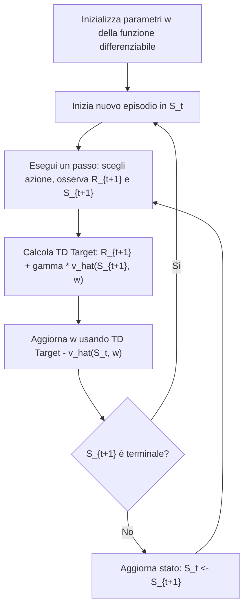
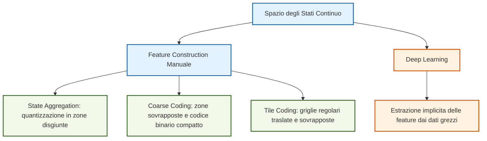

# Approssimazione della Funzione di Valore (Value Function Approximation) e Generalizzazione

## Overview Didattica

Questa lezione riprende e approfondisce il tema dell'**Approssimazione della Funzione di Valore (Value Function Approximation)** nell'ambito del Reinforcement Learning (RL), segnando il passaggio fondamentale dai metodi tabellari agli algoritmi capaci di operare su problemi su larga scala (*large-scale problems*).

I concetti principali introdotti sono:

* **Limiti dell'approccio tabellare:** Gestire le funzioni di valore $V(s)$ e $Q(s,a)$ tramite tabelle diventa impraticabile nei problemi reali, specialmente in presenza di uno **Spazio delle Azioni (Action Space)** continuo (es. decidere di quanto accelerare alla guida) o di uno **Spazio degli Stati (State Space)** molto vasto. I colli di bottiglia sono due:
  1. **Memoria:** Le tabelle diventano troppo grandi o addirittura infinite per essere memorizzate.
  2. **Efficienza campionaria:** Per ottenere una stima affidabile del valore atteso di ogni singola cella della tabella, sarebbe necessario raccogliere un numero enorme di esperienze per ciascuna coppia stato-azione.
* **L'idea dell'approssimazione funzionale:** Invece di consultare righe e colonne di una tabella, si modella $V$ o $Q$ attraverso una funzione parametrica che riceve in ingresso lo stato $S$ (o la coppia $S, A$) e restituisce un valore numerico stimato. Per rappresentare in modo compatto gli stati di un **Processo Decisionale di Markov (Markov Decision Process, MDP)** si ricorre alle **Caratteristiche (Features)** — ad esempio descrivendo una griglia $4 \times 4$ tramite due sole feature combinate linearmente con opportuni parametri.

> **Concetto Chiave — Generalizzazione (Generalization):**
> L'approssimazione funzionale non risolve soltanto un problema di scalabilità, ma introduce la capacità di **generalizzare**. Nei metodi tabellari (inclusi quelli con tracce di eleggibilità come $\text{TD}(\lambda)$), l'aggiornamento coinvolge esclusivamente gli stati effettivamente visitati lungo una traiettoria: il sistema si comporta come un semplice strumento di recupero informazioni (*information retrieval*) su ciò che ha già visto. Al contrario, in un modello parametrico la modifica di un solo parametro si riflette simultaneamente sulla stima dell'intera funzione di valore, permettendo di interpolare e stimare il valore anche di stati mai visitati in precedenza.

---

### Introduzione alla Value Function Approximation

Fino a questo punto abbiamo lavorato prevalentemente in contesti tabellari, ma per affrontare problemi reali su larga scala è necessario compiere un salto concettuale introducendo l'**Approssimazione della Funzione Valore (*Value Function Approximation*, VFA)**.

*(Nota organizzativa sul materiale: l'ordine con cui vengono presentati questi argomenti non segue esattamente la sequenza lineare del libro di testo; la trattazione attinge principalmente dal Capitolo 9, integrando però elementi dei Capitoli 10 e 11 e richiamando le Tracce di Eleggibilità (*Eligibility Traces*) del Capitolo 12.)*

---

### Perché superare l'approccio tabellare

Nell'Apprendimento per Rinforzo (*Reinforcement Learning*, RL) tabellare memorizziamo esplicitamente una stima per ogni stato nel vettore $V(s)$ oppure per ogni coppia stato-azione nella tabella $Q(s, a)$. Quando passiamo a problemi complessi del mondo reale, questo approccio crolla per due motivi fondamentali:

* **Limiti di memoria:** se lo spazio degli stati o delle azioni è enorme — o addirittura continuo, come decidere di quanto premere l'acceleratore alla guida di un'auto — il numero di celle diventa gestibile a fatica o idealmente infinito, rendendo impossibile memorizzare la tabella.
* **Limiti statistici e di campionamento:** anche potendo allocare la memoria, per ottenere una stima affidabile del valore atteso di ciascun elemento dovremmo visitare ogni singolo stato (o coppia stato-azione) un numero enorme di volte. L'approccio tabellare, quindi, non scala.

L'idea alla base della VFA è sostituire la tabella con una **funzione parametrica**: una "scatola" (modello) governata da un insieme di parametri $\mathbf{w}$ che riceve in ingresso gli stessi argomenti di prima — lo stato $S$ per $\hat{v}(S, \mathbf{w})$, oppure $(S, A)$ per $\hat{q}(S, A, \mathbf{w})$ — e restituisce direttamente un valore numerico stimato.

#### Il vero punto di forza: la Generalizzazione

Oltre a risolvere il problema della scalabilità, approssimare la funzione valore introduce una proprietà fondamentale in tutto il *Machine Learning*: la **Generalizzazione (*Generalization*)**.

> **Concetto Chiave — Generalizzazione vs Recupero d'Informazione:**
> Non vogliamo un sistema che si limiti a fare *information retrieval*, cioè a restituire esattamente ciò che ha già osservato in passato. Vogliamo un modello capace di interpolare e stimare il valore anche di stati mai visitati, sfruttando l'esperienza raccolta su stati vicini o simili.

Per capire la differenza rispetto al caso tabellare, consideriamo l'esempio di una semplice griglia (*Grid World*) $4 \times 4$ in cui la funzione valore reale ha un andamento lineare:
* Possiamo descrivere ogni stato in modo compatto usando solo due **Caratteristiche (*Features*)** (ad esempio le coordinate) e combinare queste due feature in una funzione lineare con due parametri.
* Nell'approccio tabellare (persino usando algoritmi come $TD(\lambda)$), ogni aggiornamento modificava esclusivamente i valori degli stati effettivamente incontrati lungo una traiettoria.
* Con un approssimatore parametrico, invece, **modificare anche un solo parametro cambia la stima su tutto lo spazio degli stati**. Se il modello è ben impostato, l'esperienza su pochi stati migliora automaticamente le predizioni anche sul resto dell'ambiente.

---

### Rappresentazione e scelta del modello approssimatore

Impostare un problema di Value Function Approximation significa trasformare la stima di $V$ o $Q$ in un problema simile all'**Apprendimento Supervisionato (*Supervised Learning*)**, in cui dato un input vogliamo predire un output numerico. Questo richiede due passaggi:

1. **Definire le feature dell'MDP (*Markov Decision Process*):** trovare dei descrittori compatti dello stato. In problemi semplici (come la griglia $4 \times 4$) è facile costruirle a mano; in problemi complessi si ricorre spesso a reti neurali capaci di estrarre implicitamente le feature dai dati grezzi.
2. **Scegliere la struttura della funzione approssimante:** nella pratica dell'RL ci si concentra soprattutto su due famiglie di modelli — **approcci lineari** e **Deep Learning** — per una ragione precisa: sono **differenziabili**.

#### Perché servono modelli differenziabili

La differenziabilità permette un apprendimento incrementale tramite **Discesa del Gradiente (*Gradient Descent*)** o **Discesa del Gradiente Stocastica (*Stochastic Gradient Descent*, SGD)**. Quando l'agente raccoglie nuova esperienza, non dobbiamo scartare il modello precedente e riaddestrare tutto da zero: calcoliamo l'errore commesso e spostiamo i parametri $\mathbf{w}$ nella direzione che riduce la funzione di costo.

#### Trade-off tra Approcci Lineari e Deep Learning

* **Modelli Lineari** (es. regressione lineare sulle feature):
  * *Vantaggi:* più semplici da studiare, interpretare e ottimizzare.
  * *Limiti:* se la vera funzione valore $v_\pi$ o $q_\pi$ ha un andamento fortemente non lineare, una combinazione lineare non potrà mai rappresentarla fedelmente.
* **Reti Neurali / Deep Learning**:
  * *Vantaggi:* sono **Approssimatori Universali (*Universal Approximators*)**, in grado di rappresentare funzioni arbitrarie e complesse con il grado di accuratezza desiderato.
  * *Limiti:* richiedono tipicamente molti più dati ed esperienza per essere addestrati in modo efficace.

```mermaid
flowchart LR
    accTitle: Flusso della Value Function Approximation
    accDescr: Schema concettuale del passaggio dallo stato alla stima del valore e dell'aggiornamento dei parametri tramite discesa del gradiente
    S["Stato S o coppia S, A"] --> F["Rappresentazione tramite Feature"]
    F --> M["Modello Differenziabile con parametri w"]
    M --> V["Stima del Valore v_hat(S, w)"]
    V --> C["Funzione di Costo VE(w) pesata da mu(s)"]
    C --> G["Aggiornamento parametri w via Gradient Descent"]
    G --> M
    style S fill:#e8f1f8,stroke:#2b6cb0,stroke-width:2px
    style M fill:#fef3c7,stroke:#d97706,stroke-width:2px
    style C fill:#fee2e2,stroke:#dc2626,stroke-width:2px
    style G fill:#dcfce7,stroke:#16a34a,stroke-width:2px
```

---

### L'Obiettivo di Predizione: Mean Squared Value Error

Poiché un approssimatore difficilmente sarà perfetto (ad esempio, quando cerchiamo di adattare una retta a punti che non giacciono su una retta), abbiamo bisogno di una metrica quantitativa — una funzione di costo — che misuri quanto la nostra stima si discosta dal valore reale e ci indichi in quale direzione aggiornare i parametri $\mathbf{w}$.

#### Il ruolo della ponderazione sugli stati

Nel Reinforcement Learning non tutti gli stati hanno la stessa importanza. Supponiamo di osservare che alcuni stati vengono visitati pochissimo (o mai) durante l'esecuzione del nostro agente, mentre altri stati vengono attraversati continuamente:
* Se il modello ha capacità limitata (come un modello lineare) e non può azzerare l'errore ovunque, è ragionevole **tollerare un errore più grande sugli stati rari o irrilevanti**, pur di essere molto precisi sugli stati visitati più spesso.

Per formalizzare questa priorità, pesiamo l'errore quadratico di ciascuno stato $s$ tramite una funzione di peso $\mu(s)$, ottenendo l'**Errore Quadratico Medio sul Valore (*Mean Squared Value Error*, $\overline{\text{VE}}$)**:

$$\overline{\text{VE}}(\mathbf{w}) = \sum_{s \in \mathcal{S}} \mu(s) \left[ v_\pi(s) - \hat{v}(s, \mathbf{w}) \right]^2$$

dove:
* $v_\pi(s)$ è il valore vero che vogliamo predire (equivalente all'etichetta target $Y$ nel supervised learning);
* $\hat{v}(s, \mathbf{w})$ è la predizione fornita dal nostro approssimatore parametrico;
* $\mu(s)$ rappresenta l'importanza (il peso) assegnata allo stato $s$.

#### Legame con la Policy nel caso On-Policy

> **Concetto Chiave — Dall'aspettativa teorica ai dati reali:**
> Nel caso *on-policy*, in cui valutiamo una politica $\pi$ raccogliendo esperienza proprio seguendo $\pi$, la funzione di peso $\mu(s)$ coincide naturalmente con la frequenza con cui la politica visita i diversi stati.

Possiamo quindi riscrivere l'obiettivo eliminando la funzione di peso esplicita $\mu(s)$ e inglobandola nel valore atteso sotto la politica $\pi$:

$$\overline{\text{VE}}(\mathbf{w}) = \mathbb{E}_\pi \left[ \left( v_\pi(S) - \hat{v}(S, \mathbf{w}) \right)^2 \right]$$

Anche se a prima vista questa formula con l'aspettativa $\mathbb{E}_\pi[\cdot]$ può sembrare più astratta, in pratica è estremamente vantaggiosa: proprio come abbiamo sempre fatto nel Reinforcement Learning, quando passiamo all'algoritmo pratico sostituiamo il valore atteso con i campioni reali generati eseguendo $\pi$. In questo modo, gli stati visitati più di frequente dalla politica compariranno più spesso nei dati e riceveranno automaticamente un peso maggiore nell'aggiornamento dei parametri $\mathbf{w}$.

---

### Ottimizzazione tramite Discesa del Gradiente Stocastica (SGD)

#### Principio di funzionamento: minimi locali e globali
Una volta definita la funzione obiettivo (objective function) da minimizzare rispetto ai parametri $\mathbf{w}$ della nostra funzione approssimante, il passo successivo consiste nell'ottimizzarla tramite **Discesa del Gradiente Stocastica (Stochastic Gradient Descent - SGD)**.

L'idea di base dell'algoritmo è la seguente:
* Invece di elaborare l'intero insieme di dati, si campiona un sottoinsieme (o singolo campione) dell'esperienza disponibile.
* Si calcola il **gradiente (gradient)** rispetto a tutti i parametri $\mathbf{w}$ che definiscono la funzione (sia essa lineare o non lineare, come una rete neurale).
* Il gradiente indica la direzione in cui, almeno localmente, ci si muove verso una riduzione della funzione di costo.

È fondamentale distinguere il comportamento della discesa a seconda della forma della funzione approssimante:
* **Caso lineare:** la superficie della funzione di costo è convessa, quindi **minimo locale e minimo globale coincidono**.
* **Caso non lineare (es. Reti Neurali - Neural Networks):** la funzione obiettivo può assumere forme complesse e irregolari. La SGD classica garantisce di muoversi dal punto corrente verso un **minimo locale**: questo rappresenta comunque un miglioramento rispetto alla situazione iniziale (a meno di non essere già bloccati in un minimo locale), ma non garantisce di raggiungere l'ottimo globale (a meno di comportamenti anomali, come passi di aggiornamento talmente elevati da far "saltare" fuori dalla valle corrente).

#### La regola di aggiornamento dei parametri
Nei metodi tabulari visti in precedenza — come Monte Carlo, TD(0) o TD($\lambda$) — raccogliere esperienza significava aggiornare direttamente una singola cella di una tabella o di un vettore ($V$ o $Q$). Con l'approssimazione della funzione valore (Value Function Approximation - VFA), il principio rimane identico (raccogliere dati per migliorare la stima), ma **non si aggiornano più le singole voci**, bensì i **parametri $\mathbf{w}$** della funzione.

Partendo dai parametri precedenti, si osserva la direzione indicata dal gradiente e ci si sposta in quella direzione di una quantità proporzionale all'errore commesso sul nuovo dato rispetto al valore reale, pesata per il **passo di apprendimento (step size / learning rate)** $\alpha$.

*(Nota: Passaggio integrato con chiarezza didattica)* Applicando la discesa del gradiente alla funzione di costo quadratica media tra il valore vero $v_\pi(S_t)$ e la stima $\hat{v}(S_t, \mathbf{w})$, si ottiene la regola di aggiornamento generale:

$$\mathbf{w} \leftarrow \mathbf{w} + \alpha \big[ v_\pi(S_t) - \hat{v}(S_t, \mathbf{w}) \big] \nabla_{\mathbf{w}} \hat{v}(S_t, \mathbf{w})$$

* **Ruolo di $\alpha$ e garanzie di convergenza:** il parametro $\alpha$ decide quanto è aggressivo ogni singolo passo verso il minimo. Anche introducendo l'approssimazione, esistono **garanzie matematiche di convergenza** al valore vero nel caso lineare, a patto di rispettare precise condizioni nella scelta e nella variazione temporale del passo $\alpha$ nel corso dei passi temporali (time steps).

#### Il caso lineare e il legame con i metodi tabulari
Nel caso specifico in cui l'approssimatore sia **lineare**, lo stato originale $s$ viene mappato in un vettore di **caratteristiche (features)** $\mathbf{x}(s)$ (ad esempio, le coordinate sull'asse orizzontale e verticale di una griglia), ottenendo una rappresentazione molto più compatta rispetto allo spazio degli stati originale. Ad esempio, una griglia di 9 stati può essere descritta in modo compatto usando solo 3 parametri ($w_0, w_1, w_2$).

In questo contesto, il gradiente della stima rispetto ai parametri coincide semplicemente con il vettore delle caratteristiche stesse ($\nabla_{\mathbf{w}} \hat{v}(S_t, \mathbf{w}) = \mathbf{x}(S_t)$), semplificando la regola di aggiornamento in:

$$\mathbf{w} \leftarrow \mathbf{w} + \alpha \big[ v_\pi(S_t) - \hat{v}(S_t, \mathbf{w}) \big] \mathbf{x}(S_t)$$

Questo approccio non è un concetto completamente slegato dal passato, ma una **generalizzazione dei metodi tabulari**: in uno scenario tabulare puro, infatti, esiste una corrispondenza uno-a-uno tra stati e caratteristiche (ogni stato è la propria feature, con la stessa dimensione dello spazio originale), per cui la notazione $\mathbf{x}(s)$ risulta superflua e si ricade esattamente nell'aggiornamento puntuale della singola voce.

---

### Il problema dell'oracolo e la formulazione dei Target

> **Concetto Chiave: Non possiamo "barare" come nel Supervised Learning**
> Fino a questo punto, la regola di aggiornamento è stata presentata esattamente come in un problema di **Apprendimento Supervisionato (Supervised Learning)** (come la regressione lineare o l'addestramento di una rete neurale), dove si dispone di dati storici contenenti il valore reale $y$ per calcolare l'errore.
> Tuttavia, nel Reinforcement Learning **nessun oracolo ci fornisce i veri valori $v_\pi$ o $q_\pi$**: stimarli è proprio lo scopo dell'intero processo di apprendimento!

Per superare questo ostacolo senza ricorrere a dati impossibili da avere, si sfrutta l'esperienza raccolta nel mondo reale per generare dei **target (bersagli)** che sostituiscano il valore sconosciuto $v_\pi(S_t)$. In questo modo si riesce a ricondurre il problema in un formato analogo a quello supervisionato, costruendo un dataset etichettato $\mathcal{D}$ (di cardinalità $D$) contenente coppie stato-target.

A seconda dell'algoritmo utilizzato, possiamo sostituire $v_\pi(S_t)$ nella regola di aggiornamento con:
* Il **ritorno reale Monte Carlo** $G_t$: non è l'esatto valore atteso, ma un campione reale raccolto dall'esperienza.
* Il **target TD(0)**: $R_{t+1} + \gamma \hat{v}(S_{t+1}, \mathbf{w})$.
* Il **ritorno $\lambda$ (lambda-return)**: $G_t^\lambda$.

---

### Metodo Monte Carlo con Value Function Approximation (VFA)

#### Struttura dell'algoritmo (Prediction)
Applicando quanto visto al problema di **predizione (prediction)** — in cui la politica $\pi$ è nota e fissata — il metodo Monte Carlo con VFA utilizza il ritorno $G_t$ come target per aggiornare l'intera funzione differenziabile $\hat{v}(s, \mathbf{w})$ (lineare o non lineare).

La struttura logica dell'algoritmo segue questi passaggi:
1. **Inizializzazione dei parametri:** si inizializzano i pesi $\mathbf{w}$. In presenza di conoscenza a priori sul dominio è sempre preferibile sfruttarla; in alternativa, si procede in modo casuale o arbitrario (nelle reti neurali esistono linee guida specifiche come l'inizializzazione *He* o *Xavier*).
2. **Ciclo sugli episodi:** per ciascun episodio, poiché si tratta di un approccio Monte Carlo, si genera e si attende la fine dell'**intero episodio** per poter osservare i ritorni reali.
3. **Raccolta dei dati e aggiornamento:** per ogni passo temporale $t$ dell'episodio (nella versione *every-visit*, cioè considerando ogni visita effettuata agli stati), si costruisce il punto dati associando allo stato visitato $S_t$ il rispettivo ritorno $G_t$ e si aggiornano i parametri $\mathbf{w}$ della funzione approssimante:

$$\mathbf{w} \leftarrow \mathbf{w} + \alpha \big[ G_t - \hat{v}(S_t, \mathbf{w}) \big] \nabla_{\mathbf{w}} \hat{v}(S_t, \mathbf{w})$$

*(Nota didattica: nello pseudocodice semplificato mostrato a lezione, il calcolo di $G_t$ è assunto direttamente disponibile a fine episodio senza esplicitare il calcolo efficiente all'indietro step-by-step).*

#### Proprietà teoriche e garanzie di convergenza
Spostandosi dal caso tabulare all'approssimazione di funzione, valgono le seguenti proprietà fondamentali per il metodo Monte Carlo:
* **Stimatore non distorto (Unbiased Estimator):** esattamente come nel caso tabulare, il ritorno $G_t$ rimane una stima non distorta del valore reale.
* **Convergenza lineare:** se $\hat{v}(s, \mathbf{w})$ è una funzione **lineare**, la predizione Monte Carlo converge all'**approssimazione ottima globale** di $v_\pi$.
* **Convergenza non lineare:** se l'approssimatore è **non lineare**, l'algoritmo garantisce la convergenza solo a un **ottimo locale** (pertanto non vi è certezza di aver trovato la migliore approssimazione possibile).

> **Concetto Chiave: Impatto pratico degli ottimi locali**
> Sebbene la mancata garanzia di ottimalità globale nel caso non lineare sia una proprietà importante da conoscere, nella pratica dei problemi di **controllo (control)** non rappresenta quasi mai un ostacolo bloccante: in tali scenari, infatti, l'agente non aspetta comunque di stimare alla perfezione $v_\pi$, ma agisce in modo *greedy* cambiando politica lungo il cammino per vedere se le prestazioni migliorano.

---

### Esempio pratico: Grid World 3x3 e capacità di generalizzazione

Per comprendere la differenza sostanziale tra approccio tabulare e VFA, consideriamo un semplice ambiente a griglia (**Grid World**) $3 \times 3$ deterministico:
* L'agente parte sempre dallo stesso stato e segue una politica fissa che lo porta al termine dell'episodio in 4 passi (ricevendo una ricompensa di $-1$ a passo, quindi un ritorno iniziale $G_0 = -4$).
* A causa della traiettoria deterministica, **4 stati su 9 della griglia non vengono mai visitati**, nemmeno ripetendo la simulazione per centinaia di episodi.
* Per applicare la VFA lineare, si definiscono due caratteristiche molto compatte basate sulle coordinate spaziali ($x$ e $y$), associando ai pesi $\mathbf{w}$ un passo $\alpha = 0.05$.

Il confronto tra i due paradigmi evidenzia una proprietà cruciale:
* **Approccio tabulare (anche con Eligibility Traces):** dopo 200 o 300 episodi, gli stati lungo la traiettoria convergono perfettamente, ma **gli stati mai visitati non vengono mai aggiornati**: l'agente non ha alcuna informazione su di essi.
* **Approccio VFA:** poiché l'aggiornamento agisce sui pesi globali $\mathbf{w}$ condivisi da tutto lo spazio degli stati, **già dal primo punto dati dell'episodio ($G_0 = -4$) si aggiorna la stima del valore per l'intera griglia**, inclusi i 4 stati mai visitati.

In questo esempio la VFA ottiene risultati eccellenti e molto vicini ai valori reali dell'ambiente anche sulle celle inesplorate. Tuttavia, è essenziale tenere a mente che questo successo dipende fortemente dalla **qualità delle caratteristiche scelte**: in questo problema semplice le coordinate $(x, y)$ descrivono molto bene la struttura dei valori, ma in problemi complessi progettare caratteristiche altrettanto efficaci non è affatto banale.

---

### Algoritmi Temporal Difference Semi-Gradiente: TD(0)

Riprendendo l'impostazione già vista per l'approssimazione della funzione di valore (*Value Function Approximation*), possiamo riutilizzare quasi tutta la struttura dell'approccio Monte Carlo e adattarla al contesto **Temporal Difference (TD)**, partendo dal caso più semplice: **TD(0) Semi-Gradiente (Semi-gradient TD(0))**.

*(Nota: il motivo per cui questi algoritmi prendono il nome di "semi-gradiente" verrà approfondito nel seguito del corso).*

#### Dal Ritorno Reale al TD Target

La differenza fondamentale rispetto a Monte Carlo riguarda il **target** utilizzato per calcolare l'errore di stima.

In TD(0) eseguiamo un aggiornamento ad ogni singolo passo temporale (*step-by-step*), senza attendere la conclusione dell'episodio. Di conseguenza, al passo $t$ non abbiamo a disposizione il ritorno reale $G_t$ raccolto fino alla fine della traiettoria. 

Per costruire comunque un segnale di errore, sostituiamo $G_t$ con la nostra migliore stima del ritorno disponibile dopo un solo passo: la ricompensa immediata $R_{t+1}$ sommata alla stima scontata del valore dello stato successivo $\hat{v}(S_{t+1}, \mathbf{w})$. Questa quantità è il **TD target**:

$$\text{TD Target} = R_{t+1} + \gamma \hat{v}(S_{t+1}, \mathbf{w})$$

> **Concetto Chiave:** In TD(0) con approssimazione di funzione, il ritorno reale $G_t$ di Monte Carlo viene sostituito dal TD target $R_{t+1} + \gamma \hat{v}(S_{t+1}, \mathbf{w})$, permettendo di aggiornare i parametri $\mathbf{w}$ passo dopo passo senza dover attendere la fine dell'episodio.

#### Struttura dell'Algoritmo e Regola di Aggiornamento

L'impostazione iniziale rimane identica a quella già vista in precedenza:
- Si sceglie una funzione di approssimazione differenziabile arbitraria $\hat{v}(s, \mathbf{w})$ per stimare il valore degli stati.
- Si inizializzano i parametri $\mathbf{w}$ della funzione (in modo opportuno, ad esempio a zero o con valori arbitrari).

La regola di aggiornamento agisce sempre sul vettore dei parametri $\mathbf{w}$, ma al posto di $G_t$ compare il TD target:

$$\mathbf{w} \leftarrow \mathbf{w} + \alpha \left[ R_{t+1} + \gamma \hat{v}(S_{t+1}, \mathbf{w}) - \hat{v}(S_t, \mathbf{w}) \right] \nabla \hat{v}(S_t, \mathbf{w})$$

dove $\alpha$ è il tasso di apprendimento (*step-size*) e $\nabla \hat{v}(S_t, \mathbf{w})$ è il gradiente della funzione approssimata rispetto ai parametri $\mathbf{w}$ valutato nello stato $S_t$.

Il meccanismo centrale avviene nel ciclo interno (*inner loop*) dell'algoritmo:
- Non si genera l'intera traiettoria dell'episodio all'esterno per poi eseguire i calcoli a posteriori.
- Per ciascun episodio, e per ogni singolo passo all'interno dell'episodio, l'agente compie un passo nell'ambiente, osserva $R_{t+1}$ e $S_{t+1}$, e aggiorna immediatamente i parametri $\mathbf{w}$ prima di passare allo step successivo.

#### Esempio sulla Griglia $3 \times 3$, Proprietà e Confronto con Monte Carlo

Riprendendo l'esempio della griglia $3 \times 3$ già analizzato in precedenza (con partenza dall'angolo in basso a destra lungo la stessa traiettoria):
- In Monte Carlo l'agente percorre l'intera traiettoria e aggiorna i pesi solo una volta terminato l'episodio.
- In TD(0) Semi-Gradiente l'agente percorre la stessa sequenza di stati, ma aggiorna il vettore dei parametri $\mathbf{w}$ passo dopo passo lungo il cammino.

Poiché l'aggiornamento si basa su una stima corrente $\hat{v}(S_{t+1}, \mathbf{w})$ anziché sul ritorno completo, stiamo effettuando **bootstrapping**. Questo mantiene esattamente il compromesso già visto nel caso tabulare:
- **Minore varianza (*lower variance*)**: il target dipende da un solo passo stocastico invece che dall'intera traiettoria futura.
- **Maggiore distorsione (*higher bias*)**: la stima iniziale può essere imprecisa perché si appoggia a un valore stimato e non al ritorno reale.

Nel confronto sperimentale osservato sulla griglia $3 \times 3$ dopo $300$ episodi, **TD(0)** raggiunge una stima perfetta dei valori, mentre **Monte Carlo** presenta ancora delle imprecisioni.

> **Concetto Chiave:** Sebbene nell'esempio visto TD(0) converga a una stima perfetta dopo $300$ episodi mentre Monte Carlo no — e sebbene tipicamente Monte Carlo con approssimazione di funzione di valore non sia la scelta più efficiente — questo risultato **non va generalizzato come proprietà universale**: le prestazioni relative dipendono sempre dallo specifico scenario sperimentale considerato.

---

### Confronto Iniziale e la Natura del Semi-Gradiente

Nell'analisi delle curve di apprendimento di un esempio pratico, si può notare come, dopo un singolo episodio, l'approccio **Monte Carlo (MC)** sembri convergere più velocemente rispetto ai metodi **Temporal Difference (TD)**. Tuttavia, è fondamentale non generalizzare questo comportamento: si tratta di un risultato specifico legato a quel particolare scenario e alla scelta del tasso di apprendimento $\alpha$. In altri contesti, le prestazioni relative possono invertirsi completamente.

#### Perché si parla di Semi-Gradiente (Semi-Gradient)

> **Concetto Chiave: Gradiente vs Semi-Gradiente**
> Quando applichiamo l'approssimazione di funzione ai metodi TD, non possiamo parlare di discesa del gradiente vera e propria, ma di **metodi semi-gradiente (semi-gradient methods)**. Questo accade perché il target utilizzato nell'aggiornamento dipende dagli stessi parametri $\mathbf{w}$ che stiamo cercando di ottimizzare.

Nella discesa del gradiente classica (come nell'apprendimento supervisionato o in Monte Carlo), confrontiamo la nostra funzione approssimata $\hat{v}(S_t, \mathbf{w})$ con un obiettivo (*target*) che proviene dai dati reali o da una stima indipendente dai pesi:
- Nel caso di **Monte Carlo**, il target è il ritorno osservato $G_t$. Anche se $G_t$ è una stima rumorosa del valore reale, **non dipende dai parametri $\mathbf{w}$**. Derivare l'errore quadratico rispetto a $\mathbf{w}$ produce quindi un gradiente esatto.
- Nei metodi con **bootstrapping** (come $\text{TD}(0)$, $N$-step TD o $\text{TD}(\lambda)$), invece, il target stesso contiene una stima basata sui pesi correnti $\mathbf{w}$ (ad esempio $R_{t+1} + \gamma \hat{v}(S_{t+1}, \mathbf{w})$).

Quando calcoliamo la derivata dell'errore rispetto a $\mathbf{w}$, trattiamo il target come se fosse fisso, ignorando la sua dipendenza da $\mathbf{w}$:

$$
\mathbf{w}_{t+1} = \mathbf{w}_t + \alpha \left[ U_t - \hat{v}(S_t, \mathbf{w}_t) \right] \nabla \hat{v}(S_t, \mathbf{w}_t)
$$

dove $U_t$ rappresenta il target (che nel caso TD dipende da $\mathbf{w}_t$). Calcolare il gradiente completo richiederebbe di disaccoppiare i parametri o includere la derivata del target stesso, rendendo l'algoritmo molto più complesso. L'approccio **semi-gradiente** rinuncia alla correttezza matematica formale del gradiente pieno in favore di una regola di aggiornamento semplice, computazionalmente leggera e sufficientemente efficace nella pratica.

---

### Estensione a $\text{TD}(\lambda)$ e $N$-step TD

Prima di passare dai problemi di predizione (Prediction) a quelli di controllo (Control), è possibile estendere l'approssimazione di funzione anche ai metodi multi-passo già visti nel caso tabulare. Anche in questi casi, poiché sfruttiamo il *bootstrapping*, lavoreremo con algoritmi **semi-gradiente**.

#### $\text{TD}(\lambda)$ con Approssimazione di Funzione

Come visto in precedenza, in pratica si utilizza quasi esclusivamente la visione *backward* di $\text{TD}(\lambda)$, perché è molto più semplice ed efficiente da implementare online.

Per adattare $\text{TD}(0)$ con approssimazione di funzione a $\text{TD}(\lambda)$ dobbiamo introdurre due elementi fondamentali:
1. Il parametro di decadimento $\lambda$.
2. Le **tracce di eleggibilità (Eligibility Traces)**, che fungono da meccanismo di memoria ("una lunga ombra") sugli stati visitati fino a quel momento.

A livello operativo, ad ogni passo temporale:
- Non ci limitiamo ad aggiornare i pesi sulla base del solo stato appena visitato.
- Utilizziamo il target $\lambda$ (o l'errore TD compatto $\delta_t$) e sfruttiamo la traccia di eleggibilità per distribuire il credito della nuova ricompensa su **tutti gli stati visitati in passato** che hanno una traccia non nulla.
- Ogni stato visitato in precedenza diventa così un campione di addestramento (*data sample*) pesato dal valore della sua traccia di eleggibilità per aggiornare i parametri $\mathbf{w}$.

*Nota sull'ordine degli aggiornamenti*: in uno pseudocodice classico si tende ad aggiornare i campioni seguendo l'ordine cronologico della traiettoria (primo stato, secondo stato, ecc.). In realtà, trattandosi di una discesa del gradiente su più punti dati, questo ordine non è strettamente obbligatorio: ciascun campione fornisce una spinta in una certa direzione e, in media, la sequenza degli aggiornamenti converge comunque verso la stessa soluzione.

#### $N$-step TD con Approssimazione di Funzione

Estendere l'approccio semi-gradiente a **$N$-step TD** mantiene purtroppo tutte le complessità logiche e di implementazione già incontrate nella versione tabulare:
- Bisogna gestire il ritardo temporale di $n$ passi, verificando a ogni istante se sono stati compiuti abbastanza passi per poter aggiornare lo stato visitato al tempo $\tau = t - n + 1$.
- Quando ci si avvicina alla fine dell'episodio, occorre gestire il troncamento sostituendo le stime mancanti con il ritorno reale fino alla terminazione.

L'unica vera differenza rispetto al caso tabulare sta nella regola di aggiornamento finale al tempo $\tau$: al posto dell'aggiornamento diretto della tabella $V(S_\tau)$, si aggiorna il vettore dei parametri $\mathbf{w}$ usando il ritorno $N$-step $G_{\tau:\tau+n}$ come target semi-gradiente.

#### Confronto Empirico e Garanzie di Convergenza

Osservando i grafici dell'errore quadratico medio (Root Mean Square Error, RMSE) rispetto alla funzione valore reale, i comportamenti specifici dipendono fortemente dal problema e dalla taratura dei parametri (es. in alcuni esempi specifici Monte Carlo parte più rapido e $\text{TD}(0)$ finisce per battere persino $\text{TD}(\lambda)$). Per orientarsi in modo rigoroso, è invece utile tenere presenti le garanzie teoriche di convergenza.

> **Concetto Chiave: Garanzie di Convergenza nell'Approssimazione di Funzione**
> La solidità teorica degli algoritmi di predizione dipende strettamente dal tipo di approssimatore scelto:
> - **Approssimazione Lineare (Linear Function Approximation)**: garantisce la convergenza all'ottimo globale (nel caso Monte Carlo) o a un intorno limitato dell'ottimo globale (nei metodi TD semi-gradiente).
> - **Approssimazione Non Lineare (Non-Linear Function Approximation)**: le garanzie di convergenza decadono quasi completamente. Solo Monte Carlo assicura il raggiungimento di un ottimo locale; per i metodi TD non ci sono garanzie formali di convergenza.

Nonostante l'assenza di garanzie matematiche per gli approssimatori non lineari (come le reti neurali), nella pratica ingegneristica questi metodi vengono comunque ampiamente utilizzati perché offrono prestazioni superiori su problemi complessi.

---

### Progettazione delle Feature (Feature Construction)

Uno dei punti più critici e delicati dell'intero impianto teorico visto finora è la **scelta delle feature (caratteristiche)**. Gli algoritmi di aggiornamento assumono che esista già una rappresentazione efficace dello stato $\mathbf{x}(S)$, ma nella realtà progettare buone feature è un problema complesso e determinante per il successo dell'apprendimento.

La necessità di costruire feature nasce soprattutto quando lo spazio degli stati (e/o delle azioni) è **continuo** o ha **dimensionalità infinita/molto elevata** (si pensi alla posizione continua lungo una traiettoria, all'angolo di sterzata o all'accelerazione di un veicolo).

Di seguito sono illustrati i tre principali approcci classici per generare feature da spazi continui, più l'alternativa basata sul Deep Learning.

#### 1. Aggregazione degli Stati (State Aggregation)

È la forma più semplice di quantizzazione (Quantization) dello spazio continuo. Consiste nel suddividere lo spazio in intervalli o partizioni disgiunte e raggruppare tutti gli stati che ricadono in una stessa regione sotto un unico stato rappresentativo:
- *Esempio 1D*: tutti i valori continui compresi tra $400$ e $600$ vengono mappati sull'unico valore aggregato $500$.
- *Esempio 2D*: dividere un campo da calcio o una piscina in un certo numero di zone (non necessariamente uniformi per forma o dimensione) per localizzare un robot o un agente.

Si perde inevitabilmente precisione (informazione fine), ma si trasforma uno spazio infinito in un insieme finito e trattabile. Dal punto di vista della codifica, equivale a un **One-Hot Encoding**: il vettore delle feature ha tanti elementi quante sono le zone, con un solo $1$ in corrispondenza della zona attiva e $0$ altrove.

#### 2. Coarse Coding

Il **Coarse Coding** supera i limiti di compattezza dell'aggregazione semplice utilizzando **zone che si sovrappongono** (ad esempio, cerchi sparsi nello spazio degli stati).

- Ogni zona corrisponde a una feature binaria: vale $1$ se lo stato corrente si trova all'interno della zona, $0$ se si trova all'esterno.
- Poiché le zone si intersecano, uno stato può attivare contemporaneamente più feature, generando una firma binaria più ricca (ad esempio `11001`).

**Vantaggio**: invece di avere un solo $1$ come nello *state aggregation*, la combinazione di più attivazioni permette di descrivere un numero molto maggiore di partizioni distinte nello spazio a parità di numero di feature, risultando in una rappresentazione molto più compatta ed espressiva.

#### 3. Tile Coding

Il **Tile Coding** è un approccio meno libero del *coarse coding*, ma molto più strutturato e ampiamente utilizzato nella pratica.

- Lo spazio continuo viene coperto interamente da una griglia uniforme di rettangoli o tasselli (*tiles*), senza lasciare zone scoperte ("buchi").
- Invece di usare una sola griglia, si sovrappongono **più griglie identiche (*tilings*) leggermente traslate (*shifted*)** l'una rispetto all'altra.

In questo modo, ogni punto nello spazio attiva esattamente un tassello per ogni griglia sovrapposta. Due punti vicini ma distinti possono cadere nello stesso tassello della prima griglia, ma in tasselli diversi della seconda griglia (generando codici differenti, es. `11` contro `10`), garantendo al contempo buona risoluzione spaziale e capacità di generalizzazione.

*Confronto prestazionale*: disponendo di un numero sufficiente di feature e di abbastanza dati/tempo di addestramento, sia il *coarse coding* sia il *tile coding* convergono verso prestazioni simili. Tuttavia, nelle fasi iniziali dell'apprendimento, entrambi offrono un'approssimazione nettamente migliore rispetto a una partizione singola non sovrapposta.

#### Il Ruolo del Deep Learning

Sebbene tecniche come il *tile coding* funzionino molto bene in moltissimi scenari, richiedono comunque una progettazione manuale delle feature. L'enorme punto di forza delle architetture di **Deep Learning** (reti neurali profonde) non risiede soltanto nella capacità di modellare funzioni altamente non lineari, ma soprattutto nella capacità di **derivare le feature in modo implicito** direttamente dai dati grezzi (*raw data*).

Questo elimina gran parte della complessità legata al *feature engineering* manuale, al prezzo però di richiedere volumi di dati sensibilmente maggiori e una gestione più complessa dell'addestramento.

---

### Prossimi Passi

Conclusa la trattazione dei metodi di predizione con approssimazione di funzione, la lezione successiva affronterà due temi centrali per completare il quadro:
- L'estensione di questi metodi al problema del **Controllo (Control)** per ottimizzare la *policy*.
- L'introduzione dei **Metodi Batch (Batch Methods)** per eseguire gli aggiornamenti in blocco sui dati raccolti.

---

> [!NOTE]
> ### Note per l'Esame e Avvisi del Docente
> - **Materiale d'esame:** Il docente ribadisce che **le slide rappresentano il materiale d'esame** (*"the slides are the exam material"*), mentre il libro di testo serve unicamente per approfondire o vedere approcci alternativi (da questa lezione in avanti il parallelismo tra slide e capitoli del libro — in particolare capitoli 9, 10, 11 e 12 — risulta meno diretto).
> - **Lezioni registrate su Deep Learning e progetto:** Le due lezioni registrate l'anno precedente sul Deep Learning non sono obbligatorie, ma sono consigliate come ripasso o punto di partenza per chi non ha mai seguito un corso sul tema, risultando particolarmente utili qualora si intenda realizzare un progetto più avanti nel corso.
> - **Richieste sullo pseudocodice (calcolo del ritorno $G$ in Monte Carlo):** Rispondendo a una domanda sullo pseudocodice semplificato mostrato a lezione, il docente precisa che la versione estesa (con calcolo all'indietro di $G$) è apprezzata; qualora venga richiesto esplicitamente di scrivere l'algoritmo *"in modo efficiente"*, la versione semplificata non è sufficiente, mentre se tale specifica non è indicata nella traccia, la versione efficiente non sarà richiesta.
> - **Derivazione di TD($\lambda$) con Value Function Approximation:** Sebbene lo pseudocodice completo per TD($\lambda$) con approssimazione della funzione valore non sia riportato nelle slide, il docente avvisa che potrebbe chiederlo (*"I may ask you that"*, *"it's requested"*), poiché gli studenti hanno già tutti gli elementi necessari per ricavarlo a partire da quanto visto in precedenza.