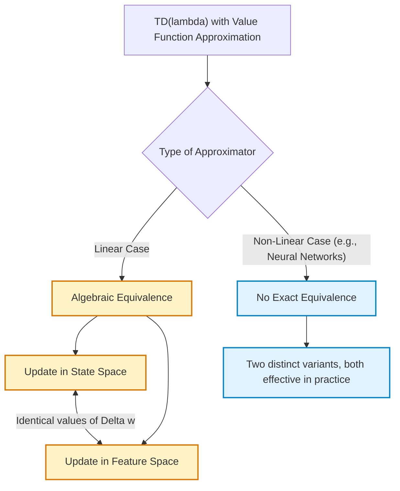
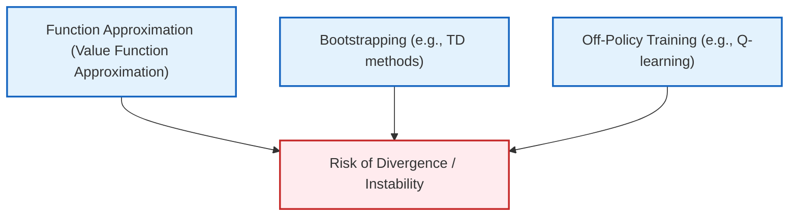
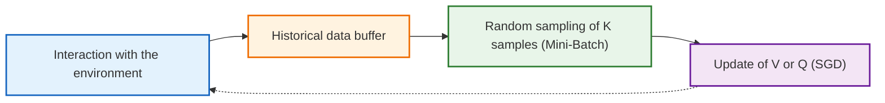

# Value Function Approximation, Feature Extraction, and Vector Notation for $TD(\lambda)$

## Instructional Overview

The lecture explores **Value Function Approximation**, laying the necessary groundwork before the upcoming transition to **Policy-Based Approaches**. After a brief organizational clarification regarding some initial technical issues and the absence of a recording for the session, the instructor picks up where the previous lecture left off to align the theoretical treatment with the notation used in the reference textbook.

The main concepts covered in this first part include:

* **Approximation Objective and Surrogate Targets:** The goal is to find the optimal parameters to obtain a reliable estimate of the state-action value function $Q$ (and the state value function $V$), which is essential for deriving a good **Policy**. Although operating in a setting similar to **Supervised Learning**, we do not have an oracle providing the true values of $V$ and $Q$ along the trajectory; therefore, we resort to surrogate estimates based on **Returns**, $TD$ returns, or $TD(\lambda)$ returns. Furthermore, the importance of implementing the algorithms for computing the $G$ return in their computationally efficient version is reiterated.
* **Feature Extraction and Compact Representation:** To handle continuous or very large spaces of states $\mathcal{S}$ and actions $\mathcal{A}$, compact representations must be adopted. Three fundamental techniques are recalled and compared:
  * **State Aggregation:** groups continuous values into discrete subsets.
  * **Coarse Coding** and **Tile Coding:** prove superior to state aggregation when few samples or few *features* are available.
  * **Design Trade-off:** *Coarse Coding* offers greater flexibility (allowing domain knowledge to be leveraged by concentrating *features* in critical regions of the state space), but lacks structure; conversely, *Tile Coding* represents the structured standard when detailed prior knowledge of the problem is unavailable.
* **Connection to the Textbook on $TD(\lambda)$:** To clarify the concise presentation in the reference text, the discussion temporarily returns to the standard **Temporal Difference $\lambda$ ($\lambda$ - $TD(\lambda)$)** algorithm without function approximation. In particular, the equivalence between the explicit per-state update $s \in \mathcal{S}$ and **vector notation** is introduced, highlighting how **Eligibility Traces** — used to solve the **Credit Assignment Problem** — automatically zero out the update for states never visited in the trajectory.

---

### 1. Framing and Review of Feature Extraction

Before diving into $\text{TD}(\lambda)$ prediction with function approximation, it is helpful to clarify a methodological point that emerged from the previous lecture: in the version shown on the slides, the computation of the $G$ return was not implemented efficiently (it was computed following the forward order instead of the optimized form). At the implementation level, unless the naive version is explicitly requested, it is always good practice to adopt the efficient formulation seen previously.

In the upcoming modules, we will face a true paradigm shift by moving to **Policy-Based Approaches**, which will introduce a discontinuity compared to the value-based methods seen so far. However, many of the tools we are building now — in particular parameterization and compact state representation — will be widely reused.

#### Objectives of Value Function Approximation (VFA)

In the context of **Value Function Approximation (VFA)**, our objective coincides with the typical Machine Learning setup: finding the best parameters (which we denote by a vector $\mathbf{w}$) using data collected from experience. If we obtain a good parametric estimate of $V(s)$ or $Q(s,a)$, we can indeed derive a good policy and solve the Reinforcement Learning problem.

To frame this process as a supervised-like learning problem, we need two ingredients:
* **A prediction objective**: in addition to the intrinsic goal of RL (maximizing expected return), we introduce an auxiliary objective aimed at minimizing the error between the approximated function and the true value.
* **Reference data (targets)**: unlike classical Supervised Learning, we neither have a historical dataset nor an oracle providing us with the true values $v_\pi(s)$ or $q_\pi(s,a)$. As already done in tabular methods, we circumvent the problem by using sample estimates in their place: full returns (Monte Carlo), the one-step TD target, or the $\text{TD}(\lambda)$ return.

#### Feature Extraction: Aggregation, Coarse Coding, and Tile Coding

To scale these algorithms to very large or continuous state spaces $\mathcal{S}$ and action spaces $\mathcal{A}$, we must build a more compact representation through a **Feature Extraction** process, transforming the state $s$ into a feature vector $\mathbf{x}(s)$ (or $\mathbf{x}(s,a)$).

We have three main approaches, which exhibit distinct behaviors and trade-offs:
* **State Aggregation**: consists of grouping continuous intervals of values of $S$ (and $A$) into a finite set of discrete subsets (clusters).
* **Coarse Coding**: encodes the state through a set of overlapping regions (binary features) with reduced dimensionality.
* **Tile Coding**: partitions the space into overlapping offset grids (tiles), providing a sparse and systematic encoding.

Comparing the three techniques reveals a clear practical trade-off:
* **Amount of data**: if we have a very large number of samples, all three approaches manage to adequately represent the problem. On the other hand, when we have little data or few features available, Coarse Coding and Tile Coding offer significantly superior performance compared to simple State Aggregation.
* **Trade-off between Coarse Coding and Tile Coding**:
  * **Coarse Coding** is very flexible and allows leveraging **Domain Knowledge**. If we know that in a certain region of the space small changes produce significant effects, we can concentrate many small, detailed features there, while leaving broader features in less critical areas. The drawback is the lack of a predefined systematic structure.
  * **Tile Coding**, on the contrary, gives up this manual flexibility in favor of a highly structured approach. For this reason, it is often adopted as the standard choice when one does not have deep knowledge of the problem domain.

---

### 2. $\text{TD}(\lambda)$ Prediction with Value Function Approximation

In the reference textbook (Sutton & Barto), the presentation of $\text{TD}(\lambda)$ in the case with Value Function Approximation is rather compact and can cause confusion compared to the intuition developed in the tabular case. Let us analyze the connection between the two formulations step by step.

#### From the Tabular Case to Vector Notation

In classic tabular $\text{TD}(\lambda)$ (without function approximation), at each time step we collect a reward and, thanks to **Eligibility Traces** — which serve to solve the **Credit Assignment Problem** — we propagate the error signal to all previously visited states along the trajectory.

Conceptually, the algorithm involves a loop over all states $\forall s \in \mathcal{S}$:
* Recently visited states have a trace $E(s) > 0$ and receive an update proportional to their trace.
* States never visited in the episode have $E(s) = 0$: their update is zero (and the trace remains $0 \times \gamma\lambda = 0$). Therefore, iterating over all of $\mathcal{S}$ or iterating only over the states in the trajectory is exactly equivalent.

For compactness, the reference textbook eliminates the explicit loop $\forall s \in \mathcal{S}$ by introducing **vector notation**: the values of all states are collected into a vector $\mathbf{V}$ and the eligibility traces into a vector $\mathbf{E}$ (in bold). The loop thus remains implicit in the vector operations on $\mathbf{V}$ and $\mathbf{E}$.

#### Update in State Space vs Feature Space

When we move to Value Function Approximation, a subtle yet fundamental change occurs. In the VFA case, in fact, the textbook continues to use compact vector notation, but moves the eligibility traces from the **State Space** to the **Feature Space**.

Let us clarify the difference by focusing on the **linear case**, in which the value function is expressed as a linear combination of the state features:

$$\hat{v}(s, \mathbf{w}) = \mathbf{w}^T \mathbf{x}(s)$$

* **State-space approach** (direct extension of the tabular case): at each step we accumulate the eligibility traces for each state visited in the trajectory and update the parameter vector $\mathbf{w}$ by applying the gradient of each state weighted by its respective trace.
* **Feature-space approach** (textbook formulation): instead of maintaining a separate trace for each state $s \in \mathcal{S}$ (which is impractical in continuous or enormous spaces), a single eligibility trace vector $\mathbf{z}$ (or $\mathbf{e}$) is maintained, having the same dimension as the parameter vector $\mathbf{w}$ and the feature vector $\mathbf{x}(s)$.

> **Note: Step integrated for pedagogical clarity**  
> To make explicit the algebraic equivalence mentioned verbally on the slides in the linear case, recall that for $\hat{v}(s, \mathbf{w}) = \mathbf{w}^T \mathbf{x}(s)$ the gradient with respect to the parameters is simply the feature vector:
> $$\nabla_{\mathbf{w}} \hat{v}(s, \mathbf{w}) = \mathbf{x}(s)$$
> If we express the sum of past updates weighted by the decay $(\gamma \lambda)^{t-k}$ over the visited states $S_k$, we obtain:
> $$\sum_{k=0}^{t} (\gamma \lambda)^{t-k} \nabla_{\mathbf{w}} \hat{v}(S_k, \mathbf{w}) = \sum_{k=0}^{t} (\gamma \lambda)^{t-k} \mathbf{x}(S_k)$$
> Rewriting this summation in recursive form, we define the trace vector in feature space at time $t$ as:
> $$\mathbf{z}_t = \gamma \lambda \mathbf{z}_{t-1} + \mathbf{x}(S_t)$$
> where $\mathbf{x}(S_t)$ represents the feature encoding of the last state visited at step $t$.

#### Equivalence in the Linear Case and Non-Linear Behavior

The result derived above leads to a crucial distinction for understanding the algorithm:

> **Key Concept: Equivalence in the linear vs. non-linear case**  
> * **In the linear case**, the per-state trace-based update and the direct update in the feature space (proposed by the textbook) are **mathematically equivalent**: they produce the exact same parameter changes $\Delta \mathbf{w}$.  
> * **In the non-linear case** (for instance, with neural networks and Deep Learning approaches), this equivalence **no longer holds**, because the gradient $\nabla_{\mathbf{w}} \hat{v}(s, \mathbf{w})$ depends on the current parameters $\mathbf{w}$ and is no longer a simple constant $\mathbf{x}(s)$. The two schemes give rise to distinct algorithms (not equivalent, though similar), yet both work properly in practice.

#### The Semi-Gradient $\text{TD}(\lambda)$ Algorithm and the $2 \times 2$ Grid Example

In its operational form (semi-gradient $\text{TD}(\lambda)$ for prediction), the algorithm requires a differentiable function $\hat{v}(s, \mathbf{w})$ with parameters $\mathbf{w}$ initialized arbitrarily (for example to zero, randomly, or using prior knowledge).

In each episode, one proceeds as follows:
1. Initialize the state $S$ and reset the eligibility trace vector $\mathbf{z} = \mathbf{0}$ to zero (having the same dimension as $\mathbf{w}$).
2. For each step until termination:
   * Execute the action according to the policy $\pi$, observing the reward $R$ and the next state $S'$.
   * Compute the TD error:
     $$\delta \leftarrow R + \gamma \hat{v}(S', \mathbf{w}) - \hat{v}(S, \mathbf{w})$$
     *(Note: if $S'$ is terminal, $\hat{v}(S', \mathbf{w}) = 0$).*
   * Update the trace vector directly in the parameter/feature space:
     $$\mathbf{z} \leftarrow \gamma \lambda \mathbf{z} + \nabla_{\mathbf{w}} \hat{v}(S, \mathbf{w})$$
     *(In the linear case, the gradient is simply $\mathbf{x}(S)$).*
   * Update the weights:
     $$\mathbf{w} \leftarrow \mathbf{w} + \alpha \delta \mathbf{z}$$
   * Set $S \leftarrow S'$.

**Conceptual Example ($2 \times 2$ Gridworld)**  
To concretely verify the equivalence in the linear case, consider a small $2 \times 2$ grid whose states are encoded with binary feature vectors, for example $(1,0)$, $(1,1)$, $(0,1)$, and $(0,0)$. Imagine a trajectory passing through the states $A \to B \to C \to \text{Terminale}$:
* Each intermediate step yields a reward $0$, while reaching the terminal state yields a reward $+1$.
* Set a trace decay factor equal to $0.5$ ($\gamma \lambda = 0.5$).
* If we compute the traces per individual state (incrementing by $+1$ the trace of the newly visited state and letting those of previously visited, un-revisited states decay by $0.5$) and sum the contributions to the weights, we obtain the exact same increments $\Delta \mathbf{w}$ as those obtained by directly updating the vector $\mathbf{z}$ in the feature space — with the advantage that updating in the feature space is computationally more direct and compact.

**Final practical remarks**:
* **Immediate generalization**: the great advantage of Value Function Approximation emerges already after a single update. Since states share the parameters $\mathbf{w}$ through the features, the update performed on a trajectory immediately modifies the value estimate of states never visited before as well.
* **Cost vs. Effectiveness**: compared to semi-gradient $\text{TD}(0)$, the per-step update in $\text{TD}(\lambda)$ entails a slightly higher complexity due to maintaining and updating the trace vector $\mathbf{z}$, but in practice it is typically much more effective at propagating information across episodes.

---

### From the Prediction Problem to Control with Approximation

After seeing how to solve the **Prediction** problem — namely estimating the state-value function $V(s)$ via Monte Carlo (MC), $\text{TD}(0)$, and $\text{TD}(\lambda)$ — we can finally address the **Control** problem.

The general setup does not change: we continue using the same frameworks already studied, but we shift our focus from the function $V$ to the **Action-Value Function** $Q(S, A)$. The underlying idea is always the same: if we can obtain an increasingly better estimate of $Q$, we can act *greedily* with respect to what we have learned and thus aim to reach the optimal value function $Q^*$.

Even with **Value Function Approximation (VFA)**, the update mechanism remains tied to the same objective function seen for prediction (based on data collected following the policy $\pi$) and proceeds incrementally.

#### The Linear Case for $Q$

In the linear approximation case, we estimate the value of a state-action pair as a linear combination of a feature vector:

$$\hat{q}(S, A, \mathbf{w}) = \mathbf{x}(S, A)^T \mathbf{w}$$

The key novelty compared to estimating $V$ is that now the features $\mathbf{x}(S, A)$ no longer describe only the state $S$, but depend jointly on the state $S$ and the action $A$:
* This is a natural generalization of the previous case.
* Even if there were special cases in which some features remain invariant with respect to the action, it is still essential to represent the action $A$ inside $\hat{q}$, precisely because in control we must be able to compare actions and maximize with respect to $A$.

As in the tabular cases, to solve control we must still continue solving the prediction problem under the hood using the same known frameworks (MC, $\text{TD}(0)$, and $\text{TD}(\lambda)$ — omitting $n$-step TD for simplicity, as it is less used in practice), computing the change $\Delta \mathbf{w}$ needed to update the parameters of our approximated function.

---

### On-Policy Control: SARSA with Value Function Approximation

Just as in the tabular case, control can be formulated in several algorithmic variants: SARSA, Q-learning, Expected SARSA, and their respective extensions $\text{SARSA}(\lambda)$, $\text{Q-learning}(\lambda)$, and $\text{Expected SARSA}(\lambda)$. For clarity and pedagogical continuity, we focus our analysis on the **SARSA** (*on-policy*) algorithm.

#### $\text{TD}(0)$ Version and Initialization

The SARSA algorithm with value function approximation combines the classic structure of SARSA with the parametric update on the weights $\mathbf{w}$:

* **Differentiability requirement:** in the initialization phase, it is necessary to choose an approximated function $\hat{q}(S, A, \mathbf{w})$ that is **differentiable** with respect to the parameters $\mathbf{w}$. In textbooks this detail is sometimes omitted to focus on the novelties of the algorithm, but it is a fundamental requirement for applying gradient-based updates.
* **Integration of previous techniques:** introducing VFA does not erase the techniques seen earlier. For example, it is still possible to use **Optimistic Initialization** to encourage exploration: in the linear case, it suffices to initialize the weights $\mathbf{w}$ to sufficiently high values (at least in absolute value) so as to obtain high initial estimates of $\hat{q}$.
* **Update on the parameters $\mathbf{w}$:** in the loop over episodes and time steps, the update no longer acts directly on the cells of a table $Q$, but modifies the vector $\mathbf{w}$ via $\Delta \mathbf{w}$. By changing $\mathbf{w}$, we consequently modify the function $\hat{q}$ itself.
* **On-Policy Flow:** the classic $(S, A, R, S', A')$ order is preserved exactly:
  1. If the next state $S'$ is **terminal**, the final update is performed and the episode ends (no next action $A'$ is chosen and the loop is not re-entered).
  2. If $S'$ is not terminal, the action $A'$ is selected first (already committing to execute it according to the current policy), and then $\mathbf{w}$ is updated using $\hat{q}(S', A', \mathbf{w})$.

#### Extension to $\text{TD}(\lambda)$ and Eligibility Traces

By combining SARSA with the $\text{TD}(\lambda)$ framework and VFA, we obtain $\text{SARSA}(\lambda)$ with value function approximation. Here too, the agent selects and commits to $A'$ before the update, while temporal credit is propagated backward via **eligibility traces**.

In the linear case, the gradient of the approximated function with respect to $\mathbf{w}$ simply coincides with the *feature* vector $\mathbf{x}(S, A)$, which therefore feeds into the trace vector at each step.

> **Key Concept — Types of Eligibility Traces:**
> There are three main ways to update eligibility traces (it is essential to understand their mechanism well for possible numerical calculations):
> 1. **Accumulating Traces:** these represent the standard choice; at each visit to a state (or state-action pair / *feature* activation), the contribution is added to the current trace value.
> 2. **Replacing Traces:** instead of summing at each new visit, the trace value is saturated by imposing an upper bound equal to $1$.
> 3. **Dutch Traces:** a third intermediate variant used in combination with linear approximation (mentioned for completeness alongside the other two).

---

### Practical Example: The Mountain Car Problem

A famous case study in Reinforcement Learning for understanding the advantages of VFA in control is the **Mountain Car** problem.

* **Problem description:** a car is at the bottom of a valley and must reach a flag placed at the top of a hill. The car's engine does not have enough power to climb straight up to the summit; to succeed, the agent must learn to drive backward up the opposite slope first, swing back and forth to build up **momentum**, and use that thrust to get over the climb.
* **State space formalization:** observing a single instant of the system, the state is characterized by two fundamental physical quantities:
  1. **Position** along the horizontal axis;
  2. **Velocity**, defined both in absolute value and in sign (positive or negative depending on the direction of motion).

#### Why Value Function Approximation Is Needed

Both position and velocity take **continuous values**: therefore, there are infinitely many possible states (and potentially complex or continuous action spaces).
* Without value function approximation, solving this problem would be extremely cumbersome and slow: one would have to manually discretize the space by grouping together a huge number of states and collect an enormous amount of experiments.
* With VFA, instead, we leverage **generalization**: even by observing just a few data points, updating the weights $\mathbf{w}$ modifies the estimate of $\hat{q}$ even for neighboring states that have never been visited before. In this way, the algorithm manages to learn a rather complex shape for the value function in about $9.000$ episodes (a modest number, when compared to simpler tabular problems such as Blackjack).

#### Choice of $\lambda$ and Impact of Traces

Applying $\text{TD}(\lambda)$ to Mountain Car yields two important experimental observations:
1. **Trade-off on $\lambda$:** by varying the hyperparameter $\lambda$, one identifies the classic intermediate optimal point (*sweet spot*), just as happens during hyperparameter *tuning* in other Machine Learning contexts (for example, in Lasso regression).
2. **Difference between Accumulating and Replacing Traces:** in this specific scenario, the choice of how to implement eligibility traces (*accumulating* versus *replacing*) produces a very marked difference in performance. There is no universal rule stating that one is always superior to the other in every problem, yet this example demonstrates how even small algorithmic design details can have a decisive impact on the results.

---

### Off-Policy Control and the "Deadly Triad"

So far we have focused on the *on-policy* case (SARSA), but in principle it is also possible to apply value function approximation to **off-policy** algorithms, first and foremost **Q-learning**.

However, great care must be taken regarding what happens when multiple levels of approximation are stacked together. In Q-learning with VFA, in fact, we update an approximate estimate of $Q$ using another previous estimate, while referring to a target policy (*greedy*) different from the policy we used to collect the data.

> **Key Concept — The Deadly Triad:**
> In the literature, the **Deadly Triad** is defined as the simultaneous combination of three elements within the same learning algorithm:
> 1. **Function Approximation:** we do not know the true values of $V$ or $Q$, but instead use an approximate parametric representation.
> 2. **Bootstrapping:** we update an estimate based on other estimates (as in TD methods), rather than waiting for the full return of the episode.
> 3. **Off-Policy Training:** we update the value function of a target policy using transitions generated by a different behavior policy.
>
> When these three factors are combined together, the algorithm loses its guaranteed stability and **can diverge drastically** instead of converging.

#### Convergence Guarantees and Practical Implications

* **Loss of theoretical guarantees:** while in the tabular methods seen earlier it was possible to prove convergence, introducing VFA changes the situation. With *on-policy* linear approximation, guarantees close to convergence and optimality are still maintained; however, as soon as **off-policy** learning or **non-linear** approximators (such as neural networks in Deep Learning approaches) are introduced, **there is no longer any theoretical guarantee of convergence**. Indeed, there exist small ad hoc MDPs (similar in structure to small graphs with a few particular transitions) in which the parameters literally "explode".
* **Practical approach:** this awareness does not mean that algorithms like Q-learning with VFA should not be tried — on the contrary, in practice they are often used successfully. However, those who implement them must know that there is no mathematical certainty of success on every *run* and that the model can turn out to be unstable or fail precisely because of the accumulation of these approximations.

---

### From the Incremental Paradigm to the Batch Paradigm

Up to this point we have almost always considered **incremental** algorithms (*incremental methods*). In an incremental approach, at every time step or at the end of every single episode we immediately update the weights $\mathbf{w}$ of our estimator:

$$\mathbf{w}_{t+1} = \mathbf{w}_t + \alpha \cdot \delta_t \cdot \nabla_{\mathbf{w}} \hat{v}(S_t, \mathbf{w}_t)$$

This approach has a clear practical advantage: as soon as we collect new information from the real world, we immediately use it to correct the value estimate and, di riflesso, improve the *policy*.

However, there is an alternative paradigm: **batch learning** (*batch reinforcement learning*). Instead of updating the parameters point by point, we first collect a substantial set of historical data $\mathcal{D}$ (composed of multiple transitions or entire episodes) and compute the update only when we have this complete block of data.

```mermaid
flowchart TD
    accTitle: Comparison between incremental approach and batch approach
    accDescr: Block diagram illustrating the continuous data flow in the incremental approach versus collecting a dataset before updating in the batch approach.

    subgraph Incremental ["Incremental Approach"]
        A1["Transition (S, A, R, S')"] --> B1["Immediate update of weights w"]
        B1 --> C1["Immediate improvement of the Policy"]
    end

    subgraph Batch ["Batch Approach"]
        A2["Continuous experience"] --> B2["Buffer / Dataset D"]
        B2 --> C2["Global Resolution (Closed Form)"]
        C2 --> D2["New weight vector w"]
    end

    style Incremental fill:#f9f9f9,stroke:#333333,stroke-width:2px
    style Batch fill:#f9f9f9,stroke:#333333,stroke-width:2px
```

#### Why Consider a Batch Approach?

1. **Data efficiency and noise reduction**: single-step estimates contain high intrinsic variance; solving globally over an entire dataset allows finding the best overall approximation for that data.
2. **Computational and hardware constraints**: consider autonomous driving. We collect huge amounts of data at very high frequency; we often do not have the computing capacity to recompute gradients every millisecond. It is more realistic to accumulate a batch of data and update the model periodically.
3. **Closed form**: in linear approximation, we are not forced to proceed in small steps with Stochastic Gradient Descent (SGD); we can find the optimal solution directly via an analytical closed-form solution.

---

### Review: The Least Squares Closed-Form Solution

In supervised learning, the linear regression problem with the Ordinary Least Squares (OLS) cost function consists in minimizing the squared error:

$$\min_{\mathbf{w}} \frac{1}{2} \sum_{t=1}^{T} \left( y_t - \mathbf{x}_t^T \mathbf{w} \right)^2 = \min_{\mathbf{w}} \frac{1}{2} \| Y - X \mathbf{w} \|_2^2$$

where:
* $X \in \mathbb{R}^{T \times d}$ is the data matrix (each row represents a sample, each column a feature).
* $Y \in \mathbb{R}^T$ is the vector of supervised targets.
* $\mathbf{w} \in \mathbb{R}^d$ is the parameter vector.

Setting the gradient with respect to $\mathbf{w}$ to zero yields the well-known normal equations, from which the closed-form solution is derived:

$$X^T X \mathbf{w} = X^T Y \implies \mathbf{w} = (X^T X)^{-1} X^T Y$$

In linear Reinforcement Learning we want to translate this exact principle:
* The row $\mathbf{x}_t$ becomes the state feature vector: $\phi(S_t) \in \mathbb{R}^d$.
* The matrix $X$ becomes the feature matrix $\Phi \in \mathbb{R}^{T \times d}$.
* The target $y_t$, in theory, would be the true value function $v_\pi(S_t)$. Not knowing it, we replace it with typical RL targets: the empirical return $G_t$, the zero-step Temporal Difference target $\text{TD}(0)$, or the $\text{TD}(\lambda)$ target.

---

### Least Squares Prediction Methods

By adding the prefix **LS** (*Least Squares*) to known methods, we obtain the family of batch algorithms for prediction (*Value Function Approximation*):
* **LSMC**: *Least Squares Monte Carlo*
* **LSTD(0)**: *Least Squares Temporal Difference (0)*
* **LSTD($\lambda$)**: *Least Squares Temporal Difference ($\lambda$)*

> **KEY CONCEPT (Derivation Focus)**
> On the exam, you are not required to memorize the final formulas of LSMC or LSTD, but to **know how to derive them** starting from the classic linear regression least squares formula $\mathbf{w} = (X^T X)^{-1} X^T Y$, appropriately substituting the desired RL target and solving for $\mathbf{w}$.

#### 1. Least Squares Monte Carlo (LSMC)
In the Monte Carlo method, the supervised target associated with visiting state $S_t$ is the actual cumulative return $G_t$:

$$y_t = G_t$$

Substituting directly into the normal equations written in expanded form (summation over the time steps $t = 1, \dots, T$ of the historical data):

$$\left( \sum_{t=1}^T \phi(S_t) \phi(S_t)^T \right) \mathbf{w} = \sum_{t=1}^T \phi(S_t) G_t$$

From which we obtain analytically:

$$\mathbf{w}_{\text{LSMC}} = \left( \sum_{t=1}^T \phi(S_t) \phi(S_t)^T \right)^{-1} \sum_{t=1}^T \phi(S_t) G_t$$

#### 2. Least Squares Temporal Difference: LSTD(0)
In the case of $\text{TD}(0)$, the target uses one-step bootstrapping:

$$y_t = R_{t+1} + \gamma \hat{v}(S_{t+1}, \mathbf{w}) = R_{t+1} + \gamma \phi(S_{t+1})^T \mathbf{w}$$

*Note: Step integrated for pedagogical clarity to show the algebraic derivation.*

Enforcing that the linear combination of the residuals with the features is zero (the orthogonality condition of the projected Bellman fixed point):

$$\sum_{t=1}^T \phi(S_t) \left( \phi(S_t)^T \mathbf{w} - \left( R_{t+1} + \gamma \phi(S_{t+1})^T \mathbf{w} \right) \right) = \mathbf{0}$$

We rearrange the terms to isolate the parameter vector $\mathbf{w}$ on one side:

$$\sum_{t=1}^T \phi(S_t) \left( \phi(S_t)^T \mathbf{w} - \gamma \phi(S_{t+1})^T \mathbf{w} \right) = \sum_{t=1}^T \phi(S_t) R_{t+1}$$

$$\left( \sum_{t=1}^T \phi(S_t) \left( \phi(S_t) - \gamma \phi(S_{t+1}) \right)^T \right) \mathbf{w} = \sum_{t=1}^T \phi(S_t) R_{t+1}$$

Defining:
* The matrix $A \in \mathbb{R}^{d \times d}$:
  $$A = \sum_{t=1}^T \phi(S_t) \left( \phi(S_t) - \gamma \phi(S_{t+1}) \right)^T$$
* The vector $b \in \mathbb{R}^d$:
  $$b = \sum_{t=1}^T \phi(S_t) R_{t+1}$$

We can write the relation in compact form as a linear system $A \mathbf{w} = b$, whose solution is:

$$\mathbf{w}_{\text{LSTD}} = A^{-1} b$$

#### 3. Extension to LSTD($\lambda$)
When we introduce eligibility traces, the derivation principle remains identical, but the features of the current state are filtered by the accumulated trace $e_t \in \mathbb{R}^d$:

$$A = \sum_{t=1}^T e_t \left( \phi(S_t) - \gamma \phi(S_{t+1}) \right)^T$$

$$b = \sum_{t=1}^T e_t R_{t+1}$$

with $e_t = \gamma \lambda e_{t-1} + \phi(S_t)$.

---

### Advantages of the Least Squares Approach in RL

* **Elimination of the learning rate**: By solving the system analytically, we no longer need to set or tune the learning rate $\alpha$. Fewer hyperparameters to tune mean an algorithm that is intrinsically more robust and easier to handle from an engineering perspective.
* **No gradient divergence issues**: There is no risk of diverging due to a step size $\alpha$ that is too large along the descent direction.
* **Computational complexity tied to the feature space**: The matrix $A$ has dimension $d \times d$, where $d$ is the dimension of the feature vector, and does not depend directly on the number of samples $T$. Matrix inversion scales on the order of $O(d^3)$ (or $O(d^2)$ if updated incrementally via the Sherman-Morrison identity), proving very advantageous when the number of features $d$ is small compared to the huge number of observed transitions.

---

### From the Prediction Problem to Control: Least Squares Policy Iteration (LSPI)

After addressing the prediction problem (estimating the value function $V$), it is necessary to extend the least-squares approach to the **control** problem as well. In the literature, this method bears the slightly counterintuitive name **Least Squares Policy Iteration (LSPI)**.

#### Algorithm Structure: from $V$ to $Q$
As usual when moving from prediction to control, we shift from estimating $V(s)$ to estimating the action-value function $Q(s, a)$:

* **Evaluation Step (Prediction):** given a historical dataset $D$ of collected transitions, the *Least Squares Temporal Difference* technique is applied to estimate $Q$ (instead of $V$). The goal is to obtain better parameters to have an accurate estimate of $Q^\pi$.
* **Improvement Step (Control):** once our knowledge of $Q$ has improved, we act *greedily* with respect to it to derive a new policy $\pi'$ from the previous policy $\pi$:
  $$\pi'(s) = \arg\max_a Q^\pi(s, a)$$

> **Key Concept — The Off-Policy Issue in LSPI:**
> If we only have a single batch of $D$ transitions collected with the initial policy $\pi$, we can easily use it to move from $\pi$ to $\pi'$. However, to continue the iteration ($\pi' \rightarrow \pi'' \rightarrow \pi'''$), we find ourselves in an inherently **off-policy** situation if we want to avoid discarding the data. To proceed, there are two possible strategies:
> 1. **Collecting new on-policy data:** once $\pi'$ has been computed, it is executed in the environment to collect a new batch of $D$ transitions generated by $\pi'$, and the computation is then repeated. However, this requires having enough time between one update and the next to interact with the environment.
> 2. **Reusing historical data:** if it is not possible to collect new data before the next computation and we want to reuse the batch generated by a previous policy, it is essential to introduce **Importance Sampling** to correct for the discrepancy between the policy that generated the data and the current policy.

#### Practical Example: The $50$-State Chain Walk
To verify the effectiveness of LSPI in practice, the instructor presents the classic **Chain Walk** example:

* **Environment structure:** an ordered sequence of $50$ states (in the introductory figure only $4$ are shown for simplicity, but the simulation uses $50$ states).
* **Stochastic dynamics:** the agent can choose to move *right* or *left*. However, the environment is not deterministic: when choosing a direction, there is a $90\%$ probability of actually moving in that direction and a $10\%$ probability of ending up in the opposite direction.
* **Rewards:** all transitions yield a reward of $0$, except when the agent reaches two specific states located along the chain (state $10$ and state $41$, highlighted in green in the simulation), which yield a reward equal to $+1$.
* **Approximation and results:** since there are $50$ states, $10$ Gaussian functions are used as *features* (effectively achieving a form of state aggregation). By collecting $10\,000$ steps of experience along the chain, LSPI proves to be very effective: after just **$4$ iterations**, a very good approximation of $Q$ and the value space is already obtained.

---

### Towards Deep Reinforcement Learning and the Third Data Paradigm

So far, only linear approximation approaches have been analyzed. The next step in the course will introduce non-linear approaches based on **Deep Learning**, and in particular the **Deep Q-Network (DQN)**. Although more advanced state-of-the-art methods exist today, DQN remains a fundamental algorithm, still widely used in real-world applications (and well suited for achieving great results in the course's practical projects).

*(Instructor's teaching note: for those who have not already taken a Deep Learning course, it is recommended to watch the two review recordings on neural network fundamentals and training uploaded to the platform, although the next lecture can still be followed independently.)*

#### The Three Paradigms for Managing Experience and Computation
The introduction of deep neural networks for large-scale problems requires **decoupling** two processes that occur in parallel: data collection through interaction with the real world and the computation needed to update the estimates. Up to this point, we have encountered two opposite extremes, to which a third intermediate approach is now added:

1. **Incremental Learning (e.g., TD Learning, SARSA):** each individual new data point collected is immediately used to update the estimate and then discarded. It is simple, but poorly suited for training complex architectures at large scale.
2. **Batch Learning / Closed-Form (e.g., LSPI):** one waits to accumulate an entire historical dataset and computes a closed-form (or near closed-form) linear solution over the entire block.
3. **Mini-Batch Learning / Experience Replay (the bridge to Deep Learning):** each new transition collected by interacting with the environment is stored in a historical data container (*buffer*). When deciding to update the estimate of $V$ or $Q$, neither a single sample nor the entire history is used; instead, a subset of fixed size $K$, called a **Mini-Batch**, is randomly sampled.

#### Why Mini-Batches and Experience Replay Are Fundamental
During the discussion with the students, the practical and theoretical reasons emerge for using a randomly sampled mini-batch instead of the entire batch or data in sequential order:

* **Constant and predictable computation time:** if the historical buffer grows continuously over time, using all of it for every update would make the computation increasingly slow and unpredictable. By fixing the mini-batch size $K$, the time for each update remains constant: a vital aspect in real-time systems (such as autonomous driving), where it is necessary to know with certainty when the new policy will be available.

> **Key Concept — Stability of Stochastic Gradient Descent (SGD) and Decorrelation:**
> The most important reason why randomly sampled mini-batches are used concerns a fundamental property of **Stochastic Gradient Descent (SGD)**: to converge stably toward a good local minimum, the algorithm requires independent and identically distributed (**i.i.d.**) data, that is, **uncorrelated** with one another.
>
> In Reinforcement Learning — especially in domains with continuous state and action spaces, such as driving a car, where function approximation is typically used — the samples collected along a trajectory are **strongly correlated** over time: a state is always very similar to the one immediately preceding it. If a neural network is trained following the temporal order in which data arrives, SGD receives non-i.i.d. data and the estimate diverges or remains very far from the true value (as shown in the comparison between the sequentially estimated curve and the true "oracle" curve).

* **Experience Replay:** by randomly sampling $K$ transitions taken from different points in the history (for example, from the beginning, middle, and end of one or more trajectories), the **temporal correlation is broken**. For the same number of training steps, the estimate of the value function improves drastically. This technique is called **Experience Replay** precisely because the same historical data point can be sampled and "re-experienced" multiple times during training, while the buffer still continues to receive new transitions that introduce novelty.

*(Concluding note in response to a question: if the environment jumped from one state to another in a completely random and uncorrelated manner, the correlation problem would not arise — albeit resulting in an MDP that is much harder to track — but in real continuous problems, the continuity of trajectories makes random sampling from the buffer indispensable).*

---

> [!NOTE]
> ### Exam Notes and Instructor Announcements
> - **Exercises on Eligibility Traces:** The instructor expressly recommends remembering the three types of *eligibility traces* (*accumulating*, *replacing*, and *Dutch traces*), emphasizing that it is very likely that exam exercises with numerical values will be proposed on this topic.
> - **Question on Least Squares (midterm or regular exam):** The instructor indicated as a possible exam exercise/question (for both the midterm and the regular exam) starting from the closed-form solution of linear regression, identifying what the inputs and outputs are in the context of Reinforcement Learning, and deriving the updates/formulations of **LSMC**, **LSTD(0)**, and **LSTD($\lambda$)**. He does not require memorizing the final derived formulas, but expects students to remember the closed-form formula of linear regression.
> - **Topic excluded from proofs:** Regarding the *deadly triad* and the lack of convergence guarantees (when combining *function approximation*, *bootstrapping*, *off-policy* learning, or non-linear approaches), the instructor explicitly stated that he **will not ask** to prove that the algorithm does not converge (being aware of it for practical implementation is sufficient).
> - **Solution criteria accepted in the course:**
>   - If asked to write an efficient version of the algorithm discussed in the previous lecture (computation of the $G$ return), the instructor expects it to be written in the efficient form seen in class and not in the inefficient one shown on the slide.
>   - For the implementation of TD($\lambda$) updates with *value function approximation* (updating in the original state space as seen in class or directly in the *feature* space as reported in the textbook), both approaches are considered valid for the purposes of the course.