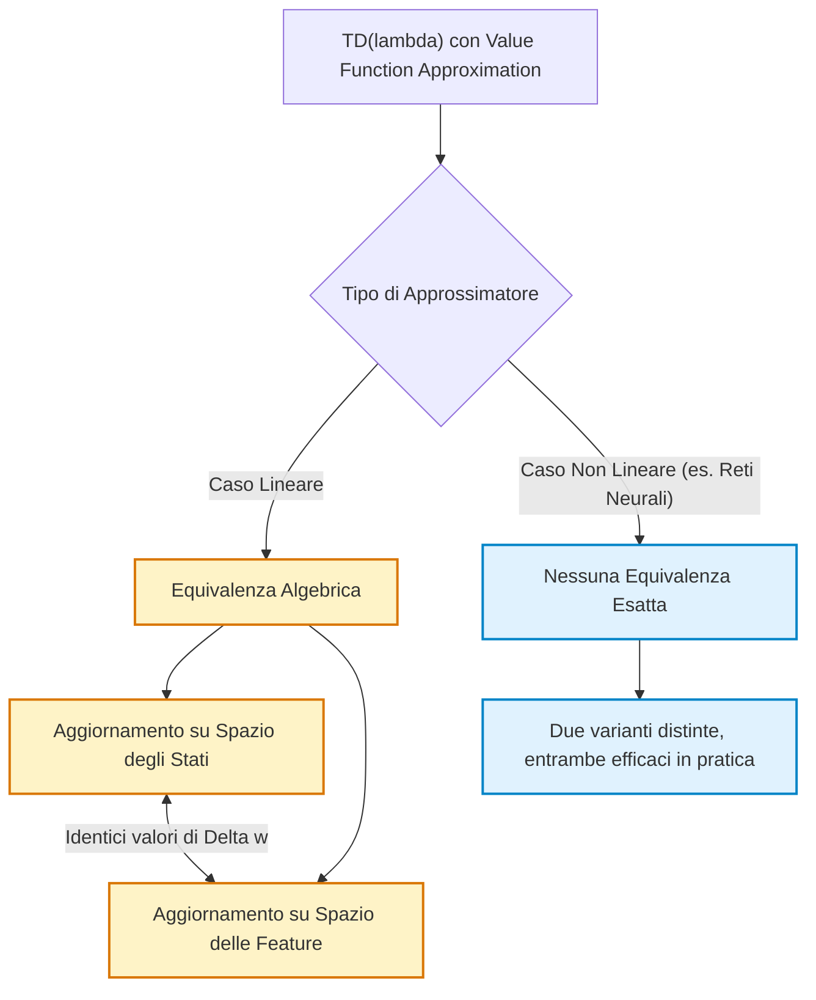
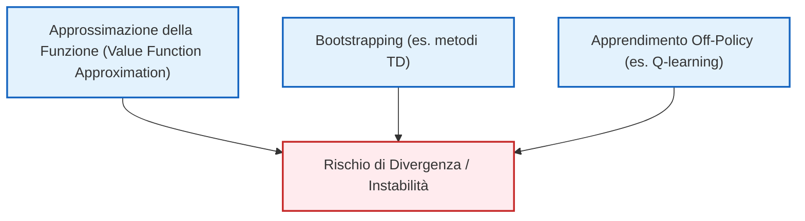
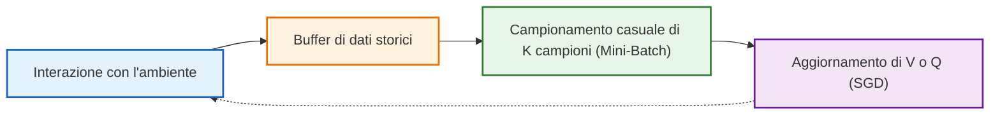

# Approssimazione della Funzione di Valore, Estrazione delle Caratteristiche e Notazione Vettoriale per $TD(\lambda)$

## Overview Didattica

La lezione approfondisce il tema dell'**Approssimazione della Funzione di Valore (Value Function Approximation)**, ponendo le basi necessarie prima del futuro passaggio ai **Metodi Basati sulla Politica (Policy-Based Approaches)**. Dopo un breve chiarimento organizzativo legato ad alcuni problemi tecnici iniziali e all'assenza di registrazione della seduta, il docente riprende le fila della lezione precedente per allineare la trattazione teorica alla notazione utilizzata dal libro di testo di riferimento.

I concetti principali affrontati in questa prima parte includono:

* **Obiettivo dell'Approssimazione e Target Sostitutivi:** L'obiettivo è individuare i parametri ottimali per ottenere una stima affidabile della funzione di valore stato-azione $Q$ (e della funzione di valore di stato $V$), fondamentale per derivare una buona **Politica (Policy)**. Pur operando in un contesto simile all'**Apprendimento Supervisionato (Supervised Learning)**, non disponiamo di un oracolo che fornisca i valori reali di $V$ e $Q$ lungo la traiettoria; si ricorre quindi a stime sostitutive basate sui **Ritorni (Returns)**, sui ritorni $TD$ o sui ritorni $TD(\lambda)$. Inoltre, viene ribadita l'importanza di implementare gli algoritmi di calcolo del ritorno $G$ nella loro versione computazionalmente efficiente.
* **Estrazione di Caratteristiche (Feature Extraction) e Rappresentazione Compatta:** Per gestire spazi continui o molto ampi di stati $\mathcal{S}$ e azioni $\mathcal{A}$, è necessario adottare rappresentazioni compatte. Vengono richiamate e confrontate tre tecniche fondamentali:
  * **Aggregazione degli Stati (State Aggregation):** raggruppa valori continui in sottoinsiemi discreti.
  * **Codifica Grossolana (Coarse Coding)** e **Codifica a Tasselli (Tile Coding):** risultano superiori all'aggregazione degli stati in presenza di pochi campioni o poche caratteristiche (*feature*).
  * **Trade-off progettuale:** il *Coarse Coding* offre maggiore flessibilità (permette di sfruttare la conoscenza del dominio concentrando le *feature* in zone critiche dello spazio degli stati), ma manca di struttura; al contrario, il *Tile Coding* rappresenta lo standard strutturato quando non si dispone di una conoscenza dettagliata a priori del problema.
* **Raccordo con il libro di testo su $TD(\lambda)$:** Per chiarire la presentazione sintetica del testo di riferimento, la trattazione torna temporaneamente all'algoritmo standard di **Differenza Temporale $\lambda$ (Temporal Difference $\lambda$ - $TD(\lambda)$)** senza approssimazione di funzione. In particolare, si introduce l'equivalenza tra l'aggiornamento esplicito per ogni stato $s \in \mathcal{S}$ e la **notazione vettoriale**, evidenziando come le **Tracce di Eleggibilità (Eligibility Traces)** — utilizzate per risolvere il **Problema dell'Assegnazione del Credito (Credit Assignment Problem)** — annullino automaticamente l'aggiornamento per gli stati mai visitati nella traiettoria.

---

### 1. Inquadramento e Richiami sulla Feature Extraction

Prima di entrare nel vivo della predizione $\text{TD}(\lambda)$ con approssimazione di funzione, è utile chiarire un punto metodologico emerso dalla lezione precedente: nella versione mostrata sulle slide, il calcolo del ritorno $G$ non era implementato in modo efficiente (veniva calcolato seguendo l'ordine diretto invece della forma ottimizzata). A livello implementativo, a meno che non venga esplicitamente richiesta la versione naive, è sempre bene adottare la formulazione efficiente vista in precedenza.

Nei prossimi moduli affronteremo un vero e proprio cambio di paradigma passando agli **Approcci Basati su Policy (Policy-Based Approaches)**, che introdurranno una discontinuità rispetto ai metodi basati sul valore visti finora. Tuttavia, molti degli strumenti che stiamo costruendo ora — in particolare la parametrizzazione e la rappresentazione compatta degli stati — verranno ampiamente riutilizzati.

#### Obiettivi della Value Function Approximation (VFA)

Nell'ambito dell'**Approssimazione della Funzione Valore (Value Function Approximation, VFA)**, il nostro obiettivo coincide con l'impostazione tipica del Machine Learning: trovare i parametri migliori (che indichiamo con un vettore $\mathbf{w}$) utilizzando i dati raccolti dall'esperienza. Se otteniamo una buona stima parametrica di $V(s)$ o di $Q(s,a)$, possiamo infatti derivare una buona policy e risolvere il problema di Apprendimento per Rinforzo (Reinforcement Learning).

Per impostare questo processo come un problema di apprendimento simil-supervisionato, abbiamo bisogno di due ingredienti:
* **Un obiettivo di predizione**: oltre all'obiettivo intrinseco dell'RL (massimizzare il ritorno atteso), introduciamo un obiettivo ausiliario volto a minimizzare l'errore tra la funzione approssimata e il valore reale.
* **Dati di riferimento (target)**: a differenza del Supervised Learning classico, non disponiamo di un dataset storico né di un oracolo che ci fornisca i valori veri $v_\pi(s)$ o $q_\pi(s,a)$. Come già fatto nei metodi tabellari, aggiriamo il problema utilizzando al loro posto stime campionarie: i ritorni completi (Monte Carlo), il target TD a un passo o il ritorno $\text{TD}(\lambda)$.

#### Estrazione delle Feature: Aggregazione, Coarse Coding e Tile Coding

Per far scalare questi algoritmi su spazi degli stati $\mathcal{S}$ e delle azioni $\mathcal{A}$ molto grandi o continui, dobbiamo costruire una rappresentazione più compatta tramite un processo di **Estrazione delle Feature (Feature Extraction)**, trasformando lo stato $s$ in un vettore di feature $\mathbf{x}(s)$ (o $\mathbf{x}(s,a)$).

Abbiamo tre approcci principali, che presentano comportamenti e compromessi distinti:
* **Aggregazione degli Stati (State Aggregation)**: consiste nel raggruppare intervalli continui di valori di $S$ (e $A$) in un insieme finito di sottoinsiemi (cluster) discreti.
* **Coarse Coding**: codifica lo stato tramite un insieme di regioni sovrapposte (feature binarie) a dimensionalità ridotta.
* **Tile Coding**: suddivide lo spazio in griglie sfalsate sovrapposte (tasselli), fornendo una codifica sparsa e sistematica.

Confrontando le tre tecniche emerge un chiaro compromesso pratico:
* **Quantità di dati**: se disponiamo di moltissimi campioni, tutti e tre gli approcci riescono a rappresentare adeguatamente il problema. Quando invece abbiamo pochi dati o poche feature a disposizione, il Coarse Coding e il Tile Coding offrono prestazioni nettamente superiori rispetto alla semplice State Aggregation.
* **Trade-off tra Coarse Coding e Tile Coding**:
  * Il **Coarse Coding** è molto flessibile e permette di sfruttare la **Conoscenza di Dominio (Domain Knowledge)**. Se sappiamo che in una certa regione dello spazio dei piccoli cambiamenti producono effetti rilevanti, possiamo concentrarvi molte feature piccole e dettagliate, lasciando invece feature più ampie nelle zone meno critiche. Lo svantaggio è l'assenza di una struttura sistematica predefinita.
  * Il **Tile Coding**, al contrario, rinuncia a questa flessibilità manuale in favore di un approccio altamente strutturato. Per questo motivo viene spesso adottato come scelta standard quando non si possiede una conoscenza approfondita del dominio del problema.

---

### 2. Predizione $\text{TD}(\lambda)$ con Value Function Approximation

Nel libro di riferimento (Sutton & Barto), la presentazione di $\text{TD}(\lambda)$ nel caso con Value Function Approximation risulta piuttosto compatta e può generare confusione rispetto all'intuizione sviluppata nel caso tabellare. Analizziamo passo dopo passo il collegamento tra le due formulazioni.

#### Dal Caso Tabellare alla Notazione Vettoriale

Nel $\text{TD}(\lambda)$ tabellare classico (senza approssimazione di funzione), ad ogni passo temporale raccogliamo una ricompensa e, grazie alle **Tracce di Eleggibilità (Eligibility Traces)** — che servono a risolvere il **Problema dell'Assegnazione del Credito (Credit Assignment Problem)** — propaghiamo il segnale di errore a tutti gli stati visitati in precedenza lungo la traiettoria.

Concettualmente, l'algoritmo prevede un ciclo su tutti gli stati $\forall s \in \mathcal{S}$:
* Gli stati visitati di recente hanno una traccia $E(s) > 0$ e ricevono un aggiornamento proporzionale alla propria traccia.
* Gli stati mai visitati nell'episodio hanno $E(s) = 0$: il loro aggiornamento è nullo (e la traccia rimane $0 \times \gamma\lambda = 0$). Quindi, iterare su tutto $\mathcal{S}$ o iterare solo sugli stati della traiettoria è esattamente equivalente.

Per compattezza, il testo di riferimento elimina il ciclo esplicito $\forall s \in \mathcal{S}$ introducendo una **notazione vettoriale**: i valori di tutti gli stati sono raccolti in un vettore $\mathbf{V}$ e le tracce di eleggibilità in un vettore $\mathbf{E}$ (in grassetto). Il ciclo rimane quindi implicito nelle operazioni vettoriali su $\mathbf{V}$ ed $\mathbf{E}$.

#### Aggiornamento nello Spazio degli Stati vs Spazio delle Feature

Quando passiamo alla Value Function Approximation, si verifica un cambiamento sottile ma fondamentale. Nel caso della VFA, infatti, il libro continua a usare una notazione vettoriale compatta, ma sposta le tracce di eleggibilità dallo **Spazio degli Stati (State Space)** allo **Spazio delle Feature (Feature Space)**.

Cerchiamo di chiarire la differenza concentrandoci sul **caso lineare**, in cui la funzione valore è espressa come combinazione lineare delle feature dello stato:

$$\hat{v}(s, \mathbf{w}) = \mathbf{w}^T \mathbf{x}(s)$$

* **Approccio nello spazio degli stati** (estensione diretta del caso tabellare): ad ogni passo accumuliamo le tracce di eleggibilità per ciascuno stato visitato nella traiettoria e aggiorniamo il vettore dei parametri $\mathbf{w}$ applicando il gradiente di ogni stato pesato dalla rispettiva traccia.
* **Approccio nello spazio delle feature** (formulazione del libro): invece di mantenere una traccia separata per ogni stato $s \in \mathcal{S}$ (cosa impraticabile in spazi continui o enormi), si mantiene un unico vettore di tracce di eleggibilità $\mathbf{z}$ (o $\mathbf{e}$) che ha la stessa dimensione del vettore dei parametri $\mathbf{w}$ e del vettore delle feature $\mathbf{x}(s)$.

> **Nota: Passaggio integrato con chiarezza didattica**  
> Per rendere esplicita l'equivalenza algebrica richiamata a voce sulle slide nel caso lineare, ricordiamo che per $\hat{v}(s, \mathbf{w}) = \mathbf{w}^T \mathbf{x}(s)$ il gradiente rispetto ai parametri è semplicemente il vettore delle feature:
> $$\nabla_{\mathbf{w}} \hat{v}(s, \mathbf{w}) = \mathbf{x}(s)$$
> Se esprimiamo la somma degli aggiornamenti passati pesati dal decadimento $(\gamma \lambda)^{t-k}$ sugli stati visitati $S_k$, otteniamo:
> $$\sum_{k=0}^{t} (\gamma \lambda)^{t-k} \nabla_{\mathbf{w}} \hat{v}(S_k, \mathbf{w}) = \sum_{k=0}^{t} (\gamma \lambda)^{t-k} \mathbf{x}(S_k)$$
> Riscrivendo questa sommatoria in forma ricorsiva, definiamo il vettore delle tracce nello spazio delle feature al tempo $t$ come:
> $$\mathbf{z}_t = \gamma \lambda \mathbf{z}_{t-1} + \mathbf{x}(S_t)$$
> dove $\mathbf{x}(S_t)$ rappresenta la codifica in feature dell'ultimo stato visitato al passo $t$.

#### Equivalenza nel Caso Lineare e Comportamento Non Lineare

Il risultato ricavato sopra porta a una distinzione cruciale per la comprensione dell'algoritmo:

> **Concetto Chiave: Equivalenza nel caso lineare vs non lineare**  
> * **Nel caso lineare**, l'aggiornamento basato sulle tracce per singolo stato e l'aggiornamento diretto nello spazio delle feature (proposto dal libro) sono **matematicamente equivalenti**: producono esattamente le stesse variazioni $\Delta \mathbf{w}$ dei parametri.  
> * **Nel caso non lineare** (ad esempio con reti neurali e approcci di Deep Learning), questa equivalenza **non vale più**, poiché il gradiente $\nabla_{\mathbf{w}} \hat{v}(s, \mathbf{w})$ dipende dai parametri correnti $\mathbf{w}$ e non è più una semplice costante $\mathbf{x}(s)$. I due schemi danno luogo ad algoritmi distinti (non equivalenti, seppur simili), ma entrambi funzionano correttamente nella pratica.

#### L'Algoritmo Semi-Gradiente $\text{TD}(\lambda)$ e l'Esempio sulla Griglia $2 \times 2$

Nella sua forma operativa (semi-gradiente $\text{TD}(\lambda)$ per la predizione), l'algoritmo richiede una funzione differenziabile $\hat{v}(s, \mathbf{w})$ con parametri $\mathbf{w}$ inizializzati arbitrariamente (ad esempio a zero, in modo casuale o usando conoscenza a priori).

Ad ogni episodio si procede come segue:
1. Si inizializza lo stato $S$ e si azzera il vettore delle tracce di eleggibilità $\mathbf{z} = \mathbf{0}$ (avente la stessa dimensione di $\mathbf{w}$).
2. Per ogni passo fino alla terminazione:
   * Si esegue l'azione secondo la policy $\pi$, osservando la ricompensa $R$ e lo stato successivo $S'$.
   * Si calcola l'errore TD:
     $$\delta \leftarrow R + \gamma \hat{v}(S', \mathbf{w}) - \hat{v}(S, \mathbf{w})$$
     *(Nota: se $S'$ è terminale, $\hat{v}(S', \mathbf{w}) = 0$).*
   * Si aggiorna il vettore delle tracce direttamente nello spazio dei parametri/feature:
     $$\mathbf{z} \leftarrow \gamma \lambda \mathbf{z} + \nabla_{\mathbf{w}} \hat{v}(S, \mathbf{w})$$
     *(Nel caso lineare, il gradiente è semplicemente $\mathbf{x}(S)$).*
   * Si aggiornano i pesi:
     $$\mathbf{w} \leftarrow \mathbf{w} + \alpha \delta \mathbf{z}$$
   * Si pone $S \leftarrow S'$.

**Esempio concettuale (Gridworld $2 \times 2$)**  
Per verificare concretamente l'equivalenza nel caso lineare, consideriamo una piccola griglia $2 \times 2$ i cui stati sono codificati con vettori binari di feature, ad esempio $(1,0)$, $(1,1)$, $(0,1)$ e $(0,0)$. Immaginiamo una traiettoria che attraversa gli stati $A \to B \to C \to \text{Terminale}$:
* Ogni passo intermedio fornisce ricompensa $0$, mentre il raggiungimento dello stato terminale fornisce ricompensa $+1$.
* Fissiamo un fattore di decadimento delle tracce pari a $0.5$ ($\gamma \lambda = 0.5$).
* Se calcoliamo le tracce per singolo stato (incrementando di $+1$ la traccia dello stato appena visitato e lasciando decadere di $0.5$ quelle degli stati precedenti non rivisitati) e sommiamo i contributi ai pesi, otteniamo esattamente gli stessi incrementi $\Delta \mathbf{w}$ che si ottengono aggiornando direttamente il vettore $\mathbf{z}$ nello spazio delle feature — con il vantaggio che l'aggiornamento nello spazio delle feature risulta computazionalmente più diretto e compatto.

**Osservazioni pratiche finali**:
* **Generalizzazione immediata**: il grande vantaggio della Value Function Approximation emerge già dopo un singolo aggiornamento. Poiché gli stati condividono i parametri $\mathbf{w}$ attraverso le feature, l'aggiornamento effettuato su una traiettoria modifica subito anche la stima del valore di stati mai visitati prima.
* **Costo vs Efficacia**: rispetto al semi-gradiente $\text{TD}(0)$, l'aggiornamento ad ogni passo in $\text{TD}(\lambda)$ comporta una complessità leggermente maggiore per via del mantenimento e dell'aggiornamento del vettore delle tracce $\mathbf{z}$, ma nella pratica risulta tipicamente molto più efficace nel propagare l'informazione lungo gli episodi.

---

### Dal Problema di Predizione al Controllo con Approssimazione

Dopo aver visto come risolvere il problema della **predizione (Prediction)** — ovvero stimare la funzione valore di stato $V(s)$ tramite Monte Carlo (MC), $\text{TD}(0)$ e $\text{TD}(\lambda)$ — possiamo finalmente affrontare il problema del **controllo (Control)**.

L'impostazione generale non cambia: continuiamo a utilizzare gli stessi framework già studiati, ma spostiamo la nostra attenzione dalla funzione $V$ alla **funzione valore azione-stato (Action-Value Function)** $Q(S, A)$. L'idea alla base è sempre la stessa: se riusciamo a ottenere una stima sempre migliore di $Q$, possiamo agire in modo *greedy* (avido) rispetto a ciò che abbiamo appreso e puntare così a raggiungere la funzione valore ottima $Q^*$.

Anche con l'**approssimazione della funzione di valore (Value Function Approximation, VFA)**, il meccanismo di aggiornamento rimane legato alla stessa funzione obiettivo vista per la predizione (basata sui dati raccolti seguendo la politica $\pi$) e procede in modo incrementale.

#### Il Caso Lineare per $Q$

Nel caso di approssimazione lineare, stimiamo il valore di una coppia stato-azione come combinazione lineare di un vettore di caratteristiche (*feature*):

$$\hat{q}(S, A, \mathbf{w}) = \mathbf{x}(S, A)^T \mathbf{w}$$

La novità fondamentale rispetto alla stima di $V$ è che ora le *feature* $\mathbf{x}(S, A)$ non descrivono più soltanto lo stato $S$, ma dipendono congiuntamente dallo stato $S$ e dall'azione $A$:
* Si tratta di una naturale generalizzazione del caso precedente.
* Anche qualora esistessero casi particolari in cui alcune caratteristiche restano invariate rispetto all'azione, è comunque indispensabile rappresentare l'azione $A$ all'interno di $\hat{q}$, proprio perché nel controllo dobbiamo poter confrontare le azioni e massimizzare rispetto ad $A$.

Come nei casi tabulari, per risolvere il controllo dobbiamo comunque continuare a risolvere sotto il cofano il problema di predizione tramite gli stessi framework noti (MC, $\text{TD}(0)$ e $\text{TD}(\lambda)$ — tralasciando per semplicità l'$n$-step TD, meno utilizzato nella pratica), calcolando la variazione $\Delta \mathbf{w}$ necessaria ad aggiornare i parametri della nostra funzione approssimata.

---

### Controllo On-Policy: SARSA con Approssimazione della Funzione di Valore

Così come nel caso tabulare, è possibile declinare il controllo in diverse varianti algoritmiche: SARSA, Q-learning, Expected SARSA e le rispettive estensioni $\text{SARSA}(\lambda)$, $\text{Q-learning}(\lambda)$ ed $\text{Expected SARSA}(\lambda)$. Per chiarezza e continuità didattica, concentriamo l'analisi sull'algoritmo **SARSA** (*on-policy*).

#### Versione $\text{TD}(0)$ e Inizializzazione

L'algoritmo SARSA con approssimazione della funzione di valore combina la struttura classica di SARSA con l'aggiornamento parametrico sui pesi $\mathbf{w}$:

* **Requisito di differenziabilità:** nella fase di inizializzazione è necessario scegliere una funzione approssimata $\hat{q}(S, A, \mathbf{w})$ **differenziabile** rispetto ai parametri $\mathbf{w}$. Nei libri di testo questo dettaglio viene talvolta omesso per concentrarsi sulle novità dell'algoritmo, ma è un requisito fondamentale per poter applicare gli aggiornamenti basati sul gradiente.
* **Integrazione di tecniche precedenti:** il fatto di introdurre la VFA non cancella gli accorgimenti visti in precedenza. Ad esempio, è ancora possibile usare un'**inizializzazione ottimistica (Optimistic Initialization)** per favorire l'esplorazione: nel caso lineare, basta impostare inizialmente i pesi $\mathbf{w}$ su valori sufficientemente elevati (almeno in valore assoluto) così da ottenere stime iniziali alte di $\hat{q}$.
* **Aggiornamento sui parametri $\mathbf{w}$:** nel ciclo sugli episodi e sui passi temporali, l'aggiornamento non agisce più direttamente sulle celle di una tabella $Q$, ma modifica il vettore $\mathbf{w}$ tramite $\Delta \mathbf{w}$. Cambiando $\mathbf{w}$, modifichiamo di conseguenza la funzione $\hat{q}$ stessa.
* **Flusso On-Policy:** viene mantenuto esattamente l'ordine classico $(S, A, R, S', A')$:
  1. Se lo stato successivo $S'$ è **terminale**, si esegue l'aggiornamento finale e l'episodio termina (non viene scelta alcuna azione successiva $A'$ e non si rientra nel ciclo).
  2. Se $S'$ non è terminale, si seleziona prima l'azione $A'$ (impegnandosi già a eseguirla secondo la politica corrente) e poi si effettua l'aggiornamento di $\mathbf{w}$ utilizzando $\hat{q}(S', A', \mathbf{w})$.

#### Estensione a $\text{TD}(\lambda)$ e Tracce di Eleggibilità

Combinando SARSA con il framework $\text{TD}(\lambda)$ e la VFA, otteniamo $\text{SARSA}(\lambda)$ con approssimazione della funzione di valore. Anche qui l'agente sceglie e si impegna su $A'$ prima dell'aggiornamento, ma il credito temporale viene propagato indietro tramite le **tracce di eleggibilità (Eligibility Traces)**.

Nel caso lineare, il gradiente della funzione approssimata rispetto a $\mathbf{w}$ coincide semplicemente con il vettore delle *feature* $\mathbf{x}(S, A)$, che va quindi ad alimentare il vettore delle tracce a ogni passo.

> **Concetto Chiave — Tipologie di Tracce di Eleggibilità:**
> Esistono tre modalità principali per aggiornare le tracce di eleggibilità (è fondamentale conoscerne bene il meccanismo per eventuali calcoli numerici):
> 1. **Tracce Accumulanti (Accumulating Traces):** rappresentano la scelta standard; a ogni visita di uno stato (o coppia stato-azione / attivazione della *feature*), il contributo viene sommato al valore corrente della traccia.
> 2. **Tracce Sostitutive (Replacing Traces):** anziché sommare ad ogni nuova visita, il valore della traccia viene saturato imponendo un limite superiore pari a $1$.
> 3. **Tracce Olandesi (Dutch Traces):** una terza variante intermedia usata in combinazione con l'approssimazione lineare (citata per completezza rispetto alle altre due).

---

### Esempio Pratico: Il Problema della Mountain Car

Un caso di studio celebre nel Reinforcement Learning per comprendere i vantaggi della VFA nel controllo è il problema della **Mountain Car** (*auto sulla montagna*).

* **Descrizione del problema:** un'auto si trova sul fondo di una valle e deve raggiungere una bandierina posta in cima a una collina. Il motore dell'auto non ha abbastanza potenza per salire direttamente in linea retta verso la vetta; per farcela, l'agente deve imparare ad andare prima all'indietro sul pendio opposto, oscillare avanti e indietro per accumulare **quantità di moto (Momentum)**, e sfruttare la spinta per superare la salita.
* **Formalizzazione dello spazio degli stati:** osservando un singolo istante del sistema, lo stato è caratterizzato da due grandezze fisiche fondamentali:
  1. **Posizione** lungo l'asse orizzontale;
  2. **Velocità**, definita sia in valore assoluto sia nel segno (positivo o negativo a seconda della direzione del moto).

#### Perché serve l'Approssimazione della Funzione di Valore

Sia la posizione sia la velocità assumono **valori continui**: esistono quindi infiniti stati possibili (e potenzialmente spazi d'azione complessi o continui).
* Senza approssimazione della funzione valore, risolvere questo problema sarebbe estremamente macchinoso e lento: bisognerebbe discretizzare manualmente lo spazio raggruppando moltissimi stati e raccogliere una quantità enorme di esperimenti.
* Con la VFA, invece, sfruttiamo la **generalizzazione (Generalization)**: anche osservando pochi punti dati, l'aggiornamento dei pesi $\mathbf{w}$ modifica la stima di $\hat{q}$ anche per stati vicini mai visitati prima. In questo modo l'algoritmo riesce a imparare una forma piuttosto complessa per la funzione valore in circa $9.000$ episodi (un numero contenuto, se confrontato con problemi tabulari più semplici come il Blackjack).

#### Scelta di $\lambda$ e Impatto delle Tracce

Applicando $\text{TD}(\lambda)$ alla Mountain Car emergono due osservazioni sperimentali importanti:
1. **Compromesso su $\lambda$:** variando l'iperparametro $\lambda$, si individua il classico punto ottimale intermedio (*sweet spot*), esattamente come accade durante il *tuning* degli iperparametri in altri contesti di Machine Learning (ad esempio nella regressione Lasso).
2. **Differenza tra Accumulating e Replacing Traces:** in questo specifico scenario, la scelta di come implementare le tracce di eleggibilità (*accumulating* rispetto a *replacing*) produce una differenza prestazionale molto marcata. Non esiste una regola universale per cui una sia sempre superiore all'altra in ogni problema, ma questo esempio dimostra come anche piccoli dettagli progettuali dell'algoritmo possano avere un impatto decisivo sui risultati.

---

### Controllo Off-Policy e la "Triade Mortale" (Deadly Triad)

Finora ci siamo concentrati sul caso *on-policy* (SARSA), ma in linea di principio è possibile applicare l'approssimazione della funzione di valore anche ad algoritmi **off-policy**, primo fra tutti il **Q-learning**.

Tuttavia, è necessario prestare molta attenzione a ciò che accade quando si sommano più livelli di approssimazione. Nel Q-learning con VFA, infatti, aggiorniamo una stima approssimata di $Q$ utilizzando un'altra stima precedente, ma riferendoci a una politica target (*greedy*) diversa dalla politica che abbiamo usato per raccogliere i dati.

> **Concetto Chiave — La Triade Mortale (Deadly Triad):**
> In letteratura si definisce **Triade Mortale (Deadly Triad)** la combinazione simultanea di tre elementi all'interno dello stesso algoritmo di apprendimento:
> 1. **Approssimazione della Funzione (Function Approximation):** non conosciamo i veri valori di $V$ o $Q$, ma usiamo una rappresentazione parametrica approssimata.
> 2. **Bootstrapping:** aggiorniamo una stima basandoci su altre stime (come nei metodi TD), anziché attendere il ritorno completo dell'episodio.
> 3. **Apprendimento Off-Policy (Off-Policy Training):** aggiorniamo la funzione valore di una politica target usando transizioni generate da una politica comportamentale diversa.
>
> Quando questi tre fattori vengono combinati insieme, l'algoritmo perde la stabilità garantita e **può divergere drasticamente** invece di convergere.

#### Garanzie di Convergenza e Implicazioni Pratiche

* **Perdita delle garanzie teoriche:** mentre nei metodi tabulari visti in precedenza era possibile dimostrare la convergenza, introducendo la VFA la situazione cambia. Con approssimazione lineare *on-policy* si mantengono ancora garanzie vicine alla convergenza e all'ottimalità; ma appena si introduce l'apprendimento **off-policy** oppure approssimatori **non lineari** (come le reti neurali negli approcci di Deep Learning), **non esiste più alcuna garanzia teorica di convergenza**. Esistono infatti piccoli MDP costruiti ad hoc (simili per struttura a piccoli grafi con poche transizioni particolari) in cui i parametri letteralmente "esplodono".
* **Approccio pratico:** questa consapevolezza non significa che algoritmi come Q-learning con VFA non debbano essere provati — al contrario, nella pratica vengono usati spesso con successo. Tuttavia, chi li implementa deve sapere che non c'è certezza matematica di successo su ogni esecuzione (*run*) e che il modello può risultare instabile o fallire proprio a causa dell'accumulo di queste approssimazioni.

---

### Dal paradigma incrementale al paradigma batch

Fino a questo momento abbiamo quasi sempre considerato algoritmi **incrementali** (*incremental methods*). In un approccio incrementale, ad ogni passo temporale o al termine di ogni singolo episodio aggiorniamo immediatamente i pesi $\mathbf{w}$ del nostro stimatore:

$$\mathbf{w}_{t+1} = \mathbf{w}_t + \alpha \cdot \delta_t \cdot \nabla_{\mathbf{w}} \hat{v}(S_t, \mathbf{w}_t)$$

Questo approccio presenta un chiaro vantaggio pratico: non appena raccogliamo una nuova informazione dal mondo reale, la sfruttiamo subito per correggere la stima del valore e, di riflesso, migliorare la politica (*policy*).

Tuttavia, esiste un paradigma alternativo: l'**apprendimento batch** (*batch reinforcement learning*). Invece di aggiornare i parametri punto per punto, raccogliamo prima un insieme consistente di dati storici $\mathcal{D}$ (composto da molteplici transizioni o interi episodi) e calcoliamo l'aggiornamento solo quando disponiamo di questo blocco completo di dati.

```mermaid
flowchart TD
    accTitle: Confronto tra approccio incrementale e approccio batch
    accDescr: Schema a blocchi che illustra il flusso dati continuo nell'approccio incrementale rispetto alla raccolta di un dataset prima dell'aggiornamento nell'approccio batch.

    subgraph Incremental ["Approccio Incrementale"]
        A1["Transizione (S, A, R, S')"] --> B1["Aggiornamento immediato dei pesi w"]
        B1 --> C1["Miglioramento immediato della Policy"]
    end

    subgraph Batch ["Approccio Batch"]
        A2["Esperienza continua"] --> B2["Buffer / Dataset D"]
        B2 --> C2["Risoluzione Globale (Forma Chiusa)"]
        C2 --> D2["Nuovo vettore dei pesi w"]
    end

    style Incremental fill:#f9f9f9,stroke:#333333,stroke-width:2px
    style Batch fill:#f9f9f9,stroke:#333333,stroke-width:2px
```

#### Perché considerare un approccio batch?

1. **Efficienza nell'uso dei dati e riduzione del rumore**: le stime basate su singoli passi contengono una varianza intrinseca elevata; risolvere globalmente su un intero dataset permette di trovare la migliore approssimazione complessiva per quei dati.
2. **Vincoli computazionali e hardware**: pensiamo alla guida autonoma. Raccogliamo moli enormi di dati ad altissima frequenza; spesso non disponiamo della capacità di calcolo per ricalcolare i gradienti ogni millisecondo. È più realistico accumulare un batch di dati e aggiornare il modello periodicamente.
3. **Forma chiusa**: nell'approssimazione lineare non siamo obbligati a procedere a piccoli passi con la discesa del gradiente stocastica (*Stochastic Gradient Descent* - SGD); possiamo trovare la soluzione ottima direttamente tramite una soluzione analitica in forma chiusa (*closed-form solution*).

---

### Richiamo: La soluzione in forma chiusa dei minimi quadrati

Nell'apprendimento supervisionato (*supervised learning*), il problema della regressione lineare con la funzione di costo dei minimi quadrati ordinari (*Ordinary Least Squares* - OLS) consiste nel minimizzare l'errore quadratico:

$$\min_{\mathbf{w}} \frac{1}{2} \sum_{t=1}^{T} \left( y_t - \mathbf{x}_t^T \mathbf{w} \right)^2 = \min_{\mathbf{w}} \frac{1}{2} \| Y - X \mathbf{w} \|_2^2$$

dove:
* $X \in \mathbb{R}^{T \times d}$ è la matrice dei dati (ogni riga rappresenta un campione, ogni colonna una feature).
* $Y \in \mathbb{R}^T$ è il vettore dei target supervisionati.
* $\mathbf{w} \in \mathbb{R}^d$ è il vettore dei parametri.

Annullando il gradiente rispetto a $\mathbf{w}$ si ottengono le note equazioni normali, da cui deriva la soluzione in forma chiusa:

$$X^T X \mathbf{w} = X^T Y \implies \mathbf{w} = (X^T X)^{-1} X^T Y$$

In Reinforcement Learning lineare vogliamo traslare esattamente questo principio:
* La riga $\mathbf{x}_t$ diventa il vettore delle feature dello stato: $\phi(S_t) \in \mathbb{R}^d$.
* La matrice $X$ diventa la matrice delle feature $\Phi \in \mathbb{R}^{T \times d}$.
* Il target $y_t$, in teoria, sarebbe la vera funzione valore $v_\pi(S_t)$. Non conoscendola, la sostituiamo con i target tipici del RL: il ritorno empirico $G_t$, il target del Temporal Difference a zero passi $\text{TD}(0)$, o il target $\text{TD}(\lambda)$.

---

### Metodi di Predizione ai Minimi Quadrati (Least Squares)

Aggiungendo il prefisso **LS** (*Least Squares*) ai metodi noti, otteniamo la famiglia di algoritmi batch per la predizione (*Value Function Approximation*):
* **LSMC**: *Least Squares Monte Carlo*
* **LSTD(0)**: *Least Squares Temporal Difference (0)*
* **LSTD($\lambda$)**: *Least Squares Temporal Difference ($\lambda$)*

> **CONCETTO CHIAVE (Focus di Derivazione)**
> All'esame non è richiesto di mandare a memoria le formule finali di LSMC o LSTD, ma di **saperle ricavare** partendo dalla formula dei minimi quadrati della regressione lineare classica $\mathbf{w} = (X^T X)^{-1} X^T Y$, sostituendo opportunamente il target del RL desiderato ed esplicitando $\mathbf{w}$.

#### 1. Least Squares Monte Carlo (LSMC)
Nel metodo Monte Carlo il target supervisionato associato alla visita dello stato $S_t$ è il ritorno cumulato effettivo $G_t$:

$$y_t = G_t$$

Sostituendo direttamente nelle equazioni normali scritte in forma estesa (sommatoria sui passi temporali $t = 1, \dots, T$ dei dati storici):

$$\left( \sum_{t=1}^T \phi(S_t) \phi(S_t)^T \right) \mathbf{w} = \sum_{t=1}^T \phi(S_t) G_t$$

Da cui si ottiene analiticamente:

$$\mathbf{w}_{\text{LSMC}} = \left( \sum_{t=1}^T \phi(S_t) \phi(S_t)^T \right)^{-1} \sum_{t=1}^T \phi(S_t) G_t$$

#### 2. Least Squares Temporal Difference: LSTD(0)
Nel caso di $\text{TD}(0)$, il target sfrutta il bootstrap ad un passo:

$$y_t = R_{t+1} + \gamma \hat{v}(S_{t+1}, \mathbf{w}) = R_{t+1} + \gamma \phi(S_{t+1})^T \mathbf{w}$$

*Nota: Passaggio integrato con chiarezza didattica per mostrare la derivazione algebrica.*

Imponendo che la combinazione lineare dei residui con le feature sia nulla (la condizione di ortogonalità del punto fisso di Bellman proiettato):

$$\sum_{t=1}^T \phi(S_t) \left( \phi(S_t)^T \mathbf{w} - \left( R_{t+1} + \gamma \phi(S_{t+1})^T \mathbf{w} \right) \right) = \mathbf{0}$$

Riorganizziamo i termini per isolare il vettore dei parametri $\mathbf{w}$ su un solo lato:

$$\sum_{t=1}^T \phi(S_t) \left( \phi(S_t)^T \mathbf{w} - \gamma \phi(S_{t+1})^T \mathbf{w} \right) = \sum_{t=1}^T \phi(S_t) R_{t+1}$$

$$\left( \sum_{t=1}^T \phi(S_t) \left( \phi(S_t) - \gamma \phi(S_{t+1}) \right)^T \right) \mathbf{w} = \sum_{t=1}^T \phi(S_t) R_{t+1}$$

Definendo:
* La matrice $A \in \mathbb{R}^{d \times d}$:
  $$A = \sum_{t=1}^T \phi(S_t) \left( \phi(S_t) - \gamma \phi(S_{t+1}) \right)^T$$
* Il vettore $b \in \mathbb{R}^d$:
  $$b = \sum_{t=1}^T \phi(S_t) R_{t+1}$$

Possiamo scrivere la relazione in forma compatta come un sistema lineare $A \mathbf{w} = b$, la cui soluzione è:

$$\mathbf{w}_{\text{LSTD}} = A^{-1} b$$

#### 3. Estensione a LSTD($\lambda$)
Quando introduciamo le tracce di eleggibilità (*eligibility traces*), il principio di derivazione resta identico, ma le feature dello stato corrente vengono filtrate dalla traccia accumulata $e_t \in \mathbb{R}^d$:

$$A = \sum_{t=1}^T e_t \left( \phi(S_t) - \gamma \phi(S_{t+1}) \right)^T$$

$$b = \sum_{t=1}^T e_t R_{t+1}$$

con $e_t = \gamma \lambda e_{t-1} + \phi(S_t)$.

---

### Vantaggi dell'Approccio ai Minimi Quadrati in RL

* **Eliminazione del learning rate**: Risolvendo il sistema analiticamente, non dobbiamo più impostare o sintonizzare il tasso di apprendimento $\alpha$ (*learning rate*). Meno iperparametri da tarare significano un algoritmo intrinsecamente più robusto e ingegneristicamente più trattabile.
* **Nessun problema di divergenza del gradiente**: Non si rischia di divergere a causa di un passo $\alpha$ troppo grande lungo la direzione di discesa.
* **Complessità computazionale legata allo spazio delle feature**: La matrice $A$ ha dimensione $d \times d$, dove $d$ è la dimensione del vettore delle feature, e non dipende direttamente dal numero di campioni $T$. L'inversione della matrice scala nell'ordine di $O(d^3)$ (oppure $O(d^2)$ se aggiornata incrementalmente tramite l'identità di Sherman-Morrison), risultando molto vantaggiosa quando il numero di feature $d$ è contenuto rispetto al numero enorme di transizioni osservate.

---

### Dal Problema di Predizione al Controllo: Least Squares Policy Iteration (LSPI)

Dopo aver affrontato il problema della predizione (stimare la funzione valore $V$), è necessario estendere l'approccio ai minimi quadrati anche al problema del **controllo**. In letteratura questo metodo porta il nome leggermente controintuitivo di **Iterazione della Policy ai Minimi Quadrati (Least Squares Policy Iteration - LSPI)**.

#### Struttura dell'algoritmo: da $V$ a $Q$
Come di consueto quando si passa dalla predizione al controllo, ci si sposta dalla stima di $V(s)$ alla stima della funzione azione-valore $Q(s, a)$:

* **Passo di Valutazione (Prediction):** dato un dataset storico $D$ di transizioni raccolte, si applica la tecnica *Least Squares Temporal Difference* per stimare $Q$ (invece di $V$). L'obiettivo è ottenere parametri migliori per avere una stima accurata di $Q^\pi$.
* **Passo di Miglioramento (Control):** una volta migliorata la conoscenza di $Q$, si agisce in modo *greedy* rispetto a essa per derivare una nuova policy $\pi'$ a partire dalla policy precedente $\pi$:
  $$\pi'(s) = \arg\max_a Q^\pi(s, a)$$

> **Concetto Chiave — Il nodo dell'Off-Policy in LSPI:**
> Se disponiamo di un solo batch di $D$ transizioni raccolte con la policy iniziale $\pi$, possiamo facilmente usarlo per passare da $\pi$ a $\pi'$. Tuttavia, per continuare l'iterazione ($\pi' \rightarrow \pi'' \rightarrow \pi'''$), ci troviamo in una situazione intrinsecamente **off-policy** se vogliamo evitare di scartare i dati. Per procedere esistono due strategie possibili:
> 1. **Raccolta di nuovi dati on-policy:** una volta calcolata $\pi'$, la si esegue nell'ambiente per raccogliere un nuovo batch di $D$ transizioni generate da $\pi'$, ripetendo poi il calcolo. Questo richiede però di avere abbastanza tempo tra un aggiornamento e il successivo per interagire con l'ambiente.
> 2. **Riutilizzo dei dati storici:** se non è possibile raccogliere nuovi dati prima del calcolo successivo e si vuole riutilizzare il batch generato da una policy precedente, è indispensabile introdurre il **Campionamento per Importanza (Importance Sampling)** per correggere la discrepanza tra la policy che ha generato i dati e la policy corrente.

#### Esempio pratico: il Chain Walk a $50$ stati
Per verificare l'efficacia di LSPI nella pratica, il docente presenta il classico esempio del **Chain Walk** (camminata su catena):

* **Struttura dell'ambiente:** una sequenza ordinata di $50$ stati (nella figura introduttiva ne vengono mostrati solo $4$ per semplicità, ma la simulazione usa $50$ stati).
* **Dinamica stocastica:** l'agente può scegliere di muoversi a destra (*right*) o a sinistra (*left*). Tuttavia, l'ambiente non è deterministico: scegliendo una direzione, si ha il $90\%$ di probabilità di spostarsi effettivamente in quella direzione e il $10\%$ di probabilità di finire nella direzione opposta.
* **Ricompense (Rewards):** tutte le transizioni forniscono ricompensa $0$, tranne quando l'agente raggiunge due stati specifici situati lungo la catena (lo stato $10$ e lo stato $41$, evidenziati in verde nella simulazione), che forniscono una ricompensa pari a $+1$.
* **Approssimazione e risultati:** trattandosi di $50$ stati, come *feature* vengono utilizzate $10$ funzioni Gaussiane (realizzando di fatto una sorta di aggregazione di stati). Raccogliendo $10\,000$ passi di esperienza lungo la catena, LSPI si dimostra molto efficace: già dopo sole **$4$ iterazioni** si ottiene un'ottima approssimazione di $Q$ e dello spazio dei valori.

---

### Verso il Deep Reinforcement Learning e il Terzo Paradigma dei Dati

Finora sono stati analizzati solo approcci di approssimazione lineare. Il passo successivo del corso introdurrà approcci non lineari basati sull'**Apprendimento Profondo (Deep Learning)**, e in particolare la **Deep Q-Network (DQN)**. Sebbene oggi esistano metodi più avanzati allo stato dell'arte, DQN resta un algoritmo fondamentale, ancora ampiamente impiegato nelle applicazioni reali (e adatto a ottenere ottimi risultati nei progetti pratici del corso).

*(Nota didattica del docente: per chi non avesse già seguito un corso di Deep Learning, è consigliato visionare le due registrazioni di ripasso su basi e addestramento delle reti neurali caricate sulla piattaforma, pur essendo la prossima lezione comunque seguibile autonomamente).*

#### I tre paradigmi per gestire esperienza e calcolo
L'introduzione di reti neurali profonde per problemi su larga scala richiede di **disaccoppiare** due processi che avvengono in parallelo: la raccolta dei dati tramite interazione con il mondo reale e il calcolo necessario per aggiornare le stime. Fino a questo momento abbiamo incontrato due estremi opposti, ai quali ora si aggiunge un terzo approccio intermedio:

1. **Apprendimento Incrementale (es. TD Learning, SARSA):** ogni singolo nuovo dato raccolto viene utilizzato immediatamente per aggiornare la stima e poi scartato. È semplice, ma poco adatto ad addestrare architetture complesse su larga scala.
2. **Apprendimento Batch / Forma Chiusa (es. LSPI):** si attende di accumulare un intero set storico di dati e si calcola una soluzione lineare in forma chiusa (o quasi) su tutto il blocco.
3. **Apprendimento Mini-Batch / Experience Replay (il ponte verso il Deep Learning):** ogni nuova transizione raccolta interagendo con l'ambiente viene inserita in un contenitore di dati storici (*buffer*). Quando si decide di aggiornare la stima di $V$ o di $Q$, non si usa né un solo campione né l'intero storico, ma si estrae casualmente un sottoinsieme di dimensione fissa $K$, chiamato **Mini-Batch**.

#### Perché i Mini-Batch e l'Experience Replay sono fondamentali
Durante il confronto con gli studenti emergono i motivi pratici e teorici per cui si utilizza un mini-batch estratto casualmente anziché l'intero batch o i dati in ordine sequenziale:

* **Tempo di calcolo costante e prevedibile:** se il buffer storico cresce continuamente nel tempo, usarlo tutto per ogni aggiornamento renderebbe il calcolo sempre più lento e imprevedibile. Fissando la dimensione $K$ del mini-batch, il tempo di ogni aggiornamento rimane costante: un aspetto vitale nei sistemi in tempo reale (come la guida autonoma), dove è necessario sapere con certezza quando sarà disponibile la nuova policy.

> **Concetto Chiave — Stabilità della Discesa del Gradiente Stocastico (SGD) e Decorrelazione:**
> Il motivo più importante per cui si usano mini-batch campionati casualmente riguarda una proprietà fondamentale della **Discesa del Gradiente Stocastico (Stochastic Gradient Descent - SGD)**: per convergere in modo stabile verso un buon minimo locale, l'algoritmo richiede dati indipendenti e identicamente distribuiti (**i.i.d.**), ovvero **non correlati** tra loro.
>
> Nel Reinforcement Learning — soprattutto in domini con spazi di stati e azioni continui, come guidare un'auto, dove si usa tipicamente l'approssimazione di funzione — i campioni raccolti lungo una traiettoria sono **fortemente correlati** nel tempo: uno stato è sempre molto simile a quello immediatamente precedente. Se si addestra una rete neurale seguendo l'ordine temporale di arrivo dei dati, la SGD riceve dati non i.i.d. e la stima diverge o resta molto lontana dal valore vero (come mostrato nel confronto tra la curva stimata sequenzialmente e la curva reale "oracolo").

* **Riproduzione dell'Esperienza (Experience Replay):** campionando casualmente $K$ transizioni prese da punti diversi della storia (ad esempio dall'inizio, dalla metà e dalla fine di una o più traiettorie), si **rompe la correlazione temporale**. A parità di numero di passi di addestramento, la stima della funzione valore migliora drasticamente. Questa tecnica prende il nome di **Experience Replay** proprio perché lo stesso dato storico può essere campionato e "rivissuto" più volte durante l'addestramento, mentre il buffer continua comunque a ricevere nuove transizioni che introducono novità.

*(Nota conclusiva in risposta a una domanda: se l'ambiente saltasse da uno stato all'altro in modo completamente casuale e scorrelato, il problema della correlazione non si porrebbe — pur avendo un MDP molto più difficile da tracciare — ma nei problemi continui reali la continuità delle traiettorie rende il campionamento casuale dal buffer indispensabile).*

---

> [!NOTE]
> ### Note per l'Esame e Avvisi del Docente
> - **Esercizi sulle Eligibility Traces:** Il docente raccomanda espressamente di ricordare i tre tipi di *eligibility traces* (*accumulating*, *replacing* e *Dutch traces*), evidenziando che è molto facile che vengano proposti esercizi d'esame con valori numerici su questo argomento.
> - **Domanda su Least Squares (esame parziale o regolare):** Il docente ha indicato come possibile esercizio/domanda d'esame (sia per il parziale che per l'esame regolare) il partire dalla soluzione in forma chiusa della regressione lineare, identificare quali siano input e output nel contesto del Reinforcement Learning e derivare gli aggiornamenti/formulazioni di **LSMC**, **LSTD(0)** e **LSTD($\lambda$)**. Non pretende che si ricordino a memoria le formule finali derivate, ma si aspetta che si ricordi la formula in forma chiusa della regressione lineare.
> - **Argomento escluso dalle dimostrazioni:** Riguardo al *deadly triad* e all'assenza di garanzie di convergenza (quando si combinano *function approximation*, *bootstrapping*, apprendimento *off-policy* o approcci non lineari), il docente ha dichiarato esplicitamente che **non chiederà** di dimostrare che l'algoritmo non converge (è sufficiente esserne consapevoli per l'implementazione pratica).
> - **Criteri di svolgimento accettati nel corso:**
>   - Se viene richiesto di scrivere una versione efficiente dell'algoritmo discusso nella lezione precedente (calcolo del ritorno $G$), il docente si aspetta che venga scritto nella forma efficiente vista a lezione e non in quella inefficiente riportata nella slide.
>   - Per l'implementazione degli aggiornamenti di TD($\lambda$) con *value function approximation* (aggiornamento nello spazio degli stati originali visto a lezione oppure direttamente nello spazio delle *feature* come riportato sul libro), entrambi gli approcci sono considerati validi ai fini del corso.