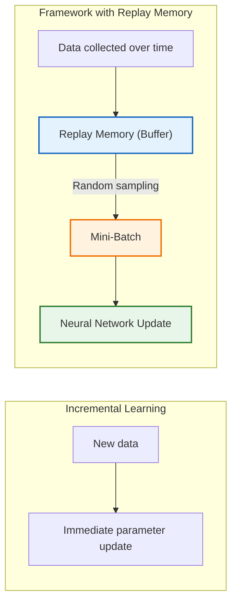
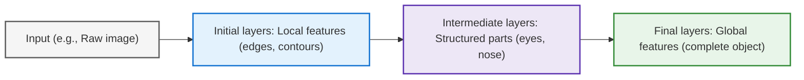
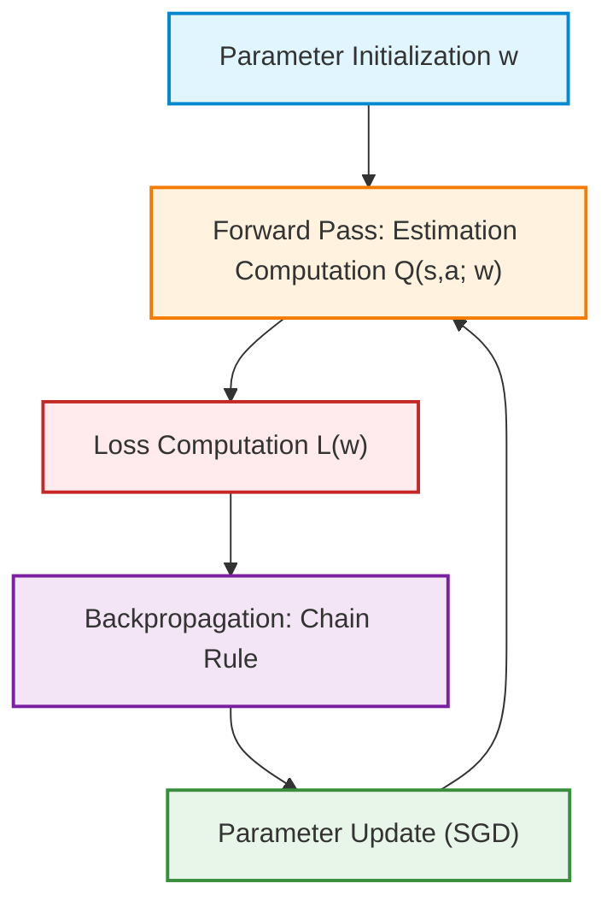
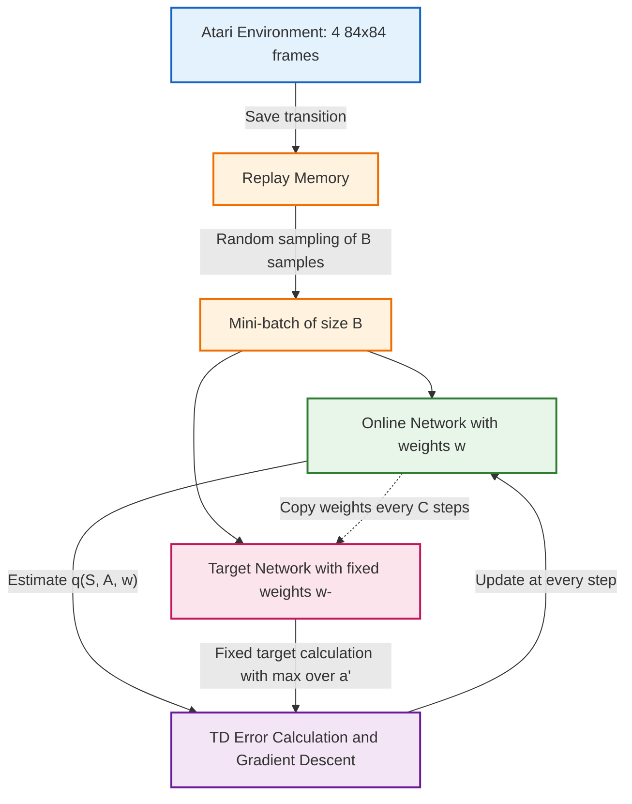

# Batch Learning and Deep Reinforcement Learning: Introduction to Deep Q-Networks (DQN)

## Didactic Overview

This lecture represents the junction point between all the value function approximation concepts seen so far (such as *bootstrapping* and *policy iteration*) and modern **Deep Reinforcement Learning** architectures, marking the final step before transitioning to *Policy Gradient* approaches.

The key concepts addressed in the lecture develop along three main lines:

* **Review of Value Function Approximation:** the motivations for moving beyond the classical tabular approach (exact matrices for $V$ and tables for $Q$) are consolidated. Using a parametric function guarantees **generalization** to unseen states, **scalability** toward continuous or very large state spaces, and significant **memory savings**.
* **Transition from Incremental Learning to *Batch Learning*:** rather than updating the function parameters $w$ on every single incoming data point, *batch* methods — such as **Least Squares Methods** — accumulate samples over an interval $T$ before performing the update. This approach offers three fundamental advantages:
  1. It makes it possible to obtain an **exact closed-form solution** (similarly to classical linear regression).
  2. It enables **asynchronous operation**, decoupling the data collection frequency from the parameter update frequency.
  3. It promotes **reuse of historical data**, efficiently exploiting information that is valuable and costly to collect.
* **Overcoming the linear limit and *Deep Q-Network (DQN)* architecture:** the structural limitation of traditional *Least Squares* approaches is the linearity constraint on the approximating function. By combining the *batch* concept with deep neural networks (*Deep Learning*), it is possible to approximate nonlinear functions to solve the **Control Problem**, arriving at the definition of the **DQN** architecture for estimating $Q$ in a *Q-Learning* scenario (distinct from *SARSA*).

---

### 1. From the Tabular Method to Function Approximation and Batch Learning

Let us resume the path from the *Value Function Approximation (VFA)* approach. Compared to classical tabular methods — in which an exact vector for $V$ or an exact table for $Q$ was maintained by updating each individual element separately — the use of a parametric function (denoted for example by $\hat{V}$ or $\hat{Q}$) introduces two fundamental advantages:
* **Generalization:** it makes it possible to obtain an estimate even for states or conditions never visited before (also making continuous state spaces manageable).
* **Memory Saving:** when the state space is huge and a table would not physically fit in memory, a compact parametric function solves the problem.

This lecture represents a point of synthesis in which all the tools seen so far (*bootstrapping*, *policy iteration*, function approximation) are combined to arrive at **Deep Reinforcement Learning (DRL)**, namely Reinforcement Learning in which value function approximation is entrusted to a *Deep Learning* architecture. The final objective will be to introduce the **DQN (Deep Q-Network)** architecture, where:
* **D** stands for *Deep* (deep neural network);
* **N** stands for *Network*;
* **Q** indicates that we are solving a control problem by estimating the function $Q$ in a *Q-learning*-based formulation (and not *SARSA*).

*(Note on references and code: since the textbook covers deep architectures only briefly in the final chapters, for further study of Deep Learning the instructor points to the free textbook "Deep Learning" by Goodfellow and Bengio and the Stanford course by Fei-Fei Li. Furthermore, compared to the previous week, updated code for $\text{SARSA}(\lambda)$ has been made available in the general function approximation case and not only in the linear one.)*

#### Incremental Learning vs. Batch Least Squares Methods

There are different ways to exploit the data collected by the agent during its interaction with the environment:

* **Incremental Learning:** this is the classic approach seen so far. As soon as a new data point arrives, it is immediately used to update the target, the prediction step, or the control step, and then the data point is no longer reused.
* **Batch Learning via Least Squares Methods:** seen in methods such as Least Squares Monte Carlo, Least Squares $\text{TD}(0)$ and $\text{TD}(\lambda)$. The idea is to wait and accumulate data, updating the parameter vector $w$ of the value function only once every $T$ steps.

Least squares methods offer three significant advantages:
1. **Exact closed-form solution:** just like in linear regression with Gauss's formula, the exact solution is computed directly instead of an approximate iterative estimate.
2. **Asynchrony:** it is possible to decouple the data collection frequency from the parameter update frequency, should the update fail to keep up with acquisition.
3. **Data Reuse:** after the first $T$ steps, one can continue collecting data (reaching $2T$ samples and beyond) and recompute the estimate by also reusing the old points already collected. Since data are valuable and expensive to obtain, being able to reuse them is a huge benefit.

> **Key Concept — The limitation of least squares methods:**
> Despite the advantages of a closed-form solution and data reuse, the least squares approach works **only for linear approximation** (linear regression). When the value function is approximated by a nonlinear model, such as a deep neural network, this method is no longer applicable.

#### The New Framework: Replay Memory and Mini-Batch

To combine the advantages of *Batch Learning* with the power of neural networks, a new architectural scheme based on a **Replay Memory** (a memory buffer) is adopted:
1. As the agent collects experiences, the data are accumulated in a persistent *buffer*.
2. Data collection and training can occur asynchronously (with the update typically performed less frequently than collection).
3. To update the approximator (the neural network), a small subset of data, called a **Mini-Batch**, is sampled from the buffer, and the update is performed on the sampled data.



---

### 2. Motivations for Deep Learning in Reinforcement Learning

Why abandon a linear model—simple, fast, and easily interpretable—to move to a nonlinear *Deep Learning* architecture? There are two major advantages, accompanied however by two critical issues that must be carefully managed.

#### Advantages: Performance and Flexibility

1. **Performance on nonlinear functions:**
   A linear approximator tries to fit a *hyperplane* to the data. As seen in the previous examples on Blackjack with Monte Carlo, the true $V$ or $Q$ functions are often strongly nonlinear. Even by weighting the *loss function* to favor certain regions of the state space, a hyperplane will never be able to accurately capture the curvature and details of the true function.

2. **Flexibility and implicit feature extraction:**
   A neural network can accept almost any type of data as input: time series, audio, images, or mixed combinations (e.g., text and images), operating *end-to-end* to map historical inputs to the optimal output.

> **Key Concept — Implicit Feature Extraction:**
> In linear methods, one must know how to manually construct suitable *features* for the problem, often relying on a domain expert. A neural network, on the other hand, **automatically extracts relevant features** from raw data implicitly, without requiring prior knowledge of the data format.

*(Practical engineering note: even with unlimited computing resources, if in a real-world application you possess domain knowledge and can define good features manually, it is still worthwhile to leverage them, possibly combining them with a downstream neural network. This helps achieve more interpretable models with fewer parameters and lower computational cost.)*

#### Disadvantages and Critical Issues in Using Neural Networks in RL

1. **High Data Demand (Data Scarcity):**
   Deep architectures have a very large number of parameters and require large amounts of data to converge. Since in Reinforcement Learning data can be scarce or expensive to generate, **reusing past experiences through the Replay Memory** becomes a fundamental requirement in order not to waste information.

2. **Violation of the i.i.d. Assumption in Stochastic Gradient Descent:**
   The training of neural networks is based on *Stochastic Gradient Descent (SGD)*.

> **Key Concept — The Problem of Correlation in Trajectories:**
> SGD requires that the samples used for training be **independent and identically distributed (i.i.d.)**, or at least as uncorrelated as possible. In Reinforcement Learning, however, data is collected along sequential *trajectories*: by definition, a state and a transition at the next step are strongly correlated with those of the previous step.

This is the second crucial reason why we will introduce the *Replay Memory* with random sampling (which will be explored in detail below): to break the temporal correlation of trajectories.

---

### 3. Review of Neural Network Architecture

To conclude the introductory overview, let us review the essential elements that make up a *Neural Network*.

#### The Artificial Neuron and Activation Functions

A single neuron essentially computes a linear combination of its inputs, to which it applies a non-linear transformation via an *activation function* $g(\cdot)$. Historically, this model originated in the late 1950s with the *Perceptron*, inspired by the biological functioning of the brain.

* **Historical activation functions:** the **Sigmoid** function and the **Hyperbolic Tangent ($\tanh$)**, valued because they are continuous and bounded between two well-defined asymptotic levels.
* **Modern activation function (ReLU):** today, most architectures use the **Rectified Linear Unit (ReLU)**:
  $$g(x) = \text{ReLU}(x) = \max(0, x) = \begin{cases} 0 & \text{se } x < 0 \\ x & \text{se } x \ge 0 \end{cases}$$

There are three reasons for the success of $\text{ReLU}$, all fundamental for Deep Reinforcement Learning:
1. It introduces **non-linearity**, while having a very simple form.
2. It is **extremely fast to compute**, a vital aspect when repeated calculations must be performed on millions of neurons over many gradient descent steps.
3. Its **derivative is immediate** ($0$ for negative inputs, $1$ for positive inputs), greatly simplifying gradient computation during training.

#### From the Universal Approximation Theorem to Deep Architectures

A very well-known classical result states that a network with a single *hidden layer* between input and output is a **universal approximator**: given a sufficient number of hidden neurons, it can represent any continuous function with arbitrary precision. However, for complex functions, the number of neurons required in a single layer can become enormous (conceptually tending toward infinity).

To overcome this limitation, starting in 2011–2012, the shift toward **Deep Architectures** became established: instead of using a single very wide layer, many hidden layers are stacked in sequence (historically, a network was referred to as *deep* starting from around 8 hidden layers). In this way, the network builds non-linear combinations of non-linear features in cascade, maintaining a theoretically almost unlimited expressive power.

#### Hierarchy of Learned Features (Visual Example)

When looking inside a trained network — particularly in the case of images, which are more easily interpretable by the human eye than time series or multivariate sensor data — one notices that the network organizes features hierarchically without anyone having explicitly imposed it:



This hierarchical structure — typical of *Convolutional Neural Networks (CNNs)*, which will be revisited later — shows how layers close to the input learn elementary local details (such as edges), while layers closer to the output aggregate them into global concepts useful for solving the assigned task. All of this happens automatically by simply providing the network architecture and the data.

---

### Training Non-Linear Approximators: SGD and Backpropagation

When using deep neural networks (*Deep Neural Networks*) as function approximators for Reinforcement Learning (RL), one faces very high-dimensional optimization problems. In modern architectures, the parameter vector $\mathbf{w}$ can easily count from tens of thousands up to $20$ millions of parameters (or more). 

Visualizing the cost function (*Loss Function*) on a two-dimensional plane is a pedagogical simplification: in reality, optimization moves within a complex non-convex landscape, characterized by local minima, saddle points, and regions with almost zero gradient.



#### Initialization and Gradient-Based Optimization
Training begins with an initial choice of parameters $\mathbf{w}_0$. Although in principle the network can be initialized randomly, in practice standard initialization techniques from the literature are used—such as *He initialization* or *Glorot/Xavier initialization*—to prevent gradients from exploding or vanishing in the first steps.

The parameter update follows the direction opposite to that of the gradient of the loss function:

$$\mathbf{w}_{k+1} = \mathbf{w}_k - \alpha \nabla_{\mathbf{w}} L(\mathbf{w}_k)$$

where $\alpha > 0$ represents the learning rate (*Learning Rate*).

#### Gradient Computation via Backpropagation
To update the parameters of a multi-layer network (*Multi-Layer Neural Network*), it is necessary to compute the effect of the variation of each individual parameter $w_i$ on the final output. This process is called *Backpropagation* (error backpropagation):

1. **Forward Pass**: The estimated output of the network is computed starting from the given input.
2. **Comparison**: The estimate produced by the network is compared with the target value.
3. **Backward Pass**: The **chain rule** (*Chain Rule*) of calculus is applied backwards, computing the partial derivatives of the loss with respect to each weight in the different intermediate layers:

$$\frac{\partial L}{\partial w_i} = \frac{\partial L}{\partial y} \cdot \frac{\partial y}{\partial z_n} \cdot \frac{\partial z_n}{\partial z_{n-1}} \cdots \frac{\partial z_1}{\partial w_i}$$

To accelerate these computations, computationally efficient non-linear activation functions are used, such as the *Rectified Linear Unit* (ReLU), defined by:

$$f(x) = \max(0, x)$$

The derivative of the ReLU is trivial (it equals $0$ for $x < 0$ and $1$ for $x > 0$), allowing backpropagation to be executed very quickly even on deep networks.

---

### Mini-Batch Stochastic Gradient Descent (SGD)

In real-world applications of Deep Learning and RL, the size of the final dataset $N$ (total number of data samples) can be huge ($N > 100.000$). 

If one wanted to calculate the true gradient (*Full Batch Gradient Descent*), one would have to compute the average of the derivatives over all $N$ data points:

$$\nabla_{\mathbf{w}} L(\mathbf{w}) = \frac{1}{N} \sum_{i=1}^{N} \nabla_{\mathbf{w}} L_i(\mathbf{w})$$

The computational complexity of executing a single update step on millions of parameters and hundreds of thousands of data points makes the exact gradient operationally unfeasible.

#### The Solution: Mini-Batch SGD
Instead of using all samples $N$, a small random subset of size $B \ll N$ is extracted, called a **Mini-Batch** (usually $B \in [32, 1024]$). The gradient estimated on this batch is expressed by:

$$\nabla_{\mathbf{w}} L(\mathbf{w}) \approx \frac{1}{B} \sum_{i=1}^{B} \nabla_{\mathbf{w}} L_i(\mathbf{w})$$

> **Logical Trade-off**: The stochastic gradient computed on a mini-batch is not exact and is subject to noise. However, its computational speed allows thousands of updates to be performed in the same time frame it would take to compute a single exact gradient step. Even if the direction at each step is not ideal, the algorithm overall proceeds toward the optimum at a much higher speed.

---

### Experience Replay and Breaking Correlations

When adopting the batch approach in Reinforcement Learning, the network updates the estimated value function—for instance $Q(s, a; \mathbf{w})$—by drawing transition samples from a historical memory buffer, called the **Experience Replay Buffer** $\mathcal{D}$.

#### The Sequential Data Problem
In classical RL, the agent's experiences $(s_t, a_t, r_t, s_{t+1})$ are collected sequentially along a temporal trajectory. If one tried to train the network on temporally consecutive samples:
* Nearby states in the trajectory would be strongly correlated with each other ($s_t \approx s_{t+1}$).
* The mini-batch would contain almost identical data, driving the gradient estimate toward drastic imbalances (i.e., toward a single direction in the state space).
* The network would risk diverging or overfitting to local regions recently visited by the agent.

> **KEY CONCEPT: Breaking Correlations (*Breaking Correlations*)**
> Extracting a mini-batch of $B$ transitions from the buffer $\mathcal{D}$ in a **random (uniform)** manner breaks the temporal correlation between samples. The statistical variability within the random batch makes the stochastic gradient estimate much closer and centered relative to the true gradient, stabilizing training convergence.

```mermaid
flowchart LR
    subgraph Raccolta Dati Sequenziale
        S1["s_t"] --> S2["s_t+1"] --> S3["s_t+2"]
    end
    
    Raccolta Dati Sequenziale -->|Inserimento| Buffer["Buffer di Memoria Storica D"]
    
    Buffer -->|Campionamento Casuale Uniforme| Batch["Mini-Batch B (i.i.d.)"]
    Batch -->|Calcolo Gradiente Stocastico| Update["Aggiornamento Peso w"]

    style Buffer fill:#fff3e0,stroke:#f57c00,stroke-width:2px
    style Batch fill:#e8f5e9,stroke:#388e3c,stroke-width:2px
    style Update fill:#ffebee,stroke:#c62828,stroke-width:2px
```

#### Off-Policy Nature of Experience Replay
The use of Experience Replay imposes important constraints on the chosen RL algorithm:

* The buffer contains samples collected in the past via obsolete policies ($\pi_{\text{old}}$), while the current network computes $Q(s, a; \mathbf{w})$ by referring to a new policy ($\pi_{\text{new}}$).
* Training conducted with Experience Replay is fundamentally **Off-Policy**.
* Strictly *On-Policy* algorithms such as **SARSA** fail or exhibit severe instability with Experience Replay, as they require data to strictly originate from the current policy.
* For this reason, in batch settings, naturally *Off-Policy* algorithms like **Q-Learning** are preferred, whose update rule based on $\max_{a'} Q(s', a')$ is independent of the policy actually used to generate the historical transitions in the buffer:

$$L(\mathbf{w}) = \mathbb{E}_{(s, a, r, s') \sim \mathcal{D}} \left[ \left( r + \gamma \max_{a'} Q(s', a'; \mathbf{w}^{-}) - Q(s, a; \mathbf{w}) \right)^2 \right]$$

---

### Automatic Feature Extraction via Convolutional Neural Networks (CNNs)

In complex RL problems (for instance, controlling Atari games directly from raw screen pixels), the state $s$ is provided as a raw image. 

An image is a matrix or a tensor of numbers: for example, a pixel grid with values between $0$ and $255$. For RGB color images, the state is represented by a tensor with $C=3$ spatial channels of size $H \times W$.

```mermaid
flowchart LR
    Input["Visual Input State (H x W x C)"] --> Conv["Convolutional Layers (Filters)"]
    Conv --> Act["Non-Linear Activation (ReLU)"]
    Act --> Pool["Downsampling (Max Pooling)"]
    Pool --> FC["Fully Connected Layers"]
    FC --> Output["Q(s, a) values for each action a"]

    style Input fill:#e1f5fe,stroke:#0288d1,stroke-width:2px
    style Conv fill:#fff3e0,stroke:#f57c00,stroke-width:2px
    style Act fill:#f3e5f5,stroke:#7b1fa2,stroke-width:2px
    style Pool fill:#ffebee,stroke:#c62828,stroke-width:2px
    style FC fill:#e8f5e9,stroke:#388e3c,stroke-width:2px
    style Output fill:#fffde7,stroke:#fbc02d,stroke-width:2px
```



#### How Convolutions Work
2D convolution is a mathematical operation between an input matrix $\mathbf{I}$ and a smaller weight matrix called a **filter** or **kernel** $\mathbf{K}$. The filter slides (*stride*) across local regions (called *patches*) of the image.

For each filter position, the element-wise multiplication (*element-wise multiplication*) is computed, followed by the sum of all terms:

$$S(i, j) = (\mathbf{I} * \mathbf{K})(i, j) = \sum_{m} \sum_{n} \mathbf{I}(i+m, j+n) \mathbf{K}(m, n)$$

#### Why Do Convolutions Work on Images?

1. **Preservation of Spatial Structure (*Spatial Structure*)**: Unlike fully connected layers (*Fully Connected Layers*), which flatten the input and destroy geometric relationships, convolutional filters process information by treating nearby pixels as part of the same semantic region (for example, the edge of an object, an eye, or a game ball).
2. **Parameter Sharing (*Parameter Sharing*)**: The same set of weights (the filter $\mathbf{K}$) is reused across all image regions. If an image has dimensions of $1000 \times 1000$ pixels, directly connecting each pixel to a neuron would require a huge number of weights; reusing a kernel of size $3 \times 3$ drastically reduces the number of free parameters to train.

#### Typical Structure of a CNN for RL
Convolutional Neural Networks (CNNs) combine different types of intermediate layers:

* **Convolutional Layer**: Applies a series of filters to form the *Feature Maps*.
* **Non-Linear Activation (ReLU)**: Applies non-linearity element-wise.
* **Max Pooling**: Reduces the spatial dimension of the feature maps by taking only the maximum value within a sub-region (e.g., $2 \times 2$). This introduces invariance to small translations and performs computational *downsampling*.

In classical *Computer Vision* approaches, filter coefficients were hand-designed by domain experts. In Deep Learning architectures applied to RL (such as DeepMind's famous DQN for Atari games), the weights of these filters **are learned automatically** from the data itself via the minimized loss, transforming the raw pixel input into a direct estimate of the action values $Q(s, a)$.

---

### The Historical Case of Deep Q-Network (DQN) on Atari Games

To consolidate all the tools seen so far, let us analyze the **Deep Q-Network (DQN)** architecture, a milestone in the recent history of Reinforcement Learning (RL). Developed by researchers at DeepMind between 2014 and 2016 (the same team that later created AlphaGo), this architecture demonstrated for the first time that an algorithm based on deep neural networks can learn to play — and win — dozens of classic Atari arcade games using a single flexible approach, without designing game-specific rules or feature extractors (such as object detection to locate the ball or the paddle).

#### Formulation of the RL Problem on Atari

How is an arcade video game modeled within the RL framework?

* **Action Space:** It is discrete and very simple. In old Atari arcade cabinets, the controls are reduced to a few choices: moving left, moving right, pressing the action button, or a combination thereof.
* **Rewards:** In some games, the score appears directly on the screen and is immediate. In others, such as the brick-breaking game (*Breakout*), the reward is sparse or delayed: for example, $-1$ when the ball falls and the episode ends, $+1$ when all the bricks are broken. Even if the reward is not immediate, we know that long-term returns are sufficient to properly formulate an RL problem.
* **States and the Markov Property:** A single frame of the screen **is not sufficient** to define the state. If we observe a static image with a ball, some bricks, and a paddle, we have no way of knowing in which direction or at what speed the ball is moving. To capture the dynamics of the game and obtain a representation that satisfies the property of a Markov Decision Process (MDP), DeepMind constructed each state by stacking **4 consecutive frames**.

#### Image Preprocessing

Before passing the 4 frames to the neural network, the raw data is simplified to reduce the computational load:
1. The images are converted to **grayscale** (only 1 channel instead of the 3 RGB channels), since color is not essential to play most Atari titles.
2. Each frame is resized to a resolution of $84 \times 84$ pixels.

---

### The Architectural Paradigm Shift in DQN

In the classical approach to function approximation for control, the state-action pair $(S, A)$ is passed as input to the approximator to obtain a single scalar estimate $\hat{q}(S, A, w)$. To choose the best action, it is therefore necessary to evaluate the network separately for each possible action $A$ given the state $S$.

With deep neural networks, DQN introduces a very effective architectural modification:
* **Input:** The network receives **only the state $S$** (the stack of 4 frames $84 \times 84$).
* **Output:** The final layer (the "head" of the network) simultaneously produces **a vector of estimates $Q$**, i.e., a distinct output for each of the possible actions in the action space (e.g., $\hat{q}(S, a_1, w), \hat{q}(S, a_2, w), \dots$).

> **Key Concept — Advantages of the Multi-Output Architecture:**
> Passing only the state as input allows exploiting parameter sharing in the early layers of the neural network to extract visual features common to all actions. This reduces the dimensionality of the input space, drastically lowers the computational cost (a single forward pass suffices to evaluate all actions and select the one with the maximum value), and enables a more efficient use of data in *off-policy* scenarios, since the network input does not explicitly depend on the actions selected by previous policies.

---

### Handling the Deadly Triad in DQN

> **Key Concept — Beware of the Deadly Triad:**
> The DQN architecture simultaneously combines all three elements that make up the *Deadly Triad*:
> 1. **Function Approximation:** using deep neural networks to estimate $Q$.
> 2. **Bootstrapping:** updating estimates of $Q$ based on other estimates of $Q$, typical of Temporal Difference ($TD(0)$) methods.
> 3. **Off-policy learning:** the data used for updates come from a historical memory also collected under previous policies, and the update rule is that of *Q-Learning* (which uses the $\max$ operator).
>
> When these three factors coexist, the algorithm risks becoming unstable and failing to converge.

To avoid divergence and stabilize training, DQN introduces **two fundamental tricks**: *Experience Replay* and *Fixed Q-Targets*.

#### 1. Experience Replay (Replay Memory)

Instead of updating the network immediately on every single transition observed sequentially, the agent stores each experience in a historical memory buffer called **Replay Memory**. A single data point consists of the complete transition (the current state formed by the 4 frames, the action taken, the reward obtained, and the next state formed by the next 4 frames).

* When an update of the network weights is needed, a mini-batch of size $B$ is randomly sampled from the Replay Memory.
* This breaks the strong temporal correlation between consecutive frames and allows past experiences to be reused multiple times.
* **Practical implementation aspects:** data collection and mini-batch updates can be completely asynchronous (for example, an update can be performed every $N$ steps in the environment, or one can initially wait until enough samples have been accumulated). Since the buffer cannot grow infinitely, in practice a fixed-size memory is often used, discarding the oldest data as new data arrive. Although weighted sampling strategies can be designed (to give more weight to recent data), uniform random sampling is already very effective for maintaining exploration and breaking correlations.

#### 2. Fixed Q-Targets

In Q-Learning with function approximation, we want to reduce the error between the current estimate $\hat{q}(S, A, w)$ and the target $TD(0)$:
$$R + \gamma \max_{a'} \hat{q}(S', a', w)$$

The problem arises from the fact that the weights $w$ appear **both** in the estimate we are updating **and** in the calculation of the target itself. At each step of stochastic gradient descent, by modifying $w$, we also continually shift our target: the error surface changes at every iteration and the network struggles to converge ("chasing a moving target").

**Solution:** two copies of the network parameters are maintained:
* The **current (online) weights** $w$, updated at each training step on the mini-batch.
* The **fixed (target/old) weights** $w^-$, used exclusively to compute the TD target:
$$y = R + \gamma \max_{a'} \hat{q}(S', a', w^-)$$

The parameters $w^-$ remain frozen for a fixed number of steps equal to the hyperparameter $C$. Only at the end of each window of $C$ steps are the target network weights synchronized by copying those of the current network ($w^- \leftarrow w$). By keeping the target fixed for a certain interval, the online network has time to converge stably toward the current estimate.



---

### Experimental Results and Contribution Analysis

DeepMind tested this exact same architecture on **49 different Atari games**, keeping the neural network structure and all hyperparameters (such as $B$ and $C$) fixed across all games, allowing training to modify only the weights $w$ specific to each game.

* **Comparison with human experts:** performance was compared against that of an in-house professional player at DeepMind. The DQN network beat the human player in **75% of the games** (significantly outperforming them especially in games requiring many rapid moves and continuous reflexes).
* **Observed limitations:** in games where rewards are extremely rare and distant in time (high reward sparsity), the standard algorithm struggled and required a much larger number of games and experiences to be able to learn.
* **Impact of the two techniques:** ablation studies conducted on a subset of games showed that:
  * **Experience Replay** is the mechanism that produces the most marked leap in quality compared to the baseline approach without any enhancements.
  * **Fixed Target** also always improves performance compared to the baseline case (reaching, in certain games, the same effectiveness as replay).
  * The **combination of both** systematically guarantees the best results.

---

### Subsequent Developments and Transition to Policy Gradient Methods

#### Advanced Topics Beyond Base DQN (Optional)

Research did not stop at the original DQN paper, but introduced higher-performing variants:
* **Double DQN:** keeps the target network fixed ($w^-$), but instead of using it both to choose the best action and to evaluate it, it uses the **online network** ($w$) to select the optimal action and the **target network** ($w^-$) to evaluate its value $Q$. This easy-to-implement modification makes the estimate less prone to overestimation and improves results.
* **Rainbow:** a more complex approach that combines 6 different improvements proposed in the literature. Among these, we find concepts already encountered in the course, such as *Prioritized Experience Replay* (analogous to the idea of prioritizing the most relevant states in asynchronous Dynamic Programming updates) and the use of *multi-step* estimates instead of the single step $TD(0)$.

#### Toward Policy Gradient Methods

The DQN architecture represents the culmination of the path built so far on value-estimation-based methods, in which we integrated all the tools seen from the basics up to approximation with deep networks — proving directly applicable even to practical problems based on images or video streams. Starting from the next lecture, we will change perspective by introducing **Policy Gradient** methods, a different framework that will reuse many of the elements already learned to tackle even more complex control problems.

---

> [!NOTE]
> ### Exam Notes and Instructor Announcements
> - The instructor explicitly specifies that **the slides are exam material**, especially for this part of the course where there is no direct textbook chapter covering everything (also adding that, for the deep learning review, the slides and last year's recording are sufficient).
> - The more recent extensions of DQN (**Double DQN** and **Rainbow**) are indicated as **optional material**: the instructor states that for the purposes of the course, they stop at the previous slide on DQN.
> - The instructor strongly recommends considering **Deep Q-Network (DQN)** for standard projects based on images or video.