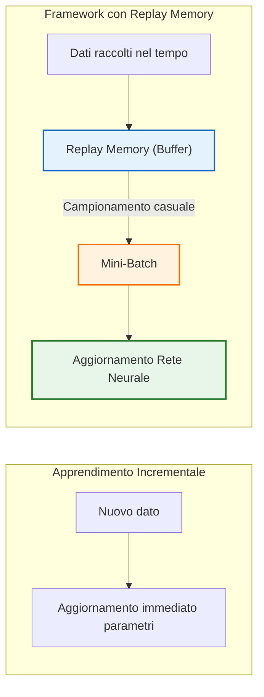
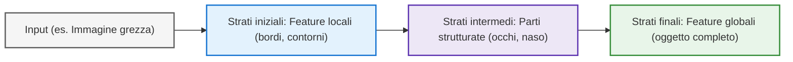
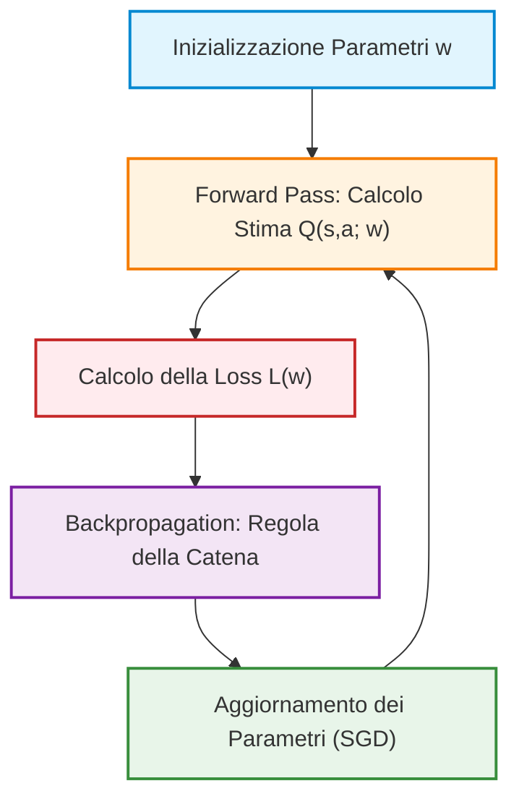
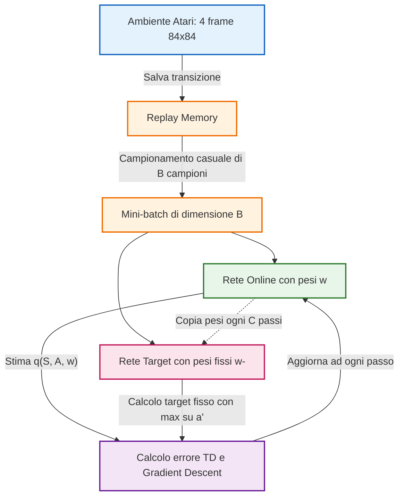

# Batch Learning e Deep Reinforcement Learning: Introduzione alle Deep Q-Network (DQN)

## Overview Didattica

Questa lezione rappresenta il punto di congiunzione tra tutti i concetti basati sull'approssimazione delle funzioni valore visti finora (come *bootstrapping* e *policy iteration*) e le architetture moderne di **Apprendimento per Rinforzo Profondo (Deep Reinforcement Learning)**, segnando l'ultima tappa prima del passaggio agli approcci *Policy Gradient*.

I concetti chiave affrontati nella lezione si sviluppano lungo tre direttrici principali:

* **Richiamo sull'Approssimazione della Funzione Valore (*Value Function Approximation*):** si consolidano le motivazioni che portano a superare l'approccio tabellare classico (matrici esatte per $V$ e tabelle per $Q$). L'uso di una funzione parametrica garantisce **generalizzazione** su stati mai osservati, **scalabilità** verso spazi di stato continui o molto grandi e un significativo **risparmio di memoria**.
* **Transizione dall'Apprendimento Incrementale (*Incremental Learning*) al *Batch Learning*:** anziché aggiornare i parametri $w$ della funzione ad ogni singolo dato in arrivo, i metodi *batch* — come i **Metodi ai Minimi Quadrati (*Least Squares*)** — accumulano campioni per un intervallo $T$ prima di eseguire l'aggiornamento. Questo approccio offre tre vantaggi fondamentali:
  1. Permette di ottenere una **soluzione esatta in forma chiusa** (analogamente alla regressione lineare classica).
  2. Consente un **funzionamento asincrono**, disaccoppiando la frequenza di raccolta dei dati da quella di aggiornamento dei parametri.
  3. Favorisce il **riutilizzo dei dati storici**, sfruttando in modo efficiente informazioni preziose e costose da raccogliere.
* **Superamento del limite lineare e architettura *Deep Q-Network (DQN)*:** il limite strutturale degli approcci *Least Squares* tradizionali è il vincolo di linearità della funzione approssimante. Combinando il concetto di *batch* con le reti neurali profonde (*Deep Learning*), è possibile approssimare funzioni non lineari per risolvere il **Problema di Controllo (*Control Problem*)**, arrivando alla definizione dell'architettura **DQN** per la stima di $Q$ in uno scenario di *Q-Learning* (distinto da *SARSA*).

---

### 1. Dal Metodo Tabellare all'Approssimazione di Funzioni e al Batch Learning

Riprendiamo il percorso dall'approccio di *Approssimazione della Funzione Valore (Value Function Approximation, VFA)*. Rispetto ai metodi tabellari classici — in cui si manteneva un vettore esatto per $V$ o una tabella esatta per $Q$ aggiornando ogni singolo elemento separatamente — l'uso di una funzione parametrica (indicata ad esempio con $\hat{V}$ o $\hat{Q}$) introduce due vantaggi fondamentali:
* **Generalizzazione (Generalization):** permette di ottenere una stima anche per stati o condizioni mai visitati in precedenza (rendendo gestibili anche spazi di stati continui).
* **Risparmio di memoria (Memory Saving):** quando lo spazio degli stati è enorme e una tabella non entrerebbe fisicamente in memoria, una funzione parametrica compatta risolve il problema.

Questa lezione rappresenta un punto di sintesi in cui si combinano tutti gli strumenti visti finora (*bootstrapping*, *policy iteration*, approssimazione di funzioni) per arrivare al **Deep Reinforcement Learning (DRL)**, ovvero il Reinforcement Learning in cui l'approssimazione della funzione valore è affidata a un'architettura di *Apprendimento Profondo (Deep Learning)*. L'obiettivo finale sarà introdurre l'architettura **DQN (Deep Q-Network)**, dove:
* **D** sta per *Deep* (rete neurale profonda);
* **N** sta per *Network* (rete);
* **Q** indica che stiamo risolvendo un problema di controllo stimando la funzione $Q$ in una formulazione basata su *Q-learning* (e non *SARSA*).

*(Nota sui riferimenti e sul codice: poiché il libro di testo tratta le architetture profonde solo brevemente nei capitoli finali, per approfondire il Deep Learning il docente segnala il testo gratuito "Deep Learning" di Goodfellow e Bengio e il corso Stanford di Fei-Fei Li. Inoltre, rispetto alla settimana precedente, è stato reso disponibile il codice aggiornato di $\text{SARSA}(\lambda)$ nel caso generale di approssimazione di funzioni e non solo in quello lineare).*

#### Apprendimento Incrementale vs. Metodi Batch ai Minimi Quadrati

Esistono modi diversi di sfruttare i dati raccolti dall'agente durante l'interazione con l'ambiente:

* **Apprendimento Incrementale (Incremental Learning):** è l'approccio classico visto finora. Appena arriva un nuovo dato, lo si utilizza immediatamente per aggiornare il target, il passo di predizione o di controllo, e poi il dato non viene più riutilizzato.
* **Apprendimento a Lotti (Batch Learning) tramite Minimi Quadrati (Least Squares Methods):** visto nei metodi come Monte Carlo ai minimi quadrati, $\text{TD}(0)$ e $\text{TD}(\lambda)$ ai minimi quadrati. L'idea è attendere e accumulare dati, aggiornando il vettore dei parametri $w$ della funzione valore solo una volta ogni $T$ passi.

I metodi ai minimi quadrati offrono tre vantaggi rilevanti:
1. **Soluzione esatta in forma chiusa:** esattamente come nella regressione lineare con la formula di Gauss, si calcola direttamente la soluzione esatta invece di una stima iterativa approssimata.
2. **Asincronicità (Asynchrony):** è possibile disaccoppiare la frequenza di raccolta dei dati dalla frequenza di aggiornamento dei parametri, qualora l'aggiornamento non riesca a stare al passo con l'acquisizione.
3. **Riutilizzo dei dati (Data Reuse):** dopo i primi $T$ passi si può continuare a raccogliere dati (arrivando a $2T$ campioni e oltre) e ricalcolare la stima riutilizzando anche i vecchi punti già raccolti. Poiché i dati sono preziosi e costosi da ottenere, poterli riutilizzare è un enorme beneficio.

> **Concetto Chiave — Il limite dei metodi ai minimi quadrati:**
> Nonostante i vantaggi della soluzione in forma chiusa e del riutilizzo dei dati, l'approccio ai minimi quadrati funziona **solo per l'approssimazione lineare** (regressione lineare). Quando la funzione valore è approssimata da un modello non lineare, come una rete neurale profonda, questo metodo non è più applicabile.

#### Il nuovo framework: Replay Memory e Mini-Batch

Per combinare i vantaggi del *Batch Learning* con la potenza delle reti neurali, si adotta un nuovo schema architetturale basato su una **Memoria di Replay (Replay Memory)** (un buffer di memoria):
1. Man mano che l'agente raccoglie esperienze, i dati vengono accumulati in un *buffer* persistente.
2. La raccolta dati e l'addestramento possono avvenire in modo asincrono (con l'aggiornamento eseguito tipicamente con frequenza inferiore rispetto alla raccolta).
3. Per aggiornare l'approssimatore (la rete neurale), si campiona dal buffer un piccolo sottoinsieme di dati, detto **Mini-Batch**, e si esegue l'aggiornamento sui dati campionati.



---

### 2. Motivazioni per il Deep Learning nel Reinforcement Learning

Perché abbandonare un modello lineare — semplice, rapido e facilmente interpretabile — per passare a un'architettura non lineare di *Deep Learning*? Esistono due grandi vantaggi, accompagnati però da due criticità che bisogna gestire con attenzione.

#### Vantaggi: Prestazioni e Flessibilità

1. **Prestazioni su funzioni non lineari:**
   Un approssimatore lineare cerca di adattare ai dati un *iperpiano (hyperplane)*. Come visto negli esempi precedenti sul Blackjack con Monte Carlo, le funzioni $V$ o $Q$ reali sono spesso fortemente non lineari. Anche ponderando la *funzione di perdita (loss function)* per privilegiare alcune regioni dello spazio degli stati, un iperpiano non riuscirà mai a catturare correttamente la curvatura e i dettagli della funzione reale.

2. **Flessibilità ed estrazione implicita delle feature:**
   Una rete neurale può accettare in ingresso quasi qualsiasi tipo di dato: serie temporali, audio, immagini o combinazioni miste (es. testo e immagini), operando *end-to-end* per mappare gli input storici nell'output ottimale.

> **Concetto Chiave — Estrazione implicita delle feature (Implicit Feature Extraction):**
> Nei metodi lineari è necessario saper costruire manualmente le *feature* adatte al problema, affidandosi spesso a un esperto di dominio. Una rete neurale, invece, **estrae automaticamente le feature rilevanti** dai dati grezzi in modo implicito, senza richiedere conoscenza a priori sul formato dei dati.

*(Nota pratica di ingegneria: anche disponendo di risorse di calcolo illimitate, se in un'applicazione reale si possiede una conoscenza di dominio e si riescono a definire buone feature manualmente, conviene comunque sfruttarle, eventualmente combinandole con una rete neurale a valle. Questo aiuta a ottenere modelli più interpretabili, con meno parametri e computazionalmente più leggeri).*

#### Svantaggi e criticità nell'uso delle Reti Neurali nel RL

1. **Elevata richiesta di dati (Data Scarcity):**
   Le architetture profonde hanno moltissimi parametri e necessitano di grandi quantità di dati per convergere. Poiché nel Reinforcement Learning i dati possono essere scarsi o costosi da generare, **riutilizzare le esperienze passate tramite la Replay Memory** diventa un requisito fondamentale per non sprecare informazione.

2. **Violazione dell'ipotesi i.i.d. nella Stochastic Gradient Descent:**
   L'addestramento delle reti neurali si basa sulla *Discesa del Gradiente Stocastica (Stochastic Gradient Descent, SGD)*.

> **Concetto Chiave — Il problema della correlazione nelle traiettorie:**
> La SGD richiede che i campioni usati per l'addestramento siano **indipendenti e identicamente distribuiti (i.i.d.)**, o quantomeno il più possibile incorrelati. Nel Reinforcement Learning, però, i dati vengono raccolti lungo *traiettorie (trajectories)* sequenziali: per definizione, uno stato e una transizione al passo successivo sono fortemente correlati a quelli del passo precedente.

Questo è il secondo motivo cruciale per cui introdurremo la *Replay Memory* con campionamento casuale (che verrà approfondita nel seguito): spezzare la correlazione temporale delle traiettorie.

---

### 3. Richiami sull'Architettura delle Reti Neurali

Per chiudere l'inquadramento introduttivo, rivediamo gli elementi essenziali che compongono una *Rete Neurale (Neural Network)*.

#### Il Neurone Artificiale e le Funzioni di Attivazione

Un singolo neurone calcola sostanzialmente una combinazione lineare degli ingressi, alla quale applica una trasformazione non lineare tramite una *funzione di attivazione (activation function)* $g(\cdot)$. Questo modello nasce storicamente a fine anni '50 con il *Percettrone (Perceptron)*, ispirato al funzionamento biologico del cervello.

* **Funzioni di attivazione storiche:** la funzione **Sigmoide (Sigmoid)** e la **Tangente Iperbolica ($\tanh$)**, apprezzate perché continue e comprese tra due livelli asintotici ben definiti.
* **Funzione di attivazione moderna (ReLU):** oggi nella maggior parte delle architetture si utilizza la **Rectified Linear Unit (ReLU)**:
  $$g(x) = \text{ReLU}(x) = \max(0, x) = \begin{cases} 0 & \text{se } x < 0 \\ x & \text{se } x \ge 0 \end{cases}$$

I motivi del successo della $\text{ReLU}$ sono tre, tutti fondamentali per il Deep Reinforcement Learning:
1. Introduce **non-linearità**, pur avendo una forma semplicissima.
2. È **estremamente veloce da calcolare**, aspetto vitale quando bisogna eseguire calcoli ripetuti su milioni di neuroni per molti passi di discesa del gradiente.
3. La sua **derivata è immediata** ($0$ per input negativi, $1$ per input positivi), semplificando enormemente il calcolo dei gradienti durante l'addestramento.

#### Dal Teorema di Approssimazione Universale alle Architetture Profonde

Un risultato classico molto noto afferma che una rete con un solo *strato nascosto (hidden layer)* tra input e output è un **approssimatore universale (universal approximator)**: fornendo un numero sufficiente di neuroni nascosti, essa può rappresentare qualsiasi funzione continua con precisione arbitraria. Tuttavia, per funzioni complesse, il numero di neuroni necessari in un unico strato può diventare enorme (concettualmente tendente all'infinito).

Per superare questo limite, a partire dal 2011–2012 si è affermato il passaggio alle **Architetture Profonde (Deep Architectures)**: anziché usare un unico strato larghissimo, si impilano molti strati nascosti in sequenza (storicamente si parlava di rete *deep* a partire da circa 8 strati nascosti). In questo modo la rete costruisce combinazioni non lineari di feature non lineari in cascata, mantenendo un potere espressivo teoricamente quasi illimitato.

#### Gerarchia delle feature apprese (esempio visivo)

Quando si osserva l'interno di una rete addestrata — in particolare nel caso delle immagini, che risultano più facilmente interpretabili dall'occhio umano rispetto a serie temporali o dati multivariati da sensori — si nota che la rete organizza le feature in modo gerarchico senza che nessuno glielo abbia imposto esplicitamente:



Questa struttura gerarchica — tipica delle *Reti Neurali Convoluzionali (Convolutional Neural Networks, CNN)* che verranno riprese più avanti — mostra come gli strati vicini all'input apprendano dettagli locali elementari (come i bordi), mentre gli strati più vicini all'output li aggreghino in concetti globali utili a risolvere il compito assegnato. Tutto ciò avviene automaticamente fornendo semplicemente l'architettura della rete e i dati.

---

### Addestramento di Approssimatori Non Lineari: SGD e Backpropagation

Quando si utilizzano reti neurali profonde (*Deep Neural Networks*) come approssimatori di funzione per il Reinforcement Learning (RL), ci si trova ad affrontare problemi di ottimizzazione ad altissima dimensione. Nelle architetture moderne, il vettore dei parametri $\mathbf{w}$ può contare facilmente da decine di migliaia fino a $20$ milioni di parametri (o più). 

Visualizzare la funzione di costo (*Loss Function*) su un piano bidimensionale è una semplificazione didattica: nella realtà, l'ottimizzazione si muove all'interno di un paesaggio non convesso complesso, caratterizzato da minimi locali, punti di sella e zone a gradiente quasi nullo.



#### Inizializzazione e Ottimizzazione basata su Gradiente
L'addestramento parte da una scelta iniziale dei parametri $\mathbf{w}_0$. Sebbene in linea di principio la rete possa essere inizializzata casualmente, nella pratica si utilizzano tecniche standard d'inizializzazione presenti in letteratura — come la *He initialization* o la *Glorot/Xavier initialization* — per evitare che i gradienti esplodano o svaniscano nei primi passi.

L'aggiornamento dei parametri segue la direzione opposta a quella del gradiente della funzione di costo:

$$\mathbf{w}_{k+1} = \mathbf{w}_k - \alpha \nabla_{\mathbf{w}} L(\mathbf{w}_k)$$

dove $\alpha > 0$ rappresenta il tasso di apprendimento (*Learning Rate*).

#### Calcolo dei Gradienti tramite Backpropagation
Per aggiornare i parametri di una rete a più strati (*Multi-Layer Neural Network*), è necessario calcolare l'effetto della variazione di ogni singolo parametro $w_i$ sull'output finale. Questo processo prende il nome di *Backpropagation* (retropropagazione dell'errore):

1. **Forward Pass**: Si calcola l'output stimato della rete a partire dall'input dato.
2. **Confronto**: Si confronta la stima prodotta dalla rete con il valore target.
3. **Backward Pass**: Si applica la **regola della catena** (*Chain Rule*) dell'analisi matematica a ritroso, calcolando le derivate parziali del costo rispetto a ogni peso nei diversi strati intermedi:

$$\frac{\partial L}{\partial w_i} = \frac{\partial L}{\partial y} \cdot \frac{\partial y}{\partial z_n} \cdot \frac{\partial z_n}{\partial z_{n-1}} \cdots \frac{\partial z_1}{\partial w_i}$$

Per accelerare questi calcoli si utilizzano funzioni di attivazione non lineari computazionalmente efficienti, come la *Rectified Linear Unit* (ReLU), definita da:

$$f(x) = \max(0, x)$$

La derivata della ReLU è banale (vale $0$ per $x < 0$ e $1$ per $x > 0$), permettendo di eseguire la retropropagazione molto rapidamente anche su reti profonde.

---

### Mini-Batch Stochastic Gradient Descent (SGD)

Nelle applicazioni reali di Deep Learning e RL, la dimensione del dataset finale $N$ (numero totale di campioni di dati) può essere enorme ($N > 100.000$). 

Se si volesse calcolare il vero gradiente (*Full Batch Gradient Descent*), si dovrebbe calcolare la media delle derivate su tutti gli $N$ punti dati:

$$\nabla_{\mathbf{w}} L(\mathbf{w}) = \frac{1}{N} \sum_{i=1}^{N} \nabla_{\mathbf{w}} L_i(\mathbf{w})$$

La complessità computazionale per eseguire un singolo passo di aggiornamento su milioni di parametri e centinaia di migliaia di dati rende il gradiente esatto improponibile dal punto di vista operativo.

#### La Soluzione: Mini-Batch SGD
Invece di utilizzare tutti i campioni $N$, si estrae un piccolo sottoinsieme casuale di dimensione $B \ll N$, detto **Mini-Batch** (solitamente $B \in [32, 1024]$). Il gradiente stimato su questo batch è espresso da:

$$\nabla_{\mathbf{w}} L(\mathbf{w}) \approx \frac{1}{B} \sum_{i=1}^{B} \nabla_{\mathbf{w}} L_i(\mathbf{w})$$

> **Trade-off Logico**: Il gradiente stocastico calcolato su un mini-batch non è esatto ed è soggetto a rumore. Tuttavia, la sua velocità di calcolo consente di eseguire migliaia di aggiornamenti nello stesso intervallo di tempo che servirebbe per calcolare un solo passo di gradiente esatto. Anche se la direzione ad ogni passo non è ideale, l'algoritmo procede verso l'ottimo a una velocità complessivamente molto superiore.

---

### Experience Replay e Rottura delle Correlazioni

Quando si adotta l'approccio a batch nel Reinforcement Learning, la rete aggiorna la funzione valore stimate — ad esempio $Q(s, a; \mathbf{w})$ — prelevando campioni di transizioni da un buffer di memoria storica, detto **Experience Replay Buffer** $\mathcal{D}$.

#### Il Problema dei Dati Sequenziali
Nel RL classico, le esperienze dell'agente $(s_t, a_t, r_t, s_{t+1})$ vengono raccolte sequenzialmente lungo una traiettoria temporale. Se si provasse ad addestrare la rete su campioni temporalmente consecutivi:
* Gli stati vicini nella traiettoria sarebbero fortemente correlati tra loro ($s_t \approx s_{t+1}$).
* Il mini-batch conterrebbe dati quasi identici, portando la stima del gradiente verso sbilanciamenti drastici (ovvero verso una singola direzione dello spazio degli stati).
* La rete rischierebbe di divergere o di andare in *overfitting* sulle regioni locali appena visitate dall'agente.

> **CONCETTO CHIAVE: Rottura delle Correlazioni (*Breaking Correlations*)**
> Estrarre in modo **casuale (uniforme)** un mini-batch di $B$ transizioni dal buffer $\mathcal{D}$ rompe la correlazione temporale tra i campioni. La variabilità statistica all'interno del batch casuale rende la stima del gradiente stocastico molto più vicina e centrata rispetto al gradiente reale, stabilizzando la convergenza dell'addestramento.

```mermaid
flowchart LR
    subgraph Raccolta Dati Sequenziale
        S1["s_t"] --> S2["s_t+1"] --> S3["s_t+2"]
    end
    
    Raccolta Dati Sequenziale -->|Inserimento| Buffer["Buffer di Memoria Storica D"]
    
    Buffer -->|Campionamento Casuale Uniforme| Batch["Mini-Batch B (i.i.d.)"]
    Batch -->|Calcolo Gradiente Stocastico| Update["Aggiornamento Peso w"]

    style Buffer fill:#fff3e0,stroke:#f57c00,stroke-width:2px
    style Batch fill:#e8f5e9,stroke:#388e3c,stroke-width:2px
    style Update fill:#ffebee,stroke:#c62828,stroke-width:2px
```

#### Natura Off-Policy dell'Experience Replay
L'uso dell'Experience Replay impone dei vincoli importanti sull'algoritmo di RL prescelto:

* Il buffer contiene campioni estratti in passato tramite *policy* obsolete ($\pi_{\text{old}}$), mentre la rete attuale calcola $Q(s, a; \mathbf{w})$ facendo riferimento a una nuova *policy* ($\pi_{\text{new}}$).
* L'addestramento condotto con l'Experience Replay è fondamentalmente **Off-Policy**.
* Algoritmi strettamente *On-Policy* come **SARSA** falliscono o mostrano forte instabilità con l'Experience Replay, poiché richiedono che i dati provengano rigorosamente dalla *policy* corrente.
* Per questo motivo, nei contesti a batch si preferiscono algoritmi naturalmente *Off-Policy* come il **Q-Learning**, la cui regola di aggiornamento basata su $\max_{a'} Q(s', a')$ prescinde dalla politica effettivamente usata per generare le transizioni storiche nel buffer:

$$L(\mathbf{w}) = \mathbb{E}_{(s, a, r, s') \sim \mathcal{D}} \left[ \left( r + \gamma \max_{a'} Q(s', a'; \mathbf{w}^{-}) - Q(s, a; \mathbf{w}) \right)^2 \right]$$

---

### Estrazione Automatica delle Feature tramite Reti Convoluzionali (CNN)

Nei problemi di RL complessi (ad esempio il controllo di giochi Atari a partire dai soli pixel dello schermo), lo stato $s$ è fornito sotto forma di immagine raw. 

Un'immagine è una matrice o un sensore di numeri: ad esempio, una griglia di pixel con valori compresi tra $0$ e $255$. Per immagini a colori RGB, lo stato è rappresentato da un tensore con $C=3$ canali spaziali di dimensione $H \times W$.

```mermaid
flowchart LR
    Input["Stato Visivo Input (H x W x C)"] --> Conv["Strati Convoluzionali (Filtri)"]
    Conv --> Act["Attivazione Non Lineare (ReLU)"]
    Act --> Pool["Downsampling (Max Pooling)"]
    Pool --> FC["Fully Connected Layers"]
    FC --> Output["Valori Q(s, a) per ogni azione a"]

    style Input fill:#e1f5fe,stroke:#0288d1,stroke-width:2px
    style Conv fill:#fff3e0,stroke:#f57c00,stroke-width:2px
    style Act fill:#f3e5f5,stroke:#7b1fa2,stroke-width:2px
    style Pool fill:#ffebee,stroke:#c62828,stroke-width:2px
    style FC fill:#e8f5e9,stroke:#388e3c,stroke-width:2px
    style Output fill:#fffde7,stroke:#fbc02d,stroke-width:2px
```



#### Funzionamento delle Convoluzioni
La convoluzione 2D è un'operazione matematica tra una matrice di input $\mathbf{I}$ e una matrice più piccola di pesi detta **filtro** o **kernel** $\mathbf{K}$. Il filtro scorre (*stride*) sulle regioni locali (dette *patches*) dell'immagine.

Per ogni posizione del filtro, si calcola il prodotto elemento per elemento (*element-wise multiplication*) seguito dalla somma di tutti i termini:

$$S(i, j) = (\mathbf{I} * \mathbf{K})(i, j) = \sum_{m} \sum_{n} \mathbf{I}(i+m, j+n) \mathbf{K}(m, n)$$

#### Perché le Convoluzioni funzionano sulle Immagini?

1. **Preservazione della Struttura Spaziale (*Spatial Structure*)**: A differenza dei livelli completamente connessi (*Fully Connected Layers*), che appiattiscono l'input distruggendo le relazioni geometriche, i filtri convoluzionali elaborano l'informazione considerando i pixel vicini come parte di una stessa regione semantica (ad esempio, il bordo di un oggetto, un occhio o una pallina di un videogioco).
2. **Condivisione dei Parametri (*Parameter Sharing*)**: Lo stesso set di pesi (il filtro $\mathbf{K}$) viene riutilizzato su tutte le regioni dell'immagine. Se un'immagine ha dimensioni $1000 \times 1000$ pixel, collegare direttamente ogni pixel a un neurone richiederebbe un numero enorme di pesi; riutilizzare un kernel di dimensione $3 \times 3$ riduce drasticamente il numero di parametri liberi da addestrare.

#### Struttura tipica di una CNN per RL
Le Reti Convoluzionali (*Convolutional Neural Networks - CNN*) combinano diversi tipi di strati intermedi:

* **Strato Convoluzionale (*Convolutional Layer*)**: Applica una serie di filtri per formare le mappe delle feature (*Feature Maps*).
* **Attivazione Non Lineare (ReLU)**: Applica la non-linearità elemento per elemento.
* **Max Pooling**: Riduce la dimensione spaziale delle feature maps prendendo solo il valore massimo all'interno di una sotto-regione (ad es. $2 \times 2$). Questo introduce invarianza alle piccole traslazioni ed effettua un *downsampling* computazionale.

Negli approcci classici di visione artificiale (*Computer Vision*), i coefficienti dei filtri venivano progettati a mano da esperti del dominio. Nelle architetture di Deep Learning applicate al RL (come la celebre DQN di DeepMind per i giochi Atari), i pesi di questi filtri **vengono appresi automaticamente** dai dati stessi tramite la minimized loss, trasformando l'input di pixel grezzi in una stima diretta dei valori di azione $Q(s, a)$.

---

### Il caso storico di Deep Q-Network (DQN) sui giochi Atari

Per consolidare tutti gli strumenti visti finora, analizziamo l'architettura **Deep Q-Network (DQN)**, una pietra miliare nella storia recente dell'Apprendimento per Rinforzo (Reinforcement Learning, RL). Sviluppata dai ricercatori di DeepMind tra il 2014 e il 2016 (gli stessi che hanno successivamente realizzato AlphaGo), questa architettura ha dimostrato per la prima volta che un algoritmo basato su reti neurali profonde può imparare a giocare — e a vincere — a decine di giochi arcade classici di Atari utilizzando un unico approccio flessibile, senza progettare regole o estrattori di caratteristiche specifici per ogni gioco (come ad esempio il rilevamento di oggetti per individuare la palla o la racchetta).

#### Formulazione del problema RL su Atari

Come si modella un videogioco arcade all'interno del framework RL?

* **Spazio delle azioni (Action Space):** è discreto e molto semplice. Nei vecchi cabinati Atari i comandi si riducono a poche scelte: muoversi a sinistra, muoversi a destra, premere il pulsante di azione oppure una loro combinazione.
* **Ricompense (Rewards):** in alcuni giochi il punteggio compare direttamente sullo schermo ed è immediato. In altri, come nel gioco dei mattoncini (*Breakout*), la ricompensa è sparsa o ritardata: ad esempio, $-1$ quando la palla cade e l'episodio termina, $+1$ quando si rompono tutti i mattoncini. Anche se la ricompensa non è immediata, sappiamo che i ritorni a lungo termine (long-term returns) sono sufficienti per formulare correttamente un problema di RL.
* **Stati (States) e proprietà di Markov:** un singolo fotogramma (frame) dello schermo **non è sufficiente** per definire lo stato. Se osserviamo un'immagine statica con una palla, dei mattoncini e una piattaforma, non abbiamo modo di sapere in che direzione o a che velocità si stia muovendo la palla. Per catturare la dinamica del gioco e ottenere una rappresentazione che soddisfi la proprietà di un Processo Decisionale di Markov (Markov Decision Process, MDP), DeepMind ha costruito ogni stato impilando **4 fotogrammi consecutivi**.

#### Preprocessing delle immagini

Prima di passare i 4 fotogrammi alla rete neurale, i dati grezzi vengono semplificati per ridurre il carico computazionale:
1. Le immagini vengono convertite in **scala di grigi** (1 solo canale invece dei 3 canali RGB), poiché il colore non è indispensabile per giocare alla maggior parte dei titoli Atari.
2. Ogni fotogramma viene ridimensionato alla risoluzione di $84 \times 84$ pixel.

---

### Il cambio di paradigma architetturale in DQN

Nell'approccio classico all'approssimazione di funzione per il controllo, la coppia stato-azione $(S, A)$ viene passata in ingresso all'approssimatore per ottenere una singola stima scalare $\hat{q}(S, A, w)$. Per scegliere l'azione migliore, è quindi necessario valutare la rete separatamente per ogni possibile azione $A$ dato lo stato $S$.

Con le reti neurali profonde, DQN introduce una modifica architetturale molto efficace:
* **Ingresso:** la rete riceve **unicamente lo stato $S$** (la pila di 4 frame $84 \times 84$).
* **Uscita:** l'ultimo strato (la "testa" della rete) produce contemporaneamente **un vettore di stime $Q$**, ovvero un output distinto per ciascuna delle azioni possibili nello spazio delle azioni (es. $\hat{q}(S, a_1, w), \hat{q}(S, a_2, w), \dots$).

> **Concetto Chiave — Vantaggi della multi-output architecture:**
> Passare solo lo stato in ingresso permette di sfruttare la condivisione dei parametri (parameter sharing) nei primi strati della rete neurale per estrarre le caratteristiche visive comuni a tutte le azioni. Ciò riduce la dimensione dello spazio di input, diminuisce drasticamente il costo computazionale (basta un solo passaggio in avanti per valutare tutte le azioni e scegliere quella con valore massimo) e permette un uso più efficiente dei dati in scenari *off-policy*, poiché l'input della rete non dipende esplicitamente dalle azioni selezionate da policy precedenti.

---

### Gestire la Triade Mortale in DQN

> **Concetto Chiave — Attenzione alla Triade Mortale (Deadly Triad):**
> L'architettura DQN combina simultaneamente tutti e tre gli elementi che compongono la *Triade Mortale*:
> 1. **Approssimazione di funzione (Function Approximation):** uso di reti neurali profonde per stimare $Q$.
> 2. **Bootstrapping:** aggiornamento delle stime di $Q$ basato su altre stime di $Q$, tipico dei metodi Temporal Difference ($TD(0)$).
> 3. **Apprendimento off-policy:** i dati usati per l'aggiornamento provengono da una memoria storica raccolta anche con policy precedenti, e la regola di aggiornamento è quella del *Q-Learning* (che usa l'operatore $\max$).
>
> Quando questi tre fattori coesistono, l'algoritmo rischia di diventare instabile e di non convergere.

Per evitare la divergenza e stabilizzare l'addestramento, DQN introduce **due accorgimenti (tricks) fondamentali**: l'*Experience Replay* e i *Fixed Q-Targets*.

#### 1. Memoria di Replay (Experience Replay)

Invece di aggiornare la rete immediatamente su ogni singola transizione osservata in sequenza, l'agente salva ogni esperienza in un buffer di memoria storica chiamato **Replay Memory**. Un singolo punto dati è costituito dalla transizione completa (lo stato corrente formato dai 4 frame, l'azione eseguita, la ricompensa ottenuta e lo stato successivo formato dai 4 frame successivi).

* Quando si vuole effettuare un aggiornamento dei pesi della rete, si campiona casualmente un mini-batch di dimensione $B$ dalla Replay Memory.
* Questo rompe la forte correlazione temporale tra frame consecutivi e permette di riutilizzare più volte le esperienze passate.
* **Aspetti pratici dell'implementazione:** la raccolta dei dati e l'aggiornamento tramite mini-batch possono essere completamente asincroni (ad esempio, si può eseguire un aggiornamento ogni $N$ passi nell'ambiente, oppure attendere all'inizio di aver accumulato abbastanza campioni). Poiché il buffer non può crescere all'infinito, nella pratica si utilizza spesso una memoria di dimensione fissa, scartando i dati più vecchi man mano che ne arrivano di nuovi. Sebbene si possano progettare strategie di campionamento pesato (per dare più peso ai dati recenti), il campionamento casuale uniforme risulta già molto efficace per mantenere l'esplorazione e rompere le correlazioni.

#### 2. Target Fisso (Fixed Q-Targets)

Nel Q-Learning con approssimazione di funzione, vogliamo ridurre l'errore tra la stima attuale $\hat{q}(S, A, w)$ e il target $TD(0)$:
$$R + \gamma \max_{a'} \hat{q}(S', a', w)$$

Il problema nasce dal fatto che i pesi $w$ compaiono **sia** nella stima che stiamo aggiornando **sia** nel calcolo del target stesso. Ad ogni passo di discesa del gradiente stocastico, modificando $w$, spostiamo continuamente anche il nostro bersaglio: la superficie di errore cambia a ogni iterazione e la rete fatica a convergere ("insegue un bersaglio mobile").

**Soluzione:** si mantengono due copie dei parametri della rete:
* I **pesi correnti (online)** $w$, aggiornati ad ogni passo di training sul mini-batch.
* I **pesi fissi (target/old)** $w^-$, utilizzati esclusivamente per calcolare il target TD:
$$y = R + \gamma \max_{a'} \hat{q}(S', a', w^-)$$

I parametri $w^-$ restano congelati per un numero fissato di passi pari all'iperparametro $C$. Solo al termine di ogni finestra di $C$ passi, i pesi della rete target vengono sincronizzati copiando quelli della rete corrente ($w^- \leftarrow w$). Mantenendo il bersaglio fermo per un certo intervallo, la rete online ha il tempo di convergere in modo stabile verso la stima corrente.



---

### Risultati sperimentali e analisi dei contributi

DeepMind ha testato questa identica architettura su **49 diversi giochi Atari**, mantenendo fissi la struttura della rete neurale e tutti gli iperparametri (come $B$ e $C$) attraverso tutti i giochi, lasciando che l'addestramento modificasse solo i pesi $w$ specifici per ciascun gioco.

* **Confronto con esperti umani:** le prestazioni sono state confrontate con quelle di un giocatore professionista interno a DeepMind. La rete DQN ha battuto il giocatore umano nel **75% dei giochi** (superandolo nettamente soprattutto nei giochi che richiedono molte mosse rapide e riflessi continui).
* **Limiti osservati:** nei giochi in cui le ricompense sono estremamente rare e lontane nel tempo (alta scarsità di reward), l'algoritmo standard incontrava difficoltà e richiedeva un numero molto maggiore di partite ed esperienze per riuscire a imparare.
* **Impatto dei due accorgimenti:** dagli studi di ablazione condotti su un sottoinsieme di giochi è emerso che:
  * L'**Experience Replay** è il meccanismo che produce il salto di qualità più marcato rispetto all'approccio base privo di accorgimenti.
  * Anche il **Fixed Target** migliora sempre le prestazioni rispetto al caso base (arrivando in certi giochi a essere efficace quanto il replay).
  * La **combinazione di entrambi** garantisce sistematicamente i risultati migliori.

---

### Sviluppi successivi e transizione ai metodi Policy Gradient

#### Approfondimenti oltre DQN base (opzionali)

La ricerca non si è fermata al paper originale di DQN, ma ha introdotto varianti più performanti:
* **Double DQN:** mantiene la rete target fissa ($w^-$), ma invece di usarla sia per scegliere l'azione migliore sia per valutarla, usa la **rete online** ($w$) per selezionare l'azione ottimale e la **rete target** ($w^-$) per valutarne il valore $Q$. Questo accorgimento semplice da implementare rende la stima meno soggetta a sovrastime e migliora i risultati.
* **Rainbow:** un approccio più complesso che combina insieme 6 diversi miglioramenti proposti in letteratura. Tra questi ritroviamo concetti già incontrati nel corso, come il *Prioritized Experience Replay* (analogo all'idea di dare priorità agli stati più rilevanti negli aggiornamenti asincroni della Programmazione Dinamica) e l'uso di stime *multi-step* al posto del singolo passo $TD(0)$.

#### Verso i metodi Policy Gradient

L'architettura DQN rappresenta il culmine del percorso costruito finora sui metodi basati sulla stima del valore, in cui abbiamo integrato tutti gli strumenti visti dalle basi fino all'approssimazione con reti profonde — risultando direttamente applicabile anche a problemi pratici basati su immagini o flussi video. A partire dalla prossima lezione cambieremo prospettiva introducendo i metodi **Policy Gradient**, un framework differente che riutilizzerà molti degli elementi già appresi per affrontare problemi di controllo ancora più complessi.

---

> [!NOTE]
> ### Note per l'Esame e Avvisi del Docente
> - Il docente precisa esplicitamente che **le slide sono materiale d'esame**, soprattutto per questa parte del corso in cui non c'è un capitolo diretto sul libro di testo che contenga tutto (aggiunge inoltre che, per i richiami sul deep learning, le slide e la registrazione dell'anno scorso sono sufficienti).
> - Le estensioni più recenti di DQN (**Double DQN** e **Rainbow**) sono indicate come **materiale opzionale**: il docente dichiara che ai fini del corso si ferma alla slide precedente su DQN.
> - Il docente raccomanda fortemente di considerare **Deep Q-Network (DQN)** per i progetti standard basati su immagini o video.