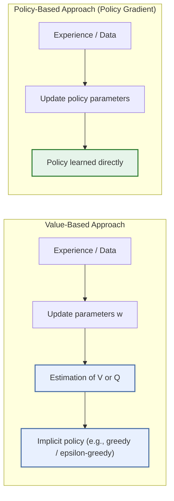
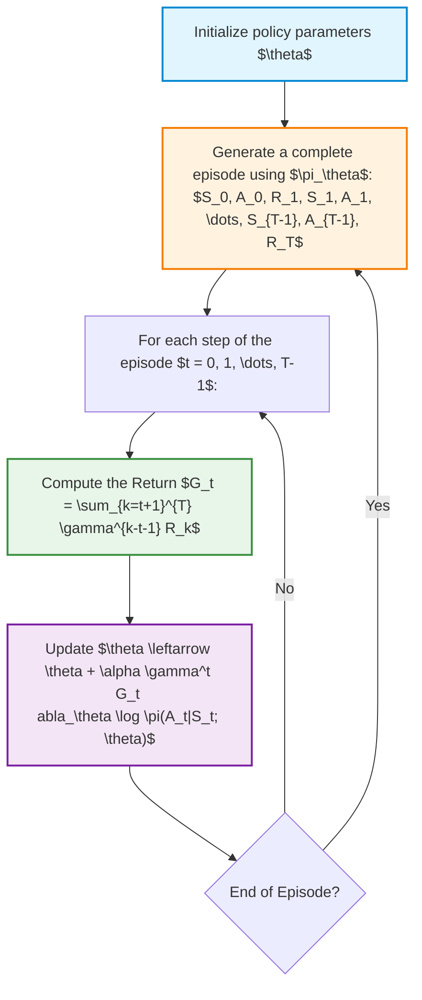
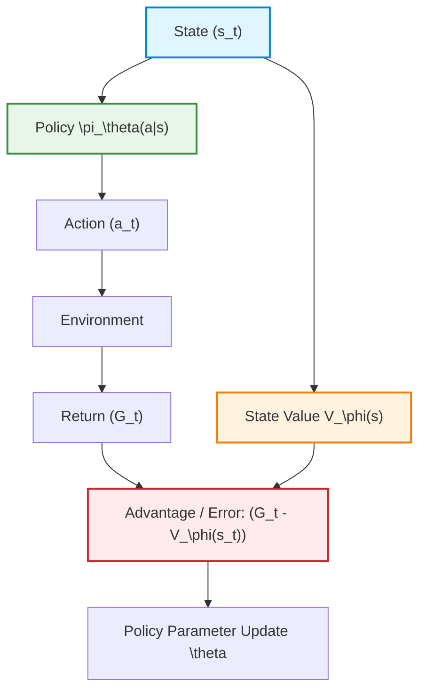

# Introduction to Policy Gradient Methods

## Course Overview

In this lecture, a new class of fundamental algorithms in Reinforcement Learning (RL) is introduced: **Policy Gradient Methods**. Up to this point in the course, the focus has been on **value-based approaches**, such as SARSA, Q-Learning, and Deep Q-Networks (DQN). In these methods, the primary goal is the accurate estimation of the state-value function $V(s)$ or the action-value function $Q(s,a)$, in order to then implicitly derive an optimal policy (for example, via the $\arg\max$ operator or $\epsilon$-greedy strategies).

The main motivation behind **policy-based approaches** lies in the asymmetry that often arises between the complexity of the value function and the simplicity of the optimal policy. Through the classic *Mountain Car* benchmark, we observe how representing the surface of the function $Q(s,a)$ can require complex, non-linear approximations, compared to an optimal policy that follows extremely simple decision rules (for instance, following the sign of the velocity). Policy Gradient methods overcome this discrepancy by directly parameterizing and optimizing the policy $\pi(a|s;\boldsymbol{\theta})$ using the gradient ascent algorithm, without the strict requirement of estimating the values $V$ or $Q$ beforehand.

---

### Review and Clarifications from the Previous Lecture

Before introducing the new methods, let us clarify some inaccuracies that came up in the Atari games example (covered in the previous lecture) as well as a fundamental theoretical aspect related to linear approximation:

* **Historical and technical clarifications on Atari:** The first landmark paper dates back to 2013 (not 2015). Furthermore, the joystick action space is richer than mentioned: it supports up to $8$ directions (plus possible combinations), not just $4$ or $5$. Finally, in *Breakout* the reward does not arrive exclusively at the end of the game, as points are accumulated progressively throughout gameplay (though the concept of delayed reward remains valid in general for other scenarios).

> **Key Concept — Linearity in Feature Space vs. State Space:**
> When we represent a learned value function (as in the case of *Mountain Car*), it can appear strongly **non-linear** when observed in the original state space $S$. However, in Value Function Approximation, we typically work in a **Feature Space** $X$. If we use techniques like Tile Coding, the approximation remains **linear with respect to the features $X$**, while still generating a surface that, when mapped back onto the state space $S$, appears curved and non-linear.
> We therefore introduce non-linear approaches (such as neural networks) for two specific reasons:
> 1. **Automatic feature extraction**;
> 2. The ability to model **non-linear relationships directly in the feature space**.

---

### Motivation for Policy Gradient Methods

With this lecture (which refers to Chapter 13 of the textbook), we change perspective: so far we have built everything starting from value functions all the way up to Deep Q-Networks. Now we temporarily set this approach aside to introduce **Policy Gradient Methods**, techniques widely used in practice.

#### The Complexity Paradox: The Mountain Car Example

To understand why these methods are needed, let us return to the classic **Mountain Car** problem, in which a car must climb out of a valley to reach the flag at the top of the hill. The state $s \in S$ is defined by two continuous variables: horizontal position and velocity (with its sign indicating the direction).

As we have seen, the value functions $V(s)$ and $Q(s,a)$ for this problem have a rather complex shape. But let us forget about Reinforcement Learning, $V$, and $Q$ for a moment: if we had to write a simple traditional program to get the car to the flag, what rule would we use?

The solution is surprisingly elementary: **position does not even matter, we just need to look at the velocity**.
* If the sign of the velocity indicates that we are already moving to the right, we keep pushing to the right.
* If the sign indicates that we are moving to the left, we keep pushing to the left.

In this way, the car oscillates, builds momentum, and reaches the top. This highlights a **strong asymmetry in complexity**: our ultimate goal is always to find an optimal policy $\pi^*$, yet in many problems $\pi^*$ is extremely simple, whereas the functions $V$ and $Q$ that we use as a basis to derive it are much more complex than necessary.

#### Value-Based Approach vs. Policy-Based Approach

From this observation arises the distinction between two major families of algorithms:

* **Value-Based Approaches:** Everything we have seen so far (e.g., SARSA, Q-Learning, DQN). The agent estimates $V(s)$ or $Q(s,a)$ (parameterized by a weight vector $w$) and the policy is defined only **implicitly** (for example, by choosing the action in a *greedy* or $\varepsilon$-greedy manner with respect to $Q$).
* **Policy-Based Approaches:** We completely abandon the definition and estimation of $V$ and $Q$. What we do is **directly parameterize the policy** and learn its parameters through experience and data collected from the environment.

#### Why don't we completely abandon $V$ and $Q$?

If it is possible to learn the policy directly, why did we invest so many lectures on value functions? There are two main reasons:
1. **Understanding and interpretability (in addition to historical reasons):** $V$ and $Q$ provide valuable information on the progress of the problem, explicitly telling us how "good" or "bad" it is to be in a certain state while following a given strategy. Without them, we lose this direct evaluation capability.
2. **Hybrid methods in practice:** To make Policy Gradient methods work really well on complex real-world problems, starting next week we will combine *value-based* and *policy-based* approaches together (bringing back into play what we have seen so far).

---

### Advantages and disadvantages of Policy Gradient methods

Let us analyze in detail what is gained and what is lost by moving to direct policy learning.

#### Strengths (Pros)
* **Faster convergence:** When the policy is structurally simpler than $V$ and $Q$ (as in Mountain Car), these methods reach a good solution in less time.
* **Effectiveness in high-dimensional and continuous spaces:** They work very well when the state space or **the action space is continuous (Continuous Action Spaces)**. Since there is no need to build tables or maximize a $Q$ over infinitely many possible actions, it suffices to define a continuous parameterized function that accepts continuous states and directly outputs actions or probability distributions.
* **Learning optimal stochastic policies:** They can natively represent and learn optimal probabilistic policies, something that classical tabular and *value-based* methods do not do (we will explore this crucial point in detail in the next section).

#### Weaknesses (Cons)
* **Convergence to Local Optima:** Unlike tabular methods or certain linear approaches with approximation of $V/Q$, in Policy Gradient methods convergence guarantees to the **Global Optimum** are almost always lost. The algorithm can get trapped in a local optimum.
* **Lack of self-evaluation:** Without $V$ or $Q$, during execution we do not directly know whether we are performing well or poorly in a given state, unless we introduce auxiliary procedures external to the policy update mechanism.

---

### The need for stochastic policies

Why is it so important that an algorithm can learn a **Stochastic Policy** instead of a deterministic one? Recall that in the *value-based* methods seen so far, stochasticity (e.g., $\varepsilon$-greedy) was used *only* for exploring during learning, and had to be eliminated afterwards to obtain the final optimal policy, which was always deterministic. However, there are scenarios in which the optimal policy itself **must** be stochastic.

#### Intuitive example: Rock, Paper, Scissors

An immediate case is the game *Rock, Paper, Scissors*. If we adopted a deterministic policy (or any predictable pattern), the opponent would learn our behavior and systematically beat us. The only optimal policy in this context is a **uniform stochastic policy** (choosing each of the three actions with the same probability).

#### The Aliasing Problem in Feature Space: The Gridworld Example

The need for stochastic policies becomes even more evident when we use function approximation in large-scale problems. Let us consider a small grid (*Gridworld*) composed of $8$ states, of which $3$ are terminal states: one leads to a very negative reward (e.g., $-1000$), the other two to a positive reward (e.g., $+100$ or $+1000$). Imagine also a penalty of $-1$ for each step taken. This small example represents, on a reduced scale, much larger real-world problems (e.g., $1000$ states).

When the problem is too large to be treated in a tabular manner, we move from the state space $S$ to the **feature space** $X$. For example, we can describe each cell through its local topology using $4$ binary features corresponding to the four cardinal directions (North, South, East, West):
* We set $1$ if there is a wall in that direction;
* We set $0$ if there is a free cell in that direction into which we can move.

A feature vector like $(1, 0, 1, 0)$ thus indicates two directions blocked by walls and two free directions.

The problem arises when **two different states of the grid present exactly the same local configuration**: for instance, two distinct corridors (two separate grey squares in the grid) both have a wall to the North, a wall to the South, and free cells to the East and West. In the feature space, **these two states appear identical to the agent**.

What happens when applying the two types of policies?
* **Deterministic policy (failing):** By the Optimal Policy Theorem in tabular Markov Decision Processes (MDPs), there always exists at least one optimal deterministic policy. However, *in feature space*, a deterministic policy is forced to make the exact same decision for both indistinguishable states (e.g., "if you see walls to North/South and open space to East/West, always go right" or "always go left"). In one of the two corridors the agent will reach the rewarded exit, but in the other it will end up bouncing against a dead end or entering an **infinite loop**, accumulating penalties of $-1$ at each step.
* **Stochastic policy (optimal):** If, instead, the policy chooses to go left with probability $50\%$ and right with probability $50\%$, sooner or later the agent will manage to exit both states and reach the positive reward. In terms of expected return, spending a few random steps is infinitely better than remaining stuck in an infinite loop.

#### From Fully Observable to Partially Observable

> **Key Concept — Aliasing and Partial Observability:**
> A problem like Gridworld (or chess) is by nature **fully observable (Fully Observable)** if the exact state $s \in S$ is known (unlike games such as *Texas Hold'em*, where the opponent's cards are hidden and the problem is intrinsically **partially observable (Partially Observable)**).
> However, when we scale to complex problems and introduce approximation through **features** (handcrafted or extracted via Deep Learning), we lose part of the original information. Consequently, **even a problem that is originally fully observable becomes effectively partially observable in the feature space**.
> Under these conditions, *value-based* methods are incapable of learning the optimal stochastic policy required to handle ambiguity between different states; **Policy Gradient** methods, on the other hand, naturally handle both stochastic policies and partially observable representations.

*(Final note: the policy learned with Policy Gradient methods **can** be stochastic when the problem requires it, but it is not forced to be if a deterministic choice turns out to be optimal. Furthermore, while facilitating the visitation of different actions, stochasticity alone does not automatically guarantee sufficient exploration without dedicated mechanisms).* 

---
*In the next section, we will move on to mathematical formalization and see how to concretely parameterize a policy.*

---

### From Value Evaluation to Direct Policy Optimization

In previous lectures on Value Function Approximation (*Value Function Approximation - VFA*), the objective was to learn a weight vector $w$ to estimate $V(s)$ or $Q(s,a)$. In that context, the policy $\pi$ was implicitly derived (for example, via $\epsilon$-greedy choices) from the estimated value function. 

In **Policy Gradient** methods, we shift paradigms: we parameterize the policy directly using a parameter vector $\theta \in \mathbb{R}^d$. We denote the parameterized policy as:

$$\pi(a|s; \theta) = \mathbb{P}(A_t = a \mid S_t = s, \theta_t = \theta)$$

The parameters $\theta$ play exactly the same role as $w$ in VFA: they are quantities that we must update starting from data collected in the environment. 

An elementary example of this approach was already encountered with *Gradient Bandits* (in non-contextual or *stateless* settings), where the policy selected actions based on "preferences" learned over time through historical data, without computing any $Q$ function. Now we extend this principle to full Markov Decision Processes (*Markov Decision Processes - MDPs*) with multiple states.

---

### The Objective Function $J(\theta)$ and Gradient Ascent

In any Machine Learning problem, it is necessary to formally define the concept of optimality through an **Objective Function** (*Objective Function*).

* **In VFA (Supervised / TD):** We minimized a cost function (Loss Function), attempting to make the distance between our estimate $\hat{v}(s,w)$ or $\hat{q}(s,a,w)$ and a target (such as the Monte Carlo return or the TD Target) as small as possible via gradient descent (*Gradient Descent*).
* **In Policy-Based Methods:** Since there are no $V$ or $Q$ functions to approximate directly, we do not need to minimize an estimation error. We return to the primary and most natural Reinforcement Learning problem: **maximizing the expected long-term return**.

We define the objective function $J(\theta)$ as the overall performance of policy $\pi_\theta$. The goal is to find the optimal set of parameters $\theta^*$:

$$\theta^* = \arg\max_\theta J(\theta)$$

Since we want to maximize $J(\theta)$, the parameter update will occur via **Gradient Ascent** (*Gradient Ascent*):

$$\theta_{t+1} = \theta_t + \alpha \nabla_\theta J(\theta_t)$$

where $\alpha > 0$ represents the learning rate (*Step Size* or *Learning Rate*).

---

### The Policy Gradient Theorem

The fundamental problem lies in computing the gradient $\nabla_\theta J(\theta)$. The return depends both on the choice of actions (dictated by $\pi_\theta$) and on the distribution of visited states, which in turn depends on $\theta$. Computing the derivative of the state distribution with respect to $\theta$ would seem to require knowledge of the environment's dynamics (the MDP transition models).

The **Policy Gradient Theorem** (*Policy Gradient Theorem*) solves this theoretical issue by demonstrating that the performance gradient is proportional to a quantity that does not require taking the derivative of the state distribution.

> **Key Concept: The Policy Gradient Theorem**
> 
> For any MDP parameterized with a differentiable policy $\pi(a|s;\theta)$, the gradient of the objective function with respect to $\theta$ is proportional to:
>
> $$\nabla_\theta J(\theta) \propto \sum_{s \in \mathcal{S}} \mu(s) \sum_{a \in \mathcal{A}} q_\pi(s,a) \nabla_\theta \pi(a|s;\theta)$$
>
> where $\mu(s)$ is the on-policy stationary (or visitation) distribution of states under $\pi$.

#### The Log-Derivative Trick (*Score Function*)

To transform the analytical expression of the theorem into an algorithm based on samples of real experience, an algebraic manipulation based on logarithm properties is applied.

*Note: Step integrated with pedagogical clarity.*

Recalling that the derivative of the logarithm of a function is $\nabla_\theta \log f(\theta) = \frac{\nabla_\theta f(\theta)}{f(\theta)}$, we can rewrite $\nabla_\theta \pi(a|s;\theta)$ by multiplying and dividing by $\pi(a|s;\theta)$:

$$\nabla_\theta \pi(a|s;\theta) = \pi(a|s;\theta) \frac{\nabla_\theta \pi(a|s;\theta)}{\pi(a|s;\theta)} = \pi(a|s;\theta) \nabla_\theta \log \pi(a|s;\theta)$$

Substituting this result into the gradient expression, we obtain:

$$\nabla_\theta J(\theta) \propto \sum_{s \in \mathcal{S}} \mu(s) \sum_{a \in \mathcal{A}} \pi(a|s;\theta) q_\pi(s,a) \nabla_\theta \log \pi(a|s;\theta)$$

The quantity $\nabla_\theta \log \pi(a|s;\theta)$ is defined as the **Score Function** (*Score Function*). 

Thanks to the presence of $\pi(a|s;\theta)$ and the state distribution $\mu(s)$, the summation over states and actions can be rewritten as an **expected value** (*Expectation*) over trajectories generated following policy $\pi$:

$$\nabla_\theta J(\theta) = \mathbb{E}_\pi \left[ q_\pi(S_t, A_t) \nabla_\theta \log \pi(A_t|S_t; \theta) \right]$$

Since we do not know the true value of $q_\pi(S_t, A_t)$, we use as an unbiased estimator (*unbiased estimator*) the **actual accumulated return** $G_t$ computed from real data (exactly the same principle used in Monte Carlo methods).

$$\nabla_\theta J(\theta) = \mathbb{E}_\pi \left[ G_t \nabla_\theta \log \pi(A_t|S_t; \theta) \right]$$

---

### Algorithm Interpretation and Update Rule

The practical computational rule for updating parameters $\theta$ at each time step $t$ becomes:

$$\theta_{t+1} = \theta_t + \alpha \gamma^t G_t \nabla_\theta \log \pi(A_t|S_t; \theta_t)$$

where $\gamma^t$ accounts for the MDP discount factor at time $t$.

> **Key Concept: Gradient Update Intuition**
> 
> The update rule acts on three main components:
> 1. **Derivative direction ($\nabla_\theta \log \pi$):** Indicates how to modify $\theta$ to increase the probability of choosing action $A_t$ in state $S_t$.
> 2. **Sample return ($G_t$):** Acts as a scalar. If $G_t > 0$ (high/positive return), it pushes the update in the direction that makes action $A_t$ more likely in the future. If the return is low or negative, it pushes the policy to make that action less likely.
> 3. **Normalization ($1/\pi(A_t|S_t;\theta)$):** It is the effect of the divisor in the *score function*. It normalizes the update for very frequent actions: it prevents actions chosen very often from dominating the update solely by virtue of their high prior probability.

---

### The REINFORCE Algorithm (Monte Carlo Policy Gradient)

The **REINFORCE** algorithm (acronym for *REward Increment = Nonnegative Factor $\times$ Offset Reinforcement $\times$ Characteristic Eligibility*) is the practical Monte Carlo implementation of the Policy Gradient Theorem.

> **Key Concept: Direct Control without Prediction**
> 
> Unlike tabular or VFA methods (such as Q-Learning or SARSA), the REINFORCE algorithm **does not include a prediction phase**. There is no block of code designed to learn $V(s)$ or $Q(s,a)$. We directly solve the **control** problem by modifying the policy parameters.

#### Pseudo-Code Structure (Monte Carlo REINFORCE)

1. **Initialization:**
   * Choose a step-size parameter $\alpha > 0$.
   * Initialize the policy parameter vector $\theta \in \mathbb{R}^d$ (randomly or using prior knowledge).
   * Define a parameterized and differentiable policy $\pi(a|s; \theta)$.

2. **Main loop for each episode:**
   * Generate an entire trajectory following the current policy $\pi_\theta$: $S_0, A_0, R_1, S_1, \dots, S_{T-1}, A_{T-1}, R_T$.
   * For each step $t = 0, 1, \dots, T-1$ of the episode:
     1. Compute the Monte Carlo return $G_t$:
        $$G_t = \sum_{k=t+1}^{T} \gamma^{k-t-1} R_k$$
     2. Update the policy parameters:
        $$\theta \leftarrow \theta + \alpha \gamma^t G_t \nabla_\theta \log \pi(A_t|S_t; \theta)$$

The algorithm presented here is based on an *every-visit* variant. From a software implementation standpoint, computing the returns $G_t$ is performed efficiently by proceeding backward from the end of the episode $T-1$ down to $0$.

---

3. The Switch Corridor Problem

#### Environment Description and Limits of Deterministic Policies

To understand how direct policy optimization behaves in complex environments or under partial observability, let us consider a practical example: the **Switch Corridor**.

The environment is a simple *Grid World* composed of 4 states: a starting point (*Start State*), a goal state (*Goal State*, $G$), and two intermediate cells. Each step taken by the agent corresponds to a negative reward (cost) equal to $-1$. The ultimate goal is to find the shortest trajectory to reach $G$.

The peculiarity of the environment lies in the central **Switch Cell**:
* In ordinary cells, an action executes the desired movement (e.g., moving right leads right).
* In the switch cell, the dynamics are inverted or deflected: attempting to go right pushes you left, and vice versa.

If we represent this environment in a reduced **Feature Space** (for example, detecting only the presence of walls to the right or left and ignoring walls to the north and south), the state representation is not sufficient to distinguish the correct orientation of the actions.

A **Deterministic Policy** fails in this scenario: if the agent deterministically chooses to go right in the switch cell, it will be systematically pushed back to the starting point, entering an infinite loop.

#### Need for Stochastic Policies and Tuning of Hyperparameter $\alpha$

To solve this problem, it is essential to adopt a **Stochastic Policy**.

> **KEY CONCEPT**
> When state features do not allow the environment to be perfectly disambiguated (spatial aliasing or partial information), a deterministic policy can get stuck. A **Stochastic Policy** allows the agent to probabilistically explore actions and overcome critical states.

Experimentally, it is observed that the optimal policy for this specific problem assigns unbalanced yet non-deterministic probabilities to actions: for example, choosing the Right direction about $55\%$ of the time and the Left direction for the remaining $45\%$. Although the agent occasionally bumps into walls, this stochasticity guarantees exiting the switch state and reaching the Goal.

##### Impact of Step Size ($\alpha$)
As previously seen in Monte Carlo methods and TD($\lambda$), the choice of the learning rate $\alpha$ plays a crucial role in the algorithm's convergence:

* **$\alpha$ too small:** Learning is too slow and requires an excessive number of episodes to stabilize.
* **Optimal $\alpha$ (Sweet Spot):** Represents the ideal compromise between speed and stability, rapidly reaching the optimal policy.
* **$\alpha$ too large:** The update is excessively aggressive. The algorithm gets stuck in a **Local Minimum**, behaving similarly to what happens in neural network training in *Deep Learning* when the learning rate is high.

---

### Variance Reduction in Policy Gradient Methods

#### The Bias-Variance Trade-off in Monte Carlo
The **REINFORCE** algorithm uses the accumulated return $G_t$ as an unbiased estimate of the expected value of the trajectory. However, using single samples of Monte Carlo returns carries an extremely high **Variance**.

During gradient update steps (*Gradient Descent* / *Gradient Ascent*), the high variance of the returns causes the update direction of the policy parameters $\theta$ to oscillate wildly, slowing down overall convergence.

#### Normalization Techniques: Whitening
A first elementary approach to contain variance consists of normalizing returns via **Whitening**.

Instead of updating parameters proportionally to the absolute value of the return $G_t$, the return is transformed by calculating the $Z$-score relative to the observed historical returns:

$$\hat{G}_t = \frac{G_t - \mu_G}{\sigma_G}$$

Where:
* $\mu_G$ is the mean of the collected historical returns.
* $\sigma_G$ is the standard deviation of the historical returns.

Although Whitening is simple and reduces oscillations, it is an ad-hoc method rarely used in advanced Reinforcement Learning practice, where the structured introduction of a **Baseline** is preferred.

---

### REINFORCE with Baseline and Introduction to Actor-Critic Approaches

#### The State-Value Function as a Baseline

To stabilize the update without introducing *Bias*, we can take the return $G_t$ and subtract from it an action-independent reference value, called a **Baseline** $b(s_t)$.

The best choice for the baseline is the **State-Value Function** $V(s_t)$.

> **KEY CONCEPT**
> Introducing a baseline $b(s_t) = V(s_t)$ does not alter the expected value of the gradient (it does not introduce *Bias*), but it **drastically reduces the variance** of the updates. The agent no longer evaluates the action based on how high the absolute return $G_t$ is, but based on how much $G_t$ is *better or worse than the expected average in state* $V(s_t)$.

##### Update Rule of REINFORCE with Baseline
The policy gradient is redefined as:

$$\theta_{t+1} = \theta_t + \alpha \gamma^t \left( G_t - V_\phi(s_t) \right) \nabla_\theta \ln \pi_\theta(a_t | s_t)$$

Since the true function $V(s_t)$ is not known a priori, we accompany the policy approximator $\pi_\theta$ with a parallel parametric approximator for the state value $V_\phi(s_t)$, trained using the Value Function Approximation methods previously discussed (e.g., TD or Monte Carlo).

Note: Although we are solving a control problem using policy-based methods, using $V(s_t)$ as a baseline only requires estimating state values rather than the $Q(s,a)$ function, keeping the process computationally efficient.

#### Performance Impact and Intuitive Interpretation

Introducing the baseline yields a radical improvement in sample efficiency:

* **Convergence Speed:** In empirical tests conducted on the switch corridor, REINFORCE with baseline reaches the optimal policy requiring roughly **$1/10$ of the episodes** compared to the base version without baseline.
* **Gradient Direction Invariance:** Since step magnitude is still rescaled by the hyperparameter $\alpha$, what matters in Gradient Descent is the direction of the update vector. The difference $(G_t - V(s_t))$ provides a much more robust directional signal compared to raw data.

##### Parallel with Deep Learning
The effect of the baseline is analogous to the concept of **Momentum** in neural network optimization: one does not blindly trust a single observed data point (which can be noisy), but rather evaluates new information relative to the historical average learned up to that point.

#### Preview: Integration into Actor-Critic Architectures
The combined use of value estimates and direct policies marks the convergence point between *Value-Based* and *Policy-Based* methods.

This hybrid approach forms the foundation of **Actor-Critic** algorithms:
* **The Actor**: Represents the policy $\pi_\theta(a|s)$ and is responsible for selecting actions.
* **The Critic**: Represents the value function $V_\phi(s)$ and evaluates the quality of the actions taken by the actor, guiding its update.

---

> [!NOTE]
> ### Exam Notes and Instructor Announcements
> - **Exam syllabus scope**: the instructor mentioned in advance that the exam material will likely cover up to Lecture 20 (a detailed schedule will follow).
> - **Topics excluded from the exam**: at the end of the course, a couple of open lectures will be held on advanced topics that will **not** be included in the exam, neither for the regular exam nor for the midterm.
> - **Second midterm and review lecture**: tentatively in the same week as the second midterm, a review (*recap*) lecture on the second part of the course is scheduled, for which the instructor will collect student requests in advance regarding topics to revisit.
> - **Derivation of Policy Gradient / REINFORCE**: the instructor explicitly stated that he will **never** ask for the mathematical derivation of the steps from the *Policy Gradient Theorem*, but requires students to **remember the final formula** and the corresponding update rule (including the *score function*), as they are used in the pseudocode and algorithms of the course.
> - **REINFORCE acronym**: the instructor clarified that he will **never** ask students to write out the full meaning of the REINFORCE acronym (while reiterating the importance of the algorithm).