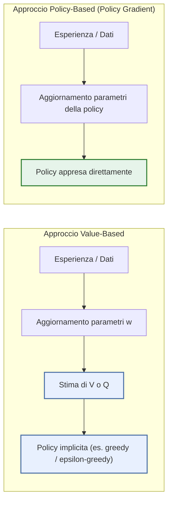
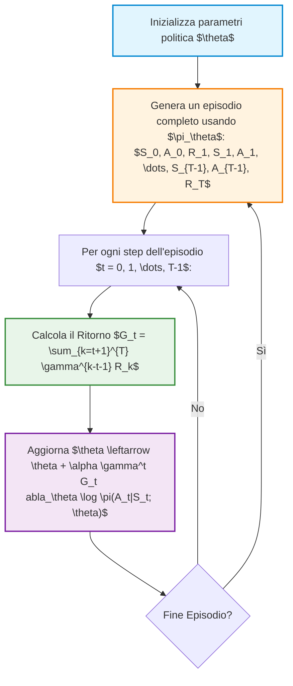
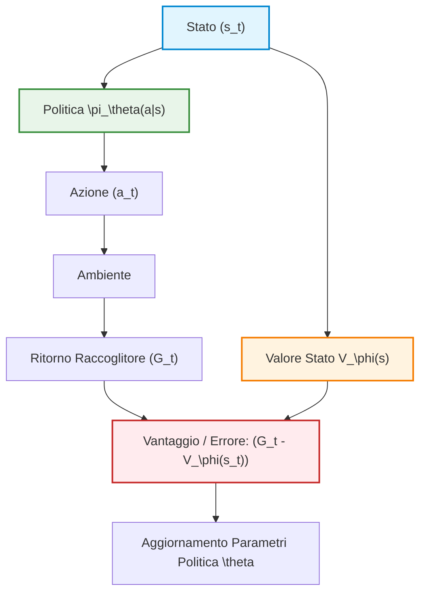

# Introduzione ai Metodi Policy Gradient

## Overview Didattica

In questa lezione viene introdotta una nuova classe di algoritmi fondamentali nel Reinforcement Learning (RL): i **Metodi Policy Gradient** (*Policy Gradient Methods*). Fino a questo punto del corso, l'attenzione si è concentrata sugli **approcci basati sui valori** (*Value-based approaches*), come SARSA, Q-Learning e Deep Q-Networks (DQN). In tali metodi, l'obiettivo principale è la stima accurata della funzione di valore dello stato $V(s)$ o della funzione di valore dell'azione $Q(s,a)$, per poi derivare implicitamente una politica ottima (ad esempio mediante l'operatore $\arg\max$ o strategie $\epsilon$-greedy).

La motivazione principale alla base dei metodi basati direttamente sulla politica (*Policy-based approaches*) risiede nell'asimmetria che spesso si presenta tra la complessità della funzione di valore e la semplicità della politica ottima. Attraverso il classico benchmark del *Mountain Car*, si osserva come la rappresentazione della superficie della funzione $Q(s,a)$ possa richiedere approssimazioni complesse e non lineari, a fronte di una politica ottima che risponde a regole decisionali estremamente semplici (ad esempio, assecondare il segno della velocità). I metodi Policy Gradient superano questa discrepanza parametrizzando ed ottimizzando direttamente la politica $\pi(a|s;\boldsymbol{\theta})$ tramite l'algoritmo di ascesa di gradiente, senza la necessità vincolante di stimare preventivamente i valori $V$ o $Q$.

---

### Richiami e precisazioni dalla lezione precedente

Prima di introdurre i nuovi metodi, chiariamo alcune imprecisioni emerse nell'esempio sui giochi Atari (trattati nella lezione precedente) e un aspetto teorico fondamentale legato all'approssimazione lineare:

* **Precisazioni storiche e tecniche su Atari:** Il primo articolo di riferimento risale al 2013 (non al 2015). Inoltre, lo spazio delle azioni del joystick è più ricco di quanto accennato: supporta fino a $8$ direzioni (più eventuali combinazioni), non solo $4$ o $5$. Infine, in *Breakout* la ricompensa (reward) non arriva esclusivamente a fine partita, ma si accumulano punti progressivamente durante il gioco (il concetto di ricompensa ritardata resta comunque valido in generale per altri scenari).

> **Concetto Chiave — Linearità nello spazio delle feature vs Spazio degli stati:**
> Quando rappresentiamo una funzione valore appresa (come nel caso di *Mountain Car*), essa può apparire fortemente **non lineare** se osservata nello spazio degli stati originale $S$. Tuttavia, nell'approssimazione della funzione valore (Value Function Approximation), noi lavoriamo tipicamente in uno **spazio delle feature (Feature Space)** $X$. Se utilizziamo tecniche come la codifica a tasselli (Tile Coding), l'approssimazione rimane **lineare rispetto alle feature $X$**, pur generando una superficie che, riportata sullo spazio degli stati $S$, appare curva e non lineare.
> Introduciamo quindi approcci non lineari (come le reti neurali) per due motivi precisi:
> 1. L'**estrazione automatica delle feature**;
> 2. La capacità di modellare relazioni **non lineari direttamente nello spazio delle feature**.

---

### Motivazione ai Metodi Policy Gradient

Con questa lezione (che fa riferimento al Capitolo 13 del libro di testo) cambiamo prospettiva: finora abbiamo costruito tutto partendo dalle funzioni valore fino ad arrivare alle Deep Q-Network. Ora mettiamo momentaneamente da parte questo approccio per introdurre i **Metodi Policy Gradient (Policy Gradient Methods)**, tecniche molto usate nella pratica.

#### Il paradosso della complessità: l'esempio di Mountain Car

Per capire perché servano questi metodi, torniamo al problema classico di **Mountain Car**, in cui un'auto deve risalire una valle per raggiungere la bandiera in cima alla collina. Lo stato $s \in S$ è definito da due variabili continue: la posizione orizzontale e la velocità (con il relativo segno che ne indica la direzione).

Come abbiamo visto, le funzioni valore $V(s)$ e $Q(s,a)$ per questo problema hanno una forma piuttosto complessa. Ma proviamo a dimenticare per un attimo il Reinforcement Learning, $V$ e $Q$: se dovessimo scrivere un semplice programma tradizionale per far arrivare l'auto alla bandiera, quale regola useremmo?

La soluzione è sorprendentemente elementare: **non importa nemmeno la posizione, basta guardare la velocità**.
* Se il segno della velocità indica che ci stiamo già muovendo verso destra, continuiamo a spingere verso destra.
* Se il segno indica che ci stiamo muovendo verso sinistra, continuiamo a spingere verso sinistra.

In questo modo l'auto oscilla, accumula slancio e raggiunge la cima. Questo evidenzia una **forte asimmetria di complessità**: il nostro obiettivo finale è sempre trovare una policy ottima $\pi^*$, ma in molti problemi $\pi^*$ è estremamente semplice, mentre le funzioni $V$ e $Q$ che usiamo come base per ricavarla sono molto più complesse del necessario.

#### Approccio Value-Based vs Approccio Policy-Based

Da questa osservazione nasce la distinzione tra due grandi famiglie di algoritmi:

* **Approcci basati sul valore (Value-Based Approaches):** Tutto ciò che abbiamo visto finora (es. SARSA, Q-Learning, DQN). L'agente stima $V(s)$ o $Q(s,a)$ (parametrizzate da un vettore di pesi $w$) e la policy viene definita solo in modo **implicito** (ad esempio scegliendo l'azione in modo *greedy* o $\varepsilon$-greedy rispetto a $Q$).
* **Approcci basati sulla policy (Policy-Based Approaches):** Abbandoniamo completamente la definizione e la stima di $V$ e $Q$. Ciò che facciamo è **parametrizzare direttamente la policy** e apprenderne i parametri tramite l'esperienza e i dati raccolti dall'ambiente.

#### Perché non abbandoniamo del tutto $V$ e $Q$?

Se è possibile apprendere direttamente la policy, perché abbiamo investito così tante lezioni sulle funzioni valore? Ci sono due ragioni principali:
1. **Comprensione e interpretabilità (oltre a motivi storici):** $V$ e $Q$ forniscono un'informazione preziosa sull'andamento del problema, dicendoci esplicitamente quanto sia "buono" o "cattivo" trovarsi in un certo stato seguendo una determinata strategia. Senza di esse, perdiamo questa capacità di valutazione diretta.
2. **Metodi ibridi nella pratica:** Per far funzionare davvero bene i metodi Policy Gradient su problemi reali complessi, a partire dalla prossima settimana combineremo approcci *value-based* e *policy-based* insieme (riportando in gioco quanto visto finora).

---

### Vantaggi e svantaggi dei metodi Policy Gradient

Analizziamo nel dettaglio cosa si guadagna e cosa si perde passando all'apprendimento diretto della policy.

#### Punti di forza (Pro)
* **Convergenza più rapida:** Quando la policy è strutturalmente più semplice rispetto a $V$ e $Q$ (come in Mountain Car), questi metodi raggiungono una buona soluzione in minor tempo.
* **Efficacia in spazi ad alta dimensionalità e continui:** Lavorano molto bene quando lo spazio degli stati o **lo spazio delle azioni è continuo (Continuous Action Spaces)**. Non dovendo costruire tabelle o massimizzare una $Q$ su infinite azioni possibili, basta definire una funzione continua parametrizzata che accetti stati continui e restituisca direttamente azioni o distribuzioni di probabilità.
* **Apprendimento di policy stocastiche ottime:** Possono rappresentare e apprendere nativamente policy probabilistiche ottime, cosa che i metodi tabellari e *value-based* classici non fanno (approfondiremo questo punto cruciale nella sezione successiva).

#### Criticità (Contro)
* **Convergenza a ottimi locali (Local Optima):** A differenza dei metodi tabellari o di alcuni approcci lineari con approssimazione di $V/Q$, nei metodi Policy Gradient si perdono quasi sempre le garanzie di convergenza all'**ottimo globale (Global Optimum)**. L'algoritmo può rimanere intrappolato in un ottimo locale.
* **Mancanza di auto-valutazione:** Non avendo $V$ o $Q$, durante l'esecuzione non sappiamo in modo diretto se ci stiamo comportando bene o male in un dato stato, a meno di non introdurre procedure ausiliarie esterne al meccanismo di aggiornamento della policy.

---

### La necessità delle policy stocastiche

Perché è così importante che un algoritmo possa apprendere una **policy stocastica (Stochastic Policy)** invece di una deterministica? Ricordiamo che nei metodi *value-based* visti finora, la stocasticità (es. $\varepsilon$-greedy) serviva *solo* per esplorare durante l'apprendimento, ma andava poi eliminata per ottenere la policy ottima finale, che era sempre deterministica. Ci sono invece scenari in cui la policy ottima stessa **deve** essere stocastica.

#### Esempio intuitivo: Sasso, Carta, Forbici

Un caso immediato è il gioco *Sasso, Carta, Forbici* (Rock, Paper, Scissors). Se adottassimo una policy deterministica (o un qualsiasi schema prevedibile), l'avversario imparerebbe il nostro comportamento e ci batterebbe sistematicamente. L'unica policy ottima in questo contesto è una **policy stocastica uniforme** (scegliere ciascuna delle tre azioni con la stessa probabilità).

#### Il problema dell'aliasing nello spazio delle feature: l'esempio del Gridworld

La necessità di policy stocastiche diventa ancora più evidente quando usiamo l'approssimazione delle funzioni in problemi di grandi dimensioni. Consideriamo una piccola griglia (*Gridworld*) composta da $8$ stati, di cui $3$ stati terminali: uno porta a una ricompensa molto negativa (es. $-1000$), gli altri due a una ricompensa positiva (es. $+100$ o $+1000$). Immaginiamo inoltre una penalità di $-1$ per ogni passo effettuato. Questo piccolo esempio rappresenta in scala ridotta problemi reali molto più grandi (es. $1000$ stati).

Quando il problema è troppo grande per essere trattato in modo tabellare, passiamo dallo spazio degli stati $S$ allo **spazio delle feature** $X$. Ad esempio, possiamo descrivere ogni cella tramite la sua topologia locale utilizzando $4$ feature binarie corrispondenti alle quattro direzioni cardinali (Nord, Sud, Est, Ovest):
* Inseriamo $1$ se in quella direzione c'è un muro;
* Inseriamo $0$ se in quella direzione c'è una cella libera in cui possiamo muoverci.

Un vettore di feature come $(1, 0, 1, 0)$ indica quindi due direzioni bloccate da muri e due direzioni libere.

Il problema nasce quando **due stati diversi della griglia presentano esattamente la stessa configurazione locale**: ad esempio, due corridoi distinti (due caselle grigie separate nella griglia) hanno entrambi un muro a Nord, un muro a Sud, e celle libere a Est e Ovest. Nello spazio delle feature, **questi due stati appaiono identici all'agente**.

Cosa succede applicando i due tipi di policy?
* **Policy deterministica (fallimentare):** Per il Teorema della Policy Ottima nei Processi Decisionali di Markov (Markov Decision Process - MDP) tabellari, esiste sempre almeno una policy deterministica ottima. Tuttavia, *nello spazio delle feature*, una policy deterministica è costretta a prendere la stessa identica decisione per entrambi gli stati indistinguibili (es. "se vedi muri a Nord/Sud e aperto a Est/Ovest, vai sempre a destra" oppure "vai sempre a sinistra"). In uno dei due corridoi l'agente raggiungerà l'uscita premiata, ma nell'altro finirà per rimbalzare contro un vicolo cieco o entrare in un **ciclo infinito** accumulando penalità di $-1$ a ogni passo.
* **Policy stocastica (ottima):** Se invece la policy sceglie di andare a sinistra con probabilità $50\%$ e a destra con probabilità $50\%$, prima o poi l'agente riuscirà a uscire da entrambi gli stati e a raggiungere la ricompensa positiva. In termini di rendimento atteso, spendere qualche passo casuale è infinitamente meglio che rimanere bloccati in un loop infinito.

#### Da completamente osservabile a parzialmente osservabile

> **Concetto Chiave — Aliasing e Parziale Osservabilità:**
> Un problema come il Gridworld (o gli scacchi) è per sua natura **completamente osservabile (Fully Observable)** se si conosce lo stato esatto $s \in S$ (a differenza di giochi come il *Texas Hold'em*, dove le carte dell'avversario sono nascoste e il problema è intrinsecamente **parzialmente osservabile (Partially Observable)**).
> Tuttavia, quando scaliamo verso problemi complessi e introduciamo l'approssimazione tramite **feature** (manuali o estratte tramite Deep Learning), perdiamo parte dell'informazione originale. Di conseguenza, **anche un problema originariamente completamente osservabile diventa di fatto parzialmente osservabile nello spazio delle feature**.
> In queste condizioni, i metodi *value-based* non sono in grado di apprendere la policy stocastica ottima necessaria a gestire l'ambiguità tra stati diversi; i metodi **Policy Gradient**, invece, gestiscono naturalmente sia policy stocastiche sia rappresentazioni parzialmente osservabili.

*(Nota finale: la policy appresa con i metodi Policy Gradient **può** essere stocastica quando il problema lo richiede, ma non è obbligata ad esserlo se una scelta deterministica risulta ottima. Inoltre, pur facilitando la visita di azioni diverse, la sola natura stocastica non garantisce automaticamente un'esplorazione sufficiente senza meccanismi dedicati).*

---
*Nella prossima sezione passeremo alla formalizzazione matematica e vedremo come parametrizzare concretamente una policy.*

---

### Dalla Valutazione del Valore all'Ottimizzazione Diretta della Politica

Nelle lezioni precedenti sull'Approssimazione della Funzione di Valore (*Value Function Approximation - VFA*), l'obiettivo era apprendere un vettore di pesi $w$ per stimare $V(s)$ o $Q(s,a)$. In quel contesto, la politica $\pi$ era implicitamente derivata (ad esempio, tramite scelte $\epsilon$-greedy) dalla funzione di valore stimata. 

Nei metodi basati su **Policy Gradient**, cambiamo paradigma: parametrizziamo direttamente la politica tramite un vettore di parametri $\theta \in \mathbb{R}^d$. Indichiamo la politica parametrizzata con:

$$\pi(a|s; \theta) = \mathbb{P}(A_t = a \mid S_t = s, \theta_t = \theta)$$

I parametri $\theta$ giocano esattamente lo stesso ruolo di $w$ nella VFA: sono quantità che dobbiamo aggiornare a partire dai dati raccolti nell'ambiente. 

Un esempio elementare di questo approccio è già stato incontrato con i *Gradient Bandits* (in contesti non contestuali o *stateless*), dove la politica sceglieva le azioni in base a delle "preferenze" apprese nel tempo tramite dati storici, senza calcolare alcuna funzione $Q$. Ora estendiamo questo principio a Processi Decisionali di Markov (*Markov Decision Processes - MDP*) completi con stati multipli.

---

### La Funzione Obiettivo $J(\theta)$ e la Risalita di Gradiente

In qualsiasi problema di Machine Learning occorre definire formalmente il concetto di ottimalità attraverso una **Funzione Obiettivo** (*Objective Function*).

* **In VFA (Supervisionato / TD):** Minimizzavamo una funzione di costo (Loss Function), provando a rendere la distanza tra la nostra stima $\hat{v}(s,w)$ o $\hat{q}(s,a,w)$ e un target (come il ritorno Monte Carlo o il Target TD) la più piccola possibile mediante discesa di gradiente (*Gradient Descent*).
* **Nei Metodi Policy-Based:** Non essendoci funzioni $V$ o $Q$ da approssimare direttamente, non dobbiamo minimizzare un errore di stima. Ritorniamo al problema di Reinforcement Learning primario e più naturale: **massimizzare il ritorno atteso a lungo termine**.

Definiamo la funzione obiettivo $J(\theta)$ come la prestazione globale della politica $\pi_\theta$. L'obiettivo è trovare l'insieme ottimo di parametri $\theta^*$:

$$\theta^* = \arg\max_\theta J(\theta)$$

Poiché vogliamo massimizzare $J(\theta)$, l'aggiornamento dei parametri avverrà tramite **Risalita di Gradiente** (*Gradient Ascent*):

$$\theta_{t+1} = \theta_t + \alpha \nabla_\theta J(\theta_t)$$

dove $\alpha > 0$ rappresenta il tasso di apprendimento (*Step Size* o *Learning Rate*).

---

### Il Teorema del Gradiente della Politica (Policy Gradient Theorem)

Il problema fondamentale risiede nel calcolare il gradiente $\nabla_\theta J(\theta)$. Il ritorno dipende sia dalla scelta delle azioni (dettata da $\pi_\theta$) sia dalla distribuzione degli stati visitati, la quale dipende a sua volta da $\theta$. Calcolare la derivata della distribuzione degli stati rispetto a $\theta$ sembrerebbe richiedere la conoscenza delle dinamiche dell'ambiente (i modelli di transizione dell'MDP).

Il **Teorema del Gradiente della Politica** (*Policy Gradient Theorem*) risolve questo problema teorico dimostrando che il gradiente della prestazione è proporzionale a una quantità che non richiede di derivare la distribuzione degli stati.

> **Concetto Chiave: Il Teorema del Gradiente della Politica**
> 
> Per qualsiasi MDP programmato con politica differenziabile $\pi(a|s;\theta)$, il gradiente della funzione obiettivo rispetto a $\theta$ è proporzionale a:
>
> $$\nabla_\theta J(\theta) \propto \sum_{s \in \mathcal{S}} \mu(s) \sum_{a \in \mathcal{A}} q_\pi(s,a) \nabla_\theta \pi(a|s;\theta)$$
>
> dove $\mu(s)$ è la distribuzione stazionaria (o di visita) on-policy degli stati sotto $\pi$.

#### Il Trick del Logaritmo (*Score Function*)

Per trasformare l'espressione analitica del teorema in un algoritmo basato su campioni di esperienza reale, si applica una manipolazione algebrica basata sulle proprietà dei logaritmi.

*Nota: Passaggio integrato con chiarezza didattica.*

Ricordando che la derivata del logaritmo di una funzione è $\nabla_\theta \log f(\theta) = \frac{\nabla_\theta f(\theta)}{f(\theta)}$, possiamo riscrivere $\nabla_\theta \pi(a|s;\theta)$ moltiplicando e dividendo per $\pi(a|s;\theta)$:

$$\nabla_\theta \pi(a|s;\theta) = \pi(a|s;\theta) \frac{\nabla_\theta \pi(a|s;\theta)}{\pi(a|s;\theta)} = \pi(a|s;\theta) \nabla_\theta \log \pi(a|s;\theta)$$

Sostituendo questo risultato nell'espressione del gradiente, otteniamo:

$$\nabla_\theta J(\theta) \propto \sum_{s \in \mathcal{S}} \mu(s) \sum_{a \in \mathcal{A}} \pi(a|s;\theta) q_\pi(s,a) \nabla_\theta \log \pi(a|s;\theta)$$

La quantità $\nabla_\theta \log \pi(a|s;\theta)$ viene definita **Funzione di Punteggio** (*Score Function*). 

Grazie alla presenza di $\pi(a|s;\theta)$ e della distribuzione di stato $\mu(s)$, la sommatoria su stati ed azioni può essere riscritta come un **valore atteso** (*Expectation*) sulle traiettorie generate seguendo la politica $\pi$:

$$\nabla_\theta J(\theta) = \mathbb{E}_\pi \left[ q_\pi(S_t, A_t) \nabla_\theta \log \pi(A_t|S_t; \theta) \right]$$

Poiché non conosciamo il valore vero di $q_\pi(S_t, A_t)$, utilizziamo come stimatore non distorto (*unbiased estimator*) il **ritorno reale accumulato** $G_t$ calcolato a partire dai dati reali (esattamente lo stesso principio impiegato nei metodi Monte Carlo).

$$\nabla_\theta J(\theta) = \mathbb{E}_\pi \left[ G_t \nabla_\theta \log \pi(A_t|S_t; \theta) \right]$$

---

### Interpretazione dell'Algoritmo e Regola di Aggiornamento

La regola pratico-computazionale per aggiornare i parametri $\theta$ ad ogni passo di tempo $t$ diventa:

$$\theta_{t+1} = \theta_t + \alpha \gamma^t G_t \nabla_\theta \log \pi(A_t|S_t; \theta_t)$$

dove $\gamma^t$ tiene conto del fattore di sconto dell'MDP al tempo $t$.

> **Concetto Chiave: Intuizione dell'Aggiornamento del Gradiente**
> 
> La regola di aggiornamento agisce su tre componenti principali:
> 1. **Direzione della derivata ($\nabla_\theta \log \pi$):** Indica come modificare $\theta$ per aumentare la probabilità di scegliere l'azione $A_t$ nello stato $S_t$.
> 2. **Ritorno campionario ($G_t$):** Funziona da scalare. Se $G_t > 0$ (ritorno elevato/positivo), spinge l'aggiornamento nella direzione che rende l'azione $A_t$ più probabile in futuro. Se il ritorno è basso o negativo, spinge la politica a rendere tale azione meno probabile.
> 3. **Normalizzazione ($1/\pi(A_t|S_t;\theta)$):** È l'effetto del divisore nella *score function*. Normalizza l'aggiornamento per azioni molto frequenti: evita che azioni scelte molto spesso dominino l'aggiornamento solo in virtù della loro alta probabilità a priori.

---

### L'Algoritmo REINFORCE (Monte Carlo Policy Gradient)

L'algoritmo **REINFORCE** (acronimo di *REward Increment = Nonnegative Factor $\times$ Offset Reinforcement $\times$ Characteristic Eligibility*) è l'attuazione pratica in modalità Monte Carlo del Teorema del Gradiente della Politica.

> **Concetto Chiave: Controllo Diretto senza Predizione**
> 
> A differenza dei metodi tabular o VFA (come Q-Learning o SARSA), l'algoritmo REINFORCE **non include una fase di predizione**. Non c'è alcun blocco di codice destinato ad apprendere $V(s)$ o $Q(s,a)$. Risolviamo direttamente il problema di **controllo** modificando i parametri della politica.

#### Struttura dello Pseudo-Codice (REINFORCE Monte Carlo)

1. **Inizializzazione:**
   * Scegli un parametro di passo $\alpha > 0$.
   * Inizializza il vettore dei parametri della politica $\theta \in \mathbb{R}^d$ (casualmente o tramite conoscenza a priori).
   * Definisci una politica parametrizzata e differenziabile $\pi(a|s; \theta)$.

2. **Loop principale per ogni episodio:**
   * Genera un'intera traiettoria seguendo la politica corrente $\pi_\theta$: $S_0, A_0, R_1, S_1, \dots, S_{T-1}, A_{T-1}, R_T$.
   * Per ciascun passo $t = 0, 1, \dots, T-1$ dell'episodio:
     1. Calcola il ritorno Monte Carlo $G_t$:
        $$G_t = \sum_{k=t+1}^{T} \gamma^{k-t-1} R_k$$
     2. Aggiorna i parametri della politica:
        $$\theta \leftarrow \theta + \alpha \gamma^t G_t \nabla_\theta \log \pi(A_t|S_t; \theta)$$

L'algoritmo qui presentato si basa su una variante *every-visit*. Dal punto di vista dell'implementazione del software, il calcolo dei ritorni $G_t$ viene eseguito in modo efficiente procedendo a ritroso (*backward*) dal termine dell'episodio $T-1$ fino a $0$.

---

3. Il Problema del Corridoio con Inversione (Switch Corridor)

#### Descrizione dell'Ambiente e Limiti delle Politiche Deterministiche

Per comprendere come l'ottimizzazione diretta della politica si comporti in ambienti complessi o con osservabilità parziale, consideriamo un esempio pratico: il **Corridoio con Inversione** (*Switch Corridor*).

L'ambiente è un *Grid World* semplice composto da 4 stati: un punto di partenza (*Start State*), uno stato obiettivo (*Goal State*, $G$) e due celle intermedie. Ad ogni passo compiuto dall'agente corrisponde una ricompensa negativa (costo) pari a $-1$. L'obiettivo finale è trovare la traiettoria più breve per raggiungere $G$.

La peculiarità dell'ambiente risiede nella **Cella di Inversione** centrale:
* Nelle celle ordinarie, un'azione esegue il movimento desiderato (es. muoversi a destra porta a destra).
* Nella cella di inversione, la dinamica è invertita o deviata: tentando di andare a destra si viene spinti a sinistra, e viceversa.

Se rappresentiamo questo ambiente in uno **Spazio delle Caratteristiche** (*Feature Space*) ridotto (ad esempio rilevando solo la presenza di muri a destra o sinistra e ignorando i muri a nord e sud), la rappresentazione dello stato non è sufficiente a distinguere l'orientamento corretto delle azioni. 

Una **Politica Deterministica** (*Deterministic Policy*) fallisce in questo scenario: se l'agente sceglie deterministicamente di andare a destra nella cella di inversione, verrà sistematicamente respinto al punto di partenza, entrando in un ciclo infinito.

#### Necessità di Politiche Stocastiche e Tuning dell'Iperparametro $\alpha$

Per risolvere questo problema è fondamentale adottare una **Politica Stocastica** (*Stochastic Policy*).

> **CONCETTO CHIAVE**
> Quando le caratteristiche dello stato non permettono di disambiguare perfettamente l'ambiente (aliasing spaziale o informazione parziale), una politica deterministica può rimanere bloccata. Una **Politica Stocastica** permette all'agente di esplorare probabilisticamente le azioni e superare gli stati critici.

Sperimentalmente si nota che la politica ottimale per questo specifico problema assegna probabilità sbilanciate ma non deterministiche alle azioni: ad esempio, scegliere la direzione Destra circa il $55\%$ delle volte e la direzione Sinistra per il restante $45\%$. Sebbene l'agente urti occasionalmente contro i muri, questa stocasticità garantisce di uscire dallo stato di inversione e raggiungere il Goal.

##### Impatto della Dimensione del Passo ($\alpha$)
Come già visto nei metodi Monte Carlo e TD($\lambda$), la scelta del tasso di apprendimento (*Learning Rate*) $\alpha$ gioca un ruolo cruciale nella convergenza dell'algoritmo:

* **$\alpha$ troppo piccolo:** L'apprendimento è troppo lento e richiede un numero eccessivo di episodi per stabilizzarsi.
* **$\alpha$ ottimale (Sweet Spot):** Rappresenta il compromesso ideale tra velocità e stabilità, raggiungendo rapidamente la politica ottimale.
* **$\alpha$ troppo grande:** L'aggiornamento è eccessivamente aggressivo. L'algoritmo rimane bloccato in un **Minimo Locale** (*Local Minimum*), con un comportamento analogo a quanto accade nell'addestramento di reti neurali in *Deep Learning* quando il tasso di apprendimento è elevato.

---

### Riduzione della Varianza nei Metodi Policy Gradient

#### Il Trade-off Bias-Varianza in Monte Carlo
L'algoritmo **REINFORCE** utilizza il ritorno accumulato $G_t$ come stima non distorta (*unbiased*) del valore atteso della traiettoria. Tuttavia, l'uso di campioni singoli di ritorno Monte Carlo porta con sé una **Varianza** (*Variance*) estremamente elevata.

Durante le fasi di aggiornamento del gradiente (*Gradient Descent* / *Gradient Ascent*), l'elevata varianza dei ritorni fa sì che la direzione di aggiornamento dei parametri della politica $\theta$ oscilli vistosamente, rallentando la convergenza complessiva.

#### Tecniche di Normalizzazione: Sbiancamento (Whitening)
Un primo approccio elementare per contenere la varianza consiste nella normalizzazione dei ritorni mediante **Sbiancamento** (*Whitening*).

Anziché aggiornare i parametri proporzionalmente al valore assoluto del ritorno $G_t$, si trasforma il ritorno calcolando lo $Z$-score relativo ai ritorni storici osservati:

$$\hat{G}_t = \frac{G_t - \mu_G}{\sigma_G}$$

Dove:
* $\mu_G$ è la media dei ritorni storici raccolti.
* $\sigma_G$ è la deviazione standard dei ritorni storici.

Sebbene lo *Whitening* sia semplice e riduca le oscillazioni, è un metodo ad-hoc poco utilizzato nella pratica avanzata del Reinforcement Learning, dove si preferisce l'introduzione strutturata di una **Baseline**.

---

### REINFORCE con Baseline e Introduzione agli Approcci Actor-Critic

#### La Funzione di Valore dello Stato come Baseline

Per stabilizzare l'aggiornamento senza introdurre distorsione (*Bias*), è possibile sottrarre al ritorno $G_t$ un valore di riferimento libero dall'azione, chiamato **Baseline** $b(s_t)$. 

La scelta migliore per la baseline è la **Funzione di Valore dello Stato** (*State-Value Function*) $V(s_t)$.

> **CONCETTO CHIAVE**
> L'introduzione di una baseline $b(s_t) = V(s_t)$ non altera il valore atteso del gradiente (non introduce *Bias*), ma **riduce drasticamente la varianza** degli aggiornamenti. L'agente non valuta più l'azione in base a quanto sia alto il ritorno assoluto $G_t$, ma in base a quanto $G_t$ sia *migliore o peggiore rispetto alla media attesa nello stato* $V(s_t)$.

##### Regola di Aggiornamento di REINFORCE con Baseline
Il gradiente della politica viene ridefinito come:

$$\theta_{t+1} = \theta_t + \alpha \gamma^t \left( G_t - V_\phi(s_t) \right) \nabla_\theta \ln \pi_\theta(a_t | s_t)$$

Poiché la vera funzione $V(s_t)$ non è nota a priori, affianchiamo all'approssimatore della politica $\pi_\theta$ un approssimatore parametrico parallelo per il valore dello stato $V_\phi(s_t)$, addestrato tramite i metodi di *Value Function Approximation* visti in precedenza (es. TD o Monte Carlo).

Nota: Sebbene stiamo risolvendo un problema di controllo mediante metodi basati sulla politica (*Policy-Based*), l'uso di $V(s_t)$ come baseline richiede solo la stima del valore degli stati e non della funzione $Q(s,a)$, mantenendo il processo computazionalmente efficiente.

#### Impatto sulle Prestazioni e Interpretazione Intuitiva

L'introduzione della baseline produce un miglioramento radicale nell'efficienza del campione (*Sample Efficiency*):

* **Velocità di Convergenza:** Nei test empirici condotti sul corridoio con inversione, il metodo REINFORCE con baseline raggiunge la politica ottimale richiedendo circa **$1/10$ degli episodi** rispetto alla versione base senza baseline.
* **Invarianza della Direzione del Gradiente:** Poiché l'intensità del passo è comunque riscalata dall'iperparametro $\alpha$, ciò che conta nel *Gradient Descent* è la direzione del vettore di aggiornamento. La differenza $(G_t - V(s_t))$ fornisce un segnale direzionale molto più robusto rispetto ai dati grezzi.

##### Parallelismo con il Deep Learning
L'effetto della baseline è analogo al concetto di **Momento** (*Momentum*) nell'ottimizzazione per reti neurali: non ci si fida ciecamente del singolo punto dati osservato (che può essere rumoroso), ma si valuta la nuova informazione in modo relativo rispetto alla media storica appresa fino a quel momento.

#### Anteprima: L'Integrazione negli Architetture Actor-Critic
L'uso combinato di stime di valore e politiche dirette segna il punto di unione tra i metodi basati sul valore (*Value-Based*) e quelli basati sulla politica (*Policy-Based*). 

Questo approccio ibrido costituisce il fondamento degli algoritmi **Attore-Critico** (*Actor-Critic*):
* **L'Attore** (*Actor*): Rappresenta la politica $\pi_\theta(a|s)$ e ha il compito di selezionare le azioni.
* **Il Critico** (*Critic*): Rappresenta la funzione di valore $V_\phi(s)$ e valuta la qualità delle azioni intraprese dall'attore, guidandone l'aggiornamento.

---

> [!NOTE]
> ### Note per l'Esame e Avvisi del Docente
> - **Estensione del programma d'esame**: il docente ha anticipato che il materiale oggetto d'esame arriverà probabilmente fino alla lezione 20 (seguirà un'agenda dettagliata).
> - **Argomenti esclusi dall'esame**: alla fine del corso si terranno un paio di lezioni libere su argomenti avanzati che **non** saranno oggetto d'esame, né per l'esame regolare né per la prova parziale.
> - **Secondo parziale e lezione di ripasso**: indicativamente nella stessa settimana del secondo parziale è prevista una lezione di ripasso (*recap*) sulla seconda parte del corso, per la quale il docente raccoglierà in anticipo le richieste degli studenti sugli argomenti da rivedere.
> - **Derivazione del Policy Gradient / REINFORCE**: il docente ha dichiarato esplicitamente che **non** chiederà mai la derivazione matematica dei passaggi dal *Policy Gradient Theorem*, ma richiede di **ricordare la formula finale** e la relativa regola di aggiornamento (inclusa la *score function*), in quanto utilizzate nello pseudocodice e negli algoritmi del corso.
> - **Acronimo REINFORCE**: il docente ha precisato che **non** chiederà mai di scrivere per esteso il significato dell'acronimo REINFORCE (pur ribadendo l'importanza dell'algoritmo).